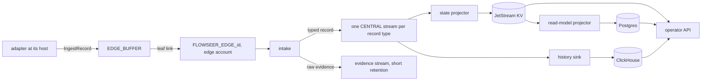
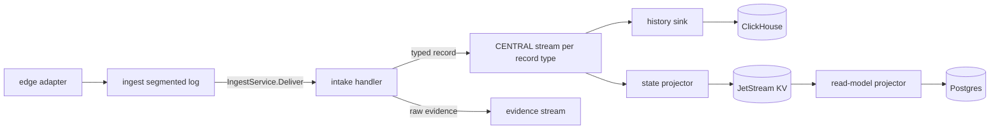

# Central Ingestion Pipeline - Direction

How observation data (syslog, traps, webhooks, poller results) travels from
the adapter that received it to the stores an operator queries, and which
store holds what.

## Context

The [device service record](2026-08-20-device-service-and-inventory-direction.md)
makes ingestion a plane of its own and NATS JetStream its carrier. It leaves
three things open that the first ingestion source needs:

- No event envelope exists. [`protobuf.md`](../conventions/protobuf.md) says
  `Provenance` rides one, and the `integration/` schema root holds only a
  README (`spec/proto/flowseer/integration/README.md`).
- Nothing central reads the `ingest` branch an edge buffer reserves. The OTLP
  forwarder is the only consumer of the per-edge hub streams
  (`src/modules/edgebus/forwarder.go`).
- No record names a store for history or for queryable state. All central
  state sits in four JetStream key-value buckets
  (`src/modules/edgebus/subjects.go`), and the
  [production monitoring baseline](../research/2026-10-01-production-monitoring-baseline.md)
  lists metric and event storage as an open risk.

## Decision

### Integrations conform to a schema, and central never reads the kind

An adapter maps what it received into FlowSeer-owned protobuf at its host, on
an edge or in central, before it publishes. The bus carries typed records
only. Central registers one consumer per record type and none per integration
kind, which is rule 10 of the device service record applied to ingestion.

A new kind therefore adds an adapter and, where it reports something new, a
record type. It adds no central code path of its own.

### One envelope carries every ingested record

`flowseer.integration.ingest.v1.IngestRecord` holds a record id, the
`Provenance` of the observation, a typed payload as a `oneof` with one arm
per record type, and optional raw evidence. The record id is also the NATS
message id, so a republish inside the stream's duplicate window is dropped.

Tenancy stays ambient. The envelope names no tenant, and intake takes the
tenant and the edge from the stream a record arrived in, never from its
subject or payload.

### Raw bytes stay at the edge unless asked for or unparsed

An adapter drops the original bytes once it has mapped them. Two cases attach
them to the envelope:

- **Parse failure.** A record the adapter could not parse completely carries
  its raw bytes, up to a bound per source. Past the bound the adapter samples:
  it keeps the raw bytes of one failure in a fixed number and reports how
  many it suppressed since the last one kept.
- **Raw window.** An operator opens a window for one integration, source, or
  device, with an expiry. While it is open the adapter attaches raw bytes to
  every record in scope.

The window is a Connect call to the edge, because the bus carries nothing an
edge must act on (device service record, 2026-09-06 amendment). The edge
enforces the expiry from its own clock, so a lost close cannot leave raw
bytes flowing.

Intake strips raw evidence from the typed streams and writes it to a
short-retention evidence stream, so no long-lived store holds device payload
it was never meant to keep.

### Stages

Intake follows each edge's hub stream with a durable consumer filtered to the
`ingest` branch, as the OTLP forwarder does for `otel`. Edge accounts import
and export nothing (`src/modules/edgebus/README.md`), so a consumer per edge
stream is the only way across, and intake is the one place that turns "this
edge said so" into a tenant-scoped central record. It validates the envelope,
refuses a record whose subject lies outside the edge's subtree, and
republishes into the CENTRAL account.

A centrally hosted adapter publishes its envelopes to intake's input in the
CENTRAL account and passes the same validation.

### Stores

| Data | Store | Reason |
| --- | --- | --- |
| Append-only records and numeric time-series | ClickHouse | One Apache-2.0 store for both, in the five patterns of the [history store record](2026-10-08-history-store-direction.md). The sink inserts synchronously and acknowledges the stream after one replica holds the rows (2026-10-08 amendment). |
| Current state that gates a decision or that a stream processor reads | JetStream KV | Compare-and-set writes, a watch for live copies, and no second connection for a consumer already on the bus. |
| Lists, filters, sorts, and joins for the API | Postgres | A read model a projector derives from the KV buckets. |

The Postgres read model is disposable. A KV bucket is a stream, so the
projector follows it with a durable consumer and a dropped table is rebuilt
by replay. Two rules follow from that. A mutation response returns the record
read from KV, never from Postgres. And nothing reads Postgres to decide
whether a write may proceed.

### One central host, one module per stage

Intake, each sink, and each projector are Service Modules
(`src/common/service`) assembled into the process that runs the hub. Each
takes a JetStream handle and a store client from its host, so moving one into
its own service later changes the host and not the module.

## Alternatives

- **A registry of per-integration processors in central.** Rejected. Central
  would need code for every kind, which breaks rule 10, and a third-party
  kind would need an in-process plugin, which the device service record
  rejects.
- **Raw payloads on the bus with central mappers.** Rejected for the same
  reason, and because every record would cross the WAN link twice its size.
- **Raw bytes carried on every record until intake.** Rejected: the edge
  buffer and the link would carry about double the bytes for a replay window
  that is rarely used.
- **ClickHouse materialized views for latest state.** Rejected. Earlier
  operation of that pattern outside this repository had problems the tree
  does not document, so this record states it as a constraint and not as a
  measured finding.
- **TimescaleDB for history.** Rejected: columnstore, continuous aggregates,
  and retention policies are in the Community Edition under its own licence
  (TSL) and absent from the Apache 2 edition, which fails the open-source
  rule the device service record applied to NATS.
- **VictoriaLogs with VictoriaMetrics.** Rejected: two stores to run, and
  schema-free fields where the records are typed. VictoriaLogs itself
  handles high-cardinality fields. The metric side is the concern: series
  churn from volatile label values is the failure the baseline measured on
  LLDP data in a time-series store.
- **A streaming database for projections.** RisingWave is Apache-2.0 and
  reads JetStream with protobuf encoding. Rejected for now: its documented
  minimum is 2 cores and 8 GiB for a compute node, it would be a third system
  to run, and state that gates a decision needs compare-and-set and not a
  view. Materialize is under a Business Source License and needs a licence
  key.
- **Postgres as the source of truth for state.** Rejected: stream processors
  need latest state on the bus they already hold, and the lane journal's
  one-writer-per-device rule rests on KV compare-and-set.
- **Separate services per plane from the start.** Deferred. It needs a client
  listener on the hub, credentials for each service, and deployment decisions
  [`GOALS.md`](../../GOALS.md) lists as not decided.

## Consequences

- The device service record's Events bullet names
  `events.<tenant>.<integration>.>`. The subjects this record uses are the
  edge subtree's `ingest.<source>` branch and per-record-type subjects in the
  CENTRAL account. The change that lands intake amends that bullet.
- `integration/` gains its first package and starts importing `model/` and
  `event/`, which `test/conformance/proto/layering_test.go` must admit.
- ClickHouse and Postgres clients are new Go modules and enter under the
  [dependency admission record](2026-10-01-dependency-admission-direction.md).
- Postgres becomes a FlowSeer store, where until now it served only the
  authorization engine. It needs table migrations and a tenant column on
  every table.
- A list served from Postgres can lag a write. API responses that follow a
  mutation read KV.
- ClickHouse needs query limits from its first deployment. One wide analytic
  query stalled ingest on the legacy store for about two minutes
  (`docs/runbooks/production-clickhouse-queries.md`).

## Open questions

- Tenant isolation inside Postgres. For ClickHouse the
  [history store record](2026-10-08-history-store-direction.md) decides it
  (2026-10-08 amendment).
- Which ClickHouse settings bound an API query so it cannot stall inserts:
  the history store record names them.
- Retention per record type: the history store record names three classes
  per tenant.
- Whether the device service record's per-tenant NATS account is still the
  target. The code isolates per edge account and names the tenant account as
  absent (`src/modules/edgebus/README.md`).

## Sources

- Repository: `src/modules/edgebus/README.md`, `src/modules/edgebus/forwarder.go`,
  `src/modules/edgebus/subjects.go`, `spec/proto/flowseer/integration/README.md`,
  `spec/proto/flowseer/event/README.md`,
  `spec/proto/flowseer/model/inventory/v1/provenance.proto`,
  `docs/runbooks/production-clickhouse-queries.md`.
- ClickHouse licence: <https://raw.githubusercontent.com/ClickHouse/ClickHouse/master/LICENSE>.
  Asynchronous inserts: <https://clickhouse.com/docs/optimize/asynchronous-inserts>.
- TimescaleDB editions: <https://www.tigerdata.com/docs/about/latest/timescaledb-editions>.
- VictoriaLogs: <https://docs.victoriametrics.com/victorialogs/>.
- RisingWave licence: <https://raw.githubusercontent.com/risingwavelabs/risingwave/main/LICENSE>.
  JetStream source: <https://docs.risingwave.com/integrations/sources/nats-jetstream>.
  Hardware: <https://docs.risingwave.com/deploy/hardware-requirements>.
- Materialize licence: <https://materialize.com/docs/license/>.
- JetStream key-value store: <https://docs.nats.io/nats-concepts/jetstream/key-value-store>.

## Amendments

### 2026-10-03 — payload messages drop their ids, and provenance widens its protocol

A payload message carried inside an `IngestRecord` (beginning with
`SyslogRecord`) holds no id of its own; deduplication and record identity
belong to `IngestRecord.record_id`. `flowseer.model.inventory.v1.Provenance`
widens its protocol field to a required `oneof protocol` with
`ManagementProtocol management = 10` and `LogProtocol log = 11`, so that
observation sources beyond management protocols (such as syslog) can name
their protocol without fabricating a management protocol value.

### 2026-10-03: the edge resolves a syslog sender from its device listing alone

Landed 2026-10-03: `lanehost.DeviceIndex` in `src/edge/agent/internal/lanehost`,
read by `src/edge/agent/internal/syslogsource`.

The edge publishes a datagram as the record of a device when exactly one
device in the listing central sends this edge claims the datagram's source
address. Whether the lane onboarded the device does not matter, since a UDP
source address is spoofable whether or not the lane logged in to the device,
and a gate on onboarding would drop syslog from a listed device whose
management session is down. An address two listed devices claim resolves to
neither and is counted under `ambiguous_source`. A device id listed at two
addresses resolves from both, each with its own row's binding. A device the
next listing omits or moves stops resolving at the old address, and a failed
listing leaves the index as it was.

A consumer of `IngestRecord` may therefore not assume the lane serves the
device a record names. A rule that needs a served device checks it against
the lane, not against the record.

### 2026-10-04: edge records enter central ingestion streams

Landed 2026-10-04: `src/services/device/internal/host/host.go` wires the
intake module, and `src/services/device/internal/intake/intake.go` follows each
attached edge stream.

An edge publishes on `flowseer.<tenant>.edge.<edge-id>.ingest.<source>`.
Intake republishes a typed record to
`flowseer.<tenant>.ingest.<record-type>.<device-id>` in
`FLOWSEER_INGEST_<RECORD_TYPE>`. Raw evidence goes to
`flowseer.<tenant>.evidence.<record-type>.<device-id>` in
`FLOWSEER_INGEST_EVIDENCE`. These shapes are defined in
`src/modules/edgebus/subjects.go`. Delivery is at least once. Each publication
uses `<tenant>.<record_id>` as its message id, and a central stream drops a
repeat of it inside its ten minute duplicate window. Past that window a
repeat is stored again, which happens when a hub restart re-sources an edge
buffer (`src/modules/edgebus/README.md`). Each sink that reads a central
stream therefore deduplicates on tenant and `record_id` itself.

The evidence stream keeps messages for 24 hours and discards its oldest
messages at its byte bound, as configured in `src/modules/edgebus/hub.go`. A
centrally hosted adapter input is not built. The current intake path accepts
records from edge streams only.

The edge follower in `src/modules/edgebus/follower.go` owns how long a
delivery may run. It hands each consumer a lifetime context that ends when the
caller's context ends, on `Close`, and on a failed first discovery pass, each
before it drains its consumers. A failed interval pass ends nothing. Intake
publishes under that lifetime and keeps no cancel of its own, so a caller
never has to tell a failed first pass from a failed interval pass.

Intake refuses a record only for a reason about the record. An edge the hub
has no tenant for, a validator failure that is not a rule violation, and a
failed central publish are retried, since a terminated record is gone and a
retry is bounded by the edge stream's own age and byte limits
(`src/services/device/internal/intake/README.md`).

### 2026-10-12: operator raw windows control raw evidence

Landed 2026-10-12: `src/services/device/internal/rawwindowapi`,
`src/edge/agent/internal/rawwindow`, and the window path in
`src/edge/agent/internal/syslogsource`. The contract is the
[Raw Window Control direction](2026-10-08-raw-window-control-direction.md).

The second case in "Raw bytes stay at the edge unless asked for or unparsed",
the operator window, is now built. An operator opens a window for a device, an
integration, or an ingestion source on one edge. Central keeps the window and
the edge enforces its expiry and byte budget at the point it selects bytes. The
control is a separate edge-opened stream, `RawWindowEdgeService.Subscribe`
with a unary `Report`, not the device dispatch lane, because a listed device
may have no running lane.

`RawEvidence` gains `windows`, the sorted distinct ids of the windows that paid
for the copy, set exactly when the reason is `RAW_REASON_WINDOW`. Window
evidence carries no suppression count, since the parse-failure policy is
consulted only when no window kept the payload. `ListedDevice` gains a
required `integration_id`, so an integration selector matches the integration
of the binding the edge resolved without central reading a kind. The edge
validates a whole listing before it replaces its index. Intake is unchanged: it
already stores raw evidence on the evidence stream and republishes the typed
record without it, so the typed record never carries window refs. No history
store or evidence retrieval API is added.

### 2026-10-08: the history store record decides what this record left open

The [history store record](2026-10-08-history-store-direction.md) takes over
ClickHouse. This amendment changes four statements above.

- The Stores row for append-only records and time-series points to the five
  table patterns of the history record. It no longer relies on
  `wait_for_async_insert=1`. The sink inserts synchronously
  (`async_insert = 0`) and acknowledges the stream after one replica holds the
  rows (history record, "Writes: synchronous, acknowledged after one
  replica").
- The 2026-10-04 sentence that each sink deduplicates on tenant and
  `record_id` gives way to the history record's three layers: shapes a repeat
  does not change, a merge key, and read-time deduplication with
  `LIMIT 1 BY tenant_id, record_id` or `FINAL`.
- Three open questions are answered there: tenant isolation ("Tenants are
  flat, and a lookup names a set of them"), query limits ("Queries cannot
  stall ingestion"), and retention per record type ("Retention: three classes
  per tenant").
- The typed ingest streams no longer keep records for 72 hours. The
  2026-10-14 amendment below replaces that bullet. The evidence stream keeps
  its 24 hours.

### 2026-10-14: a full typed stream refuses, and cleanup removes only what every member resolved

Landed 2026-10-14: `src/modules/edgebus/cleanup.go`,
`src/services/device/internal/intake/intake.go`, and
`src/services/device/internal/historysink/cleanup.go`. The research behind it
is [research 15](../research/clickhouse-history-store/15-bounded-backpressure.md).

This amendment replaces the 2026-10-08 bullet on 72-hour retention.

- Accepted work starts when a typed stream stored the record. From then on the
  record stays stored until every member consumer of that stream resolved it,
  however long ClickHouse is down. Resolving means acknowledging or
  terminating.
- A typed stream keeps limits retention with discard-new, its byte bound, and
  no maximum age. At the bound the server refuses a publication, and
  `edgebus.IsStreamFull` recognizes the refusal. Intake publishes the typed
  record before the evidence, closes a per-record-type gate for one retry
  delay after a refusal, and naks each delivery inside that window. The record
  waits in the edge buffer and the per-edge hub stream, which stay rolling.
- The members of a typed stream are the durable consumers
  `edgebus.IngestConsumers` names. For syslog that is `history_sink`, which
  the hub creates with the stream. `edgebus.CleanIngest` purges below the
  lowest member floor, and only when the consumers on the stream are exactly
  the members with their configured shape. A central host without a `history`
  section still has the member, so its syslog stream fills to the bound and
  intake refuses new records.
- No instrument counts removed records, since the server removes none. The
  sink reports pending records, stream usage, the byte limit, and the age of
  the oldest stored record.
- The edge buffer, the per-edge hub stream, and the evidence stream keep
  removing their oldest messages at their bounds. This record does not claim
  that the pipeline loses nothing. Moving that loss to the edge needs a
  per-edge stream split, which no probe has covered.

### 2026-10-15: records also enter through a delivery call

Landed 2026-10-15: `src/services/device/internal/intake/handler.go`,
`src/services/device/internal/otlpapi/handler.go`, and
`spec/proto/flowseer/edge/ingest/v1/ingest_service.proto`.

Records now also enter through `IngestService.Deliver`, beside the per-edge
stream. The call shares intake's preparation (`prepareRecord`) and message
id, so a record is refused, split into typed and evidence publications, and
deduplicated the same way on either path. The two paths differ in where they
read identity. The stream path reads the edge and tenant from the stream a
record arrived in. The call reads the edge from the assertion and the tenant
from the edge store, and refuses a record whose provenance names another
edge.

The response's `settled` counts the leading records central stored, already
held, or refused for a reason about the record. A full typed stream, a publish
failure, or a marshal failure ends the count, so the record waits in the
edge's log. The call does not share the stream consumer's full-stream gate,
which lives in the `Intake` the intake module owns. The edge's backoff spaces
the retry.

### 2026-10-16: intake is the ingest delivery handler

Landed 2026-10-16: `Handler.Deliver` in
`src/services/device/internal/intake/handler.go`, with record preparation in
`src/services/device/internal/intake/prepare.go`. The host mounts the handler
on its edge listener in `src/services/device/internal/host/serve.go`.

This amendment replaces the Context: the envelope now exists in
`spec/proto/flowseer/integration/ingest/v1/ingest_record.proto`, central
accepts records through `IngestService.Deliver`, and the Stores decisions
and their amendments govern history and current state. The former OTLP
forwarder is gone. Its Sources entry, `src/modules/edgebus/forwarder.go`,
is replaced by `src/services/device/internal/otlpapi/handler.go` and
`src/modules/edgebus/collector.go` (`Collector.Post`).

The tenant-from-stream sentence under "One envelope carries every ingested
record", the Stages diagram, and both intake paragraphs below it are
replaced. Intake is the handler of the ingest call. It takes the edge from
the verified assertion and the tenant from `busResources.edgeTenant` in
`src/services/device/internal/host/host.go`. It validates the envelope and
refuses provenance that names another edge. No per-edge account, stream,
or subject supplies identity. The open question about per-tenant versus
per-edge NATS accounts is closed: CENTRAL is the only data account.

The 2026-10-04 amendment's opening wiring paragraph, edge publication
subject, edge-stream-only input, follower lifetime paragraphs, and retry
bound from edge stream limits are replaced by this call path. Typed and
evidence publications retain their central subjects and
`<tenant>.<record_id>` message id (`prepareRecord`). A replay can repeat
past the central stream's duplicate window, so the history store's
read-time deduplication remains required. A centrally hosted adapter input
is still not built. `GOALS.md` leaves adapter host delivery and tenant
resolution undecided.

The 2026-10-14 amendment's full-stream gate, naks, and rolling per-edge hub
stream sentences are replaced. A full typed stream ends the call's settled
prefix. The record waits in the edge's ingest log and the drain's backoff
spaces retries. Typed stream membership and cleanup are unchanged. The
edge log discards its oldest segments at its byte or age bound, and the
evidence stream still discards its oldest records at its bounds. No
per-edge stream split remains to be built.

The 2026-10-15 amendment's parallel stream and call paths and comparison of
their identity sources are replaced: only the call remains. `settled`
counts the leading records stored, already held, or refused for a reason
about the record. A full stream, publish failure, marshal failure, or
validator infrastructure failure leaves the current record unsettled and
ends the count. The edge retries from that record. Typed publication comes
before evidence, so a full typed stream stores no new evidence.

"One central host, one module per stage" no longer describes intake as a
background Service Module. It is constructed with a central publisher as
part of mounting Connect services. Sinks and projectors remain host modules.
The Consequences bullet's edge `ingest.<source>` branch is replaced by the
`Deliver` path and CENTRAL subjects above.
