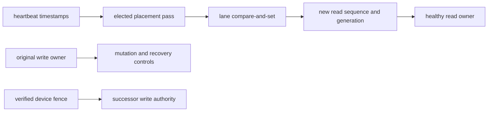

# Edge High Availability - Direction

## Context

`RegistryIntegration.edge` in
`spec/proto/flowseer/store/device/v1/registry.proto` binds the local-network
integration to one Edge. `registry.Registry.Devices` and `Hosts` use that
one Edge for device dispatch and report authorization. The read and mutation
paths share `DeviceLaneRecord`, and `dispatchapi.Report` checks membership
before applying journal writes.

Moving that membership to another Edge would move mutation work too.
Decision 8 of the [verified access direction](2026-09-05-verified-device-access-direction.md)
requires a positive device, network, session, or host fence before a
successor writes. Heartbeat silence establishes no such fence.

`GOALS.md` requires a Site-owned Edge and supports enrolled adapter hosts
without a Site. This record covers local-network Edge groups only. Site is
not yet a schema entity. The [inventory direction](2026-08-20-device-service-and-inventory-direction.md)
and `IntegrationConfig` currently describe one Edge hosting an integration.
Those accepted records are amended with the corresponding implementation.

## Decision

### Site and group identity

Add `Site` and `SiteEvent` in a leaf `model/site/v1` package, with typed
`SiteLocalRef`/`SiteGlobalRef`. Site is pure intent. Its file-level doc comment
declares `SiteConfig` and `SiteState` deliberately absent, following the
[triad convention](../conventions/protobuf.md#the-triad). SiteEvent carries
Site before and after a change. Add an EdgeGroup family in `model/edge/v1`,
with typed refs and Config/State/Event messages because its healthy member
count is observed state.

Each Edge and group names a Site, and group membership must remain within
one Site and tenant. The separate Site package avoids a generated Go import
cycle: Integration already imports Edge, so Edge cannot import Integration's
package to obtain Site.

A local-network integration names a group with one to 64 distinct enrolled
Edges. Every Edge retains its own enrollment and producer identity. Static
registry configuration supplies the initial Site and group definitions.
General Site administration and inventory persistence are separate work.

### Read placement is separate from write ownership

A device lane stores its read owner, enrollment, and placement generation
beside its write owner and enrollment. Initial assignment spreads devices
across active members. Central moves reads when their owner becomes stale,
using the existing configurable contact threshold. Existing healthy
assignments stay in place when a member joins or returns.

A read move cannot move a mutation, reset its confirmations, release its
barrier, or grant its submission credential. Dispatch, credential requests,
onboard reports, and results carry the generation needed for read
assignment. Journal updates validate it atomically with the state change.
An A to B to A cycle cannot accept a report from A's first assignment.

Enrollment identity participates in ownership. A re-enrolled Edge does not
inherit an earlier enrollment's write authority. The consumed setup key is
the existing enrollment identity in `host.edgeEnrollment`. The
[raw-window counter lesson](../solutions/architecture-patterns/a-counter-fence-kept-per-edge-id-must-reset-when-the-edge-re-enrolls.md)
explains why Edge ID or a local boot counter alone is insufficient.

Central HA lands before placement implementation. Its elected background
work and cross-replica dispatch must serve the placement controller and the
Edge stream even when they run on different replicas.

### FlowSeer manages per-node device accounts

FlowSeer provisions each node's device accounts through typed mutations.
The original write owner uses an administrative bootstrap credential for
creation and verifies the resulting access before publishing the account
as usable. The secret provider owns credential material, while config and
audit data carry handles.

Account creation, rotation, disable, and re-enable need explicit observed
state and recovery outcomes. A lost creation response requires reconciliation
before retry. An account change must preserve an administrative recovery
path and any credential required by an unresolved mutation.

The first read-failover stage may use existing read credentials and original
writer credentials. Managed node accounts replace them in the account phase.
This transitional scope does not claim device isolation between readers.

### Writes move only after a verified account fence

Each node eventually has its own device accounts. The successor disables
the predecessor's accounts, terminates their sessions, and verifies both
through a device-family procedure. Central changes write ownership only
once it has durable evidence for the correct device, predecessor enrollment,
account versions, and ownership generation.

No supported device procedure has been established. Account disable,
session termination, delayed device effects, and recovery privileges all
remain unverified until sourced and observed on the selected family.
Unsupported devices keep writes unavailable after owner loss. A partial or
unknown fence result has the same outcome.

A positive fence does not erase a mutation already submitted to the device.
The existing horizon and reconciliation rules still resolve it before new
writes. A returning node does not re-enable accounts through onboarding.
Re-enable is a separate typed operation that cannot undo a newer fence.

### Inbound accepts the virtual address and individual node addresses

The group uses a virtual address managed outside FlowSeer, with CARP as the
chosen deployment mechanism. Devices may also target individual members
directly. For example, a sender can configure node A as its primary syslog
destination and B and C as fallbacks. B accepts traffic on its own address
without holding the virtual address or the device's read assignment.

FlowSeer reports local address presence and never uses it or the sender's
destination choice to grant outbound ownership. Each node records itself
as the receiving Edge in provenance and delivers its own buffered
observations. Support for a specific sender's fallback behavior requires
source evidence and a sender test.

A device may send the same event to every configured node. Cross-node
deduplication applies to device-originated events generally, including syslog
and SNMP traps. Central combines copies of one source event into one
operator-visible event while preserving the receiving Edges as evidence.
Different devices, tenants, event types, and distinct occurrences remain
separate, even when their payloads match. Every supported event producer
must supply the source-event and receipt identities this contract requires.

Existing syslog receipt identity does not provide this: `syslogsource/source.go`
assigns a new UUID at each receiver, and `intake.prepare` constructs its
publication identity from tenant and receipt UUID. Cross-node event identity
needs a protocol-specific contract, with a policy for indistinguishable
occurrences, a bounded replay horizon, and durable coordination across
central replicas. Payload equality alone is not proof of one event.
Deduplication must preserve separately requested raw evidence and validate
each receipt before combining its provenance. It must also preserve any
protocol-required response for each receipt, independently of logical-event
deduplication. Trap ingestion needs its own schema and producer: the current
`IngestRecord` payload in
`spec/proto/flowseer/integration/ingest/v1/ingest_record.proto` contains only
syslog.

Shared TLS receiver credentials and SNMP inform identity require a separate
receiver contract. A shared engine ID alone does not establish correct
boots/time behavior. Cold startup leaves a secure listener unready until
central supplies its identity. Real sender tests must establish receiver
failover before it is claimed.

Linux and FreeBSD remain deployment targets. The existing FreeBSD packet I/O
work supplies the build and platform gate. The agent builds for FreeBSD,
since the flock store lock in `src/common/service/storelock_posix.go` covers
it, and `test/conformance/crossbuild` keeps that true. HA adds validation of
the combined receiver, placement, and restart behavior rather than
duplicating that work. No FreeBSD runtime or device protocol guarantee is
asserted here.

## Alternatives

- Moving one common owner for reads and writes would send mutations to a
  successor without the required device fence.
- Lease expiry or generation checks alone cannot stop a device command
  already held by a paused predecessor.
- Operator-managed node accounts would leave their lifecycle outside the
  requested typed configuration management.
- Sharing one Edge identity across nodes would remove enrollment isolation
  and make the report source ambiguous.
- Choosing the virtual address holder as lane owner would couple outbound
  capacity to the inbound address mechanism.

## Consequences

The registry, Integration schema, Edge onboarding, dispatch, and credential
checks change together. These are breaking contract changes before the
first stable release, with no compatibility shim.

Read availability improves before automatic write failover exists. Operators
must see read ownership and unavailable write ownership separately. Existing
credentials cannot be recalled by changing a placement record.

Site and group schema decisions require acceptance before implementation.
Vendor account and fence support, and receiver protocol behavior, require
source research and independent observations. Live-device writes retain
their separate blast-radius approval requirement.

## Open questions

- First supported device family, account protocols, capacity, bootstrap
  credential ownership, and secret-publication crash recovery.
- Device-native account disable and session termination evidence, including
  commands already accepted by the device and late re-enable operations.
- Cross-node source-event identity for each notification protocol, ambiguous
  occurrences, replay horizons, receipt provenance, trap ingestion, and
  storage semantics under concurrent replay.
- Receiver engine boots/time, secret rotation, individual endpoint security
  identity, and sender interoperability, including ordered syslog fallback.
- Exact central HA election and watch interfaces after that work lands.
