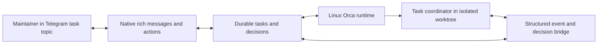

# Remote agent harness

Withdrawn 2026-10-17. The maintainer dropped the harness after trying it
on the deployment host: decisions as Telegram cards were awkward to use,
and updates took far too long to arrive. Its first phase, the store,
bridge, and Telegram client under `tools/scripts/harness/` (merged in
`6036539e`), was removed the same day. The record stays as the account of what was tried. No
plan builds on it.

Development must continue on a dedicated Linux server while the maintainer
is away from a desktop. Telegram's native AI interface provides task topics,
streamed updates, rich status cards, and decision buttons.
Orca owns the server's worktrees and agent terminals. The custom harness
owns durable tasks, decision delivery, and recovery.

## Context

`tools/scripts/skills/delegate/orca_worker.py` starts agents, retains lane
metadata, and sends instructions through terminal input. It does not carry
structured questions and answers. `tools/scripts/skills/plan/record.py`
already owns workflow checkpoints. The harness must use those checkpoints
without treating a quiet terminal as evidence of completed work.

Orca documents a headless runtime and Linux service management in its
[CLI reference](https://www.onorca.dev/docs/cli/reference#runtime-commands).
Telegram documents polling and callback buttons in its
[Bot API](https://core.telegram.org/bots/api). Its
[AI Agents guide](https://core.telegram.org/bots/features#ai-agents)
describes private topics, streaming, and rich messages.
These are interface evidence,
not proof that the intended server has the required versions or credentials.

## Decision

Build a host-side Python command group under `tools/scripts/harness/`,
following `docs/code-style-python.md`. Keep its durable database, secrets,
and task artifacts outside the checkout. Use the standard library and the
existing script launcher. This keeps tooling separate from FlowSeer's
runtime services. Use outbound Bot API long polling. Native message
features supply the interface without hosting a browser frontend.

Each task coordinator follows the existing project skills. Delegated
workers continue to return blockers to their coordinator. The coordinator
uses the bridge for decisions that belong to the maintainer. A decision
has an immutable identity, task revision, and relevant commit and diff
digest. A reply to an obsolete decision cannot authorize a later change.

Use one private-chat topic per task and an overview card for task selection.
Rich messages contain status tables, expandable explanations, verification
results, and explicit commit and land controls. Decision cards show
alternatives and tradeoffs, with a custom-answer button that requests a
reply. Starting and steering tasks use natural-language messages scoped to
their topic. Routine operations need no slash commands.

Do not display or attach diffs. Approval cards state the result, scope,
verification outcome, remaining risks, and proposed operation. Internally,
approval still binds the exact repository state. Automated code review
continues to inspect changes under the existing project workflow.

Bot actions accept only a configured numeric user ID in a configured private
chat. Persist task-to-topic, message-to-decision, and draft-to-task mappings.
Check those mappings on every reply, callback, and generation-stop update.
Task IDs and topic IDs grant no authority on their own.
Chat messages are instructions, never shell fragments. Commit and
land actions require explicit decisions describing the exact proposed
operation. Existing review, compound, and verifier checkpoints still apply.
The first version lands on the server's local `main`. It does not fetch,
push, or synchronize another checkout.

Persist incoming updates before advancing Telegram's polling offset.
Persist outgoing notifications separately so a transport retry does not
repeat a task operation. Recover ambiguous launches and input deliveries
by reconciliation, never by silently creating another worker. A bot restart
must preserve unanswered decisions and existing worker identities.

## Alternatives and consequences

A Mini App would require a hosted frontend and web authentication.
Native AI features cover the required task conversations and rich controls.
Provider remote-control products would couple control to that provider.
Keeping Orca as the execution layer preserves the repository's worker model.

Enable private-chat topics through BotFather and verify that setting with
`getMe`. Check rich messages and streaming on the intended Telegram client.
A streamed draft is temporary. Send a final persistent message and map
its native Stop control to an acknowledged task cancellation request.
The [Bot API](https://core.telegram.org/bots/api#sendrichmessagedraft)
documents draft lifetime and stop updates. Stopping a draft alone does not
prove that the agent has stopped.

The bot needs Telegram access, a provisioned server repository, and agent
credentials. Those credentials remain on the execution host. Messages and
review excerpts sent through Telegram leave that host. Full terminal logs
and secret-bearing output are not forwarded automatically.

Worktrees isolate Git changes. They do not sandbox agent processes. The
first version trusts the configured host account and its agents. Preventing
a hostile process under that account from reading bot credentials requires
an additional operating-system boundary and is outside this direction.
