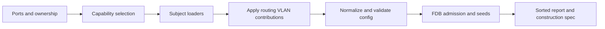

# Network model boundary - Plan

## Goal

`netmodel.Load` takes one input value, coordinates loaders by subject, and
reports a translation it cannot execute without silently widening a rule.
Stop condition: redraw a loader that needs another loader's raw messages or
writes its configuration before code moves. Readiness stays `needs-decisions`.

Source abbreviations: `N` is `src/common/sim/netmodel/`, `L` is `src/common/sim/layer/`. Schema paths start at `spec/proto/flowseer/net/`.

## Decisions

- The parent's Decisions apply. One dependency cluster stays whole under
  `.claude/skills/plan/references/phases.md`: loaders share ports, evidence
  and the construction specification.
- `Load(now, source, Input)` replaces the twelve data/request arguments in
  `src/common/sim/netmodel/netmodel.go:179`. `Input` has `Interfaces`, `VLANs`,
  `FDB`, `Budgets`, `BridgeState`, `STPPorts`, `LACPAggregators`, `LACPPorts`,
  `Addresses`, `Neighbors`, `FilterSets`, and `Want`, with the current argument
  types. Why: `N/trust_test.go:37` already bundles exactly those values. No compatibility overload remains, per the parent.
- Unsupported or malformed match terms omit the whole set and its bindings,
  with an issue naming the set, rule, field, and reason. Why: empty lists mean
  any (`L/filter/config.go:87`), and `N/netmodel.go:1921` already states the
  set-level omission rule. Scalar actions obey the schema's required,
  non-UNSPECIFIED contract (`spec/proto/flowseer/net/filter/v1/filter.proto:100`).
- The six exports `NetworkInstances`, `Vlans`, `FdbEntries`, `Poe`, `Stp`, and
  `Lacp` are removed. Why: the caller audit finds only tests. `InterfaceCounters`
  stays at the protobuf boundary and consumes `device.PortCounters`
  (`N/counters.go:19`), as the package-shape direction requires.
- Preserve `Result.Metadata`, `Spec.Metadata`, and the detailed `Report`.
  Why: `N/report.go:113` and `N/README.md`, Construction trust
  boundary, distinguish loading diagnostics from executable trust. Removing
  a caller-visible representation has no deciding source in this scope.
- Preserve the malformed-MAC fallback and both its skip and assumption.
  Why: `N/netmodel.go:1781` records the rejected observation and the replacement
  independently. `docs/architecture/2026-09-10-virtual-device-direction.md:339`
  requires defaults to be assumptions.
- No accepted direction is amended by the settled units. They preserve the
  protobuf boundary in `docs/architecture/2026-10-01-simulation-package-shape-direction.md` and
  the error/result split in `docs/architecture/2026-09-10-virtual-device-direction.md:324`.

## Requirements

R1. Source/input moves preserve results, evidence and construction errors.
Example: `topology-shadowing/partial-model-unknown-port` keeps localized
unknown-port trust (`src/common/sim/internal/simtest/cases.go:431`).

R2. Each production file is at most 1,200 lines and each function at most
150, as the parent's R9 requires. `Load` coordinates preparation, loading,
composition, normalization, and finalization. Example: a source-size test
fails if the routing walk is pasted back into `Load`.

R3. A filter term either translates with its full predicate or omits the
whole set with evidenced non-Complete diagnostics. Example: a destination
range 100..99 leaves no executable set or binding. A valid sibling set
remains present. Use direct protobuf builders and call `Load` without fixture
validation for malformed cases, as `trust_test.go:866` already does.

R4. Every requested supported layer removed during construction has an issue
and no surviving `CapabilitySources` entry. Example: explicit `filter` with
no routed interface is omitted with a missing-prerequisite issue. The
existing supported request list is `N/netmodel.go:385`.

R5. Parser failures retain field and reason. Absent prefix length differs
from present zero (`addr/v1/ip.proto:94`). An inverted range differs from an
absent endpoint (`packet/v1/transport_port.proto:12`).

R6. Remove the six exporters and their sole dependencies. Audit fails if
`netmodel.Stp` remains. Mixed-test loader coverage survives as direct inputs.

R7. The ICX fixture has forwarding assertions. Example: an unknown unicast
arriving untagged on `1/1/1` exits `1/1/2` untagged in VLAN 4000. Both ports'
facets carry that membership (`N/testdata_icx7150_test.go:42`).

## Out of scope

- Schema changes, policy surfaces, new collectors, and new runtime layers.
- A multicast settings facet, loop-protection settings, mirror configuration,
  and a mapping from QoS queues to PCP. Existing rows do not supply these
  contracts. The schema audit below records the actual gaps.
- The mode and fidelity choices under Open questions. They have no settled
  units. Implementation must not infer an answer from this unit graph.
- `Load` reads messages from FlowSeer's own collectors, trusted for shape and
  untrusted for completeness, as the parent states. Tests also construct
  malformed messages directly because `N/netmodel.go:171` promises no prior
  protovalidate requirement. Diagnostics such as observed counters and STP
  root state are not restored as runtime state by this plan.

## Units

Unit verifiers pass every Files path to `verify change --`, including new paths.

### U1. Extract the loader without changing behavior
Files: src/common/sim/netmodel/netmodel.go, src/common/sim/netmodel/load_context.go, src/common/sim/netmodel/load_ports.go, src/common/sim/netmodel/load_capabilities.go, src/common/sim/netmodel/load_phy.go, src/common/sim/netmodel/load_bridge.go, src/common/sim/netmodel/load_stp.go, src/common/sim/netmodel/load_lag.go, src/common/sim/netmodel/load_routing.go, src/common/sim/netmodel/load_filter.go, src/common/sim/netmodel/load_fdb.go, src/common/sim/netmodel/load_finish.go, src/common/sim/netmodel/facts.go, src/common/sim/netmodel/parse.go, src/common/sim/netmodel/loader_layout_test.go, src/common/sim/netmodel/export.go
After: none
Change: preserve the positional API and every branch while extracting the
checked decomposition. Helpers subdivide each walk to the parent's size
limit. Extract Stp/Lacp exporter helpers without behavior changes as well,
since their 156/170-line functions exceed 150 before U4 removes them.
Issue constants live with their loader, shared address codes with the
parsers. The coordinator applies routing VLAN contributions to the bridge.
Source: the read/write table below and `N/netmodel.go:1677`.
Tests: existing netmodel and simtest suites compare unchanged output. A
package-local AST test reads production files directly and checks 1,200/150
limits and `Load`'s coordinator calls. No test/golden/corpus value changes.
Verify: `uv run tools/scripts/run.py verify change -- src/common/sim/netmodel`

### U2. Move tests and share fixture construction
Files: src/common/sim/netmodel/netmodel_test.go, src/common/sim/netmodel/trust_test.go, src/common/sim/netmodel/routing_test.go, src/common/sim/netmodel/stp_test.go, src/common/sim/netmodel/lacp_test.go, src/common/sim/netmodel/export_test.go, src/common/sim/netmodel/helpers_test.go, src/common/sim/netmodel/load_ports_test.go, src/common/sim/netmodel/load_phy_test.go, src/common/sim/netmodel/load_bridge_test.go, src/common/sim/netmodel/load_lag_test.go, src/common/sim/netmodel/load_stp_test.go, src/common/sim/netmodel/load_routing_test.go, src/common/sim/netmodel/load_filter_test.go, src/common/sim/netmodel/load_fdb_test.go, src/common/sim/netmodel/load_capabilities_test.go, src/common/sim/netmodel/load_conflicts_test.go
After: none
Change: move assertions unchanged by subject. Shared builders and `loadInput`
live in `helpers_test.go`. Pure exporter tests live in `export_test.go`.
Source: inline repeated builders in `N/netmodel_test.go:40`, address helpers in
`N/routing_test.go:39`, and `loadInput` in `N/trust_test.go:37`.
Tests: preserve every test name and fixture value. Mixed export/load tests
stay with their loader until the exporter-removal unit splits them. The
existing report, forwarding metadata, acceptance, link-local, and corpus
files retain their scopes. No corpus expectations change.
Verify: `uv run tools/scripts/run.py verify change -- src/common/sim/netmodel`

### U3. Bundle input and migrate every caller
Files: src/common/sim/netmodel/netmodel.go, src/common/sim/netmodel/input.go, src/common/sim/netmodel/helpers_test.go, src/common/sim/netmodel/load_ports_test.go, src/common/sim/netmodel/load_phy_test.go, src/common/sim/netmodel/load_bridge_test.go, src/common/sim/netmodel/load_lag_test.go, src/common/sim/netmodel/load_stp_test.go, src/common/sim/netmodel/load_routing_test.go, src/common/sim/netmodel/load_filter_test.go, src/common/sim/netmodel/load_fdb_test.go, src/common/sim/netmodel/load_capabilities_test.go, src/common/sim/netmodel/load_conflicts_test.go, src/common/sim/netmodel/netmodel_test.go, src/common/sim/netmodel/trust_test.go, src/common/sim/netmodel/routing_test.go, src/common/sim/netmodel/stp_test.go, src/common/sim/netmodel/lacp_test.go, src/common/sim/netmodel/export_test.go, src/common/sim/netmodel/report_test.go, src/common/sim/netmodel/testdata_icx7150_test.go, src/common/sim/netmodel/conformance_test.go, src/common/sim/netmodel/README.md, src/common/sim/internal/simtest/cases.go
After: U1 U2
Change: introduce the decided Input fields and mechanically migrate calls
and README example. Remove the duplicate test-only input wrapper.
Source: caller audit below and `N/trust_test.go:37`.
Tests: all existing assertions and corpus metadata stay unchanged. The
package's external test package constructs `Input` directly. All current
calls are in the listed files or destinations from the test move.
Verify: `uv run tools/scripts/run.py verify change -- src/common/sim/netmodel src/common/sim/internal/simtest/cases.go`

### U4. Remove unused model exporters
Files: src/common/sim/netmodel/export.go, src/common/sim/netmodel/export_test.go, src/common/sim/netmodel/load_bridge_test.go, src/common/sim/netmodel/load_phy_test.go, src/common/sim/netmodel/stp_test.go, src/common/sim/netmodel/lacp_test.go, src/common/sim/netmodel/load_stp_test.go, src/common/sim/netmodel/load_lag_test.go, src/common/sim/netmodel/input.go, src/common/sim/netmodel/README.md
After: U3
Change: delete six functions and exporter-only helpers. Keep
`DefaultNetworkInstance` beside Input because corpus and builders use it.
Remove exporter documentation in the same unit.
Source: caller audit below. FDB VLAN 0 and string PSE keys need no replacement
exporter, since the schema cannot represent them.
Tests: delete `TestExportNamesTheDefaultInstance`, `TestExportWithoutSwitch`,
export-only STP/LACP/PoE cases and exporter halves of mixed cases. Preserve
loader assertions in `TestFdbAndPoeExport`, `TestPoeExportAndLoadRoundTrip`,
`TestStpExportAndLoad_RingConvergence`, and `TestLacp_RoundTrip` by supplying
messages through existing builders, with literal expected values. Audit all
six names after deletion. No corpus output changes.
Verify: `uv run tools/scripts/run.py verify change -- src/common/sim/netmodel`

### U5. Preserve parser failure reasons
Files: src/common/sim/netmodel/parse.go, src/common/sim/netmodel/parse_test.go, src/common/sim/netmodel/load_capabilities.go, src/common/sim/netmodel/load_phy.go, src/common/sim/netmodel/load_stp.go, src/common/sim/netmodel/load_lag.go, src/common/sim/netmodel/load_routing.go, src/common/sim/netmodel/load_filter.go, src/common/sim/netmodel/load_fdb.go, src/common/sim/netmodel/load_routing_test.go
After: U3
Change: the six `parse*` helpers return errors instead of bools. Their callers
record reasons only at existing reporting sites, with existing codes/scopes.
Filter callers that currently ignore failures keep doing so until U6. This preserves
acceptance, including the separate mapped-prefix guard, so it leaves the
tree green before filter rejection changes.
Source: `N/netmodel.go:2307` through `:2472` and the schema sources below.
Tests: package-local protobuf adapters pin the 48 helper cases enumerated
below, with expected success/failure reasons. Add missing/malformed MAC
Load cases in load_routing_test.go, asserting
only malformed MAC has a skip, both have the default assumption, and both
Specs construct. Existing loader/corpus acceptance stays unchanged.
Verify: `uv run tools/scripts/run.py verify change -- src/common/sim/netmodel`

### U6. Reject incomplete filter predicates atomically
Files: src/common/sim/netmodel/load_filter.go, src/common/sim/netmodel/parse.go, src/common/sim/netmodel/load_filter_test.go, src/common/sim/netmodel/filter_matrix_test.go, src/common/sim/netmodel/README.md
After: U4 U5
Change: validate all terms and both action positions before inserting a set.
Prefix lengths and range endpoints require presence before conversion.
Invalid prefixes/ranges/actions omit every same-name executable set and
binding. Diagnostics name every offending field, continuing after the first failure. Omit code-only, multiple-type/code,
empty, oversized or missing-family ICMP, and malformed TCP flag predicates.
A single ICMP type and optional code carries its family as Protocol 1/58
when absent. An explicit incompatible Protocol makes the predicate
unrepresentable and omits the set. Refuse Protocol outside uint8 and omit reserved TCP flag masks 256..2048:
`src/common/net/tcp/tcp.go:92` decodes only the eight low bits. Update README.
Source: `N/netmodel.go:1933`, `:1956`, `:1966`, `:2405`, and the schema checks below.
Tests: direct builders create absent prefix length, bad bytes, noncanonical
prefix, absent range endpoint, inverted/oversized range, and absent/zero/99
actions. Cross each of the 12 FilterMatch fields with alone/valid-sibling-term
and In/Out bindings, pinning 48 generated cases. Seven supported fields use a malformed
representative, five unsupported fields a valid representative. Positive
controls cover all seven supported fields, including both ICMP families.
Add eight malformed
prefix/port variants crossed with Src/Dst and In/Out, pinning 32 cases.
Each checks omitted bad set/binding, named evidenced issue, non-Complete
readiness, retained valid sibling, and constructible Spec. Preserve mapped
and L2 skip tests. Replace TestLoad_FilterICMPMatchNarrowingReportsIssue's
narrowing expectation with whole-set omission. Direct ICMP
builders cover all shapes above, absent/matching/conflicting Protocol;
Receive checks distinguish v4 from v6. TCP builders cover empty, duplicate,
zero, combined, oversized and overlapping flag lists. Pin 16 valid-but-
unsupported reserved-flag cases: four masks x set/clear x In/Out. Pin four
same-name cases: valid/invalid row order x In/Out, requiring name-wide set/
binding omission, retained differently named sibling, constructible Spec.
Pin two multi-offender cases, fields in one rule or separate rules, requiring
both evidenced rule/field/reason diagnostics. Mutations restoring same-name
insertion or stopping diagnostics after one failure must fail. Existing
corpus inputs have none of these terms. Corpus values stay unchanged.
Verify: `uv run tools/scripts/run.py verify change -- src/common/sim/netmodel`

### U7. Report capability removal and share defaults
Files: src/common/sim/netmodel/load_capabilities.go, src/common/sim/netmodel/load_stp.go, src/common/sim/netmodel/load_bridge.go, src/common/sim/netmodel/load_phy.go, src/common/sim/netmodel/load_finish.go, src/common/sim/netmodel/load_capabilities_test.go, src/common/sim/netmodel/load_stp_test.go, src/common/sim/netmodel/load_phy_test.go, src/common/sim/netmodel/README.md
After: U6
Change: final capability reconciliation records explicit requests that lost
their executable config, clears their sources, and avoids duplicating an
existing capability-omission issue. Finalization calls this reconciliation
against `src/common/sim/device/vswitch/config.go:72` Capabilities, which includes LAG ports.
Use `stp.DefaultTxHoldCount` and
`bridge.DefaultAgingTime` for report values and executable defaults.
Reject absent/zero PSE group and present-zero nominal power with evidenced
issues before insertion. Absent power remains unknown. Extend the RSTP
priority guard to 0..240 by 16. Update README's refusal/default limits.
Source: `N/netmodel.go:1911`, `:2080`, `:1353`, and `L/bridge/config.go:13`.
Tests: eight supported layer names crossed with absent/present enabling
input, pinning 16 explicit-request cases. For a removed layer require an
evidenced omission. Include filter-only with no IP facet, empty routing,
and rejected routed claims. Direct PseBudget builders cover absent/zero/
positive group crossed with absent/zero/positive power, pinning 9 cases.
Direct PortState builders cover absent, 0, 16, 240, 1, 15, 241, 255, 256;
require invalid-port omission and preserved valid sibling. Existing tx-hold
cases assert the layer constant. No corpus expectations change.
Verify: `uv run tools/scripts/run.py verify change -- src/common/sim/netmodel`

### U8. Pin fixture forwarding and document the boundary
Files: src/common/sim/netmodel/testdata_icx7150_test.go, src/common/sim/netmodel/README.md
After: U7
Change: the fixture test builds `vswitch.NewWithSpec` and checks observable
VLAN forwarding. README describes Input, the extraction, atomic filter
omissions, retained report/metadata responsibilities, and explicit Limits.
Source: fixture memberships at `N/testdata_icx7150_test.go:42` and the schema audit.
Tests: receive untagged from `1/1/1`, require untagged egress `1/1/2`, then
reverse the learned destination and require only `1/1/1`. No device capture
claim or assertion that an observed STP root was restored. Preserve existing
33-port, PoE-budget, and capability assertions. No corpus values change.
Verify: `uv run tools/scripts/run.py verify change -- src/common/sim/netmodel`

Waves: U1 U2 | U3 | U4 U5 | U6 | U7 | U8

## Verification

- `go test -race ./src/common/sim/netmodel ./src/common/sim/internal/simtest`
- `go test ./test/conformance/sim/...`
- Run the diff-aware verifier with every unit's actual changed paths.
- Planning checks: `verify check-plan-state` and `verify change --` on this plan/state.

## Definition of done

- Open questions answered with deciding sources or explicit choices, and
  readiness recorded implementation-ready before code work starts.
- Moves/API migration preserve expectations. Behavior fixes fail before the
  fix and under mutation. Removing an axis fails literal count guards.
- Every changed path passes the verifier. README matches the API.
- Record the outcome with `plan record implemented <plan> --units <n> --from <t> --to <t>`
  and this plan path. No plan labels enter code, comments, or commit messages.

## Inventory and evidence

Source paths below are on the current tree, at `ef213026`. Original numbers preserve the inventory's
identity. A strike marks a closure, not a new implementation claim.

### Entry and stop-condition check

The phase 9 last commit `82fdcc23` and phase 10 last commit `a7ba4976` are
ancestors of HEAD. `main` keeps this phase planned with `landed: null` and
has no phase 11 retirement entry. Both re-plan entry checks pass.

The original raw per-layer boundary fails the stop condition. Routing reads
and writes bridge configuration at `N/netmodel.go:1677`. STP reads interface
IP facets and routed sub-parent claims at `:1370`. The redraw makes
preparation and composition coordinator responsibilities, then passes
normalized shared facts to loaders. No loader reaches into another loader's
raw message slices or writes another loader's result. Shared facts retain
observed IP presence separately from accepted sub-parent claims. Current
bridge/STP exclusion uses raw presence, even for a later rejected claim.
U1 preserves that distinction and filter's current IP-presence binding test;
it does not change those checks to final routing acceptance.

| Subject and current section | Raw messages read | Shared reads and writes in current Load | Redrawn boundary |
| --- | --- | --- | --- |
| Diagnostics, `N/netmodel.go:214` | SourceContext | catalog, issues, assumptions, report | loadContext owns scope/evidence/report helpers, mutable only during Load |
| Ports, `:195`, `:414` | Interfaces | writes port.Table | loadPorts consumes Interfaces and diagnostics, returns the table |
| Ownership pre-pass, `:524` | Interfaces | reads ports, builds ifaceByName and routedSubParents | coordinator publishes IP-presence flags and accepted sub-parent claims separately |
| Capabilities and unwanted facets, `:563` | interface facets, budget/set presence, bridge-state presence, Want | reads routed ownership, writes report capability set | coordinator prepares facet-presence summary and selects layers, each loader handles its own unwanted rows |
| PHY/PoE, `:819` | Ethernet/copper facets, PseBudget | reads wanted layers/ports, writes cfg.Phy and diagnostics | own messages plus loadContext, returns phy.Config |
| Bridge, `:1017` | VLAN rows, switchport facets | reads wanted routing and ownership, writes cfg.Bridge | shared ownership explains routed exclusions, returns bridge.Config |
| STP, `:1225` | BridgeState, STP PortState | reads ports, ifaceByName IP presence, routed claims, wanted routing, writes cfg.STP | shared ownership replaces raw IP-facet access, returns stp.Config |
| LAG, `:1465` | LAG aggregation facets, LACP rows | reads ports/Members, writes cfg.LAG | own messages plus port facts, returns lag.Config |
| Routing, `:1633` | IP/interface facets, address and neighbor rows | reads ports and claims, writes cfg.Routing and bridge VLAN table | returns routing.Config and VLAN contributions, coordinator applies contributions with the same pre-conflict timing |
| Filter, `:1919` | FilterFacet, FilterRuleSet | reads IP ownership and routing availability, writes cfg.Filter | shared ownership/routing availability plus own messages, returns filter.Config |
| FDB, `:2093` | FdbEntry | reads normalized bridge/ports/routed ownership, writes seeds | coordinator supplies completed admission facts, loadFDB returns bridge.Seed values |
| Finish, `:2175` | no raw messages | sorts diagnostics/seeds, normalizes Spec, returns Result | coordinator finalizer preserves ordering, clone isolation, and error propagation |

The redraw fits the shared-context stop condition. U1 proves both shape and
unchanged behavior before later units change acceptance or reports.

### Correctness

| Entry | Current evidence | Disposition |
| --- | --- | --- |
| 1. Inverted port match becomes any | `N/netmodel.go:1966`, `:2453` ignores parse failure | U6, whole-set omission, direct range builders |
| ~~2. Mapped IPv6 prefix executes as an IPv4 rule~~ | guard `:2395`, `TestLoad_FilterSetWithMappedPrefixIsSkipped` at `N/netmodel_test.go:1682` | Fixed by `67956fe7`, preserve both Src/Dst tests. parseIPPrefix still returns it so the guard can diagnose it |
| 3. Filter capability disappears without an issue | `N/netmodel.go:2075` | U7, explicit filter with no routing, and input sets that cannot execute |
| 4. Invalid prefix becomes any | `N/netmodel.go:1956`, `:2418` ignores parse failure | U6, bad byte width, family, host bits, length, and presence |
| 5. Non-VLAN-aware FDB export errors | `N/export.go:98`, schema `switching/v1/fdb_entry.proto:29`, predefined rule `vlan_id.proto:15` | Schema limit, not a loader defect. U4 removes unused export. Representing FID 0 requires a separate schema plan |
| 6. PoE export requires numeric group | `N/export.go:153`, schema `phy/v1/pse_budget.proto:17` | Schema requires positive uint32, simulator allows string groups (`L/phy/validate.go:88`). U4 removes unused export. No schema change here |
| 7. Malformed interface MAC has skip and default | `N/netmodel.go:1781`, `N/trust_test.go:866` | Intentional dual diagnostics. Keep observation rejection and fallback assumption. U5 tests missing versus malformed MAC and constructibility |
| 8. Unknown action silently becomes Drop | `N/netmodel.go:2405`, filter schema `filter.proto:100` and `:122` | U6, action/default absent, 0, 99 all omit set and report failure |
| 9. NetworkInstances ignores VRFs | `N/export.go:38`, actual VRFs `N/netmodel.go:1906` | U4 deletes unused export, network-instance loading is Q2 |
| ~~10. InterfaceCounters accepts start after now~~ | `N/counters.go:19` takes only counters/start | No now argument exists to compare. The current discontinuity-only signature already predates phase 1 (`ad04fa4b:src/common/sim/netmodel/counters.go`). Phase 10 `8a5a38c8` replaces fabric counters with device.PortCounters, closing the import rationale for moving it |

### Completeness

| Original entry | Current evidence | Disposition |
| --- | --- | --- |
| Multicast, loop protection, traffic rejected | `N/netmodel.go:385`, request tests `N/trust_test.go:319` | Schema gaps below. Preserve Unsupported requests, add Limits in U8 |
| Only RSTP loads although layer has MSTP/PVST | `N/netmodel.go:1279`, `L/stp/config.go:115`, schema `protocol_version.proto:6` | MSTP is Q1. PVST has no version or per-VLAN input shape, so a separate schema plan |
| EtherType/MAC/PCP/DSCP whole-set skip names no term | `N/netmodel.go:1933`, `:2392` | U6 enumerates all five unsupported fields and retains set-level omission |
| Bridge aging always 300 seconds | `N/netmodel.go:1018`, `switching/v1/vlan.proto`, `switchport_facet.proto`, `fdb_entry.proto` | No aging setting exists in these inputs. Keep fallback, U7 uses bridge.DefaultAgingTime, U8 states limit |
| Result/Spec metadata and Report repeat information | `N/netmodel.go:2224`, `N/report.go:57`, `:116` | Preserve distinct report and executable trust responsibilities. Removal is outside the requested behavior |

### Design and tests

| Original entry | Current evidence | Disposition |
| --- | --- | --- |
| Load is one function with closed-over locals | `N/netmodel.go:179` through `:2240`, 2,062 lines including signature | U1, coordinator and subject files, measured size gate |
| Parse helpers lose reason | six helpers `N/netmodel.go:2307` through `:2472` | U5 error reasons, U6 presence/refusal checks |
| Literal tx-hold default 6 | `N/netmodel.go:1353`, constant `L/stp/config.go:40` | U7 uses the layer constant |
| ICX test lacks forwarding | `N/testdata_icx7150_test.go:378` now asserts 33 ports, PoE and capabilities, ends at `:443` | U8 adds Receive assertions. Current file has no build assertion either. Port forwarding is buildable through vswitch.NewWithSpec and untracked STP ports forward (`L/stp/info.go:119`) |
| Repeated fixture helpers | `N/netmodel_test.go:40`, `N/routing_test.go:39`, `N/trust_test.go:37` | U2 moves shared builders, preserves message values |
| Oversized routing/netmodel/trust tests | `N/routing_test.go:2173`, `N/netmodel_test.go:1682`, `N/trust_test.go:1484` remain large | U2 moves tests by loader, retains integration tests by trust/forwarding responsibility |

### Schema and refusal audit

Schema requirements are checked against the executable refusal before they
become units. These are schema/code claims, not unread standards claims.

| Input or facet | Schema and present refusal | Consequence |
| --- | --- | --- |
| FDB VLAN | `switching/v1/fdb_entry.proto:29`, `vlan_id.proto:15` require 1..4094. `N/netmodel.go:2124` checks raw value before seed normalization, `:2242` refuses absent VLAN awareness | Export FID 0 has no schema shape. Existing loader test `N/trust_test.go:593` covers bridge/port admission |
| PSE group | `phy/v1/pse_budget.proto:17` requires group presence and >0, `:26` forbids present-zero nominal power. `N/netmodel.go:891` instead turns absent/zero into string 0, accepted by `L/phy/validate.go:88` | Loader defect in U7, direct PseBudget builders construct both cases. Schema change unnecessary |
| Filter action | `filter/v1/filter.proto:100` and `:122` require present nonzero known enum. `N/netmodel.go:2405` converts all else to Drop before `L/filter/config.go:223` can refuse | U6 must validate the protobuf value before translation |
| IP prefix | `addr/v1/ip.proto:94`, `:126` require address/length and canonical host bits. `N/netmodel.go:2418` checks width/range/host bits but not HasLength. `L/filter/config.go:243` refuses mapped prefixes | U6 tests absence independently of explicit zero. Keep mapped guard |
| Port predicate | `packet/v1/transport_port.proto:12` requires ordered range with both endpoints. `N/netmodel.go:2453` reads absent endpoints as zero and caller ignores failures | U6 checks presence and propagates failure at set granularity |
| ICMP predicate | `packet/v1/icmp.proto`, Icmpv4Match/Icmpv6Match, OR lists and unconstrained empty type list. `L/filter/config.go:53` has one mandatory type and optional code | Multi-valued and code-only ICMP have no faithful single Match. The atomic policy omits those sets. Tests presently asserting first-entry narrowing change in U6 |
| TCP flags | `packet/v1/tcp_flags.proto` validates nonempty, unique, disjoint one-hot lists in 1..2048. `N/netmodel.go:2012` casts and ORs without those checks | U6 refuses malformed flags before conversion, including a flag required both set and clear. Schema-valid reserved masks 256..2048 are also unsupported because src/common/net/tcp/tcp.go:92 decodes only b[13]. U6 omits them with issues rather than assuming reserved bits clear |
| IP protocol | `filter/v1/filter.proto:47` carries an enum, but `N/netmodel.go:1953` narrows it to uint8 | U6 refuses negative/256 rather than wrapping. ICMP family also needs Protocol discrimination because `L/filter/filter.go:604` accepts 1 or 58 for either ICMPMatch |
| STP port priority | schema `protocol/stp/v1/port_state.proto:22` permits <=255. `N/netmodel.go:1377` checks only upper bound. `L/stp/README.md:651` states high-nibble transmission | RSTP permitted values 0..240 by 16 are explicit in vendored `spec/mib/ieee/IEEE8021-SPANNING-TREE-MIB.mib:483`. U7 extends the existing bad-priority omission rule, preserving absence and explicit zero |
| Multicast | `multicast/v1/group_membership.proto:13` carries observed membership, mode, expiry. `L/mcast/config.go:25` needs configured snooped VLANs, router ports and timer policy | No settings facet supplies that complete configuration. Membership alone does not decide enabled snooping. Excluded pending separate schema work |
| Loop protection | Interface/switchport schemas contain no probe/timer/action settings. `L/loopprotect` consumes those in its Config | Excluded pending separate schema work, no inferred settings |
| Traffic | `qos/v1/qos_interface.proto`, `queue.proto`, `classifier.proto`, `policer.proto` contain partial QoS settings. `capture/v1/mirror.proto` describes packet wrappers, not mirror configuration. `L/traffic/config.go` needs mirror selectors/destinations and PCP-keyed queues | No complete mapping, especially queue-to-PCP and mirror selection. Excluded pending a separate contract/schema plan, not a claim that QoS schema is absent |
| MSTP/PVST | MSTP bridge region, instances, ports and maps exist under `protocol/stp/v1/`, but current Load accepts none of the three row slices. ProtocolVersion has no PVST value | Q1 decides MSTP acceptance/completeness. PVST is a schema limit |

### Caller audit

`rg -n 'netmodel\.(NetworkInstances|Vlans|FdbEntries|Poe|Stp|Lacp)' --glob
'*.go' --glob '!**/*_test.go' .` returns no callers. The six definitions are
at `N/export.go:38`, `:54`, `:92`, `:144`, `:228`, and `:399`.

`netmodel.Load` callers are `N/netmodel_test.go`, `trust_test.go`,
`routing_test.go`, `stp_test.go`, `lacp_test.go`, `export_test.go`,
`report_test.go`, `testdata_icx7150_test.go`, `conformance_test.go`, and
`src/common/sim/internal/simtest/cases.go:504`. Tests using the loadInput method migrate
through its shared helper. Import audit finds no alias that bypasses the six-function audit.

### Parser matrix

Each row has eight cases, totaling 48. A package-local adapter can call the
unexported helper. Values come from direct protobuf builders, not validation.
U5 pins current acceptance. Missing prefix length/range endpoints become
failures only in U6 and have separate Load tests.

| Helper | Eight explicit variants |
| --- | --- |
| parseMAC | nil message, missing arm, EUI64 arm, EUI48 length 5, length 7, zero six octets, group six octets, unicast six octets |
| parseEUI48 | nil, lengths 0/5/7, zero six, group six, unicast six, broadcast six |
| parseIP | nil, missing arm, v4 length 3, v6 length 15, valid v4, valid v6, mapped v6, unspecified v4 |
| parsePrefix | nil, invalid supplied address, wrong family, absent length, out-of-range length, host bits, noncontaining prefix, canonical containing prefix |
| parseIPPrefix | nil, missing arm, bad v4 width, bad v6 width, excessive length, host bits, canonical v4, canonical v6 |
| parsePortMatch | nil, missing arm, exact 0/65535/65536, ordered range, inverted range, oversized endpoint |

The filter 32-case matrix uses absent prefix length, bad address width,
excessive prefix length, host bits, absent start, absent end, inverted range,
and oversized endpoint. Each crosses source/destination and In/Out.

### Carried items

`P<n>:<line>` means the retired plan at
`<retire>^:docs/plans/2026-10-01-2200-refactor-sim-package-overhaul-phase<n>-plan.md:<line>`.
Retirement-body references name the commit and count lines from its subject.
Every retired plan, including phase 13, was checked. Only phases 3, 4, 6 and
10 assign loader work here. Phase 9's retirement body adds no loader carry.

| Item | Source | Disposition |
| --- | --- | --- |
| MSTP/PVST intake | P3:305, :1551, retirement e152c4ed | Q1 for existing MSTP rows. PVST lacks schema shape, separate schema plan |
| Port priority not a multiple of 16 | P3:65, retirement e152c4ed | U7 extends existing guard. Vendored MIB :493 decides 0..240 by 16 |
| LacpStatus for PortDisabled | P4:577, retirement 6c4f1915, N/export.go:529 | U4 removes unused Lacp, so no enum addition is needed |
| Mapped/unmasked filter prefix refusal | P6:296, retirement 830736a9 | Mapped defect fixed by 67956fe7. Ordinary malformed/unmasked prefixes still need U6 |
| netmodel loaders | P10:314, retirement ef213026 | U1 coordinator split and U3 Input |
| PVID with several untagged VLANs | P7:306, retirement 06c14cac, N/netmodel.go:1153 | Preserve explicit PVID or single-membership inference. No new inference |
| Seed membership refusal | P7:317, retirement 06c14cac, N/netmodel.go:2242 | Preserve normalized admission/reason ordering in U1 |
| Switch mirror refusal, untracked-port BPDU trace, layers field, badBPDU walk, prose | P9:1172, retirement 26705dbe | Outside netmodel, not assigned here. Remain separate runtime/prose follow-ups |
| Discarded LinkChange/setOperStatus errors | P9:1172, P10:439, retirements 26705dbe/ef213026 | Already returned in src/common/sim/fabric/fabric.go:117 and src/common/sim/device/vswitch/link.go:128 |
| State.Diff top-level rows | ef213026 body :15 | Outside loader, device state comparison |
| Past-dated queue head priority | ef213026 body :16 | Outside loader, fabric queue execution |
| Queue owner subject | ef213026 body :17 | Outside loader, traffic execution |
| Protocol LAG emission with no member | ef213026 body :18 | Outside loader, switch timers |
| Construction journey settlement | ef213026 body :19 | Outside loader, fabric execution |
| Missing validateReceiveResult | ef213026 body :20 | Outside loader, corpus executor validation. U8's fixture does not fix it |
| Held result assertion position | ef213026 body :21 | Outside loader, fabric routing tests |
| Mirror SelectVLANs row | ef213026 body :22 | Outside loader, switch mirror tests |
| Unreachable journey comparisons | ef213026 body :23, P8:394, retirement 14e4a39b | Outside loader, fabric comparisons |
| Hand-built DefaultQueue/nil receiver/guards | ef213026 body :24 | Outside loader, fabric construction supports |
| isJourneyHeld and test exports | ef213026 body :25 | Outside loader, fabric helpers, separate from six netmodel exports |
| Scenario/concurrency/settled-journey comments | ef213026 body :26 | Outside loader, fabric documentation |
| Allocation figure provenance | ef213026 body :27 | Outside loader, fabric README |
| Failed Replace cleanup | ef213026 body :28 | Outside loader, fabric topology mutation |
| Node.Snapshot switch classification | ef213026 body :29 | Outside loader, fabric attachment |
| Fourth origin kind/Emissions indexing | ef213026 body :30 | Outside loader, fabric injection |
| Unvalidated Action.Diff/Encode errors/alignment | ef213026 body :31 | Outside loader, scenario comparison |
| Frame sharing API documentation | ef213026 body :32 | Outside loader, fabric API documentation |

Phases 1/2/5/13 carry no loader item. Phase 7's two adjacent limits are
preserved above. Phase 8's runtime comparison carry is included above.
Retirements are d7ac43ad, a51692c5, 492f3488, cf429b87 respectively.
The package README has no Limits heading on this tree. U8 adds one without
inventing settings from observed multicast or partial QoS rows.

## Open questions

Q1. Does this phase load MSTP now or keep RSTP-only intake?
The carried text leaves that choice to the parent's network-model unit
(P3:1551). Current `N/netmodel.go:1279` skips non-RSTP. Existing MSTP rows
are documented at `protocol/stp/v1/README.md:38`, but the Load signature has
no instance/port/map collections. Sources decide available shape, not scope.

- Keep RSTP-only intake and document unsupported MSTP (recommended, bounded
  to this graph). Existing acceptance/reporting remains. MSTP loading gets a
  separate plan. PVST requires a separate schema plan in either option.
- Add MSTP intake here. Expand Input with MstInstance/MstPort/MstVlanMap,
  map region/max-hops, retain PriorityPresent, and omit incomplete region or
  instance data with issues. Add loader/corpus tests and units before ready.
  This expands acceptance and the unit graph.

Q2. How does Load treat named network instances?
`ip/v1/ip_facet.proto:18` requires the instance an interface routes in.
`switching/v1/vlan.proto:27` also keys VLANs by instance. Current
`N/netmodel.go:1904` says it loads one default VRF and ignores those keys.
Two VLAN interfaces using VID 10 in different instances collide as one
claim at `N/netmodel.go:1672` and `:1749`.
No accepted source decides whether to extend intake or refuse those rows.

- Refuse non-default instance rows and their dependent bindings/seeds with
  scoped issues (recommended, avoids executing merged domains). Keep the
  current absent-instance default assumption. Add ownership tests for two
  named domains and explicit default before ready.
- Load named routing instances. Preserve keys through ownership, addresses,
  neighbors, filter bindings and trust scopes. Specify how the single bridge
  admits named-instance VLAN/FDB rows, with collision tests and any required
  accepted-direction amendment before ready. More code and a wider contract.

These choices block implementation. No unit above claims to settle them.
Readiness stays needs-decisions.
