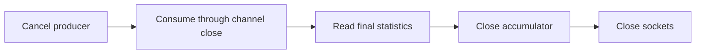

# Corpus, Load Transmitter, and Documentation Close-Out - Plan

## Goal

Close the corpus and transmitter defects left on the final simulation APIs,
pin the contract gate, and bring package documentation into agreement with
its source. Readiness stays `needs-decisions` until the choices under Open
questions are settled. The units below cover the work whose rule is already
specified. They do not authorize an implementer to choose a report contract.

Stop condition: a remaining requirement needs a different caller-visible
contract or an amendment to accepted direction without a deciding source.
Record that choice under Open questions before implementation. An ICX7150
disagreement is evidence for a separate investigation, outside this graph.

## Decisions

- The parent's Decisions apply. Prerequisites end at `a7ba4976` and
  `32792657`, both ancestors of this tree. The parent state retires those
  phases and leaves this phase open.
- Corpus constructors are already private. Commit `69906c50` removed
  their exports. Keep registry, assertions, and representative fixtures
  exported (`src/common/sim/internal/simtest/corpus.go:754`, `:830`,
  `scale.go:68`).
- The earlier conditional trust decision is answered by the tree: phase
  10 folds each journey's metadata, including copies, into its flow
  (`src/common/sim/fabric/flow.go:166`, `:195`). It does not fold the
  whole fabric into every flow. `simload.NewReport` still substitutes
  whole-fabric metadata for a Complete empty flow (`src/edge/simload/report.go:95`).
  Choosing what to remove or change is Open question 3.
- The earlier conditional type move is answered by the tree: `FlowID`
  remains in `fabric/flow.go:14`, `FlowStats` and `LatencyStats` in
  `fabric/flow.go:28`, `:44`. Assembly owns construction and configuration
  (`src/common/sim/assembly/assemble.go:172`, `configure.go:14`).
  The original conditional decision therefore requires a leaf move. Its name
  and record amendment remain Open question 2, with no relocation unit
  authorized until that ownership choice is settled.
- Keep finite source preflight. `preflightSources` validates every frame's
  signature room and encoding before opening sockets
  (`src/edge/simload/run.go:200`). Minimum-payload metadata cannot prove
  encodability or cover a varying frame.
- Keep the latency summary specified by the offered-load record, Decision,
  lines 84-88: minimum, maximum, sum, and count. Percentiles are an
  extension, not an unmet requirement of that record. No distribution
  claim or percentile is added in this close-out.
- Preserve sequence-set behavior and the signature layout. The maps accept
  sparse sends, duplicates, and reordering (`src/edge/simload/stats.go:82`,
  `:113`, `:163`). Replacing them with ranges needs a measured memory
  problem and equivalence tests. Allocation in `Sign` is not a demonstrated
  correctness defect (`signature.go:39`). Those performance suggestions
  are struck from this phase, rather than given an unmeasured optimization.
- Keep behavior refactoring separate from file moves. Parent R9 still
  applies to corpus constructors and the remaining layer functions. A
  source-size test fails on the listed sites before their decomposition.

## Requirements

R1. Every live correctness item below has a failing-first test or an open
contract choice. Example: a receiver with a signed frame queued at the drain
boundary produces one unique receive and zero missing frames after U5.

R2. Every successful frame delivery into the receive channel before shutdown
is consumed before the accumulator closes. Shutdown stops the producer,
waits for its channel to close, drains accepted frames, then freezes the
observation. Example: cancellation and a buffered frame ready together
cannot randomly turn that frame into `Missing` or `LateAfterClose`.



R3. Corpus admission, receive-result validation, and case registration have
independent checks. Example: `RegisterLoadCases(NewRegistry())` contains the
three existing load IDs, and removing one executor's receive validation
fails its source fixture check even when all 41 cases still execute.

R4. The layer gate pins each row's semantics as well as its presence.
Example: changing the RetentionKey literal, narrowing exported facts to
stateful packages, or broadening the device root to a sibling prefix makes
a test fail. Fixtures pass every unrelated rule.

R5. Every simulation and transmitter README names existing identifiers,
links to existing source, and states its limits. Example: the corpus README
contains all 41 registered IDs and contains no `bridge.PVIDFact` reference.
Every rewritten Markdown file passes `verify check-prose --strict`.

R6. Parent R9 holds across the source tree. Example: parsing `cases.go`
finds no file above 1,200 lines or function above 150 without the parent's
existing justified exception rule. No new exclusion or suppression is added.

### Relocated original inventory

Snapshot: `51a10ed1`. In the tables, `S` means `src/common/sim`, `C`
means `S/internal/simtest`, and `E` means `src/edge/simload`. Historical
paths in retired plans are interpreted against the cited retirement commit.

| Item | Current source | Disposition |
| --- | --- | --- |
| Cancellation skips buffered receives | E/run.go:252, :267 | U5. A valid signed buffered frame distinguishes shutdown loss from malformed input. |
| Negative latency is malformed | E/stats.go:104, stats_test.go:47 | Open question 5. Existing behavior has a test. |
| Lab-only flow omitted | E/report.go:110, :174, cmd/simload/main.go:139 | Open question 4. Only the normalized row is omitted. Raw lab data survives. |
| Close precedes producer cancellation | E/run.go:338 | U5. Close only after the consumer finishes. |
| Short-write and ENOBUFS context | E/packetio/sender_linux.go:97, sender_linux_test.go:62 | U5. Existing tests pin the causes, not context. |
| ~~Journey indexed by fid-1~~ | C/cases.go:2687, loopprotect_cases.go:262, stp_cases.go:366 | Fixed by `3382f02a`, which introduced reportJourney. Keep identity lookup. |
| Missing PVST case and stale counts | C/stp_cases.go:1173, corpus_test.go:589, README.md:212 | U3 checks the 41 registry IDs. U6 corrects README descriptions and counts. |
| Load cases registered inline | C/cases.go:2681 | U3 introduces RegisterLoadCases without changing the three cases. |
| Latency percentile scope | offered-load record:84-88, E/stats.go:14 | Settled by the existing summary contract. No percentile claim. |
| Compare refusal undocumented | E/README.md:58, cmd/simload/main.go:139 | U6 states the present command validation, independently of the open library choice. |
| Missing file maps | S/layer/phy/README.md:146, layer/bridge/README.md:208, port/README.md:76 | Bridge already names its split files. Port already names its four sources. U6 adds phy's six files and repairs its obsolete export link. |
| ~~Source minimum-payload metadata~~ | E/run.go:200, stream/source.go:15 | Per-frame preflight remains. A minimum does not establish encodability. |
| ~~Contiguous sequence ranges~~ | E/stats.go:77, :163, stats_test.go:63 | Public inputs may be sparse or MaxUint64. No measured target justifies a representation change here. |
| ~~Signature allocation fast path~~ | E/signature.go:39, :75, run.go:317 | No measured bottleneck. Preserve signature_test.go:13's literal wire bytes. |
| ~~Nil switch capability seed passes~~ | S/device/vswitch/diff_coverage_test.go:114 | Fixed by `98a0f3d0`: every top-level capability pointer in this seed is checked before the reflection gate. Nested optional nils remain legitimate. |
| ~~Cross-layer fact assertion table~~ | C/diffcoverage.go:141, :468 | Inventory premise was already false at `61775c73`: this file imported port and trace, with no cross-layer fact table. The current gate perturbs configuration and observes nonempty trace.Change values. |
| Linux-only linktest omitted on Darwin | E/packetio/sender_linktest_test.go:1, tools/scripts/verify/change.py:83, :679 | U5 requires explicit Linux compile and vet. Tag renamed by `4d32113f`. No verifier policy edit. |
| Hardware-only integration | E/test/integration/lab_test.go:1, run_test.go:156 | U5 adds an in-memory sender/receiver path through RunWith and NewReport. Lab stays manual. |
| Missing drain regression | E/run_test.go:279 | U5. Existing test pins the deadline with an empty receiver. |
| ~~Missing negative-latency test~~ | E/stats_test.go:47 | Already present, reinforced by `42eadcf7`. Its policy remains Open question 5. |
| ~~Missing duplicate registry test~~ | C/corpus_test.go:461 | Already present since `b1c1fa01`, before this inventory. |
| ~~Representative fork allocation gap~~ | S/fabric/fork_bench_test.go:11, fork_scale_test.go:113, :126 | Existing benchmark and absolute/scaling allocation gates cover RepresentativeFabric. `9b57657f` corrected the scaling zero point. |
| Aggregate scale memory target missed | S/fabric/README.md:415-421 | Open question 6. Existing million-frame figures meet 120 s and exceed 2 GiB cumulative allocation. No improvement is claimed. |
| Outgoing capture on Linux | src/modules/capture/rawsocket/local_linux.go:54, :116 | Settled below. Capture permits outgoing traffic. E/run.go:160 rejects one-interface runs. |
| Layer gate predicates not pinned | test/conformance/sim/layer_contract_test.go:80, :83, :87, :89, :317 | U4, with independent positive and negative fixtures for the actual predicates. |

Linux source: `src/modules/capture/rawsocket/local_linux.go:116` opens
ETH_P_ALL without an outgoing-ignore option, and `:54` discards the packet
address. [packet(7), address types](https://raw.githubusercontent.com/mkerrisk/man-pages/master/man7/packet.7)
names PACKET_OUTGOING as locally originated traffic returned to a packet
socket. [Linux v6.12 transmit tap](https://github.com/torvalds/linux/blob/v6.12/net/core/dev.c#L2152)
skips hooks whose ignore_outgoing flag is set, and
[packet socket option handling](https://github.com/torvalds/linux/blob/v6.12/net/packet/af_packet.c#L3838)
sets it through PACKET_IGNORE_OUTGOING. These sources answer the interface
question. Lab kernel behavior and bridged-topology effects remain
unverified. Global exclusion would change the existing capture loopback
contract in local_linktest_test.go:24, so no capture change is planned.

### Review follow-ups carried by the fabric retirement

Source for every row: retirement commit `ef213026`, body, Review follow-ups.
`S` is `src/common/sim`. These were explicitly left open after the review
verdict. The two accepted close-out items become units. The other items stay
named residual work under Open question 6. No deferred fix is claimed done.

| Item | Source | Disposition and reason |
| --- | --- | --- |
| State.Diff top-level current/expected fields | S/device/state.go:337, `ef213026` gap | Deferred. Device state projection is outside corpus/transmitter closure. Parent completion remains conditional. |
| Past-dated egress head and same-instant higher PCP | S/fabric/egress.go:123, gap | Deferred. Event ordering needs a fabric regression and runtime remedy. U5 changes capture shutdown only. |
| LAG queue step subject owner | S/layer/traffic/layer.go:107, gap | Deferred. A trace-subject contract changes what fabric callers see. No source-backed selection is made here. |
| Protocol LAG emission with no member | S/device/vswitch/timers.go:193, gap | Deferred. Needs a switch timer/drop-record unit rather than a documentation claim. |
| Construction start journeys never settled | S/fabric/topology.go:69, gap | Deferred. Replay and start-emission lifetime are runtime work. |
| Corpus validation counting misses omitted call | C/corpus_test.go:1500, gap | U3. Its present test counts successful cases, so source fixtures pin omission separately. |
| Held scans still constrain the final entry | S/fabric/routing_test.go:918, :1067, :1212, gap | Deferred. The scans still assert the last entry at :926, :1075 and :1220. Requires a held journey with a later entry and removal of the obsolete constraint. Corpus assertions do not cover these tests. |
| SelectVLANs row absent for released mirror | S/device/vswitch/mirror_once_test.go:88, gap | Deferred. Selection differs between held ingress VLAN and routed FID 0. Choosing equal semantics is caller-visible. |
| Unreachable copy-origin diff branches | S/fabric/compare_journey.go:51, compare.go, convention | Deferred. Removing or making comparison branches reachable requires a fabric comparison unit and caller audit. |
| Unreachable hand-built supports and DefaultQueue | S/fabric/topology.go:154, device/vswitch/mirror.go, fabric/executor.go, egress.go, output.go, fork.go, queue.go, convention | Deferred. Establishing the supported construction boundary is runtime work, with separate deletion tests. |
| Unused isJourneyHeld and test exports | S/fabric/journey.go:295, export_test.go, convention | Deferred. Dead-code cleanup is separate from the size refactor and corpus gate. Parent residual remains explicit. |
| Four misleading comments | S/fabric/comparison_location.go:28, result.go:56, journey.go:209, routing_test.go:954, convention | Deferred. U6 owns Markdown only. Comment corrections require a code-scoped follow-up with verifier receipts. |
| Per-step allocation figures lack reproduction | S/fabric/README.md:1360, convention | U6. Reproduce the existing command or remove unsupported numbers. |
| Replace rollback and old hold cleanup | S/fabric/topology.go:100, hardening | Deferred. Custom device replacement and error atomicity need an explicit runtime test seam. |
| Node.Snapshot used as switch discriminator | S/fabric/topology.go:143, attach.go, egress.go, metadata.go, hardening | Deferred. A generic-node contract question, outside close-out. |
| AttachStream fallback kind and Emissions[0] | S/fabric/attach.go:49, injection.go:78, hardening | Deferred. Fourth-device support is out of scope. Current accepted seam remains documented. |
| Action.Diff nil Operation, ignored Encode error, fallback pairing | S/fabric/scenario.go:323, align.go, hardening | Deferred. Direct unvalidated-action API behavior needs its own requirement and input-validity decision. |
| Frame sharing documented only in README | S/fabric/injection.go:13, hardening | Deferred. Ownership guarantees on Inject, Step, Snapshot and Device need a code/API documentation unit. U6 preserves the current README claim. |

### Complete historical carry ledger

P1-P11 and P13 mean the corresponding retired phase plan immediately before
its retirement. P12 means the original inventory at
`51a10ed1:docs/plans/2026-10-01-2200-refactor-sim-package-overhaul-phase12-plan.md`,
recoverable with `git show 51a10ed1:docs/plans/2026-10-01-2200-refactor-sim-package-overhaul-phase12-plan.md`. Sources are recoverable with `git show <retire>^:docs/plans/<plan>`.
Retirements: P1 d7ac43ad, P2 a51692c5, P3 e152c4ed, P4 6c4f1915,
P5 492f3488, P6 830736a9, P7 06c14cac, P8 14e4a39b, P9 26705dbe,
P10 ef213026, P11 51a10ed1, P13 cf429b87. `parent` means the open parent
plan at this snapshot, `shape` means the package-shape record, and `ST`
means C. Repeated carries cross-reference their first entry.

This ledger accounts for carries rather than accepting their proposed
remedies. A deferred row remains an unmet parent obligation under Open
question 6. A source interpretation marked unverified supplies no protocol
requirement or failing-test expectation. U6 preserves that qualification.

| Item | Source | Disposition and present evidence |
| --- | --- | --- |
| C001 State.Diff returns complete top-level fields | P10:1106, ef213026 body:15, P11:498 | Deferred under Open question 6. Follow-up evidence, not an authorized unit: State unit. `S/device/state.go:329` calls whole-field serialization. Add unequal-row tests that exclude both the differing row from Current and unrelated rows from Expected, then implement row-level differences. |
| C002 Past-dated egress head hides same-instant priority | P10:1107, ef213026 body:16, P11:499 | Deferred under Open question 6. Follow-up evidence, not an authorized unit: Queue unit. `S/fabric/egress.go:123` still requires `At.Equal(now)`. Pin a higher-PCP frame behind an overdue head before changing batching. |
| C003 Queue subject names owner instead of member | P10:1108, ef213026 body:17, P11:500 | Deferred under Open question 6. Follow-up evidence, not an authorized unit: Queue unit. `S/layer/traffic/layer.go:101` passes the configuration owner into the decision subject. Keep owner-based lookup and pin the actual member subject for tail-drop and threshold steps. |
| C004 Protocol LAG emission without a member disappears | P10:1109, ef213026 body:18, P11:501 | Deferred under Open question 6. Follow-up evidence, not an authorized unit: Switch unit. `S/device/vswitch/timers.go:190` returns false when member selection fails. Add a loop-protection emission case and a recorded no-member outcome. |
| C005 Construction does not settle touched journeys | P10:1110, ef213026 body:19, P11:502 | Deferred under Open question 6. Follow-up evidence, not an authorized unit: Topology unit. `S/fabric/topology.go:69` applies start output without the settlement used by replacement at :101. Replay a start emission with no link and settle it consistently. |
| C006 Receive-outcome gate counts cases rather than validations | P10:1111, ef213026 body:20, P11:503 | U3. Corpus gate unit. `ST/corpus_test.go:1502` counts successful AssertCase calls, not validated receives. `ST/loopprotect_cases.go:260` runs and reads a journey without the report validator used at `ST/stp_cases.go:349`. Instrument actual validation coverage and make deleting one executor validation fail. |
| C007 Held assertions still constrain the final entry | P10:1112, ef213026 body:21, P11:504 | Deferred under Open question 6. Follow-up evidence, not an authorized unit: Journey test unit. `S/fabric/routing_test.go:918`, :1067 and :1212 scan entries, but :926, :1075 and :1220 still assert on the last entry. Add a held journey with a later entry and remove the obsolete last-entry constraint. |
| C008 Mirror selector matrix omits SelectVLANs | P10:1113, ef213026 body:22, P11:505 | Deferred under Open question 6. Follow-up evidence, not an authorized unit: Mirror unit. `S/device/vswitch/mirror_once_test.go:75` has seven selectors and no VLAN selector. Held memory stores ingress VID at `mirror.go:106`, while live routed selection uses the routed result. Pin the differing paths, then make their VLAN-selection rule consistent before adding the row. |
| C009 Unreachable journey comparison branches | P10:1117, ef213026 body:23, P11:506, P8:394, P10:431 | Deferred under Open question 6. Follow-up evidence, not an authorized unit: Comparison unit. `S/fabric/compare_journey.go:59` compares origin kind/name after pairing by those values. `S/fabric/compare.go:258` retains the journey half of diffFabricRuns while Compare uses root-based comparison. Reach the branches through the public API or delete dead code. Direct helper tests alone do not establish reachability. |
| C010 Hand-built fabric supports survive | P10:1118, ef213026 body:24, P11:507 | Deferred under Open question 6. Follow-up evidence, not an authorized unit: Construction cleanup unit. `S/fabric/topology.go:154` retains DefaultQueue, `S/fabric/egress.go:70` a fallback, and `S/device/vswitch/mirror.go:20` nil-receiver support. Audit executor/output/fork/queue guards individually. Preserve valid zero-ReplaySpec handling at `fabric/executor.go:62` and queue initialization. Remove only supports with no caller. |
| C011 Unused held helper and test exports | P10:1119, ef213026 body:25, P11:508 | Deferred under Open question 6. Follow-up evidence, not an authorized unit: Cleanup unit. `S/fabric/journey.go:298` declares isJourneyHeld. `S/fabric/export_test.go:102`, :222 and :241 declare ExportIsJourneyHeld, ExportFabricFields and ExportLinkTrust without readers. Delete these declarations after a reference check. |
| C012 Four misleading comments | P10:1120, ef213026 body:26, P11:509 | Deferred under Open question 6. Follow-up evidence, not an authorized unit: Documentation unit. Correct each independently: `S/fabric/comparison_location.go:28` only supports stable numbered-action locations, `result.go:56` must respect fabric concurrency, `journey.go:209` excludes freed settled protocol journeys, and `routing_test.go:954` describes a held journey rather than a released one. |
| C013 Per-step allocation figures lack provenance | P10:1121, ef213026 body:27, P11:510 | U6 documentation audit. Documentation/performance unit. `S/fabric/README.md:1354` gives a benchmark command without benchmem and :1360 asserts 303/294 allocations without a reproducible capture. Record command, platform, revision and output or remove the numbers. Do not manufacture a historical measurement. |
| C014 Replace rollback and hold-key cleanup | P10:1125, ef213026 body:28, P11:511 | Deferred under Open question 6. Follow-up evidence, not an authorized unit: Topology unit. `S/fabric/topology.go:100` changes links/trust and applies start/peer output before only restoring the node on error. :226 accepts a supplied Device. Test failed replacement and a successful replacement with no drops, including old hold keys. Make the entire mutation transactional or define an explicitly narrower contract through re-planning. |
| C015 Snapshot doubles as switch classification | P10:1126, ef213026 body:29, P11:512 | Deferred under Open question 6. Follow-up evidence, not an authorized unit: Open seam decision. `S/fabric/topology.go:143` documents Snapshot as a projection, but `S/fabric/attach.go:57`, `egress.go:123` and metadata paths classify devices through it. Decide an explicit capability or device contract before implementing non-switch-with-Snapshot and switch-without-Snapshot tests. |
| C016 Fourth device kind and unchecked emissions indexing | P10:1127, ef213026 body:30, P11:513 | Deferred under Open question 6. Follow-up evidence, not an authorized unit: Open seam decision. `S/fabric/attach.go:49` falls through to reflector origin and `S/fabric/injection.go:78` indexes the first emission. Define stream-attachment eligibility and emission shape, then test an additional device kind and empty emissions. Do not silently prescribe a new interface here. |
| C017 Unvalidated Action.Diff, encoding errors and source fallback | P10:1128, ef213026 body:31, P11:514 | Deferred under Open question 6. Follow-up evidence, not an authorized unit: Scenario unit, all three subitems. `S/fabric/scenario.go:323` calls Operation without validation, :389 ignores Encode errors, and `S/fabric/align.go:43` reconstructs source roots beneath an action. `S/assembly/scenario.go:33` can construct a nil operation from an empty Mcheck port. Pin direct invalid calls, failed encoding, and source-generated root alignment. Define refusal/error behavior in the re-plan. |
| C018 Frame-sharing contract missing on four APIs | P10:1129, ef213026 body:32, P11:515 | Deferred under Open question 6. Follow-up evidence, not an authorized unit: Documentation unit. `S/fabric/README.md:1352` states immutable shared buffers. State ownership on `Inject` at `injection.go:13`, `Step` at `run.go:155`, `Snapshot` at `snapshot.go:13`, and `Device` at `topology.go:262`. The fork comment at `fork.go:10` already documents sharing. Distinguish independent containers from shared payload storage. |
| C019 Released mirror refusal has routing rather than traffic trace | P9:1177, 8647d908, P11:496 | Deferred under Open question 6. Follow-up evidence, not an authorized unit: Switch unit. `S/device/vswitch/route.go:288` constructs a routing-layer egress drop and :367 routes mirror refusal through it. Pin live/released mirror refusal parity with the traffic decision fact, including a terminal drop rather than a transmit. |
| C020 Untracked up-port BPDU refusal misstates cause/scope | P9:1178, 8647d908, P11:496 | Deferred under Open question 6. Follow-up evidence, not an authorized unit: Switch unit. `S/device/vswitch/intercept.go:178` rejects an untracked port with the forwarding result, and early return at :251 avoids decoding. Cover STP cause/scope on the up untracked port and malformed SSTP BadBPDU accounting. The original defect is narrower than generic unknown-port handling. |
| C021 Discarded LinkChange and setOperStatus errors | P9:1179, 8647d908, P10:439, P11:497 | Preserve current source in U6 audit. No longer applicable. `S/fabric/fabric.go:117` returns LinkChange errors and `S/device/vswitch/link.go:128` returns setOperStatus errors. Keep existing propagation rather than carrying the old ignored-error claim. |
| C022 Unused layer age field, time parameter and interface method | P9:1180, 8647d908, P11:496 | Deferred under Open question 6. Follow-up evidence, not an authorized unit: Cleanup unit. `S/device/vswitch/layers.go:30` declares timed.Advance while timers use NextWake. :44 keeps age, :49 ignores time, and :76/:80/:88 write age. Remove each unused part without altering the advance callbacks. |
| C023 badBPDU walks trees for a discarded result | P9:1181, 8647d908, P11:496 | Deferred under Open question 6. Follow-up evidence, not an authorized unit: Switch cleanup unit. `S/device/vswitch/intercept.go:240` passes nil before into bpduResult at :213. Avoid the unused transition walk on the bad-BPDU path and preserve its error output. |
| C024 Test comment narrates a unit promise | P9:1182, 8647d908, P11:496 | Deferred under Open question 6. Follow-up evidence, not an authorized unit: Documentation unit. `S/device/vswitch/stp_test.go:1904` retains the unit-promise wording. Describe the emitted BPDU and trace rule instead. |
| C025 RetentionKey classifier literal can change undetected | P2:660-666, 2db760b7, P12:132-138 | U4. Contract gate unit. `test/conformance/sim/layer_contract_test.go:80` marks stateful using a literal. The corresponding fixture at :266 and fixtureDirs at :303 do not independently pin the classification input. Derive a discriminating fixture for that guard kind and prove altering the classifier fails. |
| C026 import_device root can change undetected | P2:660-666, 2db760b7, P12:132-138 | U4. Contract gate unit. `test/conformance/sim/layer_contract_test.go:89` refuses imports below one root. The fixture at :296 imports device/vswitch only. Pin direct device and descendant imports against an independently specified prohibited root. Avoid a fixture that is equally refused by multiple roots. |
| C027 exported_fact can narrow to stateful only | P2:660-666, 2db760b7, P12:132-138 | U4. Contract gate unit. `test/conformance/sim/layer_contract_test.go:87` is global, but fixtureDirs at :303 dual-tests only five member rules. Add stateless and stateful exported-fact fixtures and make narrowing the rule fail. |
| C028 Absent/undecoded routing facts print invalid IP | P6:676-679 | Open question 7. Open fact-format decision plus corpus unit. `S/layer/routing/fact.go:29`, :53 and :70 stringify absent addresses. `ST/cases.go:2286` and :2288 pin invalid IP. Choose representations for absent next hop and undecoded header, then update all lookup expectations atomically. These are separate meanings even if a shared renderer is chosen. |
| C029 Switch README repeats relay ladder, standards and reasons | P7:526-527, P9:303-304 | U6 documentation audit. Documentation unit. `S/device/vswitch/README.md:218` retains a capability ladder and :330 relay standards, while `S/layer/bridge/README.md:27` owns the relay pipeline. Move duplicated relay detail and link from switch composition. Keep composition-specific ordering and interception limits. |
| C030 Minimum-payload source metadata | P8:251-252, :304-305, :347, P12:98-101 | Preserve current source in U6 audit. No longer applicable. Already struck in both plans. `E/run.go:200` preflightSources validates every frame before socket creation. Minimum payload alone cannot replace encoding and signature-space validation. |
| C031 Stream embedding wrapper escapes validation | P8:392 | Deferred under Open question 6. Follow-up evidence, not an authorized unit: Stream hardening unit. `S/stream/stream.go:68` has no default type refusal. The carried embedding wrapper should be a failing Validate test before source changes. The Go promotion rule is recorded in the embedding solution. Its external language source was not independently re-read here, so that external claim remains unverified in this report. |
| C032 Variation set described as closed | P8:393 | Deferred under Open question 6. Follow-up evidence, not an authorized unit: Documentation unit coupled to the preceding guard. `S/stream/variation.go:15` and `S/stream/README.md` claim closure. An unexported method alone is insufficient according to the recorded source investigation. State the actually enforced concrete-variation set after fixing validation. |
| C033 LACP aggregate-wait base on a late Advance | P4:586 | U6 documentation audit. Documentation unit, or open timing change if code behavior is challenged. `S/layer/lag/README.md:366` states Aggregate_Wait_Time without its late-call base. `S/layer/lag/lacp.go:263` starts from the call time. Explain that base. Do not change it to deadline time without a source-backed protocol decision. |
| C034 Received topology-change flag wording | P3:1633 | U6 documentation audit. Documentation unit. `S/layer/stp/README.md:485` still says a topology change raised by a BPDU. Specify a topology-change flag received in a BPDU or MSTI record, separating state-transition changes that use the new root times. |
| C035 Phase 1 path/document migration | P1:141-163, retirement d7ac43ad | U6 documentation audit. No new migration unit. `S/README.md:1`, `ST/README.md:1` and `E/README.md:1` exist at moved paths. Include all named README, CONCEPTS, GOALS, architecture and solution links in the final documentation audit rather than replaying the completed move. |
| C036 Phase 9 entry, Spec and timed-layer README corrections | P9:394-397, :1091-1102 | U6 documentation audit. Mostly landed, finish documentation audit. `S/device/vswitch/README.md:670` has the file table. `spec.go` owns construction identity and `output.go` owns result entries. Audit the exact Spec reproducibility promise and ensure all timed layers are named. Do not restore the obsolete instruction to follow SetOperStatus with LinkChange. |
| C037 Phase 9 seven understated API comments | P9:398-401, :1100-1101 | Deferred under Open question 6. Follow-up evidence, not an authorized unit: Documentation audit unit. Check package at `S/device/vswitch/config.go:1`, Switch at `switch.go:20`, NextWake at `timers.go:133`, Drain in `output.go`, Diff in `diff.go`, Derive at `derive.go:26`, and Compare at `compare.go:63` against the composed APIs. Retired switch.go line numbers no longer identify these declarations. |
| C038 Phase 9 protocol, PoE, timing and loader defaults moved out | P9:413-415, :1093-1097 | U6 documentation audit. No wholesale repeat of completed move. `S/netmodel/README.md:180` owns physical/PoE mapping, layer READMEs own protocol detail, and switch README has a composition table at :670. Audit remaining duplicate detail alongside the explicit relay carry. |
| C039 Five either-Forwarded-or-Flooded assertions | P9:425-426, :1105-1106 | Deferred under Open question 6. Follow-up evidence, not an authorized unit: Test hygiene audit. The source was split into `S/device/vswitch/route_test.go`, `lag_test.go`, `mirror_test.go` and `held_test.go`. Pin each original assertion to its observed outcome. Historical line numbers must be mapped by test name before calling all five closed. Execution/mutation verification was not run here. |
| C040 Historical test comments and acceptance_review file | P9:432-434, :1104-1107 | Deferred under Open question 6. Follow-up evidence, not an authorized unit: Partly landed. Tests now live in subject files and acceptance_review_test.go is absent. The separate narrative at `S/device/vswitch/stp_test.go:1904` remains and is tracked in the phase 9 follow-up. Audit the other named historical comments rather than treating file deletion as proof for all of them. |
| C041 Three nondeterministic wall-clock fixtures | P9:435-436, :1107-1119 | Deferred under Open question 6. Follow-up evidence, not an authorized unit: No longer an automatic repair item. Phase 9 specified fixed instants and a separate monotonic-time representation. Audit `S/device/vswitch/construction_result_test.go` and the moved subject tests for those exact fixtures. Preserve the monotonic-removal test rather than replacing its distinction with identical timestamps. |
| C042 Phase 9 size splits | P9:1101-1114 | U1/U2 preserve landed splits and close the remaining size inventory. Switch-local split landed: `S/device/vswitch/config.go:134` coordinates private composition checks and `hub.go` owns hub forwarding. This does not satisfy parent-wide R9. Carry the three oversized files and 19 long declarations separately under the parent table. |
| C043 MSTI remaining-hop boundary | P3:1603 | Deferred under Open question 6. Follow-up evidence, not an authorized unit: STP test unit. `S/layer/stp/receive.go:169` still uses <=1. Pin one discarded and two stored through an internal test if public observations cannot distinguish them. Mutation result unverified here. |
| C044 Boundary MSTI inherits CIST agreed | P3:1604 | Deferred under Open question 6. Follow-up evidence, not an authorized unit: STP test unit. `S/layer/stp/receive.go:565` copies the CIST agreement. Pin forwarding of the boundary Designated MSTI using that agreement. Do not infer coverage from a generic MSTP corpus case. |
| C045 Boundary role change clears agreed | P3:1605 | Deferred under Open question 6. Follow-up evidence, not an authorized unit: STP test unit. `S/layer/stp/roles.go:194` contains role-transition agreement clearing. Pin a boundary MSTI role change requiring a fresh agreement. |
| C046 Edge forwarding raises no topology change | P3:1606 | Deferred under Open question 6. Follow-up evidence, not an authorized unit: STP test unit. `S/layer/stp/roles.go:328` treats edge links specially. Add or identify an internal transition assertion that fails when the edge operand is removed. |
| C047 Inactive boundary MSTI ignores topology-change flag | P3:1607 | Deferred under Open question 6. Follow-up evidence, not an authorized unit: STP test unit. `S/layer/stp/receive.go:604` checks mp.tcActive. Pin an inactive MSTI separately from active propagation. |
| C048 Old isSynced boundary branch | P3:1608, P13 handshake work | Deferred under Open question 6. Follow-up evidence, not an authorized unit: Historical branch remedy no longer applies directly. `S/layer/stp/roles.go:10` now implements the later handshake decision and boundary scope. Audit the current boundary-unagreed emission test against that implementation, rather than restoring the old branch. |
| C049 Sync request OR operands | P3:1615 | Deferred under Open question 6. Follow-up evidence, not an authorized unit: STP test unit. `S/layer/stp/receive.go:11` owns syncTree. Pin both a cut forwarding proposer and a Discarding port beginning proposal so either operand removal fails. |
| C050 Boundary mirror request guard | P3:1616 | Deferred under Open question 6. Follow-up evidence, not an authorized unit: STP test unit. `S/layer/stp/receive.go:56` mirrors boundary state and `link_state_internal_test.go:654` asserts an information request. Add the already-proposing-and-Discarding negative case with a distinguishable output. |
| C051 stored guard on early CIST election | P3:1617 | Deferred under Open question 6. Follow-up evidence, not an authorized unit: STP test unit. `S/layer/stp/receive.go:530` retains the internal CIST stored guard. Pin an un-stored BPDU whose later recompute differs from early election. |
| C052 Restore prior root information before topology change | P3:1618 | Deferred under Open question 6. Follow-up evidence, not an authorized unit: STP test unit. `S/layer/stp/receive.go:522` saves/reselects information and :592 propagates received TC. Verify a same-root move between ports and an emitted request, including each restore line. |
| C053 Boundary mirror test asserts flag without distinct emission | P3:1619 | Deferred under Open question 6. Follow-up evidence, not an authorized unit: STP test unit. `S/layer/stp/link_state_internal_test.go:654` targets sync request state. Pin a distinct emitted MSTI record or delete an unreachable redundant request. A boolean assertion that another flag masks is insufficient. |
| C054 Agreement test fails to distinguish Alternate vector | P3:1620 | Deferred under Open question 6. Follow-up evidence, not an authorized unit: STP test unit. `S/layer/stp/agreement_test.go:264` is the inherited-vector case. Add an Alternate-ending call that distinguishes role-dependent vector selection. |
| C055 stored guard must cover VLAN and internal MST prior times | P3:1631 | Deferred under Open question 6. Follow-up evidence, not an authorized unit: STP test unit. `S/layer/stp/receive.go:574` restores before :592. Pin SSTP new times on the unchanged VLAN root and internal MST new times on unchanged CIST root. Neither restricting stored to CIST nor to external frames may pass. |
| C056 Retired timer-rule paragraph lacks test/mutation names | P3:1632 | Deferred under Open question 6. Follow-up evidence, not an authorized unit: No edit to retired plan. Record current evidence for the prior-times rule from `S/layer/stp/receive_cist_test.go:13` and `receive.go:574` in the new plan. The old paragraph remains historical. Test presence does not establish the requested mutation sensitivity, which is unverified here. |
| C057 Landed phase/U labels in commit messages | P4:583, b6cde757, b3e894c4 | Open question 8. Parent close-out blocker. The source explicitly says “Not fixable without rewriting landed history, so it stays as recorded.” Preserve that fact. No new phase labels in code or commits, and no history rewrite is authorized by this research. |
| C058 LACP refusal chooses wrong decode fact without failing test | P4:584, P9:453 | Deferred under Open question 6. Follow-up evidence, not an authorized unit: Switch test audit unit. `S/device/vswitch/lag_test.go:104` owns TestLACPDUHandlingAtSwitch and `intercept.go:35` owns the refusal. Pin literal invalid LACP TypeID/canonical inputs on both Peek and Receive. Current API no longer calls this Forward. |
| C059 SlowProtocolsDecodeFact expectations reuse implementation | P4:585 | Deferred under Open question 6. Follow-up evidence, not an authorized unit: Fact test unit. `S/layer/lag/fact_test.go:216` selects subtype. Replace derived wants with literal type IDs and canonical text for both LACP and Marker, retaining independent Marker cases at :196. |
| C060 Unreachable multicast recToInclude guard | P5:493 | Deferred under Open question 6. Follow-up evidence, not an authorized unit: Cleanup unit. `S/layer/mcast/state.go:97` repeats the caller guard in applyToPort. Trace the single call and remove the unreachable guard if still redundant. No new suppression or policy exemption. |
| C061 One-caller Neighbor Discovery helpers | P6:686 | Deferred under Open question 6. Follow-up evidence, not an authorized unit: Routing cleanup unit. `S/layer/routing/receive.go:164` and :179 define ndpReceiver/isSolicitedNode. Inline if each remains single-use and if the resulting receive branch stays readable and within R9. |
| C062 Unbounded passively learned Stale neighbor entries | P6:687 | Open question 11. Open retention/bound decision. `S/layer/routing/receive.go:63` and :118 insert learned entries. Set an explicit aging or capacity contract before implementing stress/expiry tests. Source confirms insertion, but policy and standards behavior are unverified here. |
| C063 Ethernet all-nodes plus IPv6 unicast can confirm reachability | P6:688 | Deferred under Open question 6. Follow-up evidence, not an authorized unit: Routing hardening unit. `S/layer/routing/receive.go:27` uses link destination admission while :93 uses header destination for Solicited validation. Pin the mixed-destination frame and check the required destination relationship against a read RFC source before changing the rule. |
| C064 IPv6 Next Header check absent | P6:689, P9:473-475 | Preserve current source in U6 audit. No longer applicable. `S/layer/routing/receive.go:28` checks ProtocolICMPv6 and Receive at :43 uses Receives. Keep a discriminating non-ICMPv6 case. The historical missing-check claim is obsolete. |
| C065 Zero/group sender MAC cached and answered | P6:690 | Deferred under Open question 6. Follow-up evidence, not an authorized unit: Routing hardening unit. `S/layer/routing/receive.go:59` and :115 process peer hardware addresses without a visible local unicast check. Add invalid-ARP and invalid-NDP-option cases after checking the codecs. Codec refusal and RFC requirements must be sourced before claiming the runtime defect. |
| C066 Released multicast-query hit charged to observer | P6:691, P9:462 | Preserve current source in U6 audit. No longer applicable as the original missing call boundary. `S/device/vswitch/route.go:308` releases in its own call and `README.md:562` documents separate hit sets, with `issues_internal_test.go` as the regression source. Preserve the isolation test. Do not carry the old monolithic-switch implementation claim. |
| C067 Published STP editions and RSTP forward-delay step | P3:1548-1550, parent:261-268 | U6 documentation audit. Documentation/source-reading unit. `S/layer/stp/README.md:514` and :622 retain draft/published limits. Published IEEE 802.1Q-2011 and 802.1D-2004 were not read for this report. Keep unverified wording until their text is obtained. |
| C068 Draft-only transmit/role rules T2, T6, C2, A3, N2 | P3:1562-1566 | U6 documentation audit. Documentation/source-reading unit. `S/layer/stp/README.md:437` and :514 identify draft-derived rules. Preserve each named rule and its source distinction. No new failing test may be asserted as published-standard conformance from this report. |
| C069 MST BPDU length-band overlap at 102 octets | P3:1567-1569 | U6 documentation audit. Documentation/source-reading unit. `S/layer/stp/README.md:622` owns limits and `src/common/net/bpdu` owns wire parsing. Keep the Q2003 overlap interpretation distinct from any later-edition claim. Later text unverified. |
| C070 Overdue hello event-clock semantics | P3:1570-1573 | U6 documentation audit. Documentation unit. `S/layer/stp/README.md:437` describes transmission timing. State the event-driven model rule without claiming the unread published Port Transmit figure endorses it. |
| C071 Published MSTI Proposal/Agreement wording | P3:1574-1576 | U6 documentation audit. Documentation/source-reading unit. `S/layer/stp/README.md:514` records edition limitations. Q2003/D2009 agreement is historical source evidence, not independent verification of published 2011 wording. |
| C072 SSTP TCN address, TLV and acknowledgment behavior | P3:1577-1583 | U6 documentation audit. Documentation/source-reading or capture unit. `S/layer/stp/README.md:622` keeps the interoperation limits. Preserve all three uncertain behaviors and the VLAN-1 STP-mode address difference. No device capture was read here. |
| C073 Loop-guard recovery VLAN and inconsistent BPDU rules | P3:1584-1588 | U6 documentation audit. Documentation/source-reading unit. `S/layer/stp/README.md:622` retains recovery limits. Vendor revisions beyond the cited archived sources, disallowed VLAN behavior and PVID inconsistency remain unverified. |
| C074 Designated root-information change waits until hello | P3:1589-1594 | U6 documentation audit. Open protocol follow-up beyond simple prose. `S/layer/stp/README.md:636` names an unmodeled agree flag and the receive/role machines remain event-driven. Preserve the carried immediate-request divergence in the close-out limits. A new protocol fix needs source-backed scope, not a corpus-only rewrite. |
| C075 Published LACP text, IEEE power table and source-address meaning | P4:565-568 | U6 documentation audit. Documentation/source-reading unit, three subitems. `S/layer/lag/README.md:467` marks draft equivalence unverified and `S/layer/phy/README.md:129` bounds physical/power modeling. Published 802.1AX-2014 text, 802.3 class table and AX Figure 6-28 SA meaning were not independently read here. |
| C076 Local experimental EtherType behavior | P5:474-476 | U6 documentation audit. Documentation unit. `S/layer/loopprotect/README.md` cites the IANA assignment and bounds the protocol. Keep IEEE Std 802 behavior unverified. IANA assignment alone does not prove that behavior. |
| C077 MLD query and Done from unspecified source | P5:477-479 | U6 documentation audit. Documentation/source-reading unit. `S/layer/mcast/README.md` states refused forms. Keep both refusals as model limits until an applicable source resolves query and Done separately. |
| C078 ARP/ND ICMP error generation absent | P6:657-659 | U6 documentation audit. No implementation silently added. `S/layer/routing/README.md` Limits owns missing ICMP Address Unreachable generation. Record a separate future plan if wanted. No parent phase owns that generator. |
| C079 IEEE relay rules after Q2003 and 802.1ad | P7:528-529, P9:1153-1155 | U6 documentation audit. Documentation/source-reading unit. `S/layer/bridge/README.md:226` scopes the relay to the read edition. Later 802.1Q and 802.1ad remain unverified. |
| C080 Routed VLAN-interface unicast isolation rule | P9:1156-1158 | U6 documentation audit. Documentation unit. `S/device/vswitch/README.md` describes local receive/interception, while `S/layer/bridge/README.md:226` scopes relay limits. Keep switch policy distinct from what Q2003 permits. Vendor behavior unverified. |
| C081 Loop-protected-port BPDU/LACPDU vendor behavior | P9:1159-1160 | U6 documentation audit. Documentation unit. `S/device/vswitch/timers.go:190` keeps current protocol emission behavior. Preserve the model rule without claiming vendor equivalence. |
| C082 Aggregate speed and Slow Protocols learning source limits | P9:1161-1163 | U6 documentation audit. Documentation unit. `S/device/vswitch/link.go:140` uses the fastest member, while `S/layer/bridge/README.md:226` limits learning at intercepted addresses. Keep the accepted model decisions and published/draft source limits separate. |
| C083 MST reroot recent-root cut versus backup delay | P13:922-928 | U6 documentation audit. Documentation/source-reading unit. `S/layer/stp/README.md:622` preserves limits and the role machine at `roles.go:281` owns transition conditions. Published 2011 remains unverified. R10 cases cannot by themselves distinguish the two readings, so changing the condition requires a discriminating case and the text. |
| C084 IEEE 802.1D-1998 timer definitions | P13:929-931 | U6 documentation audit. Documentation/source-reading unit. `S/layer/stp/README.md:622` retains timer limits. The cited figures support implemented assignments in the retired plan, but section 17.15 was not read here. Keep that qualification. |
| C085 Remaining STP role-machine and clock limits | P13:176-178, README work and P3 remaining limits | U6 documentation audit. Documentation close-out unit. `S/layer/stp/README.md:622` already lists remaining limits. Preserve runtime aging/transition limits as well as the published-source questions. Treat further protocol work as a separately scoped unit if it cannot fit a bounded source-only close-out. |
| C086 Switch timing, fork, derive, receive and link loops | P9:446, P2 Out of scope | Preserve current source in U6 audit. Landed composition. `S/device/vswitch/layers.go:49` centralizes capabilities, :167 advances them, `output.go` converts outputs, `fork.go:17` forks and `derive.go:26` derives. Remaining unused table parts are C022. No repeat composition phase. |
| C087 Bridge/filter retention keys and filter Clone have callers | P9:447, P2 Decisions | Preserve current source in U6 audit. Landed. `S/device/vswitch/layers.go:124` and :145 call both keys, and :94 calls filter Clone. The no-production-caller finding no longer applies. |
| C088 Multicast Kept based on retained records | P9:448, P2 U6 | Preserve current source in U6 audit. Landed. `S/device/vswitch/derive.go:122` carries multicast through Restore rather than reporting only key equality. Retention cases belong to `derive_test.go`/`derive_internal_test.go`. Preserve per-record reporting. |
| C089 MSTI-only BPDU transition recorded | P9:449, P3 Out of scope | Preserve current source in U6 audit. Landed. `S/device/vswitch/intercept.go:200` snapshots every tracked tree and :213 emits per-tree transition results. The old CIST-only recording is gone. |
| C090 Standalone switch point-to-point default | P9:450, P3:1556-1561 | Preserve current source in U6 audit. Accepted decision, not an open redesign. `S/device/vswitch/link.go:16` starts a standalone switch and :40 derives point-to-point from reports. Retain the standalone default reason in the README. Fabric uses link reports. |
| C091 LAG STP speed uses fastest enabled member | P9:451, P4:350, :572-576 | Preserve current source in U6 audit. Accepted model decision. `S/device/vswitch/link.go:140` computes highestSpeed. Document it without converting aggregate data rate to a path-cost rule from an unread edition. Source limitations are C076. |
| C092 Absent LAG on both sides reports Kept | P9:452, P4:569-571 | Preserve current source in U6 audit. Accepted retention decision. `S/device/vswitch/derive.go:26` uses the capability retention table and `layers.go:110` supplies the LAG key. Preserve absent-on-both semantics and its README explanation. Do not reopen solely because both keys are empty. |
| C093 Refused LACP decode assertion | P9:453, P4:584 | Preserve current source in U6 audit. Same source item as C058. `S/device/vswitch/lag_test.go:104` is the current test owner. Do not count the phase 9 carry as a different defect. |
| C094 Multicast retention with rebuilt STP gate | P9:454, P5:265, :480-481 | Preserve current source in U6 audit. Landed. `S/device/vswitch/derive.go:122` restores admitted membership and `layers.go:56` binds the new STP gate. Audit retention tests for records refused by the new gate. Keep retained/lost reporting, rather than old presence-based Kept. |
| C095 Mirror destination and loop-protected protocol emissions | P9:455, P5:482-483 | Preserve current source in U6 audit. Accepted emission policy. `S/device/vswitch/timers.go:190` selects member/output, and `mirror.go:213` identifies mirror destinations. Mirror output emits copies alone, loop-protected ports retain the decided protocol behavior. No vendor equivalence claim. |
| C096 Empty bridge Origin/Lifetime constants | P9:456, P5:484-487 | Preserve current source in U6 audit. No longer applicable. `S/layer/bridge/fdb.go:46` defines non-empty constants and `seed.go:28` normalizes omitted fields. Keep these defaults in the seed documentation. |
| C097 Filter applied to released frame | P9:457, P6 Out of scope | Preserve current source in U6 audit. Landed release processing. `S/device/vswitch/route.go:308` applies deferred/egress filtering and mirror selection. Specific mirror-refusal trace parity remains C019 and SelectVLANs remains C008. |
| C098 Hold token and ingress on switch outputs | P9:458, P6:660-663 | Preserve current source in U6 audit. Landed seam. `S/device/output.go:1` owns output values and `S/device/vswitch/route.go:249` applies token-bearing exits. Retain tokens as opaque runtime identity, not fabric inspection of routing internals. |
| C099 Routing-emission applier in capability loop | P9:459, P6:660-663 | Preserve current source in U6 audit. Landed. `S/device/vswitch/layers.go:88` applies emissions through emitRouting and drains routing exits. No missing routing applier remains. |
| C100 ARP/ND directed to interface MAC relayed or mis-dropped | P9:460, P6:664-668 | Preserve current source in U6 audit. Landed receive interception. `S/layer/routing/receive.go:18` exposes Receives and `S/device/vswitch/forward.go` dispatches the control candidate. Preserve protocol receive tests, including non-ICMPv6 rejection C064. Generic neighbor-hardening items remain C062/C063/C065. |
| C101 Unanswered next hop remains unresolved | P9:461, P6:669-672, P10:426 | Preserve current source in U6 audit. Accepted decision, not a blanket removal. `S/device/vswitch/route.go:98` still records neighbor-unresolved. Hosts now answer modeled addresses. The unanswered case remains incomplete rather than assuming success. |
| C102 Release multicast query hit isolation | P9:462, P6:691 | Preserve current source in U6 audit. Same closed original carry as C066. `S/device/vswitch/README.md:562` states the separate call scope. Preserve its regression. |
| C103 Filter requires routing capability | P9:463, P6 Decisions | Preserve current source in U6 audit. Accepted composition requirement. `S/device/vswitch/config.go:414` validates filter composition. No new optional-filter-without-routing compatibility layer. |
| C104 Inline switch membership checks | P9:464, P7 Inventory | Preserve current source in U6 audit. Landed admission helpers. `S/device/vswitch/config.go:271` and :309 validate multicast/routing composition, with port-table admission used by derive. Keep membership/reason ordering aligned with `S/netmodel/load_fdb.go:114`. |
| C105 Lost mirror ingress fallback | P9:465, P7:520-522 | Preserve current source in U6 audit. Landed shared ingress resolution. `S/device/vswitch/mirror.go:221` logicalIngress serves bridge/hub paths. Preserve the hub fallback rather than deleting every absent-ingress branch as dead support. |
| C106 Copies inputs remain summary plus egress list | P9:466, P7:520-522 | Preserve current source in U6 audit. Accepted boundary. `S/device/vswitch/mirror.go:32` builds switchport summaries and :155 readies copies. Traffic has no sibling import. Ingress resolution is shared. The input value is not automatically a new interface. |
| C107 Learning source addressed to reserved protocol MAC | P9:467, P7:523-525 | Preserve current source in U6 audit. Accepted relay limit. `S/layer/bridge/README.md:226` owns the learning limit and `S/device/vswitch/intercept.go:35` intercepts protocol frames. Preserve the documented exception. Later standard claims remain C073/C076. |
| C108 Unknown-port SetOperStatus refusal | P9:468, P7 U5 | Preserve current source in U6 audit. Landed. `S/device/vswitch/link.go:257` refuses unknown ports and LinkChange at :196 uses checked updates. Do not carry the resolved first half of the old entry. |
| C109 VLAN-interface reply after ingress learning | P9:469 | Preserve current source in U6 audit. Landed ordering. `S/device/vswitch/forward.go` owns ingress stages before neighbor reception and `route.go:59` emits replies. Preserve a case that distinguishes known return egress from flooding. Runtime checks not rerun here. |
| C110 LACP mirror ingress names logical port | P9:470 | Preserve current source in U6 audit. Landed normalization. `S/device/vswitch/intercept.go:35` handles LACP and `mirror.go:221` resolves member ingress. Keep selector tests for a LAG member. Additional VLAN-selector gap is C008. |
| C111 Ingress called once for control candidate | P9:471 | Preserve current source in U6 audit. Landed dispatch. `S/device/vswitch/forward.go` owns the common entry, and `intercept.go:35`, :251 and :272 handle protocol candidates. Preserve once-only state/hit tests instead of inferring it from identical trace text. |
| C112 Routing IPv6 protocol predicate | P9:473-475 | Preserve current source in U6 audit. Same closed original carry as C064. `S/layer/routing/receive.go:28` checks ICMPv6 before decode. No missing predicate remains. |
| C113 Relay seed rule can lose learned records during derive | P9:476-478 | Preserve current source in U6 audit. Landed per-record retention reporting. `S/device/vswitch/derive.go:133` carries bridge records and `S/layer/bridge/README.md:226` states admission limits. Keep reported lost records in Retention.Bridge. |
| C114 Fabric layer/rule constants and composite keys | P10:423, P2 Out of scope | Preserve current source in U6 audit. Landed identifier ownership. `S/fabric/scenario.go` and device layer constants now use shared trace identities. Final documentation audit should name current producers. Do not restore nestedSubjectKey after the move to trace.CompositeKey. |
| C115 Link reports decide fabric point-to-point | P10:424, P3:1556-1561 | Preserve current source in U6 audit. Landed. `S/fabric/fabric.go:117` sends device.Link reports through LinkChange and `S/device/vswitch/link.go:40` derives the state. Preserve both construction and derived topology report cases. |
| C116 Hosts answer ARP/ND and maintain Router flag semantics | P10:425, P6:673-675, P9:301-302 | Preserve current source in U6 audit. Landed host stack. `S/device/host/accept.go:16` imports routing, with host-owned addressing/configuration in `host/config.go:12`. Preserve own-address answers and Router-flag transition tests. Generic peer-learning hardening remains separate. |
| C117 Unanswered neighbor issue survives modeled host support | P10:426, P6/P9 Decisions | Preserve current source in U6 audit. Same accepted decision as C101. `S/device/vswitch/route.go:98` still records the issue. Hosts answering some addresses does not prove every next hop resolved. |
| C118 Routing-only switch has a wake | P10:427, P6 Inventory | Preserve current source in U6 audit. Landed. `S/device/vswitch/layers.go:88` registers routing as a timer and `timers.go:133` reads timers. Keep a routing-only NextWake regression. |
| C119 Held release continues its original journey | P10:428, P6 Out of scope | Preserve current source in U6 audit. Landed token seam. `S/fabric/flow.go:108` counts held journeys, `S/device/vswitch/route.go:249` applies token exits, and fabric output handling routes them to held frame IDs. Test weakness C007 still prevents declaring every held assertion sufficient. |
| C120 Flood excludes down member egress | P10:429, P7:514-517 | Preserve current source in U6 audit. Accepted decision. `S/layer/bridge` egress generation and `S/device/vswitch/link.go:176` oper aggregation avoid synthetic down-member drops. Keep this exclusion in README/corpus expectations rather than changing offered/drop accounting. |
| C121 Egress queue scheduler belongs to fabric | P10:430, P7:518-519 | Preserve current source in U6 audit. Accepted ownership. `S/fabric/egress.go:123` schedules queue events and `S/layer/traffic/layer.go:101` decides admission from configured owner. Timing/subject defects remain C002/C003. Do not move the scheduler back to traffic. |
| C122 Dead journey comparisons still open after U14 promise | P10:431, P8:394 | Deferred under Open question 6. Follow-up evidence, not an authorized unit: Same unresolved carry as C009. `S/fabric/compare_journey.go:59` and `compare.go:258` remain. A promised unit disposition is not evidence of closure. |
| C123 State/accessor seam | P10:432, P9 Out of scope | Preserve current source in U6 audit. Landed device seam. `S/device/state.go:329` owns comparison and `S/device/vswitch/inspect.go` projects switch state. Whole-row Diff weakness remains C001, Snapshot classification C015. |
| C124 Member selection, queue limits and MTU through seam | P10:433, P9 Out of scope | Preserve current source in U6 audit. Landed. `S/device/vswitch/mirror.go:20` implements AdmitEgress and `S/device/vswitch/lag.go:18` selects members. Fabric uses device-provided decisions. Queue-member subject C003 and no-member protocol emission C004 remain. |
| C125 Three point-to-point report forms collapse | P10:434, P9 Out of scope | Preserve current source in U6 audit. Landed. `S/device/vswitch/link.go:40` interprets the one device.Link value. Keep the standalone default separately from resolved cable reports, without recreating the old report type. |
| C126 Fabric does not interpret hold token/ingress/member | P10:435 | Preserve current source in U6 audit. Landed. `S/device/output.go:1` carries output shape and `S/device/vswitch/route.go:249` owns routing exits. Fabric maps opaque tokens to journey IDs. No capability-specific token reader should be reintroduced. |
| C127 Routed-LAG solicitation member selected once | P10:436 | Preserve current source in U6 audit. Landed emission seam. `S/device/vswitch/route.go:202` emits routing output using device-side member choice. Retain a routed LAG with wire VID differing from route context to detect a second fabric selection. No-member protocol path is the separate C004. |
| C128 Released egress-selected mirror copy | P10:437 | Preserve current source in U6 audit. Landed baseline. `S/device/vswitch/route.go:308` releases with mirror selection and `mirror.go:106` remembers held mirrors. Remaining live/held selector parity is C008, refusal-trace parity C019. |
| C129 Derive ages at an explicit clock and returns output | P10:438, ef213026 decided behavior | Preserve current source in U6 audit. Landed. `S/device/vswitch/derive.go:26` accepts now and returns device.Output. Preserve advance output, per-record aging and start/peer effects. Old clockless signature is obsolete. |
| C130 Discarded runtime errors | P10:439, P9:1179 | Preserve current source in U6 audit. Same closed carry as C021. `S/fabric/fabric.go:117` and `S/device/vswitch/link.go:128` return errors. |
| C131 Other phase 9 review gaps excluded from fabric units | P10:440, 8647d908 | Deferred under Open question 6. Follow-up evidence, not an authorized unit: Remain explicitly assigned here to C019/C020/C022/C023/C024. `S/device/vswitch/route.go:288`, `intercept.go:178`, `layers.go:44` and `stp_test.go:1904` still identify the work. Excluding them from phase 10 ownership did not close them. |
| C132 Layer engines under internal | P10:441, :1093-1096, parent:271-272, shape:157-161 | Open question 1. Open user design decision, detailed below. `S/device/host/host.go:13` and `S/device/reflector/reflector.go:15` reach engines outside vswitch. The host now exists, so the condition for reopening the question is met. No relocation choice is made in this report. |
| C133 MSTP intake versus missing PVST schema shape | P11:489, P3:305, :1551-1555 | Preserve current source in U6 audit. MSTP landed: `S/netmodel/load_stp.go:66` loads regions and `load_mst.go:31` composes validated rows. PVST remains a separate schema question, explicitly limited in `S/netmodel/README.md:156` and :296. Do not infer per-VLAN configuration from RSTP/MSTP rows. |
| C134 Port priority multiple of 16 | P11:490, P3:65 | Preserve current source in U6 audit. Landed validation in `S/netmodel/load_stp.go:244` port loading and MST validation in `load_mst.go:138`. Preserve the MIB-derived 0..240-by-16 refusal, including the discriminating priority fixture. |
| C135 LacpStatus PortDisabled enum | P11:491, P4:577-579 | Preserve current source in U6 audit. No longer applicable to the simulator loader. The unused Lacp exporter was removed. `S/netmodel/README.md:296` states consumed input limits and there is no retained export.go API to repair. A future schema consumer is a new task. |
| C136 Mapped and malformed/unmasked filter prefixes | P11:492, P6:296, 67956fe7 | Preserve current source in U6 audit. Landed refusal. `S/netmodel/README.md:122` points to filter_matrix_test.go for omissions/diagnostics. Keep mapped and ordinary unmasked cases distinct, with the complete matrix as current evidence. No new broadening fallback. |
| C137 Coordinator split and single Input | P11:493, P10:314 | Preserve current source in U6 audit. Landed. `S/netmodel/load_stp.go:66`, `load_mst.go:31` and `load_fdb.go:24` are separate loaders using input/context. Preserve the single Input API and README consumption contract. |
| C138 Several untagged VLANs require explicit PVID | P11:494, P7:306 | Preserve current source in U6 audit. Accepted limit. `S/netmodel/README.md:296` documents incomplete membership mapping. Preserve explicit PVID or single-membership inference. Do not choose a lowest VLAN to make an ambiguous input pass. |
| C139 Seed admission and reason ordering | P11:495, P7:317 | Preserve current source in U6 audit. Landed preservation. `S/netmodel/load_fdb.go:114` normalizes/adjudicates each seed. Preserve admission ordering and scope/reason evidence rather than restoring raw seed membership. |
| C140 Phase 11 repeats all external follow-ups | P11:496-515 | Preserve current source in U6 audit. Mapped without omission: C019-C024 cover phase 9, C001-C018 cover all 18 phase 10 items. `S/netmodel/load_mst.go:31` addresses loader work, not those runtime/gate findings. This row is a source cross-reference, not a newly invented defect. |
| C141 Netmodel Limits section and incomplete inputs | P11:520-521, retirement 51a10ed1 | Preserve current source in U6 audit. Landed documentation. `S/netmodel/README.md:296` now has Limits and :149-164 states complete default-domain MSTP, ambiguous ownership, missing/refused instance omissions and digest effects. Preserve named-domain refusal and observed multicast/QoS limits in close-out. |
| C142 Corpus public surface | P12:24-26 | Fixed by 69906c50. Preserve the registry, assertions and representative fixtures. Private constructors remain at ST/cases.go:39 and ST/stp_cases.go:1173. |
| C143 Whole-fabric metadata folded into each flow | P12:27-31 | Open question 3. S/fabric/flow.go:166 and :195 already fold journey-scoped trust. E/report.go:95 still backfills whole-fabric metadata. No whole-fabric producer fold or fallback removal is authorized before the public report choice. |
| C144 Three flow value types still in fabric | P12:32-34 | Open question 2. The original conditional relocation applies because S/fabric/flow.go:14, :28 and :44 still own the values. Name the leaf and amend the graph before adding a separate pure-move unit. |
| C145 Correctness tests must fail before fixes | P12:R1, :39, :65-79 | R1 and every correctness unit require failing-before-fix evidence. Existing passing tests strike an absence claim, while open contract choices receive no assumed expectation. |
| C146 Receiver-delivered buffered frames retained at drain end | P12:R2, :41-43, correctness 1:65-67 | U5. E/run.go:252-268 loses already delivered buffered frames. The private consumer hook and cancellation handshake prove pending accepted data at shutdown. |
| C147 Negative latency treated as malformed | P12 correctness 2:68-70 | Open question 5 only for a policy change. E/stats.go:104-108 currently refuses negative timing and stats_test.go:47 already pins it. No missing-test claim remains. |
| C148 Extra lab flow omitted from normalized rows | P12 correctness 3:71-73 | Open question 4. E/report.go:107-128 omits normalized lab-only rows but retains raw Lab at :133. The CLI refuses them at E/cmd/simload/main.go:140. |
| C149 Accumulator closes before receiver cancellation | P12 correctness 4:74-75 | U5. E/run.go:338-340 closes before capture cancellation. Drain accepted channel data before closing the accumulator. |
| C150 Linux sender returns raw errors | P12 correctness 5:76-77 | U5. E/packetio/sender_linux.go:86-102 lacks operation context. Local writeSocket fixtures pin preserved short-write and ENOBUFS causes, without a new external syscall claim. |
| C151 Corpus indexes fid minus one | P12 correctness 6:78-79 | Fixed by 3382f02a. ST/cases.go:2687 selects by FrameID. loopprotect_cases.go:262 and stp_cases.go:366 use it. |
| C152 Corpus README missing PVST ID and wrong counts | P12 completeness:83-85, R3:45-49 | U3/U6. ST/README.md:211-212 has stale counts. Compare every documented ID with the literal registry catalog pinned by corpus_test.go:585. |
| C153 Load cases registered inline | P12 completeness:86-87 | U3. Move the inline three registrations at ST/cases.go:2681-2683 to RegisterLoadCases, preserving set and order. |
| C154 Latency percentiles for lab comparison | P12 completeness:88-90 | Struck as an unmet requirement. Offered-load Decision:84-88 specifies min/max/sum/count, matching E/stats.go:159 and S/fabric/flow.go:44. No percentile unit or record narrowing is required. |
| C155 README compare rejection contract | P12 completeness:91-92 | U6 states the present command refusal at E/cmd/simload/main.go:140. Library behavior follows question 4, with no report policy chosen by prose. |
| C156 File documentation for phy, bridge and port | P12 completeness:93-94 | U6. Bridge README:206 and port README:76 already name split files. Add phy file responsibilities and repair its obsolete export link. |
| C157 Minimum-payload design entry already struck | P12 design:98-101, P8:347 | Already struck, same as C030. E/run.go:200 retains required per-frame preflight. No stream API change. |
| C158 Sequence-number map grows per received frame | P12 design:102-103 | Struck from this phase. E/stats.go:46-47 and :163 support sparse/reordered/duplicate sequences. No measured target supports replacing the representation. |
| C159 Signature allocation and repeated encoding/decoding | P12 design:104-106 | Struck from this phase. No measured signing bottleneck. Preserve signature.go:31-47 and :75 behavior and literal tagged-frame bytes. |
| C160 Nil capability seed hides diff coverage | P12 design:107-108, P9:419-421 | Original top-level nil-seed omission fixed by 98a0f3d0 at S/device/vswitch/diff_coverage_test.go:114. Nested optional nils remain valid. Exact attribution at ST/diffcoverage.go:490 is distinct and remains Open question 12. |
| C161 Fact type-assertion table after unexported facts | P12 design:109-110 | Original table premise was already false at 61775c73. ST/diffcoverage.go:175 walks configurations, not concrete capability facts. Exact leaf mapping remains question 12. |
| C162 Linux linktest compile coverage | P12 tests:114-116, P1:135-138 | U5 requires explicit GOOS=linux tagged compile and vet for sender_linktest_test.go:1. Tag renamed by 4d32113f. No verifier policy edit. |
| C163 Hardware-free transmit and compare integration | P12 tests:117-119 | U5. RunWith and Dependencies at E/run.go:223 supply in-memory sender/receiver seams. NewReport exercises hardware-free reporting. AF_PACKET remains outside that test. |
| C164 Drain-race regression absent | P12 tests:120, correctness 1/4 | U5, same drain defect as C146/C149. E/run_test.go:279 pins a deadline with an empty receiver, not the backlog race. |
| C165 Negative-latency regression absent | P12 tests:120, correctness 2 | Test absence struck. E/stats_test.go:47 already pins negative timing, reinforced by 42eadcf7. Policy change remains question 5. |
| C166 Duplicate registry identifier regression | P12 tests:120 | Already tested since b1c1fa01. ST/corpus_test.go:461 and corpus.go:768 reject duplicate IDs. Preserve the existing test. |
| C167 RepresentativeFabric allocation benchmark | P12 tests:122-123 | Already covered by S/fabric/fork_bench_test.go:11 and :19, plus fork_scale_test.go:113 and :126. Scaling baseline corrected by 9b57657f. Measurement reproduction remains U6. |
| C168 Scale allocation figure exceeds target | P12 tests:122-123 | Open question 6. S/fabric/README.md:420-421 records cumulative allocation above the 2 GiB target. A benchmark does not meet that target. |
| C169 Lab hardware check | P12 open question:127-128, goal:17-19, parent:243-245 | Manual owner-run check outside the unit graph, with command and expectations below. Parent completion without the evidence remains question 9. |
| C170 Linux outgoing-frame capture | P12 open question:129-131 | Settled by the Linux sources cited above and rawsocket/local_linux.go:54, :116. Outgoing delivery is permitted. actual lab kernel/topology remains unverified. E/run.go:160 requires distinct interface names. |
| C171 Contract gate self-pinning question | P12 open question:132-138 | U4, same three predicate gaps as C025-C027 at layer_contract_test.go:80, :87 and :89. |
| C172 README prose, identifiers, links and limits | P12:R3, :45-49 | U6 audits every S/E README, exported identifiers, local links and limits. Sentence inventory names remaining changes. |
| C173 Three simulation records and shape record | P12:R4, :51-54 | U6 audits all four records against source, preserving accepted status and requiring answers to ownership/report amendments first. |
| C174 R1: old directory/imports removed | Parent:63-65, P1 retirement d7ac43ad | Already landed by P1. Preserve final source search and absent old directory, plus layer contract import checks. |
| C175 R2: direct and transitive import rules | Parent:67-71, shape:82, P10 retirement ef213026 | Preserve existing direct and phy-only transitive gates at layer_contract_test.go:103 and :131, including explicit tagged imports. U4 pins predicates. |
| C176 R3: capability contract | Parent:73-76, P2 retirement a51692c5 | U4 strengthens the existing contract table at layer_contract_test.go:74-89. No new layer contract is invented. |
| C177 R4: fork behavior for every capability | Parent:78-80, P9 retirement 26705dbe | Preserve S/device/vswitch/fork.go:17 and fork_matrix_test.go. The top-level seed check already exists at diff_coverage_test.go:114. Exact Diff attribution remains a separate question 12. |
| C178 R5: every inventory entry fixed or struck with reason | Parent:82-86, all retired plans | Original inventory and all carries have dispositions here. Deferred live obligations under question 6 prevent declaring parent R5 complete. |
| C179 R6: protocol behavior matches named edition/clauses | Parent:88-93 | Open question 10. STP README:514, LAG README:467, bridge README:226 and phy README:129 retain qualified sources. U6 cannot make unread editions verified. |
| C180 R7: independent known-byte wire fixtures | Parent:95-100, P3/P4 retirements | Open question 10 for the remaining byte-provenance audit. Preserve codec known-byte fixtures and source qualifications. No codec behavior or wire golden changes are proposed. |
| C181 R8: fabric reaches devices through sim/device | Parent:102-104, P10 retirement ef213026 | Preserve the landed device seam at S/fabric/topology.go:61 and :262, vswitch/fork.go:17. C015/C016 remain deferred hardening, not a reason for layer imports. |
| C182 R9: file and function size limits | Parent:106-108, source-size inventory | U1/U2 satisfy parent R9 across the listed three files and 19 declarations, measured by Go AST. No new exception or narrower vswitch-only gate. |
| C183 DoD: verifier green for every changed path | Parent:249 | Future implementation checkpoint. Historical retirement records preserve prior receipts. No implementation receipt exists for this planned phase. |
| C184 DoD: implemented phase plans and commit ranges | Parent:250-251 | Future land checkpoint uses the parent retired entries and commit ranges as historical evidence. No retired file is recreated or parent plan edited by this brief. |
| C185 DoD: READMEs, CONCEPTS, GOALS and three records | Parent:252-253, P12:R3/R4, P1:141-163 | U6 covers every named README, CONCEPTS, GOALS, four direction records and linked boundary documentation. Accurate linked documents need no rewrite. |
| C186 DoD: shape amendments for departures | Parent:254-255 | U6 preserves accepted amendments and applies only settled new ownership changes. Questions 1/2 require a revised implementation graph first. |
| C187 DoD: no plan labels in code/comments/commit messages | Parent:256, P4:583 | Open question 8. P4:583 records the historical label conflict. Maintain the rule for new artifacts. No rewrite or policy exception is authorized. |
| C188 DoD: parent status and outcome | Parent:257 | Future parent outcome remains open under question 6 until implementation and every residual obligation are resolved. This planning change does not mark the parent complete. |
| C189 Open question: protocol editions | Parent:261-268 | Open question 10. Preserve settled edition choices and individual unread-source qualifications C067-C085. |
| C190 Open question: Marker protocol scope | Parent:269-270, P4 decisions | Settled responder scope in P4. net/lacp/README.md:132 describes MarkerResponse and layer/lag/fact_test.go:196 covers it. An initiator is new scope. published-edition qualification remains. |
| C191 Open question: hide layer engines under internal | Parent:271-272, P10:441, shape:157-161 | Open question 1, same carry as C132. Host imports routing/traffic at host.go:13-14. reflector also consumes them. Public configuration and engine ownership require an explicit choice. |

The nil-seed strike above closes the original top-level seed omission, not
exact leaf attribution. `C/diffcoverage.go:490` accepts any change.
`docs/solutions/conventions/a-perturbation-gate-that-copies-structs-by-field-passes-vacuously.md`,
What it does not cover, records the missing uniform subject/field mapping.
That separate caller-visible gate requirement remains Open question 12.

### Parent closure obligations

| Parent obligation | Result in this phase | Evidence |
| --- | --- | --- |
| R1 final sim paths | Already landed, preserve import gate. | S/README.md:1, test/conformance/sim/layer_contract_test.go |
| R2 import layering | Preserve existing gate, strengthen predicates in U4. | layer_contract_test.go:87, :89, S/fabric imports |
| R3 capability shape | U4 pins classifier, signatures and stateless facts. | layer_contract_test.go:80-89 |
| R4 fork behavior | Preserve capability and representative allocation suites. No new fork equivalence claim. | S/device/vswitch/fork_matrix_test.go, S/fabric/fork_scale_test.go:113 |
| R5 inventory closure | Original inventory and C001-C191 accounted for. Deferred live defects remain open under question 6, so accounting alone does not meet R5. | Parent R5 and carry ledger |
| R6 standards and modes | U6 audits every README. Unread editions and unresolved behavior remain unverified, not fulfilled by prose. | C067-C085, question 10 |
| R7 second-source wire fixtures | Preserve landed known-bytes fixtures. No wire-format unit here. Their unresolved source/edition limits remain open. | C069, C072, C075, C084 |
| R8 device seam | Preserve landed host/switch seam. Hardening gaps remain C014-C018, not new generic-device promises. | S/device/output.go:1, S/device/vswitch/layers.go:49 |
| R9 source sizes | U1/U2 close the complete present size inventory. | Size table below |
| All phase receipts and commit ranges | Previous phases retired. This phase remains planned until its decisions and work finish. | Parent state retired entries, phase state |
| README, CONCEPTS, GOALS and three records | U6 names every document and sentence. | Documentation inventory below |
| Package-shape amendments | U6 follows engine and flow ownership decisions, with implementation graph revised first. | Questions 1 and 2 |
| No plan labels in code/comments/commits | Future units obey it. A present code comment and historical commit labels prevent claiming the full parent condition. | C024, C040, C057, question 8 |
| Parent status and outcome | Cannot declare complete with deferred obligations. Record partial or expand scope only after question 6. | Parent Goal and Definition of done |
| Protocol editions question | Remains unverified where the published text was not read. | C067-C085, question 10 |
| Marker question | Responder scope was decided in P4 and remains implemented. An initiator is new scope. Published 802.1AX claim remains unverified. | S/layer/lag/fact_test.go:196, C059, C075 |
| Internal engines question | Still a user decision after host landed. | C132, question 1 |

### Source-size inventory

Counts use Go AST declaration start/end lines, excluding tests. U1 moves
whole declarations. U2 decomposes the listed functions, preserving their
input, validation, and trace contracts. No constructor expectation changes.

| File:line | Function | Lines | Unit |
| --- | --- | --- | --- |
| C/cases.go | Whole file | 2694 | U1 |
| C/stp_cases.go | Whole file | 1271 | U1 |
| S/layer/routing/layer.go | Whole file | 1270 | U1 |
| C/cases.go:39 | casePlanningPortVLANChange | 171 | U2, baseline_cases.go |
| C/cases.go:362 | caseShadowingPartialUnknownPort | 178 | U2, topology_cases.go |
| C/cases.go:1260 | caseTopologyShadowingUnknownUplinkSTP | 161 | U2, topology_stp_cases.go |
| C/cases.go:1942 | caseTroubleshootingLeaveLastMemberQuery | 158 | U2, lag_multicast_cases.go |
| C/cases.go:2276 | caseTroubleshootingNeighborResolutionPending | 225 | U2, routing_cases.go |
| C/comparison_cases.go:84 | ComparisonCorpus | 659 | U2 |
| C/filter_cases.go:250 | caseTroubleshootingStatefulReplyAllowed | 157 | U2 |
| C/filter_cases.go:410 | casePlanningFilterRuleChange | 187 | U2 |
| C/scale.go:76 | RepresentativeFabricAtQueueDepth | 209 | U2 |
| C/scenario_cases.go:40 | casePlanningScenarioReplaysLinkFlap | 175 | U2 |
| C/scenario_cases.go:219 | caseTroubleshootingPeriodicProtocolHidesExhaustion | 153 | U2 |
| S/layer/filter/diff.go:141 | Diff | 168 | U2 |
| S/layer/lag/diff.go:170 | Diff | 218 | U2 |
| S/layer/lag/lacp.go:173 | updateLag | 188 | U2 |
| S/layer/routing/config.go:235 | Validate | 327 | U2 |
| S/layer/routing/diff.go:236 | Diff | 301 | U2 |
| S/layer/routing/layer.go:792 | Route | 200 | U2, route.go |
| S/layer/routing/layer.go:1009 | Originate | 207 | U2, originate.go |
| S/layer/stp/receive.go:440 | applyBPDU | 151 | U2 |

### Documentation sentence inventory

| Document | Sentences or claims to change |
| --- | --- |
| S/README.md:33 | Change the loop-protection description's netsim name to sim. Keep the current device/assembly graph. |
| C/README.md:22, :212 | Replace private bridge fact names with TypeID/Canonical expectations, add planning/pvst-per-vlan-root, and derive case and metadata counts from the registry. Add the final split file map. |
| S/layer/phy/README.md:146 | Replace the nonexistent netmodel/export.go link with the present source or delete the obsolete export claim after inspecting the loader. Add phy.go, ethernet.go, negotiate.go, poe.go, validate.go, diff.go and their roles. |
| S/layer/bridge/README.md:208 | Keep its accurate split-file table. Check every named file and private fact name against source. |
| S/port/README.md:76 | Keep its accurate four-file table and the exported port fact names. Do not apply the capability-only private-fact rule to port. |
| S/fabric/README.md:1360 | Reproduce the per-step allocation numbers with the documented BenchmarkStep command plus -benchmem, then replace unsupported numbers with fresh output or omit the figures. Preserve the documented million-frame memory miss. |
| S/device/vswitch/README.md, S/layer/README.md | Match settled output, fork, held-token and per-capability contracts to current source. Keep layer visibility undecided until Open question 1 has an answer. |
| S/layer/lag/README.md:366 | Explain AggregateWait as based on the late Advance instant, without claiming an unread standard endorses it. |
| S/layer/stp/README.md:485 | Say a topology-change flag was received rather than raised when describing peer input. Preserve edition and clause limits at :622. |
| S/device/vswitch/README.md:218, :330 | Replace duplicated relay ownership explanations with the bridge reference, keeping composition and once-only ingress. |
| S/layer/routing/README.md | Add route.go and originate.go to the source explanation with the unchanged Route/Originate contracts. Keep its explicit Neighbor Discovery limits and unverified ARP intent. |
| E/README.md:58 | State compare's refusal of lab-only IDs, distinct TX/RX names, shutdown consumption through channel closure, and the selected library contract only after its decision. |
| E/test/integration/README.md:37 | Distinguish harness PASS from observed simulator/lab equality. Keep owner approval, power-on notice, variables and exact command. |
| virtual-device record:1026 | Keep the already corrected solicitation capability and stated remaining neighbor limits. Check its simulator, device, flow and assembly claims against final source. |
| local-network-analysis record:67-79 | Keep reflector package ownership and Origin.Of ancestry wording. Confirm filter reverse-match and sub-interface claims against the landed code, rather than expand them. |
| offered-load record:84-104, :172 | Keep Held as a gauge, held_at_end separate from offered, scoped trust, and min/max/sum/count. Correct netsim naming in current-tense statements. Acceptance status stays unchanged. |
| package-shape record:206, Alternatives | Preserve accepted assembly and fabric boundaries. Add the selected engine/flow ownership amendments only after Open questions 1 and 2 are resolved. Historical context keeps historical paths. |
| CONCEPTS.md:209-229, GOALS.md:116-129 | Keep already updated device/medium/assembly vocabulary. Update only a selected owner or API that the open choices change. |

The remaining READMEs named in U6 retain their accurate capability statements.
Strict prose corrections affect S/fabric, internal/simtest, layer/loopprotect,
layer/mcast, layer/routing, layer/traffic, netmodel, stream, trace, the root,
and both edge READMEs. Each correction preserves numbers, identifiers,
limits and citations. Protocol clauses copied from a README are evidence of
what that README claims, not independent verification of the standard.

## Out of scope

- Live hardware access by an agent. The lab command below is owner-run.
- New protocols, device kinds, performance targets, percentile statistics,
  or generic support for unvalidated fabric nodes and actions.
- The source checks read repository-authored Go. That author is trusted.
  They prevent accidental omissions and weakened contracts. They do not
  enforce a boundary against an author who can edit the checker itself.
- Report-contract work whose choice is still open. No compatibility shim
  preserves a shape changed after those decisions.

## Units

### U1. Split oversized files without behavior changes
Files: src/common/sim/internal/simtest/cases.go, src/common/sim/internal/simtest/baseline_cases.go, src/common/sim/internal/simtest/topology_cases.go, src/common/sim/internal/simtest/topology_stp_cases.go, src/common/sim/internal/simtest/lag_multicast_cases.go, src/common/sim/internal/simtest/routing_cases.go, src/common/sim/internal/simtest/registry.go, src/common/sim/internal/simtest/stp_cases.go, src/common/sim/internal/simtest/pvst_cases.go, src/common/sim/internal/simtest/README.md, src/common/sim/layer/routing/layer.go, src/common/sim/layer/routing/route.go, src/common/sim/layer/routing/originate.go, src/common/sim/layer/routing/README.md
After: none
Change: move complete declarations into the named subject files, keeping names, visibility, bodies, and package boundaries. Keep shared corpus fact helpers in cases.go and registration in registry.go. Move PVST helpers together and routing Route and Originate together with their private helpers. Rule: parent R9's file bound. Sources: cases.go:2694, stp_cases.go:1271, routing/layer.go:1270.
Tests: existing TestCorpusAdmitsAndExecutesEveryCaseDeterministically, TestLoadCases, ComparisonCorpus tests, routing Route and Originate suites run unchanged. No expectation, case ID, signature, or fixture changes. Compare moved declarations before and after using Go AST positions removed from the comparison.
Verify: `uv run tools/scripts/run.py verify change -- src/common/sim/internal/simtest src/common/sim/layer/routing`

### U2. Decompose the remaining oversized functions
Files: src/common/sim/internal/simtest/baseline_cases.go, src/common/sim/internal/simtest/topology_cases.go, src/common/sim/internal/simtest/topology_stp_cases.go, src/common/sim/internal/simtest/lag_multicast_cases.go, src/common/sim/internal/simtest/routing_cases.go, src/common/sim/internal/simtest/comparison_cases.go, src/common/sim/internal/simtest/filter_cases.go, src/common/sim/internal/simtest/scenario_cases.go, src/common/sim/internal/simtest/scale.go, test/conformance/sim/size_test.go, src/common/sim/internal/simtest/README.md, src/common/sim/layer/filter/diff.go, src/common/sim/layer/lag/diff.go, src/common/sim/layer/lag/lacp.go, src/common/sim/layer/routing/config.go, src/common/sim/layer/routing/diff.go, src/common/sim/layer/routing/route.go, src/common/sim/layer/routing/originate.go, src/common/sim/layer/stp/receive.go
After: U1
Change: extract subject helpers while retaining validation order, trace order, and exact corpus expectations. Split ComparisonCorpus into one constructor per comparison case and representative construction into configuration and priming helpers. The size inventory above names every oversized function. Rule: parent R9, not a new style policy.
Tests: new size_test.go parses non-test Go under src/common/sim and src/edge/simload, proves exact boundary fixtures of 1,200/1,201 and 150/151 lines, and rejects every unexcepted listed site before refactoring. Existing Diff, RetentionKey, LACP, routing validation, Route, Originate, STP receive, scale-envelope, corpus and comparison tests keep the same expected results. New helpers never infer expected facts from the implementation.
Verify: `uv run tools/scripts/run.py verify change -- src/common/sim/internal/simtest src/common/sim/layer/filter src/common/sim/layer/lag src/common/sim/layer/routing src/common/sim/layer/stp test/conformance/sim`

### U3. Pin corpus registration and receive validation
Files: src/common/sim/internal/simtest/registry.go, src/common/sim/internal/simtest/load_cases.go, src/common/sim/internal/simtest/load_cases_test.go, src/common/sim/internal/simtest/corpus_test.go, src/common/sim/internal/simtest/receive_validation_test.go, src/common/sim/internal/simtest/loopprotect_cases.go, src/common/sim/internal/simtest/routing_cases.go, src/common/sim/internal/simtest/scenario_cases.go, src/common/sim/internal/simtest/corpus.go, src/common/sim/internal/simtest/README.md
After: U2
Change: RegisterLoadCases owns the three existing load registrations and DefaultRegistry calls it. Repair every missing validateReceiveReport call: loopprotect_cases.go:128 and :260, the executor now at cases.go:2477 moved to routing_cases.go, and scenario_cases.go:343. Audit the complete call-site inventory and include every affected helper in the fixture inventory. A test audits direct Receive results and fabric Run reports in every executor and helper, rather than counting successful case execution. Rule: complete receive output is validated, as corpus.go:1144 defines it. The present TestCorpusReceiveOutcomes counts 41 passing cases only (corpus_test.go:1502).
Tests: NewRegistry plus RegisterLoadCases admits exactly the stated-buffer, unstated-buffer, and policer cases. DefaultRegistry ordering remains 41 IDs. Parse the README admitted-case IDs and compare them with DefaultRegistry().All(), rejecting omissions and duplicate IDs. TestLoadCases expectations remain exact. Synthetic parsed executor snippets with one omitted validateReceiveResult or validateReceiveReport call fail the audit, while the corresponding validated snippet passes. The real executor call-site inventory is compared to that audit so adding an unaudited Receive or fabric Run fails. Name the real executor/helper sites in the fixture inventory and follow delegated helpers rather than requiring an adjacent call. Existing duplicate and copy-isolation tests stay unchanged.
Verify: `uv run tools/scripts/run.py verify change -- src/common/sim/internal/simtest`

### U4. Pin the layer contract predicates
Files: test/conformance/sim/layer_contract_test.go, test/conformance/sim/guard_semantics_test.go
After: none
Change: generate temporary source fixtures from each guard kind, independently pin expected declaration signatures and forbidden roots, and exercise each applicable rule with stateful and stateless packages. Retain the existing checked-in refusal fixtures and row-removal tests. Rule: package-shape direction, One capability contract, plus the three carried predicate gaps. Sources: layer_contract_test.go:80, :83, :87, :89, :305, :317.
Tests: fixture writer starts from valid stateful and stateless declarations and changes only the target property. Mutated copies of the actual guard table must be detected for RetentionKey's stateful classifier literal and signature, device root equality and slash boundary, and exported facts in stateless packages. Every root import, descendant import, and similarly prefixed allowed sibling is tested. marksStateful and conditional Advance rows are tested through their classification effects. No new suppression, policy file, or test/conformance/a11y change.
Verify: `uv run tools/scripts/run.py verify change -- test/conformance/sim`

### U5. Drain the transmitter before closing observations
Files: src/edge/simload/run.go, src/edge/simload/run_test.go, src/edge/simload/cmd/simload/main_test.go, src/edge/simload/packetio/sender.go, src/edge/simload/packetio/sender_linux.go, src/edge/simload/packetio/sender_linux_test.go, src/edge/simload/README.md
After: none
Change: cancel the capture producer at shutdown, consume its channel through closure, wait for statistics, then close the accumulator and sockets. Preserve successful-send counting and firstRunError precedence at run.go:405: an already queued receiver failure, then parent cancellation, then the send/wait failure. Internal capture cancellation is shutdown, not a terminal error, and cannot suppress a statistics error. An existing run error precedes receiver/statistics errors, then receiver Close, then sender Close. Preserve the first non-cancellation receiver failure while draining subsequent accepted data. Wrap socket write and short-write failures with the existing sender error code and operation context while retaining errors.Is for the cause. Rules: R2, sender.go:10, and run.go:338's close-before-cancel defect. Do not change negative-latency, missing-flow, or trust policy while those choices remain open.
Tests: A private runWithReceiveHook core takes a before-next-frame hook, nil in RunWith. The test hook signals entry and blocks the consumer before its select. Feed signed flow 7 sequence 0 with a positive submission time and capture one microsecond later, confirm one successful send and accepted channel delivery, then trigger drain shutdown. Release the consumer only after producer cancellation is observed. Require Sent=1, UniqueReceived=1, Missing=0 and LateAfterClose=0, with bounded completion. This fails against the old select and close order. Repeat for normal drain, parent cancellation and receiver failure. Cover a full channel on cancellation, closure without a terminal frame, and cancellation queued after data. Test a statistics failure with and without a best-effort context.Canceled frame and require the same reported statistics failure. Pin receiver-caused sender cancellation, run-error versus statistics/close errors, and both close errors. A sender-fed in-memory receiver exercises successful sends, signatures, interleaved flows, receive counters, and NewReport without hardware. Existing close-error and statistics-error tests remain. The command test idleReceiver closes its channel on cancellation, as the real Source contract requires (cmd/simload/main_test.go:182). writeSocket fixtures return short count and ENOBUFS, requiring the structured code and preserved cause. Linux tagged compile-only commands below are required because the verifier skips linktest tags.
Verify: `uv run tools/scripts/run.py verify change -- src/edge/simload`

### U6. Close documentation against the source
Files: src/common/sim/README.md, src/common/sim/analysis/README.md, src/common/sim/assembly/README.md, src/common/sim/device/README.md, src/common/sim/device/host/README.md, src/common/sim/device/reflector/README.md, src/common/sim/device/vswitch/README.md, src/common/sim/fabric/README.md, src/common/sim/internal/simtest/README.md, src/common/sim/layer/README.md, src/common/sim/layer/bridge/README.md, src/common/sim/layer/filter/README.md, src/common/sim/layer/lag/README.md, src/common/sim/layer/loopprotect/README.md, src/common/sim/layer/mcast/README.md, src/common/sim/layer/phy/README.md, src/common/sim/layer/routing/README.md, src/common/sim/layer/stp/README.md, src/common/sim/layer/traffic/README.md, src/common/sim/medium/cable/README.md, src/common/sim/netmodel/README.md, src/common/sim/port/README.md, src/common/sim/search/README.md, src/common/sim/stream/README.md, src/common/sim/trace/README.md, src/edge/simload/README.md, src/edge/simload/test/integration/README.md, docs/architecture/2026-09-10-virtual-device-direction.md, docs/architecture/2026-09-16-local-network-analysis-direction.md, docs/architecture/2026-09-18-offered-load-streams-direction.md, docs/architecture/2026-10-01-simulation-package-shape-direction.md, CONCEPTS.md, GOALS.md
After: U3 U4 U5
Change: apply the sentence inventory above. Check the remaining named documents and keep already accurate statements unchanged. Accepted direction changes only after the corresponding Open question has an answer. The root names sim rather than netsim. File maps name present files. Protocol limits stay stated, including unverified clauses, instead of claiming a new standards result. Rule: parent definition of done and docs/doc-style.md, Stale is worse than missing.
Tests: check-prose --strict on each named Markdown file. Corpus README ID list equals DefaultRegistry().All(), duplicate documentation IDs fail, and all local links resolve. Read existing examples against actual constructors and validation. No new protocol behavior or golden expectation changes. Retain the existing fork allocation and queue-scaling tests. Reproduce BenchmarkStep allocation figures with go test -run '^$' -bench '^BenchmarkStep$' -benchmem ./src/common/sim/fabric before retaining numbers, recording platform and revision. A manual lab check is recorded separately.
Verify: `uv run tools/scripts/run.py verify change -- src/common/sim src/edge/simload docs/architecture/2026-09-10-virtual-device-direction.md docs/architecture/2026-09-16-local-network-analysis-direction.md docs/architecture/2026-09-18-offered-load-streams-direction.md docs/architecture/2026-10-01-simulation-package-shape-direction.md CONCEPTS.md GOALS.md`

Waves: U1 U4 U5 | U2 | U3 | U6

## Verification

Per unit, run the focused suites named in Tests and the listed verifier.
For Markdown, the command is `uv run tools/scripts/run.py verify check-prose <file>`.
Use `--strict` on rewritten files. Whole-phase checks:

Set SIMLOAD_CHECK_DIR to an existing absolute scratch directory in the
worker's temporary area before the commands. Do not assume TMPDIR is set.

```sh
go build ./src/common/sim/... ./src/edge/simload/...
go test -race ./src/common/sim/... ./src/edge/simload/... ./test/conformance/sim
golangci-lint run ./src/common/sim/... ./src/edge/simload/... ./test/conformance/sim
GOOS=linux go vet -tags=simload_linktest ./src/edge/simload/packetio
GOOS=linux go vet -tags=simload_lab ./src/edge/simload/test/integration
GOOS=linux go test -c -tags=simload_linktest -o "$SIMLOAD_CHECK_DIR/simload-linktest.test" ./src/edge/simload/packetio
GOOS=linux go test -c -tags=simload_lab -o "$SIMLOAD_CHECK_DIR/simload-lab.test" ./src/edge/simload/test/integration
```

Compile tagged tests on Linux or cross-compile them. Do not execute them as
part of automated close-out. Do not race-test or lint all generated YANG.

The ICX7150 manual check is outside the unit graph. On the configured Linux
lab host, after its owner approves the documented data-plane traffic, run.
The two subtests send 20,000 frames of 128 octets, 2.56 MB across about
20 seconds (`lab_test.go:346-366`). This traffic updates data-plane counters
and learned state. The owner supplies the observed wiring.


```sh
go test -tags=simload_lab -run '^TestICX7150Comparison$' -count=1 -v ./src/edge/simload/test/integration
```

Set the observed SIMLOAD_LAB_* wiring variables exactly as
`src/edge/simload/test/integration/README.md:12-18` shows. The test must run,
rather than skip. Expected harness result: single and paired-flow subtests pass, each flow
receives at least one signed frame, successful sends equal unique receives
plus missing sequences, pacing is within 1% of the scheduled 9.999 s span,
and interface capture drops are zero (lab_test.go:341, :395, :411). PASS
does not assert zero missing, latency equality, or simulator/lab delivery
equality. The operator separately compares the printed normalized rows. Record disagreement as the
configuration, full JSON, missing sequences, capture drops, and the failing
assertion. Keep lab missing frames separate from simulator drop and cable
loss. Do not tune either model to erase the disagreement.

## Definition of done

- [ ] Open contract and scope choices have answers with a deciding source or an explicit decision.
- [ ] Every carried item below has its stated disposition, including residual parent obligations.
- [ ] Every live correctness unit has its discriminating test, and all changed paths have verifier receipts.
- [ ] READMEs and named records agree with source, and parent R9 holds without new exclusions.
- [ ] No plan labels enter source, comments, or commit messages.
- [ ] Record implementation using `uv run tools/scripts/run.py plan record implemented docs/plans/2026-10-01-2200-refactor-sim-package-overhaul-phase12-plan.md --units 6 --from <start> --to <end>` only when every obligation is met. Use partial if a requirement remains open.

## Open questions

1. Do layer engines become internal? The package-shape record, Alternatives,
   reopens this once host exists. It exists, and no record chooses the new
   answer. Keep engines public (recommended for this bounded close-out,
   avoiding configuration/engine split) or split public configuration from
   internal engines (shrinks the API, changes consumers and the package
   graph). No unit above chooses either.
2. Which leaf owns FlowID, FlowStats, and LatencyStats? The original phase
   decision already requires moving them when phase 10 leaves them in
   fabric. Use sim/flow (recommended, names the data independently of the
   executor) or sim/flowstats (narrows the package meaning to accounting).
   Both change callers and the package-shape record. Keep runtime add/since
   accounting in fabric and value cloning with the values. No source picks
   the name. Add a pure-move unit after this choice, separate from report
   behavior, and re-cut the phase graph before marking it ready.
3. Which trust does a Complete empty flow report? Preserve journey-scoped
   flow metadata and remove NewReport's whole-fabric fallback (recommended
   to preserve localization) or retain the fallback and amend the documented
   scope (a report may inherit unrelated issues). Current folding and the
   report disagree. A precise source-backed answer or contract decision is
   required before adding that report-changing unit.
4. How does NewReportFromSimulator handle a lab-only flow? Reject it with
   an error, matching compare's validation (recommended, makes the mismatch
   visible and changes the Go API), or include a lab-only normalized row
   (keeps measurements visible and extends the report contract). The current
   library silently omits the normalized row while retaining the raw lab
   row. Neither outcome is decided in a record.
5. What does a signed frame with negative measured latency count as?
   Retain the present malformed policy (recommended until measurement
   semantics are specified) or count receipt while excluding its latency
   sample (changes delivered and missing counts and needs a diagnostic).
   A test already pins refusal. Separate interfaces alone do not prove
   clock skew. No new capture-clock claim is assumed.
6. Can the parent finish with the explicitly deferred review follow-ups and
   measured aggregate-memory miss below? Keep them as separately scoped
   work and record a partial parent outcome (recommended for bounded
   close-out), or expand this phase and its unit graph to close them before
   declaring the parent done. The parent's goal promises known defects
   fixed. Documentation of a deferral alone cannot satisfy that promise.
7. How do routing facts distinguish an absent IP from an undecoded IP?
   Use explicit distinct canonical text (recommended, makes the distinction
   observable) or retain one empty representation (keeps current callers but
   leaves two causes indistinguishable). No source decides this trace shape
   (`layer/routing/fact.go:29`, `:53`, `:70`, C028). Add a fact/test unit only
   after the choice.
8. What closes the parent's historical no-label condition? P4:583 records
   "Not fixable without rewriting landed history, so it stays as recorded."
   C057 names the commits, while C024 still names a present comment. Keep
   history and record a partial parent outcome (recommended, obeys this
   checkout's no-history-write boundary), or separately authorize a history
   remedy (changes landed commits and requires work outside this brief).
9. Must parent completion await the owner-run ICX7150 evidence? Keep it a
   manual follow-up with no unit blocked (recommended, matches the parent
   Verification section) or require the recorded comparison before parent
   completion (holds completion pending owner access). No lab result exists
   in this planning change. Neither choice lets an agent touch the device.
10. What closes unread standards and remaining claimed-mode gaps? Retain
    qualified limits and a partial parent outcome (recommended until texts
    and captures are available), or expand the work to obtain published
    editions, second-source fixtures and discriminating tests before claiming
    R6/R7 complete. C067-C085 name the individual unverified sources. A
    README assertion supplies no independent standards evidence.
11. What bounds passively learned stale neighbors? Choose configured capacity
    with an explicit eviction diagnostic (recommended, bounds storage), or
    expire stale entries after a specified inactivity period (adds timer
    semantics). No source selects either (`layer/routing/receive.go:63`,
    `:118`, C062). Values and retention behavior require a separate unit.
12. How does the perturbation gate prove the exact leaf changed? Define a
    uniform leaf-to-subject/field mapping and update capability Diff fields
    (recommended, proves attribution but changes trace consumers), or keep
    the current nonempty-change check and record the coverage obligation as
    partial (bounds this phase but leaves masking possible). The solution's
    What it does not cover section names this design gap. The original
    top-level nil-seed fix does not decide the mapping.
