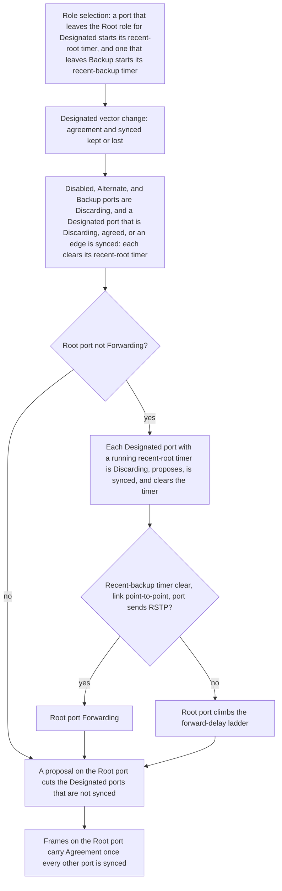

# Spanning Tree Handshake Scope and Inherited Priority - Plan

## Goal

A new Root port forwards as soon as the tree's recent Root ports have stopped,
whatever the tree's sync state. A proposal on a tree's Root or Alternate
port cuts only the Designated ports of that tree that are not synced, an
MSTI's boundary port included. A tree port or a VLAN tree that sets no
priority of its own follows the bridge each time the configuration is
normalized. The means is a recent-root and a recent-backup timer per tree
port, a stored `synced` flag that the layer keeps the way the Port
Information and Port Role Transitions machines do, and a normalize that
leaves `PriorityPresent` as the caller wrote it. Stop condition: if holding
an MSTI's cut at a boundary port needs that MSTI port to forward while the
CIST's port there is Discarding, the CIST mirror no longer bounds the
change, and the phase returns to the user with U1, U2, U4, and U5 landed.

## Decisions

"Rules" is the list under Inventory that cites each rule.

- The parent's Decisions apply.
- This phase holds four behaviors of `layer/stp`: which Designated ports a
  proposal cuts (one holding an agreement keeps it), the same sync at a
  boundary port, an MSTI proposal in a record that is not stored, and an
  inherited port priority that follows the bridge port. The spanning tree
  phase, landed 2026-10-07, left them to a later phase, and
  `src/common/sim/layer/stp/README.md` lists each under Limits.
  (decided by the user, 2026-10-07)
- A sync cuts a Designated port only when it is not synced, and `synced` is
  stored per tree port, for the CIST, an MSTI, and a PVST VLAN tree alike.
  A port is synced while it is Discarding, holds an agreement, or is an
  edge. It stays synced after it leaves Discarding, and loses that when its
  designated priority vector changes while it holds no agreement, or when
  it takes the Designated role from another one. Why: Rules 1 and 2. Today
  `syncTree` cuts every non-edge Designated port and `isSynced` computes
  the flag as Discarding or agreed (Correctness 1 and 6). A port that ends
  the ladder holds no agreement, as in the 2003 edition and the layer
  today. The draft gives it one (Rules 2).
- An agreement survives a change of the port's designated priority vector
  only when the new vector is better than or the same as the one it
  replaces. This joins the phase although it is not one of the four named
  behaviors. Why: Rules 3. A port that keeps its agreement through a sync
  would otherwise forward on an agreement its peer gave to a better vector,
  which makes the sync rule unsafe alone. The rule shares one site with
  the `synced` rule, the point where a tree's Designated ports take a new
  vector.
- A change of the designated times alone leaves `synced` and the agreement
  as they are. This is the layer's own rule, and U6 states it under Limits.
  Why: the draft runs UPDATE for it (Rules 4), the layer stores no times
  for a Designated port, and a timer change moves no port's role.
- An MSTI's sync takes in a boundary port that holds the Designated role.
  The port's MSTI state is then Discarding while the CIST forwards there,
  until the MSTI port holds an agreement or its own forward-delay ladder
  ends. Why: Rules 5. The sync is set on every port of the bridge, an MSTI
  has a role of its own where the CIST is Designated, and the 2003 text
  says an MSTI's Port State may differ to suppress temporary loops. The
  agreement reaches the MSTI port as today, copied from the CIST's on a
  BPDU from another region (Rules 6).
- The CIST mirror stays for everything else at a boundary port: the role,
  the state while no MSTI cut holds, and the CIST's own cut reaching the
  boundary MSTIs (`src/common/sim/layer/stp/receive.go:38-58`). A boundary
  port that holds the CIST's Root role, the standard's Master Port, is not
  cut by an MSTI's sync, which U6 states under Limits as the layer's own
  rule. Why: the layer has no Master role and no `synced` for a Root port,
  which the draft's condition for forwarding a Master Port again reads
  (Rules 7).
- An MSTI proposal in a record that is not stored is not acted on, as
  today. Why: Rules 8. Both figures record a proposal for superior or
  repeated information alone, which is what the layer stores. The layer's
  test for the same source is narrower than the standard's, and U6 states
  that under Limits.
- A record the layer discards for its hop count carries no proposal either.
  This is the layer's own rule, and U6 states it under Limits. Why: the
  layer discards information at the hop bound before storing it
  (`src/common/sim/layer/stp/receive.go:456-460`, `:170-172`), where the
  2003 edition stores it and ages it at once (Rules 9), and neither
  document fixes whether the port acts on the proposal first.
- An instance or VLAN port that sets no priority of its own gets the
  bridge port's from `Config.Normalize`, and `PriorityPresent` stays as
  the caller wrote it, so normalizing again inherits again. This amends
  U3's "marks it present". Why: `Switch.Config` and `Fabric.Config` return
  normalized configurations, and a caller that reads one back and changes
  the bridge port priority must see the tree ports follow it. `Diff`
  reports the effective change on each inheriting tree port. (decided by
  the user, 2026-10-05)
- The switch composition phase does not wait on this one. The phase's
  checks include the suites of `src/common/sim/device/vswitch` and
  `src/common/sim/fabric`, and each unit names the test there that its rule
  moves or that proves it. Why: the sync rule alone leaves one switch test
  failing (Correctness 7), so the earlier statement that no test outside
  `layer/stp` is touched was wrong. Tests under Inventory lists what each
  rule moves there. The one test this phase adds to `vswitch` goes into a
  new file, so it edits nothing another phase rewrites.
- The phase gains a Root reroot unit ahead of its sync rule. A new Root
  port forwards when the tree is re-rooted, which the standard separates
  from sync (`Q2003` 13.25.10 and Figure 13-17, `D2009` Figure 13-24), and
  `TestMSTITopologyChangeFlushesOnlyItsOwnVLAN` holds as written. The
  re-plan specifies the reroot state, its timers, and the transition order
  before implementation resumes. (decided by the user, 2026-10-07)
- A VLAN tree's inherited bridge priority follows the bridge through every
  normalize, as a tree port's inherited priority does. (decided by the
  user, 2026-10-07)
- The layer keeps two timers per tree port for the reroot, a recent-root
  deadline and a recent-backup deadline, and stores no `reRoot` flag. Why:
  Rules 12 to 15. A request raised by `setReRootTree` discards a recent Root
  port, which is then synced, which clears its timer, which retires the
  request. A port state changes within one call in the layer, so the whole
  chain runs in one evaluation and nothing is left to store. `reRooted`
  (Rules 11) therefore holds for every Root port that is not Forwarding
  once that evaluation has run, which is the only port that reads it. A
  Designated port that already forwards when it takes the Root role raises
  no request in either figure, since REROOT needs `!forward`, so the port
  that left the Root role keeps forwarding beside it with its timer
  running. The layer does the same.
- A recent Root port is cut whenever the tree's Root port is not Forwarding,
  also while the backup delay holds that Root port back. Why: `Q2003` Figure
  13-17 enters REROOT without reading `rbWhile`. `D2009` Figure 13-24 adds
  `rbWhile == 0` to that transition, drawn as an insertion of the draft
  (Rules 12). The plan follows the published edition it has read, as it does
  in Rules 2.
- A Root port forwards on the reroot only on a point-to-point link whose
  port sends RSTP, as it does today for its rapid transition
  (`src/common/sim/layer/stp/roles.go:320`). This is the layer's own rule,
  and U6 states it under Limits. Why: both figures read the bridge's Force
  Protocol Version here and no per-port variable (Rules 16), and the layer
  has no Force Protocol Version. `TestMigratedRootPortClimbsTheLadder`
  (`src/common/sim/layer/stp/layer_test.go:1345`) pins the `sendRSTP` half
  as intended behavior. Tests under Inventory names what removing both
  operands moves.
- The Root port's Agreement stays on `isSynced`, apart from its forwarding.
  Why: Rules 16 and 18. Forwarding reads `reRooted` and the backup delay,
  and the Agreement reads `allSynced`. `isSynced` passes over the Root port
  itself, which is the draft's form of `allSynced` and the layer's today
  (Rules 18).
- A boundary MSTI port holds no recent-root timer and is not cut by an
  MSTI's reroot. Why: the CIST mirror gives it the CIST's role and state
  (`src/common/sim/layer/stp/roles.go:193-205`, `:294-312`), and the port it
  stands for, the standard's Master Port, is never held at `FwdDelay`
  (Rules 13). A port that was an MSTI's Root port and then turns into a
  boundary port keeps its timer in the standard and loses it here, which U6
  states under Limits.
- The recent-root timer runs for the forward delay the tree's ladder uses,
  and the recent-backup timer for twice the layer's Hello Time
  (`src/common/sim/layer/stp/info.go:165-177`). Why: Rules 13 and 17 name
  `FwdDelay` and `HelloTime`, and the layer already reads both from `times`
  for every tree.
- The sync rule's code stays as commit `20926da9` holds it. U2 is what that
  commit left open: `isSynced` still computes the flag
  (`src/common/sim/layer/stp/roles.go:25`). Why: the commit's tests pass
  once U1 lands (Tests), so nothing in it is rebuilt.
- `PVST.Normalize` writes the bridge's priority into a VLAN tree that sets
  none and leaves the tree's `PriorityPresent` false, and `Tree.Canonical`
  prints the stored priority. Why: the Decision before this group, dated
  2026-10-07.
  `effectiveInstancePriority` reads an absent priority of zero as 32768
  (`src/common/sim/layer/stp/mst.go:165-170`), so a tree that inherits an
  explicit bridge priority of zero would otherwise read as 32768 in
  `Canonical` (Correctness 8).

## Requirements

R1. Every Correctness entry ends as a test that fails before its fix, or as
a test that pins today's behavior and fails under the mutation the entry
names. Example: with a proposal also collected before the `continue` at
`src/common/sim/layer/stp/receive.go:173`, U4's test fails.

R2. A proposal leaves a synced port forwarding and cuts one that is not.
Example: a PVST bridge whose ports have each stored a VLAN 1 BPDU has, on
its VLAN 10 tree, a Root port `p1`, a Designated port `p2` that forwards on
an agreement, and a Designated port `p3` that reached Forwarding through
the forward-delay ladder. A VLAN 10 BPDU arrives on `p1` from the stored
designated port with a lower root path cost and the Proposal flag. After
the call `p2` is Forwarding with its agreement, `p3` is Discarding, and
every VLAN 20 port is as it was. With the stored root path cost in that
BPDU, `p3` is Forwarding after the call.

R3. An agreement does not outlive a worse designated vector. Example: the
BPDU of R2 arrives with a higher root path cost. After the call `p2` holds
no agreement and is Discarding.

R4. An MSTI's sync cuts a boundary port for that MSTI alone. Example: an
MSTP bridge has an internal Root port `p1` and a boundary port `p2` that is
Designated and forwards for the CIST and for MSTI 1 without an agreement.
A BPDU arrives on `p1` with unchanged CIST fields and an MSTI 1 record that
names a better regional root with the Proposal flag. After the call
`VLANPortInfo(10, "p2").State` is Discarding, `PortInfo("p2").State` is
Forwarding, and the MSTI 1 record sent on `p1` carries the Agreement flag.
The MSTI state returns to Forwarding through Learning as `Advance` steps
the port's forward-delay ladder.

R5. A record that is not stored starts no handshake. Example: MSTI 1's port
`p2` is Alternate on a record stored from bridge B. A BPDU from bridge C
arrives on `p2` whose MSTI 1 record is worse than the stored one and has
the Designated role and the Proposal flag. The call's `Effects` hold no
frame for `p2`, and every MSTI 1 port has the state it had.

R6. An inherited port priority follows the bridge port. Example: a
configuration whose MSTI 1 port `1/1/1` sets only a path cost is
normalized, its bridge port `1/1/1` priority is changed from 128 to 64, and
it is normalized again. The MSTI 1 port's priority is 64 with
`PriorityPresent` false, and the layer built from it reports 64 for that
port on VLAN 10.

R7. `src/common/sim/layer/stp/README.md` states each behavior as the layer
has it after the phase. Example: the Limits entry that begins "A proposal
cuts every other non-edge Designated port" is gone.

R8. A new Root port forwards in the call that selects it, whatever the
tree's sync state, and sends no Agreement until the tree is synced.
Example: on an MSTP bridge, MSTI 1 has a Root port `l2` that forwards, an
Alternate port `l1`, and a Designated port `p3` that forwards on an
agreement. `l2` goes down, which raises MSTI 1's root path cost. After the
call MSTI 1's `l1` is Root and Forwarding, `p3` is Forwarding with no
agreement and with `synced` false, and the MSTI 1 record sent on `l1`
carries no Agreement flag.

R9. A recent Root port stops forwarding before the new Root port starts.
Example: an RSTP bridge has a Root port `p1` that forwards and an Alternate
port `p2`. A BPDU on `p2` names a better root, so `p2` becomes Root and `p1`
Designated. After the call `p1` is Discarding and proposing, and `p2` is
Forwarding. In the second form the information on both ports ages out
first, so the bridge is the root and `p1` is Designated and still
Forwarding. One forward delay or longer after that, a BPDU with no Proposal
flag on `p2` names a better root. After the call `p2` is Root and
Forwarding and `p1` is still Forwarding.

R10. A port that was a Backup port within the last two Hello Times does not
forward on the reroot. Example: `p2` is a Backup port and at `t` a BPDU on
it names a better root, so `p2` becomes Root. After that call `p2` is not
Forwarding and `NextWake` reports `t` plus twice the Hello Time or earlier.
After `Advance` at that instant `p2` is Forwarding.

R11. A VLAN tree's inherited bridge priority follows the bridge. Example: a
PVST configuration whose VLAN 10 tree sets no priority is normalized, its
bridge priority is changed from 32768 to 4096, and it is normalized again.
The VLAN 10 tree's priority is 4096 with `PriorityPresent` false, the
VLAN 10 BPDU of the layer built from it carries bridge priority 4096 with
system ID extension 10, and `Diff` between the two normalized
configurations reports the VLAN 10 tree's priority from 32768 to 4096.

## Out of scope

- The bridge's Force Protocol Version, which the layer does not have, and
  the draft's `rbWhile` term on REROOT (Decisions). U6 adds both to Limits.
- A ladder step of one Hello Time on a port that sends RSTP (Rules 19).
  Limits in `src/common/sim/layer/stp/README.md` already states it.
- An MST instance's own priority, which `MST.Normalize` fills with 32768
  and never takes from the bridge
  (`src/common/sim/layer/stp/mst.go:181-184`), so no normalize changes it.
- The Master role, the disputed flag, and a frame sent at once when a
  Designated port's vector changes. Limits in
  `src/common/sim/layer/stp/README.md` states each as absent.
- The `agree` flag of a port that has sent an Agreement. The layer has
  none, so every proposal on a Root or Alternate port starts a sync, where
  the figures need `proposed && !agree` (Rules 10). U6 adds it to Limits.

## Inventory

Paths are as of commit `f4befaf4`. `S` is `src/common/sim/layer/stp`. Each
"with ..." sentence names an edit that was applied, tested with the command
it names, and reverted.

### Sources

- `Q2003`: IEEE Std 802.1Q, 2003 Edition, clauses 13 and 14,
  https://bittwist.sourceforge.io/doc/802.1Q-2003.pdf. Page numbers are the
  printed ones, 15 less than the PDF's.
- `D2009`: P802.1aq/D1.5 with suggested changes, 12 May 2009, clause 13,
  https://www.ieee802.org/1/files/public/docs2009/aq-seaman-merged-spanning-tree-protocols-0509.pdf.
  An unapproved working draft. Page numbers are the printed ones, 2 more
  than the PDF's.
- `UNH`: UNH-IOL Rapid Spanning Tree Conformance Test Suite,
  https://www.iol.unh.edu/sites/default/files/testsuites/bfc/RSTP_conformance_Q.pdf.
  Its text holds no test of a sync against a second Designated port: the
  word appears once, in the Migration Delay discussion (PDF page 44). Its
  references are to IEEE Std 802.1Q-2011. Page numbers are the PDF's.
- Not read: the published IEEE Std 802.1Q-2011, and IEEE Std 802.1D, 1998
  Edition, to whose 17.15 `Q2003` 13.21 (page 180) leaves the definition
  of each timer. A rule below that cites `D2009` alone rests on the draft:
  Rules 4 and 7, the g) to k) half of Rules 5, the `rbWhile` term of
  Rules 12, the definition in Rules 17, and the Root port's exclusion in
  Rules 18.

`Q2003` Figures 13-14, 13-16, and 13-17 and `D2009` Figures 13-20 and 13-22
to 13-26 were read from the rendered pages, so each condition is the one
drawn on its transition. Rules 11 to 20, Correctness 7 and 8, and the lines
the Decisions and Units cite are as of commit `daaa04a0`.

### Rules

1. A sync discards a Designated port only when it is not synced. `D2009`
   Figure 13-25 (page 79) enters DESIGNATED_DISCARD on `((sync && !synced)
   || (reRoot && (rrWhile != 0)) || disputed || isolate) && !operEdge &&
   (learn || forward)`. `Q2003` Figure 13-17 (page 204) enters LISTEN on
   `(learn || forward) && !operEdge && (role != RootPort) && ((sync &&
   !synced) || (reRoot && (rrWhile != 0)))`. `Q2003` 13.24.27 (page 189)
   and `D2009` 13.27.65 (page 57) have `sync` discard a port only "if the
   Port is not already synchronized". ROOT_PROPOSED (`D2009` Figure 13-24,
   page 78) and ALTERNATE_PROPOSED (Figure 13-26, page 79) call
   `setSyncTree()`.
2. `synced` is stored. `D2009` Figure 13-25 enters DESIGNATED_SYNCED, which
   sets it, on `(!learning && !forwarding && !synced) || (agreed &&
   !synced) || (operEdge && !synced) || (sync && synced)`. `Q2003` Figure
   13-17 enters SYNCED on the same terms, with `&& (role != RootPort)` on
   the first, so a Discarding Root port is not synced by it. `D2009` Figure
   13-20 (page 75) clears the flag in UPDATE as `synced = synced &&
   agreed`. `Q2003` Figure 13-14 (page 201) has `synced = FALSE` there,
   after which SYNCED sets it again for a port whose agreement UPDATE kept.
   The two differ on a port that ends the ladder: `D2009` DESIGNATED_FORWARD
   has `agreed = sendRSTP`, `Q2003` FORWARD assigns no `agreed`, and the
   layer's ladder leaves it false (`S/advance.go:148-158`). The plan follows
   `Q2003` and the layer, so a later vector change costs such a port its
   `synced` where the draft's port keeps both.
3. `D2009` Figure 13-20 UPDATE has `agreed = agreed &&
   betterorsameInfo(Mine)`, and 13.29.1 b) (page 62) makes that true when
   "the designatedPriority vector is better than or the same as (13.10)
   the portPriority vector". `Q2003` Figure 13-14 has `agreed = agreed &&
   betterorsameInfoXst() && !changedMaster`.
4. `D2009` 13.29.33 k) (page 70) sets `updtInfo` for a Designated port when
   "the port priority vector differs from the designated priority vector
   or the port's associated timer parameter(s) differ(s) from the Root
   Port's associated timer parameters".
5. `D2009` 13.29.24 (page 66) and `Q2003` 13.26.18 (page 194) set `sync`
   "for this tree (the CIST or a given MSTI)" for all ports of the bridge.
   `D2009` 13.29.33 g) and h) (page 69) take an MSTI's role from the CIST's
   only where the CIST's port priority was received from another region,
   the Root and Alternate cases, and k) (page 70) makes every other port
   Designated by the MSTI's own vectors. Neither Port Role Transitions
   figure has a boundary condition. `Q2003` 13.24.25 NOTE (page 189) says
   "The Port State for each MSTI may differ for each MSTI as required to
   suppress temporary loops". `Q2003` 13.13 f) (page 169) has a Boundary
   Port forward the CIST and all MSTIs alike, under Stable Connectivity,
   which 13.13 opens as the case where spanning tree information "is not
   changing on any Bridge Port".
6. `D2009` 13.29.16 (page 65) and `Q2003` 13.26.9 (page 193) give every
   MSTI the CIST's `agreed` on a message from another region. The layer
   does it at `S/receive.go:557-570`.
7. `D2009` Figure 13-23 (page 77) enters MASTER_DISCARD on `sync &&
   !synced` and leaves for MASTER_LEARN and MASTER_FORWARD on `(fdWhile ==
   0) || allSynced`. 13.28.2 b) 4) (page 59) makes `allSynced` true for a
   Master Port when `synced` is true for every other port of the tree, the
   Root port among them, which Figure 13-24 (page 78) sets only on `agreed
   && !synced` or `sync && synced`. The standard's Master Port can
   therefore stay Discarding for its ladder, and the layer's does not.
8. `D2009` Figure 13-20 calls `recordProposal()` in SUPERIOR_DESIGNATED and
   REPEATED_DESIGNATED alone and `recordDispute()` in INFERIOR_DESIGNATED.
   `Q2003` Figure 13-14 calls `recordProposalXst()` in the same two states.
   `D2009` 13.29.13 (pages 63 and 64) returns SuperiorDesignatedInfo for a
   Designated message whose priority is superior, and 13.11 (pages 23 and
   24) makes an MSTI message superior when it is better or its "Designated
   Bridge Identifier Bridge Address and Designated Port Identifier Port
   Number components are the same". The layer stores a record that is
   better or whose whole bridge and port identifiers match, priority bits
   included (`S/receive.go:142-161`, and `:494` for the CIST), so a sender
   that changes a priority and sends a worse vector is stored by the
   standard and not by the layer. `D2009` 13.29.20 (page 66) tests the role
   and the flag and nothing else. It describes the procedure, and the
   figure decides when it runs.
9. `Q2003` 13.26.24 (page 196) sets an MSTI's `rcvdInfoWhile` to "zero, if
   mstiPortTimes remainingHops is less than or equal to zero", after
   setting that count to the received value less one, and 13.26.23 e) (page
   196) does the same for internal CIST information. `D2009` 13.29.32 (page
   68) takes the count from the CIST's `portTimes` alone, so the draft
   gives no rule for a record's own count.
10. `D2009` Figures 13-24 and 13-26 enter ROOT_PROPOSED and
    ALTERNATE_PROPOSED on `proposed && !agree`, and `Q2003` Figure 13-17
    enters PROPOSED on the same. `agree` is the agreement the port has
    sent, which Figure 13-20 keeps through superior information as `agree =
    agree && betterorsameInfo(Received)`. The layer answers every proposal
    on a Root or Alternate port (`S/receive.go:642-665`).

11. `reRooted` is "TRUE if the rrWhile timer is clear (zero) for all Ports
    for the given Tree other than the given Port" (`Q2003` 13.25.10, page
    190, and `D2009` 13.28.19, page 60).
12. `setReRootTree()` "sets reRoot TRUE for this tree (the CIST or a given
    MSTI) for all Ports of the Bridge" (`Q2003` 13.26.16, page 194, and
    `D2009` 13.29.22, page 66). `Q2003` Figure 13-17 (page 204) calls it in
    REROOT, entered on `!forward && !reRoot && (role == RootPort)`. `D2009`
    Figure 13-24 (page 78) enters REROOT on `!forward && (rbWhile == 0) &&
    !reRoot`, where the `rbWhile` term is underlined as one of the draft's
    suggested changes. A Root port clears its own `reRoot` once it forwards:
    REROOTED, on `reRoot && forward`, in both figures.
13. A Root port holds its recent-root timer at `FwdDelay`. `Q2003` Figure
    13-17 enters ROOT on `(rrWhile != FwdDelay) && (role == RootPort)` and
    sets `rrWhile = FwdDelay`, and `D2009` Figure 13-24 does the same in
    ROOT_PORT. The timer then runs down once the port leaves the role: the
    Port Timers machine decrements `rrWhile` and `rbWhile` each second
    (`Q2003` Figure 13-11, page 199, and `D2009` Figure 13-15, page 71). No
    other state sets `rrWhile` above zero but INIT_PORT, which a port leaves
    for the Disabled role at once. `D2009` Figure 13-23 (page 77) gives the
    Master Port no such assignment. Both documents keep the timer per port
    for the CIST and for each MSTI (`Q2003` 13.21, page 181, and `D2009`
    13.25.7, page 45, "The Recent Root timer").
14. The timer is cleared where a port is known not to forward as a recent
    Root port. `Q2003` Figure 13-16 (page 203) sets `synced`, zeroes
    `rrWhile`, and clears `sync` and `reRoot` in BLOCKED_PORT for a
    Disabled, Alternate, or Backup port, entered once the port is neither
    learning nor forwarding. `D2009` Figure 13-22 (page 77) does the same in
    DISABLED_PORT and Figure 13-26 (page 79) in ALTERNATE_PORT. For a
    Designated port `D2009` Figure 13-25 (page 79) zeroes `rrWhile`, sets
    `synced`, and clears `sync` in DESIGNATED_SYNCED, on the entry terms of
    Rules 2, and `Q2003` Figure 13-17 has `if (role != RootPort) rrWhile =
    0` in SYNCED.
15. A reroot discards a Designated port that was a Root port recently and
    still forwards. `D2009` Figure 13-25 enters DESIGNATED_DISCARD on
    `((sync && !synced) || (reRoot && (rrWhile != 0)) || disputed ||
    isolate) && !operEdge && (learn || forward)` and there clears `learn`,
    `forward`, and `disputed` and sets `fdWhile = forwardDelay`. `Q2003` Figure 13-17 enters
    LISTEN on `(learn || forward) && !operEdge && (role != RootPort) &&
    ((sync && !synced) || (reRoot && (rrWhile != 0)))`. Neither state touches
    `synced`. A port that left the Root role has lost it before, in UPDATE:
    `Q2003` Figure 13-14 has `synced = FALSE` there, and `D2009` Figure 13-20
    has `synced = synced && agreed` after the assignment of Rules 3. In the
    layer `trackDesignatedVector` does it
    (`src/common/sim/layer/stp/roles.go:257-258`). Once discarded the port
    is neither learning nor forwarding and not synced, which is an entry
    term of DESIGNATED_SYNCED (Rules 14), and with its timer at zero it
    leaves the request: `D2009` DESIGNATED_RETIRED on `reRoot && (rrWhile ==
    0)`, and `Q2003` REROOTED on `reRoot && (((role == RootPort) && forward)
    || (rrWhile == 0))`. While the request and the timer both stand, the
    port may not learn or forward on an agreement: both figures have
    `((rrWhile == 0) || !reRoot) && !sync` in that term. A proposing port
    that is discarded proposes again: DESIGNATED_PROPOSE on `!forward &&
    !agreed && !proposing && !operEdge`.
16. A Root port learns and forwards on the reroot or on its ladder, and on
    nothing else. `Q2003` Figure 13-17 enters LEARN on `!learn && ((fdWhile
    == 0) || ((role == RootPort) && (reRooted && (rbWhile == 0)) &&
    (ForceVersion >= 2)) || ...)` and FORWARD on the same with `learn &&
    !forward`. `D2009` Figure 13-24 enters ROOT_LEARN on `((fdWhile == 0) ||
    (reRooted && (rbWhile == 0)) && (rstpVersion)) && !learn`, with `&&
    (agreed || !spt)` inserted for shortest path trees, and ROOT_FORWARD on
    the same with `learn && !forward`. `rstpVersion` is "TRUE if
    ForceProtocolVersion (13.7.2) is greater than or equal to 2" (`D2009`
    13.28.20, page 60), a parameter of the bridge (`Q2003` 13.22 a), page
    181). Neither transition reads `sync`, `synced`, `allSynced`,
    `sendRSTP`, or `operPointToPointMAC`. The reason is `Q2003` 13.16.2
    (page 173) and `D2009` 13.16.2 (page 29): the Root port "can be
    transitioned to Forwarding immediately" provided that "all prior recent
    Root Ports" of the bridge "have been transitioned to Discarding and the
    Root Port was not a Backup Port recently".
17. A Backup port holds its recent-backup timer at twice the Hello Time.
    `Q2003` Figure 13-16 enters BACKUP_PORT on `(rbWhile != 2*HelloTime) &&
    (role == BackupPort)` and sets `rbWhile = 2*HelloTime`, and `D2009`
    Figure 13-26 does the same. `D2009` 13.25.5 (page 45) calls it "The
    Recent Backup timer. Maintained at its initial value, twice HelloTime,
    while the Port is a Backup Port." No state but INIT_PORT clears it, so it
    runs down after the port leaves the role, through any role it takes.
18. A Root port sends its Agreement when the tree is synced. `Q2003` Figure
    13-17 enters AGREES on `allSynced && (proposed || !agree)`, and `D2009`
    Figure 13-24 enters ROOT_AGREED on `(allSynced && !agree) || (proposed &&
    agree)`. `D2009` 13.28.2 b) 1) (pages 58 and 59) makes `allSynced` true
    for a Root or Alternate port when "synced is TRUE for all ports for the
    given tree other than the Root Port". `Q2003` 13.25.1 (page 189) has it
    "TRUE if and only if synced is TRUE for all Ports for the given Tree",
    the Root port included. A proposal starts the sync: PROPOSED and
    ROOT_PROPOSED call `setSyncTree()` (`Q2003` 13.26.18, page 194, and
    `D2009` 13.29.24, page 66).
19. Nothing in the Port Information machine touches the reroot. UPDATE
    assigns `proposing`, `proposed`, `agreed`, and `synced` and neither
    `reRoot` nor a timer (`Q2003` Figure 13-14, page 201, and `D2009` Figure
    13-20, page 75). `sendRSTP` enters the draft's Root transitions through
    the ladder alone: `D2009` 13.28.8 (page 59) has `forwardDelay` return
    "the value of HelloTime if sendRSTP is TRUE, and the value of FwdDelay
    otherwise".
20. `UNH` RSTP.op.5.2 Part A (PDF page 48) observes the reroot. The port to
    TS1 is the Root port, becomes Alternate when TS2 sends better
    information, and is Root again once TS2 stops and its information ages.
    The suite waits 6 seconds, sends frames from TS1, and expects TS3 to
    receive them within 2 seconds. Each BPDU it sends has flags `3C` (PDF
    pages 51 and 62), which is the Designated role with Learning and
    Forwarding and no Proposal, so no sync runs. The suite does not say how
    the port to TS3 came to forward.

### Correctness

1. High. A proposal cuts a Designated port that holds an agreement.
   `syncTree` clears `agreed` and sets Discarding on every non-edge
   Designated port of the tree (`S/receive.go:24-37`). With `&&
   !otherP.agreed` added to the test at `:24`, `go test
   ./src/common/sim/...` fails four tests, all in `S`:
   `TestSyncCutRetainsTopologyActivity` (`S/topology_activity_test.go:11`),
   `TestSyncCutRestartsAutoEdgeDelay` (`S/layer_test.go:1250`),
   `TestNonCISTProposalCannotRestartEdgeDelay` (`S/edge_delay_test.go:76`),
   and `TestMSTISyncLeavesABoundaryPort` (`S/agreement_test.go:491`). Each
   expects an agreed port to be Discarding after the sync.
2. Medium. An MSTI's sync skips a boundary port. `syncTree` passes over it
   (`S/receive.go:16-18`), `isSynced` reads the CIST port's state and
   agreement in its place (`S/roles.go:17-24`), and
   `TestMSTISyncLeavesABoundaryPort` pins both. `updatePortStates` writes
   the CIST's state onto a boundary MSTI port on every recompute
   (`S/roles.go:258-264`), so a cut written there alone is overwritten.
3. Low. An MSTI proposal in a record that is not stored is ignored.
   `receiveMSTIs` leaves the loop for a record that is neither from the
   stored source nor superior (`S/receive.go:161-168`) and for one with at
   most one remaining hop (`:170-172`), and collects a proposal only after
   the store (`:193-195`). No test pins it: with a proposal also collected
   before the `continue` at `:167`, `go test ./src/common/sim/layer/stp/`
   passes.
4. High. An inherited port priority stops following the bridge port after
   one normalize. `Config.Normalize` fills an instance or VLAN port's
   priority from the bridge port and sets `PriorityPresent`
   (`S/config.go:221-228`, `:239-246`), so a second normalize reads the
   value as the caller's. With the assignments at `:227` and `:245`
   removed, `go test ./src/common/sim/...` fails one test,
   `TestInstancePortPriorityIsResolvedOnceInNormalize`
   (`S/wire_format_test.go:131`), in the two subtests that assert the flag.
5. High once entry 1 is fixed. An agreement outlives a worse designated
   vector. `assignRoles` clears `agreed` on a role change alone
   (`S/roles.go:232-236`). Today the sync clears every agreement, so no
   sync shows the difference.
6. Medium. The layer computes `synced` where the standard stores it
   (`S/roles.go:25`). A Designated port that reached Forwarding through the
   forward-delay ladder, and whose designated vector has not changed since,
   is synced in both documents and cut by the layer.

7. High once entry 1 is fixed. A new Root port waits on the tree's sync,
   where the standard forwards it on the reroot (Rules 16).
   `updatePortStates` forwards a Root port only when `isSynced` holds
   (`S/roles.go:319-327`), `handleProposal` does the same after a sync
   (`S/receive.go:69-80`), and a tree port has no recent-root or
   recent-backup timer (`S/portstate.go:27-73`). With commit `20926da9` a
   Designated port whose vector worsens loses its agreement and `synced`
   and keeps forwarding, so `isSynced` fails and the Root port climbs the
   ladder. `go test ./src/common/sim/... ./test/conformance/sim/...` fails
   one test at that commit, `TestMSTITopologyChangeFlushesOnlyItsOwnVLAN`
   (`src/common/sim/device/vswitch/switch_test.go:7647-7651`): `sw2 MSTI 1
   on l1 after l2 down = role Root state Discarding, want Root Forwarding`.
   Before that commit the layer broke the same rule the other way: a
   recent Root port kept forwarding as a Designated port while the new Root
   port waited, and a proposal was what cut it.
8. Medium. A VLAN tree's inherited bridge priority stops following the
   bridge after one normalize. `PVST.Normalize` fills the tree's priority
   from the bridge's and sets `PriorityPresent` (`S/pvst.go:99-103`), so a
   second normalize reads the value as the caller's. With the assignment at
   `:102` removed, `go test ./src/common/sim/...
   ./test/conformance/sim/...` fails one more test than entry 7 names,
   `TestPVSTNormalizeInsertsDefaultVLAN1` (`S/config_test.go:1047-1049`).

### Completeness

- `S/README.md` lists the four behaviors under Limits at `:544`, `:551`,
  `:552`, and `:559`, and each path and line range there matches the tree.
  The entry at `:556`, an MSTI Root port that cannot complete its sync
  while a boundary port forwards for the CIST without an agreement, stops
  being true with U3. The MSTP section describes the boundary sync at
  `:419-423`.
- `PVST.Normalize` returns every tree with `PriorityPresent` true, and an
  inheriting one with the bridge's priority (`S/pvst.go:91-107`). Two
  callers read the result. `Config.Normalize` stores it
  (`S/config.go:235-252`), and `validatePVSTCoversEveryVLAN` reads the keys
  of its `Trees` and no priority
  (`src/common/sim/device/vswitch/config.go:426-440`). Five sites read a
  normalized tree's priority. `pvstBridgeID` takes the bridge's priority
  when the flag is false (`S/layer.go:278-288`), so it needs no change.
  `Tree.Canonical` (`S/pvst.go:25-34`) and `PVST.Validate` (`S/pvst.go:125`)
  go through `effectiveInstancePriority`, which reads zero with the flag
  false as 32768 (`S/mst.go:165-170`). `diffPVSTTree` compares the stored
  priorities (`S/diff.go:502-511`), and `RetentionKey` prints each tree's
  `Canonical` after normalizing (`S/layer.go:412-428`).
- The Decision on inheritance is carried word for word from the spanning
  tree phase's plan as commit `bc06df79` holds it. Its U3 is that plan's
  unit "Wire format and configuration identity", whose Change has
  `Config.Normalize` mark the inherited value present.
- The device path normalizes through the layer and adds no rule.
  `vswitch.Config.Normalize` calls the layer's
  (`src/common/sim/device/vswitch/config.go:552`), a switch stores that
  result (`src/common/sim/device/vswitch/switch.go:85`) and returns it from
  `Config` (`:486`), and a fabric normalizes each switch the same way
  (`src/common/sim/fabric/fabric.go:395`, `:411`).

### Tests

- No test fails when the boundary skip also applies to a PVST tree: with
  the `l.mst != nil` operand removed at `S/receive.go:16`, `go test
  ./src/common/sim/layer/stp/` passes. R2's fixture gives every port a
  stored VLAN 1 BPDU for this reason, since that is what marks a PVST
  bridge's ports external.
- `PortInfo` carries no agreement, no `synced`, and no timer (`S/info.go`),
  so a test that reads one is internal to the package.
- The reroot rule of U1 was applied to commit `20926da9` as the Decisions
  state it, with both link operands kept. `go test ./src/common/sim/...
  ./test/conformance/sim/...` then passes
  `TestMSTITopologyChangeFlushesOnlyItsOwnVLAN` and fails two tests, both
  in `S` and none in `vswitch`, `fabric`, or the conformance suite.
  `TestARoleChangeCostsALadderPortItsSyncedFlag`
  (`S/sync_internal_test.go:191`) expects a port that leaves the Root role
  to keep forwarding while another port becomes Root, which is the port
  the reroot cuts. The first subtest of `TestAgreementWaitsForRoleSelection`
  (`S/agreement_test.go:385-453`) expects a new Root port to stay
  Discarding while a ladder-forwarded Designated port holds no agreement.
- With `isSynced` also reading the stored flag (U2), the same command fails
  the same two tests and no other.
- With the point-to-point and `sendRSTP` operands also removed from the
  Root port's rule, five more tests fail, all in `S`:
  `TestMigratedRootPortClimbsTheLadder`, `TestEdgeDelayCallSequences`,
  `TestLearningUsesTheReceivedForwardDelay`,
  `TestVLANTreeReportsAChangeInSTPMode`, and the `legacy TCN` subtest of
  `TestDetectionTransmitsOnTheDetectingPort`.
- No test under `src/common/sim` pins the backup delay: the first probe
  above held a recent Backup port back and moved no test for it.
- The boundary rule of U3 has not been probed against `vswitch` and
  `fabric`, since it needs the unit built.
- The comment of `TestMSTNormalizeDoesNotOverrideUnsetInstancePortPriority`
  (`S/mst_test.go:401-405`) names the layer as the reader of the flag. The
  reader is `Config.Normalize`.

## Units

### U1. A new Root port forwards on the reroot
Files: src/common/sim/layer/stp/portstate.go, src/common/sim/layer/stp/roles.go, src/common/sim/layer/stp/receive.go, src/common/sim/layer/stp/link.go, src/common/sim/layer/stp/advance.go, src/common/sim/layer/stp/reroot_internal_test.go, src/common/sim/layer/stp/reroot_test.go, src/common/sim/layer/stp/sync_internal_test.go, src/common/sim/layer/stp/agreement_test.go
After: none
Change: a tree port holds the instant it left the Root role for
Designated and the instant it left the Backup role, each zero when clear.
Its recent-root deadline is the first instant plus the forward delay
`times` returns for the tree when the deadline is read, and its
recent-backup deadline is the second plus twice the Hello Time read the
same way. Storing the instant keeps a deadline on the delay the ladder
uses, since the first role assignment of a receive runs while the port
still holds the previous Forward Delay
(`src/common/sim/layer/stp/receive.go:527-530`, `:543`, `:579-582`). Role
assignment records both instants. It runs twice in one receive (`:543`,
`:584`), so both key on the role change, which the second run does not
see. `LinkChange` writes a role itself in two places, the Disabled role
on a link that goes down (`src/common/sim/layer/stp/link.go:81`) and the
Designated role on an up link whose point-to-point status changes
(`:160`), so it records the Backup instant in both for a port that was
Backup. A deadline that has passed reads as clear.

`updatePortStates` then works in this order for a tree, as the diagram
under Rules draws it. First it clears the recent-root deadline of every
Disabled, Alternate, and Backup port, of every boundary MSTI port, and of
every Designated port its existing pass marks synced because it is
Discarding, holds an agreement, or is an edge (Rules 14). Second, when the
port the tree's election named holds the Root role, is not a boundary MSTI
port, and is not Forwarding, it cuts every non-edge Designated port whose
recent-root deadline is running and that is not Discarding: the port is
Discarding with its ladder
restarted, proposes and requests a frame as `syncTree` has a cut port do,
is synced, and has its deadline cleared (Rules 12 and 15). A boundary MSTI
port is passed over. Third, the Root port is Forwarding when its
recent-backup deadline is clear, its link is point-to-point, and its port
sends RSTP, and it climbs the forward-delay ladder otherwise (Rules 16 and
17). `reRooted` needs no test of its own there, since the first two steps
leave no other port with a running deadline whenever the Root port is not
Forwarding (Decisions).

`Advance` recomputes a tree whose Root port is not Forwarding once that
port's recent-backup deadline passes, and `NextWake` reports the deadline
while it runs on such a port. A recent-root deadline needs neither, since
nothing waits on it. `handleProposal` runs the sync and no longer moves the
Root port (`src/common/sim/layer/stp/receive.go:71-79`).

Of commit `20926da9` this unit keeps the stored `synced` flag, the stored
designated vector, `trackDesignatedVector`, and the `syncTree` rule that
passes over a synced port. It changes three things there: the `isSynced`
operand of the Root port's rule
(`src/common/sim/layer/stp/roles.go:320`), the forwarding branch of
`handleProposal`, and the pass at
`src/common/sim/layer/stp/roles.go:275-280`, which also clears the
deadline. `isSynced` stays as it is and from here on decides the Agreement
alone (`src/common/sim/layer/stp/transmit.go:275`, `:336`).
Tests: `reroot_internal_test.go` reads the deadlines from the port state.
It holds R8 on an MSTI, and again on an RSTP bridge whose Designated port
reached Forwarding through the ladder. Both fail with the `isSynced`
operand restored, and the Agreement assertion fails if the flag follows
the Root port's state. It holds R9 in both forms and asserts that the cut
port's deadline is clear and its `synced` true. The first form fails with
the cut removed, since both ports then forward, and the second fails with
a deadline that never passes. One case gives the recent Root port an
agreement before the new Root port is selected and expects it Forwarding
after, which fails if an agreement leaves the deadline running. It holds
R10 with its `NextWake`
assertion, a second form in which the port goes down as a Backup port and
comes up to become Root inside the delay, and a third in which the port
leaves the Backup role for Designated, becomes Root more than twice the
Hello Time later, and forwards in that call. A fourth has the Backup port
on an up link whose point-to-point status changes and then become Root
inside the delay. One case joins R9 and R10: a recent Backup port becomes
Root while a recent Root port still forwards, and the recent Root port is
Discarding in that call while the new one waits, which fails if the cut
waits on the backup delay. One sends R9's first BPDU to a Designated port
that already forwards and expects both ports Forwarding after the call
with the former Root port's instant still set, which pins the case the
Decisions name. One has the BPDU that moves the Root role carry a Forward
Delay of 4 seconds over a stored 15, and expects the port that left the
role cut by a reroot 3 seconds later and not by one 5 seconds later. One case
repeats R8 with the new Root port's link not point-to-point and expects it
Discarding with a ladder running. One runs R9's first form on an MSTP
bridge whose recent Root port is an MSTI's and expects a boundary port of
that MSTI to keep the CIST's state. One runs it on VLAN 10 of a PVST bridge
and expects every VLAN 20 port as it was.
`reroot_test.go` replays `UNH` RSTP.op.5.2 Part A through `Receive` and
`Advance` with the suite's BPDU fields and its 2 second Hello Time (Rules
20): a third port forwards as Designated after its ladder, and the port
that returns to the Root role is Forwarding in the `Advance` that ages the
better information out. The suite's BPDUs are the second source here, since
every other case is written from the figures the code is written from.
`TestARoleChangeCostsALadderPortItsSyncedFlag` keeps its subject and moves
its fixture: the better information ages out with no other port holding
any, so the bridge is the root, and the port that left the Root role still
forwards with `synced` false. One forward delay later a proposal makes
another port Root and cuts the first through the sync.
The first subtest of `TestAgreementWaitsForRoleSelection` expects the new
Root port Forwarding with one more forward transition and one more
topology change. Its old expectation was the sync gate this unit removes.
The cross-package check is `go test ./src/common/sim/device/vswitch/ -run
TestMSTITopologyChangeFlushesOnlyItsOwnVLAN`, which passes with
`src/common/sim/device/vswitch/switch_test.go` as it stands. No expectation
in `vswitch` or `fabric` moves (Tests under Inventory), and one that does
is named in the commit body.
`TestMigratedRootPortClimbsTheLadder` covers the `sendRSTP` operand.
Nothing covers the draft's `rbWhile` term on the cut, which the unit does
not build.
Verify: `.claude/skills/verify-change/scripts/verify-change.sh -- src/common/sim/layer/stp/portstate.go src/common/sim/layer/stp/roles.go src/common/sim/layer/stp/receive.go src/common/sim/layer/stp/link.go src/common/sim/layer/stp/advance.go src/common/sim/layer/stp/reroot_internal_test.go src/common/sim/layer/stp/reroot_test.go src/common/sim/layer/stp/sync_internal_test.go src/common/sim/layer/stp/agreement_test.go src/common/sim/layer/stp/link_state_internal_test.go src/common/sim/layer/stp/topology_activity_test.go src/common/sim/layer/stp/layer_test.go src/common/sim/layer/stp/edge_delay_test.go src/common/sim/layer/stp/tree_internal_test.go`

### U2. The Root port's Agreement reads the stored flag
Files: src/common/sim/layer/stp/roles.go, src/common/sim/layer/stp/sync_internal_test.go
After: U1
Change: `isSynced` reads the stored `synced` flag of a Designated port in
place of its state and agreement
(`src/common/sim/layer/stp/roles.go:25`). A Designated port that forwards
after its ladder, with a vector that has not changed since, no longer
holds back the Agreement of the tree's Root or Alternate port. The
boundary branch stays as it is until U3. Everything else of the sync rule
is in commit `20926da9`, whose tests prove R2 and R3.
Tests: `sync_internal_test.go` gains three cases on R2's fixture. In the
first the BPDU on `p1` repeats the stored vector with the Proposal flag,
and the frame the call sends on `p1` carries the Agreement flag while `p3`
stays Forwarding. It fails with the computed form. In the second `p3` has
lost `synced` to a worse vector, no proposal has arrived, and the frame on
`p1` carries no Agreement flag. In the third the same proposal then cuts
`p3`, and the frame carries the flag.
Verify: `.claude/skills/verify-change/scripts/verify-change.sh -- src/common/sim/layer/stp/roles.go src/common/sim/layer/stp/sync_internal_test.go`

### U3. An MSTI's sync takes in a boundary port
Files: src/common/sim/layer/stp/portstate.go, src/common/sim/layer/stp/receive.go, src/common/sim/layer/stp/roles.go, src/common/sim/layer/stp/advance.go, src/common/sim/layer/stp/agreement_test.go, src/common/sim/layer/stp/link_state_internal_test.go, src/common/sim/layer/stp/sync_boundary_test.go, docs/architecture/2026-09-10-virtual-device-direction.md
After: U2
Change: `syncTree` no longer passes over a boundary port for an MSTI. A
boundary port that holds the Designated role and is not synced for the MSTI
is cut for it: the MSTI port loses its agreement, proposes, and is
Discarding. While that cut holds, `updatePortStates` gives the MSTI port
the less forward of the CIST's state and its own, and its own steps the
forward-delay ladder. The cut ends when the MSTI port holds an agreement or
its ladder reaches Forwarding, and the port reads the CIST's state again.
The vector rule of commit `20926da9` runs for a boundary MSTI port as for
any other, and `isSynced` reads the MSTI port's own flag there in place of
the CIST's state and agreement. U1's reroot cut still passes over a
boundary MSTI port. A boundary port with any other role, and a PVST tree,
are untouched: every boundary branch keeps its `l.mst != nil` operand.
`docs/architecture/2026-09-10-virtual-device-direction.md:583-586` says a
boundary port's answer for an MSTI's VLAN traces back to the CIST. The
unit amends that sentence to name the MSTI's own cut as the one case where
the answer is less forward than the CIST's.
Tests: `sync_boundary_test.go` holds R4, stepping one forward delay at a
time and asserting Learning before Forwarding. A second case ends the cut
with a BPDU from the other region on `p2` that carries the Agreement flag
and expects the MSTI state Forwarding in that call. A third repeats the
stored MSTI record with the Proposal flag and expects `p2` Forwarding for
MSTI 1 and the Agreement flag on the record sent on `p1`, which is
`TestMSTISyncLeavesABoundaryPort` with its Agreement expectation reversed.
A fourth makes `p2` the CIST's Root port at the boundary and expects its
MSTI state unchanged by the sync. Nothing here covers an MSTI port that
forwards while the CIST's is Discarding, which the kept mirror rules out.
The unit runs `go test ./src/common/sim/device/vswitch/
./src/common/sim/fabric/ ./test/conformance/sim/...` before its verifier.
This rule has not been probed there (Tests under Inventory), so a test it
moves is added to the unit's files and named in the commit body.
Verify: `.claude/skills/verify-change/scripts/verify-change.sh -- src/common/sim/layer/stp/portstate.go src/common/sim/layer/stp/receive.go src/common/sim/layer/stp/roles.go src/common/sim/layer/stp/advance.go src/common/sim/layer/stp/agreement_test.go src/common/sim/layer/stp/link_state_internal_test.go src/common/sim/layer/stp/sync_boundary_test.go docs/architecture/2026-09-10-virtual-device-direction.md`
### U4. A record that is not stored starts no handshake
Files: src/common/sim/layer/stp/receive_msti_proposal_test.go
After: none
Change: no code changes. The behavior of
`src/common/sim/layer/stp/receive.go:167-178` gains the test it lacks.
Tests: `receive_msti_proposal_test.go` holds R5, and a second case in which
the stored source repeats its record with one remaining hop and the
Proposal flag, with the same two expectations. The CIST's port `p2` is
Alternate in both, so the CIST requests no frame of its own. Each case is seen to fail
with the proposal collected before the `continue` it pins, at `:173` and at
`:177`, before the mutation is reverted. The assertion is on the frames of
the call, since a port's state alone would also hold if the proposal were
answered and found nothing to cut.
Verify: `.claude/skills/verify-change/scripts/verify-change.sh -- src/common/sim/layer/stp/receive_msti_proposal_test.go`
### U5. An inherited priority follows the bridge
Files: src/common/sim/layer/stp/config.go, src/common/sim/layer/stp/pvst.go, src/common/sim/layer/stp/wire_format_test.go, src/common/sim/layer/stp/mst_test.go, src/common/sim/layer/stp/config_test.go, src/common/sim/device/vswitch/config_inherit_test.go
After: none
Change: `Config.Normalize` writes the bridge port's priority into an
instance or VLAN port whose `PriorityPresent` is false and leaves the flag
false. A tree port the bridge has no port for takes `DefaultPortPriority`
the same way. `PVST.Normalize` writes the bridge's priority into a VLAN
tree whose `PriorityPresent` is false and leaves that flag false too, and
`Tree.Canonical` prints the stored priority. `Diff`, `RetentionKey`,
`addTree`, and `pvstBridgeID` read the filled values as they do today.
Tests: `TestInstancePortPriorityIsResolvedOnceInNormalize` takes the new
rule in the two subtests that assert the flag, and gains R6 through
`Normalize` and through `VLANPortInfo(10, "1/1/1").Priority` for an MSTI
port and a VLAN tree port. A further subtest builds a layer from a tree
port `{Priority: 128, PriorityPresent: true}` over bridge port priority 32
and expects 128, which fails if the inheritance overwrites a priority the
caller set. One more expects `Diff` between the two normalized
configurations of R6 to report the MSTI port's priority from 128 to 64.
The comment of `TestMSTNormalizeDoesNotOverrideUnsetInstancePortPriority`
names `Config.Normalize` as the reader of the flag.
`TestPVSTNormalizeInsertsDefaultVLAN1` expects the inserted VLAN 1 tree's
flag false (`src/common/sim/layer/stp/config_test.go:1047-1049`).
`config_test.go` gains R11 in its three parts, a case in which a tree
`{Priority: 8192, PriorityPresent: true}` keeps 8192 through both
normalizes, and one in which a tree inherits an explicit bridge priority
of zero and its `Canonical` reads `priority=0`, which fails while
`Canonical` goes through `effectiveInstancePriority`.
`config_inherit_test.go` is the cross-package check: a PVST switch
configuration with an inheriting VLAN 10 tree and an inheriting tree port
goes through `vswitch.Config.Normalize`, has its bridge priority and bridge
port priority changed, and goes through it again, and both inherited
values follow.
Verify: `.claude/skills/verify-change/scripts/verify-change.sh -- src/common/sim/layer/stp/config.go src/common/sim/layer/stp/pvst.go src/common/sim/layer/stp/wire_format_test.go src/common/sim/layer/stp/mst_test.go src/common/sim/layer/stp/config_test.go src/common/sim/device/vswitch/config_inherit_test.go`

### U6. The README states the behaviors as the layer has them
Files: src/common/sim/layer/stp/README.md
After: U1 U2 U3 U4 U5
Change: the Port Role Transitions text states the reroot with its two
timers, the sync rule, the stored `synced` flag, and the agreement rule on
a vector change, each with its figure from Rules. The MSTP section's
boundary paragraph states the MSTI cut at a Designated boundary port and
how it ends. Limits loses the entry on a proposal that cuts every
Designated port, the one on an MSTI Root port that cannot complete its
sync, and the one on normalization marking an inherited priority present.
The entry on a proposal in a record that is not stored names `D2009`
Figure 13-20 and the hop-count rule, and the one on an MSTI's sync skipping
a boundary port becomes the CIST's cut reaching the boundary MSTIs. Limits
gains a change of the designated times alone, a boundary port that holds
the CIST's Root role, the missing `agree` flag, the same-source test of
Rules 8, the ladder's missing agreement of Rules 2, the point-to-point and
`sendRSTP` operands of the Root port's rule beside the Force Protocol
Version the figures read, the cut that does not wait on the backup delay,
and the recent-root timer a port loses when it turns into a boundary port.
Every `path:line` in an edited entry is read from the tree after U1 to U5.
Tests: `uv run tools/scripts/run.py verify check-prose` on the README.
Verify: `.claude/skills/verify-change/scripts/verify-change.sh -- src/common/sim/layer/stp/README.md`

Waves: U1 U4 U5 | U2 | U3 | U6

U1, U2, and U3 are a chain because each edits
`src/common/sim/layer/stp/roles.go`.

## Verification

- `go test -race ./src/common/sim/... ./test/conformance/sim/...` and the
  verifier on every changed path. R1 holds for each new test.
- `go test ./src/common/sim/device/vswitch/ -run
  TestMSTITopologyChangeFlushesOnlyItsOwnVLAN` passes from U1 on, with
  `git diff 3368d139 -- src/common/sim/device/vswitch/switch_test.go`
  empty. `3368d139` is this branch's merge of the drive branch.

## Definition of done

- [ ] The verifier is green for every changed path, and
  `src/common/sim/layer/stp/README.md` matches the layer (R7).
- [ ] The commit body names each expectation outside `layer/stp` that moved.
- [ ] The outcome is recorded with `uv run tools/scripts/run.py plan record
  implemented <plan> --units 6 --from <t> --to <t>` or `partial`.
- [ ] No plan label appears in code, comments, or commit messages.

## Open questions

- Unverified: the published IEEE Std 802.1Q-2011 for every clause cited
  here, as the parent's Open questions say of each protocol phase. For the
  reroot it decides one thing the two documents read here leave apart:
  whether the cut of a recent Root port waits on the new Root port's
  backup delay (Rules 12). The Decisions follow `Q2003`. U1's cases on R10
  do not tell the two apart, and a reading of the published text that
  agrees with the draft changes one condition in U1's second step.
- Unverified: IEEE Std 802.1D, 1998 Edition, 17.15, for the definition of
  the two timers (Sources). The figures cited under Rules 13 and 17 give
  every assignment the units build.

## Review gaps

- src/common/sim/layer/stp/roles.go:17: `isSynced` passes over a boundary MSTI port; fails: an MSTI Root port's record carries no Agreement while a Designated boundary port has lost `synced` to a worse vector and no proposal has arrived; class: gap
- src/common/sim/layer/stp/roles.go:288: the reroot cut drops its test that the tree's Root port is not a boundary MSTI port; fails: an MSTI whose elected root port is a boundary port below Forwarding leaves an internal recent Root port forwarding; class: gap
- src/common/sim/layer/stp/roles.go:292: the reroot cut passes over a recent Root port that is Learning; fails: a Root port in Learning on a shared link that leaves the role for Designated is Discarding once another port is Root; class: gap
- src/common/sim/layer/stp/receive.go:24: `syncTree` passes over every synced port, a Discarding one included; fails: a synced Discarding Designated port that is not proposing proposes and requests a frame after a sync; class: gap
- src/common/sim/layer/stp/receive.go:30: `syncTree` starts the boundary ladder for a synced Discarding port too; fails: a boundary MSTI port that is Discarding with the CIST reaches Forwarding with the CIST's ladder and not later; class: gap
- src/common/sim/layer/stp/roles.go:328: a boundary port keeps its MSTI cut through a role change; fails: a boundary port under an MSTI cut that takes the CIST's Root role reads the CIST's state; class: gap
- src/common/sim/layer/stp/roles.go:354: a port that stops being a boundary port keeps `boundarySyncState`; fails: a port cut as a boundary port, then internal, then a boundary port again reads the CIST's state; class: gap
