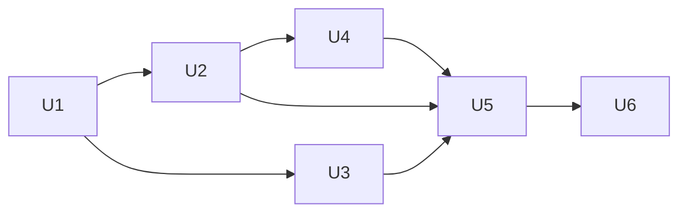

# Exact Diff Attribution - Plan

## Goal

Every configuration leaf has an independently specified diff attribution,
and the perturbation gate checks the complete expected changes. The means
is a mapping, an exact matcher, and bounded migrations of the twelve diff
owners. The current matcher accepts any nonempty result
(`src/common/sim/internal/simtest/diffcoverage.go:490`).

Stop condition: a configuration type adds a path without a fixed submitted
mutation and complete independent typed expectation. Update the literal
manifest before implementing that path.

## Decisions

- The parent's Decisions apply.
- The gate proves exact attribution in this parent, not in a later plan.
  A uniform mapping takes each configuration leaf to its diff subject and
  field, and the capability `Diff` fields follow it. Cost: trace and diff
  consumers see changed fields (decided by the user, 2026-10-10).
- Attribution is a phase of its own, run before the close-out phase, so
  the close-out documents the final diff fields. Why: with the close-out's
  nine units it exceeds one bounded phase (decided by the user,
  2026-10-10).
- Fields are granular. Existing subject kinds and keys stay. A change to
  one member of an aggregate gets its own field, a capability that appears
  or disappears gets an explicit presence field, and an identity change
  reports a removed and an added record. Cost: coarse or empty fields
  change, and their tests and corpus consumers change with them. Keeping
  aggregate fields and proving the leaf through complete before and after
  facts was the alternative (decided by the user, 2026-10-10).

- Dotted members with bracketed collection coordinates. Static names use
  dots. A collection member uses a quoted canonical key for a keyed or
  scalar-set collection, such as `attachments["edge.1"].vlan` and
  `select_src_ports["eth2"]`, and normalized position for a structured
  range, such as `match.src_ports[0].start`. Why: distinguishes static names
  from quoted string keys. Tradeoff: use canonical value for scalar-set
  identity and normalized position for structured ranges. Existing dynamic
  assembly fields change. Established scalar fields such as
  `lacp_system_priority` and `tunnel.tpid` are not rewritten
  (decided by the user, 2026-10-10).
- `presence` and nested `.presence`. Why: names lifecycle without implying
  administrative enablement. Tradeoff: nested field strings change.
  Existing facts stay. Presence follows normalized Capabilities, including
  LAG inferred from port entries (`S/device/vswitch/config.go:563`). Empty
  Traffic addition is `(traffic, capability, traffic, presence): nil ->
  vswitch.layer(traffic)`. MST addition is `(stp, bridge, empty,
  mst.presence): false -> true` (decided by the user, 2026-10-10).
- Exact expected sequence per submitted perturbation. Why: independently
  enumerate zero, one, or several normalized changes. Tradeoff: R1 becomes
  an ordered-sequence contract. A dependency oracle must not read Diff's
  returned records. Interval 1s to 2s with submitted Timer duration 0
  expects `interval: 1s -> 2s` followed by `recovery.duration: 3s -> 6s`.
  TPID 0 to 34984 expects `[]` (decided by the user, 2026-10-10).

- Compare effective values after each owner's normalization. Why: the gate
  normalizes both sides at `src/common/sim/internal/simtest/diffcoverage.go:490`,
  and every owner normalizes inside `Diff`. LAG's zero-environment boundary
  is explicit at `src/common/sim/layer/lag/README.md:153`. Filter's masked,
  sorted lists have an empty diff at `src/common/sim/layer/filter/README.md:64`.
  A submitted change erased by normalization expects no records. A presence
  flag that changes an effective priority expects the `priority` record,
  even when the submitted numeric priority stays zero
  (`src/common/sim/layer/stp/config.go:152`, `:205`).
- Preserve established granular names. Why: `lacp_system_priority` and
  `recovery.duration` are already consumer-visible fields
  (`src/common/sim/layer/lag/diff.go:288`,
  `src/common/sim/layer/loopprotect/diff.go:134`). The bracket grammar applies to newly split members without renaming those
  scalar fields.
- Preserve each owner's deterministic subject traversal and established
  scalar order. Newly split aggregates use the local sequences below. Why: corpus assertions
  compare changes by position (`src/common/sim/internal/simtest/corpus.go:890`).
  The perturbation matcher also compares the exact expected sequence. A
  reordered equivalent result fails. Filter's final comparator must preserve
  the specified local sequences instead of sorting their new Field text
  (`src/common/sim/layer/filter/diff.go:297`).
- Keep `trace.Change`, `Subject`, and `CompositeKey` unchanged. Why: they
  already carry the layer, kind, key, field, and typed facts
  (`src/common/sim/trace/trace.go:61`, `:89`, `:327`). The renderer quotes
  the whole field without parsing it (`src/common/sim/trace/render.go:114`).

- Compare normalized positions. Why: no guessed identity. An insertion or
  moving edit can report changes to displaced positions. Common indices are
  paired, unmatched tail members get nil/member facts, and a range that moves
  reports changes at the displaced positions. A bound edited in place reports
  that bound alone. Tradeoff: no guessed identity. An insertion or moving edit
  can report changes to displaced positions (decided by the user, 2026-10-10).
- Emit occurrence removals/additions. Why: preserves value facts. Larger
  multiplicity changes repeat records at the same field, so the matcher must
  accept repeated records only when independently expected. Tradeoff:
  preserves value facts. Larger multiplicity changes repeat records at the
  same field, so the matcher must accept repeated records only when
  independently expected (decided by the user, 2026-10-10).

- Optional filter aggregates: Emit granular nil/member records (recommended).
  Tradeoff: Reuses the selected member facts and order. Limits the
  single-snapshot lifecycle rule to named aggregate lifecycle slots such as
  tunnel and physical assumption. Optional match structs have no separate
  presence snapshot. Why: each optional member uses its selected field and
  fact. `ICMP{Type:8,Code:0} -> nil` emits Type then Code.
  `TCPFlags{Mask:2,Value:2} -> nil` emits Mask then Value
  (decided by the user, 2026-10-10).
- Apply the parent's highest-granularity Decision at
  `0cce6587:docs/plans/2026-10-01-2200-refactor-sim-package-overhaul-plan.md`,
  final Decisions item. Derived from that Decision, Fields are granular,
  Exact expected sequence per submitted perturbation, and Compare effective
  values after each owner's normalization: optional host IP compares its
  selected address, gateway, and neighbor members. Optional PHY Setting
  and Observed retain their established scalar projections, including
  typed zero speed and empty Duplex when absent. Range tails use Start
  then End with the selected `filter.port` facts. No additional snapshot,
  count, or scalar fact contract is introduced. Why: each member retains
  its named location and the existing effective-value semantics
  (`S/assembly/diff.go:264`, `S/layer/phy/diff.go:365`,
  `S/layer/filter/config.go:201`). Named tunnel and physical-assumption
  lifecycle slots retain their selected snapshots. Existing subject
  lifecycle snapshots and MST/PVST boolean presence facts remain selected.
- Use the fixed fixtures and literal sequences below for every primary
  slot. Derived from Exact expected sequence per submitted perturbation
  and the parent's highest-granularity Decision cited above. Why: fixed
  inputs make normalization dependencies and nil/member facts reviewable
  before implementation. Slot-local setup overrides are applied to both
  sides before the single named mutation. Complete type-driven seed checks
  run on the common fixtures before those overrides, so an intentional
  focused lifecycle setup cannot hide an unseeded branch
  (`S/internal/simtest/diffcoverage.go:182`,
  `S/device/vswitch/diff_coverage_test.go:114`).

## Requirements

R1. For every submitted perturbation, compare the independently expected
ordered sequence of layer, subject kind, subject key, field, and typed
From/To facts. The sequence may be empty, one record, or several records.
Missing, extra, unexpected duplicate, reordered, or mistyped records fail. The
expectation never reads Diff's returned records. Example: interval 1s to 2s
with submitted Timer duration 0 expects the interval record and then the
port's recovery duration 3s to 6s. TPID 0 to 34984 expects no records.
Identity changes include both lifecycle records in the owner's existing
subject traversal order.

R2. Discover structural paths from configuration types as well as concrete
paths from seeds. A nil capability or an unseeded optional branch fails.
Example: clearing `vswitch.Config.Filter` in the coverage seed fails even
when the other eight capabilities remain populated. The existing top-level
check is at `src/common/sim/device/vswitch/diff_coverage_test.go:114`.

R3. Count leaves with concrete expectations per owner, including identity
leaves. Each unmapped, unseeded, unperturbable, or intentionally nonsemantic
leaf has its full path, reason, and disposition in the result. None is
silently skipped. Example: a new exported filter match member fails until
its seed, mutation, and exact expectation exist. The current walker skips
nil pointers at `src/common/sim/internal/simtest/diffcoverage.go:182`.

R4. Each migration removes every producer/layer allowance it claims and keeps all
focused tests green. The exact matcher never falls back to a nonempty check
for an owner already migrated. Example: after bridge migrates, removing its
`tunnel` member arm fails even while the LAG owner is still allowed.

R5. Preserve existing retention checks and whole-copy behavior. Example:
perturbing the switch MAC preserves its port table, and deleting the MAC
arm still fails. Sources: `src/common/sim/internal/simtest/diffcoverage_test.go:71`
and `src/common/sim/internal/simtest/diffcoverage.go:586`.

## Out of scope

Runtime forwarding, protocol behavior, retention identity, and comparison
locations are unchanged. The checker reads trusted repository-authored
configuration types and seeds. Its purpose is missing or misattributed
coverage, not hostile input handling. This planning change edits only this
plan and its state. Future units name the direction-record amendment.
No parent or direction-record edit is part of this planning change.

## Attribution inventory and mapping

Snapshot: `4944caed`. The drafted inventory is recoverable from
`9ee39543:docs/plans/2026-10-01-2200-refactor-sim-package-overhaul-phase12-plan.md`,
section Attribution split inventory. The current twelve owners match the
literal list at `src/common/sim/internal/simtest/diffcoverage.go:26`.

In the table, `S` is `src/common/sim`, `K(...)` is `trace.CompositeKey(...)`,
`n` is a port or device name, `v` a VLAN, `r` a VRF, and `i` an instance.
Fields separated by commas correspond to the configuration members in the
same order. `k` is a quoted canonical collection value. A retained subject
keeps every existing scalar field. Its split collection fields use the
rules below. Subject addition/removal keeps the existing complete snapshot
facts and empty field, except capability presence, which uses `presence`
or the nested `.presence` suffix. Optional scalar pointers keep their
existing scalar field and nil/value facts. The collection rules below specify
correspondence after normalization.

| Configuration leaf or family | Layer | Subject kind | Key | Target field and disposition | Source on this tree |
| --- | --- | --- | --- | --- | --- |
| bridge AgingTime, MaxEntries, ForwardBPDU | relay | bridge | empty | aging_time, max_entries, forward_bpdu | S/layer/bridge/diff.go:423, :440, :479 |
| bridge FloodVLANs, ProtectedPorts members | relay | bridge | empty | flood_vlans[k], protected_ports[k] | S/layer/bridge/diff.go:453, :466 |
| bridge VLAN pointer | vlan | bridge | empty | vlan.presence, existing boolean facts | S/layer/bridge/diff.go:144 |
| bridge VLAN.Table[v] value and key identity | vlan | vlan | decimal v | name. Key replacement emits removed/added records, currently empty field | S/layer/bridge/diff.go:186, :205, :223 |
| bridge Switchports[n].PVID, IngressFiltering, Admission, PriorityTags | vlan | port | n | pvid, ingress_filtering, frame_admission, priority_tags | S/layer/bridge/diff.go:311, :350, :363, :409 |
| bridge Switchports[n].Tagged, Untagged members | vlan | port | n | tagged_vlan_ids[k], untagged_vlan_ids[k] | S/layer/bridge/diff.go:324, :337 |
| bridge Tunnel.VID, CustomerVIDs members, TPID | vlan | port | n | tunnel.presence (nil/snapshot), tunnel.vid, tunnel.customer_vids[k], tunnel.tpid (effective) | S/layer/bridge/diff.go:369, :396. S/layer/bridge/config.go:291 |
| phy Ethernet[n].Setting.SpeedBPS, Duplex, AutoNegotiation | ethernet | port | n | speed_bps, duplex, auto_negotiation_enabled | S/layer/phy/diff.go:149, :158, :167 |
| phy Ethernet[n].SupportedSpeedsBPS members, AutoNegotiationSupported | ethernet | port | n | supported_speeds_bps[k], auto_negotiation_supported | S/layer/phy/diff.go:176, :185 |
| phy Ethernet[n].Observed.SpeedBPS, Duplex | ethernet | port | n | observed_speed_bps, observed_duplex | S/layer/phy/diff.go:194, :203 |
| phy PoE.Groups[n].PowerNanowatts | poe | pse_group | n | power_nanowatts | S/layer/phy/diff.go:241, :251 |
| phy PoE.Ports[n].Group, MaxClass, Enabled, Limit, Priority, PD, PDClass | poe | port | n | group, max_class, enabled, power_limit_nanowatts, priority, pd, pd_class | S/layer/phy/diff.go:273, :284, :293, :302, :311, :320, :329, :338 |
| loopprotect Interval | loopprotect | bridge | empty | interval | S/layer/loopprotect/diff.go:69, :75 |
| loopprotect Ports[n].Action, Recovery.Mode, Recovery.Duration | loopprotect | port | n | action, recovery.mode, recovery.duration | S/layer/loopprotect/diff.go:122, :128, :134 |
| loopprotect Ports[n].VLANs members | loopprotect | port | n | vlans[k] | S/layer/loopprotect/diff.go:140 |
| mcast VLANs[v].FloodUnregistered, FastLeave | mcast | vlan | decimal v | flood_unregistered, fast_leave | S/layer/mcast/diff.go:109, :112, :145 |
| mcast VLANs[v].RouterPorts members | mcast | vlan | decimal v | router_ports[k] | S/layer/mcast/diff.go:116 |
| mcast MembershipInterval, RouterPortInterval, LastMemberQueryInterval, LastMemberQueryCount | mcast | vlan | decimal v | membership_interval, router_port_interval, last_member_query_interval, last_member_query_count | S/layer/mcast/diff.go:119, :122, :125, :129 |
| lag LAGs[n].Mode, Primary, UpDelay, DownDelay, HashBasis, MinLinks, RebalanceInterval | lag | lag | n | mode, primary, up_delay, down_delay, hash_basis, min_links, rebalance_interval | S/layer/lag/diff.go:196, :206, :216, :226, :236, :246, :258 |
| lag LACP.Mode, Fast, SystemPriority, SystemID, Key, Fallback | lag | lag | n | lacp_mode, lacp_fast, lacp_system_priority, lacp_system_id, lacp_key, lacp_fallback | S/layer/lag/diff.go:268, :278, :288, :298, :308, :318 |
| lag Members[m].Priority, Key | lag | lag_member | K(n,m) | priority, key. Map identity changes use lifecycle pair | S/layer/lag/diff.go:327, :344, :354, :389 |
| stp Priority and PriorityPresent, Address, HelloTime, MaxAge, ForwardDelay, TxHoldCount | stp | bridge | empty | priority (effective), address, hello_time, max_age, forward_delay, tx_hold_count | S/layer/stp/diff.go:140, :150, :160, :170, :180, :190 |
| stp Ports[n].Priority and PriorityPresent, PathCost, AdminEdge, PointToPoint, AutoEdge, guards | stp | port | n | priority (effective), admin_path_cost, admin_edge, admin_point_to_point, auto_edge, bpdu_guard, restricted_role, restricted_tcn, loop_guard | S/layer/stp/diff.go:252, :263, :273, :283, :293, :304 |
| stp MST/PVST pointer presence | stp | bridge | empty | mst.presence, pvst.presence, existing boolean facts | S/layer/stp/diff.go:198, :216 |
| stp MST.Name, Revision, MaxHops | stp | bridge | empty | mst.name, mst.revision, mst.max_hops | S/layer/stp/diff.go:343, :347, :353, :359 |
| stp MST.Instances[i].Priority and PriorityPresent, VLANs members | stp | mst_instance | decimal i | priority (effective), vlans[k], one value-fact record per unmatched occurrence | S/layer/stp/diff.go:403, :407, :413 |
| stp MST.Instances[i].Ports[n].Priority and PriorityPresent, PathCost | stp | mst_instance_port | K(decimal i,n) | priority (effective), path_cost | S/layer/stp/diff.go:420, :432, :438 |
| stp PVST.Trees[v].Priority and PriorityPresent, Ports[n] priority flags and PathCost | stp | pvst_tree, pvst_tree_port | decimal v, K(decimal v,n) | priority (effective), priority (effective), path_cost | S/layer/stp/diff.go:505, :509, :517, :528, :534 |
| filter Sets[s].Stateful, Default | filter | set | s | stateful, default | S/layer/filter/diff.go:164, :210, :219 |
| filter Rules.Name and rule identity | filter | rule | K(s,name), or K(s,empty,index) for unnamed/duplicate names | lifecycle pair, currently empty. Preserve existing matching | S/layer/filter/diff.go:331, :337, :347, :367 |
| filter Rule.Action, Match.Protocol, Src/Dst members, SrcPorts/DstPorts Start/End, ICMP Type/Code, TCPFlags Mask/Value | filter | rule | existing rule key | action, match.protocol, match.src[k], match.dst[k], match.src_ports[j].start/.end, match.dst_ports[j].start/.end, match.icmp.type/.code, match.tcp_flags.mask/.value. Compare normalized positions, Start before End at each position | S/layer/filter/config.go:41, :53, :74, :89, :100. S/layer/filter/diff.go:353 |
| filter Bindings.Interface, Direction, Set | filter | binding | K(interface,direction) | identity pair for Interface/Direction, set for retained binding | S/layer/filter/diff.go:264, :270, :280, :290 |
| routing ClearRouterFlag | routing | routing | empty | clear_router_flag | S/layer/routing/diff.go:242 |
| routing VRFs[r].Interfaces[n].VLAN, Port, MAC, Prefixes members | routing | interface | K(r,n) | vlan, port, mac, prefixes[k], one value-fact record per unmatched occurrence | S/layer/routing/diff.go:308, :326, :335, :344, :353 |
| routing Routes.Prefix, NextHop, Interface | routing | route | K(r,prefix,nextHop,interface) | removed/added pair, currently empty field | S/layer/routing/diff.go:393, :400, :408 |
| routing Routes.Preference, Metric | routing | route | existing route key | preference, metric | S/layer/routing/diff.go:417, :426 |
| routing Neighbors.Interface, Addr, MAC | routing | neighbor | K(r,interface,addr) | identity pair for Interface/Addr, mac for retained neighbor | S/layer/routing/diff.go:463, :470, :478, :487 |
| routing NeighborPolicy.Mode, ReachableTime, RetransTimer, HoldDepth | routing | neighbor-policy | r | mode, reachable_time, retrans_timer, hold_depth | S/layer/routing/diff.go:495, :500, :509, :518, :527 |
| traffic Mirrors.Name | traffic | mirror | name | identity pair, currently empty field | S/layer/traffic/diff.go:178, :185, :276 |
| traffic Mirrors.SelectAll, OutputPort, OutputVLAN, SnapLen | traffic | mirror | name | select_all, output_port, output_vlan, snap_len | S/layer/traffic/diff.go:245, :257, :260, :263 |
| traffic Mirrors.SelectSrcPorts, SelectDstPorts, SelectVLANs members | traffic | mirror | name | select_src_ports[k], select_dst_ports[k], select_vlans[k] | S/layer/traffic/diff.go:248, :251, :254 |
| traffic Policers[n].RateBPS, BurstOctets | traffic | port | n | rate, burst | S/layer/traffic/diff.go:197, :200, :205 |
| traffic Queues[n].MaxRateBPS[pcp], BufferOctets[pcp] | traffic | port | K(n,decimal pcp) | max_rate, buffer_octets | S/layer/traffic/diff.go:214, :220, :226 |
| port Name, IfIndex, Kind, AdminStatus, OperStatus, MTU, LagParent | port | port | Name | identity pair for Name, ifindex, kind, admin_status, oper_status, mtu, lag_parent | S/port/diff.go:19, :38, :51, :64, :77, :90, :103, :114 |
| vswitch MAC, Ports, capability members | port for MAC, delegated for members | device, delegated subject kinds | empty for device, delegated keys | mac, delegated port and layer fields | S/device/vswitch/diff.go:46, :56, :66, :153 |
| vswitch capability presence | capability layer | capability | layer name | presence, existing nil/layer facts | S/device/vswitch/diff.go:159, :188, :199 |
| assembly Start | fabric | fabric | empty | start | S/assembly/diff.go:93 |
| assembly Switches[name] members | delegated | delegated kinds | K(name,existing key) | delegated fields | S/assembly/diff.go:511 |
| assembly host Address, VLAN, IP.Addresses members, Gateway, Neighbors[addr] | fabric | host | name | address, vlan, addresses[k], gateway, neighbors[k] | S/assembly/diff.go:280, :308, :344, :674, :690 |
| assembly host Accept.Promiscuous, AllMulticast, Multicast members | fabric | host | name | accept.promiscuous, accept.all_multicast, accept.multicast[k] | S/assembly/diff.go:184, :187, :191 |
| assembly host Ethernet members | ethernet | host | name | phy fields prefixed ethernet, ethernet.supported_speeds_bps[k] | S/assembly/diff.go:169 |
| assembly reflector Address, Ports[name] Ethernet members, Attachments[name] Port/VLAN/Addresses members | fabric for Address/Attachments, ethernet for Ports | reflector | reflector name | address, ports[n].<phy field>, attachments[n].port/.vlan/.addresses[k]. Added/removed entries retain snapshots at ports[n] or attachments[n] | S/assembly/diff.go:124, :132, :225, :233, :243, :248, :743 |
| assembly Cables A/B Node/Port identity | fabric | cable | canonical endpoint pair | removed/added pair, currently empty | S/assembly/diff.go:415, :420, :543, :614 |
| assembly cable LengthMeters, Medium, Delay, TopSpeedBPS | fabric | cable | canonical endpoint pair | length, medium, delay, top_speed | S/assembly/diff.go:557, :566, :582, :591 |
| assembly cable Fault.Kind, N, Sequence members | fabric | cable | canonical endpoint pair | fault.kind, fault.n, fault.sequence[k], using normalizedFault | S/assembly/diff.go:424, :600. S/medium/cable/fault.go:35 |
| assembly Uncabled.Endpoint Node/Port | fabric | uncabled | Endpoint.Canonical() | removed/added pair | S/assembly/diff.go:153, :162 |
| assembly PhyAssumption.Medium and Ethernet members | fabric | fabric | empty | phy_assumption.presence (nil/snapshot), phy_assumption.medium, phy_assumption.ethernet.<phy field> | S/assembly/diff.go:99 |
| assembly Cable/Uncabled Evidence members | none | none | none | explicitly nonsemantic, expects no change | S/assembly/diff.go:84. S/assembly/diff_coverage_test.go:87 |
| assembly DiffSpecs switch construction inputs | fabric | switch | name | construction_inputs aggregate. Separate input from Config leaf gate | S/assembly/diff.go:24, :63 |
Collection coordinates escape keys as Go quoted strings, the same quote
operation CompositeKey uses (`S/trace/trace.go:89`). This is a field rule,
not a change to CompositeKey. The standard-library contract read for it is
`go doc strconv.Quote` from the Go 1.27 toolchain pinned in `go.mod:3`.
A literal quote or backslash inside a key remains inside one bracketed
coordinate. Fixtures include both characters as well as dots and slashes.

### Typed facts for split members

Existing scalar and lifecycle facts retain TypeID and Canonical. New
scalar facts below replace retained-subject aggregate snapshots. The names
are target contracts, not claims that these types already exist. Numeric
values use unsigned decimal, strings use their exact value, prefixes and
MACs use the canonical string used as their coordinate. Nil is an absent
fact, distinct from a zero-valued typed fact. Tests construct expected
(TypeID,Canonical) pairs directly, not by calling the producer's snapshot
or taking a singleton aggregate fact. The mapping builder reads submitted
and independently normalized inputs, never the returned records.

| Fields | Target fact TypeID |
| --- | --- |
| bridge split VLAN members, tunnel.vid | bridge.vlan_id |
| bridge protected_ports members | bridge.port |
| bridge tunnel.tpid | bridge.tpid |
| phy supported speed members and every delegated Ethernet speed | phy.speed_bps (existing at S/layer/phy/diff.go:16) |
| loopprotect vlans members | loopprotect.vlan_id |
| mcast router_ports members | mcast.router_port |
| stp vlans members | stp.mst.vlan_id |
| filter match.protocol | filter.protocol |
| filter match.src/dst members | filter.prefix |
| filter range start/end | filter.port |
| filter match.icmp.type/code | filter.icmp_type, filter.icmp_code |
| filter match.tcp_flags.mask/value | filter.tcp_flags |
| routing prefixes members | routing.prefix |
| traffic select_src_ports/select_dst_ports members | traffic.port |
| traffic select_vlans members | traffic.output_vlan (existing at S/layer/traffic/diff.go:104) |
| assembly address members | fabric.prefix |
| assembly accept.multicast and neighbors value | Existing assembly MAC fact |
| assembly fault.kind, fault.n, fault.sequence members | fabric.fault_kind, fabric.fault_n, fabric.fault_position |
| assembly phy_assumption.medium | fabric.medium |

For retained aggregates, compare tunnel VID, customer set, TPID in that
order at the old tunnel slot. Compare filter Action, Match.Protocol, Src,
Dst, SrcPorts, DstPorts, ICMP.Type/Code, TCPFlags.Mask/Value in that order
at the old retained-rule slot (`S/layer/filter/diff.go:353`). U4 changes the
final filter sort at :297 to stable subject ordering, preserving this local
sequence and old-removal/new-addition order within each collection. Compare fault
Kind, N, Sequence at the old fault slot (`S/assembly/diff.go:600`). A
retained physical assumption compares Medium followed by phy's field order.
Tunnel and physical-assumption lifecycle changes retain their single
snapshot record at the corresponding `.presence` field. Optional match
structs emit selected nil/member records. Optional host IP and PHY
pointers use the member sequences in the literal manifest.

### Collection correspondence

Normalize both inputs before correspondence. In the table, Set means match
by quoted canonical value, emit old-only values as value-to-nil records in
normalized old order, then new-only values as nil-to-value records in
normalized new order. Insertion/deletion changes only that value. Sorting
displacement and deduplication produce no records. A scalar member edit
is removal/addition, never an edit at its former raw index. Use existing
owner traversal around this local sequence. The old-members/new-members
pattern is already used by assembly multicast at
`S/assembly/diff.go:189`. Typed element facts keep an owner-local type and
canonical value. Each split member has a scalar fact.

The following rules are specifications read against normalization. Each
row gives a member-edit example and states all five correspondence cases.
Rows sharing Set still have separate seeds and expectations.

| List family | Correspondence and worked example | Normalization source on this tree |
| --- | --- | --- |
| bridge FloodVLANs | Set. [10] to [20] emits `flood_vlans["10"]: 10 -> nil`, `flood_vlans["20"]: nil -> 20`. | S/layer/bridge/config.go:267 |
| bridge ProtectedPorts | Set. [eth2] to [eth3] emits `protected_ports["eth2"]: eth2 -> nil`, `protected_ports["eth3"]: nil -> eth3`. | S/layer/bridge/config.go:271 |
| bridge Switchports.Tagged | Set. [10] to [20] emits `tagged_vlan_ids["10"]: 10 -> nil`, `tagged_vlan_ids["20"]: nil -> 20`. | S/layer/bridge/config.go:283 |
| bridge Switchports.Untagged | Set. [10] to [20] emits `untagged_vlan_ids["10"]: 10 -> nil`, `untagged_vlan_ids["20"]: nil -> 20`. | S/layer/bridge/config.go:287 |
| bridge Tunnel.CustomerVIDs | Set. [10] to [20] emits `tunnel.customer_vids["10"]: 10 -> nil`, `tunnel.customer_vids["20"]: nil -> 20`. | S/layer/bridge/config.go:295 |
| phy Ethernet.SupportedSpeedsBPS | Set. [1000000000] to [10000000000] removes `supported_speeds_bps["1000000000"]` and adds `supported_speeds_bps["10000000000"]` with speed facts. There is no phy/config.go. | S/layer/phy/phy.go:46, :52 |
| loopprotect Ports.VLANs | Set. [10] to [20] removes `vlans["10"]` and adds `vlans["20"]`. | S/layer/loopprotect/config.go:133, :136 |
| mcast VLANs.RouterPorts | Set. [eth2] to [eth3] removes `router_ports["eth2"]` and adds `router_ports["eth3"]`. | S/layer/mcast/config.go:60 |
| stp MST.Instances.VLANs | Sort-only multiset. Pair equal occurrences by canonical value. Emit one value-to-nil record per unmatched old occurrence in normalized old order, then one nil-to-value record per unmatched new occurrence in normalized new order. [10,10] to [10] emits `vlans["10"]: 10 -> nil`. Replacement [10,10] to [20,20] emits two removals at `vlans["10"]`, then two additions at `vlans["20"]`. Sorting displacement is silent. Submitted deduplication removes an occurrence. Config delegates to MST.Normalize. | S/layer/stp/config.go:219, S/layer/stp/mst.go:178, :185 |
| filter Rule.Match.Src | Set after masking. [192.0.2.1/24] to [198.51.100.1/24] removes `match.src["192.0.2.0/24"]` and adds `match.src["198.51.100.0/24"]`. A host-bit-only edit expects []. | S/layer/filter/config.go:147, :192 |
| filter Rule.Match.Dst | Set after masking. [192.0.2.1/24] to [198.51.100.1/24] removes `match.dst["192.0.2.0/24"]` and adds `match.dst["198.51.100.0/24"]`. | S/layer/filter/config.go:148, :192 |
| filter Rule.Match.SrcPorts | Sorted and compacted structured ranges. Pair common normalized indices, compare Start then End, and emit nil/member facts for unmatched tails. [{100,200},{300,400}] to [{300,400},{500,600}] emits `[0].start: 100 -> 300`, `[0].end: 200 -> 400`, `[1].start: 300 -> 500`, `[1].end: 400 -> 600`, each prefixed `match.src_ports`. Insertion/deletion includes displaced positions. Reorder and duplicate-only edits expect []. An in-place bound edit reports that bound alone. | S/layer/filter/config.go:149, :201 |
| filter Rule.Match.DstPorts | Same positional comparison as SrcPorts, separate oracle. Replace the preceding example's prefix with `match.dst_ports`. The fixed correspondence fixtures below cover insertion, deletion, displacement, deduplication, and bound edits for each family. | S/layer/filter/config.go:150, :201 |
| filter RuleSet.Rules | Preserve existing indexRules correspondence. Named unique rules match by name across insertion/deletion/displacement. Unnamed or duplicate-named rules match normalized index. No sort/dedup. Inserting unique b before unique a reports only added b. Inserting unnamed Drop before unnamed Accept reports index 0 action Accept to Drop and added index 1 Accept. Name edit uses existing subject identity changes. | S/layer/filter/config.go:128, :142, S/layer/filter/diff.go:367 |
| filter Bindings | Match by (Interface,Direction). Insert/delete or an identity edit uses existing snapshots. Set edit reports `set`. Sorting displacement is silent, no dedup. (eth2,in,s1) to (eth2,in,s2) emits `set: s1 -> s2`. Duplicate identities use normalized map overwrite: the last sorted Set wins. Removing s1 from [s1,s2] expects []. Removing s2 emits `set: s2 -> s1`. | S/layer/filter/config.go:178, S/layer/filter/diff.go:232, :236, :248 |
| routing Interfaces.Prefixes | Sort-only multiset of unmasked interface addresses. Pair equal occurrences and emit old-only occurrence removals, then new-only occurrence additions, with `routing.prefix` value facts. [192.0.2.1/24,192.0.2.1/24] to [192.0.2.1/24] emits `prefixes["192.0.2.1/24"]: 192.0.2.1/24 -> nil`. Replacement removes the old occurrences before adding the new ones. Sorting displacement is silent. Submitted deduplication is semantic. | S/layer/routing/config.go:148 |
| routing VRFs.Routes | Match existing (VRF,masked Prefix,NextHop,Interface) identity. Insert/delete or identity edit uses lifecycle snapshots. Preference/Metric member edit stays on its route even if sorting moves it. No list dedup. Duplicate keys keep existing map overwrite after normalized sorting. Metric 10 to 20 emits `metric: 10 -> 20`, not displacement records. | S/layer/routing/config.go:152, :160, S/layer/routing/diff.go:361 |
| routing VRFs.Neighbors | Match (VRF,Interface,Addr). Insert/delete or identity edit uses lifecycle snapshots. Sorting displacement is silent, no dedup, duplicate keys keep existing map overwrite. MAC a to b emits `mac: a -> b` at the retained key. | S/layer/routing/config.go:175, S/layer/routing/diff.go:434 |
| traffic Mirrors | Match Name, including an identity edit's lifecycle pair. Sorting displacement is silent, no dedup, duplicate names keep existing mirrorsByName overwrite. OutputPort eth2 to eth3 emits `output_port: eth2 -> eth3`. | S/layer/traffic/config.go:172, S/layer/traffic/diff.go:269 |
| traffic Mirror.SelectSrcPorts | Set. [eth2] to [eth3] emits `select_src_ports["eth2"]: eth2 -> nil`, then `select_src_ports["eth3"]: nil -> eth3`. | S/layer/traffic/config.go:159 |
| traffic Mirror.SelectDstPorts | Set. [eth2] to [eth3] removes `select_dst_ports["eth2"]` and adds `select_dst_ports["eth3"]`. | S/layer/traffic/config.go:163 |
| traffic Mirror.SelectVLANs | Set. [10] to [20] removes `select_vlans["10"]` and adds `select_vlans["20"]`. | S/layer/traffic/config.go:167 |
| assembly Hosts.IP.Addresses | Set of unmasked prefix values. [192.0.2.1/24] to [192.0.2.2/24] removes `addresses["192.0.2.1/24"]` and adds `addresses["192.0.2.2/24"]`. | S/assembly/config.go:201 |
| assembly Hosts.Accept.Multicast | Set. MAC a to b removes `accept.multicast["a"]` and adds `accept.multicast["b"]`. Use actual MAC strings in fields and facts. | S/assembly/config.go:206 |
| assembly Reflectors.Attachments.Addresses | Set of unmasked prefix values. Address a to b at edge.1 removes `attachments["edge.1"].addresses["a"]` and adds `attachments["edge.1"].addresses["b"]`. | S/assembly/config.go:230, :233 |
| assembly host, reflector port, and PhyAssumption Ethernet.SupportedSpeedsBPS | Three Set families, each with its own prefix: `ethernet.`, `ports["p1"].`, `phy_assumption.ethernet.`. 1 Gb/s to 10 Gb/s gives the phy Set example under each prefix. | S/assembly/config.go:205, :226, :263, S/medium/cable/ethernet.go:110, S/layer/phy/phy.go:52 |
| assembly Cable.Fault.Sequence | Set of 1-based frame positions only when Kind is LoseSequence. [1] to [2] removes `fault.sequence["1"]` and adds `fault.sequence["2"]`. Other kinds clear Sequence, so all five edits expect [] there. config.go calls normalizedFault rather than defining the sort locally. | S/assembly/config.go:250, S/assembly/diff.go:426, :434 |
| assembly Cables | Match canonical endpoint pair after orientation. Insert/delete or endpoint edit uses cable snapshots. Sorting displacement is silent, no dedup. Retained LengthMeters 3 to 4 emits `length: 3 -> 4`. Reversed endpoint orientation follows existing directional fault normalization. | S/assembly/config.go:245, :266, :293, S/assembly/diff.go:415 |
| assembly Uncabled | Match Endpoint, preserve old/removal then new/addition traversal. Insert/delete or endpoint edit uses endpoint facts. Sorting displacement is silent, no dedup. (sw1,p1) to (sw1,p2) emits removal then addition. | S/assembly/config.go:255, :258, S/assembly/diff.go:138 |
| assembly Cables.Evidence, Uncabled.Evidence | Both canonicalized sets but nonsemantic to Diff. Insertion/deletion/displacement/dedup/member edit all expect []. [survey:a] to [survey:b] expects []. | S/assembly/config.go:251, :256, :283, S/assembly/diff.go:84, :138 |

Keyed maps keep existing subject matching. Maps with lifecycle arms keep
those snapshots. Traffic policer/queue maps retain their existing numeric
field projections against absent-as-zero values (`S/layer/traffic/diff.go:194`,
`:210`). Their complete key-edit expectations include both old and new
subjects for the nonzero seeds, and empty sequences for zero-equivalent
submitted entries. Assembly
wrapper keys move to brackets: `ports["p.1"]`, `attachments["edge.1"]`,
`neighbors["192.0.2.1"]`. This changes fields, not Subject or CompositeKey.
Map-key replacements get explicit mutation adapters, since the current
walker visits only map values (`S/internal/simtest/diffcoverage.go:196`).

### Fixed range and occurrence expectations

Each row below submits only the named change. All other configuration values
stay fixed. U1 supplies the complete owner fixtures inside each wrapper.
Filter uses set `set1` and unique rule `rule1` at the owner, and set `ingress`
and unique rule `rule1` in each wrapper. SrcPorts is `[{1000,2000}]` and
DstPorts is `[{80,80}]`, from `S/layer/filter/diff_test.go:177`.
Both bounds are raw Normalize/Diff inputs. No Validate call removes the
DstPorts Start probe even though it submits `[{81,80}]`.
MST instance 1 has VLANs `[10]` (`S/layer/stp/diff_coverage_test.go:57`).
Routing's default VRF interface vlan10 has Prefixes `[10.0.10.1/24]`
(`S/layer/routing/diff_coverage_test.go:25`).

A fact below is `(TypeID, Canonical)`. `port(x)` means `(filter.port, x)`,
`vlan(x)` means `(stp.mst.vlan_id, x)`, and `prefix(x)` means
`(routing.prefix, x)`. Decimal facts use the shown decimal string.
`K` retains the CompositeKey spelling specified above. The switch emits
the owner's subject unchanged (`S/device/vswitch/diff.go:153`). Assembly
prefixes that subject key with `K(sw1, owner-key)`
(`S/assembly/diff.go:511`). These definitions fully specify layer, subject,
field, type and value for these 18 primary slots.

| Primary path | Layer / kind / key | Fixed submitted before -> after | Complete ordered field and facts |
| --- | --- | --- | --- |
| `filter.Config.Sets[set1].Rules[0].Match.SrcPorts[0].Start` | filter / rule / K(set1,rule1) | 1000 -> 1001 | `match.src_ports[0].start: port(1000) -> port(1001)` |
| `filter.Config.Sets[set1].Rules[0].Match.SrcPorts[0].End` | filter / rule / K(set1,rule1) | 2000 -> 2001 | `match.src_ports[0].end: port(2000) -> port(2001)` |
| `filter.Config.Sets[set1].Rules[0].Match.DstPorts[0].Start` | filter / rule / K(set1,rule1) | 80 -> 81 | `match.dst_ports[0].start: port(80) -> port(81)` |
| `filter.Config.Sets[set1].Rules[0].Match.DstPorts[0].End` | filter / rule / K(set1,rule1) | 80 -> 81 | `match.dst_ports[0].end: port(80) -> port(81)` |
| `vswitch.Config.Filter.Sets[ingress].Rules[0].Match.SrcPorts[0].Start` | filter / rule / K(ingress,rule1) | 1000 -> 1001 | `match.src_ports[0].start: port(1000) -> port(1001)` |
| `vswitch.Config.Filter.Sets[ingress].Rules[0].Match.SrcPorts[0].End` | filter / rule / K(ingress,rule1) | 2000 -> 2001 | `match.src_ports[0].end: port(2000) -> port(2001)` |
| `vswitch.Config.Filter.Sets[ingress].Rules[0].Match.DstPorts[0].Start` | filter / rule / K(ingress,rule1) | 80 -> 81 | `match.dst_ports[0].start: port(80) -> port(81)` |
| `vswitch.Config.Filter.Sets[ingress].Rules[0].Match.DstPorts[0].End` | filter / rule / K(ingress,rule1) | 80 -> 81 | `match.dst_ports[0].end: port(80) -> port(81)` |
| `assembly.Config.Switches[sw1].Filter.Sets[ingress].Rules[0].Match.SrcPorts[0].Start` | filter / rule / K(sw1,K(ingress,rule1)) | 1000 -> 1001 | `match.src_ports[0].start: port(1000) -> port(1001)` |
| `assembly.Config.Switches[sw1].Filter.Sets[ingress].Rules[0].Match.SrcPorts[0].End` | filter / rule / K(sw1,K(ingress,rule1)) | 2000 -> 2001 | `match.src_ports[0].end: port(2000) -> port(2001)` |
| `assembly.Config.Switches[sw1].Filter.Sets[ingress].Rules[0].Match.DstPorts[0].Start` | filter / rule / K(sw1,K(ingress,rule1)) | 80 -> 81 | `match.dst_ports[0].start: port(80) -> port(81)` |
| `assembly.Config.Switches[sw1].Filter.Sets[ingress].Rules[0].Match.DstPorts[0].End` | filter / rule / K(sw1,K(ingress,rule1)) | 80 -> 81 | `match.dst_ports[0].end: port(80) -> port(81)` |
| `stp.Config.MST.Instances[1].VLANs[0]` | stp / mst_instance / 1 | [10] -> [11] | `vlans["10"]: vlan(10) -> nil`, `vlans["11"]: nil -> vlan(11)` |
| `vswitch.Config.STP.MST.Instances[1].VLANs[0]` | stp / mst_instance / 1 | [10] -> [11] | `vlans["10"]: vlan(10) -> nil`, `vlans["11"]: nil -> vlan(11)` |
| `assembly.Config.Switches[sw1].STP.MST.Instances[1].VLANs[0]` | stp / mst_instance / K(sw1,1) | [10] -> [11] | `vlans["10"]: vlan(10) -> nil`, `vlans["11"]: nil -> vlan(11)` |
| `routing.Config.VRFs[default].Interfaces[vlan10].Prefixes[0]` | routing / interface / K(default,vlan10) | [10.0.10.1/24] -> [192.0.2.0/25] | `prefixes["10.0.10.1/24"]: prefix(10.0.10.1/24) -> nil`, `prefixes["192.0.2.0/25"]: nil -> prefix(192.0.2.0/25)` |
| `vswitch.Config.Routing.VRFs[default].Interfaces[vlan10].Prefixes[0]` | routing / interface / K(default,vlan10) | [10.0.10.1/24] -> [192.0.2.0/25] | `prefixes["10.0.10.1/24"]: prefix(10.0.10.1/24) -> nil`, `prefixes["192.0.2.0/25"]: nil -> prefix(192.0.2.0/25)` |
| `assembly.Config.Switches[sw1].Routing.VRFs[default].Interfaces[vlan10].Prefixes[0]` | routing / interface / K(sw1,K(default,vlan10)) | [10.0.10.1/24] -> [192.0.2.0/25] | `prefixes["10.0.10.1/24"]: prefix(10.0.10.1/24) -> nil`, `prefixes["192.0.2.0/25"]: nil -> prefix(192.0.2.0/25)` |

#### Positional range matrix

Run these seven fixed submissions separately for SrcPorts and DstPorts at
all three depths. The subject in each case is the corresponding rule above.
Only the selected range list changes. `f` is `match.src_ports` or
`match.dst_ports`. Every shown integer is a `filter.port` fact. A record's
field is `f` followed by its bracket and member suffix. There are 42
supplementary cases, separate from the 12 primary bound probes.

| Submission | Before -> submitted after | Complete ordered sequence |
| --- | --- | --- |
| Insert before both ranges | [{100,200},{300,400}] -> [{50,250},{100,200},{300,400}] | `[0].start: 100 -> 50`, `[0].end: 200 -> 250`, `[1].start: 300 -> 100`, `[1].end: 400 -> 200`, `[2].start: nil -> 300`, `[2].end: nil -> 400` |
| Delete first range | [{100,200},{300,400}] -> [{300,400}] | `[0].start: 100 -> 300`, `[0].end: 200 -> 400`, `[1].start: 300 -> nil`, `[1].end: 400 -> nil` |
| Replace and move first range | [{100,200},{300,400}] -> [{500,600},{300,400}] | `[0].start: 100 -> 300`, `[0].end: 200 -> 400`, `[1].start: 300 -> 500`, `[1].end: 400 -> 600` |
| Reorder submission | [{100,200},{300,400}] -> [{300,400},{100,200}] | `[]` |
| Add duplicate | [{100,200},{300,400}] -> [{100,200},{100,200},{300,400}] | `[]` |
| Edit one bound in place | [{100,200},{300,400}] -> [{101,200},{300,400}] | `[0].start: 100 -> 101` |
| Edit both bounds in place | [{100,200},{300,400}] -> [{101,201},{300,400}] | `[0].start: 100 -> 101`, `[0].end: 200 -> 201` |

#### Occurrence matrix

Run these seven submissions separately for instance VLANs and interface
prefixes at all three depths, with the corresponding subject above.
For VLANs, a is 10 and b is 20. For prefixes, a is 192.0.2.1/24 and b is
198.51.100.1/24. A removal is `vlans["a"]: vlan(a) -> nil` or
`prefixes["a"]: prefix(a) -> nil`, after substituting the literal value
for a in both coordinate and fact. Addition reverses nil/value sides.
There are 42 supplementary cases, separate from the six primary member
probes. Repeated records preserve their sequence positions.

| Submission | Before -> submitted after | Complete ordered sequence |
| --- | --- | --- |
| Insert occurrence | [a,a] -> [a,a,a] | Add a |
| Delete occurrence | [a,a] -> [a] | Remove a |
| Replace both occurrences | [a,a] -> [b,b] | Remove a, remove a, add b, add b |
| Reorder submission | [a,b] -> [b,a] | `[]` |
| Submitted deduplication | [a,a,b] -> [a,b] | Remove a |
| Remove two occurrences | [a,a,a] -> [a] | Remove a, remove a |
| Add two occurrences | [a] -> [a,a,a] | Add a, add a |

The matcher accepts the two identical records in the last two cases and
rejects an extra third one. Dropping one repeated record fails the literal
sequence length. Filter deduplication is a normalized no-op, while multiset
deduplication changes multiplicity. U1's gate fixtures test that distinction.
The correspondence matrices add 7 cases to U3, 21 to U4, 28 to U5, and
28 to U6. Each wrapper test compares the whole result against these literal
records, including layer, kind and the prefixed key. It never constructs
its expectation from the delegated Diff result.

### Coverage accounting

The existing seeded subtest counts below are reproducible with
`go test -json ./src/common/sim/layer/... ./src/common/sim/port ./src/common/sim/device/vswitch ./src/common/sim/assembly -run '^TestDiffCoversEveryConfigField$' -count=1`.
Count `run` events whose test name begins `TestDiffCoversEveryConfigField/`.
They are nonempty-check counts, not exact-attribution counts.

| Owner | Current exercised leaves | Concrete complete exact expectations | Seed source |
| --- | --- | --- | --- |
| bridge | 15 | 0 | S/layer/bridge/diff_coverage_test.go:18 |
| phy | 15 | 0 | S/layer/phy/diff_coverage_test.go:14 |
| loopprotect | 5 | 0 | S/layer/loopprotect/diff_coverage_test.go:17 |
| mcast | 7 | 0 | S/layer/mcast/diff_coverage_test.go:17 |
| lag | 15 | 0 | S/layer/lag/diff_coverage_test.go:17 |
| stp | 31 | 0 | S/layer/stp/diff_coverage_test.go:20 |
| filter | 18 | 0 | S/layer/filter/diff_test.go:160 |
| routing | 17 | 0 | S/layer/routing/diff_coverage_test.go:19 |
| traffic | 12 | 0 | S/layer/traffic/diff_coverage_test.go:15 |
| port | 6 | 0 | S/port/diff_coverage_test.go:16 |
| vswitch | 92 | 0 | S/device/vswitch/diff_coverage_test.go:32 |
| assembly | 33 | 0 | S/assembly/diff_coverage_test.go:33 |

The primary manifest has 627 fixed expectations: 266 currently exercised
values, 208 missing representative values, four formerly exempt values,
69 map-key identities, and 80 pointer-presence cases. MAC, time and IP
values remain atomic. One slot is one submitted value/key change or
populated-to-nil pointer case. Reverse pointer cases belong to focused unit
tests and do not count again in the primary gate. The two evidence slots
remain nonsemantic and have exact empty expectations. The formerly
exempt port Name and active fault Sequence now have semantic expectations.

All 627 paths below have a fixed input mutation and complete ordered typed
sequence. Eight expect no records: TPID default equivalence at three
depths, true-to-nil flood-default equivalence at three depths, and the two
evidence leaves. These eight are counted and matched. Current production
coverage still reaches zero exact expectations, as the owner table records.
The 18 fixed range/occurrence primary expectations and all 84 supplementary
correspondence cases remain specified above. They are included in, or
supplement, these literal counts respectively.

| Unit | Current value probes | Added primary slots | Primary target | Complete primary expectations specified | Supplementary correspondence cases specified |
| --- | --- | --- | --- | --- | --- |
| U1 mapping/gate foundation | 0 | 0 | All 627 entries registered | 627 | 84 |
| U2 | 42 | 16 | 58 | 58 | 0 |
| U3 | 46 | 10 | 56 | 56 | 7 |
| U4 | 35 | 7 | 42 | 42 | 21 |
| U5 | 110 | 104 | 214 | 214 | 28 |
| U6 | 33 | 224 | 257 | 257 | 28 |

| Owner | Value mutations | Map-key mutations | Pointer-presence mutations | Literal complete expectations | Migration unit |
| --- | --- | --- | --- | --- | --- |
| bridge | 15 | 2 | 3 | 20 | U2 |
| phy | 15 | 3 | 5 | 23 | U2 |
| loopprotect | 5 | 1 | 0 | 6 | U2 |
| mcast | 7 | 1 | 1 | 9 | U2 |
| lag | 15 | 2 | 1 | 18 | U3 |
| stp | 31 | 5 | 2 | 38 | U3 |
| filter | 18 | 1 | 4 | 23 | U4 |
| routing | 17 | 2 | 0 | 19 | U4 |
| traffic | 12 | 4 | 1 | 17 | U5 |
| port | 7 | 0 | 0 | 7 | U5 |
| vswitch | 143 | 21 | 26 | 190 | U5 |
| assembly | 193 | 27 | 37 | 257 | U6 |

Switch closure is 135 layer values, MAC 1, and Port adapter 7, plus
21 keys and 26 presence cases, for 190. Assembly closure is 193 values,
27 keys, and 37 presence cases, for 257. These counts specify one
representative per collection element type. Normalized fallback entries
such as PVST VLAN 1 are named in the expected sequence when they change,
and add no second structural slot for the same element type.

U1 asserts registered path count 627 and concrete expectation count 627 as
separate literal constants. Each owner asserts the literal expectation
count in its row, and every slot increments its concrete-hit count only
inside its exact expectation branch. The primary empty-sequence hit count
is 8. U2-U6 assert their literal primary counts 58, 56, 42, 214, and 257.
The supplementary correspondence counts remain 7, 21, 28, and 28 for
U3-U6. Dropping an expectation branch, a wrapper expansion, a Boolean
mutation, or a path fails one of these independent constants. Counts never
come from total minus skipped, from returned Diff records, or from a count
of paths without concrete expectations
(`docs/solutions/conventions/a-combinatorial-table-count-guard-must-assert-a-literal.md`,
`docs/solutions/conventions/a-fixed-seed-property-generator-must-enumerate-boolean-dimensions.md`).

The current walker skips nil pointers, map keys and empty containers
(`S/internal/simtest/diffcoverage.go:182`, `:196`, `:205`). Structural type
enumeration must reconcile every path against a seed or explicit adapter.
`port.Table` stores only unexported fields (`S/port/port.go:172`). Its
seven Port leaves use NewBuilder, including Name's identity pair. Copy
`Table` whole before adapting it. Unsupported future leaf kinds fail at
`S/internal/simtest/diffcoverage.go:395`, even while an allowance remains.

### Literal independent expectation manifest

Each row is one primary slot. Slot identifiers are plan references. Producer
mappings and test names use concrete paths. For port, the manifest root
`port.Config` denotes a `port.Port` entry rebuilt through NewBuilder
(`S/port/port.go:88`). The common fixture is fixed by owner below.
Apply a row's Setup to both raw inputs, copy them independently, and submit
only the named mutation. `@key` moves the unchanged map value to the new
key and deletes the old key. `@present` changes the fixed populated value
to nil. Neither marker is emitted Field text. All other input values stay
fixed. Input numbers retain the Go type of the named field. MAC, address,
prefix, duration, and timestamp strings construct those Go values. A
non-null scalar at a pointer field means a pointer to that value. Numeric
map keys retain their declared Go key type. Missing fixture fields take
their Go zero value. `{}` denotes a populated empty struct or map according
to its declared type. The fixtures call Normalize and Diff without Validate.

A sequence record is `[layer, subject-kind, subject-key, field, From, To]`.
A fact is `[TypeID, Canonical]`. JSON `null` is nil, and `""` is an empty
string. All canonical fact values are strings. `[]` is an exact empty
sequence. These literal facts reuse the selected target TypeIDs table and
existing scalar/lifecycle TypeIDs. Sequence position is significant.
Expectations never invoke Diff, Config.Canonical, ConfigFact, SnapshotRule,
producer snapshot helpers, or renderers. They never classify or copy a
returned record. The test may construct an expected Fact from its literal
pair. Normalize supplies the effective inputs to Diff, while the expected
sequence remains fixed before that call.

The direct-owner fixtures are complete representatives. The filter fixture
uses fixed flags Mask 2 and Value 2, the same literal values used by the
optional-aggregate decision. Filter bound and prefix fixtures retain the
fixed inputs above. STP keeps its current omitted PVST VLAN 1, whose
normalized inherited priority is 0. Its bridge Priority and
PriorityPresent probes consequently also report that tree's priority.
Type and normalization evidence is attached to every literal row.

#### bridge fixture

Base input (S/layer/bridge/diff_coverage_test.go:19):

```json
{
  "AgingTime": "300s",
  "MaxEntries": 1024,
  "FloodVLANs": [
    10
  ],
  "ProtectedPorts": [
    "1/1/1"
  ],
  "ForwardBPDU": true,
  "VLAN": {
    "Table": {
      "10": "ten"
    },
    "Switchports": {
      "1/1/1": {
        "PVID": 10,
        "Tagged": [
          20
        ],
        "Untagged": [
          10
        ],
        "IngressFiltering": true,
        "Admission": "TaggedOnly",
        "Tunnel": {
          "VID": 30,
          "CustomerVIDs": [
            100
          ],
          "TPID": 34984
        },
        "PriorityTags": "IfNonzero"
      }
    }
  }
}
```

#### phy fixture

Base input (S/layer/phy/diff_coverage_test.go:16):

```json
{
  "Ethernet": {
    "1/1/1": {
      "SupportedSpeedsBPS": [
        1000000000
      ],
      "AutoNegotiationSupported": "Supported",
      "Setting": {
        "SpeedBPS": 1000000000,
        "Duplex": "Full",
        "AutoNegotiation": true
      },
      "Observed": {
        "SpeedBPS": 1000000000,
        "Duplex": "Full"
      }
    }
  },
  "PoE": {
    "Groups": {
      "g1": {
        "PowerNanowatts": 370000000000
      }
    },
    "Ports": {
      "1/1/1": {
        "Group": "g1",
        "MaxClass": 4,
        "Enabled": true,
        "Limit": 5000000000,
        "Priority": "High",
        "PD": "Attached",
        "PDClass": 4
      }
    }
  }
}
```

#### loopprotect fixture

Base input (S/layer/loopprotect/diff_coverage_test.go:16):

```json
{
  "Interval": "5s",
  "Ports": {
    "1/1/1": {
      "Action": "Block",
      "Recovery": {
        "Mode": "Timer",
        "Duration": "30s"
      },
      "VLANs": [
        10
      ]
    }
  }
}
```

#### mcast fixture

Base input (S/layer/mcast/diff_coverage_test.go:17):

```json
{
  "VLANs": {
    "10": {
      "FloodUnregistered": true,
      "FastLeave": true,
      "RouterPorts": [
        "1/1/1"
      ],
      "MembershipInterval": "260s",
      "RouterPortInterval": "260s",
      "LastMemberQueryInterval": "1s",
      "LastMemberQueryCount": 2
    }
  }
}
```

#### lag fixture

Base input (S/layer/lag/diff_coverage_test.go:19):

```json
{
  "LAGs": {
    "lag1": {
      "Mode": "BalanceSLB",
      "Primary": "1/1/1",
      "UpDelay": "2s",
      "DownDelay": "1s",
      "HashBasis": 7,
      "MinLinks": 1,
      "RebalanceInterval": "45s",
      "LACP": {
        "Mode": "Active",
        "Fast": true,
        "SystemPriority": 32768,
        "SystemID": "02:00:00:00:00:01",
        "Key": 1,
        "Fallback": true
      },
      "Members": {
        "1/1/1": {
          "Priority": 128,
          "Key": 1
        }
      }
    }
  }
}
```

#### stp fixture

Base input (S/layer/stp/diff_coverage_test.go:20):

```json
{
  "Priority": 0,
  "PriorityPresent": true,
  "Address": "02:00:00:00:00:01",
  "HelloTime": "2s",
  "MaxAge": "20s",
  "ForwardDelay": "15s",
  "TxHoldCount": 6,
  "Ports": {
    "1/1/1": {
      "Priority": 0,
      "PriorityPresent": true,
      "PathCost": 20000,
      "AdminEdge": true,
      "AutoEdge": true,
      "PointToPoint": "ForceTrue",
      "BPDUGuard": true,
      "RestrictedRole": true,
      "RestrictedTCN": true,
      "LoopGuard": true
    }
  },
  "MST": {
    "Name": "region1",
    "Revision": 1,
    "MaxHops": 20,
    "Instances": {
      "1": {
        "Priority": 0,
        "PriorityPresent": true,
        "VLANs": [
          10
        ],
        "Ports": {
          "1/1/1": {
            "Priority": 128,
            "PriorityPresent": true,
            "PathCost": 20000
          }
        }
      }
    }
  },
  "PVST": {
    "Trees": {
      "10": {
        "Priority": 8192,
        "PriorityPresent": true,
        "Ports": {
          "1/1/1": {
            "Priority": 128,
            "PriorityPresent": true,
            "PathCost": 20000
          }
        }
      }
    }
  }
}
```

#### filter fixture

Base input (S/layer/filter/diff_test.go:164):

```json
{
  "Sets": {
    "set1": {
      "Stateful": true,
      "Default": "drop",
      "Rules": [
        {
          "Name": "rule1",
          "Action": "accept",
          "Match": {
            "Protocol": 6,
            "Src": [
              "10.0.1.0/24"
            ],
            "Dst": [
              "10.0.2.0/24"
            ],
            "SrcPorts": [
              {
                "Start": 1000,
                "End": 2000
              }
            ],
            "DstPorts": [
              {
                "Start": 80,
                "End": 80
              }
            ],
            "ICMP": {
              "Type": 8,
              "Code": 0
            },
            "TCPFlags": {
              "Mask": 2,
              "Value": 2
            }
          }
        }
      ]
    }
  },
  "Bindings": [
    {
      "Interface": "vlan10",
      "Direction": "in",
      "Set": "set1"
    }
  ]
}
```

#### routing fixture

Base input (S/layer/routing/diff_coverage_test.go:17):

```json
{
  "ClearRouterFlag": false,
  "VRFs": {
    "default": {
      "Interfaces": {
        "vlan10": {
          "VLAN": 10,
          "Port": "1/1/1",
          "MAC": "02:00:00:00:00:01",
          "Prefixes": [
            "10.0.10.1/24"
          ]
        }
      },
      "Routes": [
        {
          "Prefix": "10.0.20.0/24",
          "NextHop": "10.0.10.7",
          "Interface": "vlan10",
          "Preference": 1,
          "Metric": 10
        }
      ],
      "Neighbors": [
        {
          "Interface": "vlan10",
          "Addr": "10.0.10.7",
          "MAC": "02:00:00:00:00:02"
        }
      ],
      "NeighborPolicy": {
        "Mode": "disabled",
        "ReachableTime": "30s",
        "RetransTimer": "3s",
        "HoldDepth": 4
      }
    }
  }
}
```

#### traffic fixture

Base input (S/layer/traffic/diff_coverage_test.go:16):

```json
{
  "Mirrors": [
    {
      "Name": "m1",
      "SelectAll": true,
      "SelectSrcPorts": [
        "1/1/1"
      ],
      "SelectDstPorts": [
        "1/1/2"
      ],
      "SelectVLANs": [
        10
      ],
      "OutputPort": "1/1/3",
      "OutputVLAN": 20,
      "SnapLen": 128
    }
  ],
  "Policers": {
    "1/1/1": {
      "RateBPS": 1000000,
      "BurstOctets": 1500
    }
  },
  "Queues": {
    "1/1/1": {
      "MaxRateBPS": {
        "0": 1000000
      },
      "BufferOctets": {
        "0": 4096
      }
    }
  }
}
```

#### Port and switch fixtures

Port uses the fixed input below and the unchanged companion
`{Name:"lag1",Kind:port.LAG,AdminStatus:port.Up,OperStatus:port.Up}`.
Both tables are rebuilt with NewBuilder, including a Name replacement
(`S/port/diff_coverage_test.go:17`, `S/port/port.go:374`).

```json
{
  "Name": "1/1/1",
  "IfIndex": 1,
  "Kind": "Other",
  "AdminStatus": "Up",
  "OperStatus": "Up",
  "MTU": 1500,
  "LagParent": "lag1"
}
```

Switch fixture VS has MAC `02:00:00:00:00:01`, every capability populated
with its complete owner fixture, and one rebuilt Port
`{Name:"1/1/1",IfIndex:1,Kind:port.Other,AdminStatus:port.Up,OperStatus:port.Up,MTU:1500}`.
Its LagParent is empty. The filter set key is `ingress`, and its binding
Set is `ingress`. Every other owner input stays literal. The port table
contains no LAG-kind port, so the nested LAG key/member mutations acquire
no inferred entries (`S/device/vswitch/config.go:529`,
`S/layer/lag/config.go:179`). This is a raw Normalize/Diff fixture.

Port-wrapper fixture PW replaces VS's table with the Port fixture and its
fixed companion LAG. On both sides, its LAG fixture also explicitly includes
`Members["1/1/2"]={Priority:128,Key:1}`. Thus both possible renamed members
are already explicit, and none of the seven Table probes gains an unrelated
inferred-member record. Other capability inputs remain VS's literals.
This setup is applied before the one named Port mutation
(`S/device/vswitch/config.go:563`, `S/layer/lag/config.go:229`).

Top-level switch pointer probes locally replace the selected capability
with their literal Before value on both inputs, then toggle only that
pointer to nil. Other capabilities remain VS's literals. The Phy Before
contains an empty non-nil Ethernet map and empty non-nil PoE. The Bridge
Before contains a populated empty VLAN aggregate. Their sequences include
both architectural layers, and Bridge also emits `vlan.presence`. STP's
empty Before inherits the switch MAC and emits its address-to-zero record
after the capability record (`S/device/vswitch/config.go:72`,
`S/device/vswitch/config.go:581`, `S/device/vswitch/diff.go:56`).

#### Assembly fixture

Base input (`S/assembly/diff_coverage_test.go:33`), with `VS fixture`
replaced by the complete switch fixture above:

```json
{
  "Start": "2026-09-10T12:00:00Z",
  "Switches": {
    "sw1": "VS fixture"
  },
  "Hosts": {
    "h1": {
      "Address": "02:00:00:00:00:02",
      "VLAN": 10,
      "IP": {
        "Addresses": [
          "10.0.10.7/24"
        ],
        "Gateway": "10.0.10.1",
        "Neighbors": {
          "10.0.10.1": "02:00:00:00:00:03"
        }
      },
      "Ethernet": {
        "SupportedSpeedsBPS": [
          1000000000
        ],
        "AutoNegotiationSupported": "Supported",
        "Setting": {
          "SpeedBPS": 1000000000,
          "Duplex": "Full",
          "AutoNegotiation": true
        },
        "Observed": {
          "SpeedBPS": 1000000000,
          "Duplex": "Full"
        }
      },
      "Accept": {
        "Promiscuous": true,
        "AllMulticast": true,
        "Multicast": [
          "01:00:5e:00:00:01"
        ]
      }
    }
  },
  "Reflectors": {
    "r1": {
      "Address": "02:00:00:00:00:04",
      "Ports": {
        "p1": {
          "SupportedSpeedsBPS": [
            1000000000
          ],
          "AutoNegotiationSupported": "Supported",
          "Setting": {
            "SpeedBPS": 1000000000,
            "Duplex": "Full",
            "AutoNegotiation": true
          },
          "Observed": {
            "SpeedBPS": 1000000000,
            "Duplex": "Full"
          }
        }
      },
      "Attachments": {
        "p1": {
          "Port": "p1",
          "VLAN": 10,
          "Addresses": [
            "10.0.20.7/24"
          ]
        }
      }
    }
  },
  "Cables": [
    {
      "Cable": {
        "LengthMeters": 3,
        "TopSpeedBPS": 1000000000,
        "Fault": {
          "Kind": "LoseEveryNth",
          "N": 5,
          "Sequence": [
            1
          ]
        },
        "Medium": "TwistedPair",
        "Delay": "2ms"
      },
      "A": {
        "Node": "sw1",
        "Port": "1/1/1"
      },
      "B": {
        "Node": "h1",
        "Port": ""
      },
      "Evidence": [
        "survey:rack-walk"
      ]
    }
  ],
  "Uncabled": [
    {
      "Endpoint": {
        "Node": "sw1",
        "Port": "1/1/2"
      },
      "Evidence": [
        "survey:empty-port"
      ]
    }
  ],
  "PhyAssumption": {
    "Medium": "MultimodeFiber",
    "Ethernet": {
      "SupportedSpeedsBPS": [
        1000000000
      ],
      "AutoNegotiationSupported": "Supported",
      "Setting": {
        "SpeedBPS": 1000000000,
        "Duplex": "Full",
        "AutoNegotiation": true
      },
      "Observed": {
        "SpeedBPS": 1000000000,
        "Duplex": "Full"
      }
    }
  }
}
```

Assembly applies PW inside sw1 for the seven Table rows. Other switch
setup overrides apply inside sw1 with identical raw inputs. The switch
rows retain layer, kind, field and literal facts. Each key becomes
`trace.CompositeKey("sw1", original-key)`, including empty keys and
capability keys (`S/assembly/diff.go:511`). Each expanded row below lists
the complete resulting key and sequence, so no delegated result supplies
an expectation.

The raw cable is oriented sw1-to-h1. Normalize orients it h1-to-sw1, with
key `h1:-sw1:1/1/1`. A.Node and A.Port changes additionally move retained
host h1's peer endpoint. The whole sequence includes that host record after
the cable lifecycle pair (`S/assembly/config.go:293`,
`S/assembly/diff.go:415`, `S/assembly/diff.go:643`). Sequence uses an active
LoseSequence override. Evidence changes remain exact and empty. Assumption
observations are raw type-coverage inputs and are refused at construction
(`S/medium/cable/ethernet.go:71`).

The Switches[sw1].@key setup replaces only that switch with the literal
MAC-only configuration on both inputs before renaming. Its semantic
snapshot is the literal `["vswitch.config","[]"]`: Config{} normalizes to
the same MAC-only effective configuration. This expectation never executes
the Config.Canonical implementation, which itself calls Diff
(`S/device/vswitch/config.go:53`, `S/device/vswitch/config.go:531`). Other
node addresses are explicit and fixed, so this key rename causes no MAC
allocation dependency (`S/assembly/config.go:143`).

#### All primary slots

The Fixture column names the complete common input, plus any fixed setup
override. Before and After are the sole submitted path values. Whole
populated aggregates are literal values in pointer rows. All sequence
columns are complete, including wrapper additions and normalization
side effects. `S` retains the source-root abbreviation defined above.

##### bridge: 20 slots

| Slot | Concrete path | Fixture and fixed setup | Before | After | Complete ordered typed sequence | Source evidence |
| --- | --- | --- | --- | --- | --- | --- |
| `BRI01` | `bridge.Config.AgingTime` | bridge | `"300s"` | `"301s"` | `[["relay","bridge","","aging_time",["bridge.duration","5m0s"],["bridge.duration","5m1s"]]]` | S/layer/bridge/diff.go:427, S/layer/bridge/config.go:262 |
| `BRI02` | `bridge.Config.MaxEntries` | bridge | `1024` | `1025` | `[["relay","bridge","","max_entries",["bridge.int","1024"],["bridge.int","1025"]]]` | S/layer/bridge/diff.go:440, S/layer/bridge/config.go:262 |
| `BRI03` | `bridge.Config.FloodVLANs[0]` | bridge | `10` | `11` | `[["relay","bridge","","flood_vlans[\"10\"]",["bridge.vlan_id","10"],null],["relay","bridge","","flood_vlans[\"11\"]",null,["bridge.vlan_id","11"]]]` | S/layer/bridge/diff.go:135, S/layer/bridge/config.go:262 |
| `BRI04` | `bridge.Config.ProtectedPorts[0]` | bridge | `"1/1/1"` | `"1/1/2"` | `[["relay","bridge","","protected_ports[\"1/1/1\"]",["bridge.port","1/1/1"],null],["relay","bridge","","protected_ports[\"1/1/2\"]",null,["bridge.port","1/1/2"]]]` | S/layer/bridge/diff.go:135, S/layer/bridge/config.go:262 |
| `BRI05` | `bridge.Config.ForwardBPDU` | bridge | `true` | `false` | `[["relay","bridge","","forward_bpdu",["bridge.bool","true"],["bridge.bool","false"]]]` | S/layer/bridge/diff.go:479, S/layer/bridge/config.go:262 |
| `BRI06` | `bridge.Config.VLAN.Table[10]` | bridge | `"ten"` | `"eleven"` | `[["vlan","vlan","10","name",["bridge.vlan_name","ten"],["bridge.vlan_name","eleven"]]]` | S/layer/bridge/diff.go:205, S/layer/bridge/config.go:262 |
| `BRI07` | `bridge.Config.VLAN.Switchports[1/1/1].PVID` | bridge | `10` | `11` | `[["vlan","port","1/1/1","pvid",["bridge.pvid","10"],["bridge.pvid","11"]]]` | S/layer/bridge/diff.go:311, S/layer/bridge/config.go:262 |
| `BRI08` | `bridge.Config.VLAN.Switchports[1/1/1].Tagged[0]` | bridge | `20` | `21` | `[["vlan","port","1/1/1","tagged_vlan_ids[\"20\"]",["bridge.vlan_id","20"],null],["vlan","port","1/1/1","tagged_vlan_ids[\"21\"]",null,["bridge.vlan_id","21"]]]` | S/layer/bridge/diff.go:135, S/layer/bridge/config.go:262 |
| `BRI09` | `bridge.Config.VLAN.Switchports[1/1/1].Untagged[0]` | bridge | `10` | `11` | `[["vlan","port","1/1/1","untagged_vlan_ids[\"10\"]",["bridge.vlan_id","10"],null],["vlan","port","1/1/1","untagged_vlan_ids[\"11\"]",null,["bridge.vlan_id","11"]]]` | S/layer/bridge/diff.go:135, S/layer/bridge/config.go:262 |
| `BRI10` | `bridge.Config.VLAN.Switchports[1/1/1].IngressFiltering` | bridge | `true` | `false` | `[["vlan","port","1/1/1","ingress_filtering",["bridge.bool","true"],["bridge.bool","false"]]]` | S/layer/bridge/diff.go:350, S/layer/bridge/config.go:262 |
| `BRI11` | `bridge.Config.VLAN.Switchports[1/1/1].Admission` | bridge | `"TaggedOnly"` | `"All"` | `[["vlan","port","1/1/1","frame_admission",["bridge.admission","TaggedOnly"],["bridge.admission","All"]]]` | S/layer/bridge/diff.go:363, S/layer/bridge/config.go:262 |
| `BRI12` | `bridge.Config.VLAN.Switchports[1/1/1].PriorityTags` | bridge | `"IfNonzero"` | `"Never"` | `[["vlan","port","1/1/1","priority_tags",["bridge.priority_tags","IfNonzero"],["bridge.priority_tags","Never"]]]` | S/layer/bridge/diff.go:409, S/layer/bridge/config.go:262 |
| `BRI13` | `bridge.Config.VLAN.Switchports[1/1/1].Tunnel.VID` | bridge | `30` | `31` | `[["vlan","port","1/1/1","tunnel.vid",["bridge.vlan_id","30"],["bridge.vlan_id","31"]]]` | S/layer/bridge/diff.go:396, S/layer/bridge/config.go:262 |
| `BRI14` | `bridge.Config.VLAN.Switchports[1/1/1].Tunnel.CustomerVIDs[0]` | bridge | `100` | `101` | `[["vlan","port","1/1/1","tunnel.customer_vids[\"100\"]",["bridge.vlan_id","100"],null],["vlan","port","1/1/1","tunnel.customer_vids[\"101\"]",null,["bridge.vlan_id","101"]]]` | S/layer/bridge/diff.go:135, S/layer/bridge/config.go:262 |
| `BRI15` | `bridge.Config.VLAN.Switchports[1/1/1].Tunnel.TPID` | bridge: Set VLAN.Switchports[1/1/1].Tunnel.TPID=0 on the common Before fixture | `0` | `34984` | `[]` | S/layer/bridge/config.go:293, S/layer/bridge/config.go:262 |
| `BRI16` | `bridge.Config.VLAN.@present` | bridge | `{"Table":{"10":"ten"},"Switchports":{"1/1/1":{"PVID":10,"Tagged":[20],"Untagged":[10],"IngressFiltering":true,"Admission":"TaggedOnly","Tunnel":{"VID":30,"CustomerVIDs":[100],"TPID":34984},"PriorityTags":"IfNonzero"}}}` | `null` | `[["vlan","bridge","","vlan.presence",["bridge.bool","true"],["bridge.bool","false"]],["vlan","vlan","10","",["bridge.vlan_name","ten"],null],["vlan","port","1/1/1","",["bridge.switchport","pvid=10;tagged=[20];untagged=[10];ingress_filtering=true;admission=\"TaggedOnly\";priority_tags=\"IfNonzero\";tunnel={vid=30;tpid=34984;customer_vids=[100]}"],null]]` | S/layer/bridge/diff.go:135, S/layer/bridge/config.go:262 |
| `BRI17` | `bridge.Config.VLAN.Table[10].@key` | bridge | `10` | `11` | `[["vlan","vlan","10","",["bridge.vlan_name","ten"],null],["vlan","vlan","11","",null,["bridge.vlan_name","ten"]]]` | S/layer/bridge/diff.go:135, S/layer/bridge/config.go:262 |
| `BRI18` | `bridge.Config.VLAN.Switchports[1/1/1].@key` | bridge | `"1/1/1"` | `"1/1/2"` | `[["vlan","port","1/1/1","",["bridge.switchport","pvid=10;tagged=[20];untagged=[10];ingress_filtering=true;admission=\"TaggedOnly\";priority_tags=\"IfNonzero\";tunnel={vid=30;tpid=34984;customer_vids=[100]}"],null],["vlan","port","1/1/2","",null,["bridge.switchport","pvid=10;tagged=[20];untagged=[10];ingress_filtering=true;admission=\"TaggedOnly\";priority_tags=\"IfNonzero\";tunnel={vid=30;tpid=34984;customer_vids=[100]}"]]]` | S/layer/bridge/diff.go:135, S/layer/bridge/config.go:262 |
| `BRI19` | `bridge.Config.VLAN.Switchports[1/1/1].PVID.@present` | bridge | `10` | `null` | `[["vlan","port","1/1/1","pvid",["bridge.pvid","10"],null]]` | S/layer/bridge/diff.go:135, S/layer/bridge/config.go:262 |
| `BRI20` | `bridge.Config.VLAN.Switchports[1/1/1].Tunnel.@present` | bridge | `{"VID":30,"CustomerVIDs":[100],"TPID":34984}` | `null` | `[["vlan","port","1/1/1","tunnel.presence",["bridge.tunnel","vid=30;tpid=34984;customer_vids=[100]"],null]]` | S/layer/bridge/diff.go:135, S/layer/bridge/config.go:262 |

##### phy: 23 slots

| Slot | Concrete path | Fixture and fixed setup | Before | After | Complete ordered typed sequence | Source evidence |
| --- | --- | --- | --- | --- | --- | --- |
| `PHY01` | `phy.Config.Ethernet[1/1/1].Setting.SpeedBPS` | phy | `1000000000` | `1000000001` | `[["ethernet","port","1/1/1","speed_bps",["phy.speed_bps","1000000000"],["phy.speed_bps","1000000001"]]]` | S/layer/phy/diff.go:149, S/layer/phy/phy.go:46 |
| `PHY02` | `phy.Config.Ethernet[1/1/1].Setting.Duplex` | phy | `"Full"` | `"Half"` | `[["ethernet","port","1/1/1","duplex",["phy.duplex","Full"],["phy.duplex","Half"]]]` | S/layer/phy/diff.go:158, S/layer/phy/phy.go:46 |
| `PHY03` | `phy.Config.Ethernet[1/1/1].Setting.AutoNegotiation` | phy | `true` | `false` | `[["ethernet","port","1/1/1","auto_negotiation_enabled",["phy.bool","true"],["phy.bool","false"]]]` | S/layer/phy/diff.go:167, S/layer/phy/phy.go:46 |
| `PHY04` | `phy.Config.Ethernet[1/1/1].AutoNegotiationSupported` | phy | `"Supported"` | `"Unsupported"` | `[["ethernet","port","1/1/1","auto_negotiation_supported",["phy.capability","Supported"],["phy.capability","Unsupported"]]]` | S/layer/phy/diff.go:185, S/layer/phy/phy.go:46 |
| `PHY05` | `phy.Config.Ethernet[1/1/1].Observed.SpeedBPS` | phy | `1000000000` | `1000000001` | `[["ethernet","port","1/1/1","observed_speed_bps",["phy.speed_bps","1000000000"],["phy.speed_bps","1000000001"]]]` | S/layer/phy/diff.go:194, S/layer/phy/phy.go:46 |
| `PHY06` | `phy.Config.Ethernet[1/1/1].Observed.Duplex` | phy | `"Full"` | `"Half"` | `[["ethernet","port","1/1/1","observed_duplex",["phy.duplex","Full"],["phy.duplex","Half"]]]` | S/layer/phy/diff.go:203, S/layer/phy/phy.go:46 |
| `PHY07` | `phy.Config.Ethernet[1/1/1].SupportedSpeedsBPS[0]` | phy | `1000000000` | `10000000000` | `[["ethernet","port","1/1/1","supported_speeds_bps[\"1000000000\"]",["phy.speed_bps","1000000000"],null],["ethernet","port","1/1/1","supported_speeds_bps[\"10000000000\"]",null,["phy.speed_bps","10000000000"]]]` | S/layer/phy/diff.go:121, S/layer/phy/phy.go:46 |
| `PHY08` | `phy.Config.PoE.Groups[g1].PowerNanowatts` | phy | `370000000000` | `370000000001` | `[["poe","pse_group","g1","power_nanowatts",["phy.power_nw","370000000000"],["phy.power_nw","370000000001"]]]` | S/layer/phy/diff.go:251, S/layer/phy/phy.go:46 |
| `PHY09` | `phy.Config.PoE.Ports[1/1/1].Group` | phy | `"g1"` | `"g2"` | `[["poe","port","1/1/1","group",["phy.string","g1"],["phy.string","g2"]]]` | S/layer/phy/diff.go:284, S/layer/phy/phy.go:46 |
| `PHY10` | `phy.Config.PoE.Ports[1/1/1].MaxClass` | phy | `4` | `5` | `[["poe","port","1/1/1","max_class",["phy.class","4"],["phy.class","5"]]]` | S/layer/phy/diff.go:293, S/layer/phy/phy.go:46 |
| `PHY11` | `phy.Config.PoE.Ports[1/1/1].Enabled` | phy | `true` | `false` | `[["poe","port","1/1/1","enabled",["phy.bool","true"],["phy.bool","false"]]]` | S/layer/phy/diff.go:302, S/layer/phy/phy.go:46 |
| `PHY12` | `phy.Config.PoE.Ports[1/1/1].Limit` | phy | `5000000000` | `5000000001` | `[["poe","port","1/1/1","power_limit_nanowatts",["phy.power_nw","5000000000"],["phy.power_nw","5000000001"]]]` | S/layer/phy/diff.go:311, S/layer/phy/phy.go:46 |
| `PHY13` | `phy.Config.PoE.Ports[1/1/1].Priority` | phy | `"High"` | `"Low"` | `[["poe","port","1/1/1","priority",["phy.priority","High"],["phy.priority","Low"]]]` | S/layer/phy/diff.go:320, S/layer/phy/phy.go:46 |
| `PHY14` | `phy.Config.PoE.Ports[1/1/1].PD` | phy | `"Attached"` | `"Absent"` | `[["poe","port","1/1/1","pd",["phy.pd_state","Attached"],["phy.pd_state","Absent"]]]` | S/layer/phy/diff.go:329, S/layer/phy/phy.go:46 |
| `PHY15` | `phy.Config.PoE.Ports[1/1/1].PDClass` | phy | `4` | `5` | `[["poe","port","1/1/1","pd_class",["phy.class","4"],["phy.class","5"]]]` | S/layer/phy/diff.go:338, S/layer/phy/phy.go:46 |
| `PHY16` | `phy.Config.Ethernet[1/1/1].@key` | phy | `"1/1/1"` | `"1/1/2"` | `[["ethernet","port","1/1/1","",["phy.ethernet","speeds=[1000000000],autoneg_sup=Supported,setting={speed=1000000000,duplex=\"Full\",autoneg=true},observed={speed=1000000000,duplex=\"Full\"}"],null],["ethernet","port","1/1/2","",null,["phy.ethernet","speeds=[1000000000],autoneg_sup=Supported,setting={speed=1000000000,duplex=\"Full\",autoneg=true},observed={speed=1000000000,duplex=\"Full\"}"]]]` | S/layer/phy/diff.go:121, S/layer/phy/phy.go:46 |
| `PHY17` | `phy.Config.Ethernet[1/1/1].Setting.@present` | phy | `{"SpeedBPS":1000000000,"Duplex":"Full","AutoNegotiation":true}` | `null` | `[["ethernet","port","1/1/1","speed_bps",["phy.speed_bps","1000000000"],["phy.speed_bps","0"]],["ethernet","port","1/1/1","duplex",["phy.duplex","Full"],["phy.duplex",""]],["ethernet","port","1/1/1","auto_negotiation_enabled",["phy.bool","true"],["phy.bool","false"]]]` | S/layer/phy/diff.go:121, S/layer/phy/phy.go:46 |
| `PHY18` | `phy.Config.Ethernet[1/1/1].Observed.@present` | phy | `{"SpeedBPS":1000000000,"Duplex":"Full"}` | `null` | `[["ethernet","port","1/1/1","observed_speed_bps",["phy.speed_bps","1000000000"],["phy.speed_bps","0"]],["ethernet","port","1/1/1","observed_duplex",["phy.duplex","Full"],["phy.duplex",""]]]` | S/layer/phy/diff.go:121, S/layer/phy/phy.go:46 |
| `PHY19` | `phy.Config.PoE.@present` | phy | `{"Groups":{"g1":{"PowerNanowatts":370000000000}},"Ports":{"1/1/1":{"Group":"g1","MaxClass":4,"Enabled":true,"Limit":5000000000,"Priority":"High","PD":"Attached","PDClass":4}}}` | `null` | `[["poe","pse_group","g1","",["phy.pse_group","370000000000"],null],["poe","port","1/1/1","",["phy.pse_port","group=\"g1\",max_class=4,enabled=true,limit=5000000000,priority=\"High\",pd=Attached,pd_class=4"],null]]` | S/layer/phy/diff.go:121, S/layer/phy/phy.go:46 |
| `PHY20` | `phy.Config.PoE.Groups[g1].@key` | phy | `"g1"` | `"g2"` | `[["poe","pse_group","g1","",["phy.pse_group","370000000000"],null],["poe","pse_group","g2","",null,["phy.pse_group","370000000000"]]]` | S/layer/phy/diff.go:121, S/layer/phy/phy.go:46 |
| `PHY21` | `phy.Config.PoE.Ports[1/1/1].@key` | phy | `"1/1/1"` | `"1/1/2"` | `[["poe","port","1/1/1","",["phy.pse_port","group=\"g1\",max_class=4,enabled=true,limit=5000000000,priority=\"High\",pd=Attached,pd_class=4"],null],["poe","port","1/1/2","",null,["phy.pse_port","group=\"g1\",max_class=4,enabled=true,limit=5000000000,priority=\"High\",pd=Attached,pd_class=4"]]]` | S/layer/phy/diff.go:121, S/layer/phy/phy.go:46 |
| `PHY22` | `phy.Config.PoE.Ports[1/1/1].Limit.@present` | phy | `5000000000` | `null` | `[["poe","port","1/1/1","power_limit_nanowatts",["phy.power_nw","5000000000"],null]]` | S/layer/phy/diff.go:121, S/layer/phy/phy.go:46 |
| `PHY23` | `phy.Config.PoE.Ports[1/1/1].PDClass.@present` | phy | `4` | `null` | `[["poe","port","1/1/1","pd_class",["phy.class","4"],null]]` | S/layer/phy/diff.go:121, S/layer/phy/phy.go:46 |

##### loopprotect: 6 slots

| Slot | Concrete path | Fixture and fixed setup | Before | After | Complete ordered typed sequence | Source evidence |
| --- | --- | --- | --- | --- | --- | --- |
| `LOO01` | `loopprotect.Config.Interval` | loopprotect | `"5s"` | `"6s"` | `[["loopprotect","bridge","","interval",["loopprotect.duration","5s"],["loopprotect.duration","6s"]]]` | S/layer/loopprotect/diff.go:75, S/layer/loopprotect/config.go:129 |
| `LOO02` | `loopprotect.Config.Ports[1/1/1].Action` | loopprotect | `"Block"` | `"Disable"` | `[["loopprotect","port","1/1/1","action",["loopprotect.action","Block"],["loopprotect.action","Disable"]]]` | S/layer/loopprotect/diff.go:122, S/layer/loopprotect/config.go:129 |
| `LOO03` | `loopprotect.Config.Ports[1/1/1].Recovery.Mode` | loopprotect | `"Timer"` | `"Manual"` | `[["loopprotect","port","1/1/1","recovery.mode",["loopprotect.recovery_mode","Timer"],["loopprotect.recovery_mode","Manual"]]]` | S/layer/loopprotect/diff.go:128, S/layer/loopprotect/config.go:129 |
| `LOO04` | `loopprotect.Config.Ports[1/1/1].Recovery.Duration` | loopprotect | `"30s"` | `"31s"` | `[["loopprotect","port","1/1/1","recovery.duration",["loopprotect.duration","30s"],["loopprotect.duration","31s"]]]` | S/layer/loopprotect/diff.go:134, S/layer/loopprotect/config.go:129 |
| `LOO05` | `loopprotect.Config.Ports[1/1/1].VLANs[0]` | loopprotect | `10` | `11` | `[["loopprotect","port","1/1/1","vlans[\"10\"]",["loopprotect.vlan_id","10"],null],["loopprotect","port","1/1/1","vlans[\"11\"]",null,["loopprotect.vlan_id","11"]]]` | S/layer/loopprotect/diff.go:63, S/layer/loopprotect/config.go:129 |
| `LOO06` | `loopprotect.Config.Ports[1/1/1].@key` | loopprotect | `"1/1/1"` | `"1/1/2"` | `[["loopprotect","port","1/1/1","",["loopprotect.port","action=Block,recovery_mode=Timer,recovery_duration=30s,vlans=10"],null],["loopprotect","port","1/1/2","",null,["loopprotect.port","action=Block,recovery_mode=Timer,recovery_duration=30s,vlans=10"]]]` | S/layer/loopprotect/diff.go:63, S/layer/loopprotect/config.go:129 |

##### mcast: 9 slots

| Slot | Concrete path | Fixture and fixed setup | Before | After | Complete ordered typed sequence | Source evidence |
| --- | --- | --- | --- | --- | --- | --- |
| `MCA01` | `mcast.Config.VLANs[10].FloodUnregistered` | mcast | `true` | `false` | `[["mcast","vlan","10","flood_unregistered",["mcast.bool","true"],["mcast.bool","false"]]]` | S/layer/mcast/diff.go:108, S/layer/mcast/config.go:33 |
| `MCA02` | `mcast.Config.VLANs[10].FastLeave` | mcast | `true` | `false` | `[["mcast","vlan","10","fast_leave",["mcast.bool","true"],["mcast.bool","false"]]]` | S/layer/mcast/diff.go:111, S/layer/mcast/config.go:33 |
| `MCA03` | `mcast.Config.VLANs[10].MembershipInterval` | mcast | `"260s"` | `"261s"` | `[["mcast","vlan","10","membership_interval",["mcast.duration","4m20s"],["mcast.duration","4m21s"]]]` | S/layer/mcast/diff.go:118, S/layer/mcast/config.go:33 |
| `MCA04` | `mcast.Config.VLANs[10].RouterPortInterval` | mcast | `"260s"` | `"261s"` | `[["mcast","vlan","10","router_port_interval",["mcast.duration","4m20s"],["mcast.duration","4m21s"]]]` | S/layer/mcast/diff.go:121, S/layer/mcast/config.go:33 |
| `MCA05` | `mcast.Config.VLANs[10].LastMemberQueryInterval` | mcast | `"1s"` | `"2s"` | `[["mcast","vlan","10","last_member_query_interval",["mcast.duration","1s"],["mcast.duration","2s"]]]` | S/layer/mcast/diff.go:124, S/layer/mcast/config.go:33 |
| `MCA06` | `mcast.Config.VLANs[10].LastMemberQueryCount` | mcast | `2` | `3` | `[["mcast","vlan","10","last_member_query_count",["mcast.int","2"],["mcast.int","3"]]]` | S/layer/mcast/diff.go:128, S/layer/mcast/config.go:33 |
| `MCA07` | `mcast.Config.VLANs[10].RouterPorts[0]` | mcast | `"1/1/1"` | `"1/1/2"` | `[["mcast","vlan","10","router_ports[\"1/1/1\"]",["mcast.router_port","1/1/1"],null],["mcast","vlan","10","router_ports[\"1/1/2\"]",null,["mcast.router_port","1/1/2"]]]` | S/layer/mcast/diff.go:93, S/layer/mcast/config.go:33 |
| `MCA08` | `mcast.Config.VLANs[10].@key` | mcast | `10` | `11` | `[["mcast","vlan","10","",["mcast.vlan_snooping","flood=true,fast_leave=true,router_ports=[\"1/1/1\"],mem_int=4m20s,rtr_int=4m20s,lmqi=1s,lmqc=2"],null],["mcast","vlan","11","",null,["mcast.vlan_snooping","flood=true,fast_leave=true,router_ports=[\"1/1/1\"],mem_int=4m20s,rtr_int=4m20s,lmqi=1s,lmqc=2"]]]` | S/layer/mcast/diff.go:93, S/layer/mcast/config.go:33 |
| `MCA09` | `mcast.Config.VLANs[10].FloodUnregistered.@present` | mcast | `true` | `null` | `[]` | S/layer/mcast/config.go:41, S/layer/mcast/config.go:33 |

##### lag: 18 slots

| Slot | Concrete path | Fixture and fixed setup | Before | After | Complete ordered typed sequence | Source evidence |
| --- | --- | --- | --- | --- | --- | --- |
| `LAG01` | `lag.Config.LAGs[lag1].Mode` | lag | `"BalanceSLB"` | `"BalanceTCP"` | `[["lag","lag","lag1","mode",["lag.bond_mode","BalanceSLB"],["lag.bond_mode","BalanceTCP"]]]` | S/layer/lag/diff.go:196, S/layer/lag/config.go:174 |
| `LAG02` | `lag.Config.LAGs[lag1].Primary` | lag | `"1/1/1"` | `"1/1/2"` | `[["lag","lag","lag1","primary",["lag.primary","1/1/1"],["lag.primary","1/1/2"]]]` | S/layer/lag/diff.go:206, S/layer/lag/config.go:174 |
| `LAG03` | `lag.Config.LAGs[lag1].UpDelay` | lag | `"2s"` | `"3s"` | `[["lag","lag","lag1","up_delay",["lag.duration","2s"],["lag.duration","3s"]]]` | S/layer/lag/diff.go:216, S/layer/lag/config.go:174 |
| `LAG04` | `lag.Config.LAGs[lag1].DownDelay` | lag | `"1s"` | `"2s"` | `[["lag","lag","lag1","down_delay",["lag.duration","1s"],["lag.duration","2s"]]]` | S/layer/lag/diff.go:226, S/layer/lag/config.go:174 |
| `LAG05` | `lag.Config.LAGs[lag1].HashBasis` | lag | `7` | `8` | `[["lag","lag","lag1","hash_basis",["lag.hash_basis","7"],["lag.hash_basis","8"]]]` | S/layer/lag/diff.go:236, S/layer/lag/config.go:174 |
| `LAG06` | `lag.Config.LAGs[lag1].MinLinks` | lag | `1` | `2` | `[["lag","lag","lag1","min_links",["lag.min_links","1"],["lag.min_links","2"]]]` | S/layer/lag/diff.go:246, S/layer/lag/config.go:174 |
| `LAG07` | `lag.Config.LAGs[lag1].RebalanceInterval` | lag | `"45s"` | `"46s"` | `[["lag","lag","lag1","rebalance_interval",["lag.rebalance_interval","45s"],["lag.rebalance_interval","46s"]]]` | S/layer/lag/diff.go:258, S/layer/lag/config.go:174 |
| `LAG08` | `lag.Config.LAGs[lag1].LACP.Mode` | lag | `"Active"` | `"Passive"` | `[["lag","lag","lag1","lacp_mode",["lag.lacp_mode","Active"],["lag.lacp_mode","Passive"]]]` | S/layer/lag/diff.go:268, S/layer/lag/config.go:174 |
| `LAG09` | `lag.Config.LAGs[lag1].LACP.Fast` | lag | `true` | `false` | `[["lag","lag","lag1","lacp_fast",["lag.bool","true"],["lag.bool","false"]]]` | S/layer/lag/diff.go:278, S/layer/lag/config.go:174 |
| `LAG10` | `lag.Config.LAGs[lag1].LACP.SystemPriority` | lag | `32768` | `32769` | `[["lag","lag","lag1","lacp_system_priority",["lag.uint16","32768"],["lag.uint16","32769"]]]` | S/layer/lag/diff.go:288, S/layer/lag/config.go:174 |
| `LAG11` | `lag.Config.LAGs[lag1].LACP.SystemID` | lag | `"02:00:00:00:00:01"` | `"02:00:00:00:00:02"` | `[["lag","lag","lag1","lacp_system_id",["lag.mac","02:00:00:00:00:01"],["lag.mac","02:00:00:00:00:02"]]]` | S/layer/lag/diff.go:298, S/layer/lag/config.go:174 |
| `LAG12` | `lag.Config.LAGs[lag1].LACP.Key` | lag | `1` | `2` | `[["lag","lag","lag1","lacp_key",["lag.uint16","1"],["lag.uint16","2"]]]` | S/layer/lag/diff.go:308, S/layer/lag/config.go:174 |
| `LAG13` | `lag.Config.LAGs[lag1].LACP.Fallback` | lag | `true` | `false` | `[["lag","lag","lag1","lacp_fallback",["lag.bool","true"],["lag.bool","false"]]]` | S/layer/lag/diff.go:318, S/layer/lag/config.go:174 |
| `LAG14` | `lag.Config.LAGs[lag1].Members[1/1/1].Priority` | lag | `128` | `129` | `[["lag","lag_member","\"lag1\"/\"1/1/1\"","priority",["lag.port_priority","128"],["lag.port_priority","129"]]]` | S/layer/lag/diff.go:344, S/layer/lag/config.go:174 |
| `LAG15` | `lag.Config.LAGs[lag1].Members[1/1/1].Key` | lag | `1` | `2` | `[["lag","lag_member","\"lag1\"/\"1/1/1\"","key",["lag.uint16","1"],["lag.uint16","2"]]]` | S/layer/lag/diff.go:354, S/layer/lag/config.go:174 |
| `LAG16` | `lag.Config.LAGs[lag1].@key` | lag | `"lag1"` | `"lag2"` | `[["lag","lag","lag1","",["lag.lag","mode=\"BalanceSLB\";primary=\"1/1/1\";up_delay_ns=2000000000;down_delay_ns=1000000000;hash_basis=7;min_links=1;rebalance_interval=45s;lacp={mode=\"Active\";fast=true;system_priority=32768;system_id=\"02:00:00:00:00:01\";key=1;fallback=true};members={\"1/1/1\":{priority=128;key=1}}"],null],["lag","lag","lag2","",null,["lag.lag","mode=\"BalanceSLB\";primary=\"1/1/1\";up_delay_ns=2000000000;down_delay_ns=1000000000;hash_basis=7;min_links=1;rebalance_interval=45s;lacp={mode=\"Active\";fast=true;system_priority=32768;system_id=\"02:00:00:00:00:01\";key=1;fallback=true};members={\"1/1/1\":{priority=128;key=1}}"]]]` | S/layer/lag/diff.go:170, S/layer/lag/config.go:174 |
| `LAG17` | `lag.Config.LAGs[lag1].RebalanceInterval.@present` | lag | `"45s"` | `null` | `[["lag","lag","lag1","rebalance_interval",["lag.rebalance_interval","45s"],["lag.rebalance_interval","10s"]]]` | S/layer/lag/config.go:223, S/layer/lag/config.go:174 |
| `LAG18` | `lag.Config.LAGs[lag1].Members[1/1/1].@key` | lag | `"1/1/1"` | `"1/1/2"` | `[["lag","lag_member","\"lag1\"/\"1/1/1\"","",["lag.member","priority=128,key=1"],null],["lag","lag_member","\"lag1\"/\"1/1/2\"","",null,["lag.member","priority=128,key=1"]]]` | S/layer/lag/diff.go:170, S/layer/lag/config.go:174 |

##### stp: 38 slots

| Slot | Concrete path | Fixture and fixed setup | Before | After | Complete ordered typed sequence | Source evidence |
| --- | --- | --- | --- | --- | --- | --- |
| `STP01` | `stp.Config.Priority` | stp | `0` | `4096` | `[["stp","bridge","","priority",["stp.priority","0"],["stp.priority","4096"]],["stp","pvst_tree","1","priority",["stp.priority","0"],["stp.priority","4096"]]]` | S/layer/stp/diff.go:150, S/layer/stp/config.go:205 |
| `STP02` | `stp.Config.Address` | stp | `"02:00:00:00:00:01"` | `"02:00:00:00:00:02"` | `[["stp","bridge","","address",["stp.mac","02:00:00:00:00:01"],["stp.mac","02:00:00:00:00:02"]]]` | S/layer/stp/diff.go:140, S/layer/stp/config.go:205 |
| `STP03` | `stp.Config.HelloTime` | stp | `"2s"` | `"3s"` | `[["stp","bridge","","hello_time",["stp.duration","2s"],["stp.duration","3s"]]]` | S/layer/stp/diff.go:160, S/layer/stp/config.go:205 |
| `STP04` | `stp.Config.MaxAge` | stp | `"20s"` | `"21s"` | `[["stp","bridge","","max_age",["stp.duration","20s"],["stp.duration","21s"]]]` | S/layer/stp/diff.go:170, S/layer/stp/config.go:205 |
| `STP05` | `stp.Config.ForwardDelay` | stp | `"15s"` | `"16s"` | `[["stp","bridge","","forward_delay",["stp.duration","15s"],["stp.duration","16s"]]]` | S/layer/stp/diff.go:180, S/layer/stp/config.go:205 |
| `STP06` | `stp.Config.TxHoldCount` | stp | `6` | `7` | `[["stp","bridge","","tx_hold_count",["stp.tx_hold_count","6"],["stp.tx_hold_count","7"]]]` | S/layer/stp/diff.go:190, S/layer/stp/config.go:205 |
| `STP07` | `stp.Config.PriorityPresent` | stp | `true` | `false` | `[["stp","bridge","","priority",["stp.priority","0"],["stp.priority","32768"]],["stp","pvst_tree","1","priority",["stp.priority","0"],["stp.priority","32768"]]]` | S/layer/stp/pvst.go:102, S/layer/stp/config.go:205 |
| `STP08` | `stp.Config.Ports[1/1/1].Priority` | stp | `0` | `16` | `[["stp","port","1/1/1","priority",["stp.port_priority","0"],["stp.port_priority","16"]]]` | S/layer/stp/diff.go:150, S/layer/stp/config.go:205 |
| `STP09` | `stp.Config.Ports[1/1/1].PathCost` | stp | `20000` | `20001` | `[["stp","port","1/1/1","admin_path_cost",["stp.path_cost","20000"],["stp.path_cost","20001"]]]` | S/layer/stp/diff.go:263, S/layer/stp/config.go:205 |
| `STP10` | `stp.Config.Ports[1/1/1].AdminEdge` | stp | `true` | `false` | `[["stp","port","1/1/1","admin_edge",["stp.bool","true"],["stp.bool","false"]]]` | S/layer/stp/diff.go:273, S/layer/stp/config.go:205 |
| `STP11` | `stp.Config.Ports[1/1/1].AutoEdge` | stp | `true` | `false` | `[["stp","port","1/1/1","auto_edge",["stp.bool","true"],["stp.bool","false"]]]` | S/layer/stp/diff.go:293, S/layer/stp/config.go:205 |
| `STP12` | `stp.Config.Ports[1/1/1].PointToPoint` | stp | `"ForceTrue"` | `"ForceFalse"` | `[["stp","port","1/1/1","admin_point_to_point",["stp.point_to_point","ForceTrue"],["stp.point_to_point","ForceFalse"]]]` | S/layer/stp/diff.go:283, S/layer/stp/config.go:205 |
| `STP13` | `stp.Config.Ports[1/1/1].BPDUGuard` | stp | `true` | `false` | `[["stp","port","1/1/1","bpdu_guard",["stp.bool","true"],["stp.bool","false"]]]` | S/layer/stp/diff.go:304, S/layer/stp/config.go:205 |
| `STP14` | `stp.Config.Ports[1/1/1].RestrictedRole` | stp | `true` | `false` | `[["stp","port","1/1/1","restricted_role",["stp.bool","true"],["stp.bool","false"]]]` | S/layer/stp/diff.go:305, S/layer/stp/config.go:205 |
| `STP15` | `stp.Config.Ports[1/1/1].RestrictedTCN` | stp | `true` | `false` | `[["stp","port","1/1/1","restricted_tcn",["stp.bool","true"],["stp.bool","false"]]]` | S/layer/stp/diff.go:306, S/layer/stp/config.go:205 |
| `STP16` | `stp.Config.Ports[1/1/1].LoopGuard` | stp | `true` | `false` | `[["stp","port","1/1/1","loop_guard",["stp.bool","true"],["stp.bool","false"]]]` | S/layer/stp/diff.go:307, S/layer/stp/config.go:205 |
| `STP17` | `stp.Config.Ports[1/1/1].PriorityPresent` | stp | `true` | `false` | `[["stp","port","1/1/1","priority",["stp.port_priority","0"],["stp.port_priority","128"]]]` | S/layer/stp/config.go:214, S/layer/stp/config.go:205 |
| `STP18` | `stp.Config.MST.Name` | stp | `"region1"` | `"region2"` | `[["stp","bridge","","mst.name",["stp.mst.name","region1"],["stp.mst.name","region2"]]]` | S/layer/stp/diff.go:347, S/layer/stp/config.go:205 |
| `STP19` | `stp.Config.MST.Revision` | stp | `1` | `2` | `[["stp","bridge","","mst.revision",["stp.mst.revision","1"],["stp.mst.revision","2"]]]` | S/layer/stp/diff.go:353, S/layer/stp/config.go:205 |
| `STP20` | `stp.Config.MST.MaxHops` | stp | `20` | `21` | `[["stp","bridge","","mst.max_hops",["stp.mst.max_hops","20"],["stp.mst.max_hops","21"]]]` | S/layer/stp/diff.go:359, S/layer/stp/config.go:205 |
| `STP21` | `stp.Config.MST.Instances[1].Priority` | stp | `0` | `4096` | `[["stp","mst_instance","1","priority",["stp.priority","0"],["stp.priority","4096"]]]` | S/layer/stp/diff.go:150, S/layer/stp/config.go:205 |
| `STP22` | `stp.Config.MST.Instances[1].PriorityPresent` | stp | `true` | `false` | `[["stp","mst_instance","1","priority",["stp.priority","0"],["stp.priority","32768"]]]` | S/layer/stp/mst.go:182, S/layer/stp/config.go:205 |
| `STP23` | `stp.Config.MST.Instances[1].VLANs[0]` | stp | `10` | `11` | `[["stp","mst_instance","1","vlans[\"10\"]",["stp.mst.vlan_id","10"],null],["stp","mst_instance","1","vlans[\"11\"]",null,["stp.mst.vlan_id","11"]]]` | S/layer/stp/diff.go:128, S/layer/stp/config.go:205 |
| `STP24` | `stp.Config.MST.Instances[1].Ports[1/1/1].Priority` | stp | `128` | `129` | `[["stp","mst_instance_port","\"1\"/\"1/1/1\"","priority",["stp.port_priority","128"],["stp.port_priority","129"]]]` | S/layer/stp/diff.go:150, S/layer/stp/config.go:205 |
| `STP25` | `stp.Config.MST.Instances[1].Ports[1/1/1].PriorityPresent` | stp | `true` | `false` | `[["stp","mst_instance_port","\"1\"/\"1/1/1\"","priority",["stp.port_priority","128"],["stp.port_priority","0"]]]` | S/layer/stp/config.go:225, S/layer/stp/config.go:205 |
| `STP26` | `stp.Config.MST.Instances[1].Ports[1/1/1].PathCost` | stp | `20000` | `20001` | `[["stp","mst_instance_port","\"1\"/\"1/1/1\"","path_cost",["stp.path_cost","20000"],["stp.path_cost","20001"]]]` | S/layer/stp/diff.go:438, S/layer/stp/config.go:205 |
| `STP27` | `stp.Config.PVST.Trees[10].Ports[1/1/1].Priority` | stp | `128` | `129` | `[["stp","pvst_tree_port","\"10\"/\"1/1/1\"","priority",["stp.port_priority","128"],["stp.port_priority","129"]]]` | S/layer/stp/diff.go:150, S/layer/stp/config.go:205 |
| `STP28` | `stp.Config.PVST.Trees[10].Ports[1/1/1].PriorityPresent` | stp | `true` | `false` | `[["stp","pvst_tree_port","\"10\"/\"1/1/1\"","priority",["stp.port_priority","128"],["stp.port_priority","0"]]]` | S/layer/stp/config.go:225, S/layer/stp/config.go:205 |
| `STP29` | `stp.Config.PVST.Trees[10].Ports[1/1/1].PathCost` | stp | `20000` | `20001` | `[["stp","pvst_tree_port","\"10\"/\"1/1/1\"","path_cost",["stp.path_cost","20000"],["stp.path_cost","20001"]]]` | S/layer/stp/diff.go:438, S/layer/stp/config.go:205 |
| `STP30` | `stp.Config.PVST.Trees[10].Priority` | stp | `8192` | `12288` | `[["stp","pvst_tree","10","priority",["stp.priority","8192"],["stp.priority","12288"]]]` | S/layer/stp/diff.go:150, S/layer/stp/config.go:205 |
| `STP31` | `stp.Config.PVST.Trees[10].PriorityPresent` | stp | `true` | `false` | `[["stp","pvst_tree","10","priority",["stp.priority","8192"],["stp.priority","0"]]]` | S/layer/stp/pvst.go:102, S/layer/stp/config.go:205 |
| `STP32` | `stp.Config.Ports[1/1/1].@key` | stp | `"1/1/1"` | `"1/1/2"` | `[["stp","port","1/1/1","",["stp.port","priority=0,path_cost=20000,admin_edge=true,auto_edge=true,point_to_point=\"ForceTrue\",bpdu_guard=true,restricted_role=true,restricted_tcn=true,loop_guard=true"],null],["stp","port","1/1/2","",null,["stp.port","priority=0,path_cost=20000,admin_edge=true,auto_edge=true,point_to_point=\"ForceTrue\",bpdu_guard=true,restricted_role=true,restricted_tcn=true,loop_guard=true"]]]` | S/layer/stp/diff.go:128, S/layer/stp/config.go:205 |
| `STP33` | `stp.Config.MST.@present` | stp | `{"Name":"region1","Revision":1,"MaxHops":20,"Instances":{"1":{"Priority":0,"PriorityPresent":true,"VLANs":[10],"Ports":{"1/1/1":{"Priority":128,"PriorityPresent":true,"PathCost":20000}}}}}` | `null` | `[["stp","bridge","","mst.presence",["stp.bool","true"],["stp.bool","false"]]]` | S/layer/stp/diff.go:128, S/layer/stp/config.go:205 |
| `STP34` | `stp.Config.PVST.@present` | stp | `{"Trees":{"10":{"Priority":8192,"PriorityPresent":true,"Ports":{"1/1/1":{"Priority":128,"PriorityPresent":true,"PathCost":20000}}}}}` | `null` | `[["stp","bridge","","pvst.presence",["stp.bool","true"],["stp.bool","false"]]]` | S/layer/stp/diff.go:128, S/layer/stp/config.go:205 |
| `STP35` | `stp.Config.MST.Instances[1].@key` | stp | `1` | `2` | `[["stp","mst_instance","1","",["stp.mst.instance","priority=0,vlans=[10],ports=[1/1/1:{priority=128,path_cost=20000}]"],null],["stp","mst_instance","2","",null,["stp.mst.instance","priority=0,vlans=[10],ports=[1/1/1:{priority=128,path_cost=20000}]"]]]` | S/layer/stp/diff.go:128, S/layer/stp/config.go:205 |
| `STP36` | `stp.Config.MST.Instances[1].Ports[1/1/1].@key` | stp | `"1/1/1"` | `"1/1/2"` | `[["stp","mst_instance_port","\"1\"/\"1/1/1\"","",["stp.mst.instance_port","priority=128,path_cost=20000"],null],["stp","mst_instance_port","\"1\"/\"1/1/2\"","",null,["stp.mst.instance_port","priority=128,path_cost=20000"]]]` | S/layer/stp/diff.go:128, S/layer/stp/config.go:205 |
| `STP37` | `stp.Config.PVST.Trees[10].@key` | stp | `10` | `11` | `[["stp","pvst_tree","10","",["stp.pvst.tree","priority=8192,ports=[1/1/1:{priority=128,path_cost=20000}]"],null],["stp","pvst_tree","11","",null,["stp.pvst.tree","priority=8192,ports=[1/1/1:{priority=128,path_cost=20000}]"]]]` | S/layer/stp/diff.go:128, S/layer/stp/config.go:205 |
| `STP38` | `stp.Config.PVST.Trees[10].Ports[1/1/1].@key` | stp | `"1/1/1"` | `"1/1/2"` | `[["stp","pvst_tree_port","\"10\"/\"1/1/1\"","",["stp.mst.instance_port","priority=128,path_cost=20000"],null],["stp","pvst_tree_port","\"10\"/\"1/1/2\"","",null,["stp.mst.instance_port","priority=128,path_cost=20000"]]]` | S/layer/stp/diff.go:128, S/layer/stp/config.go:205 |

##### filter: 23 slots

| Slot | Concrete path | Fixture and fixed setup | Before | After | Complete ordered typed sequence | Source evidence |
| --- | --- | --- | --- | --- | --- | --- |
| `FIL01` | `filter.Config.Sets[set1].Stateful` | filter | `true` | `false` | `[["filter","set","set1","stateful",["filter.bool","true"],["filter.bool","false"]]]` | S/layer/filter/diff.go:210, S/layer/filter/config.go:130 |
| `FIL02` | `filter.Config.Sets[set1].Default` | filter | `"drop"` | `"accept"` | `[["filter","set","set1","default",["filter.action","drop"],["filter.action","accept"]]]` | S/layer/filter/diff.go:219, S/layer/filter/config.go:130 |
| `FIL03` | `filter.Config.Sets[set1].Rules[0].Name` | filter | `"rule1"` | `"rule2"` | `[["filter","rule","\"set1\"/\"rule1\"","",["filter.rule","name=\"rule1\";action=\"accept\";proto=6;src=[10.0.1.0/24];dst=[10.0.2.0/24];src_ports=[1000-2000];dst_ports=[80-80];icmp=type:8,code:0;tcp_flags=mask:2,val:2"],null],["filter","rule","\"set1\"/\"rule2\"","",null,["filter.rule","name=\"rule2\";action=\"accept\";proto=6;src=[10.0.1.0/24];dst=[10.0.2.0/24];src_ports=[1000-2000];dst_ports=[80-80];icmp=type:8,code:0;tcp_flags=mask:2,val:2"]]]` | S/layer/filter/diff.go:367, S/layer/filter/config.go:130 |
| `FIL04` | `filter.Config.Sets[set1].Rules[0].Action` | filter | `"accept"` | `"drop"` | `[["filter","rule","\"set1\"/\"rule1\"","action",["filter.action","accept"],["filter.action","drop"]]]` | S/layer/filter/diff.go:57, S/layer/filter/config.go:130 |
| `FIL05` | `filter.Config.Sets[set1].Rules[0].Match.Protocol` | filter | `6` | `17` | `[["filter","rule","\"set1\"/\"rule1\"","match.protocol",["filter.protocol","6"],["filter.protocol","17"]]]` | S/layer/filter/diff.go:57, S/layer/filter/config.go:130 |
| `FIL06` | `filter.Config.Sets[set1].Rules[0].Match.Src[0]` | filter | `"10.0.1.0/24"` | `"192.0.2.0/25"` | `[["filter","rule","\"set1\"/\"rule1\"","match.src[\"10.0.1.0/24\"]",["filter.prefix","10.0.1.0/24"],null],["filter","rule","\"set1\"/\"rule1\"","match.src[\"192.0.2.0/25\"]",null,["filter.prefix","192.0.2.0/25"]]]` | S/layer/filter/config.go:192, S/layer/filter/config.go:130 |
| `FIL07` | `filter.Config.Sets[set1].Rules[0].Match.Dst[0]` | filter | `"10.0.2.0/24"` | `"192.0.2.0/25"` | `[["filter","rule","\"set1\"/\"rule1\"","match.dst[\"10.0.2.0/24\"]",["filter.prefix","10.0.2.0/24"],null],["filter","rule","\"set1\"/\"rule1\"","match.dst[\"192.0.2.0/25\"]",null,["filter.prefix","192.0.2.0/25"]]]` | S/layer/filter/config.go:192, S/layer/filter/config.go:130 |
| `FIL08` | `filter.Config.Sets[set1].Rules[0].Match.SrcPorts[0].Start` | filter | `1000` | `1001` | `[["filter","rule","\"set1\"/\"rule1\"","match.src_ports[0].start",["filter.port","1000"],["filter.port","1001"]]]` | S/layer/filter/config.go:201, S/layer/filter/config.go:130 |
| `FIL09` | `filter.Config.Sets[set1].Rules[0].Match.SrcPorts[0].End` | filter | `2000` | `2001` | `[["filter","rule","\"set1\"/\"rule1\"","match.src_ports[0].end",["filter.port","2000"],["filter.port","2001"]]]` | S/layer/filter/config.go:201, S/layer/filter/config.go:130 |
| `FIL10` | `filter.Config.Sets[set1].Rules[0].Match.DstPorts[0].Start` | filter | `80` | `81` | `[["filter","rule","\"set1\"/\"rule1\"","match.dst_ports[0].start",["filter.port","80"],["filter.port","81"]]]` | S/layer/filter/config.go:201, S/layer/filter/config.go:130 |
| `FIL11` | `filter.Config.Sets[set1].Rules[0].Match.DstPorts[0].End` | filter | `80` | `81` | `[["filter","rule","\"set1\"/\"rule1\"","match.dst_ports[0].end",["filter.port","80"],["filter.port","81"]]]` | S/layer/filter/config.go:201, S/layer/filter/config.go:130 |
| `FIL12` | `filter.Config.Sets[set1].Rules[0].Match.ICMP.Type` | filter | `8` | `9` | `[["filter","rule","\"set1\"/\"rule1\"","match.icmp.type",["filter.icmp_type","8"],["filter.icmp_type","9"]]]` | S/layer/filter/diff.go:57, S/layer/filter/config.go:130 |
| `FIL13` | `filter.Config.Sets[set1].Rules[0].Match.ICMP.Code` | filter | `0` | `1` | `[["filter","rule","\"set1\"/\"rule1\"","match.icmp.code",["filter.icmp_code","0"],["filter.icmp_code","1"]]]` | S/layer/filter/diff.go:57, S/layer/filter/config.go:130 |
| `FIL14` | `filter.Config.Sets[set1].Rules[0].Match.TCPFlags.Mask` | filter | `2` | `18` | `[["filter","rule","\"set1\"/\"rule1\"","match.tcp_flags.mask",["filter.tcp_flags","2"],["filter.tcp_flags","18"]]]` | S/layer/filter/diff.go:57, S/layer/filter/config.go:130 |
| `FIL15` | `filter.Config.Sets[set1].Rules[0].Match.TCPFlags.Value` | filter | `2` | `0` | `[["filter","rule","\"set1\"/\"rule1\"","match.tcp_flags.value",["filter.tcp_flags","2"],["filter.tcp_flags","0"]]]` | S/layer/filter/diff.go:57, S/layer/filter/config.go:130 |
| `FIL16` | `filter.Config.Bindings[0].Interface` | filter | `"vlan10"` | `"vlan11"` | `[["filter","binding","\"vlan10\"/\"in\"","",["filter.binding","set=\"set1\""],null],["filter","binding","\"vlan11\"/\"in\"","",null,["filter.binding","set=\"set1\""]]]` | S/layer/filter/diff.go:228, S/layer/filter/config.go:130 |
| `FIL17` | `filter.Config.Bindings[0].Direction` | filter | `"in"` | `"out"` | `[["filter","binding","\"vlan10\"/\"in\"","",["filter.binding","set=\"set1\""],null],["filter","binding","\"vlan10\"/\"out\"","",null,["filter.binding","set=\"set1\""]]]` | S/layer/filter/diff.go:228, S/layer/filter/config.go:130 |
| `FIL18` | `filter.Config.Bindings[0].Set` | filter | `"set1"` | `"set2"` | `[["filter","binding","\"vlan10\"/\"in\"","set",["filter.binding","set=\"set1\""],["filter.binding","set=\"set2\""]]]` | S/layer/filter/diff.go:164, S/layer/filter/config.go:130 |
| `FIL19` | `filter.Config.Sets[set1].@key` | filter | `"set1"` | `"set2"` | `[["filter","rule","\"set1\"/\"rule1\"","",["filter.rule","name=\"rule1\";action=\"accept\";proto=6;src=[10.0.1.0/24];dst=[10.0.2.0/24];src_ports=[1000-2000];dst_ports=[80-80];icmp=type:8,code:0;tcp_flags=mask:2,val:2"],null],["filter","rule","\"set2\"/\"rule1\"","",null,["filter.rule","name=\"rule1\";action=\"accept\";proto=6;src=[10.0.1.0/24];dst=[10.0.2.0/24];src_ports=[1000-2000];dst_ports=[80-80];icmp=type:8,code:0;tcp_flags=mask:2,val:2"]],["filter","set","set1","",["filter.set","stateful=true;default=\"drop\";rule_count=1"],null],["filter","set","set2","",null,["filter.set","stateful=true;default=\"drop\";rule_count=1"]]]` | S/layer/filter/diff.go:297, S/layer/filter/config.go:130 |
| `FIL20` | `filter.Config.Sets[set1].Rules[0].Match.Protocol.@present` | filter | `6` | `null` | `[["filter","rule","\"set1\"/\"rule1\"","match.protocol",["filter.protocol","6"],null]]` | S/layer/filter/config.go:153, S/layer/filter/config.go:130 |
| `FIL21` | `filter.Config.Sets[set1].Rules[0].Match.ICMP.@present` | filter | `{"Type":8,"Code":0}` | `null` | `[["filter","rule","\"set1\"/\"rule1\"","match.icmp.type",["filter.icmp_type","8"],null],["filter","rule","\"set1\"/\"rule1\"","match.icmp.code",["filter.icmp_code","0"],null]]` | S/layer/filter/config.go:156, S/layer/filter/config.go:130 |
| `FIL22` | `filter.Config.Sets[set1].Rules[0].Match.ICMP.Code.@present` | filter | `0` | `null` | `[["filter","rule","\"set1\"/\"rule1\"","match.icmp.code",["filter.icmp_code","0"],null]]` | S/layer/filter/config.go:158, S/layer/filter/config.go:130 |
| `FIL23` | `filter.Config.Sets[set1].Rules[0].Match.TCPFlags.@present` | filter | `{"Mask":2,"Value":2}` | `null` | `[["filter","rule","\"set1\"/\"rule1\"","match.tcp_flags.mask",["filter.tcp_flags","2"],null],["filter","rule","\"set1\"/\"rule1\"","match.tcp_flags.value",["filter.tcp_flags","2"],null]]` | S/layer/filter/config.go:167, S/layer/filter/config.go:130 |

##### routing: 19 slots

| Slot | Concrete path | Fixture and fixed setup | Before | After | Complete ordered typed sequence | Source evidence |
| --- | --- | --- | --- | --- | --- | --- |
| `ROU01` | `routing.Config.ClearRouterFlag` | routing | `false` | `true` | `[["routing","routing","","clear_router_flag",["routing.clear_router_flag","false"],["routing.clear_router_flag","true"]]]` | S/layer/routing/diff.go:242, S/layer/routing/config.go:145 |
| `ROU02` | `routing.Config.VRFs[default].Interfaces[vlan10].VLAN` | routing | `10` | `11` | `[["routing","interface","\"default\"/\"vlan10\"","vlan",["routing.vlan","10"],["routing.vlan","11"]]]` | S/layer/routing/diff.go:326, S/layer/routing/config.go:145 |
| `ROU03` | `routing.Config.VRFs[default].Interfaces[vlan10].Port` | routing | `"1/1/1"` | `"1/1/2"` | `[["routing","interface","\"default\"/\"vlan10\"","port",["routing.port","1/1/1"],["routing.port","1/1/2"]]]` | S/layer/routing/diff.go:335, S/layer/routing/config.go:145 |
| `ROU04` | `routing.Config.VRFs[default].Interfaces[vlan10].MAC` | routing | `"02:00:00:00:00:01"` | `"02:00:00:00:00:02"` | `[["routing","interface","\"default\"/\"vlan10\"","mac",["routing.mac","02:00:00:00:00:01"],["routing.mac","02:00:00:00:00:02"]]]` | S/layer/routing/diff.go:344, S/layer/routing/config.go:145 |
| `ROU05` | `routing.Config.VRFs[default].Interfaces[vlan10].Prefixes[0]` | routing | `"10.0.10.1/24"` | `"192.0.2.0/25"` | `[["routing","interface","\"default\"/\"vlan10\"","prefixes[\"10.0.10.1/24\"]",["routing.prefix","10.0.10.1/24"],null],["routing","interface","\"default\"/\"vlan10\"","prefixes[\"192.0.2.0/25\"]",null,["routing.prefix","192.0.2.0/25"]]]` | S/layer/routing/diff.go:236, S/layer/routing/config.go:145 |
| `ROU06` | `routing.Config.VRFs[default].Routes[0].Prefix` | routing | `"10.0.20.0/24"` | `"192.0.2.0/25"` | `[["routing","route","\"default\"/\"10.0.20.0/24\"/\"10.0.10.7\"/\"vlan10\"","",["routing.route","prefix=\"10.0.20.0/24\",preference=1,metric=10,next_hop=\"10.0.10.7\",interface=\"vlan10\""],null],["routing","route","\"default\"/\"192.0.2.0/25\"/\"10.0.10.7\"/\"vlan10\"","",null,["routing.route","prefix=\"192.0.2.0/25\",preference=1,metric=10,next_hop=\"10.0.10.7\",interface=\"vlan10\""]]]` | S/layer/routing/diff.go:380, S/layer/routing/config.go:145 |
| `ROU07` | `routing.Config.VRFs[default].Routes[0].NextHop` | routing | `"10.0.10.7"` | `"10.0.10.8"` | `[["routing","route","\"default\"/\"10.0.20.0/24\"/\"10.0.10.7\"/\"vlan10\"","",["routing.route","prefix=\"10.0.20.0/24\",preference=1,metric=10,next_hop=\"10.0.10.7\",interface=\"vlan10\""],null],["routing","route","\"default\"/\"10.0.20.0/24\"/\"10.0.10.8\"/\"vlan10\"","",null,["routing.route","prefix=\"10.0.20.0/24\",preference=1,metric=10,next_hop=\"10.0.10.8\",interface=\"vlan10\""]]]` | S/layer/routing/diff.go:380, S/layer/routing/config.go:145 |
| `ROU08` | `routing.Config.VRFs[default].Routes[0].Interface` | routing | `"vlan10"` | `"vlan11"` | `[["routing","route","\"default\"/\"10.0.20.0/24\"/\"10.0.10.7\"/\"vlan10\"","",["routing.route","prefix=\"10.0.20.0/24\",preference=1,metric=10,next_hop=\"10.0.10.7\",interface=\"vlan10\""],null],["routing","route","\"default\"/\"10.0.20.0/24\"/\"10.0.10.7\"/\"vlan11\"","",null,["routing.route","prefix=\"10.0.20.0/24\",preference=1,metric=10,next_hop=\"10.0.10.7\",interface=\"vlan11\""]]]` | S/layer/routing/diff.go:380, S/layer/routing/config.go:145 |
| `ROU09` | `routing.Config.VRFs[default].Routes[0].Preference` | routing | `1` | `2` | `[["routing","route","\"default\"/\"10.0.20.0/24\"/\"10.0.10.7\"/\"vlan10\"","preference",["routing.route.preference","1"],["routing.route.preference","2"]]]` | S/layer/routing/diff.go:417, S/layer/routing/config.go:145 |
| `ROU10` | `routing.Config.VRFs[default].Routes[0].Metric` | routing | `10` | `11` | `[["routing","route","\"default\"/\"10.0.20.0/24\"/\"10.0.10.7\"/\"vlan10\"","metric",["routing.route.metric","10"],["routing.route.metric","11"]]]` | S/layer/routing/diff.go:426, S/layer/routing/config.go:145 |
| `ROU11` | `routing.Config.VRFs[default].Neighbors[0].Interface` | routing | `"vlan10"` | `"vlan11"` | `[["routing","neighbor","\"default\"/\"vlan10\"/\"10.0.10.7\"","",["routing.neighbor","interface=\"vlan10\",addr=\"10.0.10.7\",mac=\"02:00:00:00:00:02\""],null],["routing","neighbor","\"default\"/\"vlan11\"/\"10.0.10.7\"","",null,["routing.neighbor","interface=\"vlan11\",addr=\"10.0.10.7\",mac=\"02:00:00:00:00:02\""]]]` | S/layer/routing/diff.go:453, S/layer/routing/config.go:145 |
| `ROU12` | `routing.Config.VRFs[default].Neighbors[0].Addr` | routing | `"10.0.10.7"` | `"10.0.10.8"` | `[["routing","neighbor","\"default\"/\"vlan10\"/\"10.0.10.7\"","",["routing.neighbor","interface=\"vlan10\",addr=\"10.0.10.7\",mac=\"02:00:00:00:00:02\""],null],["routing","neighbor","\"default\"/\"vlan10\"/\"10.0.10.8\"","",null,["routing.neighbor","interface=\"vlan10\",addr=\"10.0.10.8\",mac=\"02:00:00:00:00:02\""]]]` | S/layer/routing/diff.go:453, S/layer/routing/config.go:145 |
| `ROU13` | `routing.Config.VRFs[default].Neighbors[0].MAC` | routing | `"02:00:00:00:00:02"` | `"02:00:00:00:00:03"` | `[["routing","neighbor","\"default\"/\"vlan10\"/\"10.0.10.7\"","mac",["routing.mac","02:00:00:00:00:02"],["routing.mac","02:00:00:00:00:03"]]]` | S/layer/routing/diff.go:344, S/layer/routing/config.go:145 |
| `ROU14` | `routing.Config.VRFs[default].NeighborPolicy.Mode` | routing | `"disabled"` | `""` | `[["routing","neighbor-policy","default","mode",["routing.neighbor_policy.mode","disabled"],["routing.neighbor_policy.mode",""]]]` | S/layer/routing/diff.go:500, S/layer/routing/config.go:145 |
| `ROU15` | `routing.Config.VRFs[default].NeighborPolicy.ReachableTime` | routing | `"30s"` | `"31s"` | `[["routing","neighbor-policy","default","reachable_time",["routing.neighbor_policy.reachable_time","30s"],["routing.neighbor_policy.reachable_time","31s"]]]` | S/layer/routing/diff.go:509, S/layer/routing/config.go:145 |
| `ROU16` | `routing.Config.VRFs[default].NeighborPolicy.RetransTimer` | routing | `"3s"` | `"4s"` | `[["routing","neighbor-policy","default","retrans_timer",["routing.neighbor_policy.retrans_timer","3s"],["routing.neighbor_policy.retrans_timer","4s"]]]` | S/layer/routing/diff.go:518, S/layer/routing/config.go:145 |
| `ROU17` | `routing.Config.VRFs[default].NeighborPolicy.HoldDepth` | routing | `4` | `5` | `[["routing","neighbor-policy","default","hold_depth",["routing.neighbor_policy.hold_depth","4"],["routing.neighbor_policy.hold_depth","5"]]]` | S/layer/routing/diff.go:527, S/layer/routing/config.go:145 |
| `ROU18` | `routing.Config.VRFs[default].@key` | routing | `"default"` | `"default2"` | `[["routing","vrf","default","",["routing.vrf","interfaces={\"vlan10\":vlan=10;port=\"1/1/1\";mac=\"02:00:00:00:00:01\";prefixes=[\"10.0.10.1/24\"]};routes=[{prefix=\"10.0.20.0/24\";preference=1;metric=10;next_hop=\"10.0.10.7\";interface=\"vlan10\"}];neighbors=[{interface=\"vlan10\";addr=\"10.0.10.7\";mac=\"02:00:00:00:00:02\"}];neighbor_policy={mode=\"disabled\";reachable_time=30s;retrans_timer=3s;hold_depth=4}"],null],["routing","vrf","default2","",null,["routing.vrf","interfaces={\"vlan10\":vlan=10;port=\"1/1/1\";mac=\"02:00:00:00:00:01\";prefixes=[\"10.0.10.1/24\"]};routes=[{prefix=\"10.0.20.0/24\";preference=1;metric=10;next_hop=\"10.0.10.7\";interface=\"vlan10\"}];neighbors=[{interface=\"vlan10\";addr=\"10.0.10.7\";mac=\"02:00:00:00:00:02\"}];neighbor_policy={mode=\"disabled\";reachable_time=30s;retrans_timer=3s;hold_depth=4}"]]]` | S/layer/routing/diff.go:236, S/layer/routing/config.go:145 |
| `ROU19` | `routing.Config.VRFs[default].Interfaces[vlan10].@key` | routing | `"vlan10"` | `"vlan11"` | `[["routing","interface","\"default\"/\"vlan10\"","",["routing.interface","vlan=10;port=\"1/1/1\";mac=\"02:00:00:00:00:01\";prefixes=[\"10.0.10.1/24\"]"],null],["routing","interface","\"default\"/\"vlan11\"","",null,["routing.interface","vlan=10;port=\"1/1/1\";mac=\"02:00:00:00:00:01\";prefixes=[\"10.0.10.1/24\"]"]]]` | S/layer/routing/diff.go:236, S/layer/routing/config.go:145 |

##### traffic: 17 slots

| Slot | Concrete path | Fixture and fixed setup | Before | After | Complete ordered typed sequence | Source evidence |
| --- | --- | --- | --- | --- | --- | --- |
| `TRA01` | `traffic.Config.Mirrors[0].Name` | traffic | `"m1"` | `"m2"` | `[["traffic","mirror","m1","",["traffic.mirror","name=\"m1\";select_all=true;select_src_ports=[\"1/1/1\"];select_dst_ports=[\"1/1/2\"];select_vlans=[10];output_port=\"1/1/3\";output_vlan=20;snap_len=128"],null],["traffic","mirror","m2","",null,["traffic.mirror","name=\"m2\";select_all=true;select_src_ports=[\"1/1/1\"];select_dst_ports=[\"1/1/2\"];select_vlans=[10];output_port=\"1/1/3\";output_vlan=20;snap_len=128"]]]` | S/layer/traffic/diff.go:165, S/layer/traffic/config.go:156 |
| `TRA02` | `traffic.Config.Mirrors[0].SelectAll` | traffic | `true` | `false` | `[["traffic","mirror","m1","select_all",["traffic.select_all","true"],["traffic.select_all","false"]]]` | S/layer/traffic/diff.go:245, S/layer/traffic/config.go:156 |
| `TRA03` | `traffic.Config.Mirrors[0].OutputPort` | traffic | `"1/1/3"` | `"1/1/4"` | `[["traffic","mirror","m1","output_port",["traffic.output_port","1/1/3"],["traffic.output_port","1/1/4"]]]` | S/layer/traffic/diff.go:257, S/layer/traffic/config.go:156 |
| `TRA04` | `traffic.Config.Mirrors[0].OutputVLAN` | traffic | `20` | `21` | `[["traffic","mirror","m1","output_vlan",["traffic.output_vlan","20"],["traffic.output_vlan","21"]]]` | S/layer/traffic/diff.go:260, S/layer/traffic/config.go:156 |
| `TRA05` | `traffic.Config.Mirrors[0].SnapLen` | traffic | `128` | `129` | `[["traffic","mirror","m1","snap_len",["traffic.snap_len","128"],["traffic.snap_len","129"]]]` | S/layer/traffic/diff.go:263, S/layer/traffic/config.go:156 |
| `TRA06` | `traffic.Config.Mirrors[0].SelectSrcPorts[0]` | traffic | `"1/1/1"` | `"1/1/2"` | `[["traffic","mirror","m1","select_src_ports[\"1/1/1\"]",["traffic.port","1/1/1"],null],["traffic","mirror","m1","select_src_ports[\"1/1/2\"]",null,["traffic.port","1/1/2"]]]` | S/layer/traffic/diff.go:165, S/layer/traffic/config.go:156 |
| `TRA07` | `traffic.Config.Mirrors[0].SelectDstPorts[0]` | traffic | `"1/1/2"` | `"1/1/3"` | `[["traffic","mirror","m1","select_dst_ports[\"1/1/2\"]",["traffic.port","1/1/2"],null],["traffic","mirror","m1","select_dst_ports[\"1/1/3\"]",null,["traffic.port","1/1/3"]]]` | S/layer/traffic/diff.go:165, S/layer/traffic/config.go:156 |
| `TRA08` | `traffic.Config.Mirrors[0].SelectVLANs[0]` | traffic | `10` | `11` | `[["traffic","mirror","m1","select_vlans[\"10\"]",["traffic.output_vlan","10"],null],["traffic","mirror","m1","select_vlans[\"11\"]",null,["traffic.output_vlan","11"]]]` | S/layer/traffic/diff.go:165, S/layer/traffic/config.go:156 |
| `TRA09` | `traffic.Config.Policers[1/1/1].RateBPS` | traffic | `1000000` | `1000001` | `[["traffic","port","1/1/1","rate",["traffic.rate_bps","1000000"],["traffic.rate_bps","1000001"]]]` | S/layer/traffic/diff.go:200, S/layer/traffic/config.go:156 |
| `TRA10` | `traffic.Config.Policers[1/1/1].BurstOctets` | traffic | `1500` | `1501` | `[["traffic","port","1/1/1","burst",["traffic.burst_octets","1500"],["traffic.burst_octets","1501"]]]` | S/layer/traffic/diff.go:205, S/layer/traffic/config.go:156 |
| `TRA11` | `traffic.Config.Queues[1/1/1].MaxRateBPS[0]` | traffic | `1000000` | `1000001` | `[["traffic","port","\"1/1/1\"/\"0\"","max_rate",["traffic.max_rate_bps","1000000"],["traffic.max_rate_bps","1000001"]]]` | S/layer/traffic/diff.go:220, S/layer/traffic/config.go:156 |
| `TRA12` | `traffic.Config.Queues[1/1/1].BufferOctets[0]` | traffic | `4096` | `4097` | `[["traffic","port","\"1/1/1\"/\"0\"","buffer_octets",["traffic.queue_buffer_octets","4096"],["traffic.queue_buffer_octets","4097"]]]` | S/layer/traffic/diff.go:226, S/layer/traffic/config.go:156 |
| `TRA13` | `traffic.Config.Mirrors[0].OutputVLAN.@present` | traffic | `20` | `null` | `[["traffic","mirror","m1","output_vlan",["traffic.output_vlan","20"],null]]` | S/layer/traffic/diff.go:165, S/layer/traffic/config.go:156 |
| `TRA14` | `traffic.Config.Policers[1/1/1].@key` | traffic | `"1/1/1"` | `"1/1/2"` | `[["traffic","port","1/1/1","rate",["traffic.rate_bps","1000000"],["traffic.rate_bps","0"]],["traffic","port","1/1/1","burst",["traffic.burst_octets","1500"],["traffic.burst_octets","0"]],["traffic","port","1/1/2","rate",["traffic.rate_bps","0"],["traffic.rate_bps","1000000"]],["traffic","port","1/1/2","burst",["traffic.burst_octets","0"],["traffic.burst_octets","1500"]]]` | S/layer/traffic/diff.go:165, S/layer/traffic/config.go:156 |
| `TRA15` | `traffic.Config.Queues[1/1/1].@key` | traffic | `"1/1/1"` | `"1/1/2"` | `[["traffic","port","\"1/1/1\"/\"0\"","max_rate",["traffic.max_rate_bps","1000000"],["traffic.max_rate_bps","0"]],["traffic","port","\"1/1/1\"/\"0\"","buffer_octets",["traffic.queue_buffer_octets","4096"],["traffic.queue_buffer_octets","0"]],["traffic","port","\"1/1/2\"/\"0\"","max_rate",["traffic.max_rate_bps","0"],["traffic.max_rate_bps","1000000"]],["traffic","port","\"1/1/2\"/\"0\"","buffer_octets",["traffic.queue_buffer_octets","0"],["traffic.queue_buffer_octets","4096"]]]` | S/layer/traffic/diff.go:165, S/layer/traffic/config.go:156 |
| `TRA16` | `traffic.Config.Queues[1/1/1].MaxRateBPS[0].@key` | traffic | `0` | `1` | `[["traffic","port","\"1/1/1\"/\"0\"","max_rate",["traffic.max_rate_bps","1000000"],["traffic.max_rate_bps","0"]],["traffic","port","\"1/1/1\"/\"1\"","max_rate",["traffic.max_rate_bps","0"],["traffic.max_rate_bps","1000000"]]]` | S/layer/traffic/diff.go:165, S/layer/traffic/config.go:156 |
| `TRA17` | `traffic.Config.Queues[1/1/1].BufferOctets[0].@key` | traffic | `0` | `1` | `[["traffic","port","\"1/1/1\"/\"0\"","buffer_octets",["traffic.queue_buffer_octets","4096"],["traffic.queue_buffer_octets","0"]],["traffic","port","\"1/1/1\"/\"1\"","buffer_octets",["traffic.queue_buffer_octets","0"],["traffic.queue_buffer_octets","4096"]]]` | S/layer/traffic/diff.go:165, S/layer/traffic/config.go:156 |

##### port: 7 slots

| Slot | Concrete path | Fixture and fixed setup | Before | After | Complete ordered typed sequence | Source evidence |
| --- | --- | --- | --- | --- | --- | --- |
| `POR01` | `port.Config.Name` | port | `"1/1/1"` | `"1/1/2"` | `[["port","port","1/1/1","",["port.port","name=\"1/1/1\",kind=\"Other\",ifindex=1,admin=\"Up\",oper=\"Up\",mtu=1500,lag=\"lag1\""],null],["port","port","1/1/2","",null,["port.port","name=\"1/1/2\",kind=\"Other\",ifindex=1,admin=\"Up\",oper=\"Up\",mtu=1500,lag=\"lag1\""]]]` | S/port/diff.go:9, S/port/port.go:111 |
| `POR02` | `port.Config.IfIndex` | port | `1` | `2` | `[["port","port","1/1/1","ifindex",["port.ifindex","1"],["port.ifindex","2"]]]` | S/port/diff.go:38, S/port/port.go:111 |
| `POR03` | `port.Config.Kind` | port | `"Other"` | `"Physical"` | `[["port","port","1/1/1","kind",["port.kind","Other"],["port.kind","Physical"]]]` | S/port/diff.go:51, S/port/port.go:111 |
| `POR04` | `port.Config.AdminStatus` | port | `"Up"` | `"Down"` | `[["port","port","1/1/1","admin_status",["port.link_state","Up"],["port.link_state","Down"]]]` | S/port/diff.go:64, S/port/port.go:111 |
| `POR05` | `port.Config.OperStatus` | port | `"Up"` | `"Down"` | `[["port","port","1/1/1","oper_status",["port.link_state","Up"],["port.link_state","Down"]]]` | S/port/diff.go:77, S/port/port.go:111 |
| `POR06` | `port.Config.MTU` | port | `1500` | `1501` | `[["port","port","1/1/1","mtu",["port.mtu","1500"],["port.mtu","1501"]]]` | S/port/diff.go:90, S/port/port.go:111 |
| `POR07` | `port.Config.LagParent` | port | `"lag1"` | `""` | `[["port","port","1/1/1","lag_parent",["port.lag_parent","lag1"],["port.lag_parent",""]]]` | S/port/diff.go:103, S/port/port.go:111 |

##### vswitch: 190 slots

| Slot | Concrete path | Fixture and fixed setup | Before | After | Complete ordered typed sequence | Source evidence |
| --- | --- | --- | --- | --- | --- | --- |
| `VBRI01` | `vswitch.Config.Bridge.AgingTime` | VS | `"300s"` | `"301s"` | `[["relay","bridge","","aging_time",["bridge.duration","5m0s"],["bridge.duration","5m1s"]]]` | S/layer/bridge/diff.go:427, S/layer/bridge/config.go:262, S/device/vswitch/config.go:529, S/device/vswitch/diff.go:56 |
| `VBRI02` | `vswitch.Config.Bridge.MaxEntries` | VS | `1024` | `1025` | `[["relay","bridge","","max_entries",["bridge.int","1024"],["bridge.int","1025"]]]` | S/layer/bridge/diff.go:440, S/layer/bridge/config.go:262, S/device/vswitch/config.go:529, S/device/vswitch/diff.go:56 |
| `VBRI03` | `vswitch.Config.Bridge.FloodVLANs[0]` | VS | `10` | `11` | `[["relay","bridge","","flood_vlans[\"10\"]",["bridge.vlan_id","10"],null],["relay","bridge","","flood_vlans[\"11\"]",null,["bridge.vlan_id","11"]]]` | S/layer/bridge/diff.go:135, S/layer/bridge/config.go:262, S/device/vswitch/config.go:529, S/device/vswitch/diff.go:56 |
| `VBRI04` | `vswitch.Config.Bridge.ProtectedPorts[0]` | VS | `"1/1/1"` | `"1/1/2"` | `[["relay","bridge","","protected_ports[\"1/1/1\"]",["bridge.port","1/1/1"],null],["relay","bridge","","protected_ports[\"1/1/2\"]",null,["bridge.port","1/1/2"]]]` | S/layer/bridge/diff.go:135, S/layer/bridge/config.go:262, S/device/vswitch/config.go:529, S/device/vswitch/diff.go:56 |
| `VBRI05` | `vswitch.Config.Bridge.ForwardBPDU` | VS | `true` | `false` | `[["relay","bridge","","forward_bpdu",["bridge.bool","true"],["bridge.bool","false"]]]` | S/layer/bridge/diff.go:479, S/layer/bridge/config.go:262, S/device/vswitch/config.go:529, S/device/vswitch/diff.go:56 |
| `VBRI06` | `vswitch.Config.Bridge.VLAN.Table[10]` | VS | `"ten"` | `"eleven"` | `[["vlan","vlan","10","name",["bridge.vlan_name","ten"],["bridge.vlan_name","eleven"]]]` | S/layer/bridge/diff.go:205, S/layer/bridge/config.go:262, S/device/vswitch/config.go:529, S/device/vswitch/diff.go:56 |
| `VBRI07` | `vswitch.Config.Bridge.VLAN.Switchports[1/1/1].PVID` | VS | `10` | `11` | `[["vlan","port","1/1/1","pvid",["bridge.pvid","10"],["bridge.pvid","11"]]]` | S/layer/bridge/diff.go:311, S/layer/bridge/config.go:262, S/device/vswitch/config.go:529, S/device/vswitch/diff.go:56 |
| `VBRI08` | `vswitch.Config.Bridge.VLAN.Switchports[1/1/1].Tagged[0]` | VS | `20` | `21` | `[["vlan","port","1/1/1","tagged_vlan_ids[\"20\"]",["bridge.vlan_id","20"],null],["vlan","port","1/1/1","tagged_vlan_ids[\"21\"]",null,["bridge.vlan_id","21"]]]` | S/layer/bridge/diff.go:135, S/layer/bridge/config.go:262, S/device/vswitch/config.go:529, S/device/vswitch/diff.go:56 |
| `VBRI09` | `vswitch.Config.Bridge.VLAN.Switchports[1/1/1].Untagged[0]` | VS | `10` | `11` | `[["vlan","port","1/1/1","untagged_vlan_ids[\"10\"]",["bridge.vlan_id","10"],null],["vlan","port","1/1/1","untagged_vlan_ids[\"11\"]",null,["bridge.vlan_id","11"]]]` | S/layer/bridge/diff.go:135, S/layer/bridge/config.go:262, S/device/vswitch/config.go:529, S/device/vswitch/diff.go:56 |
| `VBRI10` | `vswitch.Config.Bridge.VLAN.Switchports[1/1/1].IngressFiltering` | VS | `true` | `false` | `[["vlan","port","1/1/1","ingress_filtering",["bridge.bool","true"],["bridge.bool","false"]]]` | S/layer/bridge/diff.go:350, S/layer/bridge/config.go:262, S/device/vswitch/config.go:529, S/device/vswitch/diff.go:56 |
| `VBRI11` | `vswitch.Config.Bridge.VLAN.Switchports[1/1/1].Admission` | VS | `"TaggedOnly"` | `"All"` | `[["vlan","port","1/1/1","frame_admission",["bridge.admission","TaggedOnly"],["bridge.admission","All"]]]` | S/layer/bridge/diff.go:363, S/layer/bridge/config.go:262, S/device/vswitch/config.go:529, S/device/vswitch/diff.go:56 |
| `VBRI12` | `vswitch.Config.Bridge.VLAN.Switchports[1/1/1].PriorityTags` | VS | `"IfNonzero"` | `"Never"` | `[["vlan","port","1/1/1","priority_tags",["bridge.priority_tags","IfNonzero"],["bridge.priority_tags","Never"]]]` | S/layer/bridge/diff.go:409, S/layer/bridge/config.go:262, S/device/vswitch/config.go:529, S/device/vswitch/diff.go:56 |
| `VBRI13` | `vswitch.Config.Bridge.VLAN.Switchports[1/1/1].Tunnel.VID` | VS | `30` | `31` | `[["vlan","port","1/1/1","tunnel.vid",["bridge.vlan_id","30"],["bridge.vlan_id","31"]]]` | S/layer/bridge/diff.go:396, S/layer/bridge/config.go:262, S/device/vswitch/config.go:529, S/device/vswitch/diff.go:56 |
| `VBRI14` | `vswitch.Config.Bridge.VLAN.Switchports[1/1/1].Tunnel.CustomerVIDs[0]` | VS | `100` | `101` | `[["vlan","port","1/1/1","tunnel.customer_vids[\"100\"]",["bridge.vlan_id","100"],null],["vlan","port","1/1/1","tunnel.customer_vids[\"101\"]",null,["bridge.vlan_id","101"]]]` | S/layer/bridge/diff.go:135, S/layer/bridge/config.go:262, S/device/vswitch/config.go:529, S/device/vswitch/diff.go:56 |
| `VBRI15` | `vswitch.Config.Bridge.VLAN.Switchports[1/1/1].Tunnel.TPID` | VS: Set Bridge.VLAN.Switchports[1/1/1].Tunnel.TPID=0 on the common Before fixture | `0` | `34984` | `[]` | S/layer/bridge/config.go:293, S/layer/bridge/config.go:262, S/device/vswitch/config.go:529, S/device/vswitch/diff.go:56 |
| `VBRI16` | `vswitch.Config.Bridge.VLAN.@present` | VS | `{"Table":{"10":"ten"},"Switchports":{"1/1/1":{"PVID":10,"Tagged":[20],"Untagged":[10],"IngressFiltering":true,"Admission":"TaggedOnly","Tunnel":{"VID":30,"CustomerVIDs":[100],"TPID":34984},"PriorityTags":"IfNonzero"}}}` | `null` | `[["vlan","capability","vlan","presence",["vswitch.layer","vlan"],null],["vlan","bridge","","vlan.presence",["bridge.bool","true"],["bridge.bool","false"]],["vlan","vlan","10","",["bridge.vlan_name","ten"],null],["vlan","port","1/1/1","",["bridge.switchport","pvid=10;tagged=[20];untagged=[10];ingress_filtering=true;admission=\"TaggedOnly\";priority_tags=\"IfNonzero\";tunnel={vid=30;tpid=34984;customer_vids=[100]}"],null]]` | S/layer/bridge/diff.go:135, S/layer/bridge/config.go:262, S/device/vswitch/config.go:529, S/device/vswitch/diff.go:56 |
| `VBRI17` | `vswitch.Config.Bridge.VLAN.Table[10].@key` | VS | `10` | `11` | `[["vlan","vlan","10","",["bridge.vlan_name","ten"],null],["vlan","vlan","11","",null,["bridge.vlan_name","ten"]]]` | S/layer/bridge/diff.go:135, S/layer/bridge/config.go:262, S/device/vswitch/config.go:529, S/device/vswitch/diff.go:56 |
| `VBRI18` | `vswitch.Config.Bridge.VLAN.Switchports[1/1/1].@key` | VS | `"1/1/1"` | `"1/1/2"` | `[["vlan","port","1/1/1","",["bridge.switchport","pvid=10;tagged=[20];untagged=[10];ingress_filtering=true;admission=\"TaggedOnly\";priority_tags=\"IfNonzero\";tunnel={vid=30;tpid=34984;customer_vids=[100]}"],null],["vlan","port","1/1/2","",null,["bridge.switchport","pvid=10;tagged=[20];untagged=[10];ingress_filtering=true;admission=\"TaggedOnly\";priority_tags=\"IfNonzero\";tunnel={vid=30;tpid=34984;customer_vids=[100]}"]]]` | S/layer/bridge/diff.go:135, S/layer/bridge/config.go:262, S/device/vswitch/config.go:529, S/device/vswitch/diff.go:56 |
| `VBRI19` | `vswitch.Config.Bridge.VLAN.Switchports[1/1/1].PVID.@present` | VS | `10` | `null` | `[["vlan","port","1/1/1","pvid",["bridge.pvid","10"],null]]` | S/layer/bridge/diff.go:135, S/layer/bridge/config.go:262, S/device/vswitch/config.go:529, S/device/vswitch/diff.go:56 |
| `VBRI20` | `vswitch.Config.Bridge.VLAN.Switchports[1/1/1].Tunnel.@present` | VS | `{"VID":30,"CustomerVIDs":[100],"TPID":34984}` | `null` | `[["vlan","port","1/1/1","tunnel.presence",["bridge.tunnel","vid=30;tpid=34984;customer_vids=[100]"],null]]` | S/layer/bridge/diff.go:135, S/layer/bridge/config.go:262, S/device/vswitch/config.go:529, S/device/vswitch/diff.go:56 |
| `VPHY01` | `vswitch.Config.Phy.Ethernet[1/1/1].Setting.SpeedBPS` | VS | `1000000000` | `1000000001` | `[["ethernet","port","1/1/1","speed_bps",["phy.speed_bps","1000000000"],["phy.speed_bps","1000000001"]]]` | S/layer/phy/diff.go:149, S/layer/phy/phy.go:46, S/device/vswitch/config.go:529, S/device/vswitch/diff.go:56 |
| `VPHY02` | `vswitch.Config.Phy.Ethernet[1/1/1].Setting.Duplex` | VS | `"Full"` | `"Half"` | `[["ethernet","port","1/1/1","duplex",["phy.duplex","Full"],["phy.duplex","Half"]]]` | S/layer/phy/diff.go:158, S/layer/phy/phy.go:46, S/device/vswitch/config.go:529, S/device/vswitch/diff.go:56 |
| `VPHY03` | `vswitch.Config.Phy.Ethernet[1/1/1].Setting.AutoNegotiation` | VS | `true` | `false` | `[["ethernet","port","1/1/1","auto_negotiation_enabled",["phy.bool","true"],["phy.bool","false"]]]` | S/layer/phy/diff.go:167, S/layer/phy/phy.go:46, S/device/vswitch/config.go:529, S/device/vswitch/diff.go:56 |
| `VPHY04` | `vswitch.Config.Phy.Ethernet[1/1/1].AutoNegotiationSupported` | VS | `"Supported"` | `"Unsupported"` | `[["ethernet","port","1/1/1","auto_negotiation_supported",["phy.capability","Supported"],["phy.capability","Unsupported"]]]` | S/layer/phy/diff.go:185, S/layer/phy/phy.go:46, S/device/vswitch/config.go:529, S/device/vswitch/diff.go:56 |
| `VPHY05` | `vswitch.Config.Phy.Ethernet[1/1/1].Observed.SpeedBPS` | VS | `1000000000` | `1000000001` | `[["ethernet","port","1/1/1","observed_speed_bps",["phy.speed_bps","1000000000"],["phy.speed_bps","1000000001"]]]` | S/layer/phy/diff.go:194, S/layer/phy/phy.go:46, S/device/vswitch/config.go:529, S/device/vswitch/diff.go:56 |
| `VPHY06` | `vswitch.Config.Phy.Ethernet[1/1/1].Observed.Duplex` | VS | `"Full"` | `"Half"` | `[["ethernet","port","1/1/1","observed_duplex",["phy.duplex","Full"],["phy.duplex","Half"]]]` | S/layer/phy/diff.go:203, S/layer/phy/phy.go:46, S/device/vswitch/config.go:529, S/device/vswitch/diff.go:56 |
| `VPHY07` | `vswitch.Config.Phy.Ethernet[1/1/1].SupportedSpeedsBPS[0]` | VS | `1000000000` | `10000000000` | `[["ethernet","port","1/1/1","supported_speeds_bps[\"1000000000\"]",["phy.speed_bps","1000000000"],null],["ethernet","port","1/1/1","supported_speeds_bps[\"10000000000\"]",null,["phy.speed_bps","10000000000"]]]` | S/layer/phy/diff.go:121, S/layer/phy/phy.go:46, S/device/vswitch/config.go:529, S/device/vswitch/diff.go:56 |
| `VPHY08` | `vswitch.Config.Phy.PoE.Groups[g1].PowerNanowatts` | VS | `370000000000` | `370000000001` | `[["poe","pse_group","g1","power_nanowatts",["phy.power_nw","370000000000"],["phy.power_nw","370000000001"]]]` | S/layer/phy/diff.go:251, S/layer/phy/phy.go:46, S/device/vswitch/config.go:529, S/device/vswitch/diff.go:56 |
| `VPHY09` | `vswitch.Config.Phy.PoE.Ports[1/1/1].Group` | VS | `"g1"` | `"g2"` | `[["poe","port","1/1/1","group",["phy.string","g1"],["phy.string","g2"]]]` | S/layer/phy/diff.go:284, S/layer/phy/phy.go:46, S/device/vswitch/config.go:529, S/device/vswitch/diff.go:56 |
| `VPHY10` | `vswitch.Config.Phy.PoE.Ports[1/1/1].MaxClass` | VS | `4` | `5` | `[["poe","port","1/1/1","max_class",["phy.class","4"],["phy.class","5"]]]` | S/layer/phy/diff.go:293, S/layer/phy/phy.go:46, S/device/vswitch/config.go:529, S/device/vswitch/diff.go:56 |
| `VPHY11` | `vswitch.Config.Phy.PoE.Ports[1/1/1].Enabled` | VS | `true` | `false` | `[["poe","port","1/1/1","enabled",["phy.bool","true"],["phy.bool","false"]]]` | S/layer/phy/diff.go:302, S/layer/phy/phy.go:46, S/device/vswitch/config.go:529, S/device/vswitch/diff.go:56 |
| `VPHY12` | `vswitch.Config.Phy.PoE.Ports[1/1/1].Limit` | VS | `5000000000` | `5000000001` | `[["poe","port","1/1/1","power_limit_nanowatts",["phy.power_nw","5000000000"],["phy.power_nw","5000000001"]]]` | S/layer/phy/diff.go:311, S/layer/phy/phy.go:46, S/device/vswitch/config.go:529, S/device/vswitch/diff.go:56 |
| `VPHY13` | `vswitch.Config.Phy.PoE.Ports[1/1/1].Priority` | VS | `"High"` | `"Low"` | `[["poe","port","1/1/1","priority",["phy.priority","High"],["phy.priority","Low"]]]` | S/layer/phy/diff.go:320, S/layer/phy/phy.go:46, S/device/vswitch/config.go:529, S/device/vswitch/diff.go:56 |
| `VPHY14` | `vswitch.Config.Phy.PoE.Ports[1/1/1].PD` | VS | `"Attached"` | `"Absent"` | `[["poe","port","1/1/1","pd",["phy.pd_state","Attached"],["phy.pd_state","Absent"]]]` | S/layer/phy/diff.go:329, S/layer/phy/phy.go:46, S/device/vswitch/config.go:529, S/device/vswitch/diff.go:56 |
| `VPHY15` | `vswitch.Config.Phy.PoE.Ports[1/1/1].PDClass` | VS | `4` | `5` | `[["poe","port","1/1/1","pd_class",["phy.class","4"],["phy.class","5"]]]` | S/layer/phy/diff.go:338, S/layer/phy/phy.go:46, S/device/vswitch/config.go:529, S/device/vswitch/diff.go:56 |
| `VPHY16` | `vswitch.Config.Phy.Ethernet[1/1/1].@key` | VS | `"1/1/1"` | `"1/1/2"` | `[["ethernet","port","1/1/1","",["phy.ethernet","speeds=[1000000000],autoneg_sup=Supported,setting={speed=1000000000,duplex=\"Full\",autoneg=true},observed={speed=1000000000,duplex=\"Full\"}"],null],["ethernet","port","1/1/2","",null,["phy.ethernet","speeds=[1000000000],autoneg_sup=Supported,setting={speed=1000000000,duplex=\"Full\",autoneg=true},observed={speed=1000000000,duplex=\"Full\"}"]]]` | S/layer/phy/diff.go:121, S/layer/phy/phy.go:46, S/device/vswitch/config.go:529, S/device/vswitch/diff.go:56 |
| `VPHY17` | `vswitch.Config.Phy.Ethernet[1/1/1].Setting.@present` | VS | `{"SpeedBPS":1000000000,"Duplex":"Full","AutoNegotiation":true}` | `null` | `[["ethernet","port","1/1/1","speed_bps",["phy.speed_bps","1000000000"],["phy.speed_bps","0"]],["ethernet","port","1/1/1","duplex",["phy.duplex","Full"],["phy.duplex",""]],["ethernet","port","1/1/1","auto_negotiation_enabled",["phy.bool","true"],["phy.bool","false"]]]` | S/layer/phy/diff.go:121, S/layer/phy/phy.go:46, S/device/vswitch/config.go:529, S/device/vswitch/diff.go:56 |
| `VPHY18` | `vswitch.Config.Phy.Ethernet[1/1/1].Observed.@present` | VS | `{"SpeedBPS":1000000000,"Duplex":"Full"}` | `null` | `[["ethernet","port","1/1/1","observed_speed_bps",["phy.speed_bps","1000000000"],["phy.speed_bps","0"]],["ethernet","port","1/1/1","observed_duplex",["phy.duplex","Full"],["phy.duplex",""]]]` | S/layer/phy/diff.go:121, S/layer/phy/phy.go:46, S/device/vswitch/config.go:529, S/device/vswitch/diff.go:56 |
| `VPHY19` | `vswitch.Config.Phy.PoE.@present` | VS | `{"Groups":{"g1":{"PowerNanowatts":370000000000}},"Ports":{"1/1/1":{"Group":"g1","MaxClass":4,"Enabled":true,"Limit":5000000000,"Priority":"High","PD":"Attached","PDClass":4}}}` | `null` | `[["poe","capability","poe","presence",["vswitch.layer","poe"],null],["poe","pse_group","g1","",["phy.pse_group","370000000000"],null],["poe","port","1/1/1","",["phy.pse_port","group=\"g1\",max_class=4,enabled=true,limit=5000000000,priority=\"High\",pd=Attached,pd_class=4"],null]]` | S/layer/phy/diff.go:121, S/layer/phy/phy.go:46, S/device/vswitch/config.go:529, S/device/vswitch/diff.go:56 |
| `VPHY20` | `vswitch.Config.Phy.PoE.Groups[g1].@key` | VS | `"g1"` | `"g2"` | `[["poe","pse_group","g1","",["phy.pse_group","370000000000"],null],["poe","pse_group","g2","",null,["phy.pse_group","370000000000"]]]` | S/layer/phy/diff.go:121, S/layer/phy/phy.go:46, S/device/vswitch/config.go:529, S/device/vswitch/diff.go:56 |
| `VPHY21` | `vswitch.Config.Phy.PoE.Ports[1/1/1].@key` | VS | `"1/1/1"` | `"1/1/2"` | `[["poe","port","1/1/1","",["phy.pse_port","group=\"g1\",max_class=4,enabled=true,limit=5000000000,priority=\"High\",pd=Attached,pd_class=4"],null],["poe","port","1/1/2","",null,["phy.pse_port","group=\"g1\",max_class=4,enabled=true,limit=5000000000,priority=\"High\",pd=Attached,pd_class=4"]]]` | S/layer/phy/diff.go:121, S/layer/phy/phy.go:46, S/device/vswitch/config.go:529, S/device/vswitch/diff.go:56 |
| `VPHY22` | `vswitch.Config.Phy.PoE.Ports[1/1/1].Limit.@present` | VS | `5000000000` | `null` | `[["poe","port","1/1/1","power_limit_nanowatts",["phy.power_nw","5000000000"],null]]` | S/layer/phy/diff.go:121, S/layer/phy/phy.go:46, S/device/vswitch/config.go:529, S/device/vswitch/diff.go:56 |
| `VPHY23` | `vswitch.Config.Phy.PoE.Ports[1/1/1].PDClass.@present` | VS | `4` | `null` | `[["poe","port","1/1/1","pd_class",["phy.class","4"],null]]` | S/layer/phy/diff.go:121, S/layer/phy/phy.go:46, S/device/vswitch/config.go:529, S/device/vswitch/diff.go:56 |
| `VLOO01` | `vswitch.Config.LoopProtect.Interval` | VS | `"5s"` | `"6s"` | `[["loopprotect","bridge","","interval",["loopprotect.duration","5s"],["loopprotect.duration","6s"]]]` | S/layer/loopprotect/diff.go:75, S/layer/loopprotect/config.go:129, S/device/vswitch/config.go:529, S/device/vswitch/diff.go:56 |
| `VLOO02` | `vswitch.Config.LoopProtect.Ports[1/1/1].Action` | VS | `"Block"` | `"Disable"` | `[["loopprotect","port","1/1/1","action",["loopprotect.action","Block"],["loopprotect.action","Disable"]]]` | S/layer/loopprotect/diff.go:122, S/layer/loopprotect/config.go:129, S/device/vswitch/config.go:529, S/device/vswitch/diff.go:56 |
| `VLOO03` | `vswitch.Config.LoopProtect.Ports[1/1/1].Recovery.Mode` | VS | `"Timer"` | `"Manual"` | `[["loopprotect","port","1/1/1","recovery.mode",["loopprotect.recovery_mode","Timer"],["loopprotect.recovery_mode","Manual"]]]` | S/layer/loopprotect/diff.go:128, S/layer/loopprotect/config.go:129, S/device/vswitch/config.go:529, S/device/vswitch/diff.go:56 |
| `VLOO04` | `vswitch.Config.LoopProtect.Ports[1/1/1].Recovery.Duration` | VS | `"30s"` | `"31s"` | `[["loopprotect","port","1/1/1","recovery.duration",["loopprotect.duration","30s"],["loopprotect.duration","31s"]]]` | S/layer/loopprotect/diff.go:134, S/layer/loopprotect/config.go:129, S/device/vswitch/config.go:529, S/device/vswitch/diff.go:56 |
| `VLOO05` | `vswitch.Config.LoopProtect.Ports[1/1/1].VLANs[0]` | VS | `10` | `11` | `[["loopprotect","port","1/1/1","vlans[\"10\"]",["loopprotect.vlan_id","10"],null],["loopprotect","port","1/1/1","vlans[\"11\"]",null,["loopprotect.vlan_id","11"]]]` | S/layer/loopprotect/diff.go:63, S/layer/loopprotect/config.go:129, S/device/vswitch/config.go:529, S/device/vswitch/diff.go:56 |
| `VLOO06` | `vswitch.Config.LoopProtect.Ports[1/1/1].@key` | VS | `"1/1/1"` | `"1/1/2"` | `[["loopprotect","port","1/1/1","",["loopprotect.port","action=Block,recovery_mode=Timer,recovery_duration=30s,vlans=10"],null],["loopprotect","port","1/1/2","",null,["loopprotect.port","action=Block,recovery_mode=Timer,recovery_duration=30s,vlans=10"]]]` | S/layer/loopprotect/diff.go:63, S/layer/loopprotect/config.go:129, S/device/vswitch/config.go:529, S/device/vswitch/diff.go:56 |
| `VMCA01` | `vswitch.Config.Mcast.VLANs[10].FloodUnregistered` | VS | `true` | `false` | `[["mcast","vlan","10","flood_unregistered",["mcast.bool","true"],["mcast.bool","false"]]]` | S/layer/mcast/diff.go:108, S/layer/mcast/config.go:33, S/device/vswitch/config.go:529, S/device/vswitch/diff.go:56 |
| `VMCA02` | `vswitch.Config.Mcast.VLANs[10].FastLeave` | VS | `true` | `false` | `[["mcast","vlan","10","fast_leave",["mcast.bool","true"],["mcast.bool","false"]]]` | S/layer/mcast/diff.go:111, S/layer/mcast/config.go:33, S/device/vswitch/config.go:529, S/device/vswitch/diff.go:56 |
| `VMCA03` | `vswitch.Config.Mcast.VLANs[10].MembershipInterval` | VS | `"260s"` | `"261s"` | `[["mcast","vlan","10","membership_interval",["mcast.duration","4m20s"],["mcast.duration","4m21s"]]]` | S/layer/mcast/diff.go:118, S/layer/mcast/config.go:33, S/device/vswitch/config.go:529, S/device/vswitch/diff.go:56 |
| `VMCA04` | `vswitch.Config.Mcast.VLANs[10].RouterPortInterval` | VS | `"260s"` | `"261s"` | `[["mcast","vlan","10","router_port_interval",["mcast.duration","4m20s"],["mcast.duration","4m21s"]]]` | S/layer/mcast/diff.go:121, S/layer/mcast/config.go:33, S/device/vswitch/config.go:529, S/device/vswitch/diff.go:56 |
| `VMCA05` | `vswitch.Config.Mcast.VLANs[10].LastMemberQueryInterval` | VS | `"1s"` | `"2s"` | `[["mcast","vlan","10","last_member_query_interval",["mcast.duration","1s"],["mcast.duration","2s"]]]` | S/layer/mcast/diff.go:124, S/layer/mcast/config.go:33, S/device/vswitch/config.go:529, S/device/vswitch/diff.go:56 |
| `VMCA06` | `vswitch.Config.Mcast.VLANs[10].LastMemberQueryCount` | VS | `2` | `3` | `[["mcast","vlan","10","last_member_query_count",["mcast.int","2"],["mcast.int","3"]]]` | S/layer/mcast/diff.go:128, S/layer/mcast/config.go:33, S/device/vswitch/config.go:529, S/device/vswitch/diff.go:56 |
| `VMCA07` | `vswitch.Config.Mcast.VLANs[10].RouterPorts[0]` | VS | `"1/1/1"` | `"1/1/2"` | `[["mcast","vlan","10","router_ports[\"1/1/1\"]",["mcast.router_port","1/1/1"],null],["mcast","vlan","10","router_ports[\"1/1/2\"]",null,["mcast.router_port","1/1/2"]]]` | S/layer/mcast/diff.go:93, S/layer/mcast/config.go:33, S/device/vswitch/config.go:529, S/device/vswitch/diff.go:56 |
| `VMCA08` | `vswitch.Config.Mcast.VLANs[10].@key` | VS | `10` | `11` | `[["mcast","vlan","10","",["mcast.vlan_snooping","flood=true,fast_leave=true,router_ports=[\"1/1/1\"],mem_int=4m20s,rtr_int=4m20s,lmqi=1s,lmqc=2"],null],["mcast","vlan","11","",null,["mcast.vlan_snooping","flood=true,fast_leave=true,router_ports=[\"1/1/1\"],mem_int=4m20s,rtr_int=4m20s,lmqi=1s,lmqc=2"]]]` | S/layer/mcast/diff.go:93, S/layer/mcast/config.go:33, S/device/vswitch/config.go:529, S/device/vswitch/diff.go:56 |
| `VMCA09` | `vswitch.Config.Mcast.VLANs[10].FloodUnregistered.@present` | VS | `true` | `null` | `[]` | S/layer/mcast/config.go:41, S/layer/mcast/config.go:33, S/device/vswitch/config.go:529, S/device/vswitch/diff.go:56 |
| `VLAG01` | `vswitch.Config.LAG.LAGs[lag1].Mode` | VS | `"BalanceSLB"` | `"BalanceTCP"` | `[["lag","lag","lag1","mode",["lag.bond_mode","BalanceSLB"],["lag.bond_mode","BalanceTCP"]]]` | S/layer/lag/diff.go:196, S/layer/lag/config.go:174, S/device/vswitch/config.go:529, S/device/vswitch/diff.go:56 |
| `VLAG02` | `vswitch.Config.LAG.LAGs[lag1].Primary` | VS | `"1/1/1"` | `"1/1/2"` | `[["lag","lag","lag1","primary",["lag.primary","1/1/1"],["lag.primary","1/1/2"]]]` | S/layer/lag/diff.go:206, S/layer/lag/config.go:174, S/device/vswitch/config.go:529, S/device/vswitch/diff.go:56 |
| `VLAG03` | `vswitch.Config.LAG.LAGs[lag1].UpDelay` | VS | `"2s"` | `"3s"` | `[["lag","lag","lag1","up_delay",["lag.duration","2s"],["lag.duration","3s"]]]` | S/layer/lag/diff.go:216, S/layer/lag/config.go:174, S/device/vswitch/config.go:529, S/device/vswitch/diff.go:56 |
| `VLAG04` | `vswitch.Config.LAG.LAGs[lag1].DownDelay` | VS | `"1s"` | `"2s"` | `[["lag","lag","lag1","down_delay",["lag.duration","1s"],["lag.duration","2s"]]]` | S/layer/lag/diff.go:226, S/layer/lag/config.go:174, S/device/vswitch/config.go:529, S/device/vswitch/diff.go:56 |
| `VLAG05` | `vswitch.Config.LAG.LAGs[lag1].HashBasis` | VS | `7` | `8` | `[["lag","lag","lag1","hash_basis",["lag.hash_basis","7"],["lag.hash_basis","8"]]]` | S/layer/lag/diff.go:236, S/layer/lag/config.go:174, S/device/vswitch/config.go:529, S/device/vswitch/diff.go:56 |
| `VLAG06` | `vswitch.Config.LAG.LAGs[lag1].MinLinks` | VS | `1` | `2` | `[["lag","lag","lag1","min_links",["lag.min_links","1"],["lag.min_links","2"]]]` | S/layer/lag/diff.go:246, S/layer/lag/config.go:174, S/device/vswitch/config.go:529, S/device/vswitch/diff.go:56 |
| `VLAG07` | `vswitch.Config.LAG.LAGs[lag1].RebalanceInterval` | VS | `"45s"` | `"46s"` | `[["lag","lag","lag1","rebalance_interval",["lag.rebalance_interval","45s"],["lag.rebalance_interval","46s"]]]` | S/layer/lag/diff.go:258, S/layer/lag/config.go:174, S/device/vswitch/config.go:529, S/device/vswitch/diff.go:56 |
| `VLAG08` | `vswitch.Config.LAG.LAGs[lag1].LACP.Mode` | VS | `"Active"` | `"Passive"` | `[["lag","lag","lag1","lacp_mode",["lag.lacp_mode","Active"],["lag.lacp_mode","Passive"]]]` | S/layer/lag/diff.go:268, S/layer/lag/config.go:174, S/device/vswitch/config.go:529, S/device/vswitch/diff.go:56 |
| `VLAG09` | `vswitch.Config.LAG.LAGs[lag1].LACP.Fast` | VS | `true` | `false` | `[["lag","lag","lag1","lacp_fast",["lag.bool","true"],["lag.bool","false"]]]` | S/layer/lag/diff.go:278, S/layer/lag/config.go:174, S/device/vswitch/config.go:529, S/device/vswitch/diff.go:56 |
| `VLAG10` | `vswitch.Config.LAG.LAGs[lag1].LACP.SystemPriority` | VS | `32768` | `32769` | `[["lag","lag","lag1","lacp_system_priority",["lag.uint16","32768"],["lag.uint16","32769"]]]` | S/layer/lag/diff.go:288, S/layer/lag/config.go:174, S/device/vswitch/config.go:529, S/device/vswitch/diff.go:56 |
| `VLAG11` | `vswitch.Config.LAG.LAGs[lag1].LACP.SystemID` | VS | `"02:00:00:00:00:01"` | `"02:00:00:00:00:02"` | `[["lag","lag","lag1","lacp_system_id",["lag.mac","02:00:00:00:00:01"],["lag.mac","02:00:00:00:00:02"]]]` | S/layer/lag/diff.go:298, S/layer/lag/config.go:174, S/device/vswitch/config.go:529, S/device/vswitch/diff.go:56 |
| `VLAG12` | `vswitch.Config.LAG.LAGs[lag1].LACP.Key` | VS | `1` | `2` | `[["lag","lag","lag1","lacp_key",["lag.uint16","1"],["lag.uint16","2"]]]` | S/layer/lag/diff.go:308, S/layer/lag/config.go:174, S/device/vswitch/config.go:529, S/device/vswitch/diff.go:56 |
| `VLAG13` | `vswitch.Config.LAG.LAGs[lag1].LACP.Fallback` | VS | `true` | `false` | `[["lag","lag","lag1","lacp_fallback",["lag.bool","true"],["lag.bool","false"]]]` | S/layer/lag/diff.go:318, S/layer/lag/config.go:174, S/device/vswitch/config.go:529, S/device/vswitch/diff.go:56 |
| `VLAG14` | `vswitch.Config.LAG.LAGs[lag1].Members[1/1/1].Priority` | VS | `128` | `129` | `[["lag","lag_member","\"lag1\"/\"1/1/1\"","priority",["lag.port_priority","128"],["lag.port_priority","129"]]]` | S/layer/lag/diff.go:344, S/layer/lag/config.go:174, S/device/vswitch/config.go:529, S/device/vswitch/diff.go:56 |
| `VLAG15` | `vswitch.Config.LAG.LAGs[lag1].Members[1/1/1].Key` | VS | `1` | `2` | `[["lag","lag_member","\"lag1\"/\"1/1/1\"","key",["lag.uint16","1"],["lag.uint16","2"]]]` | S/layer/lag/diff.go:354, S/layer/lag/config.go:174, S/device/vswitch/config.go:529, S/device/vswitch/diff.go:56 |
| `VLAG16` | `vswitch.Config.LAG.LAGs[lag1].@key` | VS | `"lag1"` | `"lag2"` | `[["lag","lag","lag1","",["lag.lag","mode=\"BalanceSLB\";primary=\"1/1/1\";up_delay_ns=2000000000;down_delay_ns=1000000000;hash_basis=7;min_links=1;rebalance_interval=45s;lacp={mode=\"Active\";fast=true;system_priority=32768;system_id=\"02:00:00:00:00:01\";key=1;fallback=true};members={\"1/1/1\":{priority=128;key=1}}"],null],["lag","lag","lag2","",null,["lag.lag","mode=\"BalanceSLB\";primary=\"1/1/1\";up_delay_ns=2000000000;down_delay_ns=1000000000;hash_basis=7;min_links=1;rebalance_interval=45s;lacp={mode=\"Active\";fast=true;system_priority=32768;system_id=\"02:00:00:00:00:01\";key=1;fallback=true};members={\"1/1/1\":{priority=128;key=1}}"]]]` | S/layer/lag/diff.go:170, S/layer/lag/config.go:174, S/device/vswitch/config.go:529, S/device/vswitch/diff.go:56 |
| `VLAG17` | `vswitch.Config.LAG.LAGs[lag1].RebalanceInterval.@present` | VS | `"45s"` | `null` | `[["lag","lag","lag1","rebalance_interval",["lag.rebalance_interval","45s"],["lag.rebalance_interval","10s"]]]` | S/layer/lag/config.go:223, S/layer/lag/config.go:174, S/device/vswitch/config.go:529, S/device/vswitch/diff.go:56 |
| `VLAG18` | `vswitch.Config.LAG.LAGs[lag1].Members[1/1/1].@key` | VS | `"1/1/1"` | `"1/1/2"` | `[["lag","lag_member","\"lag1\"/\"1/1/1\"","",["lag.member","priority=128,key=1"],null],["lag","lag_member","\"lag1\"/\"1/1/2\"","",null,["lag.member","priority=128,key=1"]]]` | S/layer/lag/diff.go:170, S/layer/lag/config.go:174, S/device/vswitch/config.go:529, S/device/vswitch/diff.go:56 |
| `VSTP01` | `vswitch.Config.STP.Priority` | VS | `0` | `4096` | `[["stp","bridge","","priority",["stp.priority","0"],["stp.priority","4096"]],["stp","pvst_tree","1","priority",["stp.priority","0"],["stp.priority","4096"]]]` | S/layer/stp/diff.go:150, S/layer/stp/config.go:205, S/device/vswitch/config.go:529, S/device/vswitch/diff.go:56 |
| `VSTP02` | `vswitch.Config.STP.Address` | VS | `"02:00:00:00:00:01"` | `"02:00:00:00:00:02"` | `[["stp","bridge","","address",["stp.mac","02:00:00:00:00:01"],["stp.mac","02:00:00:00:00:02"]]]` | S/layer/stp/diff.go:140, S/layer/stp/config.go:205, S/device/vswitch/config.go:529, S/device/vswitch/diff.go:56 |
| `VSTP03` | `vswitch.Config.STP.HelloTime` | VS | `"2s"` | `"3s"` | `[["stp","bridge","","hello_time",["stp.duration","2s"],["stp.duration","3s"]]]` | S/layer/stp/diff.go:160, S/layer/stp/config.go:205, S/device/vswitch/config.go:529, S/device/vswitch/diff.go:56 |
| `VSTP04` | `vswitch.Config.STP.MaxAge` | VS | `"20s"` | `"21s"` | `[["stp","bridge","","max_age",["stp.duration","20s"],["stp.duration","21s"]]]` | S/layer/stp/diff.go:170, S/layer/stp/config.go:205, S/device/vswitch/config.go:529, S/device/vswitch/diff.go:56 |
| `VSTP05` | `vswitch.Config.STP.ForwardDelay` | VS | `"15s"` | `"16s"` | `[["stp","bridge","","forward_delay",["stp.duration","15s"],["stp.duration","16s"]]]` | S/layer/stp/diff.go:180, S/layer/stp/config.go:205, S/device/vswitch/config.go:529, S/device/vswitch/diff.go:56 |
| `VSTP06` | `vswitch.Config.STP.TxHoldCount` | VS | `6` | `7` | `[["stp","bridge","","tx_hold_count",["stp.tx_hold_count","6"],["stp.tx_hold_count","7"]]]` | S/layer/stp/diff.go:190, S/layer/stp/config.go:205, S/device/vswitch/config.go:529, S/device/vswitch/diff.go:56 |
| `VSTP07` | `vswitch.Config.STP.PriorityPresent` | VS | `true` | `false` | `[["stp","bridge","","priority",["stp.priority","0"],["stp.priority","32768"]],["stp","pvst_tree","1","priority",["stp.priority","0"],["stp.priority","32768"]]]` | S/layer/stp/pvst.go:102, S/layer/stp/config.go:205, S/device/vswitch/config.go:529, S/device/vswitch/diff.go:56 |
| `VSTP08` | `vswitch.Config.STP.Ports[1/1/1].Priority` | VS | `0` | `16` | `[["stp","port","1/1/1","priority",["stp.port_priority","0"],["stp.port_priority","16"]]]` | S/layer/stp/diff.go:150, S/layer/stp/config.go:205, S/device/vswitch/config.go:529, S/device/vswitch/diff.go:56 |
| `VSTP09` | `vswitch.Config.STP.Ports[1/1/1].PathCost` | VS | `20000` | `20001` | `[["stp","port","1/1/1","admin_path_cost",["stp.path_cost","20000"],["stp.path_cost","20001"]]]` | S/layer/stp/diff.go:263, S/layer/stp/config.go:205, S/device/vswitch/config.go:529, S/device/vswitch/diff.go:56 |
| `VSTP10` | `vswitch.Config.STP.Ports[1/1/1].AdminEdge` | VS | `true` | `false` | `[["stp","port","1/1/1","admin_edge",["stp.bool","true"],["stp.bool","false"]]]` | S/layer/stp/diff.go:273, S/layer/stp/config.go:205, S/device/vswitch/config.go:529, S/device/vswitch/diff.go:56 |
| `VSTP11` | `vswitch.Config.STP.Ports[1/1/1].AutoEdge` | VS | `true` | `false` | `[["stp","port","1/1/1","auto_edge",["stp.bool","true"],["stp.bool","false"]]]` | S/layer/stp/diff.go:293, S/layer/stp/config.go:205, S/device/vswitch/config.go:529, S/device/vswitch/diff.go:56 |
| `VSTP12` | `vswitch.Config.STP.Ports[1/1/1].PointToPoint` | VS | `"ForceTrue"` | `"ForceFalse"` | `[["stp","port","1/1/1","admin_point_to_point",["stp.point_to_point","ForceTrue"],["stp.point_to_point","ForceFalse"]]]` | S/layer/stp/diff.go:283, S/layer/stp/config.go:205, S/device/vswitch/config.go:529, S/device/vswitch/diff.go:56 |
| `VSTP13` | `vswitch.Config.STP.Ports[1/1/1].BPDUGuard` | VS | `true` | `false` | `[["stp","port","1/1/1","bpdu_guard",["stp.bool","true"],["stp.bool","false"]]]` | S/layer/stp/diff.go:304, S/layer/stp/config.go:205, S/device/vswitch/config.go:529, S/device/vswitch/diff.go:56 |
| `VSTP14` | `vswitch.Config.STP.Ports[1/1/1].RestrictedRole` | VS | `true` | `false` | `[["stp","port","1/1/1","restricted_role",["stp.bool","true"],["stp.bool","false"]]]` | S/layer/stp/diff.go:305, S/layer/stp/config.go:205, S/device/vswitch/config.go:529, S/device/vswitch/diff.go:56 |
| `VSTP15` | `vswitch.Config.STP.Ports[1/1/1].RestrictedTCN` | VS | `true` | `false` | `[["stp","port","1/1/1","restricted_tcn",["stp.bool","true"],["stp.bool","false"]]]` | S/layer/stp/diff.go:306, S/layer/stp/config.go:205, S/device/vswitch/config.go:529, S/device/vswitch/diff.go:56 |
| `VSTP16` | `vswitch.Config.STP.Ports[1/1/1].LoopGuard` | VS | `true` | `false` | `[["stp","port","1/1/1","loop_guard",["stp.bool","true"],["stp.bool","false"]]]` | S/layer/stp/diff.go:307, S/layer/stp/config.go:205, S/device/vswitch/config.go:529, S/device/vswitch/diff.go:56 |
| `VSTP17` | `vswitch.Config.STP.Ports[1/1/1].PriorityPresent` | VS | `true` | `false` | `[["stp","port","1/1/1","priority",["stp.port_priority","0"],["stp.port_priority","128"]]]` | S/layer/stp/config.go:214, S/layer/stp/config.go:205, S/device/vswitch/config.go:529, S/device/vswitch/diff.go:56 |
| `VSTP18` | `vswitch.Config.STP.MST.Name` | VS | `"region1"` | `"region2"` | `[["stp","bridge","","mst.name",["stp.mst.name","region1"],["stp.mst.name","region2"]]]` | S/layer/stp/diff.go:347, S/layer/stp/config.go:205, S/device/vswitch/config.go:529, S/device/vswitch/diff.go:56 |
| `VSTP19` | `vswitch.Config.STP.MST.Revision` | VS | `1` | `2` | `[["stp","bridge","","mst.revision",["stp.mst.revision","1"],["stp.mst.revision","2"]]]` | S/layer/stp/diff.go:353, S/layer/stp/config.go:205, S/device/vswitch/config.go:529, S/device/vswitch/diff.go:56 |
| `VSTP20` | `vswitch.Config.STP.MST.MaxHops` | VS | `20` | `21` | `[["stp","bridge","","mst.max_hops",["stp.mst.max_hops","20"],["stp.mst.max_hops","21"]]]` | S/layer/stp/diff.go:359, S/layer/stp/config.go:205, S/device/vswitch/config.go:529, S/device/vswitch/diff.go:56 |
| `VSTP21` | `vswitch.Config.STP.MST.Instances[1].Priority` | VS | `0` | `4096` | `[["stp","mst_instance","1","priority",["stp.priority","0"],["stp.priority","4096"]]]` | S/layer/stp/diff.go:150, S/layer/stp/config.go:205, S/device/vswitch/config.go:529, S/device/vswitch/diff.go:56 |
| `VSTP22` | `vswitch.Config.STP.MST.Instances[1].PriorityPresent` | VS | `true` | `false` | `[["stp","mst_instance","1","priority",["stp.priority","0"],["stp.priority","32768"]]]` | S/layer/stp/mst.go:182, S/layer/stp/config.go:205, S/device/vswitch/config.go:529, S/device/vswitch/diff.go:56 |
| `VSTP23` | `vswitch.Config.STP.MST.Instances[1].VLANs[0]` | VS | `10` | `11` | `[["stp","mst_instance","1","vlans[\"10\"]",["stp.mst.vlan_id","10"],null],["stp","mst_instance","1","vlans[\"11\"]",null,["stp.mst.vlan_id","11"]]]` | S/layer/stp/diff.go:128, S/layer/stp/config.go:205, S/device/vswitch/config.go:529, S/device/vswitch/diff.go:56 |
| `VSTP24` | `vswitch.Config.STP.MST.Instances[1].Ports[1/1/1].Priority` | VS | `128` | `129` | `[["stp","mst_instance_port","\"1\"/\"1/1/1\"","priority",["stp.port_priority","128"],["stp.port_priority","129"]]]` | S/layer/stp/diff.go:150, S/layer/stp/config.go:205, S/device/vswitch/config.go:529, S/device/vswitch/diff.go:56 |
| `VSTP25` | `vswitch.Config.STP.MST.Instances[1].Ports[1/1/1].PriorityPresent` | VS | `true` | `false` | `[["stp","mst_instance_port","\"1\"/\"1/1/1\"","priority",["stp.port_priority","128"],["stp.port_priority","0"]]]` | S/layer/stp/config.go:225, S/layer/stp/config.go:205, S/device/vswitch/config.go:529, S/device/vswitch/diff.go:56 |
| `VSTP26` | `vswitch.Config.STP.MST.Instances[1].Ports[1/1/1].PathCost` | VS | `20000` | `20001` | `[["stp","mst_instance_port","\"1\"/\"1/1/1\"","path_cost",["stp.path_cost","20000"],["stp.path_cost","20001"]]]` | S/layer/stp/diff.go:438, S/layer/stp/config.go:205, S/device/vswitch/config.go:529, S/device/vswitch/diff.go:56 |
| `VSTP27` | `vswitch.Config.STP.PVST.Trees[10].Ports[1/1/1].Priority` | VS | `128` | `129` | `[["stp","pvst_tree_port","\"10\"/\"1/1/1\"","priority",["stp.port_priority","128"],["stp.port_priority","129"]]]` | S/layer/stp/diff.go:150, S/layer/stp/config.go:205, S/device/vswitch/config.go:529, S/device/vswitch/diff.go:56 |
| `VSTP28` | `vswitch.Config.STP.PVST.Trees[10].Ports[1/1/1].PriorityPresent` | VS | `true` | `false` | `[["stp","pvst_tree_port","\"10\"/\"1/1/1\"","priority",["stp.port_priority","128"],["stp.port_priority","0"]]]` | S/layer/stp/config.go:225, S/layer/stp/config.go:205, S/device/vswitch/config.go:529, S/device/vswitch/diff.go:56 |
| `VSTP29` | `vswitch.Config.STP.PVST.Trees[10].Ports[1/1/1].PathCost` | VS | `20000` | `20001` | `[["stp","pvst_tree_port","\"10\"/\"1/1/1\"","path_cost",["stp.path_cost","20000"],["stp.path_cost","20001"]]]` | S/layer/stp/diff.go:438, S/layer/stp/config.go:205, S/device/vswitch/config.go:529, S/device/vswitch/diff.go:56 |
| `VSTP30` | `vswitch.Config.STP.PVST.Trees[10].Priority` | VS | `8192` | `12288` | `[["stp","pvst_tree","10","priority",["stp.priority","8192"],["stp.priority","12288"]]]` | S/layer/stp/diff.go:150, S/layer/stp/config.go:205, S/device/vswitch/config.go:529, S/device/vswitch/diff.go:56 |
| `VSTP31` | `vswitch.Config.STP.PVST.Trees[10].PriorityPresent` | VS | `true` | `false` | `[["stp","pvst_tree","10","priority",["stp.priority","8192"],["stp.priority","0"]]]` | S/layer/stp/pvst.go:102, S/layer/stp/config.go:205, S/device/vswitch/config.go:529, S/device/vswitch/diff.go:56 |
| `VSTP32` | `vswitch.Config.STP.Ports[1/1/1].@key` | VS | `"1/1/1"` | `"1/1/2"` | `[["stp","port","1/1/1","",["stp.port","priority=0,path_cost=20000,admin_edge=true,auto_edge=true,point_to_point=\"ForceTrue\",bpdu_guard=true,restricted_role=true,restricted_tcn=true,loop_guard=true"],null],["stp","port","1/1/2","",null,["stp.port","priority=0,path_cost=20000,admin_edge=true,auto_edge=true,point_to_point=\"ForceTrue\",bpdu_guard=true,restricted_role=true,restricted_tcn=true,loop_guard=true"]]]` | S/layer/stp/diff.go:128, S/layer/stp/config.go:205, S/device/vswitch/config.go:529, S/device/vswitch/diff.go:56 |
| `VSTP33` | `vswitch.Config.STP.MST.@present` | VS | `{"Name":"region1","Revision":1,"MaxHops":20,"Instances":{"1":{"Priority":0,"PriorityPresent":true,"VLANs":[10],"Ports":{"1/1/1":{"Priority":128,"PriorityPresent":true,"PathCost":20000}}}}}` | `null` | `[["stp","bridge","","mst.presence",["stp.bool","true"],["stp.bool","false"]]]` | S/layer/stp/diff.go:128, S/layer/stp/config.go:205, S/device/vswitch/config.go:529, S/device/vswitch/diff.go:56 |
| `VSTP34` | `vswitch.Config.STP.PVST.@present` | VS | `{"Trees":{"10":{"Priority":8192,"PriorityPresent":true,"Ports":{"1/1/1":{"Priority":128,"PriorityPresent":true,"PathCost":20000}}}}}` | `null` | `[["stp","bridge","","pvst.presence",["stp.bool","true"],["stp.bool","false"]]]` | S/layer/stp/diff.go:128, S/layer/stp/config.go:205, S/device/vswitch/config.go:529, S/device/vswitch/diff.go:56 |
| `VSTP35` | `vswitch.Config.STP.MST.Instances[1].@key` | VS | `1` | `2` | `[["stp","mst_instance","1","",["stp.mst.instance","priority=0,vlans=[10],ports=[1/1/1:{priority=128,path_cost=20000}]"],null],["stp","mst_instance","2","",null,["stp.mst.instance","priority=0,vlans=[10],ports=[1/1/1:{priority=128,path_cost=20000}]"]]]` | S/layer/stp/diff.go:128, S/layer/stp/config.go:205, S/device/vswitch/config.go:529, S/device/vswitch/diff.go:56 |
| `VSTP36` | `vswitch.Config.STP.MST.Instances[1].Ports[1/1/1].@key` | VS | `"1/1/1"` | `"1/1/2"` | `[["stp","mst_instance_port","\"1\"/\"1/1/1\"","",["stp.mst.instance_port","priority=128,path_cost=20000"],null],["stp","mst_instance_port","\"1\"/\"1/1/2\"","",null,["stp.mst.instance_port","priority=128,path_cost=20000"]]]` | S/layer/stp/diff.go:128, S/layer/stp/config.go:205, S/device/vswitch/config.go:529, S/device/vswitch/diff.go:56 |
| `VSTP37` | `vswitch.Config.STP.PVST.Trees[10].@key` | VS | `10` | `11` | `[["stp","pvst_tree","10","",["stp.pvst.tree","priority=8192,ports=[1/1/1:{priority=128,path_cost=20000}]"],null],["stp","pvst_tree","11","",null,["stp.pvst.tree","priority=8192,ports=[1/1/1:{priority=128,path_cost=20000}]"]]]` | S/layer/stp/diff.go:128, S/layer/stp/config.go:205, S/device/vswitch/config.go:529, S/device/vswitch/diff.go:56 |
| `VSTP38` | `vswitch.Config.STP.PVST.Trees[10].Ports[1/1/1].@key` | VS | `"1/1/1"` | `"1/1/2"` | `[["stp","pvst_tree_port","\"10\"/\"1/1/1\"","",["stp.mst.instance_port","priority=128,path_cost=20000"],null],["stp","pvst_tree_port","\"10\"/\"1/1/2\"","",null,["stp.mst.instance_port","priority=128,path_cost=20000"]]]` | S/layer/stp/diff.go:128, S/layer/stp/config.go:205, S/device/vswitch/config.go:529, S/device/vswitch/diff.go:56 |
| `VFIL01` | `vswitch.Config.Filter.Sets[ingress].Stateful` | VS | `true` | `false` | `[["filter","set","ingress","stateful",["filter.bool","true"],["filter.bool","false"]]]` | S/layer/filter/diff.go:210, S/layer/filter/config.go:130, S/device/vswitch/config.go:529, S/device/vswitch/diff.go:56 |
| `VFIL02` | `vswitch.Config.Filter.Sets[ingress].Default` | VS | `"drop"` | `"accept"` | `[["filter","set","ingress","default",["filter.action","drop"],["filter.action","accept"]]]` | S/layer/filter/diff.go:219, S/layer/filter/config.go:130, S/device/vswitch/config.go:529, S/device/vswitch/diff.go:56 |
| `VFIL03` | `vswitch.Config.Filter.Sets[ingress].Rules[0].Name` | VS | `"rule1"` | `"rule2"` | `[["filter","rule","\"ingress\"/\"rule1\"","",["filter.rule","name=\"rule1\";action=\"accept\";proto=6;src=[10.0.1.0/24];dst=[10.0.2.0/24];src_ports=[1000-2000];dst_ports=[80-80];icmp=type:8,code:0;tcp_flags=mask:2,val:2"],null],["filter","rule","\"ingress\"/\"rule2\"","",null,["filter.rule","name=\"rule2\";action=\"accept\";proto=6;src=[10.0.1.0/24];dst=[10.0.2.0/24];src_ports=[1000-2000];dst_ports=[80-80];icmp=type:8,code:0;tcp_flags=mask:2,val:2"]]]` | S/layer/filter/diff.go:367, S/layer/filter/config.go:130, S/device/vswitch/config.go:529, S/device/vswitch/diff.go:56 |
| `VFIL04` | `vswitch.Config.Filter.Sets[ingress].Rules[0].Action` | VS | `"accept"` | `"drop"` | `[["filter","rule","\"ingress\"/\"rule1\"","action",["filter.action","accept"],["filter.action","drop"]]]` | S/layer/filter/diff.go:57, S/layer/filter/config.go:130, S/device/vswitch/config.go:529, S/device/vswitch/diff.go:56 |
| `VFIL05` | `vswitch.Config.Filter.Sets[ingress].Rules[0].Match.Protocol` | VS | `6` | `17` | `[["filter","rule","\"ingress\"/\"rule1\"","match.protocol",["filter.protocol","6"],["filter.protocol","17"]]]` | S/layer/filter/diff.go:57, S/layer/filter/config.go:130, S/device/vswitch/config.go:529, S/device/vswitch/diff.go:56 |
| `VFIL06` | `vswitch.Config.Filter.Sets[ingress].Rules[0].Match.Src[0]` | VS | `"10.0.1.0/24"` | `"192.0.2.0/25"` | `[["filter","rule","\"ingress\"/\"rule1\"","match.src[\"10.0.1.0/24\"]",["filter.prefix","10.0.1.0/24"],null],["filter","rule","\"ingress\"/\"rule1\"","match.src[\"192.0.2.0/25\"]",null,["filter.prefix","192.0.2.0/25"]]]` | S/layer/filter/config.go:192, S/layer/filter/config.go:130, S/device/vswitch/config.go:529, S/device/vswitch/diff.go:56 |
| `VFIL07` | `vswitch.Config.Filter.Sets[ingress].Rules[0].Match.Dst[0]` | VS | `"10.0.2.0/24"` | `"192.0.2.0/25"` | `[["filter","rule","\"ingress\"/\"rule1\"","match.dst[\"10.0.2.0/24\"]",["filter.prefix","10.0.2.0/24"],null],["filter","rule","\"ingress\"/\"rule1\"","match.dst[\"192.0.2.0/25\"]",null,["filter.prefix","192.0.2.0/25"]]]` | S/layer/filter/config.go:192, S/layer/filter/config.go:130, S/device/vswitch/config.go:529, S/device/vswitch/diff.go:56 |
| `VFIL08` | `vswitch.Config.Filter.Sets[ingress].Rules[0].Match.SrcPorts[0].Start` | VS | `1000` | `1001` | `[["filter","rule","\"ingress\"/\"rule1\"","match.src_ports[0].start",["filter.port","1000"],["filter.port","1001"]]]` | S/layer/filter/config.go:201, S/layer/filter/config.go:130, S/device/vswitch/config.go:529, S/device/vswitch/diff.go:56 |
| `VFIL09` | `vswitch.Config.Filter.Sets[ingress].Rules[0].Match.SrcPorts[0].End` | VS | `2000` | `2001` | `[["filter","rule","\"ingress\"/\"rule1\"","match.src_ports[0].end",["filter.port","2000"],["filter.port","2001"]]]` | S/layer/filter/config.go:201, S/layer/filter/config.go:130, S/device/vswitch/config.go:529, S/device/vswitch/diff.go:56 |
| `VFIL10` | `vswitch.Config.Filter.Sets[ingress].Rules[0].Match.DstPorts[0].Start` | VS | `80` | `81` | `[["filter","rule","\"ingress\"/\"rule1\"","match.dst_ports[0].start",["filter.port","80"],["filter.port","81"]]]` | S/layer/filter/config.go:201, S/layer/filter/config.go:130, S/device/vswitch/config.go:529, S/device/vswitch/diff.go:56 |
| `VFIL11` | `vswitch.Config.Filter.Sets[ingress].Rules[0].Match.DstPorts[0].End` | VS | `80` | `81` | `[["filter","rule","\"ingress\"/\"rule1\"","match.dst_ports[0].end",["filter.port","80"],["filter.port","81"]]]` | S/layer/filter/config.go:201, S/layer/filter/config.go:130, S/device/vswitch/config.go:529, S/device/vswitch/diff.go:56 |
| `VFIL12` | `vswitch.Config.Filter.Sets[ingress].Rules[0].Match.ICMP.Type` | VS | `8` | `9` | `[["filter","rule","\"ingress\"/\"rule1\"","match.icmp.type",["filter.icmp_type","8"],["filter.icmp_type","9"]]]` | S/layer/filter/diff.go:57, S/layer/filter/config.go:130, S/device/vswitch/config.go:529, S/device/vswitch/diff.go:56 |
| `VFIL13` | `vswitch.Config.Filter.Sets[ingress].Rules[0].Match.ICMP.Code` | VS | `0` | `1` | `[["filter","rule","\"ingress\"/\"rule1\"","match.icmp.code",["filter.icmp_code","0"],["filter.icmp_code","1"]]]` | S/layer/filter/diff.go:57, S/layer/filter/config.go:130, S/device/vswitch/config.go:529, S/device/vswitch/diff.go:56 |
| `VFIL14` | `vswitch.Config.Filter.Sets[ingress].Rules[0].Match.TCPFlags.Mask` | VS | `2` | `18` | `[["filter","rule","\"ingress\"/\"rule1\"","match.tcp_flags.mask",["filter.tcp_flags","2"],["filter.tcp_flags","18"]]]` | S/layer/filter/diff.go:57, S/layer/filter/config.go:130, S/device/vswitch/config.go:529, S/device/vswitch/diff.go:56 |
| `VFIL15` | `vswitch.Config.Filter.Sets[ingress].Rules[0].Match.TCPFlags.Value` | VS | `2` | `0` | `[["filter","rule","\"ingress\"/\"rule1\"","match.tcp_flags.value",["filter.tcp_flags","2"],["filter.tcp_flags","0"]]]` | S/layer/filter/diff.go:57, S/layer/filter/config.go:130, S/device/vswitch/config.go:529, S/device/vswitch/diff.go:56 |
| `VFIL16` | `vswitch.Config.Filter.Bindings[0].Interface` | VS | `"vlan10"` | `"vlan11"` | `[["filter","binding","\"vlan10\"/\"in\"","",["filter.binding","set=\"ingress\""],null],["filter","binding","\"vlan11\"/\"in\"","",null,["filter.binding","set=\"ingress\""]]]` | S/layer/filter/diff.go:228, S/layer/filter/config.go:130, S/device/vswitch/config.go:529, S/device/vswitch/diff.go:56 |
| `VFIL17` | `vswitch.Config.Filter.Bindings[0].Direction` | VS | `"in"` | `"out"` | `[["filter","binding","\"vlan10\"/\"in\"","",["filter.binding","set=\"ingress\""],null],["filter","binding","\"vlan10\"/\"out\"","",null,["filter.binding","set=\"ingress\""]]]` | S/layer/filter/diff.go:228, S/layer/filter/config.go:130, S/device/vswitch/config.go:529, S/device/vswitch/diff.go:56 |
| `VFIL18` | `vswitch.Config.Filter.Bindings[0].Set` | VS | `"ingress"` | `"ingress2"` | `[["filter","binding","\"vlan10\"/\"in\"","set",["filter.binding","set=\"ingress\""],["filter.binding","set=\"ingress2\""]]]` | S/layer/filter/diff.go:164, S/layer/filter/config.go:130, S/device/vswitch/config.go:529, S/device/vswitch/diff.go:56 |
| `VFIL19` | `vswitch.Config.Filter.Sets[ingress].@key` | VS | `"ingress"` | `"ingress2"` | `[["filter","rule","\"ingress\"/\"rule1\"","",["filter.rule","name=\"rule1\";action=\"accept\";proto=6;src=[10.0.1.0/24];dst=[10.0.2.0/24];src_ports=[1000-2000];dst_ports=[80-80];icmp=type:8,code:0;tcp_flags=mask:2,val:2"],null],["filter","rule","\"ingress2\"/\"rule1\"","",null,["filter.rule","name=\"rule1\";action=\"accept\";proto=6;src=[10.0.1.0/24];dst=[10.0.2.0/24];src_ports=[1000-2000];dst_ports=[80-80];icmp=type:8,code:0;tcp_flags=mask:2,val:2"]],["filter","set","ingress","",["filter.set","stateful=true;default=\"drop\";rule_count=1"],null],["filter","set","ingress2","",null,["filter.set","stateful=true;default=\"drop\";rule_count=1"]]]` | S/layer/filter/diff.go:297, S/layer/filter/config.go:130, S/device/vswitch/config.go:529, S/device/vswitch/diff.go:56 |
| `VFIL20` | `vswitch.Config.Filter.Sets[ingress].Rules[0].Match.Protocol.@present` | VS | `6` | `null` | `[["filter","rule","\"ingress\"/\"rule1\"","match.protocol",["filter.protocol","6"],null]]` | S/layer/filter/config.go:153, S/layer/filter/config.go:130, S/device/vswitch/config.go:529, S/device/vswitch/diff.go:56 |
| `VFIL21` | `vswitch.Config.Filter.Sets[ingress].Rules[0].Match.ICMP.@present` | VS | `{"Type":8,"Code":0}` | `null` | `[["filter","rule","\"ingress\"/\"rule1\"","match.icmp.type",["filter.icmp_type","8"],null],["filter","rule","\"ingress\"/\"rule1\"","match.icmp.code",["filter.icmp_code","0"],null]]` | S/layer/filter/config.go:156, S/layer/filter/config.go:130, S/device/vswitch/config.go:529, S/device/vswitch/diff.go:56 |
| `VFIL22` | `vswitch.Config.Filter.Sets[ingress].Rules[0].Match.ICMP.Code.@present` | VS | `0` | `null` | `[["filter","rule","\"ingress\"/\"rule1\"","match.icmp.code",["filter.icmp_code","0"],null]]` | S/layer/filter/config.go:158, S/layer/filter/config.go:130, S/device/vswitch/config.go:529, S/device/vswitch/diff.go:56 |
| `VFIL23` | `vswitch.Config.Filter.Sets[ingress].Rules[0].Match.TCPFlags.@present` | VS | `{"Mask":2,"Value":2}` | `null` | `[["filter","rule","\"ingress\"/\"rule1\"","match.tcp_flags.mask",["filter.tcp_flags","2"],null],["filter","rule","\"ingress\"/\"rule1\"","match.tcp_flags.value",["filter.tcp_flags","2"],null]]` | S/layer/filter/config.go:167, S/layer/filter/config.go:130, S/device/vswitch/config.go:529, S/device/vswitch/diff.go:56 |
| `VROU01` | `vswitch.Config.Routing.ClearRouterFlag` | VS | `false` | `true` | `[["routing","routing","","clear_router_flag",["routing.clear_router_flag","false"],["routing.clear_router_flag","true"]]]` | S/layer/routing/diff.go:242, S/layer/routing/config.go:145, S/device/vswitch/config.go:529, S/device/vswitch/diff.go:56 |
| `VROU02` | `vswitch.Config.Routing.VRFs[default].Interfaces[vlan10].VLAN` | VS | `10` | `11` | `[["routing","interface","\"default\"/\"vlan10\"","vlan",["routing.vlan","10"],["routing.vlan","11"]]]` | S/layer/routing/diff.go:326, S/layer/routing/config.go:145, S/device/vswitch/config.go:529, S/device/vswitch/diff.go:56 |
| `VROU03` | `vswitch.Config.Routing.VRFs[default].Interfaces[vlan10].Port` | VS | `"1/1/1"` | `"1/1/2"` | `[["routing","interface","\"default\"/\"vlan10\"","port",["routing.port","1/1/1"],["routing.port","1/1/2"]]]` | S/layer/routing/diff.go:335, S/layer/routing/config.go:145, S/device/vswitch/config.go:529, S/device/vswitch/diff.go:56 |
| `VROU04` | `vswitch.Config.Routing.VRFs[default].Interfaces[vlan10].MAC` | VS | `"02:00:00:00:00:01"` | `"02:00:00:00:00:02"` | `[["routing","interface","\"default\"/\"vlan10\"","mac",["routing.mac","02:00:00:00:00:01"],["routing.mac","02:00:00:00:00:02"]]]` | S/layer/routing/diff.go:344, S/layer/routing/config.go:145, S/device/vswitch/config.go:529, S/device/vswitch/diff.go:56 |
| `VROU05` | `vswitch.Config.Routing.VRFs[default].Interfaces[vlan10].Prefixes[0]` | VS | `"10.0.10.1/24"` | `"192.0.2.0/25"` | `[["routing","interface","\"default\"/\"vlan10\"","prefixes[\"10.0.10.1/24\"]",["routing.prefix","10.0.10.1/24"],null],["routing","interface","\"default\"/\"vlan10\"","prefixes[\"192.0.2.0/25\"]",null,["routing.prefix","192.0.2.0/25"]]]` | S/layer/routing/diff.go:236, S/layer/routing/config.go:145, S/device/vswitch/config.go:529, S/device/vswitch/diff.go:56 |
| `VROU06` | `vswitch.Config.Routing.VRFs[default].Routes[0].Prefix` | VS | `"10.0.20.0/24"` | `"192.0.2.0/25"` | `[["routing","route","\"default\"/\"10.0.20.0/24\"/\"10.0.10.7\"/\"vlan10\"","",["routing.route","prefix=\"10.0.20.0/24\",preference=1,metric=10,next_hop=\"10.0.10.7\",interface=\"vlan10\""],null],["routing","route","\"default\"/\"192.0.2.0/25\"/\"10.0.10.7\"/\"vlan10\"","",null,["routing.route","prefix=\"192.0.2.0/25\",preference=1,metric=10,next_hop=\"10.0.10.7\",interface=\"vlan10\""]]]` | S/layer/routing/diff.go:380, S/layer/routing/config.go:145, S/device/vswitch/config.go:529, S/device/vswitch/diff.go:56 |
| `VROU07` | `vswitch.Config.Routing.VRFs[default].Routes[0].NextHop` | VS | `"10.0.10.7"` | `"10.0.10.8"` | `[["routing","route","\"default\"/\"10.0.20.0/24\"/\"10.0.10.7\"/\"vlan10\"","",["routing.route","prefix=\"10.0.20.0/24\",preference=1,metric=10,next_hop=\"10.0.10.7\",interface=\"vlan10\""],null],["routing","route","\"default\"/\"10.0.20.0/24\"/\"10.0.10.8\"/\"vlan10\"","",null,["routing.route","prefix=\"10.0.20.0/24\",preference=1,metric=10,next_hop=\"10.0.10.8\",interface=\"vlan10\""]]]` | S/layer/routing/diff.go:380, S/layer/routing/config.go:145, S/device/vswitch/config.go:529, S/device/vswitch/diff.go:56 |
| `VROU08` | `vswitch.Config.Routing.VRFs[default].Routes[0].Interface` | VS | `"vlan10"` | `"vlan11"` | `[["routing","route","\"default\"/\"10.0.20.0/24\"/\"10.0.10.7\"/\"vlan10\"","",["routing.route","prefix=\"10.0.20.0/24\",preference=1,metric=10,next_hop=\"10.0.10.7\",interface=\"vlan10\""],null],["routing","route","\"default\"/\"10.0.20.0/24\"/\"10.0.10.7\"/\"vlan11\"","",null,["routing.route","prefix=\"10.0.20.0/24\",preference=1,metric=10,next_hop=\"10.0.10.7\",interface=\"vlan11\""]]]` | S/layer/routing/diff.go:380, S/layer/routing/config.go:145, S/device/vswitch/config.go:529, S/device/vswitch/diff.go:56 |
| `VROU09` | `vswitch.Config.Routing.VRFs[default].Routes[0].Preference` | VS | `1` | `2` | `[["routing","route","\"default\"/\"10.0.20.0/24\"/\"10.0.10.7\"/\"vlan10\"","preference",["routing.route.preference","1"],["routing.route.preference","2"]]]` | S/layer/routing/diff.go:417, S/layer/routing/config.go:145, S/device/vswitch/config.go:529, S/device/vswitch/diff.go:56 |
| `VROU10` | `vswitch.Config.Routing.VRFs[default].Routes[0].Metric` | VS | `10` | `11` | `[["routing","route","\"default\"/\"10.0.20.0/24\"/\"10.0.10.7\"/\"vlan10\"","metric",["routing.route.metric","10"],["routing.route.metric","11"]]]` | S/layer/routing/diff.go:426, S/layer/routing/config.go:145, S/device/vswitch/config.go:529, S/device/vswitch/diff.go:56 |
| `VROU11` | `vswitch.Config.Routing.VRFs[default].Neighbors[0].Interface` | VS | `"vlan10"` | `"vlan11"` | `[["routing","neighbor","\"default\"/\"vlan10\"/\"10.0.10.7\"","",["routing.neighbor","interface=\"vlan10\",addr=\"10.0.10.7\",mac=\"02:00:00:00:00:02\""],null],["routing","neighbor","\"default\"/\"vlan11\"/\"10.0.10.7\"","",null,["routing.neighbor","interface=\"vlan11\",addr=\"10.0.10.7\",mac=\"02:00:00:00:00:02\""]]]` | S/layer/routing/diff.go:453, S/layer/routing/config.go:145, S/device/vswitch/config.go:529, S/device/vswitch/diff.go:56 |
| `VROU12` | `vswitch.Config.Routing.VRFs[default].Neighbors[0].Addr` | VS | `"10.0.10.7"` | `"10.0.10.8"` | `[["routing","neighbor","\"default\"/\"vlan10\"/\"10.0.10.7\"","",["routing.neighbor","interface=\"vlan10\",addr=\"10.0.10.7\",mac=\"02:00:00:00:00:02\""],null],["routing","neighbor","\"default\"/\"vlan10\"/\"10.0.10.8\"","",null,["routing.neighbor","interface=\"vlan10\",addr=\"10.0.10.8\",mac=\"02:00:00:00:00:02\""]]]` | S/layer/routing/diff.go:453, S/layer/routing/config.go:145, S/device/vswitch/config.go:529, S/device/vswitch/diff.go:56 |
| `VROU13` | `vswitch.Config.Routing.VRFs[default].Neighbors[0].MAC` | VS | `"02:00:00:00:00:02"` | `"02:00:00:00:00:03"` | `[["routing","neighbor","\"default\"/\"vlan10\"/\"10.0.10.7\"","mac",["routing.mac","02:00:00:00:00:02"],["routing.mac","02:00:00:00:00:03"]]]` | S/layer/routing/diff.go:344, S/layer/routing/config.go:145, S/device/vswitch/config.go:529, S/device/vswitch/diff.go:56 |
| `VROU14` | `vswitch.Config.Routing.VRFs[default].NeighborPolicy.Mode` | VS | `"disabled"` | `""` | `[["routing","neighbor-policy","default","mode",["routing.neighbor_policy.mode","disabled"],["routing.neighbor_policy.mode",""]]]` | S/layer/routing/diff.go:500, S/layer/routing/config.go:145, S/device/vswitch/config.go:529, S/device/vswitch/diff.go:56 |
| `VROU15` | `vswitch.Config.Routing.VRFs[default].NeighborPolicy.ReachableTime` | VS | `"30s"` | `"31s"` | `[["routing","neighbor-policy","default","reachable_time",["routing.neighbor_policy.reachable_time","30s"],["routing.neighbor_policy.reachable_time","31s"]]]` | S/layer/routing/diff.go:509, S/layer/routing/config.go:145, S/device/vswitch/config.go:529, S/device/vswitch/diff.go:56 |
| `VROU16` | `vswitch.Config.Routing.VRFs[default].NeighborPolicy.RetransTimer` | VS | `"3s"` | `"4s"` | `[["routing","neighbor-policy","default","retrans_timer",["routing.neighbor_policy.retrans_timer","3s"],["routing.neighbor_policy.retrans_timer","4s"]]]` | S/layer/routing/diff.go:518, S/layer/routing/config.go:145, S/device/vswitch/config.go:529, S/device/vswitch/diff.go:56 |
| `VROU17` | `vswitch.Config.Routing.VRFs[default].NeighborPolicy.HoldDepth` | VS | `4` | `5` | `[["routing","neighbor-policy","default","hold_depth",["routing.neighbor_policy.hold_depth","4"],["routing.neighbor_policy.hold_depth","5"]]]` | S/layer/routing/diff.go:527, S/layer/routing/config.go:145, S/device/vswitch/config.go:529, S/device/vswitch/diff.go:56 |
| `VROU18` | `vswitch.Config.Routing.VRFs[default].@key` | VS | `"default"` | `"default2"` | `[["routing","vrf","default","",["routing.vrf","interfaces={\"vlan10\":vlan=10;port=\"1/1/1\";mac=\"02:00:00:00:00:01\";prefixes=[\"10.0.10.1/24\"]};routes=[{prefix=\"10.0.20.0/24\";preference=1;metric=10;next_hop=\"10.0.10.7\";interface=\"vlan10\"}];neighbors=[{interface=\"vlan10\";addr=\"10.0.10.7\";mac=\"02:00:00:00:00:02\"}];neighbor_policy={mode=\"disabled\";reachable_time=30s;retrans_timer=3s;hold_depth=4}"],null],["routing","vrf","default2","",null,["routing.vrf","interfaces={\"vlan10\":vlan=10;port=\"1/1/1\";mac=\"02:00:00:00:00:01\";prefixes=[\"10.0.10.1/24\"]};routes=[{prefix=\"10.0.20.0/24\";preference=1;metric=10;next_hop=\"10.0.10.7\";interface=\"vlan10\"}];neighbors=[{interface=\"vlan10\";addr=\"10.0.10.7\";mac=\"02:00:00:00:00:02\"}];neighbor_policy={mode=\"disabled\";reachable_time=30s;retrans_timer=3s;hold_depth=4}"]]]` | S/layer/routing/diff.go:236, S/layer/routing/config.go:145, S/device/vswitch/config.go:529, S/device/vswitch/diff.go:56 |
| `VROU19` | `vswitch.Config.Routing.VRFs[default].Interfaces[vlan10].@key` | VS | `"vlan10"` | `"vlan11"` | `[["routing","interface","\"default\"/\"vlan10\"","",["routing.interface","vlan=10;port=\"1/1/1\";mac=\"02:00:00:00:00:01\";prefixes=[\"10.0.10.1/24\"]"],null],["routing","interface","\"default\"/\"vlan11\"","",null,["routing.interface","vlan=10;port=\"1/1/1\";mac=\"02:00:00:00:00:01\";prefixes=[\"10.0.10.1/24\"]"]]]` | S/layer/routing/diff.go:236, S/layer/routing/config.go:145, S/device/vswitch/config.go:529, S/device/vswitch/diff.go:56 |
| `VTRA01` | `vswitch.Config.Traffic.Mirrors[0].Name` | VS | `"m1"` | `"m2"` | `[["traffic","mirror","m1","",["traffic.mirror","name=\"m1\";select_all=true;select_src_ports=[\"1/1/1\"];select_dst_ports=[\"1/1/2\"];select_vlans=[10];output_port=\"1/1/3\";output_vlan=20;snap_len=128"],null],["traffic","mirror","m2","",null,["traffic.mirror","name=\"m2\";select_all=true;select_src_ports=[\"1/1/1\"];select_dst_ports=[\"1/1/2\"];select_vlans=[10];output_port=\"1/1/3\";output_vlan=20;snap_len=128"]]]` | S/layer/traffic/diff.go:165, S/layer/traffic/config.go:156, S/device/vswitch/config.go:529, S/device/vswitch/diff.go:56 |
| `VTRA02` | `vswitch.Config.Traffic.Mirrors[0].SelectAll` | VS | `true` | `false` | `[["traffic","mirror","m1","select_all",["traffic.select_all","true"],["traffic.select_all","false"]]]` | S/layer/traffic/diff.go:245, S/layer/traffic/config.go:156, S/device/vswitch/config.go:529, S/device/vswitch/diff.go:56 |
| `VTRA03` | `vswitch.Config.Traffic.Mirrors[0].OutputPort` | VS | `"1/1/3"` | `"1/1/4"` | `[["traffic","mirror","m1","output_port",["traffic.output_port","1/1/3"],["traffic.output_port","1/1/4"]]]` | S/layer/traffic/diff.go:257, S/layer/traffic/config.go:156, S/device/vswitch/config.go:529, S/device/vswitch/diff.go:56 |
| `VTRA04` | `vswitch.Config.Traffic.Mirrors[0].OutputVLAN` | VS | `20` | `21` | `[["traffic","mirror","m1","output_vlan",["traffic.output_vlan","20"],["traffic.output_vlan","21"]]]` | S/layer/traffic/diff.go:260, S/layer/traffic/config.go:156, S/device/vswitch/config.go:529, S/device/vswitch/diff.go:56 |
| `VTRA05` | `vswitch.Config.Traffic.Mirrors[0].SnapLen` | VS | `128` | `129` | `[["traffic","mirror","m1","snap_len",["traffic.snap_len","128"],["traffic.snap_len","129"]]]` | S/layer/traffic/diff.go:263, S/layer/traffic/config.go:156, S/device/vswitch/config.go:529, S/device/vswitch/diff.go:56 |
| `VTRA06` | `vswitch.Config.Traffic.Mirrors[0].SelectSrcPorts[0]` | VS | `"1/1/1"` | `"1/1/2"` | `[["traffic","mirror","m1","select_src_ports[\"1/1/1\"]",["traffic.port","1/1/1"],null],["traffic","mirror","m1","select_src_ports[\"1/1/2\"]",null,["traffic.port","1/1/2"]]]` | S/layer/traffic/diff.go:165, S/layer/traffic/config.go:156, S/device/vswitch/config.go:529, S/device/vswitch/diff.go:56 |
| `VTRA07` | `vswitch.Config.Traffic.Mirrors[0].SelectDstPorts[0]` | VS | `"1/1/2"` | `"1/1/3"` | `[["traffic","mirror","m1","select_dst_ports[\"1/1/2\"]",["traffic.port","1/1/2"],null],["traffic","mirror","m1","select_dst_ports[\"1/1/3\"]",null,["traffic.port","1/1/3"]]]` | S/layer/traffic/diff.go:165, S/layer/traffic/config.go:156, S/device/vswitch/config.go:529, S/device/vswitch/diff.go:56 |
| `VTRA08` | `vswitch.Config.Traffic.Mirrors[0].SelectVLANs[0]` | VS | `10` | `11` | `[["traffic","mirror","m1","select_vlans[\"10\"]",["traffic.output_vlan","10"],null],["traffic","mirror","m1","select_vlans[\"11\"]",null,["traffic.output_vlan","11"]]]` | S/layer/traffic/diff.go:165, S/layer/traffic/config.go:156, S/device/vswitch/config.go:529, S/device/vswitch/diff.go:56 |
| `VTRA09` | `vswitch.Config.Traffic.Policers[1/1/1].RateBPS` | VS | `1000000` | `1000001` | `[["traffic","port","1/1/1","rate",["traffic.rate_bps","1000000"],["traffic.rate_bps","1000001"]]]` | S/layer/traffic/diff.go:200, S/layer/traffic/config.go:156, S/device/vswitch/config.go:529, S/device/vswitch/diff.go:56 |
| `VTRA10` | `vswitch.Config.Traffic.Policers[1/1/1].BurstOctets` | VS | `1500` | `1501` | `[["traffic","port","1/1/1","burst",["traffic.burst_octets","1500"],["traffic.burst_octets","1501"]]]` | S/layer/traffic/diff.go:205, S/layer/traffic/config.go:156, S/device/vswitch/config.go:529, S/device/vswitch/diff.go:56 |
| `VTRA11` | `vswitch.Config.Traffic.Queues[1/1/1].MaxRateBPS[0]` | VS | `1000000` | `1000001` | `[["traffic","port","\"1/1/1\"/\"0\"","max_rate",["traffic.max_rate_bps","1000000"],["traffic.max_rate_bps","1000001"]]]` | S/layer/traffic/diff.go:220, S/layer/traffic/config.go:156, S/device/vswitch/config.go:529, S/device/vswitch/diff.go:56 |
| `VTRA12` | `vswitch.Config.Traffic.Queues[1/1/1].BufferOctets[0]` | VS | `4096` | `4097` | `[["traffic","port","\"1/1/1\"/\"0\"","buffer_octets",["traffic.queue_buffer_octets","4096"],["traffic.queue_buffer_octets","4097"]]]` | S/layer/traffic/diff.go:226, S/layer/traffic/config.go:156, S/device/vswitch/config.go:529, S/device/vswitch/diff.go:56 |
| `VTRA13` | `vswitch.Config.Traffic.Mirrors[0].OutputVLAN.@present` | VS | `20` | `null` | `[["traffic","mirror","m1","output_vlan",["traffic.output_vlan","20"],null]]` | S/layer/traffic/diff.go:165, S/layer/traffic/config.go:156, S/device/vswitch/config.go:529, S/device/vswitch/diff.go:56 |
| `VTRA14` | `vswitch.Config.Traffic.Policers[1/1/1].@key` | VS | `"1/1/1"` | `"1/1/2"` | `[["traffic","port","1/1/1","rate",["traffic.rate_bps","1000000"],["traffic.rate_bps","0"]],["traffic","port","1/1/1","burst",["traffic.burst_octets","1500"],["traffic.burst_octets","0"]],["traffic","port","1/1/2","rate",["traffic.rate_bps","0"],["traffic.rate_bps","1000000"]],["traffic","port","1/1/2","burst",["traffic.burst_octets","0"],["traffic.burst_octets","1500"]]]` | S/layer/traffic/diff.go:165, S/layer/traffic/config.go:156, S/device/vswitch/config.go:529, S/device/vswitch/diff.go:56 |
| `VTRA15` | `vswitch.Config.Traffic.Queues[1/1/1].@key` | VS | `"1/1/1"` | `"1/1/2"` | `[["traffic","port","\"1/1/1\"/\"0\"","max_rate",["traffic.max_rate_bps","1000000"],["traffic.max_rate_bps","0"]],["traffic","port","\"1/1/1\"/\"0\"","buffer_octets",["traffic.queue_buffer_octets","4096"],["traffic.queue_buffer_octets","0"]],["traffic","port","\"1/1/2\"/\"0\"","max_rate",["traffic.max_rate_bps","0"],["traffic.max_rate_bps","1000000"]],["traffic","port","\"1/1/2\"/\"0\"","buffer_octets",["traffic.queue_buffer_octets","0"],["traffic.queue_buffer_octets","4096"]]]` | S/layer/traffic/diff.go:165, S/layer/traffic/config.go:156, S/device/vswitch/config.go:529, S/device/vswitch/diff.go:56 |
| `VTRA16` | `vswitch.Config.Traffic.Queues[1/1/1].MaxRateBPS[0].@key` | VS | `0` | `1` | `[["traffic","port","\"1/1/1\"/\"0\"","max_rate",["traffic.max_rate_bps","1000000"],["traffic.max_rate_bps","0"]],["traffic","port","\"1/1/1\"/\"1\"","max_rate",["traffic.max_rate_bps","0"],["traffic.max_rate_bps","1000000"]]]` | S/layer/traffic/diff.go:165, S/layer/traffic/config.go:156, S/device/vswitch/config.go:529, S/device/vswitch/diff.go:56 |
| `VTRA17` | `vswitch.Config.Traffic.Queues[1/1/1].BufferOctets[0].@key` | VS | `0` | `1` | `[["traffic","port","\"1/1/1\"/\"0\"","buffer_octets",["traffic.queue_buffer_octets","4096"],["traffic.queue_buffer_octets","0"]],["traffic","port","\"1/1/1\"/\"1\"","buffer_octets",["traffic.queue_buffer_octets","0"],["traffic.queue_buffer_octets","4096"]]]` | S/layer/traffic/diff.go:165, S/layer/traffic/config.go:156, S/device/vswitch/config.go:529, S/device/vswitch/diff.go:56 |
| `VPOR01` | `vswitch.Config.Ports.Ports()[1/1/1].Name` | VS: Port-wrapper fixture PW | `"1/1/1"` | `"1/1/2"` | `[["port","port","1/1/1","",["port.port","name=\"1/1/1\",kind=\"Other\",ifindex=1,admin=\"Up\",oper=\"Up\",mtu=1500,lag=\"lag1\""],null],["port","port","1/1/2","",null,["port.port","name=\"1/1/2\",kind=\"Other\",ifindex=1,admin=\"Up\",oper=\"Up\",mtu=1500,lag=\"lag1\""]]]` | S/port/diff.go:9, S/port/port.go:111, S/device/vswitch/config.go:529, S/device/vswitch/config.go:563 |
| `VPOR02` | `vswitch.Config.Ports.Ports()[1/1/1].IfIndex` | VS: Port-wrapper fixture PW | `1` | `2` | `[["port","port","1/1/1","ifindex",["port.ifindex","1"],["port.ifindex","2"]]]` | S/port/diff.go:38, S/port/port.go:111, S/device/vswitch/config.go:529, S/device/vswitch/config.go:563 |
| `VPOR03` | `vswitch.Config.Ports.Ports()[1/1/1].Kind` | VS: Port-wrapper fixture PW | `"Other"` | `"Physical"` | `[["port","port","1/1/1","kind",["port.kind","Other"],["port.kind","Physical"]]]` | S/port/diff.go:51, S/port/port.go:111, S/device/vswitch/config.go:529, S/device/vswitch/config.go:563 |
| `VPOR04` | `vswitch.Config.Ports.Ports()[1/1/1].AdminStatus` | VS: Port-wrapper fixture PW | `"Up"` | `"Down"` | `[["port","port","1/1/1","admin_status",["port.link_state","Up"],["port.link_state","Down"]]]` | S/port/diff.go:64, S/port/port.go:111, S/device/vswitch/config.go:529, S/device/vswitch/config.go:563 |
| `VPOR05` | `vswitch.Config.Ports.Ports()[1/1/1].OperStatus` | VS: Port-wrapper fixture PW | `"Up"` | `"Down"` | `[["port","port","1/1/1","oper_status",["port.link_state","Up"],["port.link_state","Down"]]]` | S/port/diff.go:77, S/port/port.go:111, S/device/vswitch/config.go:529, S/device/vswitch/config.go:563 |
| `VPOR06` | `vswitch.Config.Ports.Ports()[1/1/1].MTU` | VS: Port-wrapper fixture PW | `1500` | `1501` | `[["port","port","1/1/1","mtu",["port.mtu","1500"],["port.mtu","1501"]]]` | S/port/diff.go:90, S/port/port.go:111, S/device/vswitch/config.go:529, S/device/vswitch/config.go:563 |
| `VPOR07` | `vswitch.Config.Ports.Ports()[1/1/1].LagParent` | VS: Port-wrapper fixture PW | `"lag1"` | `""` | `[["port","port","1/1/1","lag_parent",["port.lag_parent","lag1"],["port.lag_parent",""]]]` | S/port/diff.go:103, S/port/port.go:111, S/device/vswitch/config.go:529, S/device/vswitch/config.go:563 |
| `VMAC` | `vswitch.Config.MAC` | VS | `"02:00:00:00:00:01"` | `"02:00:00:00:00:02"` | `[["port","device","","mac",["vswitch.mac","02:00:00:00:00:01"],["vswitch.mac","02:00:00:00:00:02"]]]` | S/device/vswitch/diff.go:46, S/device/vswitch/config.go:529 |
| `VCPHY` | `vswitch.Config.Phy.@present` | VS: Replace Phy with the literal Before on both inputs before the toggle | `{"Ethernet":{},"PoE":{"Groups":{},"Ports":{}}}` | `null` | `[["ethernet","capability","ethernet","presence",["vswitch.layer","ethernet"],null],["poe","capability","poe","presence",["vswitch.layer","poe"],null]]` | S/device/vswitch/config.go:72, S/device/vswitch/config.go:563, S/device/vswitch/diff.go:56, S/device/vswitch/diff.go:159 |
| `VCBRIDGE` | `vswitch.Config.Bridge.@present` | VS: Replace Bridge with the literal Before on both inputs before the toggle | `{"VLAN":{"Table":{},"Switchports":{}}}` | `null` | `[["relay","capability","relay","presence",["vswitch.layer","relay"],null],["vlan","capability","vlan","presence",["vswitch.layer","vlan"],null],["vlan","bridge","","vlan.presence",["bridge.bool","true"],["bridge.bool","false"]]]` | S/device/vswitch/config.go:72, S/device/vswitch/config.go:563, S/device/vswitch/diff.go:56, S/device/vswitch/diff.go:159 |
| `VCLAG` | `vswitch.Config.LAG.@present` | VS: Replace LAG with the literal Before on both inputs before the toggle | `{}` | `null` | `[["lag","capability","lag","presence",["vswitch.layer","lag"],null]]` | S/device/vswitch/config.go:72, S/device/vswitch/config.go:563, S/device/vswitch/diff.go:56, S/device/vswitch/diff.go:159 |
| `VCSTP` | `vswitch.Config.STP.@present` | VS: Replace STP with the literal Before on both inputs before the toggle | `{}` | `null` | `[["stp","capability","stp","presence",["vswitch.layer","stp"],null],["stp","bridge","","address",["stp.mac","02:00:00:00:00:01"],["stp.mac","00:00:00:00:00:00"]]]` | S/device/vswitch/config.go:72, S/device/vswitch/config.go:563, S/device/vswitch/diff.go:56, S/device/vswitch/diff.go:159 |
| `VCLOOPPROTECT` | `vswitch.Config.LoopProtect.@present` | VS: Replace LoopProtect with the literal Before on both inputs before the toggle | `{}` | `null` | `[["loopprotect","capability","loopprotect","presence",["vswitch.layer","loopprotect"],null]]` | S/device/vswitch/config.go:72, S/device/vswitch/config.go:563, S/device/vswitch/diff.go:56, S/device/vswitch/diff.go:159 |
| `VCMCAST` | `vswitch.Config.Mcast.@present` | VS: Replace Mcast with the literal Before on both inputs before the toggle | `{}` | `null` | `[["mcast","capability","mcast","presence",["vswitch.layer","mcast"],null]]` | S/device/vswitch/config.go:72, S/device/vswitch/config.go:563, S/device/vswitch/diff.go:56, S/device/vswitch/diff.go:159 |
| `VCROUTING` | `vswitch.Config.Routing.@present` | VS: Replace Routing with the literal Before on both inputs before the toggle | `{}` | `null` | `[["routing","capability","routing","presence",["vswitch.layer","routing"],null]]` | S/device/vswitch/config.go:72, S/device/vswitch/config.go:563, S/device/vswitch/diff.go:56, S/device/vswitch/diff.go:159 |
| `VCTRAFFIC` | `vswitch.Config.Traffic.@present` | VS: Replace Traffic with the literal Before on both inputs before the toggle | `{}` | `null` | `[["traffic","capability","traffic","presence",["vswitch.layer","traffic"],null]]` | S/device/vswitch/config.go:72, S/device/vswitch/config.go:563, S/device/vswitch/diff.go:56, S/device/vswitch/diff.go:159 |
| `VCFILTER` | `vswitch.Config.Filter.@present` | VS: Replace Filter with the literal Before on both inputs before the toggle | `{}` | `null` | `[["filter","capability","filter","presence",["vswitch.layer","filter"],null]]` | S/device/vswitch/config.go:72, S/device/vswitch/config.go:563, S/device/vswitch/diff.go:56, S/device/vswitch/diff.go:159 |

##### assembly: 257 slots

| Slot | Concrete path | Fixture and fixed setup | Before | After | Complete ordered typed sequence | Source evidence |
| --- | --- | --- | --- | --- | --- | --- |
| `AVBRI01` | `assembly.Config.Switches[sw1].Bridge.AgingTime` | Assembly | `"300s"` | `"301s"` | `[["relay","bridge","\"sw1\"/\"\"","aging_time",["bridge.duration","5m0s"],["bridge.duration","5m1s"]]]` | S/layer/bridge/diff.go:427, S/layer/bridge/config.go:262, S/device/vswitch/config.go:529, S/device/vswitch/diff.go:56, S/assembly/config.go:185, S/assembly/diff.go:511 |
| `AVBRI02` | `assembly.Config.Switches[sw1].Bridge.MaxEntries` | Assembly | `1024` | `1025` | `[["relay","bridge","\"sw1\"/\"\"","max_entries",["bridge.int","1024"],["bridge.int","1025"]]]` | S/layer/bridge/diff.go:440, S/layer/bridge/config.go:262, S/device/vswitch/config.go:529, S/device/vswitch/diff.go:56, S/assembly/config.go:185, S/assembly/diff.go:511 |
| `AVBRI03` | `assembly.Config.Switches[sw1].Bridge.FloodVLANs[0]` | Assembly | `10` | `11` | `[["relay","bridge","\"sw1\"/\"\"","flood_vlans[\"10\"]",["bridge.vlan_id","10"],null],["relay","bridge","\"sw1\"/\"\"","flood_vlans[\"11\"]",null,["bridge.vlan_id","11"]]]` | S/layer/bridge/diff.go:135, S/layer/bridge/config.go:262, S/device/vswitch/config.go:529, S/device/vswitch/diff.go:56, S/assembly/config.go:185, S/assembly/diff.go:511 |
| `AVBRI04` | `assembly.Config.Switches[sw1].Bridge.ProtectedPorts[0]` | Assembly | `"1/1/1"` | `"1/1/2"` | `[["relay","bridge","\"sw1\"/\"\"","protected_ports[\"1/1/1\"]",["bridge.port","1/1/1"],null],["relay","bridge","\"sw1\"/\"\"","protected_ports[\"1/1/2\"]",null,["bridge.port","1/1/2"]]]` | S/layer/bridge/diff.go:135, S/layer/bridge/config.go:262, S/device/vswitch/config.go:529, S/device/vswitch/diff.go:56, S/assembly/config.go:185, S/assembly/diff.go:511 |
| `AVBRI05` | `assembly.Config.Switches[sw1].Bridge.ForwardBPDU` | Assembly | `true` | `false` | `[["relay","bridge","\"sw1\"/\"\"","forward_bpdu",["bridge.bool","true"],["bridge.bool","false"]]]` | S/layer/bridge/diff.go:479, S/layer/bridge/config.go:262, S/device/vswitch/config.go:529, S/device/vswitch/diff.go:56, S/assembly/config.go:185, S/assembly/diff.go:511 |
| `AVBRI06` | `assembly.Config.Switches[sw1].Bridge.VLAN.Table[10]` | Assembly | `"ten"` | `"eleven"` | `[["vlan","vlan","\"sw1\"/\"10\"","name",["bridge.vlan_name","ten"],["bridge.vlan_name","eleven"]]]` | S/layer/bridge/diff.go:205, S/layer/bridge/config.go:262, S/device/vswitch/config.go:529, S/device/vswitch/diff.go:56, S/assembly/config.go:185, S/assembly/diff.go:511 |
| `AVBRI07` | `assembly.Config.Switches[sw1].Bridge.VLAN.Switchports[1/1/1].PVID` | Assembly | `10` | `11` | `[["vlan","port","\"sw1\"/\"1/1/1\"","pvid",["bridge.pvid","10"],["bridge.pvid","11"]]]` | S/layer/bridge/diff.go:311, S/layer/bridge/config.go:262, S/device/vswitch/config.go:529, S/device/vswitch/diff.go:56, S/assembly/config.go:185, S/assembly/diff.go:511 |
| `AVBRI08` | `assembly.Config.Switches[sw1].Bridge.VLAN.Switchports[1/1/1].Tagged[0]` | Assembly | `20` | `21` | `[["vlan","port","\"sw1\"/\"1/1/1\"","tagged_vlan_ids[\"20\"]",["bridge.vlan_id","20"],null],["vlan","port","\"sw1\"/\"1/1/1\"","tagged_vlan_ids[\"21\"]",null,["bridge.vlan_id","21"]]]` | S/layer/bridge/diff.go:135, S/layer/bridge/config.go:262, S/device/vswitch/config.go:529, S/device/vswitch/diff.go:56, S/assembly/config.go:185, S/assembly/diff.go:511 |
| `AVBRI09` | `assembly.Config.Switches[sw1].Bridge.VLAN.Switchports[1/1/1].Untagged[0]` | Assembly | `10` | `11` | `[["vlan","port","\"sw1\"/\"1/1/1\"","untagged_vlan_ids[\"10\"]",["bridge.vlan_id","10"],null],["vlan","port","\"sw1\"/\"1/1/1\"","untagged_vlan_ids[\"11\"]",null,["bridge.vlan_id","11"]]]` | S/layer/bridge/diff.go:135, S/layer/bridge/config.go:262, S/device/vswitch/config.go:529, S/device/vswitch/diff.go:56, S/assembly/config.go:185, S/assembly/diff.go:511 |
| `AVBRI10` | `assembly.Config.Switches[sw1].Bridge.VLAN.Switchports[1/1/1].IngressFiltering` | Assembly | `true` | `false` | `[["vlan","port","\"sw1\"/\"1/1/1\"","ingress_filtering",["bridge.bool","true"],["bridge.bool","false"]]]` | S/layer/bridge/diff.go:350, S/layer/bridge/config.go:262, S/device/vswitch/config.go:529, S/device/vswitch/diff.go:56, S/assembly/config.go:185, S/assembly/diff.go:511 |
| `AVBRI11` | `assembly.Config.Switches[sw1].Bridge.VLAN.Switchports[1/1/1].Admission` | Assembly | `"TaggedOnly"` | `"All"` | `[["vlan","port","\"sw1\"/\"1/1/1\"","frame_admission",["bridge.admission","TaggedOnly"],["bridge.admission","All"]]]` | S/layer/bridge/diff.go:363, S/layer/bridge/config.go:262, S/device/vswitch/config.go:529, S/device/vswitch/diff.go:56, S/assembly/config.go:185, S/assembly/diff.go:511 |
| `AVBRI12` | `assembly.Config.Switches[sw1].Bridge.VLAN.Switchports[1/1/1].PriorityTags` | Assembly | `"IfNonzero"` | `"Never"` | `[["vlan","port","\"sw1\"/\"1/1/1\"","priority_tags",["bridge.priority_tags","IfNonzero"],["bridge.priority_tags","Never"]]]` | S/layer/bridge/diff.go:409, S/layer/bridge/config.go:262, S/device/vswitch/config.go:529, S/device/vswitch/diff.go:56, S/assembly/config.go:185, S/assembly/diff.go:511 |
| `AVBRI13` | `assembly.Config.Switches[sw1].Bridge.VLAN.Switchports[1/1/1].Tunnel.VID` | Assembly | `30` | `31` | `[["vlan","port","\"sw1\"/\"1/1/1\"","tunnel.vid",["bridge.vlan_id","30"],["bridge.vlan_id","31"]]]` | S/layer/bridge/diff.go:396, S/layer/bridge/config.go:262, S/device/vswitch/config.go:529, S/device/vswitch/diff.go:56, S/assembly/config.go:185, S/assembly/diff.go:511 |
| `AVBRI14` | `assembly.Config.Switches[sw1].Bridge.VLAN.Switchports[1/1/1].Tunnel.CustomerVIDs[0]` | Assembly | `100` | `101` | `[["vlan","port","\"sw1\"/\"1/1/1\"","tunnel.customer_vids[\"100\"]",["bridge.vlan_id","100"],null],["vlan","port","\"sw1\"/\"1/1/1\"","tunnel.customer_vids[\"101\"]",null,["bridge.vlan_id","101"]]]` | S/layer/bridge/diff.go:135, S/layer/bridge/config.go:262, S/device/vswitch/config.go:529, S/device/vswitch/diff.go:56, S/assembly/config.go:185, S/assembly/diff.go:511 |
| `AVBRI15` | `assembly.Config.Switches[sw1].Bridge.VLAN.Switchports[1/1/1].Tunnel.TPID` | Assembly: Set Switches[sw1].Bridge.VLAN.Switchports[1/1/1].Tunnel.TPID=0 on the common Before fixture | `0` | `34984` | `[]` | S/layer/bridge/config.go:293, S/layer/bridge/config.go:262, S/device/vswitch/config.go:529, S/device/vswitch/diff.go:56, S/assembly/config.go:185, S/assembly/diff.go:511 |
| `AVBRI16` | `assembly.Config.Switches[sw1].Bridge.VLAN.@present` | Assembly | `{"Table":{"10":"ten"},"Switchports":{"1/1/1":{"PVID":10,"Tagged":[20],"Untagged":[10],"IngressFiltering":true,"Admission":"TaggedOnly","Tunnel":{"VID":30,"CustomerVIDs":[100],"TPID":34984},"PriorityTags":"IfNonzero"}}}` | `null` | `[["vlan","capability","\"sw1\"/\"vlan\"","presence",["vswitch.layer","vlan"],null],["vlan","bridge","\"sw1\"/\"\"","vlan.presence",["bridge.bool","true"],["bridge.bool","false"]],["vlan","vlan","\"sw1\"/\"10\"","",["bridge.vlan_name","ten"],null],["vlan","port","\"sw1\"/\"1/1/1\"","",["bridge.switchport","pvid=10;tagged=[20];untagged=[10];ingress_filtering=true;admission=\"TaggedOnly\";priority_tags=\"IfNonzero\";tunnel={vid=30;tpid=34984;customer_vids=[100]}"],null]]` | S/layer/bridge/diff.go:135, S/layer/bridge/config.go:262, S/device/vswitch/config.go:529, S/device/vswitch/diff.go:56, S/assembly/config.go:185, S/assembly/diff.go:511 |
| `AVBRI17` | `assembly.Config.Switches[sw1].Bridge.VLAN.Table[10].@key` | Assembly | `10` | `11` | `[["vlan","vlan","\"sw1\"/\"10\"","",["bridge.vlan_name","ten"],null],["vlan","vlan","\"sw1\"/\"11\"","",null,["bridge.vlan_name","ten"]]]` | S/layer/bridge/diff.go:135, S/layer/bridge/config.go:262, S/device/vswitch/config.go:529, S/device/vswitch/diff.go:56, S/assembly/config.go:185, S/assembly/diff.go:511 |
| `AVBRI18` | `assembly.Config.Switches[sw1].Bridge.VLAN.Switchports[1/1/1].@key` | Assembly | `"1/1/1"` | `"1/1/2"` | `[["vlan","port","\"sw1\"/\"1/1/1\"","",["bridge.switchport","pvid=10;tagged=[20];untagged=[10];ingress_filtering=true;admission=\"TaggedOnly\";priority_tags=\"IfNonzero\";tunnel={vid=30;tpid=34984;customer_vids=[100]}"],null],["vlan","port","\"sw1\"/\"1/1/2\"","",null,["bridge.switchport","pvid=10;tagged=[20];untagged=[10];ingress_filtering=true;admission=\"TaggedOnly\";priority_tags=\"IfNonzero\";tunnel={vid=30;tpid=34984;customer_vids=[100]}"]]]` | S/layer/bridge/diff.go:135, S/layer/bridge/config.go:262, S/device/vswitch/config.go:529, S/device/vswitch/diff.go:56, S/assembly/config.go:185, S/assembly/diff.go:511 |
| `AVBRI19` | `assembly.Config.Switches[sw1].Bridge.VLAN.Switchports[1/1/1].PVID.@present` | Assembly | `10` | `null` | `[["vlan","port","\"sw1\"/\"1/1/1\"","pvid",["bridge.pvid","10"],null]]` | S/layer/bridge/diff.go:135, S/layer/bridge/config.go:262, S/device/vswitch/config.go:529, S/device/vswitch/diff.go:56, S/assembly/config.go:185, S/assembly/diff.go:511 |
| `AVBRI20` | `assembly.Config.Switches[sw1].Bridge.VLAN.Switchports[1/1/1].Tunnel.@present` | Assembly | `{"VID":30,"CustomerVIDs":[100],"TPID":34984}` | `null` | `[["vlan","port","\"sw1\"/\"1/1/1\"","tunnel.presence",["bridge.tunnel","vid=30;tpid=34984;customer_vids=[100]"],null]]` | S/layer/bridge/diff.go:135, S/layer/bridge/config.go:262, S/device/vswitch/config.go:529, S/device/vswitch/diff.go:56, S/assembly/config.go:185, S/assembly/diff.go:511 |
| `AVPHY01` | `assembly.Config.Switches[sw1].Phy.Ethernet[1/1/1].Setting.SpeedBPS` | Assembly | `1000000000` | `1000000001` | `[["ethernet","port","\"sw1\"/\"1/1/1\"","speed_bps",["phy.speed_bps","1000000000"],["phy.speed_bps","1000000001"]]]` | S/layer/phy/diff.go:149, S/layer/phy/phy.go:46, S/device/vswitch/config.go:529, S/device/vswitch/diff.go:56, S/assembly/config.go:185, S/assembly/diff.go:511 |
| `AVPHY02` | `assembly.Config.Switches[sw1].Phy.Ethernet[1/1/1].Setting.Duplex` | Assembly | `"Full"` | `"Half"` | `[["ethernet","port","\"sw1\"/\"1/1/1\"","duplex",["phy.duplex","Full"],["phy.duplex","Half"]]]` | S/layer/phy/diff.go:158, S/layer/phy/phy.go:46, S/device/vswitch/config.go:529, S/device/vswitch/diff.go:56, S/assembly/config.go:185, S/assembly/diff.go:511 |
| `AVPHY03` | `assembly.Config.Switches[sw1].Phy.Ethernet[1/1/1].Setting.AutoNegotiation` | Assembly | `true` | `false` | `[["ethernet","port","\"sw1\"/\"1/1/1\"","auto_negotiation_enabled",["phy.bool","true"],["phy.bool","false"]]]` | S/layer/phy/diff.go:167, S/layer/phy/phy.go:46, S/device/vswitch/config.go:529, S/device/vswitch/diff.go:56, S/assembly/config.go:185, S/assembly/diff.go:511 |
| `AVPHY04` | `assembly.Config.Switches[sw1].Phy.Ethernet[1/1/1].AutoNegotiationSupported` | Assembly | `"Supported"` | `"Unsupported"` | `[["ethernet","port","\"sw1\"/\"1/1/1\"","auto_negotiation_supported",["phy.capability","Supported"],["phy.capability","Unsupported"]]]` | S/layer/phy/diff.go:185, S/layer/phy/phy.go:46, S/device/vswitch/config.go:529, S/device/vswitch/diff.go:56, S/assembly/config.go:185, S/assembly/diff.go:511 |
| `AVPHY05` | `assembly.Config.Switches[sw1].Phy.Ethernet[1/1/1].Observed.SpeedBPS` | Assembly | `1000000000` | `1000000001` | `[["ethernet","port","\"sw1\"/\"1/1/1\"","observed_speed_bps",["phy.speed_bps","1000000000"],["phy.speed_bps","1000000001"]]]` | S/layer/phy/diff.go:194, S/layer/phy/phy.go:46, S/device/vswitch/config.go:529, S/device/vswitch/diff.go:56, S/assembly/config.go:185, S/assembly/diff.go:511 |
| `AVPHY06` | `assembly.Config.Switches[sw1].Phy.Ethernet[1/1/1].Observed.Duplex` | Assembly | `"Full"` | `"Half"` | `[["ethernet","port","\"sw1\"/\"1/1/1\"","observed_duplex",["phy.duplex","Full"],["phy.duplex","Half"]]]` | S/layer/phy/diff.go:203, S/layer/phy/phy.go:46, S/device/vswitch/config.go:529, S/device/vswitch/diff.go:56, S/assembly/config.go:185, S/assembly/diff.go:511 |
| `AVPHY07` | `assembly.Config.Switches[sw1].Phy.Ethernet[1/1/1].SupportedSpeedsBPS[0]` | Assembly | `1000000000` | `10000000000` | `[["ethernet","port","\"sw1\"/\"1/1/1\"","supported_speeds_bps[\"1000000000\"]",["phy.speed_bps","1000000000"],null],["ethernet","port","\"sw1\"/\"1/1/1\"","supported_speeds_bps[\"10000000000\"]",null,["phy.speed_bps","10000000000"]]]` | S/layer/phy/diff.go:121, S/layer/phy/phy.go:46, S/device/vswitch/config.go:529, S/device/vswitch/diff.go:56, S/assembly/config.go:185, S/assembly/diff.go:511 |
| `AVPHY08` | `assembly.Config.Switches[sw1].Phy.PoE.Groups[g1].PowerNanowatts` | Assembly | `370000000000` | `370000000001` | `[["poe","pse_group","\"sw1\"/\"g1\"","power_nanowatts",["phy.power_nw","370000000000"],["phy.power_nw","370000000001"]]]` | S/layer/phy/diff.go:251, S/layer/phy/phy.go:46, S/device/vswitch/config.go:529, S/device/vswitch/diff.go:56, S/assembly/config.go:185, S/assembly/diff.go:511 |
| `AVPHY09` | `assembly.Config.Switches[sw1].Phy.PoE.Ports[1/1/1].Group` | Assembly | `"g1"` | `"g2"` | `[["poe","port","\"sw1\"/\"1/1/1\"","group",["phy.string","g1"],["phy.string","g2"]]]` | S/layer/phy/diff.go:284, S/layer/phy/phy.go:46, S/device/vswitch/config.go:529, S/device/vswitch/diff.go:56, S/assembly/config.go:185, S/assembly/diff.go:511 |
| `AVPHY10` | `assembly.Config.Switches[sw1].Phy.PoE.Ports[1/1/1].MaxClass` | Assembly | `4` | `5` | `[["poe","port","\"sw1\"/\"1/1/1\"","max_class",["phy.class","4"],["phy.class","5"]]]` | S/layer/phy/diff.go:293, S/layer/phy/phy.go:46, S/device/vswitch/config.go:529, S/device/vswitch/diff.go:56, S/assembly/config.go:185, S/assembly/diff.go:511 |
| `AVPHY11` | `assembly.Config.Switches[sw1].Phy.PoE.Ports[1/1/1].Enabled` | Assembly | `true` | `false` | `[["poe","port","\"sw1\"/\"1/1/1\"","enabled",["phy.bool","true"],["phy.bool","false"]]]` | S/layer/phy/diff.go:302, S/layer/phy/phy.go:46, S/device/vswitch/config.go:529, S/device/vswitch/diff.go:56, S/assembly/config.go:185, S/assembly/diff.go:511 |
| `AVPHY12` | `assembly.Config.Switches[sw1].Phy.PoE.Ports[1/1/1].Limit` | Assembly | `5000000000` | `5000000001` | `[["poe","port","\"sw1\"/\"1/1/1\"","power_limit_nanowatts",["phy.power_nw","5000000000"],["phy.power_nw","5000000001"]]]` | S/layer/phy/diff.go:311, S/layer/phy/phy.go:46, S/device/vswitch/config.go:529, S/device/vswitch/diff.go:56, S/assembly/config.go:185, S/assembly/diff.go:511 |
| `AVPHY13` | `assembly.Config.Switches[sw1].Phy.PoE.Ports[1/1/1].Priority` | Assembly | `"High"` | `"Low"` | `[["poe","port","\"sw1\"/\"1/1/1\"","priority",["phy.priority","High"],["phy.priority","Low"]]]` | S/layer/phy/diff.go:320, S/layer/phy/phy.go:46, S/device/vswitch/config.go:529, S/device/vswitch/diff.go:56, S/assembly/config.go:185, S/assembly/diff.go:511 |
| `AVPHY14` | `assembly.Config.Switches[sw1].Phy.PoE.Ports[1/1/1].PD` | Assembly | `"Attached"` | `"Absent"` | `[["poe","port","\"sw1\"/\"1/1/1\"","pd",["phy.pd_state","Attached"],["phy.pd_state","Absent"]]]` | S/layer/phy/diff.go:329, S/layer/phy/phy.go:46, S/device/vswitch/config.go:529, S/device/vswitch/diff.go:56, S/assembly/config.go:185, S/assembly/diff.go:511 |
| `AVPHY15` | `assembly.Config.Switches[sw1].Phy.PoE.Ports[1/1/1].PDClass` | Assembly | `4` | `5` | `[["poe","port","\"sw1\"/\"1/1/1\"","pd_class",["phy.class","4"],["phy.class","5"]]]` | S/layer/phy/diff.go:338, S/layer/phy/phy.go:46, S/device/vswitch/config.go:529, S/device/vswitch/diff.go:56, S/assembly/config.go:185, S/assembly/diff.go:511 |
| `AVPHY16` | `assembly.Config.Switches[sw1].Phy.Ethernet[1/1/1].@key` | Assembly | `"1/1/1"` | `"1/1/2"` | `[["ethernet","port","\"sw1\"/\"1/1/1\"","",["phy.ethernet","speeds=[1000000000],autoneg_sup=Supported,setting={speed=1000000000,duplex=\"Full\",autoneg=true},observed={speed=1000000000,duplex=\"Full\"}"],null],["ethernet","port","\"sw1\"/\"1/1/2\"","",null,["phy.ethernet","speeds=[1000000000],autoneg_sup=Supported,setting={speed=1000000000,duplex=\"Full\",autoneg=true},observed={speed=1000000000,duplex=\"Full\"}"]]]` | S/layer/phy/diff.go:121, S/layer/phy/phy.go:46, S/device/vswitch/config.go:529, S/device/vswitch/diff.go:56, S/assembly/config.go:185, S/assembly/diff.go:511 |
| `AVPHY17` | `assembly.Config.Switches[sw1].Phy.Ethernet[1/1/1].Setting.@present` | Assembly | `{"SpeedBPS":1000000000,"Duplex":"Full","AutoNegotiation":true}` | `null` | `[["ethernet","port","\"sw1\"/\"1/1/1\"","speed_bps",["phy.speed_bps","1000000000"],["phy.speed_bps","0"]],["ethernet","port","\"sw1\"/\"1/1/1\"","duplex",["phy.duplex","Full"],["phy.duplex",""]],["ethernet","port","\"sw1\"/\"1/1/1\"","auto_negotiation_enabled",["phy.bool","true"],["phy.bool","false"]]]` | S/layer/phy/diff.go:121, S/layer/phy/phy.go:46, S/device/vswitch/config.go:529, S/device/vswitch/diff.go:56, S/assembly/config.go:185, S/assembly/diff.go:511 |
| `AVPHY18` | `assembly.Config.Switches[sw1].Phy.Ethernet[1/1/1].Observed.@present` | Assembly | `{"SpeedBPS":1000000000,"Duplex":"Full"}` | `null` | `[["ethernet","port","\"sw1\"/\"1/1/1\"","observed_speed_bps",["phy.speed_bps","1000000000"],["phy.speed_bps","0"]],["ethernet","port","\"sw1\"/\"1/1/1\"","observed_duplex",["phy.duplex","Full"],["phy.duplex",""]]]` | S/layer/phy/diff.go:121, S/layer/phy/phy.go:46, S/device/vswitch/config.go:529, S/device/vswitch/diff.go:56, S/assembly/config.go:185, S/assembly/diff.go:511 |
| `AVPHY19` | `assembly.Config.Switches[sw1].Phy.PoE.@present` | Assembly | `{"Groups":{"g1":{"PowerNanowatts":370000000000}},"Ports":{"1/1/1":{"Group":"g1","MaxClass":4,"Enabled":true,"Limit":5000000000,"Priority":"High","PD":"Attached","PDClass":4}}}` | `null` | `[["poe","capability","\"sw1\"/\"poe\"","presence",["vswitch.layer","poe"],null],["poe","pse_group","\"sw1\"/\"g1\"","",["phy.pse_group","370000000000"],null],["poe","port","\"sw1\"/\"1/1/1\"","",["phy.pse_port","group=\"g1\",max_class=4,enabled=true,limit=5000000000,priority=\"High\",pd=Attached,pd_class=4"],null]]` | S/layer/phy/diff.go:121, S/layer/phy/phy.go:46, S/device/vswitch/config.go:529, S/device/vswitch/diff.go:56, S/assembly/config.go:185, S/assembly/diff.go:511 |
| `AVPHY20` | `assembly.Config.Switches[sw1].Phy.PoE.Groups[g1].@key` | Assembly | `"g1"` | `"g2"` | `[["poe","pse_group","\"sw1\"/\"g1\"","",["phy.pse_group","370000000000"],null],["poe","pse_group","\"sw1\"/\"g2\"","",null,["phy.pse_group","370000000000"]]]` | S/layer/phy/diff.go:121, S/layer/phy/phy.go:46, S/device/vswitch/config.go:529, S/device/vswitch/diff.go:56, S/assembly/config.go:185, S/assembly/diff.go:511 |
| `AVPHY21` | `assembly.Config.Switches[sw1].Phy.PoE.Ports[1/1/1].@key` | Assembly | `"1/1/1"` | `"1/1/2"` | `[["poe","port","\"sw1\"/\"1/1/1\"","",["phy.pse_port","group=\"g1\",max_class=4,enabled=true,limit=5000000000,priority=\"High\",pd=Attached,pd_class=4"],null],["poe","port","\"sw1\"/\"1/1/2\"","",null,["phy.pse_port","group=\"g1\",max_class=4,enabled=true,limit=5000000000,priority=\"High\",pd=Attached,pd_class=4"]]]` | S/layer/phy/diff.go:121, S/layer/phy/phy.go:46, S/device/vswitch/config.go:529, S/device/vswitch/diff.go:56, S/assembly/config.go:185, S/assembly/diff.go:511 |
| `AVPHY22` | `assembly.Config.Switches[sw1].Phy.PoE.Ports[1/1/1].Limit.@present` | Assembly | `5000000000` | `null` | `[["poe","port","\"sw1\"/\"1/1/1\"","power_limit_nanowatts",["phy.power_nw","5000000000"],null]]` | S/layer/phy/diff.go:121, S/layer/phy/phy.go:46, S/device/vswitch/config.go:529, S/device/vswitch/diff.go:56, S/assembly/config.go:185, S/assembly/diff.go:511 |
| `AVPHY23` | `assembly.Config.Switches[sw1].Phy.PoE.Ports[1/1/1].PDClass.@present` | Assembly | `4` | `null` | `[["poe","port","\"sw1\"/\"1/1/1\"","pd_class",["phy.class","4"],null]]` | S/layer/phy/diff.go:121, S/layer/phy/phy.go:46, S/device/vswitch/config.go:529, S/device/vswitch/diff.go:56, S/assembly/config.go:185, S/assembly/diff.go:511 |
| `AVLOO01` | `assembly.Config.Switches[sw1].LoopProtect.Interval` | Assembly | `"5s"` | `"6s"` | `[["loopprotect","bridge","\"sw1\"/\"\"","interval",["loopprotect.duration","5s"],["loopprotect.duration","6s"]]]` | S/layer/loopprotect/diff.go:75, S/layer/loopprotect/config.go:129, S/device/vswitch/config.go:529, S/device/vswitch/diff.go:56, S/assembly/config.go:185, S/assembly/diff.go:511 |
| `AVLOO02` | `assembly.Config.Switches[sw1].LoopProtect.Ports[1/1/1].Action` | Assembly | `"Block"` | `"Disable"` | `[["loopprotect","port","\"sw1\"/\"1/1/1\"","action",["loopprotect.action","Block"],["loopprotect.action","Disable"]]]` | S/layer/loopprotect/diff.go:122, S/layer/loopprotect/config.go:129, S/device/vswitch/config.go:529, S/device/vswitch/diff.go:56, S/assembly/config.go:185, S/assembly/diff.go:511 |
| `AVLOO03` | `assembly.Config.Switches[sw1].LoopProtect.Ports[1/1/1].Recovery.Mode` | Assembly | `"Timer"` | `"Manual"` | `[["loopprotect","port","\"sw1\"/\"1/1/1\"","recovery.mode",["loopprotect.recovery_mode","Timer"],["loopprotect.recovery_mode","Manual"]]]` | S/layer/loopprotect/diff.go:128, S/layer/loopprotect/config.go:129, S/device/vswitch/config.go:529, S/device/vswitch/diff.go:56, S/assembly/config.go:185, S/assembly/diff.go:511 |
| `AVLOO04` | `assembly.Config.Switches[sw1].LoopProtect.Ports[1/1/1].Recovery.Duration` | Assembly | `"30s"` | `"31s"` | `[["loopprotect","port","\"sw1\"/\"1/1/1\"","recovery.duration",["loopprotect.duration","30s"],["loopprotect.duration","31s"]]]` | S/layer/loopprotect/diff.go:134, S/layer/loopprotect/config.go:129, S/device/vswitch/config.go:529, S/device/vswitch/diff.go:56, S/assembly/config.go:185, S/assembly/diff.go:511 |
| `AVLOO05` | `assembly.Config.Switches[sw1].LoopProtect.Ports[1/1/1].VLANs[0]` | Assembly | `10` | `11` | `[["loopprotect","port","\"sw1\"/\"1/1/1\"","vlans[\"10\"]",["loopprotect.vlan_id","10"],null],["loopprotect","port","\"sw1\"/\"1/1/1\"","vlans[\"11\"]",null,["loopprotect.vlan_id","11"]]]` | S/layer/loopprotect/diff.go:63, S/layer/loopprotect/config.go:129, S/device/vswitch/config.go:529, S/device/vswitch/diff.go:56, S/assembly/config.go:185, S/assembly/diff.go:511 |
| `AVLOO06` | `assembly.Config.Switches[sw1].LoopProtect.Ports[1/1/1].@key` | Assembly | `"1/1/1"` | `"1/1/2"` | `[["loopprotect","port","\"sw1\"/\"1/1/1\"","",["loopprotect.port","action=Block,recovery_mode=Timer,recovery_duration=30s,vlans=10"],null],["loopprotect","port","\"sw1\"/\"1/1/2\"","",null,["loopprotect.port","action=Block,recovery_mode=Timer,recovery_duration=30s,vlans=10"]]]` | S/layer/loopprotect/diff.go:63, S/layer/loopprotect/config.go:129, S/device/vswitch/config.go:529, S/device/vswitch/diff.go:56, S/assembly/config.go:185, S/assembly/diff.go:511 |
| `AVMCA01` | `assembly.Config.Switches[sw1].Mcast.VLANs[10].FloodUnregistered` | Assembly | `true` | `false` | `[["mcast","vlan","\"sw1\"/\"10\"","flood_unregistered",["mcast.bool","true"],["mcast.bool","false"]]]` | S/layer/mcast/diff.go:108, S/layer/mcast/config.go:33, S/device/vswitch/config.go:529, S/device/vswitch/diff.go:56, S/assembly/config.go:185, S/assembly/diff.go:511 |
| `AVMCA02` | `assembly.Config.Switches[sw1].Mcast.VLANs[10].FastLeave` | Assembly | `true` | `false` | `[["mcast","vlan","\"sw1\"/\"10\"","fast_leave",["mcast.bool","true"],["mcast.bool","false"]]]` | S/layer/mcast/diff.go:111, S/layer/mcast/config.go:33, S/device/vswitch/config.go:529, S/device/vswitch/diff.go:56, S/assembly/config.go:185, S/assembly/diff.go:511 |
| `AVMCA03` | `assembly.Config.Switches[sw1].Mcast.VLANs[10].MembershipInterval` | Assembly | `"260s"` | `"261s"` | `[["mcast","vlan","\"sw1\"/\"10\"","membership_interval",["mcast.duration","4m20s"],["mcast.duration","4m21s"]]]` | S/layer/mcast/diff.go:118, S/layer/mcast/config.go:33, S/device/vswitch/config.go:529, S/device/vswitch/diff.go:56, S/assembly/config.go:185, S/assembly/diff.go:511 |
| `AVMCA04` | `assembly.Config.Switches[sw1].Mcast.VLANs[10].RouterPortInterval` | Assembly | `"260s"` | `"261s"` | `[["mcast","vlan","\"sw1\"/\"10\"","router_port_interval",["mcast.duration","4m20s"],["mcast.duration","4m21s"]]]` | S/layer/mcast/diff.go:121, S/layer/mcast/config.go:33, S/device/vswitch/config.go:529, S/device/vswitch/diff.go:56, S/assembly/config.go:185, S/assembly/diff.go:511 |
| `AVMCA05` | `assembly.Config.Switches[sw1].Mcast.VLANs[10].LastMemberQueryInterval` | Assembly | `"1s"` | `"2s"` | `[["mcast","vlan","\"sw1\"/\"10\"","last_member_query_interval",["mcast.duration","1s"],["mcast.duration","2s"]]]` | S/layer/mcast/diff.go:124, S/layer/mcast/config.go:33, S/device/vswitch/config.go:529, S/device/vswitch/diff.go:56, S/assembly/config.go:185, S/assembly/diff.go:511 |
| `AVMCA06` | `assembly.Config.Switches[sw1].Mcast.VLANs[10].LastMemberQueryCount` | Assembly | `2` | `3` | `[["mcast","vlan","\"sw1\"/\"10\"","last_member_query_count",["mcast.int","2"],["mcast.int","3"]]]` | S/layer/mcast/diff.go:128, S/layer/mcast/config.go:33, S/device/vswitch/config.go:529, S/device/vswitch/diff.go:56, S/assembly/config.go:185, S/assembly/diff.go:511 |
| `AVMCA07` | `assembly.Config.Switches[sw1].Mcast.VLANs[10].RouterPorts[0]` | Assembly | `"1/1/1"` | `"1/1/2"` | `[["mcast","vlan","\"sw1\"/\"10\"","router_ports[\"1/1/1\"]",["mcast.router_port","1/1/1"],null],["mcast","vlan","\"sw1\"/\"10\"","router_ports[\"1/1/2\"]",null,["mcast.router_port","1/1/2"]]]` | S/layer/mcast/diff.go:93, S/layer/mcast/config.go:33, S/device/vswitch/config.go:529, S/device/vswitch/diff.go:56, S/assembly/config.go:185, S/assembly/diff.go:511 |
| `AVMCA08` | `assembly.Config.Switches[sw1].Mcast.VLANs[10].@key` | Assembly | `10` | `11` | `[["mcast","vlan","\"sw1\"/\"10\"","",["mcast.vlan_snooping","flood=true,fast_leave=true,router_ports=[\"1/1/1\"],mem_int=4m20s,rtr_int=4m20s,lmqi=1s,lmqc=2"],null],["mcast","vlan","\"sw1\"/\"11\"","",null,["mcast.vlan_snooping","flood=true,fast_leave=true,router_ports=[\"1/1/1\"],mem_int=4m20s,rtr_int=4m20s,lmqi=1s,lmqc=2"]]]` | S/layer/mcast/diff.go:93, S/layer/mcast/config.go:33, S/device/vswitch/config.go:529, S/device/vswitch/diff.go:56, S/assembly/config.go:185, S/assembly/diff.go:511 |
| `AVMCA09` | `assembly.Config.Switches[sw1].Mcast.VLANs[10].FloodUnregistered.@present` | Assembly | `true` | `null` | `[]` | S/layer/mcast/config.go:41, S/layer/mcast/config.go:33, S/device/vswitch/config.go:529, S/device/vswitch/diff.go:56, S/assembly/config.go:185, S/assembly/diff.go:511 |
| `AVLAG01` | `assembly.Config.Switches[sw1].LAG.LAGs[lag1].Mode` | Assembly | `"BalanceSLB"` | `"BalanceTCP"` | `[["lag","lag","\"sw1\"/\"lag1\"","mode",["lag.bond_mode","BalanceSLB"],["lag.bond_mode","BalanceTCP"]]]` | S/layer/lag/diff.go:196, S/layer/lag/config.go:174, S/device/vswitch/config.go:529, S/device/vswitch/diff.go:56, S/assembly/config.go:185, S/assembly/diff.go:511 |
| `AVLAG02` | `assembly.Config.Switches[sw1].LAG.LAGs[lag1].Primary` | Assembly | `"1/1/1"` | `"1/1/2"` | `[["lag","lag","\"sw1\"/\"lag1\"","primary",["lag.primary","1/1/1"],["lag.primary","1/1/2"]]]` | S/layer/lag/diff.go:206, S/layer/lag/config.go:174, S/device/vswitch/config.go:529, S/device/vswitch/diff.go:56, S/assembly/config.go:185, S/assembly/diff.go:511 |
| `AVLAG03` | `assembly.Config.Switches[sw1].LAG.LAGs[lag1].UpDelay` | Assembly | `"2s"` | `"3s"` | `[["lag","lag","\"sw1\"/\"lag1\"","up_delay",["lag.duration","2s"],["lag.duration","3s"]]]` | S/layer/lag/diff.go:216, S/layer/lag/config.go:174, S/device/vswitch/config.go:529, S/device/vswitch/diff.go:56, S/assembly/config.go:185, S/assembly/diff.go:511 |
| `AVLAG04` | `assembly.Config.Switches[sw1].LAG.LAGs[lag1].DownDelay` | Assembly | `"1s"` | `"2s"` | `[["lag","lag","\"sw1\"/\"lag1\"","down_delay",["lag.duration","1s"],["lag.duration","2s"]]]` | S/layer/lag/diff.go:226, S/layer/lag/config.go:174, S/device/vswitch/config.go:529, S/device/vswitch/diff.go:56, S/assembly/config.go:185, S/assembly/diff.go:511 |
| `AVLAG05` | `assembly.Config.Switches[sw1].LAG.LAGs[lag1].HashBasis` | Assembly | `7` | `8` | `[["lag","lag","\"sw1\"/\"lag1\"","hash_basis",["lag.hash_basis","7"],["lag.hash_basis","8"]]]` | S/layer/lag/diff.go:236, S/layer/lag/config.go:174, S/device/vswitch/config.go:529, S/device/vswitch/diff.go:56, S/assembly/config.go:185, S/assembly/diff.go:511 |
| `AVLAG06` | `assembly.Config.Switches[sw1].LAG.LAGs[lag1].MinLinks` | Assembly | `1` | `2` | `[["lag","lag","\"sw1\"/\"lag1\"","min_links",["lag.min_links","1"],["lag.min_links","2"]]]` | S/layer/lag/diff.go:246, S/layer/lag/config.go:174, S/device/vswitch/config.go:529, S/device/vswitch/diff.go:56, S/assembly/config.go:185, S/assembly/diff.go:511 |
| `AVLAG07` | `assembly.Config.Switches[sw1].LAG.LAGs[lag1].RebalanceInterval` | Assembly | `"45s"` | `"46s"` | `[["lag","lag","\"sw1\"/\"lag1\"","rebalance_interval",["lag.rebalance_interval","45s"],["lag.rebalance_interval","46s"]]]` | S/layer/lag/diff.go:258, S/layer/lag/config.go:174, S/device/vswitch/config.go:529, S/device/vswitch/diff.go:56, S/assembly/config.go:185, S/assembly/diff.go:511 |
| `AVLAG08` | `assembly.Config.Switches[sw1].LAG.LAGs[lag1].LACP.Mode` | Assembly | `"Active"` | `"Passive"` | `[["lag","lag","\"sw1\"/\"lag1\"","lacp_mode",["lag.lacp_mode","Active"],["lag.lacp_mode","Passive"]]]` | S/layer/lag/diff.go:268, S/layer/lag/config.go:174, S/device/vswitch/config.go:529, S/device/vswitch/diff.go:56, S/assembly/config.go:185, S/assembly/diff.go:511 |
| `AVLAG09` | `assembly.Config.Switches[sw1].LAG.LAGs[lag1].LACP.Fast` | Assembly | `true` | `false` | `[["lag","lag","\"sw1\"/\"lag1\"","lacp_fast",["lag.bool","true"],["lag.bool","false"]]]` | S/layer/lag/diff.go:278, S/layer/lag/config.go:174, S/device/vswitch/config.go:529, S/device/vswitch/diff.go:56, S/assembly/config.go:185, S/assembly/diff.go:511 |
| `AVLAG10` | `assembly.Config.Switches[sw1].LAG.LAGs[lag1].LACP.SystemPriority` | Assembly | `32768` | `32769` | `[["lag","lag","\"sw1\"/\"lag1\"","lacp_system_priority",["lag.uint16","32768"],["lag.uint16","32769"]]]` | S/layer/lag/diff.go:288, S/layer/lag/config.go:174, S/device/vswitch/config.go:529, S/device/vswitch/diff.go:56, S/assembly/config.go:185, S/assembly/diff.go:511 |
| `AVLAG11` | `assembly.Config.Switches[sw1].LAG.LAGs[lag1].LACP.SystemID` | Assembly | `"02:00:00:00:00:01"` | `"02:00:00:00:00:02"` | `[["lag","lag","\"sw1\"/\"lag1\"","lacp_system_id",["lag.mac","02:00:00:00:00:01"],["lag.mac","02:00:00:00:00:02"]]]` | S/layer/lag/diff.go:298, S/layer/lag/config.go:174, S/device/vswitch/config.go:529, S/device/vswitch/diff.go:56, S/assembly/config.go:185, S/assembly/diff.go:511 |
| `AVLAG12` | `assembly.Config.Switches[sw1].LAG.LAGs[lag1].LACP.Key` | Assembly | `1` | `2` | `[["lag","lag","\"sw1\"/\"lag1\"","lacp_key",["lag.uint16","1"],["lag.uint16","2"]]]` | S/layer/lag/diff.go:308, S/layer/lag/config.go:174, S/device/vswitch/config.go:529, S/device/vswitch/diff.go:56, S/assembly/config.go:185, S/assembly/diff.go:511 |
| `AVLAG13` | `assembly.Config.Switches[sw1].LAG.LAGs[lag1].LACP.Fallback` | Assembly | `true` | `false` | `[["lag","lag","\"sw1\"/\"lag1\"","lacp_fallback",["lag.bool","true"],["lag.bool","false"]]]` | S/layer/lag/diff.go:318, S/layer/lag/config.go:174, S/device/vswitch/config.go:529, S/device/vswitch/diff.go:56, S/assembly/config.go:185, S/assembly/diff.go:511 |
| `AVLAG14` | `assembly.Config.Switches[sw1].LAG.LAGs[lag1].Members[1/1/1].Priority` | Assembly | `128` | `129` | `[["lag","lag_member","\"sw1\"/\"\\\"lag1\\\"/\\\"1/1/1\\\"\"","priority",["lag.port_priority","128"],["lag.port_priority","129"]]]` | S/layer/lag/diff.go:344, S/layer/lag/config.go:174, S/device/vswitch/config.go:529, S/device/vswitch/diff.go:56, S/assembly/config.go:185, S/assembly/diff.go:511 |
| `AVLAG15` | `assembly.Config.Switches[sw1].LAG.LAGs[lag1].Members[1/1/1].Key` | Assembly | `1` | `2` | `[["lag","lag_member","\"sw1\"/\"\\\"lag1\\\"/\\\"1/1/1\\\"\"","key",["lag.uint16","1"],["lag.uint16","2"]]]` | S/layer/lag/diff.go:354, S/layer/lag/config.go:174, S/device/vswitch/config.go:529, S/device/vswitch/diff.go:56, S/assembly/config.go:185, S/assembly/diff.go:511 |
| `AVLAG16` | `assembly.Config.Switches[sw1].LAG.LAGs[lag1].@key` | Assembly | `"lag1"` | `"lag2"` | `[["lag","lag","\"sw1\"/\"lag1\"","",["lag.lag","mode=\"BalanceSLB\";primary=\"1/1/1\";up_delay_ns=2000000000;down_delay_ns=1000000000;hash_basis=7;min_links=1;rebalance_interval=45s;lacp={mode=\"Active\";fast=true;system_priority=32768;system_id=\"02:00:00:00:00:01\";key=1;fallback=true};members={\"1/1/1\":{priority=128;key=1}}"],null],["lag","lag","\"sw1\"/\"lag2\"","",null,["lag.lag","mode=\"BalanceSLB\";primary=\"1/1/1\";up_delay_ns=2000000000;down_delay_ns=1000000000;hash_basis=7;min_links=1;rebalance_interval=45s;lacp={mode=\"Active\";fast=true;system_priority=32768;system_id=\"02:00:00:00:00:01\";key=1;fallback=true};members={\"1/1/1\":{priority=128;key=1}}"]]]` | S/layer/lag/diff.go:170, S/layer/lag/config.go:174, S/device/vswitch/config.go:529, S/device/vswitch/diff.go:56, S/assembly/config.go:185, S/assembly/diff.go:511 |
| `AVLAG17` | `assembly.Config.Switches[sw1].LAG.LAGs[lag1].RebalanceInterval.@present` | Assembly | `"45s"` | `null` | `[["lag","lag","\"sw1\"/\"lag1\"","rebalance_interval",["lag.rebalance_interval","45s"],["lag.rebalance_interval","10s"]]]` | S/layer/lag/config.go:223, S/layer/lag/config.go:174, S/device/vswitch/config.go:529, S/device/vswitch/diff.go:56, S/assembly/config.go:185, S/assembly/diff.go:511 |
| `AVLAG18` | `assembly.Config.Switches[sw1].LAG.LAGs[lag1].Members[1/1/1].@key` | Assembly | `"1/1/1"` | `"1/1/2"` | `[["lag","lag_member","\"sw1\"/\"\\\"lag1\\\"/\\\"1/1/1\\\"\"","",["lag.member","priority=128,key=1"],null],["lag","lag_member","\"sw1\"/\"\\\"lag1\\\"/\\\"1/1/2\\\"\"","",null,["lag.member","priority=128,key=1"]]]` | S/layer/lag/diff.go:170, S/layer/lag/config.go:174, S/device/vswitch/config.go:529, S/device/vswitch/diff.go:56, S/assembly/config.go:185, S/assembly/diff.go:511 |
| `AVSTP01` | `assembly.Config.Switches[sw1].STP.Priority` | Assembly | `0` | `4096` | `[["stp","bridge","\"sw1\"/\"\"","priority",["stp.priority","0"],["stp.priority","4096"]],["stp","pvst_tree","\"sw1\"/\"1\"","priority",["stp.priority","0"],["stp.priority","4096"]]]` | S/layer/stp/diff.go:150, S/layer/stp/config.go:205, S/device/vswitch/config.go:529, S/device/vswitch/diff.go:56, S/assembly/config.go:185, S/assembly/diff.go:511 |
| `AVSTP02` | `assembly.Config.Switches[sw1].STP.Address` | Assembly | `"02:00:00:00:00:01"` | `"02:00:00:00:00:02"` | `[["stp","bridge","\"sw1\"/\"\"","address",["stp.mac","02:00:00:00:00:01"],["stp.mac","02:00:00:00:00:02"]]]` | S/layer/stp/diff.go:140, S/layer/stp/config.go:205, S/device/vswitch/config.go:529, S/device/vswitch/diff.go:56, S/assembly/config.go:185, S/assembly/diff.go:511 |
| `AVSTP03` | `assembly.Config.Switches[sw1].STP.HelloTime` | Assembly | `"2s"` | `"3s"` | `[["stp","bridge","\"sw1\"/\"\"","hello_time",["stp.duration","2s"],["stp.duration","3s"]]]` | S/layer/stp/diff.go:160, S/layer/stp/config.go:205, S/device/vswitch/config.go:529, S/device/vswitch/diff.go:56, S/assembly/config.go:185, S/assembly/diff.go:511 |
| `AVSTP04` | `assembly.Config.Switches[sw1].STP.MaxAge` | Assembly | `"20s"` | `"21s"` | `[["stp","bridge","\"sw1\"/\"\"","max_age",["stp.duration","20s"],["stp.duration","21s"]]]` | S/layer/stp/diff.go:170, S/layer/stp/config.go:205, S/device/vswitch/config.go:529, S/device/vswitch/diff.go:56, S/assembly/config.go:185, S/assembly/diff.go:511 |
| `AVSTP05` | `assembly.Config.Switches[sw1].STP.ForwardDelay` | Assembly | `"15s"` | `"16s"` | `[["stp","bridge","\"sw1\"/\"\"","forward_delay",["stp.duration","15s"],["stp.duration","16s"]]]` | S/layer/stp/diff.go:180, S/layer/stp/config.go:205, S/device/vswitch/config.go:529, S/device/vswitch/diff.go:56, S/assembly/config.go:185, S/assembly/diff.go:511 |
| `AVSTP06` | `assembly.Config.Switches[sw1].STP.TxHoldCount` | Assembly | `6` | `7` | `[["stp","bridge","\"sw1\"/\"\"","tx_hold_count",["stp.tx_hold_count","6"],["stp.tx_hold_count","7"]]]` | S/layer/stp/diff.go:190, S/layer/stp/config.go:205, S/device/vswitch/config.go:529, S/device/vswitch/diff.go:56, S/assembly/config.go:185, S/assembly/diff.go:511 |
| `AVSTP07` | `assembly.Config.Switches[sw1].STP.PriorityPresent` | Assembly | `true` | `false` | `[["stp","bridge","\"sw1\"/\"\"","priority",["stp.priority","0"],["stp.priority","32768"]],["stp","pvst_tree","\"sw1\"/\"1\"","priority",["stp.priority","0"],["stp.priority","32768"]]]` | S/layer/stp/pvst.go:102, S/layer/stp/config.go:205, S/device/vswitch/config.go:529, S/device/vswitch/diff.go:56, S/assembly/config.go:185, S/assembly/diff.go:511 |
| `AVSTP08` | `assembly.Config.Switches[sw1].STP.Ports[1/1/1].Priority` | Assembly | `0` | `16` | `[["stp","port","\"sw1\"/\"1/1/1\"","priority",["stp.port_priority","0"],["stp.port_priority","16"]]]` | S/layer/stp/diff.go:150, S/layer/stp/config.go:205, S/device/vswitch/config.go:529, S/device/vswitch/diff.go:56, S/assembly/config.go:185, S/assembly/diff.go:511 |
| `AVSTP09` | `assembly.Config.Switches[sw1].STP.Ports[1/1/1].PathCost` | Assembly | `20000` | `20001` | `[["stp","port","\"sw1\"/\"1/1/1\"","admin_path_cost",["stp.path_cost","20000"],["stp.path_cost","20001"]]]` | S/layer/stp/diff.go:263, S/layer/stp/config.go:205, S/device/vswitch/config.go:529, S/device/vswitch/diff.go:56, S/assembly/config.go:185, S/assembly/diff.go:511 |
| `AVSTP10` | `assembly.Config.Switches[sw1].STP.Ports[1/1/1].AdminEdge` | Assembly | `true` | `false` | `[["stp","port","\"sw1\"/\"1/1/1\"","admin_edge",["stp.bool","true"],["stp.bool","false"]]]` | S/layer/stp/diff.go:273, S/layer/stp/config.go:205, S/device/vswitch/config.go:529, S/device/vswitch/diff.go:56, S/assembly/config.go:185, S/assembly/diff.go:511 |
| `AVSTP11` | `assembly.Config.Switches[sw1].STP.Ports[1/1/1].AutoEdge` | Assembly | `true` | `false` | `[["stp","port","\"sw1\"/\"1/1/1\"","auto_edge",["stp.bool","true"],["stp.bool","false"]]]` | S/layer/stp/diff.go:293, S/layer/stp/config.go:205, S/device/vswitch/config.go:529, S/device/vswitch/diff.go:56, S/assembly/config.go:185, S/assembly/diff.go:511 |
| `AVSTP12` | `assembly.Config.Switches[sw1].STP.Ports[1/1/1].PointToPoint` | Assembly | `"ForceTrue"` | `"ForceFalse"` | `[["stp","port","\"sw1\"/\"1/1/1\"","admin_point_to_point",["stp.point_to_point","ForceTrue"],["stp.point_to_point","ForceFalse"]]]` | S/layer/stp/diff.go:283, S/layer/stp/config.go:205, S/device/vswitch/config.go:529, S/device/vswitch/diff.go:56, S/assembly/config.go:185, S/assembly/diff.go:511 |
| `AVSTP13` | `assembly.Config.Switches[sw1].STP.Ports[1/1/1].BPDUGuard` | Assembly | `true` | `false` | `[["stp","port","\"sw1\"/\"1/1/1\"","bpdu_guard",["stp.bool","true"],["stp.bool","false"]]]` | S/layer/stp/diff.go:304, S/layer/stp/config.go:205, S/device/vswitch/config.go:529, S/device/vswitch/diff.go:56, S/assembly/config.go:185, S/assembly/diff.go:511 |
| `AVSTP14` | `assembly.Config.Switches[sw1].STP.Ports[1/1/1].RestrictedRole` | Assembly | `true` | `false` | `[["stp","port","\"sw1\"/\"1/1/1\"","restricted_role",["stp.bool","true"],["stp.bool","false"]]]` | S/layer/stp/diff.go:305, S/layer/stp/config.go:205, S/device/vswitch/config.go:529, S/device/vswitch/diff.go:56, S/assembly/config.go:185, S/assembly/diff.go:511 |
| `AVSTP15` | `assembly.Config.Switches[sw1].STP.Ports[1/1/1].RestrictedTCN` | Assembly | `true` | `false` | `[["stp","port","\"sw1\"/\"1/1/1\"","restricted_tcn",["stp.bool","true"],["stp.bool","false"]]]` | S/layer/stp/diff.go:306, S/layer/stp/config.go:205, S/device/vswitch/config.go:529, S/device/vswitch/diff.go:56, S/assembly/config.go:185, S/assembly/diff.go:511 |
| `AVSTP16` | `assembly.Config.Switches[sw1].STP.Ports[1/1/1].LoopGuard` | Assembly | `true` | `false` | `[["stp","port","\"sw1\"/\"1/1/1\"","loop_guard",["stp.bool","true"],["stp.bool","false"]]]` | S/layer/stp/diff.go:307, S/layer/stp/config.go:205, S/device/vswitch/config.go:529, S/device/vswitch/diff.go:56, S/assembly/config.go:185, S/assembly/diff.go:511 |
| `AVSTP17` | `assembly.Config.Switches[sw1].STP.Ports[1/1/1].PriorityPresent` | Assembly | `true` | `false` | `[["stp","port","\"sw1\"/\"1/1/1\"","priority",["stp.port_priority","0"],["stp.port_priority","128"]]]` | S/layer/stp/config.go:214, S/layer/stp/config.go:205, S/device/vswitch/config.go:529, S/device/vswitch/diff.go:56, S/assembly/config.go:185, S/assembly/diff.go:511 |
| `AVSTP18` | `assembly.Config.Switches[sw1].STP.MST.Name` | Assembly | `"region1"` | `"region2"` | `[["stp","bridge","\"sw1\"/\"\"","mst.name",["stp.mst.name","region1"],["stp.mst.name","region2"]]]` | S/layer/stp/diff.go:347, S/layer/stp/config.go:205, S/device/vswitch/config.go:529, S/device/vswitch/diff.go:56, S/assembly/config.go:185, S/assembly/diff.go:511 |
| `AVSTP19` | `assembly.Config.Switches[sw1].STP.MST.Revision` | Assembly | `1` | `2` | `[["stp","bridge","\"sw1\"/\"\"","mst.revision",["stp.mst.revision","1"],["stp.mst.revision","2"]]]` | S/layer/stp/diff.go:353, S/layer/stp/config.go:205, S/device/vswitch/config.go:529, S/device/vswitch/diff.go:56, S/assembly/config.go:185, S/assembly/diff.go:511 |
| `AVSTP20` | `assembly.Config.Switches[sw1].STP.MST.MaxHops` | Assembly | `20` | `21` | `[["stp","bridge","\"sw1\"/\"\"","mst.max_hops",["stp.mst.max_hops","20"],["stp.mst.max_hops","21"]]]` | S/layer/stp/diff.go:359, S/layer/stp/config.go:205, S/device/vswitch/config.go:529, S/device/vswitch/diff.go:56, S/assembly/config.go:185, S/assembly/diff.go:511 |
| `AVSTP21` | `assembly.Config.Switches[sw1].STP.MST.Instances[1].Priority` | Assembly | `0` | `4096` | `[["stp","mst_instance","\"sw1\"/\"1\"","priority",["stp.priority","0"],["stp.priority","4096"]]]` | S/layer/stp/diff.go:150, S/layer/stp/config.go:205, S/device/vswitch/config.go:529, S/device/vswitch/diff.go:56, S/assembly/config.go:185, S/assembly/diff.go:511 |
| `AVSTP22` | `assembly.Config.Switches[sw1].STP.MST.Instances[1].PriorityPresent` | Assembly | `true` | `false` | `[["stp","mst_instance","\"sw1\"/\"1\"","priority",["stp.priority","0"],["stp.priority","32768"]]]` | S/layer/stp/mst.go:182, S/layer/stp/config.go:205, S/device/vswitch/config.go:529, S/device/vswitch/diff.go:56, S/assembly/config.go:185, S/assembly/diff.go:511 |
| `AVSTP23` | `assembly.Config.Switches[sw1].STP.MST.Instances[1].VLANs[0]` | Assembly | `10` | `11` | `[["stp","mst_instance","\"sw1\"/\"1\"","vlans[\"10\"]",["stp.mst.vlan_id","10"],null],["stp","mst_instance","\"sw1\"/\"1\"","vlans[\"11\"]",null,["stp.mst.vlan_id","11"]]]` | S/layer/stp/diff.go:128, S/layer/stp/config.go:205, S/device/vswitch/config.go:529, S/device/vswitch/diff.go:56, S/assembly/config.go:185, S/assembly/diff.go:511 |
| `AVSTP24` | `assembly.Config.Switches[sw1].STP.MST.Instances[1].Ports[1/1/1].Priority` | Assembly | `128` | `129` | `[["stp","mst_instance_port","\"sw1\"/\"\\\"1\\\"/\\\"1/1/1\\\"\"","priority",["stp.port_priority","128"],["stp.port_priority","129"]]]` | S/layer/stp/diff.go:150, S/layer/stp/config.go:205, S/device/vswitch/config.go:529, S/device/vswitch/diff.go:56, S/assembly/config.go:185, S/assembly/diff.go:511 |
| `AVSTP25` | `assembly.Config.Switches[sw1].STP.MST.Instances[1].Ports[1/1/1].PriorityPresent` | Assembly | `true` | `false` | `[["stp","mst_instance_port","\"sw1\"/\"\\\"1\\\"/\\\"1/1/1\\\"\"","priority",["stp.port_priority","128"],["stp.port_priority","0"]]]` | S/layer/stp/config.go:225, S/layer/stp/config.go:205, S/device/vswitch/config.go:529, S/device/vswitch/diff.go:56, S/assembly/config.go:185, S/assembly/diff.go:511 |
| `AVSTP26` | `assembly.Config.Switches[sw1].STP.MST.Instances[1].Ports[1/1/1].PathCost` | Assembly | `20000` | `20001` | `[["stp","mst_instance_port","\"sw1\"/\"\\\"1\\\"/\\\"1/1/1\\\"\"","path_cost",["stp.path_cost","20000"],["stp.path_cost","20001"]]]` | S/layer/stp/diff.go:438, S/layer/stp/config.go:205, S/device/vswitch/config.go:529, S/device/vswitch/diff.go:56, S/assembly/config.go:185, S/assembly/diff.go:511 |
| `AVSTP27` | `assembly.Config.Switches[sw1].STP.PVST.Trees[10].Ports[1/1/1].Priority` | Assembly | `128` | `129` | `[["stp","pvst_tree_port","\"sw1\"/\"\\\"10\\\"/\\\"1/1/1\\\"\"","priority",["stp.port_priority","128"],["stp.port_priority","129"]]]` | S/layer/stp/diff.go:150, S/layer/stp/config.go:205, S/device/vswitch/config.go:529, S/device/vswitch/diff.go:56, S/assembly/config.go:185, S/assembly/diff.go:511 |
| `AVSTP28` | `assembly.Config.Switches[sw1].STP.PVST.Trees[10].Ports[1/1/1].PriorityPresent` | Assembly | `true` | `false` | `[["stp","pvst_tree_port","\"sw1\"/\"\\\"10\\\"/\\\"1/1/1\\\"\"","priority",["stp.port_priority","128"],["stp.port_priority","0"]]]` | S/layer/stp/config.go:225, S/layer/stp/config.go:205, S/device/vswitch/config.go:529, S/device/vswitch/diff.go:56, S/assembly/config.go:185, S/assembly/diff.go:511 |
| `AVSTP29` | `assembly.Config.Switches[sw1].STP.PVST.Trees[10].Ports[1/1/1].PathCost` | Assembly | `20000` | `20001` | `[["stp","pvst_tree_port","\"sw1\"/\"\\\"10\\\"/\\\"1/1/1\\\"\"","path_cost",["stp.path_cost","20000"],["stp.path_cost","20001"]]]` | S/layer/stp/diff.go:438, S/layer/stp/config.go:205, S/device/vswitch/config.go:529, S/device/vswitch/diff.go:56, S/assembly/config.go:185, S/assembly/diff.go:511 |
| `AVSTP30` | `assembly.Config.Switches[sw1].STP.PVST.Trees[10].Priority` | Assembly | `8192` | `12288` | `[["stp","pvst_tree","\"sw1\"/\"10\"","priority",["stp.priority","8192"],["stp.priority","12288"]]]` | S/layer/stp/diff.go:150, S/layer/stp/config.go:205, S/device/vswitch/config.go:529, S/device/vswitch/diff.go:56, S/assembly/config.go:185, S/assembly/diff.go:511 |
| `AVSTP31` | `assembly.Config.Switches[sw1].STP.PVST.Trees[10].PriorityPresent` | Assembly | `true` | `false` | `[["stp","pvst_tree","\"sw1\"/\"10\"","priority",["stp.priority","8192"],["stp.priority","0"]]]` | S/layer/stp/pvst.go:102, S/layer/stp/config.go:205, S/device/vswitch/config.go:529, S/device/vswitch/diff.go:56, S/assembly/config.go:185, S/assembly/diff.go:511 |
| `AVSTP32` | `assembly.Config.Switches[sw1].STP.Ports[1/1/1].@key` | Assembly | `"1/1/1"` | `"1/1/2"` | `[["stp","port","\"sw1\"/\"1/1/1\"","",["stp.port","priority=0,path_cost=20000,admin_edge=true,auto_edge=true,point_to_point=\"ForceTrue\",bpdu_guard=true,restricted_role=true,restricted_tcn=true,loop_guard=true"],null],["stp","port","\"sw1\"/\"1/1/2\"","",null,["stp.port","priority=0,path_cost=20000,admin_edge=true,auto_edge=true,point_to_point=\"ForceTrue\",bpdu_guard=true,restricted_role=true,restricted_tcn=true,loop_guard=true"]]]` | S/layer/stp/diff.go:128, S/layer/stp/config.go:205, S/device/vswitch/config.go:529, S/device/vswitch/diff.go:56, S/assembly/config.go:185, S/assembly/diff.go:511 |
| `AVSTP33` | `assembly.Config.Switches[sw1].STP.MST.@present` | Assembly | `{"Name":"region1","Revision":1,"MaxHops":20,"Instances":{"1":{"Priority":0,"PriorityPresent":true,"VLANs":[10],"Ports":{"1/1/1":{"Priority":128,"PriorityPresent":true,"PathCost":20000}}}}}` | `null` | `[["stp","bridge","\"sw1\"/\"\"","mst.presence",["stp.bool","true"],["stp.bool","false"]]]` | S/layer/stp/diff.go:128, S/layer/stp/config.go:205, S/device/vswitch/config.go:529, S/device/vswitch/diff.go:56, S/assembly/config.go:185, S/assembly/diff.go:511 |
| `AVSTP34` | `assembly.Config.Switches[sw1].STP.PVST.@present` | Assembly | `{"Trees":{"10":{"Priority":8192,"PriorityPresent":true,"Ports":{"1/1/1":{"Priority":128,"PriorityPresent":true,"PathCost":20000}}}}}` | `null` | `[["stp","bridge","\"sw1\"/\"\"","pvst.presence",["stp.bool","true"],["stp.bool","false"]]]` | S/layer/stp/diff.go:128, S/layer/stp/config.go:205, S/device/vswitch/config.go:529, S/device/vswitch/diff.go:56, S/assembly/config.go:185, S/assembly/diff.go:511 |
| `AVSTP35` | `assembly.Config.Switches[sw1].STP.MST.Instances[1].@key` | Assembly | `1` | `2` | `[["stp","mst_instance","\"sw1\"/\"1\"","",["stp.mst.instance","priority=0,vlans=[10],ports=[1/1/1:{priority=128,path_cost=20000}]"],null],["stp","mst_instance","\"sw1\"/\"2\"","",null,["stp.mst.instance","priority=0,vlans=[10],ports=[1/1/1:{priority=128,path_cost=20000}]"]]]` | S/layer/stp/diff.go:128, S/layer/stp/config.go:205, S/device/vswitch/config.go:529, S/device/vswitch/diff.go:56, S/assembly/config.go:185, S/assembly/diff.go:511 |
| `AVSTP36` | `assembly.Config.Switches[sw1].STP.MST.Instances[1].Ports[1/1/1].@key` | Assembly | `"1/1/1"` | `"1/1/2"` | `[["stp","mst_instance_port","\"sw1\"/\"\\\"1\\\"/\\\"1/1/1\\\"\"","",["stp.mst.instance_port","priority=128,path_cost=20000"],null],["stp","mst_instance_port","\"sw1\"/\"\\\"1\\\"/\\\"1/1/2\\\"\"","",null,["stp.mst.instance_port","priority=128,path_cost=20000"]]]` | S/layer/stp/diff.go:128, S/layer/stp/config.go:205, S/device/vswitch/config.go:529, S/device/vswitch/diff.go:56, S/assembly/config.go:185, S/assembly/diff.go:511 |
| `AVSTP37` | `assembly.Config.Switches[sw1].STP.PVST.Trees[10].@key` | Assembly | `10` | `11` | `[["stp","pvst_tree","\"sw1\"/\"10\"","",["stp.pvst.tree","priority=8192,ports=[1/1/1:{priority=128,path_cost=20000}]"],null],["stp","pvst_tree","\"sw1\"/\"11\"","",null,["stp.pvst.tree","priority=8192,ports=[1/1/1:{priority=128,path_cost=20000}]"]]]` | S/layer/stp/diff.go:128, S/layer/stp/config.go:205, S/device/vswitch/config.go:529, S/device/vswitch/diff.go:56, S/assembly/config.go:185, S/assembly/diff.go:511 |
| `AVSTP38` | `assembly.Config.Switches[sw1].STP.PVST.Trees[10].Ports[1/1/1].@key` | Assembly | `"1/1/1"` | `"1/1/2"` | `[["stp","pvst_tree_port","\"sw1\"/\"\\\"10\\\"/\\\"1/1/1\\\"\"","",["stp.mst.instance_port","priority=128,path_cost=20000"],null],["stp","pvst_tree_port","\"sw1\"/\"\\\"10\\\"/\\\"1/1/2\\\"\"","",null,["stp.mst.instance_port","priority=128,path_cost=20000"]]]` | S/layer/stp/diff.go:128, S/layer/stp/config.go:205, S/device/vswitch/config.go:529, S/device/vswitch/diff.go:56, S/assembly/config.go:185, S/assembly/diff.go:511 |
| `AVFIL01` | `assembly.Config.Switches[sw1].Filter.Sets[ingress].Stateful` | Assembly | `true` | `false` | `[["filter","set","\"sw1\"/\"ingress\"","stateful",["filter.bool","true"],["filter.bool","false"]]]` | S/layer/filter/diff.go:210, S/layer/filter/config.go:130, S/device/vswitch/config.go:529, S/device/vswitch/diff.go:56, S/assembly/config.go:185, S/assembly/diff.go:511 |
| `AVFIL02` | `assembly.Config.Switches[sw1].Filter.Sets[ingress].Default` | Assembly | `"drop"` | `"accept"` | `[["filter","set","\"sw1\"/\"ingress\"","default",["filter.action","drop"],["filter.action","accept"]]]` | S/layer/filter/diff.go:219, S/layer/filter/config.go:130, S/device/vswitch/config.go:529, S/device/vswitch/diff.go:56, S/assembly/config.go:185, S/assembly/diff.go:511 |
| `AVFIL03` | `assembly.Config.Switches[sw1].Filter.Sets[ingress].Rules[0].Name` | Assembly | `"rule1"` | `"rule2"` | `[["filter","rule","\"sw1\"/\"\\\"ingress\\\"/\\\"rule1\\\"\"","",["filter.rule","name=\"rule1\";action=\"accept\";proto=6;src=[10.0.1.0/24];dst=[10.0.2.0/24];src_ports=[1000-2000];dst_ports=[80-80];icmp=type:8,code:0;tcp_flags=mask:2,val:2"],null],["filter","rule","\"sw1\"/\"\\\"ingress\\\"/\\\"rule2\\\"\"","",null,["filter.rule","name=\"rule2\";action=\"accept\";proto=6;src=[10.0.1.0/24];dst=[10.0.2.0/24];src_ports=[1000-2000];dst_ports=[80-80];icmp=type:8,code:0;tcp_flags=mask:2,val:2"]]]` | S/layer/filter/diff.go:367, S/layer/filter/config.go:130, S/device/vswitch/config.go:529, S/device/vswitch/diff.go:56, S/assembly/config.go:185, S/assembly/diff.go:511 |
| `AVFIL04` | `assembly.Config.Switches[sw1].Filter.Sets[ingress].Rules[0].Action` | Assembly | `"accept"` | `"drop"` | `[["filter","rule","\"sw1\"/\"\\\"ingress\\\"/\\\"rule1\\\"\"","action",["filter.action","accept"],["filter.action","drop"]]]` | S/layer/filter/diff.go:57, S/layer/filter/config.go:130, S/device/vswitch/config.go:529, S/device/vswitch/diff.go:56, S/assembly/config.go:185, S/assembly/diff.go:511 |
| `AVFIL05` | `assembly.Config.Switches[sw1].Filter.Sets[ingress].Rules[0].Match.Protocol` | Assembly | `6` | `17` | `[["filter","rule","\"sw1\"/\"\\\"ingress\\\"/\\\"rule1\\\"\"","match.protocol",["filter.protocol","6"],["filter.protocol","17"]]]` | S/layer/filter/diff.go:57, S/layer/filter/config.go:130, S/device/vswitch/config.go:529, S/device/vswitch/diff.go:56, S/assembly/config.go:185, S/assembly/diff.go:511 |
| `AVFIL06` | `assembly.Config.Switches[sw1].Filter.Sets[ingress].Rules[0].Match.Src[0]` | Assembly | `"10.0.1.0/24"` | `"192.0.2.0/25"` | `[["filter","rule","\"sw1\"/\"\\\"ingress\\\"/\\\"rule1\\\"\"","match.src[\"10.0.1.0/24\"]",["filter.prefix","10.0.1.0/24"],null],["filter","rule","\"sw1\"/\"\\\"ingress\\\"/\\\"rule1\\\"\"","match.src[\"192.0.2.0/25\"]",null,["filter.prefix","192.0.2.0/25"]]]` | S/layer/filter/config.go:192, S/layer/filter/config.go:130, S/device/vswitch/config.go:529, S/device/vswitch/diff.go:56, S/assembly/config.go:185, S/assembly/diff.go:511 |
| `AVFIL07` | `assembly.Config.Switches[sw1].Filter.Sets[ingress].Rules[0].Match.Dst[0]` | Assembly | `"10.0.2.0/24"` | `"192.0.2.0/25"` | `[["filter","rule","\"sw1\"/\"\\\"ingress\\\"/\\\"rule1\\\"\"","match.dst[\"10.0.2.0/24\"]",["filter.prefix","10.0.2.0/24"],null],["filter","rule","\"sw1\"/\"\\\"ingress\\\"/\\\"rule1\\\"\"","match.dst[\"192.0.2.0/25\"]",null,["filter.prefix","192.0.2.0/25"]]]` | S/layer/filter/config.go:192, S/layer/filter/config.go:130, S/device/vswitch/config.go:529, S/device/vswitch/diff.go:56, S/assembly/config.go:185, S/assembly/diff.go:511 |
| `AVFIL08` | `assembly.Config.Switches[sw1].Filter.Sets[ingress].Rules[0].Match.SrcPorts[0].Start` | Assembly | `1000` | `1001` | `[["filter","rule","\"sw1\"/\"\\\"ingress\\\"/\\\"rule1\\\"\"","match.src_ports[0].start",["filter.port","1000"],["filter.port","1001"]]]` | S/layer/filter/config.go:201, S/layer/filter/config.go:130, S/device/vswitch/config.go:529, S/device/vswitch/diff.go:56, S/assembly/config.go:185, S/assembly/diff.go:511 |
| `AVFIL09` | `assembly.Config.Switches[sw1].Filter.Sets[ingress].Rules[0].Match.SrcPorts[0].End` | Assembly | `2000` | `2001` | `[["filter","rule","\"sw1\"/\"\\\"ingress\\\"/\\\"rule1\\\"\"","match.src_ports[0].end",["filter.port","2000"],["filter.port","2001"]]]` | S/layer/filter/config.go:201, S/layer/filter/config.go:130, S/device/vswitch/config.go:529, S/device/vswitch/diff.go:56, S/assembly/config.go:185, S/assembly/diff.go:511 |
| `AVFIL10` | `assembly.Config.Switches[sw1].Filter.Sets[ingress].Rules[0].Match.DstPorts[0].Start` | Assembly | `80` | `81` | `[["filter","rule","\"sw1\"/\"\\\"ingress\\\"/\\\"rule1\\\"\"","match.dst_ports[0].start",["filter.port","80"],["filter.port","81"]]]` | S/layer/filter/config.go:201, S/layer/filter/config.go:130, S/device/vswitch/config.go:529, S/device/vswitch/diff.go:56, S/assembly/config.go:185, S/assembly/diff.go:511 |
| `AVFIL11` | `assembly.Config.Switches[sw1].Filter.Sets[ingress].Rules[0].Match.DstPorts[0].End` | Assembly | `80` | `81` | `[["filter","rule","\"sw1\"/\"\\\"ingress\\\"/\\\"rule1\\\"\"","match.dst_ports[0].end",["filter.port","80"],["filter.port","81"]]]` | S/layer/filter/config.go:201, S/layer/filter/config.go:130, S/device/vswitch/config.go:529, S/device/vswitch/diff.go:56, S/assembly/config.go:185, S/assembly/diff.go:511 |
| `AVFIL12` | `assembly.Config.Switches[sw1].Filter.Sets[ingress].Rules[0].Match.ICMP.Type` | Assembly | `8` | `9` | `[["filter","rule","\"sw1\"/\"\\\"ingress\\\"/\\\"rule1\\\"\"","match.icmp.type",["filter.icmp_type","8"],["filter.icmp_type","9"]]]` | S/layer/filter/diff.go:57, S/layer/filter/config.go:130, S/device/vswitch/config.go:529, S/device/vswitch/diff.go:56, S/assembly/config.go:185, S/assembly/diff.go:511 |
| `AVFIL13` | `assembly.Config.Switches[sw1].Filter.Sets[ingress].Rules[0].Match.ICMP.Code` | Assembly | `0` | `1` | `[["filter","rule","\"sw1\"/\"\\\"ingress\\\"/\\\"rule1\\\"\"","match.icmp.code",["filter.icmp_code","0"],["filter.icmp_code","1"]]]` | S/layer/filter/diff.go:57, S/layer/filter/config.go:130, S/device/vswitch/config.go:529, S/device/vswitch/diff.go:56, S/assembly/config.go:185, S/assembly/diff.go:511 |
| `AVFIL14` | `assembly.Config.Switches[sw1].Filter.Sets[ingress].Rules[0].Match.TCPFlags.Mask` | Assembly | `2` | `18` | `[["filter","rule","\"sw1\"/\"\\\"ingress\\\"/\\\"rule1\\\"\"","match.tcp_flags.mask",["filter.tcp_flags","2"],["filter.tcp_flags","18"]]]` | S/layer/filter/diff.go:57, S/layer/filter/config.go:130, S/device/vswitch/config.go:529, S/device/vswitch/diff.go:56, S/assembly/config.go:185, S/assembly/diff.go:511 |
| `AVFIL15` | `assembly.Config.Switches[sw1].Filter.Sets[ingress].Rules[0].Match.TCPFlags.Value` | Assembly | `2` | `0` | `[["filter","rule","\"sw1\"/\"\\\"ingress\\\"/\\\"rule1\\\"\"","match.tcp_flags.value",["filter.tcp_flags","2"],["filter.tcp_flags","0"]]]` | S/layer/filter/diff.go:57, S/layer/filter/config.go:130, S/device/vswitch/config.go:529, S/device/vswitch/diff.go:56, S/assembly/config.go:185, S/assembly/diff.go:511 |
| `AVFIL16` | `assembly.Config.Switches[sw1].Filter.Bindings[0].Interface` | Assembly | `"vlan10"` | `"vlan11"` | `[["filter","binding","\"sw1\"/\"\\\"vlan10\\\"/\\\"in\\\"\"","",["filter.binding","set=\"ingress\""],null],["filter","binding","\"sw1\"/\"\\\"vlan11\\\"/\\\"in\\\"\"","",null,["filter.binding","set=\"ingress\""]]]` | S/layer/filter/diff.go:228, S/layer/filter/config.go:130, S/device/vswitch/config.go:529, S/device/vswitch/diff.go:56, S/assembly/config.go:185, S/assembly/diff.go:511 |
| `AVFIL17` | `assembly.Config.Switches[sw1].Filter.Bindings[0].Direction` | Assembly | `"in"` | `"out"` | `[["filter","binding","\"sw1\"/\"\\\"vlan10\\\"/\\\"in\\\"\"","",["filter.binding","set=\"ingress\""],null],["filter","binding","\"sw1\"/\"\\\"vlan10\\\"/\\\"out\\\"\"","",null,["filter.binding","set=\"ingress\""]]]` | S/layer/filter/diff.go:228, S/layer/filter/config.go:130, S/device/vswitch/config.go:529, S/device/vswitch/diff.go:56, S/assembly/config.go:185, S/assembly/diff.go:511 |
| `AVFIL18` | `assembly.Config.Switches[sw1].Filter.Bindings[0].Set` | Assembly | `"ingress"` | `"ingress2"` | `[["filter","binding","\"sw1\"/\"\\\"vlan10\\\"/\\\"in\\\"\"","set",["filter.binding","set=\"ingress\""],["filter.binding","set=\"ingress2\""]]]` | S/layer/filter/diff.go:164, S/layer/filter/config.go:130, S/device/vswitch/config.go:529, S/device/vswitch/diff.go:56, S/assembly/config.go:185, S/assembly/diff.go:511 |
| `AVFIL19` | `assembly.Config.Switches[sw1].Filter.Sets[ingress].@key` | Assembly | `"ingress"` | `"ingress2"` | `[["filter","rule","\"sw1\"/\"\\\"ingress\\\"/\\\"rule1\\\"\"","",["filter.rule","name=\"rule1\";action=\"accept\";proto=6;src=[10.0.1.0/24];dst=[10.0.2.0/24];src_ports=[1000-2000];dst_ports=[80-80];icmp=type:8,code:0;tcp_flags=mask:2,val:2"],null],["filter","rule","\"sw1\"/\"\\\"ingress2\\\"/\\\"rule1\\\"\"","",null,["filter.rule","name=\"rule1\";action=\"accept\";proto=6;src=[10.0.1.0/24];dst=[10.0.2.0/24];src_ports=[1000-2000];dst_ports=[80-80];icmp=type:8,code:0;tcp_flags=mask:2,val:2"]],["filter","set","\"sw1\"/\"ingress\"","",["filter.set","stateful=true;default=\"drop\";rule_count=1"],null],["filter","set","\"sw1\"/\"ingress2\"","",null,["filter.set","stateful=true;default=\"drop\";rule_count=1"]]]` | S/layer/filter/diff.go:297, S/layer/filter/config.go:130, S/device/vswitch/config.go:529, S/device/vswitch/diff.go:56, S/assembly/config.go:185, S/assembly/diff.go:511 |
| `AVFIL20` | `assembly.Config.Switches[sw1].Filter.Sets[ingress].Rules[0].Match.Protocol.@present` | Assembly | `6` | `null` | `[["filter","rule","\"sw1\"/\"\\\"ingress\\\"/\\\"rule1\\\"\"","match.protocol",["filter.protocol","6"],null]]` | S/layer/filter/config.go:153, S/layer/filter/config.go:130, S/device/vswitch/config.go:529, S/device/vswitch/diff.go:56, S/assembly/config.go:185, S/assembly/diff.go:511 |
| `AVFIL21` | `assembly.Config.Switches[sw1].Filter.Sets[ingress].Rules[0].Match.ICMP.@present` | Assembly | `{"Type":8,"Code":0}` | `null` | `[["filter","rule","\"sw1\"/\"\\\"ingress\\\"/\\\"rule1\\\"\"","match.icmp.type",["filter.icmp_type","8"],null],["filter","rule","\"sw1\"/\"\\\"ingress\\\"/\\\"rule1\\\"\"","match.icmp.code",["filter.icmp_code","0"],null]]` | S/layer/filter/config.go:156, S/layer/filter/config.go:130, S/device/vswitch/config.go:529, S/device/vswitch/diff.go:56, S/assembly/config.go:185, S/assembly/diff.go:511 |
| `AVFIL22` | `assembly.Config.Switches[sw1].Filter.Sets[ingress].Rules[0].Match.ICMP.Code.@present` | Assembly | `0` | `null` | `[["filter","rule","\"sw1\"/\"\\\"ingress\\\"/\\\"rule1\\\"\"","match.icmp.code",["filter.icmp_code","0"],null]]` | S/layer/filter/config.go:158, S/layer/filter/config.go:130, S/device/vswitch/config.go:529, S/device/vswitch/diff.go:56, S/assembly/config.go:185, S/assembly/diff.go:511 |
| `AVFIL23` | `assembly.Config.Switches[sw1].Filter.Sets[ingress].Rules[0].Match.TCPFlags.@present` | Assembly | `{"Mask":2,"Value":2}` | `null` | `[["filter","rule","\"sw1\"/\"\\\"ingress\\\"/\\\"rule1\\\"\"","match.tcp_flags.mask",["filter.tcp_flags","2"],null],["filter","rule","\"sw1\"/\"\\\"ingress\\\"/\\\"rule1\\\"\"","match.tcp_flags.value",["filter.tcp_flags","2"],null]]` | S/layer/filter/config.go:167, S/layer/filter/config.go:130, S/device/vswitch/config.go:529, S/device/vswitch/diff.go:56, S/assembly/config.go:185, S/assembly/diff.go:511 |
| `AVROU01` | `assembly.Config.Switches[sw1].Routing.ClearRouterFlag` | Assembly | `false` | `true` | `[["routing","routing","\"sw1\"/\"\"","clear_router_flag",["routing.clear_router_flag","false"],["routing.clear_router_flag","true"]]]` | S/layer/routing/diff.go:242, S/layer/routing/config.go:145, S/device/vswitch/config.go:529, S/device/vswitch/diff.go:56, S/assembly/config.go:185, S/assembly/diff.go:511 |
| `AVROU02` | `assembly.Config.Switches[sw1].Routing.VRFs[default].Interfaces[vlan10].VLAN` | Assembly | `10` | `11` | `[["routing","interface","\"sw1\"/\"\\\"default\\\"/\\\"vlan10\\\"\"","vlan",["routing.vlan","10"],["routing.vlan","11"]]]` | S/layer/routing/diff.go:326, S/layer/routing/config.go:145, S/device/vswitch/config.go:529, S/device/vswitch/diff.go:56, S/assembly/config.go:185, S/assembly/diff.go:511 |
| `AVROU03` | `assembly.Config.Switches[sw1].Routing.VRFs[default].Interfaces[vlan10].Port` | Assembly | `"1/1/1"` | `"1/1/2"` | `[["routing","interface","\"sw1\"/\"\\\"default\\\"/\\\"vlan10\\\"\"","port",["routing.port","1/1/1"],["routing.port","1/1/2"]]]` | S/layer/routing/diff.go:335, S/layer/routing/config.go:145, S/device/vswitch/config.go:529, S/device/vswitch/diff.go:56, S/assembly/config.go:185, S/assembly/diff.go:511 |
| `AVROU04` | `assembly.Config.Switches[sw1].Routing.VRFs[default].Interfaces[vlan10].MAC` | Assembly | `"02:00:00:00:00:01"` | `"02:00:00:00:00:02"` | `[["routing","interface","\"sw1\"/\"\\\"default\\\"/\\\"vlan10\\\"\"","mac",["routing.mac","02:00:00:00:00:01"],["routing.mac","02:00:00:00:00:02"]]]` | S/layer/routing/diff.go:344, S/layer/routing/config.go:145, S/device/vswitch/config.go:529, S/device/vswitch/diff.go:56, S/assembly/config.go:185, S/assembly/diff.go:511 |
| `AVROU05` | `assembly.Config.Switches[sw1].Routing.VRFs[default].Interfaces[vlan10].Prefixes[0]` | Assembly | `"10.0.10.1/24"` | `"192.0.2.0/25"` | `[["routing","interface","\"sw1\"/\"\\\"default\\\"/\\\"vlan10\\\"\"","prefixes[\"10.0.10.1/24\"]",["routing.prefix","10.0.10.1/24"],null],["routing","interface","\"sw1\"/\"\\\"default\\\"/\\\"vlan10\\\"\"","prefixes[\"192.0.2.0/25\"]",null,["routing.prefix","192.0.2.0/25"]]]` | S/layer/routing/diff.go:236, S/layer/routing/config.go:145, S/device/vswitch/config.go:529, S/device/vswitch/diff.go:56, S/assembly/config.go:185, S/assembly/diff.go:511 |
| `AVROU06` | `assembly.Config.Switches[sw1].Routing.VRFs[default].Routes[0].Prefix` | Assembly | `"10.0.20.0/24"` | `"192.0.2.0/25"` | `[["routing","route","\"sw1\"/\"\\\"default\\\"/\\\"10.0.20.0/24\\\"/\\\"10.0.10.7\\\"/\\\"vlan10\\\"\"","",["routing.route","prefix=\"10.0.20.0/24\",preference=1,metric=10,next_hop=\"10.0.10.7\",interface=\"vlan10\""],null],["routing","route","\"sw1\"/\"\\\"default\\\"/\\\"192.0.2.0/25\\\"/\\\"10.0.10.7\\\"/\\\"vlan10\\\"\"","",null,["routing.route","prefix=\"192.0.2.0/25\",preference=1,metric=10,next_hop=\"10.0.10.7\",interface=\"vlan10\""]]]` | S/layer/routing/diff.go:380, S/layer/routing/config.go:145, S/device/vswitch/config.go:529, S/device/vswitch/diff.go:56, S/assembly/config.go:185, S/assembly/diff.go:511 |
| `AVROU07` | `assembly.Config.Switches[sw1].Routing.VRFs[default].Routes[0].NextHop` | Assembly | `"10.0.10.7"` | `"10.0.10.8"` | `[["routing","route","\"sw1\"/\"\\\"default\\\"/\\\"10.0.20.0/24\\\"/\\\"10.0.10.7\\\"/\\\"vlan10\\\"\"","",["routing.route","prefix=\"10.0.20.0/24\",preference=1,metric=10,next_hop=\"10.0.10.7\",interface=\"vlan10\""],null],["routing","route","\"sw1\"/\"\\\"default\\\"/\\\"10.0.20.0/24\\\"/\\\"10.0.10.8\\\"/\\\"vlan10\\\"\"","",null,["routing.route","prefix=\"10.0.20.0/24\",preference=1,metric=10,next_hop=\"10.0.10.8\",interface=\"vlan10\""]]]` | S/layer/routing/diff.go:380, S/layer/routing/config.go:145, S/device/vswitch/config.go:529, S/device/vswitch/diff.go:56, S/assembly/config.go:185, S/assembly/diff.go:511 |
| `AVROU08` | `assembly.Config.Switches[sw1].Routing.VRFs[default].Routes[0].Interface` | Assembly | `"vlan10"` | `"vlan11"` | `[["routing","route","\"sw1\"/\"\\\"default\\\"/\\\"10.0.20.0/24\\\"/\\\"10.0.10.7\\\"/\\\"vlan10\\\"\"","",["routing.route","prefix=\"10.0.20.0/24\",preference=1,metric=10,next_hop=\"10.0.10.7\",interface=\"vlan10\""],null],["routing","route","\"sw1\"/\"\\\"default\\\"/\\\"10.0.20.0/24\\\"/\\\"10.0.10.7\\\"/\\\"vlan11\\\"\"","",null,["routing.route","prefix=\"10.0.20.0/24\",preference=1,metric=10,next_hop=\"10.0.10.7\",interface=\"vlan11\""]]]` | S/layer/routing/diff.go:380, S/layer/routing/config.go:145, S/device/vswitch/config.go:529, S/device/vswitch/diff.go:56, S/assembly/config.go:185, S/assembly/diff.go:511 |
| `AVROU09` | `assembly.Config.Switches[sw1].Routing.VRFs[default].Routes[0].Preference` | Assembly | `1` | `2` | `[["routing","route","\"sw1\"/\"\\\"default\\\"/\\\"10.0.20.0/24\\\"/\\\"10.0.10.7\\\"/\\\"vlan10\\\"\"","preference",["routing.route.preference","1"],["routing.route.preference","2"]]]` | S/layer/routing/diff.go:417, S/layer/routing/config.go:145, S/device/vswitch/config.go:529, S/device/vswitch/diff.go:56, S/assembly/config.go:185, S/assembly/diff.go:511 |
| `AVROU10` | `assembly.Config.Switches[sw1].Routing.VRFs[default].Routes[0].Metric` | Assembly | `10` | `11` | `[["routing","route","\"sw1\"/\"\\\"default\\\"/\\\"10.0.20.0/24\\\"/\\\"10.0.10.7\\\"/\\\"vlan10\\\"\"","metric",["routing.route.metric","10"],["routing.route.metric","11"]]]` | S/layer/routing/diff.go:426, S/layer/routing/config.go:145, S/device/vswitch/config.go:529, S/device/vswitch/diff.go:56, S/assembly/config.go:185, S/assembly/diff.go:511 |
| `AVROU11` | `assembly.Config.Switches[sw1].Routing.VRFs[default].Neighbors[0].Interface` | Assembly | `"vlan10"` | `"vlan11"` | `[["routing","neighbor","\"sw1\"/\"\\\"default\\\"/\\\"vlan10\\\"/\\\"10.0.10.7\\\"\"","",["routing.neighbor","interface=\"vlan10\",addr=\"10.0.10.7\",mac=\"02:00:00:00:00:02\""],null],["routing","neighbor","\"sw1\"/\"\\\"default\\\"/\\\"vlan11\\\"/\\\"10.0.10.7\\\"\"","",null,["routing.neighbor","interface=\"vlan11\",addr=\"10.0.10.7\",mac=\"02:00:00:00:00:02\""]]]` | S/layer/routing/diff.go:453, S/layer/routing/config.go:145, S/device/vswitch/config.go:529, S/device/vswitch/diff.go:56, S/assembly/config.go:185, S/assembly/diff.go:511 |
| `AVROU12` | `assembly.Config.Switches[sw1].Routing.VRFs[default].Neighbors[0].Addr` | Assembly | `"10.0.10.7"` | `"10.0.10.8"` | `[["routing","neighbor","\"sw1\"/\"\\\"default\\\"/\\\"vlan10\\\"/\\\"10.0.10.7\\\"\"","",["routing.neighbor","interface=\"vlan10\",addr=\"10.0.10.7\",mac=\"02:00:00:00:00:02\""],null],["routing","neighbor","\"sw1\"/\"\\\"default\\\"/\\\"vlan10\\\"/\\\"10.0.10.8\\\"\"","",null,["routing.neighbor","interface=\"vlan10\",addr=\"10.0.10.8\",mac=\"02:00:00:00:00:02\""]]]` | S/layer/routing/diff.go:453, S/layer/routing/config.go:145, S/device/vswitch/config.go:529, S/device/vswitch/diff.go:56, S/assembly/config.go:185, S/assembly/diff.go:511 |
| `AVROU13` | `assembly.Config.Switches[sw1].Routing.VRFs[default].Neighbors[0].MAC` | Assembly | `"02:00:00:00:00:02"` | `"02:00:00:00:00:03"` | `[["routing","neighbor","\"sw1\"/\"\\\"default\\\"/\\\"vlan10\\\"/\\\"10.0.10.7\\\"\"","mac",["routing.mac","02:00:00:00:00:02"],["routing.mac","02:00:00:00:00:03"]]]` | S/layer/routing/diff.go:344, S/layer/routing/config.go:145, S/device/vswitch/config.go:529, S/device/vswitch/diff.go:56, S/assembly/config.go:185, S/assembly/diff.go:511 |
| `AVROU14` | `assembly.Config.Switches[sw1].Routing.VRFs[default].NeighborPolicy.Mode` | Assembly | `"disabled"` | `""` | `[["routing","neighbor-policy","\"sw1\"/\"default\"","mode",["routing.neighbor_policy.mode","disabled"],["routing.neighbor_policy.mode",""]]]` | S/layer/routing/diff.go:500, S/layer/routing/config.go:145, S/device/vswitch/config.go:529, S/device/vswitch/diff.go:56, S/assembly/config.go:185, S/assembly/diff.go:511 |
| `AVROU15` | `assembly.Config.Switches[sw1].Routing.VRFs[default].NeighborPolicy.ReachableTime` | Assembly | `"30s"` | `"31s"` | `[["routing","neighbor-policy","\"sw1\"/\"default\"","reachable_time",["routing.neighbor_policy.reachable_time","30s"],["routing.neighbor_policy.reachable_time","31s"]]]` | S/layer/routing/diff.go:509, S/layer/routing/config.go:145, S/device/vswitch/config.go:529, S/device/vswitch/diff.go:56, S/assembly/config.go:185, S/assembly/diff.go:511 |
| `AVROU16` | `assembly.Config.Switches[sw1].Routing.VRFs[default].NeighborPolicy.RetransTimer` | Assembly | `"3s"` | `"4s"` | `[["routing","neighbor-policy","\"sw1\"/\"default\"","retrans_timer",["routing.neighbor_policy.retrans_timer","3s"],["routing.neighbor_policy.retrans_timer","4s"]]]` | S/layer/routing/diff.go:518, S/layer/routing/config.go:145, S/device/vswitch/config.go:529, S/device/vswitch/diff.go:56, S/assembly/config.go:185, S/assembly/diff.go:511 |
| `AVROU17` | `assembly.Config.Switches[sw1].Routing.VRFs[default].NeighborPolicy.HoldDepth` | Assembly | `4` | `5` | `[["routing","neighbor-policy","\"sw1\"/\"default\"","hold_depth",["routing.neighbor_policy.hold_depth","4"],["routing.neighbor_policy.hold_depth","5"]]]` | S/layer/routing/diff.go:527, S/layer/routing/config.go:145, S/device/vswitch/config.go:529, S/device/vswitch/diff.go:56, S/assembly/config.go:185, S/assembly/diff.go:511 |
| `AVROU18` | `assembly.Config.Switches[sw1].Routing.VRFs[default].@key` | Assembly | `"default"` | `"default2"` | `[["routing","vrf","\"sw1\"/\"default\"","",["routing.vrf","interfaces={\"vlan10\":vlan=10;port=\"1/1/1\";mac=\"02:00:00:00:00:01\";prefixes=[\"10.0.10.1/24\"]};routes=[{prefix=\"10.0.20.0/24\";preference=1;metric=10;next_hop=\"10.0.10.7\";interface=\"vlan10\"}];neighbors=[{interface=\"vlan10\";addr=\"10.0.10.7\";mac=\"02:00:00:00:00:02\"}];neighbor_policy={mode=\"disabled\";reachable_time=30s;retrans_timer=3s;hold_depth=4}"],null],["routing","vrf","\"sw1\"/\"default2\"","",null,["routing.vrf","interfaces={\"vlan10\":vlan=10;port=\"1/1/1\";mac=\"02:00:00:00:00:01\";prefixes=[\"10.0.10.1/24\"]};routes=[{prefix=\"10.0.20.0/24\";preference=1;metric=10;next_hop=\"10.0.10.7\";interface=\"vlan10\"}];neighbors=[{interface=\"vlan10\";addr=\"10.0.10.7\";mac=\"02:00:00:00:00:02\"}];neighbor_policy={mode=\"disabled\";reachable_time=30s;retrans_timer=3s;hold_depth=4}"]]]` | S/layer/routing/diff.go:236, S/layer/routing/config.go:145, S/device/vswitch/config.go:529, S/device/vswitch/diff.go:56, S/assembly/config.go:185, S/assembly/diff.go:511 |
| `AVROU19` | `assembly.Config.Switches[sw1].Routing.VRFs[default].Interfaces[vlan10].@key` | Assembly | `"vlan10"` | `"vlan11"` | `[["routing","interface","\"sw1\"/\"\\\"default\\\"/\\\"vlan10\\\"\"","",["routing.interface","vlan=10;port=\"1/1/1\";mac=\"02:00:00:00:00:01\";prefixes=[\"10.0.10.1/24\"]"],null],["routing","interface","\"sw1\"/\"\\\"default\\\"/\\\"vlan11\\\"\"","",null,["routing.interface","vlan=10;port=\"1/1/1\";mac=\"02:00:00:00:00:01\";prefixes=[\"10.0.10.1/24\"]"]]]` | S/layer/routing/diff.go:236, S/layer/routing/config.go:145, S/device/vswitch/config.go:529, S/device/vswitch/diff.go:56, S/assembly/config.go:185, S/assembly/diff.go:511 |
| `AVTRA01` | `assembly.Config.Switches[sw1].Traffic.Mirrors[0].Name` | Assembly | `"m1"` | `"m2"` | `[["traffic","mirror","\"sw1\"/\"m1\"","",["traffic.mirror","name=\"m1\";select_all=true;select_src_ports=[\"1/1/1\"];select_dst_ports=[\"1/1/2\"];select_vlans=[10];output_port=\"1/1/3\";output_vlan=20;snap_len=128"],null],["traffic","mirror","\"sw1\"/\"m2\"","",null,["traffic.mirror","name=\"m2\";select_all=true;select_src_ports=[\"1/1/1\"];select_dst_ports=[\"1/1/2\"];select_vlans=[10];output_port=\"1/1/3\";output_vlan=20;snap_len=128"]]]` | S/layer/traffic/diff.go:165, S/layer/traffic/config.go:156, S/device/vswitch/config.go:529, S/device/vswitch/diff.go:56, S/assembly/config.go:185, S/assembly/diff.go:511 |
| `AVTRA02` | `assembly.Config.Switches[sw1].Traffic.Mirrors[0].SelectAll` | Assembly | `true` | `false` | `[["traffic","mirror","\"sw1\"/\"m1\"","select_all",["traffic.select_all","true"],["traffic.select_all","false"]]]` | S/layer/traffic/diff.go:245, S/layer/traffic/config.go:156, S/device/vswitch/config.go:529, S/device/vswitch/diff.go:56, S/assembly/config.go:185, S/assembly/diff.go:511 |
| `AVTRA03` | `assembly.Config.Switches[sw1].Traffic.Mirrors[0].OutputPort` | Assembly | `"1/1/3"` | `"1/1/4"` | `[["traffic","mirror","\"sw1\"/\"m1\"","output_port",["traffic.output_port","1/1/3"],["traffic.output_port","1/1/4"]]]` | S/layer/traffic/diff.go:257, S/layer/traffic/config.go:156, S/device/vswitch/config.go:529, S/device/vswitch/diff.go:56, S/assembly/config.go:185, S/assembly/diff.go:511 |
| `AVTRA04` | `assembly.Config.Switches[sw1].Traffic.Mirrors[0].OutputVLAN` | Assembly | `20` | `21` | `[["traffic","mirror","\"sw1\"/\"m1\"","output_vlan",["traffic.output_vlan","20"],["traffic.output_vlan","21"]]]` | S/layer/traffic/diff.go:260, S/layer/traffic/config.go:156, S/device/vswitch/config.go:529, S/device/vswitch/diff.go:56, S/assembly/config.go:185, S/assembly/diff.go:511 |
| `AVTRA05` | `assembly.Config.Switches[sw1].Traffic.Mirrors[0].SnapLen` | Assembly | `128` | `129` | `[["traffic","mirror","\"sw1\"/\"m1\"","snap_len",["traffic.snap_len","128"],["traffic.snap_len","129"]]]` | S/layer/traffic/diff.go:263, S/layer/traffic/config.go:156, S/device/vswitch/config.go:529, S/device/vswitch/diff.go:56, S/assembly/config.go:185, S/assembly/diff.go:511 |
| `AVTRA06` | `assembly.Config.Switches[sw1].Traffic.Mirrors[0].SelectSrcPorts[0]` | Assembly | `"1/1/1"` | `"1/1/2"` | `[["traffic","mirror","\"sw1\"/\"m1\"","select_src_ports[\"1/1/1\"]",["traffic.port","1/1/1"],null],["traffic","mirror","\"sw1\"/\"m1\"","select_src_ports[\"1/1/2\"]",null,["traffic.port","1/1/2"]]]` | S/layer/traffic/diff.go:165, S/layer/traffic/config.go:156, S/device/vswitch/config.go:529, S/device/vswitch/diff.go:56, S/assembly/config.go:185, S/assembly/diff.go:511 |
| `AVTRA07` | `assembly.Config.Switches[sw1].Traffic.Mirrors[0].SelectDstPorts[0]` | Assembly | `"1/1/2"` | `"1/1/3"` | `[["traffic","mirror","\"sw1\"/\"m1\"","select_dst_ports[\"1/1/2\"]",["traffic.port","1/1/2"],null],["traffic","mirror","\"sw1\"/\"m1\"","select_dst_ports[\"1/1/3\"]",null,["traffic.port","1/1/3"]]]` | S/layer/traffic/diff.go:165, S/layer/traffic/config.go:156, S/device/vswitch/config.go:529, S/device/vswitch/diff.go:56, S/assembly/config.go:185, S/assembly/diff.go:511 |
| `AVTRA08` | `assembly.Config.Switches[sw1].Traffic.Mirrors[0].SelectVLANs[0]` | Assembly | `10` | `11` | `[["traffic","mirror","\"sw1\"/\"m1\"","select_vlans[\"10\"]",["traffic.output_vlan","10"],null],["traffic","mirror","\"sw1\"/\"m1\"","select_vlans[\"11\"]",null,["traffic.output_vlan","11"]]]` | S/layer/traffic/diff.go:165, S/layer/traffic/config.go:156, S/device/vswitch/config.go:529, S/device/vswitch/diff.go:56, S/assembly/config.go:185, S/assembly/diff.go:511 |
| `AVTRA09` | `assembly.Config.Switches[sw1].Traffic.Policers[1/1/1].RateBPS` | Assembly | `1000000` | `1000001` | `[["traffic","port","\"sw1\"/\"1/1/1\"","rate",["traffic.rate_bps","1000000"],["traffic.rate_bps","1000001"]]]` | S/layer/traffic/diff.go:200, S/layer/traffic/config.go:156, S/device/vswitch/config.go:529, S/device/vswitch/diff.go:56, S/assembly/config.go:185, S/assembly/diff.go:511 |
| `AVTRA10` | `assembly.Config.Switches[sw1].Traffic.Policers[1/1/1].BurstOctets` | Assembly | `1500` | `1501` | `[["traffic","port","\"sw1\"/\"1/1/1\"","burst",["traffic.burst_octets","1500"],["traffic.burst_octets","1501"]]]` | S/layer/traffic/diff.go:205, S/layer/traffic/config.go:156, S/device/vswitch/config.go:529, S/device/vswitch/diff.go:56, S/assembly/config.go:185, S/assembly/diff.go:511 |
| `AVTRA11` | `assembly.Config.Switches[sw1].Traffic.Queues[1/1/1].MaxRateBPS[0]` | Assembly | `1000000` | `1000001` | `[["traffic","port","\"sw1\"/\"\\\"1/1/1\\\"/\\\"0\\\"\"","max_rate",["traffic.max_rate_bps","1000000"],["traffic.max_rate_bps","1000001"]]]` | S/layer/traffic/diff.go:220, S/layer/traffic/config.go:156, S/device/vswitch/config.go:529, S/device/vswitch/diff.go:56, S/assembly/config.go:185, S/assembly/diff.go:511 |
| `AVTRA12` | `assembly.Config.Switches[sw1].Traffic.Queues[1/1/1].BufferOctets[0]` | Assembly | `4096` | `4097` | `[["traffic","port","\"sw1\"/\"\\\"1/1/1\\\"/\\\"0\\\"\"","buffer_octets",["traffic.queue_buffer_octets","4096"],["traffic.queue_buffer_octets","4097"]]]` | S/layer/traffic/diff.go:226, S/layer/traffic/config.go:156, S/device/vswitch/config.go:529, S/device/vswitch/diff.go:56, S/assembly/config.go:185, S/assembly/diff.go:511 |
| `AVTRA13` | `assembly.Config.Switches[sw1].Traffic.Mirrors[0].OutputVLAN.@present` | Assembly | `20` | `null` | `[["traffic","mirror","\"sw1\"/\"m1\"","output_vlan",["traffic.output_vlan","20"],null]]` | S/layer/traffic/diff.go:165, S/layer/traffic/config.go:156, S/device/vswitch/config.go:529, S/device/vswitch/diff.go:56, S/assembly/config.go:185, S/assembly/diff.go:511 |
| `AVTRA14` | `assembly.Config.Switches[sw1].Traffic.Policers[1/1/1].@key` | Assembly | `"1/1/1"` | `"1/1/2"` | `[["traffic","port","\"sw1\"/\"1/1/1\"","rate",["traffic.rate_bps","1000000"],["traffic.rate_bps","0"]],["traffic","port","\"sw1\"/\"1/1/1\"","burst",["traffic.burst_octets","1500"],["traffic.burst_octets","0"]],["traffic","port","\"sw1\"/\"1/1/2\"","rate",["traffic.rate_bps","0"],["traffic.rate_bps","1000000"]],["traffic","port","\"sw1\"/\"1/1/2\"","burst",["traffic.burst_octets","0"],["traffic.burst_octets","1500"]]]` | S/layer/traffic/diff.go:165, S/layer/traffic/config.go:156, S/device/vswitch/config.go:529, S/device/vswitch/diff.go:56, S/assembly/config.go:185, S/assembly/diff.go:511 |
| `AVTRA15` | `assembly.Config.Switches[sw1].Traffic.Queues[1/1/1].@key` | Assembly | `"1/1/1"` | `"1/1/2"` | `[["traffic","port","\"sw1\"/\"\\\"1/1/1\\\"/\\\"0\\\"\"","max_rate",["traffic.max_rate_bps","1000000"],["traffic.max_rate_bps","0"]],["traffic","port","\"sw1\"/\"\\\"1/1/1\\\"/\\\"0\\\"\"","buffer_octets",["traffic.queue_buffer_octets","4096"],["traffic.queue_buffer_octets","0"]],["traffic","port","\"sw1\"/\"\\\"1/1/2\\\"/\\\"0\\\"\"","max_rate",["traffic.max_rate_bps","0"],["traffic.max_rate_bps","1000000"]],["traffic","port","\"sw1\"/\"\\\"1/1/2\\\"/\\\"0\\\"\"","buffer_octets",["traffic.queue_buffer_octets","0"],["traffic.queue_buffer_octets","4096"]]]` | S/layer/traffic/diff.go:165, S/layer/traffic/config.go:156, S/device/vswitch/config.go:529, S/device/vswitch/diff.go:56, S/assembly/config.go:185, S/assembly/diff.go:511 |
| `AVTRA16` | `assembly.Config.Switches[sw1].Traffic.Queues[1/1/1].MaxRateBPS[0].@key` | Assembly | `0` | `1` | `[["traffic","port","\"sw1\"/\"\\\"1/1/1\\\"/\\\"0\\\"\"","max_rate",["traffic.max_rate_bps","1000000"],["traffic.max_rate_bps","0"]],["traffic","port","\"sw1\"/\"\\\"1/1/1\\\"/\\\"1\\\"\"","max_rate",["traffic.max_rate_bps","0"],["traffic.max_rate_bps","1000000"]]]` | S/layer/traffic/diff.go:165, S/layer/traffic/config.go:156, S/device/vswitch/config.go:529, S/device/vswitch/diff.go:56, S/assembly/config.go:185, S/assembly/diff.go:511 |
| `AVTRA17` | `assembly.Config.Switches[sw1].Traffic.Queues[1/1/1].BufferOctets[0].@key` | Assembly | `0` | `1` | `[["traffic","port","\"sw1\"/\"\\\"1/1/1\\\"/\\\"0\\\"\"","buffer_octets",["traffic.queue_buffer_octets","4096"],["traffic.queue_buffer_octets","0"]],["traffic","port","\"sw1\"/\"\\\"1/1/1\\\"/\\\"1\\\"\"","buffer_octets",["traffic.queue_buffer_octets","0"],["traffic.queue_buffer_octets","4096"]]]` | S/layer/traffic/diff.go:165, S/layer/traffic/config.go:156, S/device/vswitch/config.go:529, S/device/vswitch/diff.go:56, S/assembly/config.go:185, S/assembly/diff.go:511 |
| `AVPOR01` | `assembly.Config.Switches[sw1].Ports.Ports()[1/1/1].Name` | Assembly: Port-wrapper fixture PW | `"1/1/1"` | `"1/1/2"` | `[["port","port","\"sw1\"/\"1/1/1\"","",["port.port","name=\"1/1/1\",kind=\"Other\",ifindex=1,admin=\"Up\",oper=\"Up\",mtu=1500,lag=\"lag1\""],null],["port","port","\"sw1\"/\"1/1/2\"","",null,["port.port","name=\"1/1/2\",kind=\"Other\",ifindex=1,admin=\"Up\",oper=\"Up\",mtu=1500,lag=\"lag1\""]]]` | S/port/diff.go:9, S/port/port.go:111, S/device/vswitch/config.go:529, S/device/vswitch/config.go:563, S/assembly/config.go:185, S/assembly/diff.go:511 |
| `AVPOR02` | `assembly.Config.Switches[sw1].Ports.Ports()[1/1/1].IfIndex` | Assembly: Port-wrapper fixture PW | `1` | `2` | `[["port","port","\"sw1\"/\"1/1/1\"","ifindex",["port.ifindex","1"],["port.ifindex","2"]]]` | S/port/diff.go:38, S/port/port.go:111, S/device/vswitch/config.go:529, S/device/vswitch/config.go:563, S/assembly/config.go:185, S/assembly/diff.go:511 |
| `AVPOR03` | `assembly.Config.Switches[sw1].Ports.Ports()[1/1/1].Kind` | Assembly: Port-wrapper fixture PW | `"Other"` | `"Physical"` | `[["port","port","\"sw1\"/\"1/1/1\"","kind",["port.kind","Other"],["port.kind","Physical"]]]` | S/port/diff.go:51, S/port/port.go:111, S/device/vswitch/config.go:529, S/device/vswitch/config.go:563, S/assembly/config.go:185, S/assembly/diff.go:511 |
| `AVPOR04` | `assembly.Config.Switches[sw1].Ports.Ports()[1/1/1].AdminStatus` | Assembly: Port-wrapper fixture PW | `"Up"` | `"Down"` | `[["port","port","\"sw1\"/\"1/1/1\"","admin_status",["port.link_state","Up"],["port.link_state","Down"]]]` | S/port/diff.go:64, S/port/port.go:111, S/device/vswitch/config.go:529, S/device/vswitch/config.go:563, S/assembly/config.go:185, S/assembly/diff.go:511 |
| `AVPOR05` | `assembly.Config.Switches[sw1].Ports.Ports()[1/1/1].OperStatus` | Assembly: Port-wrapper fixture PW | `"Up"` | `"Down"` | `[["port","port","\"sw1\"/\"1/1/1\"","oper_status",["port.link_state","Up"],["port.link_state","Down"]]]` | S/port/diff.go:77, S/port/port.go:111, S/device/vswitch/config.go:529, S/device/vswitch/config.go:563, S/assembly/config.go:185, S/assembly/diff.go:511 |
| `AVPOR06` | `assembly.Config.Switches[sw1].Ports.Ports()[1/1/1].MTU` | Assembly: Port-wrapper fixture PW | `1500` | `1501` | `[["port","port","\"sw1\"/\"1/1/1\"","mtu",["port.mtu","1500"],["port.mtu","1501"]]]` | S/port/diff.go:90, S/port/port.go:111, S/device/vswitch/config.go:529, S/device/vswitch/config.go:563, S/assembly/config.go:185, S/assembly/diff.go:511 |
| `AVPOR07` | `assembly.Config.Switches[sw1].Ports.Ports()[1/1/1].LagParent` | Assembly: Port-wrapper fixture PW | `"lag1"` | `""` | `[["port","port","\"sw1\"/\"1/1/1\"","lag_parent",["port.lag_parent","lag1"],["port.lag_parent",""]]]` | S/port/diff.go:103, S/port/port.go:111, S/device/vswitch/config.go:529, S/device/vswitch/config.go:563, S/assembly/config.go:185, S/assembly/diff.go:511 |
| `AVMAC` | `assembly.Config.Switches[sw1].MAC` | Assembly | `"02:00:00:00:00:01"` | `"02:00:00:00:00:02"` | `[["port","device","\"sw1\"/\"\"","mac",["vswitch.mac","02:00:00:00:00:01"],["vswitch.mac","02:00:00:00:00:02"]]]` | S/device/vswitch/diff.go:46, S/device/vswitch/config.go:529, S/assembly/config.go:185, S/assembly/diff.go:511 |
| `AVCPHY` | `assembly.Config.Switches[sw1].Phy.@present` | Assembly: Replace Phy with the literal Before on both inputs before the toggle | `{"Ethernet":{},"PoE":{"Groups":{},"Ports":{}}}` | `null` | `[["ethernet","capability","\"sw1\"/\"ethernet\"","presence",["vswitch.layer","ethernet"],null],["poe","capability","\"sw1\"/\"poe\"","presence",["vswitch.layer","poe"],null]]` | S/device/vswitch/config.go:72, S/device/vswitch/config.go:563, S/device/vswitch/diff.go:56, S/device/vswitch/diff.go:159, S/assembly/config.go:185, S/assembly/diff.go:511 |
| `AVCBRIDGE` | `assembly.Config.Switches[sw1].Bridge.@present` | Assembly: Replace Bridge with the literal Before on both inputs before the toggle | `{"VLAN":{"Table":{},"Switchports":{}}}` | `null` | `[["relay","capability","\"sw1\"/\"relay\"","presence",["vswitch.layer","relay"],null],["vlan","capability","\"sw1\"/\"vlan\"","presence",["vswitch.layer","vlan"],null],["vlan","bridge","\"sw1\"/\"\"","vlan.presence",["bridge.bool","true"],["bridge.bool","false"]]]` | S/device/vswitch/config.go:72, S/device/vswitch/config.go:563, S/device/vswitch/diff.go:56, S/device/vswitch/diff.go:159, S/assembly/config.go:185, S/assembly/diff.go:511 |
| `AVCLAG` | `assembly.Config.Switches[sw1].LAG.@present` | Assembly: Replace LAG with the literal Before on both inputs before the toggle | `{}` | `null` | `[["lag","capability","\"sw1\"/\"lag\"","presence",["vswitch.layer","lag"],null]]` | S/device/vswitch/config.go:72, S/device/vswitch/config.go:563, S/device/vswitch/diff.go:56, S/device/vswitch/diff.go:159, S/assembly/config.go:185, S/assembly/diff.go:511 |
| `AVCSTP` | `assembly.Config.Switches[sw1].STP.@present` | Assembly: Replace STP with the literal Before on both inputs before the toggle | `{}` | `null` | `[["stp","capability","\"sw1\"/\"stp\"","presence",["vswitch.layer","stp"],null],["stp","bridge","\"sw1\"/\"\"","address",["stp.mac","02:00:00:00:00:01"],["stp.mac","00:00:00:00:00:00"]]]` | S/device/vswitch/config.go:72, S/device/vswitch/config.go:563, S/device/vswitch/diff.go:56, S/device/vswitch/diff.go:159, S/assembly/config.go:185, S/assembly/diff.go:511 |
| `AVCLOOPPROTECT` | `assembly.Config.Switches[sw1].LoopProtect.@present` | Assembly: Replace LoopProtect with the literal Before on both inputs before the toggle | `{}` | `null` | `[["loopprotect","capability","\"sw1\"/\"loopprotect\"","presence",["vswitch.layer","loopprotect"],null]]` | S/device/vswitch/config.go:72, S/device/vswitch/config.go:563, S/device/vswitch/diff.go:56, S/device/vswitch/diff.go:159, S/assembly/config.go:185, S/assembly/diff.go:511 |
| `AVCMCAST` | `assembly.Config.Switches[sw1].Mcast.@present` | Assembly: Replace Mcast with the literal Before on both inputs before the toggle | `{}` | `null` | `[["mcast","capability","\"sw1\"/\"mcast\"","presence",["vswitch.layer","mcast"],null]]` | S/device/vswitch/config.go:72, S/device/vswitch/config.go:563, S/device/vswitch/diff.go:56, S/device/vswitch/diff.go:159, S/assembly/config.go:185, S/assembly/diff.go:511 |
| `AVCROUTING` | `assembly.Config.Switches[sw1].Routing.@present` | Assembly: Replace Routing with the literal Before on both inputs before the toggle | `{}` | `null` | `[["routing","capability","\"sw1\"/\"routing\"","presence",["vswitch.layer","routing"],null]]` | S/device/vswitch/config.go:72, S/device/vswitch/config.go:563, S/device/vswitch/diff.go:56, S/device/vswitch/diff.go:159, S/assembly/config.go:185, S/assembly/diff.go:511 |
| `AVCTRAFFIC` | `assembly.Config.Switches[sw1].Traffic.@present` | Assembly: Replace Traffic with the literal Before on both inputs before the toggle | `{}` | `null` | `[["traffic","capability","\"sw1\"/\"traffic\"","presence",["vswitch.layer","traffic"],null]]` | S/device/vswitch/config.go:72, S/device/vswitch/config.go:563, S/device/vswitch/diff.go:56, S/device/vswitch/diff.go:159, S/assembly/config.go:185, S/assembly/diff.go:511 |
| `AVCFILTER` | `assembly.Config.Switches[sw1].Filter.@present` | Assembly: Replace Filter with the literal Before on both inputs before the toggle | `{}` | `null` | `[["filter","capability","\"sw1\"/\"filter\"","presence",["vswitch.layer","filter"],null]]` | S/device/vswitch/config.go:72, S/device/vswitch/config.go:563, S/device/vswitch/diff.go:56, S/device/vswitch/diff.go:159, S/assembly/config.go:185, S/assembly/diff.go:511 |
| `ASS191` | `assembly.Config.Start` | Assembly | `"2026-09-10T12:00:00Z"` | `"2026-09-10T12:00:01Z"` | `[["fabric","fabric","","start",["fabric.start","2026-09-10T12:00:00Z"],["fabric.start","2026-09-10T12:00:01Z"]]]` | S/assembly/diff.go:94, S/assembly/config.go:134 |
| `ASS192` | `assembly.Config.Hosts[h1].Address` | Assembly | `"02:00:00:00:00:02"` | `"02:00:00:00:00:05"` | `[["fabric","host","h1","address",["fabric.mac","02:00:00:00:00:02"],["fabric.mac","02:00:00:00:00:05"]]]` | S/assembly/diff.go:674, S/assembly/config.go:134 |
| `ASS193` | `assembly.Config.Hosts[h1].VLAN` | Assembly | `10` | `11` | `[["fabric","host","h1","vlan",["fabric.vlan","10"],["fabric.vlan","11"]]]` | S/assembly/diff.go:690, S/assembly/config.go:134 |
| `ASS194` | `assembly.Config.Hosts[h1].VLAN.@present` | Assembly | `10` | `null` | `[["fabric","host","h1","vlan",["fabric.vlan","10"],null]]` | S/assembly/diff.go:85, S/assembly/config.go:134 |
| `ASS195` | `assembly.Config.Hosts[h1].IP.Addresses[0]` | Assembly | `"10.0.10.7/24"` | `"192.0.2.7/24"` | `[["fabric","host","h1","addresses[\"10.0.10.7/24\"]",["fabric.prefix","10.0.10.7/24"],null],["fabric","host","h1","addresses[\"192.0.2.7/24\"]",null,["fabric.prefix","192.0.2.7/24"]]]` | S/assembly/diff.go:85, S/assembly/config.go:134 |
| `ASS196` | `assembly.Config.Hosts[h1].IP.Gateway` | Assembly | `"10.0.10.1"` | `"10.0.10.2"` | `[["fabric","host","h1","gateway",["fabric.gateway","10.0.10.1"],["fabric.gateway","10.0.10.2"]]]` | S/assembly/diff.go:308, S/assembly/config.go:134 |
| `ASS197` | `assembly.Config.Hosts[h1].IP.Neighbors[10.0.10.1]` | Assembly | `"02:00:00:00:00:03"` | `"02:00:00:00:00:05"` | `[["fabric","host","h1","neighbors[\"10.0.10.1\"]",["fabric.mac","02:00:00:00:00:03"],["fabric.mac","02:00:00:00:00:05"]]]` | S/assembly/diff.go:344, S/assembly/config.go:134 |
| `ASS198` | `assembly.Config.Hosts[h1].IP.Neighbors[10.0.10.1].@key` | Assembly | `"10.0.10.1"` | `"10.0.10.2"` | `[["fabric","host","h1","neighbors[\"10.0.10.1\"]",["fabric.mac","02:00:00:00:00:03"],null],["fabric","host","h1","neighbors[\"10.0.10.2\"]",null,["fabric.mac","02:00:00:00:00:03"]]]` | S/assembly/diff.go:344, S/assembly/config.go:134 |
| `ASS199` | `assembly.Config.Hosts[h1].IP.@present` | Assembly | `{"Addresses":["10.0.10.7/24"],"Gateway":"10.0.10.1","Neighbors":{"10.0.10.1":"02:00:00:00:00:03"}}` | `null` | `[["fabric","host","h1","addresses[\"10.0.10.7/24\"]",["fabric.prefix","10.0.10.7/24"],null],["fabric","host","h1","gateway",["fabric.gateway","10.0.10.1"],null],["fabric","host","h1","neighbors[\"10.0.10.1\"]",["fabric.mac","02:00:00:00:00:03"],null]]` | S/assembly/diff.go:254, S/assembly/config.go:134 |
| `ASS200` | `assembly.Config.Hosts[h1].Accept.Promiscuous` | Assembly | `true` | `false` | `[["fabric","host","h1","accept.promiscuous",["fabric.bool","true"],["fabric.bool","false"]]]` | S/assembly/diff.go:184, S/assembly/config.go:134 |
| `ASS201` | `assembly.Config.Hosts[h1].Accept.AllMulticast` | Assembly | `true` | `false` | `[["fabric","host","h1","accept.all_multicast",["fabric.bool","true"],["fabric.bool","false"]]]` | S/assembly/diff.go:187, S/assembly/config.go:134 |
| `ASS202` | `assembly.Config.Hosts[h1].Accept.Multicast[0]` | Assembly | `"01:00:5e:00:00:01"` | `"01:00:5e:00:00:02"` | `[["fabric","host","h1","accept.multicast[\"01:00:5e:00:00:01\"]",["fabric.mac","01:00:5e:00:00:01"],null],["fabric","host","h1","accept.multicast[\"01:00:5e:00:00:02\"]",null,["fabric.mac","01:00:5e:00:00:02"]]]` | S/assembly/diff.go:85, S/assembly/config.go:134 |
| `ASS203` | `assembly.Config.Hosts[h1].Ethernet.Setting.SpeedBPS` | Assembly | `1000000000` | `1000000001` | `[["ethernet","host","h1","ethernet.speed_bps",["phy.speed_bps","1000000000"],["phy.speed_bps","1000000001"]]]` | S/assembly/diff.go:173, S/assembly/config.go:134, S/layer/phy/diff.go:149, S/layer/phy/phy.go:46 |
| `ASS204` | `assembly.Config.Hosts[h1].Ethernet.Setting.Duplex` | Assembly | `"Full"` | `"Half"` | `[["ethernet","host","h1","ethernet.duplex",["phy.duplex","Full"],["phy.duplex","Half"]]]` | S/assembly/diff.go:173, S/assembly/config.go:134, S/layer/phy/diff.go:149, S/layer/phy/phy.go:46 |
| `ASS205` | `assembly.Config.Hosts[h1].Ethernet.Setting.AutoNegotiation` | Assembly | `true` | `false` | `[["ethernet","host","h1","ethernet.auto_negotiation_enabled",["phy.bool","true"],["phy.bool","false"]]]` | S/assembly/diff.go:173, S/assembly/config.go:134, S/layer/phy/diff.go:149, S/layer/phy/phy.go:46 |
| `ASS206` | `assembly.Config.Hosts[h1].Ethernet.AutoNegotiationSupported` | Assembly | `"Supported"` | `"Unsupported"` | `[["ethernet","host","h1","ethernet.auto_negotiation_supported",["phy.capability","Supported"],["phy.capability","Unsupported"]]]` | S/assembly/diff.go:173, S/assembly/config.go:134, S/layer/phy/diff.go:149, S/layer/phy/phy.go:46 |
| `ASS207` | `assembly.Config.Hosts[h1].Ethernet.Observed.SpeedBPS` | Assembly | `1000000000` | `1000000001` | `[["ethernet","host","h1","ethernet.observed_speed_bps",["phy.speed_bps","1000000000"],["phy.speed_bps","1000000001"]]]` | S/assembly/diff.go:173, S/assembly/config.go:134, S/layer/phy/diff.go:149, S/layer/phy/phy.go:46 |
| `ASS208` | `assembly.Config.Hosts[h1].Ethernet.Observed.Duplex` | Assembly | `"Full"` | `"Half"` | `[["ethernet","host","h1","ethernet.observed_duplex",["phy.duplex","Full"],["phy.duplex","Half"]]]` | S/assembly/diff.go:173, S/assembly/config.go:134, S/layer/phy/diff.go:149, S/layer/phy/phy.go:46 |
| `ASS209` | `assembly.Config.Hosts[h1].Ethernet.SupportedSpeedsBPS[0]` | Assembly | `1000000000` | `10000000000` | `[["ethernet","host","h1","ethernet.supported_speeds_bps[\"1000000000\"]",["phy.speed_bps","1000000000"],null],["ethernet","host","h1","ethernet.supported_speeds_bps[\"10000000000\"]",null,["phy.speed_bps","10000000000"]]]` | S/assembly/diff.go:85, S/assembly/config.go:134, S/layer/phy/diff.go:149, S/layer/phy/phy.go:46 |
| `ASS210` | `assembly.Config.Hosts[h1].Ethernet.Setting.@present` | Assembly | `{"SpeedBPS":1000000000,"Duplex":"Full","AutoNegotiation":true}` | `null` | `[["ethernet","host","h1","ethernet.speed_bps",["phy.speed_bps","1000000000"],["phy.speed_bps","0"]],["ethernet","host","h1","ethernet.duplex",["phy.duplex","Full"],["phy.duplex",""]],["ethernet","host","h1","ethernet.auto_negotiation_enabled",["phy.bool","true"],["phy.bool","false"]]]` | S/assembly/diff.go:85, S/assembly/config.go:134, S/layer/phy/diff.go:149, S/layer/phy/phy.go:46 |
| `ASS211` | `assembly.Config.Hosts[h1].Ethernet.Observed.@present` | Assembly | `{"SpeedBPS":1000000000,"Duplex":"Full"}` | `null` | `[["ethernet","host","h1","ethernet.observed_speed_bps",["phy.speed_bps","1000000000"],["phy.speed_bps","0"]],["ethernet","host","h1","ethernet.observed_duplex",["phy.duplex","Full"],["phy.duplex",""]]]` | S/assembly/diff.go:85, S/assembly/config.go:134, S/layer/phy/diff.go:149, S/layer/phy/phy.go:46 |
| `ASS212` | `assembly.Config.Reflectors[r1].Ports[p1].Setting.SpeedBPS` | Assembly | `1000000000` | `1000000001` | `[["ethernet","reflector","r1","ports[\"p1\"].speed_bps",["phy.speed_bps","1000000000"],["phy.speed_bps","1000000001"]]]` | S/assembly/diff.go:123, S/assembly/config.go:134, S/layer/phy/diff.go:149, S/layer/phy/phy.go:46 |
| `ASS213` | `assembly.Config.Reflectors[r1].Ports[p1].Setting.Duplex` | Assembly | `"Full"` | `"Half"` | `[["ethernet","reflector","r1","ports[\"p1\"].duplex",["phy.duplex","Full"],["phy.duplex","Half"]]]` | S/assembly/diff.go:123, S/assembly/config.go:134, S/layer/phy/diff.go:149, S/layer/phy/phy.go:46 |
| `ASS214` | `assembly.Config.Reflectors[r1].Ports[p1].Setting.AutoNegotiation` | Assembly | `true` | `false` | `[["ethernet","reflector","r1","ports[\"p1\"].auto_negotiation_enabled",["phy.bool","true"],["phy.bool","false"]]]` | S/assembly/diff.go:123, S/assembly/config.go:134, S/layer/phy/diff.go:149, S/layer/phy/phy.go:46 |
| `ASS215` | `assembly.Config.Reflectors[r1].Ports[p1].AutoNegotiationSupported` | Assembly | `"Supported"` | `"Unsupported"` | `[["ethernet","reflector","r1","ports[\"p1\"].auto_negotiation_supported",["phy.capability","Supported"],["phy.capability","Unsupported"]]]` | S/assembly/diff.go:123, S/assembly/config.go:134, S/layer/phy/diff.go:149, S/layer/phy/phy.go:46 |
| `ASS216` | `assembly.Config.Reflectors[r1].Ports[p1].Observed.SpeedBPS` | Assembly | `1000000000` | `1000000001` | `[["ethernet","reflector","r1","ports[\"p1\"].observed_speed_bps",["phy.speed_bps","1000000000"],["phy.speed_bps","1000000001"]]]` | S/assembly/diff.go:123, S/assembly/config.go:134, S/layer/phy/diff.go:149, S/layer/phy/phy.go:46 |
| `ASS217` | `assembly.Config.Reflectors[r1].Ports[p1].Observed.Duplex` | Assembly | `"Full"` | `"Half"` | `[["ethernet","reflector","r1","ports[\"p1\"].observed_duplex",["phy.duplex","Full"],["phy.duplex","Half"]]]` | S/assembly/diff.go:123, S/assembly/config.go:134, S/layer/phy/diff.go:149, S/layer/phy/phy.go:46 |
| `ASS218` | `assembly.Config.Reflectors[r1].Ports[p1].SupportedSpeedsBPS[0]` | Assembly | `1000000000` | `10000000000` | `[["ethernet","reflector","r1","ports[\"p1\"].supported_speeds_bps[\"1000000000\"]",["phy.speed_bps","1000000000"],null],["ethernet","reflector","r1","ports[\"p1\"].supported_speeds_bps[\"10000000000\"]",null,["phy.speed_bps","10000000000"]]]` | S/assembly/diff.go:85, S/assembly/config.go:134, S/layer/phy/diff.go:149, S/layer/phy/phy.go:46 |
| `ASS219` | `assembly.Config.Reflectors[r1].Ports[p1].Setting.@present` | Assembly | `{"SpeedBPS":1000000000,"Duplex":"Full","AutoNegotiation":true}` | `null` | `[["ethernet","reflector","r1","ports[\"p1\"].speed_bps",["phy.speed_bps","1000000000"],["phy.speed_bps","0"]],["ethernet","reflector","r1","ports[\"p1\"].duplex",["phy.duplex","Full"],["phy.duplex",""]],["ethernet","reflector","r1","ports[\"p1\"].auto_negotiation_enabled",["phy.bool","true"],["phy.bool","false"]]]` | S/assembly/diff.go:85, S/assembly/config.go:134, S/layer/phy/diff.go:149, S/layer/phy/phy.go:46 |
| `ASS220` | `assembly.Config.Reflectors[r1].Ports[p1].Observed.@present` | Assembly | `{"SpeedBPS":1000000000,"Duplex":"Full"}` | `null` | `[["ethernet","reflector","r1","ports[\"p1\"].observed_speed_bps",["phy.speed_bps","1000000000"],["phy.speed_bps","0"]],["ethernet","reflector","r1","ports[\"p1\"].observed_duplex",["phy.duplex","Full"],["phy.duplex",""]]]` | S/assembly/diff.go:85, S/assembly/config.go:134, S/layer/phy/diff.go:149, S/layer/phy/phy.go:46 |
| `ASS221` | `assembly.Config.PhyAssumption.Ethernet.Setting.SpeedBPS` | Assembly | `1000000000` | `1000000001` | `[["fabric","fabric","","phy_assumption.ethernet.speed_bps",["phy.speed_bps","1000000000"],["phy.speed_bps","1000000001"]]]` | S/assembly/diff.go:104, S/assembly/config.go:134, S/layer/phy/diff.go:149, S/layer/phy/phy.go:46 |
| `ASS222` | `assembly.Config.PhyAssumption.Ethernet.Setting.Duplex` | Assembly | `"Full"` | `"Half"` | `[["fabric","fabric","","phy_assumption.ethernet.duplex",["phy.duplex","Full"],["phy.duplex","Half"]]]` | S/assembly/diff.go:104, S/assembly/config.go:134, S/layer/phy/diff.go:149, S/layer/phy/phy.go:46 |
| `ASS223` | `assembly.Config.PhyAssumption.Ethernet.Setting.AutoNegotiation` | Assembly | `true` | `false` | `[["fabric","fabric","","phy_assumption.ethernet.auto_negotiation_enabled",["phy.bool","true"],["phy.bool","false"]]]` | S/assembly/diff.go:104, S/assembly/config.go:134, S/layer/phy/diff.go:149, S/layer/phy/phy.go:46 |
| `ASS224` | `assembly.Config.PhyAssumption.Ethernet.AutoNegotiationSupported` | Assembly | `"Supported"` | `"Unsupported"` | `[["fabric","fabric","","phy_assumption.ethernet.auto_negotiation_supported",["phy.capability","Supported"],["phy.capability","Unsupported"]]]` | S/assembly/diff.go:104, S/assembly/config.go:134, S/layer/phy/diff.go:149, S/layer/phy/phy.go:46 |
| `ASS225` | `assembly.Config.PhyAssumption.Ethernet.Observed.SpeedBPS` | Assembly | `1000000000` | `1000000001` | `[["fabric","fabric","","phy_assumption.ethernet.observed_speed_bps",["phy.speed_bps","1000000000"],["phy.speed_bps","1000000001"]]]` | S/assembly/diff.go:104, S/assembly/config.go:134, S/layer/phy/diff.go:149, S/layer/phy/phy.go:46 |
| `ASS226` | `assembly.Config.PhyAssumption.Ethernet.Observed.Duplex` | Assembly | `"Full"` | `"Half"` | `[["fabric","fabric","","phy_assumption.ethernet.observed_duplex",["phy.duplex","Full"],["phy.duplex","Half"]]]` | S/assembly/diff.go:104, S/assembly/config.go:134, S/layer/phy/diff.go:149, S/layer/phy/phy.go:46 |
| `ASS227` | `assembly.Config.PhyAssumption.Ethernet.SupportedSpeedsBPS[0]` | Assembly | `1000000000` | `10000000000` | `[["fabric","fabric","","phy_assumption.ethernet.supported_speeds_bps[\"1000000000\"]",["phy.speed_bps","1000000000"],null],["fabric","fabric","","phy_assumption.ethernet.supported_speeds_bps[\"10000000000\"]",null,["phy.speed_bps","10000000000"]]]` | S/assembly/diff.go:85, S/assembly/config.go:134, S/layer/phy/diff.go:149, S/layer/phy/phy.go:46 |
| `ASS228` | `assembly.Config.PhyAssumption.Ethernet.Setting.@present` | Assembly | `{"SpeedBPS":1000000000,"Duplex":"Full","AutoNegotiation":true}` | `null` | `[["fabric","fabric","","phy_assumption.ethernet.speed_bps",["phy.speed_bps","1000000000"],["phy.speed_bps","0"]],["fabric","fabric","","phy_assumption.ethernet.duplex",["phy.duplex","Full"],["phy.duplex",""]],["fabric","fabric","","phy_assumption.ethernet.auto_negotiation_enabled",["phy.bool","true"],["phy.bool","false"]]]` | S/assembly/diff.go:85, S/assembly/config.go:134, S/layer/phy/diff.go:149, S/layer/phy/phy.go:46 |
| `ASS229` | `assembly.Config.PhyAssumption.Ethernet.Observed.@present` | Assembly | `{"SpeedBPS":1000000000,"Duplex":"Full"}` | `null` | `[["fabric","fabric","","phy_assumption.ethernet.observed_speed_bps",["phy.speed_bps","1000000000"],["phy.speed_bps","0"]],["fabric","fabric","","phy_assumption.ethernet.observed_duplex",["phy.duplex","Full"],["phy.duplex",""]]]` | S/assembly/diff.go:85, S/assembly/config.go:134, S/layer/phy/diff.go:149, S/layer/phy/phy.go:46 |
| `ASS230` | `assembly.Config.Reflectors[r1].Address` | Assembly | `"02:00:00:00:00:04"` | `"02:00:00:00:00:05"` | `[["fabric","reflector","r1","address",["fabric.mac","02:00:00:00:00:04"],["fabric.mac","02:00:00:00:00:05"]]]` | S/assembly/diff.go:674, S/assembly/config.go:134 |
| `ASS231` | `assembly.Config.Reflectors[r1].Ports[p1].@key` | Assembly | `"p1"` | `"p2"` | `[["ethernet","reflector","r1","ports[\"p1\"]",["phy.ethernet","speeds=[1000000000],autoneg_sup=Supported,setting={speed=1000000000,duplex=\"Full\",autoneg=true},observed={speed=1000000000,duplex=\"Full\"}"],null],["ethernet","reflector","r1","ports[\"p2\"]",null,["phy.ethernet","speeds=[1000000000],autoneg_sup=Supported,setting={speed=1000000000,duplex=\"Full\",autoneg=true},observed={speed=1000000000,duplex=\"Full\"}"]]]` | S/assembly/diff.go:123, S/assembly/config.go:134, S/layer/phy/diff.go:149, S/layer/phy/phy.go:46 |
| `ASS232` | `assembly.Config.Reflectors[r1].Attachments[p1].Port` | Assembly | `"p1"` | `"p2"` | `[["fabric","reflector","r1","attachments[\"p1\"].port",["fabric.reflector_attachment_port","p1"],["fabric.reflector_attachment_port","p2"]]]` | S/assembly/diff.go:206, S/assembly/config.go:134 |
| `ASS233` | `assembly.Config.Reflectors[r1].Attachments[p1].VLAN` | Assembly | `10` | `11` | `[["fabric","reflector","r1","attachments[\"p1\"].vlan",["fabric.vlan","10"],["fabric.vlan","11"]]]` | S/assembly/diff.go:206, S/assembly/config.go:134 |
| `ASS234` | `assembly.Config.Reflectors[r1].Attachments[p1].VLAN.@present` | Assembly | `10` | `null` | `[["fabric","reflector","r1","attachments[\"p1\"].vlan",["fabric.vlan","10"],null]]` | S/assembly/diff.go:85, S/assembly/config.go:134 |
| `ASS235` | `assembly.Config.Reflectors[r1].Attachments[p1].Addresses[0]` | Assembly | `"10.0.20.7/24"` | `"192.0.2.7/24"` | `[["fabric","reflector","r1","attachments[\"p1\"].addresses[\"10.0.20.7/24\"]",["fabric.prefix","10.0.20.7/24"],null],["fabric","reflector","r1","attachments[\"p1\"].addresses[\"192.0.2.7/24\"]",null,["fabric.prefix","192.0.2.7/24"]]]` | S/assembly/diff.go:85, S/assembly/config.go:134 |
| `ASS236` | `assembly.Config.Reflectors[r1].Attachments[p1].@key` | Assembly | `"p1"` | `"p2"` | `[["fabric","reflector","r1","attachments[\"p1\"]",["fabric.reflector_attachment","port=\"p1\";vlan=10;addresses=[\"10.0.20.7/24\"];"],null],["fabric","reflector","r1","attachments[\"p2\"]",null,["fabric.reflector_attachment","port=\"p1\";vlan=10;addresses=[\"10.0.20.7/24\"];"]]]` | S/assembly/diff.go:206, S/assembly/config.go:134 |
| `ASS237` | `assembly.Config.Cables[0].Cable.LengthMeters` | Assembly | `3` | `4` | `[["fabric","cable","h1:-sw1:1/1/1","length",["fabric.length_meters","3"],["fabric.length_meters","4"]]]` | S/assembly/diff.go:522, S/assembly/config.go:134 |
| `ASS238` | `assembly.Config.Cables[0].Cable.Medium` | Assembly | `"TwistedPair"` | `"MultimodeFiber"` | `[["fabric","cable","h1:-sw1:1/1/1","medium",["fabric.medium","TwistedPair"],["fabric.medium","MultimodeFiber"]]]` | S/assembly/diff.go:522, S/assembly/config.go:134 |
| `ASS239` | `assembly.Config.Cables[0].Cable.Delay` | Assembly | `"2ms"` | `"3ms"` | `[["fabric","cable","h1:-sw1:1/1/1","delay",["fabric.delay","2ms"],["fabric.delay","3ms"]]]` | S/assembly/diff.go:522, S/assembly/config.go:134 |
| `ASS240` | `assembly.Config.Cables[0].Cable.TopSpeedBPS` | Assembly | `1000000000` | `1000000001` | `[["fabric","cable","h1:-sw1:1/1/1","top_speed",["fabric.top_speed_bps","1000000000"],["fabric.top_speed_bps","1000000001"]]]` | S/assembly/diff.go:522, S/assembly/config.go:134 |
| `ASS241` | `assembly.Config.Cables[0].Cable.Fault.Kind` | Assembly | `"LoseEveryNth"` | `"CorruptEveryNth"` | `[["fabric","cable","h1:-sw1:1/1/1","fault.kind",["fabric.fault_kind","LoseEveryNth"],["fabric.fault_kind","CorruptEveryNth"]]]` | S/assembly/diff.go:522, S/assembly/config.go:134 |
| `ASS242` | `assembly.Config.Cables[0].Cable.Fault.N` | Assembly | `5` | `6` | `[["fabric","cable","h1:-sw1:1/1/1","fault.n",["fabric.fault_n","5"],["fabric.fault_n","6"]]]` | S/assembly/diff.go:522, S/assembly/config.go:134 |
| `ASS243` | `assembly.Config.Cables[0].Cable.Fault.Sequence[0]` | Assembly: Cables[0].Cable.Fault.Kind="LoseSequence" on both inputs, N remains submitted 5 and normalizes to 0 | `1` | `2` | `[["fabric","cable","h1:-sw1:1/1/1","fault.sequence[\"1\"]",["fabric.fault_position","1"],null],["fabric","cable","h1:-sw1:1/1/1","fault.sequence[\"2\"]",null,["fabric.fault_position","2"]]]` | S/assembly/diff.go:434, S/assembly/config.go:134 |
| `ASS244` | `assembly.Config.Cables[0].Cable.Delay.@present` | Assembly | `"2ms"` | `null` | `[["fabric","cable","h1:-sw1:1/1/1","delay",["fabric.delay","2ms"],null]]` | S/assembly/diff.go:85, S/assembly/config.go:134 |
| `ASS245` | `assembly.Config.Cables[0].A.Node` | Assembly | `"sw1"` | `"sw2"` | `[["fabric","cable","h1:-sw1:1/1/1","",["fabric.cable","a.node=\"h1\";a.port=\"\";b.node=\"sw1\";b.port=\"1/1/1\";length_bits=4613937818241073152;top_speed=1000000000;fault=\"kind=\\\"LoseEveryNth\\\";n=5;sequence=[];\";medium=\"TwistedPair\";delay=2000000;"],null],["fabric","cable","h1:-sw2:1/1/1","",null,["fabric.cable","a.node=\"h1\";a.port=\"\";b.node=\"sw2\";b.port=\"1/1/1\";length_bits=4613937818241073152;top_speed=1000000000;fault=\"kind=\\\"LoseEveryNth\\\";n=5;sequence=[];\";medium=\"TwistedPair\";delay=2000000;"]],["fabric","host","h1","port",["fabric.endpoint","sw1:1/1/1"],["fabric.endpoint","sw2:1/1/1"]]]` | S/assembly/diff.go:522, S/assembly/diff.go:659, S/assembly/config.go:134 |
| `ASS246` | `assembly.Config.Cables[0].A.Port` | Assembly | `"1/1/1"` | `"1/1/2"` | `[["fabric","cable","h1:-sw1:1/1/1","",["fabric.cable","a.node=\"h1\";a.port=\"\";b.node=\"sw1\";b.port=\"1/1/1\";length_bits=4613937818241073152;top_speed=1000000000;fault=\"kind=\\\"LoseEveryNth\\\";n=5;sequence=[];\";medium=\"TwistedPair\";delay=2000000;"],null],["fabric","cable","h1:-sw1:1/1/2","",null,["fabric.cable","a.node=\"h1\";a.port=\"\";b.node=\"sw1\";b.port=\"1/1/2\";length_bits=4613937818241073152;top_speed=1000000000;fault=\"kind=\\\"LoseEveryNth\\\";n=5;sequence=[];\";medium=\"TwistedPair\";delay=2000000;"]],["fabric","host","h1","port",["fabric.endpoint","sw1:1/1/1"],["fabric.endpoint","sw1:1/1/2"]]]` | S/assembly/diff.go:522, S/assembly/diff.go:659, S/assembly/config.go:134 |
| `ASS247` | `assembly.Config.Cables[0].B.Node` | Assembly | `"h1"` | `"h2"` | `[["fabric","cable","h1:-sw1:1/1/1","",["fabric.cable","a.node=\"h1\";a.port=\"\";b.node=\"sw1\";b.port=\"1/1/1\";length_bits=4613937818241073152;top_speed=1000000000;fault=\"kind=\\\"LoseEveryNth\\\";n=5;sequence=[];\";medium=\"TwistedPair\";delay=2000000;"],null],["fabric","cable","h2:-sw1:1/1/1","",null,["fabric.cable","a.node=\"h2\";a.port=\"\";b.node=\"sw1\";b.port=\"1/1/1\";length_bits=4613937818241073152;top_speed=1000000000;fault=\"kind=\\\"LoseEveryNth\\\";n=5;sequence=[];\";medium=\"TwistedPair\";delay=2000000;"]]]` | S/assembly/diff.go:522, S/assembly/diff.go:659, S/assembly/config.go:134 |
| `ASS248` | `assembly.Config.Cables[0].B.Port` | Assembly | `""` | `"p1"` | `[["fabric","cable","h1:-sw1:1/1/1","",["fabric.cable","a.node=\"h1\";a.port=\"\";b.node=\"sw1\";b.port=\"1/1/1\";length_bits=4613937818241073152;top_speed=1000000000;fault=\"kind=\\\"LoseEveryNth\\\";n=5;sequence=[];\";medium=\"TwistedPair\";delay=2000000;"],null],["fabric","cable","h1:p1-sw1:1/1/1","",null,["fabric.cable","a.node=\"h1\";a.port=\"p1\";b.node=\"sw1\";b.port=\"1/1/1\";length_bits=4613937818241073152;top_speed=1000000000;fault=\"kind=\\\"LoseEveryNth\\\";n=5;sequence=[];\";medium=\"TwistedPair\";delay=2000000;"]]]` | S/assembly/diff.go:522, S/assembly/diff.go:659, S/assembly/config.go:134 |
| `ASS249` | `assembly.Config.Cables[0].Evidence[0]` | Assembly | `"survey:rack-walk"` | `"survey:changed"` | `[]` | S/assembly/diff.go:85, S/assembly/config.go:134 |
| `ASS250` | `assembly.Config.Uncabled[0].Endpoint.Node` | Assembly | `"sw1"` | `"sw2"` | `[["fabric","uncabled","sw1:1/1/2","",["fabric.endpoint","sw1:1/1/2"],null],["fabric","uncabled","sw2:1/1/2","",null,["fabric.endpoint","sw2:1/1/2"]]]` | S/assembly/diff.go:138, S/assembly/config.go:134 |
| `ASS251` | `assembly.Config.Uncabled[0].Endpoint.Port` | Assembly | `"1/1/2"` | `"1/1/3"` | `[["fabric","uncabled","sw1:1/1/2","",["fabric.endpoint","sw1:1/1/2"],null],["fabric","uncabled","sw1:1/1/3","",null,["fabric.endpoint","sw1:1/1/3"]]]` | S/assembly/diff.go:138, S/assembly/config.go:134 |
| `ASS252` | `assembly.Config.Uncabled[0].Evidence[0]` | Assembly | `"survey:empty-port"` | `"survey:changed"` | `[]` | S/assembly/diff.go:138, S/assembly/config.go:134 |
| `ASS253` | `assembly.Config.PhyAssumption.Medium` | Assembly | `"MultimodeFiber"` | `"TwistedPair"` | `[["fabric","fabric","","phy_assumption.medium",["fabric.medium","MultimodeFiber"],["fabric.medium","TwistedPair"]]]` | S/medium/cable/ethernet.go:40, S/assembly/config.go:134 |
| `ASS254` | `assembly.Config.PhyAssumption.@present` | Assembly | `{"Medium":"MultimodeFiber","Ethernet":{"SupportedSpeedsBPS":[1000000000],"AutoNegotiationSupported":"Supported","Setting":{"SpeedBPS":1000000000,"Duplex":"Full","AutoNegotiation":true},"Observed":{"SpeedBPS":1000000000,"Duplex":"Full"}}}` | `null` | `[["fabric","fabric","","phy_assumption.presence",["fabric.phy_assumption","medium=\"MultimodeFiber\";ethernet=\"speeds=[1000000000],autoneg_sup=Supported,setting={speed=1000000000,duplex=\\\"Full\\\",autoneg=true},observed={speed=1000000000,duplex=\\\"Full\\\"}\";"],null]]` | S/assembly/diff_facts.go:231, S/assembly/config.go:134 |
| `ASS255` | `assembly.Config.Hosts[h1].@key` | Assembly | `"h1"` | `"h2"` | `[["fabric","host","h1","",["fabric.host","address=\"02:00:00:00:00:02\";ethernet=\"speeds=[1000000000],autoneg_sup=Supported,setting={speed=1000000000,duplex=\\\"Full\\\",autoneg=true},observed={speed=1000000000,duplex=\\\"Full\\\"}\";accept.promiscuous=\"true\";accept.all_multicast=\"true\";accept.multicast=[\"01:00:5e:00:00:01\"];vlan=10;ip=present;addresses=[\"10.0.10.7/24\"];gateway=\"10.0.10.1\";neighbors=[\"10.0.10.1\"=\"02:00:00:00:00:03\"];"],null],["fabric","host","h2","",null,["fabric.host","address=\"02:00:00:00:00:02\";ethernet=\"speeds=[1000000000],autoneg_sup=Supported,setting={speed=1000000000,duplex=\\\"Full\\\",autoneg=true},observed={speed=1000000000,duplex=\\\"Full\\\"}\";accept.promiscuous=\"true\";accept.all_multicast=\"true\";accept.multicast=[\"01:00:5e:00:00:01\"];vlan=10;ip=present;addresses=[\"10.0.10.7/24\"];gateway=\"10.0.10.1\";neighbors=[\"10.0.10.1\"=\"02:00:00:00:00:03\"];"]]]` | S/assembly/diff.go:623, S/assembly/config.go:134 |
| `ASS256` | `assembly.Config.Reflectors[r1].@key` | Assembly | `"r1"` | `"r2"` | `[["fabric","reflector","r1","",["fabric.reflector","address=\"02:00:00:00:00:04\";ports=[{name=\"p1\";ethernet=\"speeds=[1000000000],autoneg_sup=Supported,setting={speed=1000000000,duplex=\\\"Full\\\",autoneg=true},observed={speed=1000000000,duplex=\\\"Full\\\"}\";}];attachments=[{name=\"p1\";port=\"p1\";vlan=10;addresses=[\"10.0.20.7/24\"];}];"],null],["fabric","reflector","r2","",null,["fabric.reflector","address=\"02:00:00:00:00:04\";ports=[{name=\"p1\";ethernet=\"speeds=[1000000000],autoneg_sup=Supported,setting={speed=1000000000,duplex=\\\"Full\\\",autoneg=true},observed={speed=1000000000,duplex=\\\"Full\\\"}\";}];attachments=[{name=\"p1\";port=\"p1\";vlan=10;addresses=[\"10.0.20.7/24\"];}];"]]]` | S/assembly/diff.go:703, S/assembly/config.go:134 |
| `ASS257` | `assembly.Config.Switches[sw1].@key` | Assembly: Replace Switches[sw1] on both inputs with {MAC:"02:00:00:00:00:01"}, all its capabilities nil and Ports empty | `"sw1"` | `"sw2"` | `[["fabric","switch","sw1","",["vswitch.config","[]"],null],["fabric","switch","sw2","",null,["vswitch.config","[]"]]]` | S/assembly/diff.go:470, S/device/vswitch/config.go:53, S/assembly/config.go:134 |

#### Six optional filter aggregate expectations

These are the six primary rows for the decided lifecycle. They are included
in the 627 count. Both members are removed even when their fact value is
zero. A retained nil Code contributes no Code record. Reverse additions
use nil-to-member facts in the same Type/Code or Mask/Value order and
belong to focused tests, outside the primary count.

| Primary slot | Complete ordered typed sequence |
| --- | --- |
| `filter.Config.Sets[set1].Rules[0].Match.ICMP.@present` | `[["filter","rule","\"set1\"/\"rule1\"","match.icmp.type",["filter.icmp_type","8"],null],["filter","rule","\"set1\"/\"rule1\"","match.icmp.code",["filter.icmp_code","0"],null]]` |
| `filter.Config.Sets[set1].Rules[0].Match.TCPFlags.@present` | `[["filter","rule","\"set1\"/\"rule1\"","match.tcp_flags.mask",["filter.tcp_flags","2"],null],["filter","rule","\"set1\"/\"rule1\"","match.tcp_flags.value",["filter.tcp_flags","2"],null]]` |
| `vswitch.Config.Filter.Sets[ingress].Rules[0].Match.ICMP.@present` | `[["filter","rule","\"ingress\"/\"rule1\"","match.icmp.type",["filter.icmp_type","8"],null],["filter","rule","\"ingress\"/\"rule1\"","match.icmp.code",["filter.icmp_code","0"],null]]` |
| `vswitch.Config.Filter.Sets[ingress].Rules[0].Match.TCPFlags.@present` | `[["filter","rule","\"ingress\"/\"rule1\"","match.tcp_flags.mask",["filter.tcp_flags","2"],null],["filter","rule","\"ingress\"/\"rule1\"","match.tcp_flags.value",["filter.tcp_flags","2"],null]]` |
| `assembly.Config.Switches[sw1].Filter.Sets[ingress].Rules[0].Match.ICMP.@present` | `[["filter","rule","\"sw1\"/\"\\\"ingress\\\"/\\\"rule1\\\"\"","match.icmp.type",["filter.icmp_type","8"],null],["filter","rule","\"sw1\"/\"\\\"ingress\\\"/\\\"rule1\\\"\"","match.icmp.code",["filter.icmp_code","0"],null]]` |
| `assembly.Config.Switches[sw1].Filter.Sets[ingress].Rules[0].Match.TCPFlags.@present` | `[["filter","rule","\"sw1\"/\"\\\"ingress\\\"/\\\"rule1\\\"\"","match.tcp_flags.mask",["filter.tcp_flags","2"],null],["filter","rule","\"sw1\"/\"\\\"ingress\\\"/\\\"rule1\\\"\"","match.tcp_flags.value",["filter.tcp_flags","2"],null]]` |

The optional pointer's nil-Code variant expects only
`["filter","rule",K(set1,rule1),"match.icmp.type",["filter.icmp_type","8"],null]`.
Its wrappers substitute ingress and the assembly sw1 prefix exactly as
above. No separate ICMP/TCPFlags presence field or fact is added
(`S/layer/filter/config.go:152`, `S/layer/filter/config.go:168`).

### Paths the current gate cannot perturb

Each row describes an addition to the producer's current coverage. U1
populates every seed and builds every adapter listed here, including wrapper
seeds. U2-U6 own exact producer migration and allowance removal for their
respective rows. The grouping is attribution ownership, not permission to
delay seed completion until the producer migrates. `@key` means an
explicit map-key mutation and `@present` a populated-to-nil pointer case.
They are manifest notation, never emitted Field text. Every row names its
current absence or mutation limitation. None is a permanent exclusion.
Use each complete owner seed inside the switch and assembly wrappers so
nested types are covered there as well. The seed sources above and type
sources below bind the literal counts to this tree.

#### U2 additions

| Full path | Current limitation and disposition | Type source |
| --- | --- | --- |
| `bridge.Config.VLAN.@present` | Walker dereferences without presence probe. Add nil toggle adapter | S/layer/bridge/config.go:236 |
| `bridge.Config.VLAN.Table[10].@key` | Walker visits values only. Add key-rename adapter with fixed value | S/layer/bridge/config.go:153 |
| `bridge.Config.VLAN.Switchports[1/1/1].@key` | Walker visits values only. Add key-rename adapter with fixed value | S/layer/bridge/config.go:154 |
| `bridge.Config.VLAN.Switchports[1/1/1].PVID.@present` | Walker dereferences without presence probe. Add nil toggle adapter | S/layer/bridge/config.go:99 |
| `bridge.Config.VLAN.Switchports[1/1/1].Tunnel.@present` | Walker dereferences without presence probe. Add nil toggle adapter | S/layer/bridge/config.go:104 |
| `phy.Config.Ethernet[1/1/1].@key` | Walker visits values only. Add key-rename adapter with fixed value | S/layer/phy/phy.go:22 |
| `phy.Config.Ethernet[1/1/1].Setting.@present` | Walker dereferences without presence probe. Add nil toggle adapter | S/layer/phy/ethernet.go:110 |
| `phy.Config.Ethernet[1/1/1].Observed.@present` | Walker dereferences without presence probe. Add nil toggle adapter | S/layer/phy/ethernet.go:111 |
| `phy.Config.PoE.@present` | Walker dereferences without presence probe. Add nil toggle adapter | S/layer/phy/phy.go:23 |
| `phy.Config.PoE.Groups[g1].@key` | Walker visits values only. Add key-rename adapter with fixed value | S/layer/phy/poe.go:156 |
| `phy.Config.PoE.Ports[1/1/1].@key` | Walker visits values only. Add key-rename adapter with fixed value | S/layer/phy/poe.go:157 |
| `phy.Config.PoE.Ports[1/1/1].Limit.@present` | Walker dereferences without presence probe. Add nil toggle adapter | S/layer/phy/poe.go:111 |
| `phy.Config.PoE.Ports[1/1/1].PDClass.@present` | Walker dereferences without presence probe. Add nil toggle adapter | S/layer/phy/poe.go:114 |
| `loopprotect.Config.Ports[1/1/1].@key` | Walker visits values only. Add key-rename adapter with fixed value | S/layer/loopprotect/config.go:83 |
| `mcast.Config.VLANs[10].@key` | Walker visits values only. Add key-rename adapter with fixed value | S/layer/mcast/config.go:27 |
| `mcast.Config.VLANs[10].FloodUnregistered.@present` | Walker dereferences without presence probe. Add nil toggle adapter | S/layer/mcast/config.go:77 |

#### U3 additions

| Full path | Current limitation and disposition | Type source |
| --- | --- | --- |
| `lag.Config.LAGs[lag1].@key` | Walker visits values only. Add key-rename adapter with fixed value | S/layer/lag/config.go:154 |
| `lag.Config.LAGs[lag1].RebalanceInterval.@present` | Walker dereferences without presence probe. Add nil toggle adapter | S/layer/lag/config.go:129 |
| `lag.Config.LAGs[lag1].Members[1/1/1].@key` | Walker visits values only. Add key-rename adapter with fixed value | S/layer/lag/config.go:132 |
| `stp.Config.Ports[1/1/1].@key` | Walker visits values only. Add key-rename adapter with fixed value | S/layer/stp/config.go:127 |
| `stp.Config.MST.@present` | Walker dereferences without presence probe. Add nil toggle adapter | S/layer/stp/config.go:128 |
| `stp.Config.MST.Instances[1].@key` | Walker visits values only. Add key-rename adapter with fixed value | S/layer/stp/mst.go:77 |
| `stp.Config.MST.Instances[1].Ports[1/1/1].@key` | Walker visits values only. Add key-rename adapter with fixed value | S/layer/stp/mst.go:48 |
| `stp.Config.PVST.@present` | Walker dereferences without presence probe. Add nil toggle adapter | S/layer/stp/config.go:129 |
| `stp.Config.PVST.Trees[10].@key` | Walker visits values only. Add key-rename adapter with fixed value | S/layer/stp/pvst.go:40 |
| `stp.Config.PVST.Trees[10].Ports[1/1/1].@key` | Walker visits values only. Add key-rename adapter with fixed value | S/layer/stp/pvst.go:17 |

#### U4 additions

| Full path | Current limitation and disposition | Type source |
| --- | --- | --- |
| `filter.Config.Sets[set1].@key` | Walker visits values only. Add key-rename adapter with fixed value | S/layer/filter/config.go:122 |
| `filter.Config.Sets[set1].Rules[0].Match.Protocol.@present` | Walker dereferences without presence probe. Add nil toggle adapter | S/layer/filter/config.go:90 |
| `filter.Config.Sets[set1].Rules[0].Match.ICMP.@present` | Walker dereferences without presence probe. Add nil toggle adapter | S/layer/filter/config.go:95 |
| `filter.Config.Sets[set1].Rules[0].Match.ICMP.Code.@present` | Walker dereferences without presence probe. Add nil toggle adapter | S/layer/filter/config.go:55 |
| `filter.Config.Sets[set1].Rules[0].Match.TCPFlags.@present` | Walker dereferences without presence probe. Add nil toggle adapter | S/layer/filter/config.go:96 |
| `routing.Config.VRFs[default].@key` | Walker visits values only. Add key-rename adapter with fixed value | S/layer/routing/config.go:113 |
| `routing.Config.VRFs[default].Interfaces[vlan10].@key` | Walker visits values only. Add key-rename adapter with fixed value | S/layer/routing/config.go:101 |

#### U5 additions

| Full path | Current limitation and disposition | Type source |
| --- | --- | --- |
| `traffic.Config.Mirrors[0].OutputVLAN.@present` | Walker dereferences without presence probe. Add nil toggle adapter | S/layer/traffic/config.go:92 |
| `traffic.Config.Policers[1/1/1].@key` | Walker visits values only. Add key-rename adapter with fixed value | S/layer/traffic/config.go:119 |
| `traffic.Config.Queues[1/1/1].@key` | Walker visits values only. Add key-rename adapter with fixed value | S/layer/traffic/config.go:120 |
| `traffic.Config.Queues[1/1/1].MaxRateBPS[0].@key` | Walker visits values only. Add key-rename adapter with fixed value | S/layer/traffic/config.go:111 |
| `traffic.Config.Queues[1/1/1].BufferOctets[0].@key` | Walker visits values only. Add key-rename adapter with fixed value | S/layer/traffic/config.go:112 |
| `port.Config.Name` | Name exempted. Rename to a valid nonempty name through NewBuilder | S/port/port.go:89 |
| `vswitch.Config.Ports.Ports()[1/1/1].Name` | Opaque Table storage. Rebuild this public Port leaf through NewBuilder | S/port/port.go:89 |
| `vswitch.Config.Ports.Ports()[1/1/1].IfIndex` | Opaque Table storage. Rebuild this public Port leaf through NewBuilder | S/port/port.go:90 |
| `vswitch.Config.Ports.Ports()[1/1/1].Kind` | Opaque Table storage. Rebuild this public Port leaf through NewBuilder | S/port/port.go:91 |
| `vswitch.Config.Ports.Ports()[1/1/1].AdminStatus` | Opaque Table storage. Rebuild this public Port leaf through NewBuilder | S/port/port.go:92 |
| `vswitch.Config.Ports.Ports()[1/1/1].OperStatus` | Opaque Table storage. Rebuild this public Port leaf through NewBuilder | S/port/port.go:93 |
| `vswitch.Config.Ports.Ports()[1/1/1].MTU` | Opaque Table storage. Rebuild this public Port leaf through NewBuilder | S/port/port.go:94 |
| `vswitch.Config.Ports.Ports()[1/1/1].LagParent` | Opaque Table storage. Rebuild this public Port leaf through NewBuilder | S/port/port.go:95 |
| `vswitch.Config.Phy.@present` | Walker dereferences without presence probe. Add nil toggle adapter | S/device/vswitch/config.go:39 |
| `vswitch.Config.Phy.Ethernet[1/1/1].@key` | Walker visits values only. Add key-rename adapter with fixed value | S/layer/phy/phy.go:22 |
| `vswitch.Config.Phy.Ethernet[1/1/1].Setting.@present` | Walker dereferences without presence probe. Add nil toggle adapter | S/layer/phy/ethernet.go:110 |
| `vswitch.Config.Phy.Ethernet[1/1/1].Observed.@present` | Walker dereferences without presence probe. Add nil toggle adapter | S/layer/phy/ethernet.go:111 |
| `vswitch.Config.Phy.Ethernet[1/1/1].Observed.SpeedBPS` | No populated representative below nil/empty branch or opaque Table. Add populated representative from complete owner fixture | S/layer/phy/ethernet.go:90 |
| `vswitch.Config.Phy.Ethernet[1/1/1].Observed.Duplex` | No populated representative below nil/empty branch or opaque Table. Add populated representative from complete owner fixture | S/layer/phy/ethernet.go:91 |
| `vswitch.Config.Phy.PoE.@present` | Walker dereferences without presence probe. Add nil toggle adapter | S/layer/phy/phy.go:23 |
| `vswitch.Config.Phy.PoE.Groups[g1].@key` | Walker visits values only. Add key-rename adapter with fixed value | S/layer/phy/poe.go:156 |
| `vswitch.Config.Phy.PoE.Groups[g1].PowerNanowatts` | No populated representative below nil/empty branch or opaque Table. Add populated representative from complete owner fixture | S/layer/phy/poe.go:56 |
| `vswitch.Config.Phy.PoE.Ports[1/1/1].@key` | Walker visits values only. Add key-rename adapter with fixed value | S/layer/phy/poe.go:157 |
| `vswitch.Config.Phy.PoE.Ports[1/1/1].Limit.@present` | Walker dereferences without presence probe. Add nil toggle adapter | S/layer/phy/poe.go:111 |
| `vswitch.Config.Phy.PoE.Ports[1/1/1].PDClass.@present` | Walker dereferences without presence probe. Add nil toggle adapter | S/layer/phy/poe.go:114 |
| `vswitch.Config.Phy.PoE.Ports[1/1/1].PDClass` | No populated representative below nil/empty branch or opaque Table. Add populated representative from complete owner fixture | S/layer/phy/poe.go:114 |
| `vswitch.Config.Bridge.@present` | Walker dereferences without presence probe. Add nil toggle adapter | S/device/vswitch/config.go:40 |
| `vswitch.Config.Bridge.FloodVLANs[0]` | No populated representative below nil/empty branch or opaque Table. Add populated representative from complete owner fixture | S/layer/bridge/config.go:233 |
| `vswitch.Config.Bridge.ProtectedPorts[0]` | No populated representative below nil/empty branch or opaque Table. Add populated representative from complete owner fixture | S/layer/bridge/config.go:234 |
| `vswitch.Config.Bridge.VLAN.@present` | Walker dereferences without presence probe. Add nil toggle adapter | S/layer/bridge/config.go:236 |
| `vswitch.Config.Bridge.VLAN.Table[10].@key` | Walker visits values only. Add key-rename adapter with fixed value | S/layer/bridge/config.go:153 |
| `vswitch.Config.Bridge.VLAN.Switchports[1/1/1].@key` | Walker visits values only. Add key-rename adapter with fixed value | S/layer/bridge/config.go:154 |
| `vswitch.Config.Bridge.VLAN.Switchports[1/1/1].PVID.@present` | Walker dereferences without presence probe. Add nil toggle adapter | S/layer/bridge/config.go:99 |
| `vswitch.Config.Bridge.VLAN.Switchports[1/1/1].Tagged[0]` | No populated representative below nil/empty branch or opaque Table. Add populated representative from complete owner fixture | S/layer/bridge/config.go:100 |
| `vswitch.Config.Bridge.VLAN.Switchports[1/1/1].Untagged[0]` | No populated representative below nil/empty branch or opaque Table. Add populated representative from complete owner fixture | S/layer/bridge/config.go:101 |
| `vswitch.Config.Bridge.VLAN.Switchports[1/1/1].Tunnel.@present` | Walker dereferences without presence probe. Add nil toggle adapter | S/layer/bridge/config.go:104 |
| `vswitch.Config.Bridge.VLAN.Switchports[1/1/1].Tunnel.VID` | No populated representative below nil/empty branch or opaque Table. Add populated representative from complete owner fixture | S/layer/bridge/config.go:33 |
| `vswitch.Config.Bridge.VLAN.Switchports[1/1/1].Tunnel.CustomerVIDs[0]` | No populated representative below nil/empty branch or opaque Table. Add populated representative from complete owner fixture | S/layer/bridge/config.go:34 |
| `vswitch.Config.Bridge.VLAN.Switchports[1/1/1].Tunnel.TPID` | No populated representative below nil/empty branch or opaque Table. Add populated representative from complete owner fixture | S/layer/bridge/config.go:35 |
| `vswitch.Config.LAG.@present` | Walker dereferences without presence probe. Add nil toggle adapter | S/device/vswitch/config.go:41 |
| `vswitch.Config.LAG.LAGs[lag1].@key` | Walker visits values only. Add key-rename adapter with fixed value | S/layer/lag/config.go:154 |
| `vswitch.Config.LAG.LAGs[lag1].RebalanceInterval.@present` | Walker dereferences without presence probe. Add nil toggle adapter | S/layer/lag/config.go:129 |
| `vswitch.Config.LAG.LAGs[lag1].RebalanceInterval` | No populated representative below nil/empty branch or opaque Table. Add populated representative from complete owner fixture | S/layer/lag/config.go:129 |
| `vswitch.Config.LAG.LAGs[lag1].Members[1/1/1].@key` | Walker visits values only. Add key-rename adapter with fixed value | S/layer/lag/config.go:132 |
| `vswitch.Config.STP.@present` | Walker dereferences without presence probe. Add nil toggle adapter | S/device/vswitch/config.go:42 |
| `vswitch.Config.STP.Ports[1/1/1].@key` | Walker visits values only. Add key-rename adapter with fixed value | S/layer/stp/config.go:127 |
| `vswitch.Config.STP.MST.@present` | Walker dereferences without presence probe. Add nil toggle adapter | S/layer/stp/config.go:128 |
| `vswitch.Config.STP.MST.Name` | No populated representative below nil/empty branch or opaque Table. Add populated representative from complete owner fixture | S/layer/stp/mst.go:74 |
| `vswitch.Config.STP.MST.Revision` | No populated representative below nil/empty branch or opaque Table. Add populated representative from complete owner fixture | S/layer/stp/mst.go:75 |
| `vswitch.Config.STP.MST.MaxHops` | No populated representative below nil/empty branch or opaque Table. Add populated representative from complete owner fixture | S/layer/stp/mst.go:76 |
| `vswitch.Config.STP.MST.Instances[1].@key` | Walker visits values only. Add key-rename adapter with fixed value | S/layer/stp/mst.go:77 |
| `vswitch.Config.STP.MST.Instances[1].Priority` | No populated representative below nil/empty branch or opaque Table. Add populated representative from complete owner fixture | S/layer/stp/mst.go:45 |
| `vswitch.Config.STP.MST.Instances[1].PriorityPresent` | No populated representative below nil/empty branch or opaque Table. Add populated representative from complete owner fixture | S/layer/stp/mst.go:46 |
| `vswitch.Config.STP.MST.Instances[1].VLANs[0]` | No populated representative below nil/empty branch or opaque Table. Add populated representative from complete owner fixture. Use the fixed occurrence expectation below | S/layer/stp/mst.go:47 |
| `vswitch.Config.STP.MST.Instances[1].Ports[1/1/1].@key` | Walker visits values only. Add key-rename adapter with fixed value | S/layer/stp/mst.go:48 |
| `vswitch.Config.STP.MST.Instances[1].Ports[1/1/1].Priority` | No populated representative below nil/empty branch or opaque Table. Add populated representative from complete owner fixture | S/layer/stp/mst.go:28 |
| `vswitch.Config.STP.MST.Instances[1].Ports[1/1/1].PriorityPresent` | No populated representative below nil/empty branch or opaque Table. Add populated representative from complete owner fixture | S/layer/stp/mst.go:29 |
| `vswitch.Config.STP.MST.Instances[1].Ports[1/1/1].PathCost` | No populated representative below nil/empty branch or opaque Table. Add populated representative from complete owner fixture | S/layer/stp/mst.go:30 |
| `vswitch.Config.STP.PVST.@present` | Walker dereferences without presence probe. Add nil toggle adapter | S/layer/stp/config.go:129 |
| `vswitch.Config.STP.PVST.Trees[10].@key` | Walker visits values only. Add key-rename adapter with fixed value | S/layer/stp/pvst.go:40 |
| `vswitch.Config.STP.PVST.Trees[10].Priority` | No populated representative below nil/empty branch or opaque Table. Add populated representative from complete owner fixture | S/layer/stp/pvst.go:15 |
| `vswitch.Config.STP.PVST.Trees[10].PriorityPresent` | No populated representative below nil/empty branch or opaque Table. Add populated representative from complete owner fixture | S/layer/stp/pvst.go:16 |
| `vswitch.Config.STP.PVST.Trees[10].Ports[1/1/1].@key` | Walker visits values only. Add key-rename adapter with fixed value | S/layer/stp/pvst.go:17 |
| `vswitch.Config.STP.PVST.Trees[10].Ports[1/1/1].Priority` | No populated representative below nil/empty branch or opaque Table. Add populated representative from complete owner fixture | S/layer/stp/mst.go:28 |
| `vswitch.Config.STP.PVST.Trees[10].Ports[1/1/1].PriorityPresent` | No populated representative below nil/empty branch or opaque Table. Add populated representative from complete owner fixture | S/layer/stp/mst.go:29 |
| `vswitch.Config.STP.PVST.Trees[10].Ports[1/1/1].PathCost` | No populated representative below nil/empty branch or opaque Table. Add populated representative from complete owner fixture | S/layer/stp/mst.go:30 |
| `vswitch.Config.LoopProtect.@present` | Walker dereferences without presence probe. Add nil toggle adapter | S/device/vswitch/config.go:43 |
| `vswitch.Config.LoopProtect.Ports[1/1/1].@key` | Walker visits values only. Add key-rename adapter with fixed value | S/layer/loopprotect/config.go:83 |
| `vswitch.Config.LoopProtect.Ports[1/1/1].VLANs[0]` | No populated representative below nil/empty branch or opaque Table. Add populated representative from complete owner fixture | S/layer/loopprotect/config.go:66 |
| `vswitch.Config.Mcast.@present` | Walker dereferences without presence probe. Add nil toggle adapter | S/device/vswitch/config.go:44 |
| `vswitch.Config.Mcast.VLANs[10].@key` | Walker visits values only. Add key-rename adapter with fixed value | S/layer/mcast/config.go:27 |
| `vswitch.Config.Mcast.VLANs[10].FloodUnregistered.@present` | Walker dereferences without presence probe. Add nil toggle adapter | S/layer/mcast/config.go:77 |
| `vswitch.Config.Mcast.VLANs[10].FloodUnregistered` | No populated representative below nil/empty branch or opaque Table. Add populated representative from complete owner fixture | S/layer/mcast/config.go:77 |
| `vswitch.Config.Mcast.VLANs[10].RouterPorts[0]` | No populated representative below nil/empty branch or opaque Table. Add populated representative from complete owner fixture | S/layer/mcast/config.go:79 |
| `vswitch.Config.Routing.@present` | Walker dereferences without presence probe. Add nil toggle adapter | S/device/vswitch/config.go:45 |
| `vswitch.Config.Routing.VRFs[default].@key` | Walker visits values only. Add key-rename adapter with fixed value | S/layer/routing/config.go:113 |
| `vswitch.Config.Routing.VRFs[default].Interfaces[vlan10].@key` | Walker visits values only. Add key-rename adapter with fixed value | S/layer/routing/config.go:101 |
| `vswitch.Config.Routing.VRFs[default].Routes[0].Prefix` | No populated representative below nil/empty branch or opaque Table. Add populated representative from complete owner fixture | S/layer/routing/config.go:37 |
| `vswitch.Config.Routing.VRFs[default].Routes[0].NextHop` | No populated representative below nil/empty branch or opaque Table. Add populated representative from complete owner fixture | S/layer/routing/config.go:38 |
| `vswitch.Config.Routing.VRFs[default].Routes[0].Interface` | No populated representative below nil/empty branch or opaque Table. Add populated representative from complete owner fixture | S/layer/routing/config.go:39 |
| `vswitch.Config.Routing.VRFs[default].Routes[0].Preference` | No populated representative below nil/empty branch or opaque Table. Add populated representative from complete owner fixture | S/layer/routing/config.go:40 |
| `vswitch.Config.Routing.VRFs[default].Routes[0].Metric` | No populated representative below nil/empty branch or opaque Table. Add populated representative from complete owner fixture | S/layer/routing/config.go:41 |
| `vswitch.Config.Routing.VRFs[default].Neighbors[0].Interface` | No populated representative below nil/empty branch or opaque Table. Add populated representative from complete owner fixture | S/layer/routing/config.go:48 |
| `vswitch.Config.Routing.VRFs[default].Neighbors[0].Addr` | No populated representative below nil/empty branch or opaque Table. Add populated representative from complete owner fixture | S/layer/routing/config.go:49 |
| `vswitch.Config.Routing.VRFs[default].Neighbors[0].MAC` | No populated representative below nil/empty branch or opaque Table. Add populated representative from complete owner fixture | S/layer/routing/config.go:50 |
| `vswitch.Config.Traffic.@present` | Walker dereferences without presence probe. Add nil toggle adapter | S/device/vswitch/config.go:46 |
| `vswitch.Config.Traffic.Mirrors[0].SelectSrcPorts[0]` | No populated representative below nil/empty branch or opaque Table. Add populated representative from complete owner fixture | S/layer/traffic/config.go:88 |
| `vswitch.Config.Traffic.Mirrors[0].SelectDstPorts[0]` | No populated representative below nil/empty branch or opaque Table. Add populated representative from complete owner fixture | S/layer/traffic/config.go:89 |
| `vswitch.Config.Traffic.Mirrors[0].SelectVLANs[0]` | No populated representative below nil/empty branch or opaque Table. Add populated representative from complete owner fixture | S/layer/traffic/config.go:90 |
| `vswitch.Config.Traffic.Mirrors[0].OutputVLAN.@present` | Walker dereferences without presence probe. Add nil toggle adapter | S/layer/traffic/config.go:92 |
| `vswitch.Config.Traffic.Policers[1/1/1].@key` | Walker visits values only. Add key-rename adapter with fixed value | S/layer/traffic/config.go:119 |
| `vswitch.Config.Traffic.Policers[1/1/1].RateBPS` | No populated representative below nil/empty branch or opaque Table. Add populated representative from complete owner fixture | S/layer/traffic/config.go:100 |
| `vswitch.Config.Traffic.Policers[1/1/1].BurstOctets` | No populated representative below nil/empty branch or opaque Table. Add populated representative from complete owner fixture | S/layer/traffic/config.go:101 |
| `vswitch.Config.Traffic.Queues[1/1/1].@key` | Walker visits values only. Add key-rename adapter with fixed value | S/layer/traffic/config.go:120 |
| `vswitch.Config.Traffic.Queues[1/1/1].MaxRateBPS[0].@key` | Walker visits values only. Add key-rename adapter with fixed value | S/layer/traffic/config.go:111 |
| `vswitch.Config.Traffic.Queues[1/1/1].MaxRateBPS[0]` | No populated representative below nil/empty branch or opaque Table. Add populated representative from complete owner fixture | S/layer/traffic/config.go:111 |
| `vswitch.Config.Traffic.Queues[1/1/1].BufferOctets[0].@key` | Walker visits values only. Add key-rename adapter with fixed value | S/layer/traffic/config.go:112 |
| `vswitch.Config.Traffic.Queues[1/1/1].BufferOctets[0]` | No populated representative below nil/empty branch or opaque Table. Add populated representative from complete owner fixture | S/layer/traffic/config.go:112 |
| `vswitch.Config.Filter.@present` | Walker dereferences without presence probe. Add nil toggle adapter | S/device/vswitch/config.go:47 |
| `vswitch.Config.Filter.Sets[ingress].@key` | Walker visits values only. Add key-rename adapter with fixed value | S/layer/filter/config.go:122 |
| `vswitch.Config.Filter.Sets[ingress].Rules[0].Match.Protocol.@present` | Walker dereferences without presence probe. Add nil toggle adapter | S/layer/filter/config.go:90 |
| `vswitch.Config.Filter.Sets[ingress].Rules[0].Match.ICMP.@present` | Walker dereferences without presence probe. Add nil toggle adapter | S/layer/filter/config.go:95 |
| `vswitch.Config.Filter.Sets[ingress].Rules[0].Match.ICMP.Code.@present` | Walker dereferences without presence probe. Add nil toggle adapter | S/layer/filter/config.go:55 |
| `vswitch.Config.Filter.Sets[ingress].Rules[0].Match.TCPFlags.@present` | Walker dereferences without presence probe. Add nil toggle adapter | S/layer/filter/config.go:96 |

#### U6 additions

| Full path | Current limitation and disposition | Type source |
| --- | --- | --- |
| `assembly.Config.Switches[sw1].@key` | Walker visits values only. Add key-rename adapter with fixed value | S/assembly/config.go:34 |
| `assembly.Config.Switches[sw1].Ports.Ports()[1/1/1].Name` | Opaque Table storage. Rebuild this public Port leaf through NewBuilder | S/port/port.go:89 |
| `assembly.Config.Switches[sw1].Ports.Ports()[1/1/1].IfIndex` | Opaque Table storage. Rebuild this public Port leaf through NewBuilder | S/port/port.go:90 |
| `assembly.Config.Switches[sw1].Ports.Ports()[1/1/1].Kind` | Opaque Table storage. Rebuild this public Port leaf through NewBuilder | S/port/port.go:91 |
| `assembly.Config.Switches[sw1].Ports.Ports()[1/1/1].AdminStatus` | Opaque Table storage. Rebuild this public Port leaf through NewBuilder | S/port/port.go:92 |
| `assembly.Config.Switches[sw1].Ports.Ports()[1/1/1].OperStatus` | Opaque Table storage. Rebuild this public Port leaf through NewBuilder | S/port/port.go:93 |
| `assembly.Config.Switches[sw1].Ports.Ports()[1/1/1].MTU` | Opaque Table storage. Rebuild this public Port leaf through NewBuilder | S/port/port.go:94 |
| `assembly.Config.Switches[sw1].Ports.Ports()[1/1/1].LagParent` | Opaque Table storage. Rebuild this public Port leaf through NewBuilder | S/port/port.go:95 |
| `assembly.Config.Switches[sw1].Phy.@present` | Walker dereferences without presence probe. Add nil toggle adapter | S/device/vswitch/config.go:39 |
| `assembly.Config.Switches[sw1].Phy.Ethernet[1/1/1].@key` | Walker visits values only. Add key-rename adapter with fixed value | S/layer/phy/phy.go:22 |
| `assembly.Config.Switches[sw1].Phy.Ethernet[1/1/1].SupportedSpeedsBPS[0]` | No populated representative below nil/empty branch or opaque Table. Add populated representative from complete owner fixture | S/layer/phy/ethernet.go:108 |
| `assembly.Config.Switches[sw1].Phy.Ethernet[1/1/1].AutoNegotiationSupported` | No populated representative below nil/empty branch or opaque Table. Add populated representative from complete owner fixture | S/layer/phy/ethernet.go:109 |
| `assembly.Config.Switches[sw1].Phy.Ethernet[1/1/1].Setting.@present` | Walker dereferences without presence probe. Add nil toggle adapter | S/layer/phy/ethernet.go:110 |
| `assembly.Config.Switches[sw1].Phy.Ethernet[1/1/1].Setting.SpeedBPS` | No populated representative below nil/empty branch or opaque Table. Add populated representative from complete owner fixture | S/layer/phy/ethernet.go:72 |
| `assembly.Config.Switches[sw1].Phy.Ethernet[1/1/1].Setting.Duplex` | No populated representative below nil/empty branch or opaque Table. Add populated representative from complete owner fixture | S/layer/phy/ethernet.go:73 |
| `assembly.Config.Switches[sw1].Phy.Ethernet[1/1/1].Setting.AutoNegotiation` | No populated representative below nil/empty branch or opaque Table. Add populated representative from complete owner fixture | S/layer/phy/ethernet.go:74 |
| `assembly.Config.Switches[sw1].Phy.Ethernet[1/1/1].Observed.@present` | Walker dereferences without presence probe. Add nil toggle adapter | S/layer/phy/ethernet.go:111 |
| `assembly.Config.Switches[sw1].Phy.Ethernet[1/1/1].Observed.SpeedBPS` | No populated representative below nil/empty branch or opaque Table. Add populated representative from complete owner fixture | S/layer/phy/ethernet.go:90 |
| `assembly.Config.Switches[sw1].Phy.Ethernet[1/1/1].Observed.Duplex` | No populated representative below nil/empty branch or opaque Table. Add populated representative from complete owner fixture | S/layer/phy/ethernet.go:91 |
| `assembly.Config.Switches[sw1].Phy.PoE.@present` | Walker dereferences without presence probe. Add nil toggle adapter | S/layer/phy/phy.go:23 |
| `assembly.Config.Switches[sw1].Phy.PoE.Groups[g1].@key` | Walker visits values only. Add key-rename adapter with fixed value | S/layer/phy/poe.go:156 |
| `assembly.Config.Switches[sw1].Phy.PoE.Groups[g1].PowerNanowatts` | No populated representative below nil/empty branch or opaque Table. Add populated representative from complete owner fixture | S/layer/phy/poe.go:56 |
| `assembly.Config.Switches[sw1].Phy.PoE.Ports[1/1/1].@key` | Walker visits values only. Add key-rename adapter with fixed value | S/layer/phy/poe.go:157 |
| `assembly.Config.Switches[sw1].Phy.PoE.Ports[1/1/1].Group` | No populated representative below nil/empty branch or opaque Table. Add populated representative from complete owner fixture | S/layer/phy/poe.go:108 |
| `assembly.Config.Switches[sw1].Phy.PoE.Ports[1/1/1].MaxClass` | No populated representative below nil/empty branch or opaque Table. Add populated representative from complete owner fixture | S/layer/phy/poe.go:109 |
| `assembly.Config.Switches[sw1].Phy.PoE.Ports[1/1/1].Enabled` | No populated representative below nil/empty branch or opaque Table. Add populated representative from complete owner fixture | S/layer/phy/poe.go:110 |
| `assembly.Config.Switches[sw1].Phy.PoE.Ports[1/1/1].Limit.@present` | Walker dereferences without presence probe. Add nil toggle adapter | S/layer/phy/poe.go:111 |
| `assembly.Config.Switches[sw1].Phy.PoE.Ports[1/1/1].Limit` | No populated representative below nil/empty branch or opaque Table. Add populated representative from complete owner fixture | S/layer/phy/poe.go:111 |
| `assembly.Config.Switches[sw1].Phy.PoE.Ports[1/1/1].Priority` | No populated representative below nil/empty branch or opaque Table. Add populated representative from complete owner fixture | S/layer/phy/poe.go:112 |
| `assembly.Config.Switches[sw1].Phy.PoE.Ports[1/1/1].PD` | No populated representative below nil/empty branch or opaque Table. Add populated representative from complete owner fixture | S/layer/phy/poe.go:113 |
| `assembly.Config.Switches[sw1].Phy.PoE.Ports[1/1/1].PDClass.@present` | Walker dereferences without presence probe. Add nil toggle adapter | S/layer/phy/poe.go:114 |
| `assembly.Config.Switches[sw1].Phy.PoE.Ports[1/1/1].PDClass` | No populated representative below nil/empty branch or opaque Table. Add populated representative from complete owner fixture | S/layer/phy/poe.go:114 |
| `assembly.Config.Switches[sw1].Bridge.@present` | Walker dereferences without presence probe. Add nil toggle adapter | S/device/vswitch/config.go:40 |
| `assembly.Config.Switches[sw1].Bridge.AgingTime` | No populated representative below nil/empty branch or opaque Table. Add populated representative from complete owner fixture | S/layer/bridge/config.go:231 |
| `assembly.Config.Switches[sw1].Bridge.MaxEntries` | No populated representative below nil/empty branch or opaque Table. Add populated representative from complete owner fixture | S/layer/bridge/config.go:232 |
| `assembly.Config.Switches[sw1].Bridge.FloodVLANs[0]` | No populated representative below nil/empty branch or opaque Table. Add populated representative from complete owner fixture | S/layer/bridge/config.go:233 |
| `assembly.Config.Switches[sw1].Bridge.ProtectedPorts[0]` | No populated representative below nil/empty branch or opaque Table. Add populated representative from complete owner fixture | S/layer/bridge/config.go:234 |
| `assembly.Config.Switches[sw1].Bridge.ForwardBPDU` | No populated representative below nil/empty branch or opaque Table. Add populated representative from complete owner fixture | S/layer/bridge/config.go:235 |
| `assembly.Config.Switches[sw1].Bridge.VLAN.@present` | Walker dereferences without presence probe. Add nil toggle adapter | S/layer/bridge/config.go:236 |
| `assembly.Config.Switches[sw1].Bridge.VLAN.Table[10].@key` | Walker visits values only. Add key-rename adapter with fixed value | S/layer/bridge/config.go:153 |
| `assembly.Config.Switches[sw1].Bridge.VLAN.Table[10]` | No populated representative below nil/empty branch or opaque Table. Add populated representative from complete owner fixture | S/layer/bridge/config.go:153 |
| `assembly.Config.Switches[sw1].Bridge.VLAN.Switchports[1/1/1].@key` | Walker visits values only. Add key-rename adapter with fixed value | S/layer/bridge/config.go:154 |
| `assembly.Config.Switches[sw1].Bridge.VLAN.Switchports[1/1/1].PVID.@present` | Walker dereferences without presence probe. Add nil toggle adapter | S/layer/bridge/config.go:99 |
| `assembly.Config.Switches[sw1].Bridge.VLAN.Switchports[1/1/1].PVID` | No populated representative below nil/empty branch or opaque Table. Add populated representative from complete owner fixture | S/layer/bridge/config.go:99 |
| `assembly.Config.Switches[sw1].Bridge.VLAN.Switchports[1/1/1].Tagged[0]` | No populated representative below nil/empty branch or opaque Table. Add populated representative from complete owner fixture | S/layer/bridge/config.go:100 |
| `assembly.Config.Switches[sw1].Bridge.VLAN.Switchports[1/1/1].Untagged[0]` | No populated representative below nil/empty branch or opaque Table. Add populated representative from complete owner fixture | S/layer/bridge/config.go:101 |
| `assembly.Config.Switches[sw1].Bridge.VLAN.Switchports[1/1/1].IngressFiltering` | No populated representative below nil/empty branch or opaque Table. Add populated representative from complete owner fixture | S/layer/bridge/config.go:102 |
| `assembly.Config.Switches[sw1].Bridge.VLAN.Switchports[1/1/1].Admission` | No populated representative below nil/empty branch or opaque Table. Add populated representative from complete owner fixture | S/layer/bridge/config.go:103 |
| `assembly.Config.Switches[sw1].Bridge.VLAN.Switchports[1/1/1].Tunnel.@present` | Walker dereferences without presence probe. Add nil toggle adapter | S/layer/bridge/config.go:104 |
| `assembly.Config.Switches[sw1].Bridge.VLAN.Switchports[1/1/1].Tunnel.VID` | No populated representative below nil/empty branch or opaque Table. Add populated representative from complete owner fixture | S/layer/bridge/config.go:33 |
| `assembly.Config.Switches[sw1].Bridge.VLAN.Switchports[1/1/1].Tunnel.CustomerVIDs[0]` | No populated representative below nil/empty branch or opaque Table. Add populated representative from complete owner fixture | S/layer/bridge/config.go:34 |
| `assembly.Config.Switches[sw1].Bridge.VLAN.Switchports[1/1/1].Tunnel.TPID` | No populated representative below nil/empty branch or opaque Table. Add populated representative from complete owner fixture | S/layer/bridge/config.go:35 |
| `assembly.Config.Switches[sw1].Bridge.VLAN.Switchports[1/1/1].PriorityTags` | No populated representative below nil/empty branch or opaque Table. Add populated representative from complete owner fixture | S/layer/bridge/config.go:105 |
| `assembly.Config.Switches[sw1].LAG.@present` | Walker dereferences without presence probe. Add nil toggle adapter | S/device/vswitch/config.go:41 |
| `assembly.Config.Switches[sw1].LAG.LAGs[lag1].@key` | Walker visits values only. Add key-rename adapter with fixed value | S/layer/lag/config.go:154 |
| `assembly.Config.Switches[sw1].LAG.LAGs[lag1].Mode` | No populated representative below nil/empty branch or opaque Table. Add populated representative from complete owner fixture | S/layer/lag/config.go:118 |
| `assembly.Config.Switches[sw1].LAG.LAGs[lag1].Primary` | No populated representative below nil/empty branch or opaque Table. Add populated representative from complete owner fixture | S/layer/lag/config.go:119 |
| `assembly.Config.Switches[sw1].LAG.LAGs[lag1].UpDelay` | No populated representative below nil/empty branch or opaque Table. Add populated representative from complete owner fixture | S/layer/lag/config.go:120 |
| `assembly.Config.Switches[sw1].LAG.LAGs[lag1].DownDelay` | No populated representative below nil/empty branch or opaque Table. Add populated representative from complete owner fixture | S/layer/lag/config.go:121 |
| `assembly.Config.Switches[sw1].LAG.LAGs[lag1].HashBasis` | No populated representative below nil/empty branch or opaque Table. Add populated representative from complete owner fixture | S/layer/lag/config.go:122 |
| `assembly.Config.Switches[sw1].LAG.LAGs[lag1].MinLinks` | No populated representative below nil/empty branch or opaque Table. Add populated representative from complete owner fixture | S/layer/lag/config.go:123 |
| `assembly.Config.Switches[sw1].LAG.LAGs[lag1].RebalanceInterval.@present` | Walker dereferences without presence probe. Add nil toggle adapter | S/layer/lag/config.go:129 |
| `assembly.Config.Switches[sw1].LAG.LAGs[lag1].RebalanceInterval` | No populated representative below nil/empty branch or opaque Table. Add populated representative from complete owner fixture | S/layer/lag/config.go:129 |
| `assembly.Config.Switches[sw1].LAG.LAGs[lag1].LACP.Mode` | No populated representative below nil/empty branch or opaque Table. Add populated representative from complete owner fixture | S/layer/lag/config.go:108 |
| `assembly.Config.Switches[sw1].LAG.LAGs[lag1].LACP.Fast` | No populated representative below nil/empty branch or opaque Table. Add populated representative from complete owner fixture | S/layer/lag/config.go:109 |
| `assembly.Config.Switches[sw1].LAG.LAGs[lag1].LACP.SystemPriority` | No populated representative below nil/empty branch or opaque Table. Add populated representative from complete owner fixture | S/layer/lag/config.go:110 |
| `assembly.Config.Switches[sw1].LAG.LAGs[lag1].LACP.SystemID` | No populated representative below nil/empty branch or opaque Table. Add populated representative from complete owner fixture | S/layer/lag/config.go:111 |
| `assembly.Config.Switches[sw1].LAG.LAGs[lag1].LACP.Key` | No populated representative below nil/empty branch or opaque Table. Add populated representative from complete owner fixture | S/layer/lag/config.go:112 |
| `assembly.Config.Switches[sw1].LAG.LAGs[lag1].LACP.Fallback` | No populated representative below nil/empty branch or opaque Table. Add populated representative from complete owner fixture | S/layer/lag/config.go:113 |
| `assembly.Config.Switches[sw1].LAG.LAGs[lag1].Members[1/1/1].@key` | Walker visits values only. Add key-rename adapter with fixed value | S/layer/lag/config.go:132 |
| `assembly.Config.Switches[sw1].LAG.LAGs[lag1].Members[1/1/1].Priority` | No populated representative below nil/empty branch or opaque Table. Add populated representative from complete owner fixture | S/layer/lag/config.go:94 |
| `assembly.Config.Switches[sw1].LAG.LAGs[lag1].Members[1/1/1].Key` | No populated representative below nil/empty branch or opaque Table. Add populated representative from complete owner fixture | S/layer/lag/config.go:95 |
| `assembly.Config.Switches[sw1].STP.@present` | Walker dereferences without presence probe. Add nil toggle adapter | S/device/vswitch/config.go:42 |
| `assembly.Config.Switches[sw1].STP.Priority` | No populated representative below nil/empty branch or opaque Table. Add populated representative from complete owner fixture | S/layer/stp/config.go:120 |
| `assembly.Config.Switches[sw1].STP.PriorityPresent` | No populated representative below nil/empty branch or opaque Table. Add populated representative from complete owner fixture | S/layer/stp/config.go:121 |
| `assembly.Config.Switches[sw1].STP.Address` | No populated representative below nil/empty branch or opaque Table. Add populated representative from complete owner fixture | S/layer/stp/config.go:122 |
| `assembly.Config.Switches[sw1].STP.HelloTime` | No populated representative below nil/empty branch or opaque Table. Add populated representative from complete owner fixture | S/layer/stp/config.go:123 |
| `assembly.Config.Switches[sw1].STP.MaxAge` | No populated representative below nil/empty branch or opaque Table. Add populated representative from complete owner fixture | S/layer/stp/config.go:124 |
| `assembly.Config.Switches[sw1].STP.ForwardDelay` | No populated representative below nil/empty branch or opaque Table. Add populated representative from complete owner fixture | S/layer/stp/config.go:125 |
| `assembly.Config.Switches[sw1].STP.TxHoldCount` | No populated representative below nil/empty branch or opaque Table. Add populated representative from complete owner fixture | S/layer/stp/config.go:126 |
| `assembly.Config.Switches[sw1].STP.Ports[1/1/1].@key` | Walker visits values only. Add key-rename adapter with fixed value | S/layer/stp/config.go:127 |
| `assembly.Config.Switches[sw1].STP.Ports[1/1/1].Priority` | No populated representative below nil/empty branch or opaque Table. Add populated representative from complete owner fixture | S/layer/stp/config.go:66 |
| `assembly.Config.Switches[sw1].STP.Ports[1/1/1].PriorityPresent` | No populated representative below nil/empty branch or opaque Table. Add populated representative from complete owner fixture | S/layer/stp/config.go:67 |
| `assembly.Config.Switches[sw1].STP.Ports[1/1/1].PathCost` | No populated representative below nil/empty branch or opaque Table. Add populated representative from complete owner fixture | S/layer/stp/config.go:68 |
| `assembly.Config.Switches[sw1].STP.Ports[1/1/1].AdminEdge` | No populated representative below nil/empty branch or opaque Table. Add populated representative from complete owner fixture | S/layer/stp/config.go:69 |
| `assembly.Config.Switches[sw1].STP.Ports[1/1/1].AutoEdge` | No populated representative below nil/empty branch or opaque Table. Add populated representative from complete owner fixture | S/layer/stp/config.go:70 |
| `assembly.Config.Switches[sw1].STP.Ports[1/1/1].PointToPoint` | No populated representative below nil/empty branch or opaque Table. Add populated representative from complete owner fixture | S/layer/stp/config.go:71 |
| `assembly.Config.Switches[sw1].STP.Ports[1/1/1].BPDUGuard` | No populated representative below nil/empty branch or opaque Table. Add populated representative from complete owner fixture | S/layer/stp/config.go:74 |
| `assembly.Config.Switches[sw1].STP.Ports[1/1/1].RestrictedRole` | No populated representative below nil/empty branch or opaque Table. Add populated representative from complete owner fixture | S/layer/stp/config.go:78 |
| `assembly.Config.Switches[sw1].STP.Ports[1/1/1].RestrictedTCN` | No populated representative below nil/empty branch or opaque Table. Add populated representative from complete owner fixture | S/layer/stp/config.go:82 |
| `assembly.Config.Switches[sw1].STP.Ports[1/1/1].LoopGuard` | No populated representative below nil/empty branch or opaque Table. Add populated representative from complete owner fixture | S/layer/stp/config.go:86 |
| `assembly.Config.Switches[sw1].STP.MST.@present` | Walker dereferences without presence probe. Add nil toggle adapter | S/layer/stp/config.go:128 |
| `assembly.Config.Switches[sw1].STP.MST.Name` | No populated representative below nil/empty branch or opaque Table. Add populated representative from complete owner fixture | S/layer/stp/mst.go:74 |
| `assembly.Config.Switches[sw1].STP.MST.Revision` | No populated representative below nil/empty branch or opaque Table. Add populated representative from complete owner fixture | S/layer/stp/mst.go:75 |
| `assembly.Config.Switches[sw1].STP.MST.MaxHops` | No populated representative below nil/empty branch or opaque Table. Add populated representative from complete owner fixture | S/layer/stp/mst.go:76 |
| `assembly.Config.Switches[sw1].STP.MST.Instances[1].@key` | Walker visits values only. Add key-rename adapter with fixed value | S/layer/stp/mst.go:77 |
| `assembly.Config.Switches[sw1].STP.MST.Instances[1].Priority` | No populated representative below nil/empty branch or opaque Table. Add populated representative from complete owner fixture | S/layer/stp/mst.go:45 |
| `assembly.Config.Switches[sw1].STP.MST.Instances[1].PriorityPresent` | No populated representative below nil/empty branch or opaque Table. Add populated representative from complete owner fixture | S/layer/stp/mst.go:46 |
| `assembly.Config.Switches[sw1].STP.MST.Instances[1].VLANs[0]` | No populated representative below nil/empty branch or opaque Table. Add populated representative from complete owner fixture. Use the fixed occurrence expectation below | S/layer/stp/mst.go:47 |
| `assembly.Config.Switches[sw1].STP.MST.Instances[1].Ports[1/1/1].@key` | Walker visits values only. Add key-rename adapter with fixed value | S/layer/stp/mst.go:48 |
| `assembly.Config.Switches[sw1].STP.MST.Instances[1].Ports[1/1/1].Priority` | No populated representative below nil/empty branch or opaque Table. Add populated representative from complete owner fixture | S/layer/stp/mst.go:28 |
| `assembly.Config.Switches[sw1].STP.MST.Instances[1].Ports[1/1/1].PriorityPresent` | No populated representative below nil/empty branch or opaque Table. Add populated representative from complete owner fixture | S/layer/stp/mst.go:29 |
| `assembly.Config.Switches[sw1].STP.MST.Instances[1].Ports[1/1/1].PathCost` | No populated representative below nil/empty branch or opaque Table. Add populated representative from complete owner fixture | S/layer/stp/mst.go:30 |
| `assembly.Config.Switches[sw1].STP.PVST.@present` | Walker dereferences without presence probe. Add nil toggle adapter | S/layer/stp/config.go:129 |
| `assembly.Config.Switches[sw1].STP.PVST.Trees[10].@key` | Walker visits values only. Add key-rename adapter with fixed value | S/layer/stp/pvst.go:40 |
| `assembly.Config.Switches[sw1].STP.PVST.Trees[10].Priority` | No populated representative below nil/empty branch or opaque Table. Add populated representative from complete owner fixture | S/layer/stp/pvst.go:15 |
| `assembly.Config.Switches[sw1].STP.PVST.Trees[10].PriorityPresent` | No populated representative below nil/empty branch or opaque Table. Add populated representative from complete owner fixture | S/layer/stp/pvst.go:16 |
| `assembly.Config.Switches[sw1].STP.PVST.Trees[10].Ports[1/1/1].@key` | Walker visits values only. Add key-rename adapter with fixed value | S/layer/stp/pvst.go:17 |
| `assembly.Config.Switches[sw1].STP.PVST.Trees[10].Ports[1/1/1].Priority` | No populated representative below nil/empty branch or opaque Table. Add populated representative from complete owner fixture | S/layer/stp/mst.go:28 |
| `assembly.Config.Switches[sw1].STP.PVST.Trees[10].Ports[1/1/1].PriorityPresent` | No populated representative below nil/empty branch or opaque Table. Add populated representative from complete owner fixture | S/layer/stp/mst.go:29 |
| `assembly.Config.Switches[sw1].STP.PVST.Trees[10].Ports[1/1/1].PathCost` | No populated representative below nil/empty branch or opaque Table. Add populated representative from complete owner fixture | S/layer/stp/mst.go:30 |
| `assembly.Config.Switches[sw1].LoopProtect.@present` | Walker dereferences without presence probe. Add nil toggle adapter | S/device/vswitch/config.go:43 |
| `assembly.Config.Switches[sw1].LoopProtect.Interval` | No populated representative below nil/empty branch or opaque Table. Add populated representative from complete owner fixture | S/layer/loopprotect/config.go:82 |
| `assembly.Config.Switches[sw1].LoopProtect.Ports[1/1/1].@key` | Walker visits values only. Add key-rename adapter with fixed value | S/layer/loopprotect/config.go:83 |
| `assembly.Config.Switches[sw1].LoopProtect.Ports[1/1/1].Action` | No populated representative below nil/empty branch or opaque Table. Add populated representative from complete owner fixture | S/layer/loopprotect/config.go:61 |
| `assembly.Config.Switches[sw1].LoopProtect.Ports[1/1/1].Recovery.Mode` | No populated representative below nil/empty branch or opaque Table. Add populated representative from complete owner fixture | S/layer/loopprotect/config.go:55 |
| `assembly.Config.Switches[sw1].LoopProtect.Ports[1/1/1].Recovery.Duration` | No populated representative below nil/empty branch or opaque Table. Add populated representative from complete owner fixture | S/layer/loopprotect/config.go:56 |
| `assembly.Config.Switches[sw1].LoopProtect.Ports[1/1/1].VLANs[0]` | No populated representative below nil/empty branch or opaque Table. Add populated representative from complete owner fixture | S/layer/loopprotect/config.go:66 |
| `assembly.Config.Switches[sw1].Mcast.@present` | Walker dereferences without presence probe. Add nil toggle adapter | S/device/vswitch/config.go:44 |
| `assembly.Config.Switches[sw1].Mcast.VLANs[10].@key` | Walker visits values only. Add key-rename adapter with fixed value | S/layer/mcast/config.go:27 |
| `assembly.Config.Switches[sw1].Mcast.VLANs[10].FloodUnregistered.@present` | Walker dereferences without presence probe. Add nil toggle adapter | S/layer/mcast/config.go:77 |
| `assembly.Config.Switches[sw1].Mcast.VLANs[10].FloodUnregistered` | No populated representative below nil/empty branch or opaque Table. Add populated representative from complete owner fixture | S/layer/mcast/config.go:77 |
| `assembly.Config.Switches[sw1].Mcast.VLANs[10].FastLeave` | No populated representative below nil/empty branch or opaque Table. Add populated representative from complete owner fixture | S/layer/mcast/config.go:78 |
| `assembly.Config.Switches[sw1].Mcast.VLANs[10].RouterPorts[0]` | No populated representative below nil/empty branch or opaque Table. Add populated representative from complete owner fixture | S/layer/mcast/config.go:79 |
| `assembly.Config.Switches[sw1].Mcast.VLANs[10].MembershipInterval` | No populated representative below nil/empty branch or opaque Table. Add populated representative from complete owner fixture | S/layer/mcast/config.go:80 |
| `assembly.Config.Switches[sw1].Mcast.VLANs[10].RouterPortInterval` | No populated representative below nil/empty branch or opaque Table. Add populated representative from complete owner fixture | S/layer/mcast/config.go:81 |
| `assembly.Config.Switches[sw1].Mcast.VLANs[10].LastMemberQueryInterval` | No populated representative below nil/empty branch or opaque Table. Add populated representative from complete owner fixture | S/layer/mcast/config.go:84 |
| `assembly.Config.Switches[sw1].Mcast.VLANs[10].LastMemberQueryCount` | No populated representative below nil/empty branch or opaque Table. Add populated representative from complete owner fixture | S/layer/mcast/config.go:88 |
| `assembly.Config.Switches[sw1].Routing.@present` | Walker dereferences without presence probe. Add nil toggle adapter | S/device/vswitch/config.go:45 |
| `assembly.Config.Switches[sw1].Routing.ClearRouterFlag` | No populated representative below nil/empty branch or opaque Table. Add populated representative from complete owner fixture | S/layer/routing/config.go:112 |
| `assembly.Config.Switches[sw1].Routing.VRFs[default].@key` | Walker visits values only. Add key-rename adapter with fixed value | S/layer/routing/config.go:113 |
| `assembly.Config.Switches[sw1].Routing.VRFs[default].Interfaces[vlan10].@key` | Walker visits values only. Add key-rename adapter with fixed value | S/layer/routing/config.go:101 |
| `assembly.Config.Switches[sw1].Routing.VRFs[default].Interfaces[vlan10].VLAN` | No populated representative below nil/empty branch or opaque Table. Add populated representative from complete owner fixture | S/layer/routing/config.go:26 |
| `assembly.Config.Switches[sw1].Routing.VRFs[default].Interfaces[vlan10].Port` | No populated representative below nil/empty branch or opaque Table. Add populated representative from complete owner fixture | S/layer/routing/config.go:27 |
| `assembly.Config.Switches[sw1].Routing.VRFs[default].Interfaces[vlan10].MAC` | No populated representative below nil/empty branch or opaque Table. Add populated representative from complete owner fixture | S/layer/routing/config.go:28 |
| `assembly.Config.Switches[sw1].Routing.VRFs[default].Interfaces[vlan10].Prefixes[0]` | No populated representative below nil/empty branch or opaque Table. Add populated representative from complete owner fixture. Use the fixed occurrence expectation below | S/layer/routing/config.go:29 |
| `assembly.Config.Switches[sw1].Routing.VRFs[default].Routes[0].Prefix` | No populated representative below nil/empty branch or opaque Table. Add populated representative from complete owner fixture | S/layer/routing/config.go:37 |
| `assembly.Config.Switches[sw1].Routing.VRFs[default].Routes[0].NextHop` | No populated representative below nil/empty branch or opaque Table. Add populated representative from complete owner fixture | S/layer/routing/config.go:38 |
| `assembly.Config.Switches[sw1].Routing.VRFs[default].Routes[0].Interface` | No populated representative below nil/empty branch or opaque Table. Add populated representative from complete owner fixture | S/layer/routing/config.go:39 |
| `assembly.Config.Switches[sw1].Routing.VRFs[default].Routes[0].Preference` | No populated representative below nil/empty branch or opaque Table. Add populated representative from complete owner fixture | S/layer/routing/config.go:40 |
| `assembly.Config.Switches[sw1].Routing.VRFs[default].Routes[0].Metric` | No populated representative below nil/empty branch or opaque Table. Add populated representative from complete owner fixture | S/layer/routing/config.go:41 |
| `assembly.Config.Switches[sw1].Routing.VRFs[default].Neighbors[0].Interface` | No populated representative below nil/empty branch or opaque Table. Add populated representative from complete owner fixture | S/layer/routing/config.go:48 |
| `assembly.Config.Switches[sw1].Routing.VRFs[default].Neighbors[0].Addr` | No populated representative below nil/empty branch or opaque Table. Add populated representative from complete owner fixture | S/layer/routing/config.go:49 |
| `assembly.Config.Switches[sw1].Routing.VRFs[default].Neighbors[0].MAC` | No populated representative below nil/empty branch or opaque Table. Add populated representative from complete owner fixture | S/layer/routing/config.go:50 |
| `assembly.Config.Switches[sw1].Routing.VRFs[default].NeighborPolicy.Mode` | No populated representative below nil/empty branch or opaque Table. Add populated representative from complete owner fixture | S/layer/routing/config.go:79 |
| `assembly.Config.Switches[sw1].Routing.VRFs[default].NeighborPolicy.ReachableTime` | No populated representative below nil/empty branch or opaque Table. Add populated representative from complete owner fixture | S/layer/routing/config.go:80 |
| `assembly.Config.Switches[sw1].Routing.VRFs[default].NeighborPolicy.RetransTimer` | No populated representative below nil/empty branch or opaque Table. Add populated representative from complete owner fixture | S/layer/routing/config.go:81 |
| `assembly.Config.Switches[sw1].Routing.VRFs[default].NeighborPolicy.HoldDepth` | No populated representative below nil/empty branch or opaque Table. Add populated representative from complete owner fixture | S/layer/routing/config.go:82 |
| `assembly.Config.Switches[sw1].Traffic.@present` | Walker dereferences without presence probe. Add nil toggle adapter | S/device/vswitch/config.go:46 |
| `assembly.Config.Switches[sw1].Traffic.Mirrors[0].Name` | No populated representative below nil/empty branch or opaque Table. Add populated representative from complete owner fixture | S/layer/traffic/config.go:86 |
| `assembly.Config.Switches[sw1].Traffic.Mirrors[0].SelectAll` | No populated representative below nil/empty branch or opaque Table. Add populated representative from complete owner fixture | S/layer/traffic/config.go:87 |
| `assembly.Config.Switches[sw1].Traffic.Mirrors[0].SelectSrcPorts[0]` | No populated representative below nil/empty branch or opaque Table. Add populated representative from complete owner fixture | S/layer/traffic/config.go:88 |
| `assembly.Config.Switches[sw1].Traffic.Mirrors[0].SelectDstPorts[0]` | No populated representative below nil/empty branch or opaque Table. Add populated representative from complete owner fixture | S/layer/traffic/config.go:89 |
| `assembly.Config.Switches[sw1].Traffic.Mirrors[0].SelectVLANs[0]` | No populated representative below nil/empty branch or opaque Table. Add populated representative from complete owner fixture | S/layer/traffic/config.go:90 |
| `assembly.Config.Switches[sw1].Traffic.Mirrors[0].OutputPort` | No populated representative below nil/empty branch or opaque Table. Add populated representative from complete owner fixture | S/layer/traffic/config.go:91 |
| `assembly.Config.Switches[sw1].Traffic.Mirrors[0].OutputVLAN.@present` | Walker dereferences without presence probe. Add nil toggle adapter | S/layer/traffic/config.go:92 |
| `assembly.Config.Switches[sw1].Traffic.Mirrors[0].OutputVLAN` | No populated representative below nil/empty branch or opaque Table. Add populated representative from complete owner fixture | S/layer/traffic/config.go:92 |
| `assembly.Config.Switches[sw1].Traffic.Mirrors[0].SnapLen` | No populated representative below nil/empty branch or opaque Table. Add populated representative from complete owner fixture | S/layer/traffic/config.go:93 |
| `assembly.Config.Switches[sw1].Traffic.Policers[1/1/1].@key` | Walker visits values only. Add key-rename adapter with fixed value | S/layer/traffic/config.go:119 |
| `assembly.Config.Switches[sw1].Traffic.Policers[1/1/1].RateBPS` | No populated representative below nil/empty branch or opaque Table. Add populated representative from complete owner fixture | S/layer/traffic/config.go:100 |
| `assembly.Config.Switches[sw1].Traffic.Policers[1/1/1].BurstOctets` | No populated representative below nil/empty branch or opaque Table. Add populated representative from complete owner fixture | S/layer/traffic/config.go:101 |
| `assembly.Config.Switches[sw1].Traffic.Queues[1/1/1].@key` | Walker visits values only. Add key-rename adapter with fixed value | S/layer/traffic/config.go:120 |
| `assembly.Config.Switches[sw1].Traffic.Queues[1/1/1].MaxRateBPS[0].@key` | Walker visits values only. Add key-rename adapter with fixed value | S/layer/traffic/config.go:111 |
| `assembly.Config.Switches[sw1].Traffic.Queues[1/1/1].MaxRateBPS[0]` | No populated representative below nil/empty branch or opaque Table. Add populated representative from complete owner fixture | S/layer/traffic/config.go:111 |
| `assembly.Config.Switches[sw1].Traffic.Queues[1/1/1].BufferOctets[0].@key` | Walker visits values only. Add key-rename adapter with fixed value | S/layer/traffic/config.go:112 |
| `assembly.Config.Switches[sw1].Traffic.Queues[1/1/1].BufferOctets[0]` | No populated representative below nil/empty branch or opaque Table. Add populated representative from complete owner fixture | S/layer/traffic/config.go:112 |
| `assembly.Config.Switches[sw1].Filter.@present` | Walker dereferences without presence probe. Add nil toggle adapter | S/device/vswitch/config.go:47 |
| `assembly.Config.Switches[sw1].Filter.Sets[ingress].@key` | Walker visits values only. Add key-rename adapter with fixed value | S/layer/filter/config.go:122 |
| `assembly.Config.Switches[sw1].Filter.Sets[ingress].Stateful` | No populated representative below nil/empty branch or opaque Table. Add populated representative from complete owner fixture | S/layer/filter/config.go:108 |
| `assembly.Config.Switches[sw1].Filter.Sets[ingress].Default` | No populated representative below nil/empty branch or opaque Table. Add populated representative from complete owner fixture | S/layer/filter/config.go:109 |
| `assembly.Config.Switches[sw1].Filter.Sets[ingress].Rules[0].Name` | No populated representative below nil/empty branch or opaque Table. Add populated representative from complete owner fixture | S/layer/filter/config.go:101 |
| `assembly.Config.Switches[sw1].Filter.Sets[ingress].Rules[0].Match.Protocol.@present` | Walker dereferences without presence probe. Add nil toggle adapter | S/layer/filter/config.go:90 |
| `assembly.Config.Switches[sw1].Filter.Sets[ingress].Rules[0].Match.Protocol` | No populated representative below nil/empty branch or opaque Table. Add populated representative from complete owner fixture | S/layer/filter/config.go:90 |
| `assembly.Config.Switches[sw1].Filter.Sets[ingress].Rules[0].Match.Src[0]` | No populated representative below nil/empty branch or opaque Table. Add populated representative from complete owner fixture | S/layer/filter/config.go:91 |
| `assembly.Config.Switches[sw1].Filter.Sets[ingress].Rules[0].Match.Dst[0]` | No populated representative below nil/empty branch or opaque Table. Add populated representative from complete owner fixture | S/layer/filter/config.go:92 |
| `assembly.Config.Switches[sw1].Filter.Sets[ingress].Rules[0].Match.SrcPorts[0].Start` | No populated representative below nil/empty branch or opaque Table. Add populated representative from complete owner fixture. Use the fixed positional range expectation below | S/layer/filter/config.go:42 |
| `assembly.Config.Switches[sw1].Filter.Sets[ingress].Rules[0].Match.SrcPorts[0].End` | No populated representative below nil/empty branch or opaque Table. Add populated representative from complete owner fixture. Use the fixed positional range expectation below | S/layer/filter/config.go:43 |
| `assembly.Config.Switches[sw1].Filter.Sets[ingress].Rules[0].Match.DstPorts[0].Start` | No populated representative below nil/empty branch or opaque Table. Add populated representative from complete owner fixture. Use the fixed positional range expectation below | S/layer/filter/config.go:42 |
| `assembly.Config.Switches[sw1].Filter.Sets[ingress].Rules[0].Match.DstPorts[0].End` | No populated representative below nil/empty branch or opaque Table. Add populated representative from complete owner fixture. Use the fixed positional range expectation below | S/layer/filter/config.go:43 |
| `assembly.Config.Switches[sw1].Filter.Sets[ingress].Rules[0].Match.ICMP.@present` | Walker dereferences without presence probe. Add nil toggle adapter | S/layer/filter/config.go:95 |
| `assembly.Config.Switches[sw1].Filter.Sets[ingress].Rules[0].Match.ICMP.Type` | No populated representative below nil/empty branch or opaque Table. Add populated representative from complete owner fixture | S/layer/filter/config.go:54 |
| `assembly.Config.Switches[sw1].Filter.Sets[ingress].Rules[0].Match.ICMP.Code.@present` | Walker dereferences without presence probe. Add nil toggle adapter | S/layer/filter/config.go:55 |
| `assembly.Config.Switches[sw1].Filter.Sets[ingress].Rules[0].Match.ICMP.Code` | No populated representative below nil/empty branch or opaque Table. Add populated representative from complete owner fixture | S/layer/filter/config.go:55 |
| `assembly.Config.Switches[sw1].Filter.Sets[ingress].Rules[0].Match.TCPFlags.@present` | Walker dereferences without presence probe. Add nil toggle adapter | S/layer/filter/config.go:96 |
| `assembly.Config.Switches[sw1].Filter.Sets[ingress].Rules[0].Match.TCPFlags.Mask` | No populated representative below nil/empty branch or opaque Table. Add populated representative from complete owner fixture | S/layer/filter/config.go:75 |
| `assembly.Config.Switches[sw1].Filter.Sets[ingress].Rules[0].Match.TCPFlags.Value` | No populated representative below nil/empty branch or opaque Table. Add populated representative from complete owner fixture | S/layer/filter/config.go:76 |
| `assembly.Config.Switches[sw1].Filter.Sets[ingress].Rules[0].Action` | No populated representative below nil/empty branch or opaque Table. Add populated representative from complete owner fixture | S/layer/filter/config.go:103 |
| `assembly.Config.Switches[sw1].Filter.Bindings[0].Interface` | No populated representative below nil/empty branch or opaque Table. Add populated representative from complete owner fixture | S/layer/filter/config.go:115 |
| `assembly.Config.Switches[sw1].Filter.Bindings[0].Direction` | No populated representative below nil/empty branch or opaque Table. Add populated representative from complete owner fixture | S/layer/filter/config.go:116 |
| `assembly.Config.Switches[sw1].Filter.Bindings[0].Set` | No populated representative below nil/empty branch or opaque Table. Add populated representative from complete owner fixture | S/layer/filter/config.go:117 |
| `assembly.Config.Hosts[h1].@key` | Walker visits values only. Add key-rename adapter with fixed value | S/assembly/config.go:35 |
| `assembly.Config.Hosts[h1].VLAN.@present` | Walker dereferences without presence probe. Add nil toggle adapter | S/device/host/config.go:32 |
| `assembly.Config.Hosts[h1].IP.@present` | Walker dereferences without presence probe. Add nil toggle adapter | S/device/host/config.go:33 |
| `assembly.Config.Hosts[h1].IP.Neighbors[10.0.10.1].@key` | Walker visits values only. Add key-rename adapter with fixed value | S/device/host/config.go:22 |
| `assembly.Config.Hosts[h1].Ethernet.Setting.@present` | Walker dereferences without presence probe. Add nil toggle adapter | S/layer/phy/ethernet.go:110 |
| `assembly.Config.Hosts[h1].Ethernet.Setting.SpeedBPS` | No populated representative below nil/empty branch or opaque Table. Add populated representative from complete owner fixture | S/layer/phy/ethernet.go:72 |
| `assembly.Config.Hosts[h1].Ethernet.Setting.Duplex` | No populated representative below nil/empty branch or opaque Table. Add populated representative from complete owner fixture | S/layer/phy/ethernet.go:73 |
| `assembly.Config.Hosts[h1].Ethernet.Setting.AutoNegotiation` | No populated representative below nil/empty branch or opaque Table. Add populated representative from complete owner fixture | S/layer/phy/ethernet.go:74 |
| `assembly.Config.Hosts[h1].Ethernet.Observed.@present` | Walker dereferences without presence probe. Add nil toggle adapter | S/layer/phy/ethernet.go:111 |
| `assembly.Config.Hosts[h1].Ethernet.Observed.SpeedBPS` | No populated representative below nil/empty branch or opaque Table. Add populated representative from complete owner fixture | S/layer/phy/ethernet.go:90 |
| `assembly.Config.Hosts[h1].Ethernet.Observed.Duplex` | No populated representative below nil/empty branch or opaque Table. Add populated representative from complete owner fixture | S/layer/phy/ethernet.go:91 |
| `assembly.Config.Reflectors[r1].@key` | Walker visits values only. Add key-rename adapter with fixed value | S/assembly/config.go:36 |
| `assembly.Config.Reflectors[r1].Ports[p1].@key` | Walker visits values only. Add key-rename adapter with fixed value | S/device/reflector/config.go:28 |
| `assembly.Config.Reflectors[r1].Ports[p1].Setting.@present` | Walker dereferences without presence probe. Add nil toggle adapter | S/layer/phy/ethernet.go:110 |
| `assembly.Config.Reflectors[r1].Ports[p1].Setting.SpeedBPS` | No populated representative below nil/empty branch or opaque Table. Add populated representative from complete owner fixture | S/layer/phy/ethernet.go:72 |
| `assembly.Config.Reflectors[r1].Ports[p1].Setting.Duplex` | No populated representative below nil/empty branch or opaque Table. Add populated representative from complete owner fixture | S/layer/phy/ethernet.go:73 |
| `assembly.Config.Reflectors[r1].Ports[p1].Setting.AutoNegotiation` | No populated representative below nil/empty branch or opaque Table. Add populated representative from complete owner fixture | S/layer/phy/ethernet.go:74 |
| `assembly.Config.Reflectors[r1].Ports[p1].Observed.@present` | Walker dereferences without presence probe. Add nil toggle adapter | S/layer/phy/ethernet.go:111 |
| `assembly.Config.Reflectors[r1].Ports[p1].Observed.SpeedBPS` | No populated representative below nil/empty branch or opaque Table. Add populated representative from complete owner fixture | S/layer/phy/ethernet.go:90 |
| `assembly.Config.Reflectors[r1].Ports[p1].Observed.Duplex` | No populated representative below nil/empty branch or opaque Table. Add populated representative from complete owner fixture | S/layer/phy/ethernet.go:91 |
| `assembly.Config.Reflectors[r1].Attachments[p1].@key` | Walker visits values only. Add key-rename adapter with fixed value | S/device/reflector/config.go:29 |
| `assembly.Config.Reflectors[r1].Attachments[p1].VLAN.@present` | Walker dereferences without presence probe. Add nil toggle adapter | S/device/reflector/config.go:37 |
| `assembly.Config.Cables[0].Cable.Fault.Sequence[0]` | Inactive in current every-Nth seed. Use active LoseSequence seed and explicit inactive no-op | S/medium/cable/fault.go:38 |
| `assembly.Config.Cables[0].Cable.Delay.@present` | Walker dereferences without presence probe. Add nil toggle adapter | S/medium/cable/cable.go:17 |
| `assembly.Config.Cables[0].Evidence[0]` | Evidence exempted as nonsemantic. Expect exact empty sequence | S/fabric/config.go:68 |
| `assembly.Config.Uncabled[0].Evidence[0]` | Evidence exempted as nonsemantic. Expect exact empty sequence | S/fabric/config.go:89 |
| `assembly.Config.PhyAssumption.@present` | Walker dereferences without presence probe. Add nil toggle adapter | S/assembly/config.go:39 |
| `assembly.Config.PhyAssumption.Ethernet.Setting.@present` | Walker dereferences without presence probe. Add nil toggle adapter | S/layer/phy/ethernet.go:110 |
| `assembly.Config.PhyAssumption.Ethernet.Setting.SpeedBPS` | No populated representative below nil/empty branch or opaque Table. Add populated representative from complete owner fixture | S/layer/phy/ethernet.go:72 |
| `assembly.Config.PhyAssumption.Ethernet.Setting.Duplex` | No populated representative below nil/empty branch or opaque Table. Add populated representative from complete owner fixture | S/layer/phy/ethernet.go:73 |
| `assembly.Config.PhyAssumption.Ethernet.Setting.AutoNegotiation` | No populated representative below nil/empty branch or opaque Table. Add populated representative from complete owner fixture | S/layer/phy/ethernet.go:74 |
| `assembly.Config.PhyAssumption.Ethernet.Observed.@present` | Walker dereferences without presence probe. Add nil toggle adapter | S/layer/phy/ethernet.go:111 |
| `assembly.Config.PhyAssumption.Ethernet.Observed.SpeedBPS` | No populated representative below nil/empty branch or opaque Table. Add populated representative from complete owner fixture | S/layer/phy/ethernet.go:90 |
| `assembly.Config.PhyAssumption.Ethernet.Observed.Duplex` | No populated representative below nil/empty branch or opaque Table. Add populated representative from complete owner fixture | S/layer/phy/ethernet.go:91 |

#### Opaque storage and normalization controls

| Full path family | Reason and required disposition | Source |
| --- | --- | --- |
| port.Table.ports[*].Name/IfIndex/Kind/AdminStatus/OperStatus/MTU/LagParent | Unexported storage. U1 seeds seven public Port leaves through NewBuilder. U5 migrates their exact output. | S/port/port.go:172 |
| port.Table.byName[*].Name/IfIndex/Kind/AdminStatus/OperStatus/MTU/LagParent | Derived lookup index of those same ports. Rebuild through NewBuilder, no extra configuration-leaf count. | S/port/port.go:374 |
| vswitch.Config.Ports and assembly.Config.Switches[sw1].Ports | Reflection cannot enter Table. U1 provides Table adapters for both wrappers. U5/U6 migrate their exact output. | S/internal/simtest/diffcoverage.go:191 |
| assembly.Config.Cables[0].Cable.Fault.Sequence[0] | Inactive under the existing LoseEveryNth seed. U1 adds active LoseSequence and independently empty inactive fixtures. U6 migrates active output. | S/assembly/diff.go:431 |
| assembly.Config.Cables[0].Cable.Fault.N | Inactive under LoseSequence/None. U1 keeps active every-Nth and adds exact empty inactive fixtures. U6 migrates active output. | S/assembly/diff.go:434 |
| assembly.Config.Cables[0].Evidence[0], assembly.Config.Uncabled[0].Evidence[0] | Nonsemantic provenance. U1 replaces exemptions with independently exact empty expectations. | S/assembly/diff.go:84, :138 |
| assembly.Config.PhyAssumption.Ethernet.Observed.@present/.SpeedBPS/.Duplex | Constructor forbids assumed observations. U1 seeds raw Normalize/Diff type behavior with explicit fixtures for U6, without claiming executable assumptions. | S/medium/cable/ethernet.go:71 |

All exported value kinds here have a mutation strategy. Identity, pointer
presence and Table storage need the named adapters. An inactive submitted
value receives an empty expectation plus an active seed for the same leaf.
Seed validity and raw Normalize/Diff participation remain separate: the
current STP seed intentionally contains both MST and PVST
(`S/layer/stp/diff_coverage_test.go:15`). No constructor refusal removes a
leaf from the manifest. The six optional ICMP/TCPFlags presence expectations are literal rows
in the manifest. Every owner and unit has an independent literal count.

### Allowance contract

U1 creates one explicit producer mapping per diff owner in
`internal/simtest/diffmapping_<owner>.go`. Each entry names its structural
leaf, mutation, independent expected records, producing owner, and emitted
layer. A temporary allowance is keyed by (producer, layer), with a literal
covered-path manifest. It never applies to another producer, an unknown
leaf, or the complete wrapper result. The producer mapping stores the
allowance alongside its expectations so removing it needs no shared
registry edit. Wrappers compose those mappings and carry their own entries
only for records they produce. No inferred expectation reads Diff output.

| Unit | Allowances removed | Allowances permitted after completion |
| --- | --- | --- |
| U1 | None | All twelve producers, explicitly by their emitted layers |
| U2 | bridge relay/vlan, phy ethernet/poe, loopprotect, mcast | All unmigrated producers, excluding these four and any other completed unit |
| U3 | lag, stp | All unmigrated producers, excluding lag/stp and any other completed unit |
| U4 | filter, routing | traffic, port, vswitch/assembly own records, plus lag/stp if U3 remains pending |
| U5 | traffic, port, vswitch own records including capability presence | assembly own records |
| U6 | assembly own records | None, allowance facility removed |

The permitted set is all U1 allowances minus the union removed by completed
units. U2 and U3 may finish in either order. Each removes only its own
allowances. The U4-U6 rows include the removals required by their After
edges. U4 may finish while U3 is still pending, even though the wave
notation groups work by earliest dependency level. No pending independent producer loses its allowance early.

The layer names are those each diff already emits, not package names:
PHY uses `ethernet` and `poe` (`S/layer/phy/phy.go:13`, `:16`), bridge
uses its relay/VLAN layer constants (`S/layer/bridge/layer.go:86`, `:89`).
Switch MAC uses port's layer (`S/device/vswitch/diff.go:44`). Switch
capability presence is produced by vswitch with the capability's layer
(`S/device/vswitch/diff.go:159`). Assembly keeps the delegated producer
when it prefixes switch subject keys (`S/assembly/diff.go:511`).

For example, after U2, a bridge member perturbation through vswitch or
assembly must match exact bridge records. The remaining vswitch presence
allowance cannot admit a wrong bridge member field. U1 tests that distinction
with a wrapper returning an unrelated allowed presence record while dropping
the migrated bridge arm. Missing mappings, empty seeds and unsupported
mutations fail under every allowance. Every allowance still runs the
existing nonempty coverage assertion for effective changes. Normalized
no-op cases require an independently authored empty sequence and run exact
matching even before the producer migrates.

### Consumer audit

`ChangeExpectation.Matches` compares every field and fact, and AssertCase
checks count and position (`S/internal/simtest/corpus.go:251`, `:890`).
The port VLAN case holds `pvid` and coarse `untagged_vlan_ids` expectations
at `S/internal/simtest/cases.go:74`. The added filter rule holds an empty
field and complete snapshot at `S/internal/simtest/filter_cases.go:475`.
Migrate a changed corpus expectation in its producer unit. U2 also owns
`S/device/vswitch/diff_test.go:49`, :61 and
`S/device/vswitch/conformance_test.go:304`. VLAN replacement becomes PVID,
old untagged member removal, new member addition, with scalar VLAN facts.
U5 later owns capability-presence behavior in the shared switch diff test.

U6 owns assembly consumers in `S/fabric/reflector_diff_test.go:102`, :145,
:181, :210 (attachment VLAN, port presence, speed and address members),
`S/fabric/topology_state_test.go:817`, :987, :995 (physical-assumption
presence through Diff and DiffSpecs), `S/fabric/compare_test.go:445`
(fault kind and typed facts), and `S/device/host/accept_test.go:407`
(multicast coordinates through DiffSpecs). Error-field assertions in those
packages have a separate contract and retain their current strings.
DiffSpecs calls Diff then sorts by subject/field at `S/assembly/diff.go:35`,
:73. U6 changes that final sort to stable subject ordering so delegated
local sequences survive. Its construction_inputs field stays separate.

`search` consumes behavioral comparison locations, rather than
configuration `trace.Change.Field` (`S/search/minimize.go:102`,
`S/search/search.go:57`). Its location assertions at `S/search/minimize_test.go:701`
stay unchanged. `netmodel` uses empty LAG and STP diffs as equality checks
(`S/netmodel/load_lag_test.go:389`, `S/netmodel/load_stp_test.go:762`). Its
Default.Field is a separate contract (`S/netmodel/report.go:36`). No field
rewrite is indicated in those packages. `src/edge/simload/report.go:90` projects flow statistics and analysis metadata.
`src/edge/simload/run.go:30` carries transmission inputs, rather than
configuration diff fields. Verify
those dependents after migration. The units update structured expectations in the producer change.

## Units

The six ownership groups share the exact gate and wrapper consumers, so this
phase stays one dependency cluster. Inventory tables are excluded from the
plan-size bound (`.claude/skills/plan/references/phases.md`). Shared
corpus test ownership puts filter/routing after the simple layers. Range and multiplicity fixtures apply at every wrapper depth. Optional filter-aggregate presence uses the six literal nil/member sequences.

### U1. Mapping and exact gate
Files: src/common/sim/internal/simtest/diffmapping_bridge.go, src/common/sim/internal/simtest/diffmapping_phy.go, src/common/sim/internal/simtest/diffmapping_loopprotect.go, src/common/sim/internal/simtest/diffmapping_mcast.go, src/common/sim/internal/simtest/diffmapping_lag.go, src/common/sim/internal/simtest/diffmapping_stp.go, src/common/sim/internal/simtest/diffmapping_filter.go, src/common/sim/internal/simtest/diffmapping_routing.go, src/common/sim/internal/simtest/diffmapping_traffic.go, src/common/sim/internal/simtest/diffmapping_port.go, src/common/sim/internal/simtest/diffmapping_vswitch.go, src/common/sim/internal/simtest/diffmapping_assembly.go, src/common/sim/internal/simtest/diffcoverage.go, src/common/sim/internal/simtest/diffcoverage_test.go, src/common/sim/internal/simtest/README.md, src/common/sim/layer/bridge/diff_coverage_test.go, src/common/sim/layer/phy/diff_coverage_test.go, src/common/sim/layer/loopprotect/diff_coverage_test.go, src/common/sim/layer/mcast/diff_coverage_test.go, src/common/sim/layer/lag/diff_coverage_test.go, src/common/sim/layer/stp/diff_coverage_test.go, src/common/sim/layer/filter/diff_test.go, src/common/sim/layer/routing/diff_coverage_test.go, src/common/sim/layer/traffic/diff_coverage_test.go, src/common/sim/port/diff_coverage_test.go, src/common/sim/device/vswitch/diff_coverage_test.go, src/common/sim/assembly/diff_coverage_test.go, docs/architecture/2026-10-01-simulation-package-shape-direction.md
After: none
Change: The type manifest and leaf mapping produce independent complete expectations. Populate complete seeds for all 627 registered slots in U1, including all optional wrapper branches, map-key and pointer adapters, opaque Table values, active fault variants, nonsemantic inputs and raw assumption observations. No seed work listed under U2-U6 is deferred. The literal independent expectation manifest is the implementation input, including all six optional filter-aggregate presence cases. A temporary allowance names each unmigrated owner in its coverage test, with its current leaf manifest. The producer/layer allowance contract above applies. Exact fixture checks always run. Removing an allowance requires that owner to pass the exact matcher. Extend the direction record's `Diff(a, b Config) []trace.Change` bullet at line 126 with the bracket grammar, presence suffix, exact ordered expectations, and normalization domain. Add positional range comparison and occurrence-valued multiset changes in that same paragraph. Preserve its CompositeKey sentence. No sentence of the parent changes. Update the simtest README's perturbation-gate description. No new trace type or cross-layer imports enter the gate.
Tests: In diffcoverage_test.go, leavesOrEmpty/checkLeaf build scalar, nested map/slice, opaque port.Table, normalized no-op, dependency, and identity-pair fixtures. Wrong layer/kind/key/field/fact, a missing arm plus an unrelated record, an unexpected duplicate record, reordered equivalent records, half a lifecycle pair, a nil required seed branch, and an unsupported mutation each fail. A new exported fixture leaf fails the type manifest. Existing deep-copy and retention regressions stay. Gate sources: diffcoverage.go:175, :468, :586. These exact fixture failures are independent of the temporary owner allowances.
Verify: `uv run tools/scripts/run.py verify change -- src/common/sim/internal/simtest/diffmapping_bridge.go src/common/sim/internal/simtest/diffmapping_phy.go src/common/sim/internal/simtest/diffmapping_loopprotect.go src/common/sim/internal/simtest/diffmapping_mcast.go src/common/sim/internal/simtest/diffmapping_lag.go src/common/sim/internal/simtest/diffmapping_stp.go src/common/sim/internal/simtest/diffmapping_filter.go src/common/sim/internal/simtest/diffmapping_routing.go src/common/sim/internal/simtest/diffmapping_traffic.go src/common/sim/internal/simtest/diffmapping_port.go src/common/sim/internal/simtest/diffmapping_vswitch.go src/common/sim/internal/simtest/diffmapping_assembly.go src/common/sim/internal/simtest/diffcoverage.go src/common/sim/internal/simtest/diffcoverage_test.go src/common/sim/internal/simtest/README.md src/common/sim/layer/bridge/diff_coverage_test.go src/common/sim/layer/phy/diff_coverage_test.go src/common/sim/layer/loopprotect/diff_coverage_test.go src/common/sim/layer/mcast/diff_coverage_test.go src/common/sim/layer/lag/diff_coverage_test.go src/common/sim/layer/stp/diff_coverage_test.go src/common/sim/layer/filter/diff_test.go src/common/sim/layer/routing/diff_coverage_test.go src/common/sim/layer/traffic/diff_coverage_test.go src/common/sim/port/diff_coverage_test.go src/common/sim/device/vswitch/diff_coverage_test.go src/common/sim/assembly/diff_coverage_test.go docs/architecture/2026-10-01-simulation-package-shape-direction.md`

### U2. Bridge, PHY, loop protection, and multicast
Files: src/common/sim/internal/simtest/diffmapping_bridge.go, src/common/sim/internal/simtest/diffmapping_phy.go, src/common/sim/internal/simtest/diffmapping_loopprotect.go, src/common/sim/internal/simtest/diffmapping_mcast.go, src/common/sim/layer/bridge/diff.go, src/common/sim/layer/bridge/diff_test.go, src/common/sim/layer/bridge/diff_coverage_test.go, src/common/sim/layer/bridge/README.md, src/common/sim/layer/phy/diff.go, src/common/sim/layer/phy/diff_coverage_test.go, src/common/sim/layer/phy/phy_test.go, src/common/sim/layer/phy/README.md, src/common/sim/layer/loopprotect/diff.go, src/common/sim/layer/loopprotect/diff_coverage_test.go, src/common/sim/layer/loopprotect/config_test.go, src/common/sim/layer/loopprotect/README.md, src/common/sim/layer/mcast/diff.go, src/common/sim/layer/mcast/diff_coverage_test.go, src/common/sim/layer/mcast/config_test.go, src/common/sim/layer/mcast/README.md, src/common/sim/internal/simtest/cases.go, src/common/sim/internal/simtest/corpus_test.go, src/common/sim/device/vswitch/diff_test.go, src/common/sim/device/vswitch/conformance_test.go
After: U1
Change: The four owners emit selected granular aggregate-member fields and exact typed leaf facts, then remove their allowances. Existing scalar fields stay. The port VLAN corpus expectation changes from its aggregate untagged field to the ordered member records. The source inventory above is the rule for each family. No claimed owner retains a nonempty-only fallback.
Tests: Each current Config seed and Normalize/Diff entry point builds its exact leaf cases. bridge/diff_test.go:209 renames the tunnel lifecycle field to tunnel.presence and preserves its snapshot facts. Retained tunnel changes assert VID, TPID and individual customer-member fields. The flood/protected list assertions at :151 and :177 change to ordered member records. TPID 0 to 34984 is a no-op, and 0 to 33024 reports effective 34984 to 33024. PHY seeds cover Setting and Observed separately and the supported-speed members. loopprotect.Config.Normalize builds both explicit and inherited recovery-duration cases. mcast.Config.Normalize builds router-port replacement. Update the switch diff count/order/facts at device/vswitch/diff_test.go:49/:61 and typed conformance assertions at conformance_test.go:304 in this producer unit. DefaultRegistry().Get("planning/port-vlan-change") and AssertCase prove corpus count, order and facts. Removing one migrated arm while an unrelated record remains fails its gate.
Verify: `uv run tools/scripts/run.py verify change -- src/common/sim/internal/simtest/diffmapping_bridge.go src/common/sim/internal/simtest/diffmapping_phy.go src/common/sim/internal/simtest/diffmapping_loopprotect.go src/common/sim/internal/simtest/diffmapping_mcast.go src/common/sim/layer/bridge/diff.go src/common/sim/layer/bridge/diff_test.go src/common/sim/layer/bridge/diff_coverage_test.go src/common/sim/layer/bridge/README.md src/common/sim/layer/phy/diff.go src/common/sim/layer/phy/diff_coverage_test.go src/common/sim/layer/phy/phy_test.go src/common/sim/layer/phy/README.md src/common/sim/layer/loopprotect/diff.go src/common/sim/layer/loopprotect/diff_coverage_test.go src/common/sim/layer/loopprotect/config_test.go src/common/sim/layer/loopprotect/README.md src/common/sim/layer/mcast/diff.go src/common/sim/layer/mcast/diff_coverage_test.go src/common/sim/layer/mcast/config_test.go src/common/sim/layer/mcast/README.md src/common/sim/internal/simtest/cases.go src/common/sim/internal/simtest/corpus_test.go src/common/sim/device/vswitch/diff_test.go src/common/sim/device/vswitch/conformance_test.go`

### U3. LAG and STP
Files: src/common/sim/internal/simtest/diffmapping_lag.go, src/common/sim/internal/simtest/diffmapping_stp.go, src/common/sim/layer/lag/diff.go, src/common/sim/layer/lag/diff_coverage_test.go, src/common/sim/layer/lag/config_test.go, src/common/sim/layer/lag/diff_injectivity_test.go, src/common/sim/layer/lag/README.md, src/common/sim/layer/stp/diff.go, src/common/sim/layer/stp/diff_coverage_test.go, src/common/sim/layer/stp/config_test.go, src/common/sim/layer/stp/README.md
After: U1
Change: LAG and STP use exact expectations for their existing scalar and identity mappings and selected granular list and presence fields, then remove both allowances. Preserve the already present up_delay, down_delay and admin_point_to_point arms. Keep effective priority handling and existing subject keys. The LAG-member port name is a map identity, not a new field under the lag subject (lag/config.go:93, diff.go:327).
Tests: Config literals plus Config.Normalize(layer.Env{}) and Diff build delay, member rename, MST/PVST, explicit-zero PriorityPresent, and inherited instance/tree priority cases. config_test.go:489 pins admin_point_to_point. Wrappers remove each delay or PointToPoint record and retain an unrelated change, which the exact matcher rejects. lag/diff_injectivity_test.go preserves quoted member keys. STP config_test.go lifecycle and VLAN-list assertions change with the bracket grammar and presence suffix. Assert all seven instance-VLAN occurrence cases in the fixed matrix, including identical repeated removals/additions. No existing corpus literal names these newly split fields.
Verify: `uv run tools/scripts/run.py verify change -- src/common/sim/internal/simtest/diffmapping_lag.go src/common/sim/internal/simtest/diffmapping_stp.go src/common/sim/layer/lag/diff.go src/common/sim/layer/lag/diff_coverage_test.go src/common/sim/layer/lag/config_test.go src/common/sim/layer/lag/diff_injectivity_test.go src/common/sim/layer/lag/README.md src/common/sim/layer/stp/diff.go src/common/sim/layer/stp/diff_coverage_test.go src/common/sim/layer/stp/config_test.go src/common/sim/layer/stp/README.md`

### U4. Filter and routing
Files: src/common/sim/internal/simtest/diffmapping_filter.go, src/common/sim/internal/simtest/diffmapping_routing.go, src/common/sim/layer/filter/diff.go, src/common/sim/layer/filter/diff_test.go, src/common/sim/layer/filter/diff_injectivity_test.go, src/common/sim/layer/filter/README.md, src/common/sim/layer/routing/diff.go, src/common/sim/layer/routing/diff_coverage_test.go, src/common/sim/layer/routing/config_test.go, src/common/sim/layer/routing/diff_internal_test.go, src/common/sim/layer/routing/README.md, src/common/sim/internal/simtest/filter_cases.go, src/common/sim/internal/simtest/corpus_test.go
After: U1 U2
Change: Filter emits a field for each retained rule member instead of its empty whole-rule record. Replace its final Field/To sort with stable subject ordering, preserving the specified local member sequence. Existing named, unnamed, and duplicate-name subject identities stay. Routing splits interface prefixes and preserves route/neighbor identity pairs. Both owners remove their allowances. The added-rule corpus lifecycle keeps its existing empty field and snapshot. Assert it explicitly while changing retained-rule members. U2 precedes this unit because both edit corpus_test.go.
Tests: filter.Config literals and Normalize/Diff build protocol, prefixes, range boundaries, ICMP and flag members. Include a Src replacement from 198.51.100.0/24 to 192.0.2.0/24 whose addition sorts lexically before its removal, duplicate bindings where removing the overwritten entry is empty and removing the winner reports set, and a range with both boundaries changed. Include sorted-range displacement and duplicate range normalization, with the literal positional sequences below. diff_injectivity_test.go preserves named/unnamed/duplicate-name keys. routing.Config seeds and Normalize/Diff build interface prefixes, preference/metric, and both halves of route and neighbor identity replacement. A missing half or incorrect retained-member fact fails. The fixed matrices supply 14 range cases and seven routing-prefix occurrence cases with complete typed sequences. DefaultRegistry().Get("planning/filter-rule-change") and AssertCase check the added-rule case's exact structured expectation at filter_cases.go:475.
Verify: `uv run tools/scripts/run.py verify change -- src/common/sim/internal/simtest/diffmapping_filter.go src/common/sim/internal/simtest/diffmapping_routing.go src/common/sim/layer/filter/diff.go src/common/sim/layer/filter/diff_test.go src/common/sim/layer/filter/diff_injectivity_test.go src/common/sim/layer/filter/README.md src/common/sim/layer/routing/diff.go src/common/sim/layer/routing/diff_coverage_test.go src/common/sim/layer/routing/config_test.go src/common/sim/layer/routing/diff_internal_test.go src/common/sim/layer/routing/README.md src/common/sim/internal/simtest/filter_cases.go src/common/sim/internal/simtest/corpus_test.go`

### U5. Traffic, port, and switch
Files: src/common/sim/internal/simtest/diffmapping_traffic.go, src/common/sim/internal/simtest/diffmapping_port.go, src/common/sim/internal/simtest/diffmapping_vswitch.go, src/common/sim/layer/traffic/diff.go, src/common/sim/layer/traffic/diff_coverage_test.go, src/common/sim/layer/traffic/config_test.go, src/common/sim/layer/traffic/README.md, src/common/sim/port/diff.go, src/common/sim/port/diff_coverage_test.go, src/common/sim/port/port_test.go, src/common/sim/port/README.md, src/common/sim/device/vswitch/diff.go, src/common/sim/device/vswitch/diff_coverage_test.go, src/common/sim/device/vswitch/diff_test.go, src/common/sim/device/vswitch/README.md
After: U2 U3 U4
Change: Traffic selector members use the selected grammar. Port coverage includes Name's removed/added pair through NewBuilder. Switch capability presence uses the selected explicit field and normalized architectural presence, and delegates exact owner mappings. The three owners remove their allowances. Port lifecycle facts and empty fields stay.
Tests: traffic.Config.Normalize/Diff builds mirror rename, selector membership replacement, policer and per-PCP queue inputs. port.NewBuilder builds both tables and the fixed LAG companion, including the currently exempt Name at port/diff_coverage_test.go:34. vswitch.Config.Normalize and Diff build every populated capability and empty Traffic addition/removal. Preserve MAC and the delegated-layer tests already migrated by U2 in diff_test.go. U5 follows U2 because both edit that consumer file as well as the producer dependencies. A nil top-level capability seed fails before matching, and an omitted LAG inferred from its port table has independently expected presence. Reordering selectors still has an empty diff (traffic/diff_coverage_test.go:54). Switch coverage asserts all six range/occurrence primary slots and all 28 range/occurrence matrix cases with unchanged owner keys and no unrelated record.
Verify: `uv run tools/scripts/run.py verify change -- src/common/sim/internal/simtest/diffmapping_traffic.go src/common/sim/internal/simtest/diffmapping_port.go src/common/sim/internal/simtest/diffmapping_vswitch.go src/common/sim/layer/traffic/diff.go src/common/sim/layer/traffic/diff_coverage_test.go src/common/sim/layer/traffic/config_test.go src/common/sim/layer/traffic/README.md src/common/sim/port/diff.go src/common/sim/port/diff_coverage_test.go src/common/sim/port/port_test.go src/common/sim/port/README.md src/common/sim/device/vswitch/diff.go src/common/sim/device/vswitch/diff_coverage_test.go src/common/sim/device/vswitch/diff_test.go src/common/sim/device/vswitch/README.md`

### U6. Assembly and corpus closure
Files: src/common/sim/internal/simtest/diffmapping_assembly.go, src/common/sim/assembly/diff.go, src/common/sim/assembly/diff_coverage_test.go, src/common/sim/assembly/compare_test.go, src/common/sim/assembly/construction_result_test.go, src/common/sim/assembly/README.md, src/common/sim/internal/simtest/diffcoverage.go, src/common/sim/internal/simtest/diffcoverage_test.go, src/common/sim/internal/simtest/README.md, src/common/sim/internal/simtest/corpus_test.go, src/common/sim/fabric/reflector_diff_test.go, src/common/sim/fabric/topology_state_test.go, src/common/sim/fabric/compare_test.go, src/common/sim/device/host/accept_test.go
After: U5
Change: Assembly uses the selected granular grammar for host and reflector wrappers, fault members, and physical-assumption members. Preserve prefixed switch subject keys and directional fault orientation. Use the complete optional seeds and active/nonsemantic variants supplied by U1. Migrate their independent expectations and keep evidence cases exact and empty. Adapt DiffSpecs to stable subject sorting, preserving local ordered records from Diff. Remove assembly's allowance and the temporary allowance facility after the last owner passes. Every enumerated diff owner now uses the exact matcher. DiffSpecs construction_inputs remains a separately named contract outside the Config leaf gate.
Tests: assembly.Config literals and assembly.Diff build cable endpoint identity pairs, forward/reversed cable fault members, host address and multicast membership, reflector attachments with separators, physical assumptions, and delegated switch leaves. TestDiffDetectsReversedDirectionalFaults at assembly/compare_test.go:476 and snapshot helpers at :605/:627/:659 change atomically with the selected fields. Update the fabric reflector, topology-state, compare and host accept consumers named in the audit, including count, order and typed facts. ConstructionSpec plus DiffSpecs keep evidence-only changes empty (construction_result_test.go). Independently assert a multi-member delegated change through DiffSpecs so its final sorter cannot reorder the local sequence. DefaultRegistry().Get and AssertCase run both planning comparison cases and the full registry. AssertEveryDiffPackageIsCovered still checks all twelve owners. The type manifest fails when any allowance remains or a leaf has no disposition. Assembly Diff coverage asserts all six range/occurrence primary slots and all 28 matrix cases with K(sw1, owner-key). DiffSpecs uses a separate valid construction fixture for the existing multi-member ordering assertion. Raw invalid DstPorts bounds, duplicate MST VLANs, and simultaneous MST/PVST stay in Normalize/Diff fixtures. DiffSpecs normalizes construction inputs through switch validation (assembly/diff.go:24, assembly/assemble.go:313, device/vswitch/spec.go:42), which rejects these inputs (layer/filter/config.go:268, layer/stp/mst.go:258, layer/stp/config.go:326). The 28 matrix-case count applies to Diff alone.
Verify: `uv run tools/scripts/run.py verify change -- src/common/sim/internal/simtest/diffmapping_assembly.go src/common/sim/assembly/diff.go src/common/sim/assembly/diff_coverage_test.go src/common/sim/assembly/compare_test.go src/common/sim/assembly/construction_result_test.go src/common/sim/assembly/README.md src/common/sim/internal/simtest/diffcoverage.go src/common/sim/internal/simtest/diffcoverage_test.go src/common/sim/internal/simtest/README.md src/common/sim/internal/simtest/corpus_test.go src/common/sim/fabric/reflector_diff_test.go src/common/sim/fabric/topology_state_test.go src/common/sim/fabric/compare_test.go src/common/sim/device/host/accept_test.go`

Waves: U1 | U2 U3 | U4 | U5 | U6



## Verification

Each producer runs its package tests before its verifier. The final code
migration verifies `src/common/sim` and `src/edge/simload`, so behavioral
search, model-loading equality checks, corpus comparisons, and simload
still pass. No lint or race invocation covers all of `generated/go/yang`.

For this plan and state:

```sh
uv run tools/scripts/run.py verify check-prose docs/plans/2026-10-01-2200-refactor-sim-package-overhaul-phase14-plan.md
uv run tools/scripts/run.py verify check-plan-state
uv run tools/scripts/run.py verify change -- docs/plans/2026-10-01-2200-refactor-sim-package-overhaul-phase14-plan.md docs/plans/2026-10-01-2200-refactor-sim-package-overhaul-phase14-plan.state.json
```

## Definition of done

- [x] Positional range and occurrence multiplicity decisions replace the open correspondence questions.
- [x] Literal concrete-expectation counts cover all 627 type-driven slots and all 84 supplementary correspondence cases.
- [ ] All six units pass their focused tests and every changed-path verifier.
- [ ] The direction record and owner READMEs state the selected contract.
- [ ] No temporary allowance survives and retention regressions stay green.
- [ ] Record the six-unit implementation outcome with `plan record implemented`.
- [ ] No plan labels enter code, comments, or commit messages.

## Open questions

None.
