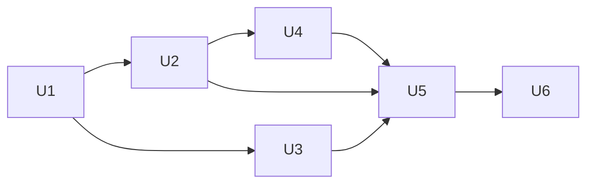

# Exact Diff Attribution - Plan

## Goal

Every configuration leaf has an independently specified diff attribution,
and the perturbation gate checks the complete expected changes. The means
is a mapping, an exact matcher, and bounded migrations of the twelve diff
owners. The current matcher accepts any nonempty result
(`src/common/sim/internal/simtest/diffcoverage.go:490`).

Stop condition: a collection correspondence has several source-compatible
outputs. Readiness stays `needs-decisions` until those outputs are chosen.
The remaining blockers are range correspondence and duplicate multiplicity.

## Decisions

- The parent's Decisions apply.
- The gate proves exact attribution in this parent, not in a later plan.
  A uniform mapping takes each configuration leaf to its diff subject and
  field, and the capability `Diff` fields follow it. Cost: trace and diff
  consumers see changed fields (decided by the user, 2026-10-10).
- Attribution is a phase of its own, run before the close-out phase, so
  the close-out documents the final diff fields. Why: with the close-out's
  nine units it exceeds one bounded phase (decided by the user,
  2026-10-10).
- Fields are granular. Existing subject kinds and keys stay. A change to
  one member of an aggregate gets its own field, a capability that appears
  or disappears gets an explicit presence field, and an identity change
  reports a removed and an added record. Cost: coarse or empty fields
  change, and their tests and corpus consumers change with them. Keeping
  aggregate fields and proving the leaf through complete before and after
  facts was the alternative (decided by the user, 2026-10-10).

- Dotted members with bracketed collection coordinates. Static names use
  dots. A collection member uses a quoted canonical key for a keyed or
  scalar-set collection, such as `attachments["edge.1"].vlan` and
  `select_src_ports["eth2"]`, and normalized position for a structured
  range, such as `match.src_ports[0].start`. Why: distinguishes static names
  from quoted string keys. Tradeoff: use canonical value for scalar-set
  identity and normalized position for structured ranges. Existing dynamic
  assembly fields change. Established scalar fields such as
  `lacp_system_priority` and `tunnel.tpid` are not rewritten
  (decided by the user, 2026-10-10).
- `presence` and nested `.presence`. Why: names lifecycle without implying
  administrative enablement. Tradeoff: nested field strings change.
  Existing facts stay. Presence follows normalized Capabilities, including
  LAG inferred from port entries (`S/device/vswitch/config.go:563`). Empty
  Traffic addition is `(traffic, capability, traffic, presence): nil ->
  vswitch.layer(traffic)`. MST addition is `(stp, bridge, empty,
  mst.presence): false -> true` (decided by the user, 2026-10-10).
- Exact expected sequence per submitted perturbation. Why: independently
  enumerate zero, one, or several normalized changes. Tradeoff: R1 becomes
  an ordered-sequence contract. A dependency oracle must not read Diff's
  returned records. Interval 1s to 2s with submitted Timer duration 0
  expects `interval: 1s -> 2s` followed by `recovery.duration: 3s -> 6s`.
  TPID 0 to 34984 expects `[]` (decided by the user, 2026-10-10).

- Compare effective values after each owner's normalization. Why: the gate
  normalizes both sides at `src/common/sim/internal/simtest/diffcoverage.go:490`,
  and every owner normalizes inside `Diff`. LAG's zero-environment boundary
  is explicit at `src/common/sim/layer/lag/README.md:153`. Filter's masked,
  sorted lists have an empty diff at `src/common/sim/layer/filter/README.md:64`.
  A submitted change erased by normalization expects no records. A presence
  flag that changes an effective priority expects the `priority` record,
  even when the submitted numeric priority stays zero
  (`src/common/sim/layer/stp/config.go:152`, `:205`).
- Preserve established granular names. Why: `lacp_system_priority` and
  `recovery.duration` are already consumer-visible fields
  (`src/common/sim/layer/lag/diff.go:288`,
  `src/common/sim/layer/loopprotect/diff.go:134`). The bracket grammar applies to newly split members without renaming those
  scalar fields.
- Preserve each owner's deterministic output order. Why: corpus assertions
  compare changes by position (`src/common/sim/internal/simtest/corpus.go:890`).
  The perturbation matcher also compares the exact expected sequence. A
  reordered equivalent result fails rather than silently changing this contract.
- Keep `trace.Change`, `Subject`, and `CompositeKey` unchanged. Why: they
  already carry the layer, kind, key, field, and typed facts
  (`src/common/sim/trace/trace.go:61`, `:89`, `:327`). The renderer quotes
  the whole field without parsing it (`src/common/sim/trace/render.go:114`).

## Requirements

R1. For every submitted perturbation, compare the independently expected
ordered sequence of layer, subject kind, subject key, field, and typed
From/To facts. The sequence may be empty, one record, or several records.
Missing, extra, unexpected duplicate, reordered, or mistyped records fail. The
expectation never reads Diff's returned records. Example: interval 1s to 2s
with submitted Timer duration 0 expects the interval record and then the
port's recovery duration 3s to 6s. TPID 0 to 34984 expects no records.
Identity changes include both lifecycle records in the owner's existing
subject traversal order.

R2. Discover structural paths from configuration types as well as concrete
paths from seeds. A nil capability or an unseeded optional branch fails.
Example: clearing `vswitch.Config.Filter` in the coverage seed fails even
when the other eight capabilities remain populated. The existing top-level
check is at `src/common/sim/device/vswitch/diff_coverage_test.go:114`.

R3. Count leaves with concrete expectations per owner, including identity
leaves. Each unmapped, unseeded, unperturbable, or intentionally nonsemantic
leaf has its full path, reason, and disposition in the result. None is
silently skipped. Example: a new exported filter match member fails until
its seed, mutation, and exact expectation exist. The current walker skips
nil pointers at `src/common/sim/internal/simtest/diffcoverage.go:182`.

R4. Each migration removes every producer/layer allowance it claims and keeps all
focused tests green. The exact matcher never falls back to a nonempty check
for an owner already migrated. Example: after bridge migrates, removing its
`tunnel` member arm fails even while the LAG owner is still allowed.

R5. Preserve existing retention checks and whole-copy behavior. Example:
perturbing the switch MAC preserves its port table, and deleting the MAC
arm still fails. Sources: `src/common/sim/internal/simtest/diffcoverage_test.go:71`
and `src/common/sim/internal/simtest/diffcoverage.go:586`.

## Out of scope

Runtime forwarding, protocol behavior, retention identity, and comparison
locations are unchanged. The checker reads trusted repository-authored
configuration types and seeds. Its purpose is missing or misattributed
coverage, not hostile input handling. This planning change edits only this
plan and its state. Future units name the direction-record amendment.
No parent or direction-record edit is part of this planning change.

## Attribution inventory and mapping

Snapshot: `4944caed`. The drafted inventory is recoverable from
`9ee39543:docs/plans/2026-10-01-2200-refactor-sim-package-overhaul-phase12-plan.md`,
section Attribution split inventory. The current twelve owners match the
literal list at `src/common/sim/internal/simtest/diffcoverage.go:26`.

In the table, `S` is `src/common/sim`, `K(...)` is `trace.CompositeKey(...)`,
`n` is a port or device name, `v` a VLAN, `r` a VRF, and `i` an instance.
Fields separated by commas correspond to the configuration members in the
same order. `k` is a quoted canonical collection value. A retained subject
keeps every existing scalar field. Its split collection fields use the
rules below. Subject addition/removal keeps the existing complete snapshot
facts and empty field, except capability presence, which uses `presence`
or the nested `.presence` suffix. Optional scalar pointers keep their
existing scalar field and nil/value facts. Open questions mark only the
correspondence that remains undecided, not the settled grammar.

| Configuration leaf or family | Layer | Subject kind | Key | Target field and disposition | Source on this tree |
| --- | --- | --- | --- | --- | --- |
| bridge AgingTime, MaxEntries, ForwardBPDU | relay | bridge | empty | aging_time, max_entries, forward_bpdu | S/layer/bridge/diff.go:423, :440, :479 |
| bridge FloodVLANs, ProtectedPorts members | relay | bridge | empty | flood_vlans[k], protected_ports[k] | S/layer/bridge/diff.go:453, :466 |
| bridge VLAN pointer | vlan | bridge | empty | vlan.presence, existing boolean facts | S/layer/bridge/diff.go:144 |
| bridge VLAN.Table[v] value and key identity | vlan | vlan | decimal v | name. Key replacement emits removed/added records, currently empty field | S/layer/bridge/diff.go:186, :205, :223 |
| bridge Switchports[n].PVID, IngressFiltering, Admission, PriorityTags | vlan | port | n | pvid, ingress_filtering, frame_admission, priority_tags | S/layer/bridge/diff.go:311, :350, :363, :409 |
| bridge Switchports[n].Tagged, Untagged members | vlan | port | n | tagged_vlan_ids[k], untagged_vlan_ids[k] | S/layer/bridge/diff.go:324, :337 |
| bridge Tunnel.VID, CustomerVIDs members, TPID | vlan | port | n | tunnel.presence (nil/snapshot), tunnel.vid, tunnel.customer_vids[k], tunnel.tpid (effective) | S/layer/bridge/diff.go:369, :396. S/layer/bridge/config.go:291 |
| phy Ethernet[n].Setting.SpeedBPS, Duplex, AutoNegotiation | ethernet | port | n | speed_bps, duplex, auto_negotiation_enabled | S/layer/phy/diff.go:149, :158, :167 |
| phy Ethernet[n].SupportedSpeedsBPS members, AutoNegotiationSupported | ethernet | port | n | supported_speeds_bps[k], auto_negotiation_supported | S/layer/phy/diff.go:176, :185 |
| phy Ethernet[n].Observed.SpeedBPS, Duplex | ethernet | port | n | observed_speed_bps, observed_duplex | S/layer/phy/diff.go:194, :203 |
| phy PoE.Groups[n].PowerNanowatts | poe | pse_group | n | power_nanowatts | S/layer/phy/diff.go:241, :251 |
| phy PoE.Ports[n].Group, MaxClass, Enabled, Limit, Priority, PD, PDClass | poe | port | n | group, max_class, enabled, power_limit_nanowatts, priority, pd, pd_class | S/layer/phy/diff.go:273, :284, :293, :302, :311, :320, :329, :338 |
| loopprotect Interval | loopprotect | bridge | empty | interval | S/layer/loopprotect/diff.go:69, :75 |
| loopprotect Ports[n].Action, Recovery.Mode, Recovery.Duration | loopprotect | port | n | action, recovery.mode, recovery.duration | S/layer/loopprotect/diff.go:122, :128, :134 |
| loopprotect Ports[n].VLANs members | loopprotect | port | n | vlans[k] | S/layer/loopprotect/diff.go:140 |
| mcast VLANs[v].FloodUnregistered, FastLeave | mcast | vlan | decimal v | flood_unregistered, fast_leave | S/layer/mcast/diff.go:109, :112, :145 |
| mcast VLANs[v].RouterPorts members | mcast | vlan | decimal v | router_ports[k] | S/layer/mcast/diff.go:116 |
| mcast MembershipInterval, RouterPortInterval, LastMemberQueryInterval, LastMemberQueryCount | mcast | vlan | decimal v | membership_interval, router_port_interval, last_member_query_interval, last_member_query_count | S/layer/mcast/diff.go:119, :122, :125, :129 |
| lag LAGs[n].Mode, Primary, UpDelay, DownDelay, HashBasis, MinLinks, RebalanceInterval | lag | lag | n | mode, primary, up_delay, down_delay, hash_basis, min_links, rebalance_interval | S/layer/lag/diff.go:196, :206, :216, :226, :236, :246, :258 |
| lag LACP.Mode, Fast, SystemPriority, SystemID, Key, Fallback | lag | lag | n | lacp_mode, lacp_fast, lacp_system_priority, lacp_system_id, lacp_key, lacp_fallback | S/layer/lag/diff.go:268, :278, :288, :298, :308, :318 |
| lag Members[m].Priority, Key | lag | lag_member | K(n,m) | priority, key. Map identity changes use lifecycle pair | S/layer/lag/diff.go:327, :344, :354, :389 |
| stp Priority and PriorityPresent, Address, HelloTime, MaxAge, ForwardDelay, TxHoldCount | stp | bridge | empty | priority (effective), address, hello_time, max_age, forward_delay, tx_hold_count | S/layer/stp/diff.go:140, :150, :160, :170, :180, :190 |
| stp Ports[n].Priority and PriorityPresent, PathCost, AdminEdge, PointToPoint, AutoEdge, guards | stp | port | n | priority (effective), admin_path_cost, admin_edge, admin_point_to_point, auto_edge, bpdu_guard, restricted_role, restricted_tcn, loop_guard | S/layer/stp/diff.go:252, :263, :273, :283, :293, :304 |
| stp MST/PVST pointer presence | stp | bridge | empty | mst.presence, pvst.presence, existing boolean facts | S/layer/stp/diff.go:198, :216 |
| stp MST.Name, Revision, MaxHops | stp | bridge | empty | mst.name, mst.revision, mst.max_hops | S/layer/stp/diff.go:343, :347, :353, :359 |
| stp MST.Instances[i].Priority and PriorityPresent, VLANs members | stp | mst_instance | decimal i | priority (effective), vlans[k]. Duplicate multiplicity blocked by Q5 | S/layer/stp/diff.go:403, :407, :413 |
| stp MST.Instances[i].Ports[n].Priority and PriorityPresent, PathCost | stp | mst_instance_port | K(decimal i,n) | priority (effective), path_cost | S/layer/stp/diff.go:420, :432, :438 |
| stp PVST.Trees[v].Priority and PriorityPresent, Ports[n] priority flags and PathCost | stp | pvst_tree, pvst_tree_port | decimal v, K(decimal v,n) | priority (effective), priority (effective), path_cost | S/layer/stp/diff.go:505, :509, :517, :528, :534 |
| filter Sets[s].Stateful, Default | filter | set | s | stateful, default | S/layer/filter/diff.go:164, :210, :219 |
| filter Rules.Name and rule identity | filter | rule | K(s,name), or K(s,empty,index) for unnamed/duplicate names | lifecycle pair, currently empty. Preserve existing matching | S/layer/filter/diff.go:331, :337, :347, :367 |
| filter Rule.Action, Match.Protocol, Src/Dst members, SrcPorts/DstPorts Start/End, ICMP Type/Code, TCPFlags Mask/Value | filter | rule | existing rule key | action, match.protocol, match.src[k], match.dst[k], match.src_ports[j].start/.end, match.dst_ports[j].start/.end, match.icmp.type/.code, match.tcp_flags.mask/.value. Range correspondence blocked by Q4 | S/layer/filter/config.go:41, :53, :74, :89, :100. S/layer/filter/diff.go:353 |
| filter Bindings.Interface, Direction, Set | filter | binding | K(interface,direction) | identity pair for Interface/Direction, set for retained binding | S/layer/filter/diff.go:264, :270, :280, :290 |
| routing ClearRouterFlag | routing | routing | empty | clear_router_flag | S/layer/routing/diff.go:242 |
| routing VRFs[r].Interfaces[n].VLAN, Port, MAC, Prefixes members | routing | interface | K(r,n) | vlan, port, mac, prefixes[k]. Duplicate multiplicity blocked by Q5 | S/layer/routing/diff.go:308, :326, :335, :344, :353 |
| routing Routes.Prefix, NextHop, Interface | routing | route | K(r,prefix,nextHop,interface) | removed/added pair, currently empty field | S/layer/routing/diff.go:393, :400, :408 |
| routing Routes.Preference, Metric | routing | route | existing route key | preference, metric | S/layer/routing/diff.go:417, :426 |
| routing Neighbors.Interface, Addr, MAC | routing | neighbor | K(r,interface,addr) | identity pair for Interface/Addr, mac for retained neighbor | S/layer/routing/diff.go:463, :470, :478, :487 |
| routing NeighborPolicy.Mode, ReachableTime, RetransTimer, HoldDepth | routing | neighbor-policy | r | mode, reachable_time, retrans_timer, hold_depth | S/layer/routing/diff.go:495, :500, :509, :518, :527 |
| traffic Mirrors.Name | traffic | mirror | name | identity pair, currently empty field | S/layer/traffic/diff.go:178, :185, :276 |
| traffic Mirrors.SelectAll, OutputPort, OutputVLAN, SnapLen | traffic | mirror | name | select_all, output_port, output_vlan, snap_len | S/layer/traffic/diff.go:245, :257, :260, :263 |
| traffic Mirrors.SelectSrcPorts, SelectDstPorts, SelectVLANs members | traffic | mirror | name | select_src_ports, select_dst_ports, select_vlans[k] | S/layer/traffic/diff.go:248, :251, :254 |
| traffic Policers[n].RateBPS, BurstOctets | traffic | port | n | rate, burst | S/layer/traffic/diff.go:197, :200, :205 |
| traffic Queues[n].MaxRateBPS[pcp], BufferOctets[pcp] | traffic | port | K(n,decimal pcp) | max_rate, buffer_octets | S/layer/traffic/diff.go:214, :220, :226 |
| port Name, IfIndex, Kind, AdminStatus, OperStatus, MTU, LagParent | port | port | Name | identity pair for Name, ifindex, kind, admin_status, oper_status, mtu, lag_parent | S/port/diff.go:19, :38, :51, :64, :77, :90, :103, :114 |
| vswitch MAC, Ports, capability members | port for MAC, delegated for members | device, delegated subject kinds | empty for device, delegated keys | mac, delegated port and layer fields | S/device/vswitch/diff.go:46, :56, :66, :153 |
| vswitch capability presence | capability layer | capability | layer name | presence, existing nil/layer facts | S/device/vswitch/diff.go:159, :188, :199 |
| assembly Start | fabric | fabric | empty | start | S/assembly/diff.go:93 |
| assembly Switches[name] members | delegated | delegated kinds | K(name,existing key) | delegated fields | S/assembly/diff.go:511 |
| assembly host Address, VLAN, IP.Addresses members, Gateway, Neighbors[addr] | fabric | host | name | address, vlan, addresses[k], gateway, neighbors[k] | S/assembly/diff.go:280, :308, :344, :674, :690 |
| assembly host Accept.Promiscuous, AllMulticast, Multicast members | fabric | host | name | accept.promiscuous, accept.all_multicast, accept.multicast[k] | S/assembly/diff.go:184, :187, :191 |
| assembly host Ethernet members | ethernet | host | name | phy fields prefixed ethernet, ethernet.supported_speeds_bps[k] | S/assembly/diff.go:169 |
| assembly reflector Address, Ports[name] Ethernet members, Attachments[name] Port/VLAN/Addresses members | fabric for Address/Attachments, ethernet for Ports | reflector | reflector name | address, ports[n].<phy field>, attachments[n].port/.vlan/.addresses[k]. Added/removed entries retain snapshots at ports[n] or attachments[n] | S/assembly/diff.go:124, :132, :225, :233, :243, :248, :743 |
| assembly Cables A/B Node/Port identity | fabric | cable | canonical endpoint pair | removed/added pair, currently empty | S/assembly/diff.go:415, :420, :543, :614 |
| assembly cable LengthMeters, Medium, Delay, TopSpeedBPS | fabric | cable | canonical endpoint pair | length, medium, delay, top_speed | S/assembly/diff.go:557, :566, :582, :591 |
| assembly cable Fault.Kind, N, Sequence members | fabric | cable | canonical endpoint pair | fault.kind, fault.n, fault.sequence[k], using normalizedFault | S/assembly/diff.go:424, :600. S/medium/cable/fault.go:35 |
| assembly Uncabled.Endpoint Node/Port | fabric | uncabled | Endpoint.Canonical() | removed/added pair | S/assembly/diff.go:153, :162 |
| assembly PhyAssumption.Medium and Ethernet members | fabric | fabric | empty | phy_assumption.presence (nil/snapshot), phy_assumption.medium, phy_assumption.ethernet.<phy field> | S/assembly/diff.go:99 |
| assembly Cable/Uncabled Evidence members | none | none | none | explicitly nonsemantic, expects no change | S/assembly/diff.go:84. S/assembly/diff_coverage_test.go:87 |
| assembly DiffSpecs switch construction inputs | fabric | switch | name | construction_inputs aggregate. Separate input from Config leaf gate | S/assembly/diff.go:24, :63 |
Collection coordinates escape keys as Go quoted strings, the same quote
operation CompositeKey uses (`S/trace/trace.go:89`). This is a field rule,
not a change to CompositeKey. The standard-library contract read for it is
`go doc strconv.Quote` from the Go 1.27 toolchain pinned in `go.mod:3`.
A literal quote or backslash inside a key remains inside one bracketed
coordinate. Fixtures include both characters as well as dots and slashes.

### Typed facts for split members

Existing scalar and lifecycle facts retain TypeID and Canonical. New
scalar facts below replace retained-subject aggregate snapshots. The names
are target contracts, not claims that these types already exist. Numeric
values use unsigned decimal, strings use their exact value, prefixes and
MACs use the canonical string used as their coordinate. Nil is an absent
fact, distinct from a zero-valued typed fact. Tests construct expected
(TypeID,Canonical) pairs directly, not by calling the producer's snapshot
or taking a singleton aggregate fact. The mapping builder reads submitted
and independently normalized inputs, never the returned records.

| Fields | Target fact TypeID |
| --- | --- |
| bridge split VLAN members, tunnel.vid | bridge.vlan_id |
| bridge protected_ports members | bridge.port |
| bridge tunnel.tpid | bridge.tpid |
| phy supported speed members and every delegated Ethernet speed | phy.speed_bps (existing at S/layer/phy/diff.go:16) |
| loopprotect vlans members | loopprotect.vlan_id |
| mcast router_ports members | mcast.router_port |
| stp vlans members | stp.mst.vlan_id under Q5 occurrence option, or stp.mst.vlan_count under count option |
| filter match.protocol | filter.protocol |
| filter match.src/dst members | filter.prefix |
| filter range start/end | filter.port |
| filter match.icmp.type/code | filter.icmp_type, filter.icmp_code |
| filter match.tcp_flags.mask/value | filter.tcp_flags |
| routing prefixes members | routing.prefix under Q5 occurrence option, or routing.prefix_count under count option |
| traffic select_src_ports/select_dst_ports members | traffic.port |
| traffic select_vlans members | traffic.output_vlan (existing at S/layer/traffic/diff.go:104) |
| assembly address members | fabric.prefix |
| assembly accept.multicast and neighbors value | Existing assembly MAC fact |
| assembly fault.kind, fault.n, fault.sequence members | fabric.fault_kind, fabric.fault_n, fabric.fault_position |
| assembly phy_assumption.medium | fabric.medium |

For retained aggregates, compare tunnel VID, customer set, TPID in that
order at the old tunnel slot. Compare filter Action, Match.Protocol, Src,
Dst, SrcPorts, DstPorts, ICMP.Type/Code, TCPFlags.Mask/Value in that order
at the old retained-rule slot (`S/layer/filter/diff.go:353`). Compare fault
Kind, N, Sequence at the old fault slot (`S/assembly/diff.go:600`). A
retained physical assumption compares Medium followed by phy's field order.
Lifecycle changes retain their single snapshot record at the corresponding
`.presence` field rather than also emitting retained-member records.

### Collection correspondence

Normalize both inputs before correspondence. In the table, Set means match
by quoted canonical value, emit old-only values as value-to-nil records in
normalized old order, then new-only values as nil-to-value records in
normalized new order. Insertion/deletion changes only that value. Sorting
displacement and deduplication produce no records. A scalar member edit
is removal/addition, never an edit at its former raw index. Use existing
owner traversal around this local sequence. The old-members/new-members
pattern is already used by assembly multicast at
`S/assembly/diff.go:189`. Typed element facts keep an owner-local type and
canonical value. Each split member has a scalar fact.

The following rules are specifications read against normalization. Each
row gives a member-edit example and states all five correspondence cases.
Rows sharing Set still have separate seeds and expectations.

| List family | Correspondence and worked example | Normalization source on this tree |
| --- | --- | --- |
| bridge FloodVLANs | Set. [10] to [20] emits `flood_vlans["10"]: 10 -> nil`, `flood_vlans["20"]: nil -> 20`. | S/layer/bridge/config.go:267 |
| bridge ProtectedPorts | Set. [eth2] to [eth3] emits `protected_ports["eth2"]: eth2 -> nil`, `protected_ports["eth3"]: nil -> eth3`. | S/layer/bridge/config.go:271 |
| bridge Switchports.Tagged | Set. [10] to [20] emits `tagged_vlan_ids["10"]: 10 -> nil`, `tagged_vlan_ids["20"]: nil -> 20`. | S/layer/bridge/config.go:283 |
| bridge Switchports.Untagged | Set. [10] to [20] emits `untagged_vlan_ids["10"]: 10 -> nil`, `untagged_vlan_ids["20"]: nil -> 20`. | S/layer/bridge/config.go:287 |
| bridge Tunnel.CustomerVIDs | Set. [10] to [20] emits `tunnel.customer_vids["10"]: 10 -> nil`, `tunnel.customer_vids["20"]: nil -> 20`. | S/layer/bridge/config.go:295 |
| phy Ethernet.SupportedSpeedsBPS | Set. [1000000000] to [10000000000] removes `supported_speeds_bps["1000000000"]` and adds `supported_speeds_bps["10000000000"]` with speed facts. There is no phy/config.go. | S/layer/phy/phy.go:46, :52 |
| loopprotect Ports.VLANs | Set. [10] to [20] removes `vlans["10"]` and adds `vlans["20"]`. | S/layer/loopprotect/config.go:133, :136 |
| mcast VLANs.RouterPorts | Set. [eth2] to [eth3] removes `router_ports["eth2"]` and adds `router_ports["eth3"]`. | S/layer/mcast/config.go:60 |
| stp MST.Instances.VLANs | Sort-only multiset. Insertion/deletion/member replacement preserve counts, displacement is silent, normalization does not deduplicate. Q5 blocks fact correspondence. [10,10] to [10] is the Q5 example. Config delegates to MST.Normalize. | S/layer/stp/config.go:219, S/layer/stp/mst.go:178, :185 |
| filter Rule.Match.Src | Set after masking. [192.0.2.1/24] to [198.51.100.1/24] removes `match.src["192.0.2.0/24"]` and adds `match.src["198.51.100.0/24"]`. A host-bit-only edit expects []. | S/layer/filter/config.go:147, :192 |
| filter Rule.Match.Dst | Set after masking. [192.0.2.1/24] to [198.51.100.1/24] removes `match.dst["192.0.2.0/24"]` and adds `match.dst["198.51.100.0/24"]`. | S/layer/filter/config.go:148, :192 |
| filter Rule.Match.SrcPorts | Sorted and compacted structured ranges. Q4 specifies insertion/deletion/displacement/member edits per option. Reorder and duplicate-only edits expect []. [{100,200},{300,400}] to [{300,400},{500,600}] is the Q4 example. | S/layer/filter/config.go:149, :201 |
| filter Rule.Match.DstPorts | Same normalization as SrcPorts, separate oracle. Replace the Q4 example's prefix with `match.dst_ports`. All five correspondence cases remain blocked by Q4 except reorder/dedup no-ops. | S/layer/filter/config.go:150, :201 |
| filter RuleSet.Rules | Preserve existing indexRules correspondence. Named unique rules match by name across insertion/deletion/displacement. Unnamed or duplicate-named rules match normalized index. No sort/dedup. Inserting unique b before unique a reports only added b. Inserting unnamed Drop before unnamed Accept reports index 0 action Accept to Drop and added index 1 Accept. Name edit uses existing subject identity changes. | S/layer/filter/config.go:128, :142, S/layer/filter/diff.go:367 |
| filter Bindings | Match by (Interface,Direction). Insert/delete or an identity edit uses existing snapshots. Set edit reports `set`. Sorting displacement is silent, no dedup. (eth2,in,s1) to (eth2,in,s2) emits `set: s1 -> s2`. Duplicate identities retain the existing indexed behavior, not a new field identity. | S/layer/filter/config.go:178, S/layer/filter/diff.go:248 |
| routing Interfaces.Prefixes | Sort-only multiset of unmasked interface addresses. Q5 controls insertion/deletion/member edit and multiplicity facts. Sorting displacement is silent, no dedup. [192.0.2.1/24,192.0.2.1/24] to [192.0.2.1/24] is the Q5 example. | S/layer/routing/config.go:148 |
| routing VRFs.Routes | Match existing (VRF,masked Prefix,NextHop,Interface) identity. Insert/delete or identity edit uses lifecycle snapshots. Preference/Metric member edit stays on its route even if sorting moves it. No list dedup. Duplicate keys keep existing map overwrite after normalized sorting. Metric 10 to 20 emits `metric: 10 -> 20`, not displacement records. | S/layer/routing/config.go:152, :160, S/layer/routing/diff.go:361 |
| routing VRFs.Neighbors | Match (VRF,Interface,Addr). Insert/delete or identity edit uses lifecycle snapshots. Sorting displacement is silent, no dedup, duplicate keys keep existing map overwrite. MAC a to b emits `mac: a -> b` at the retained key. | S/layer/routing/config.go:175, S/layer/routing/diff.go:434 |
| traffic Mirrors | Match Name, including an identity edit's lifecycle pair. Sorting displacement is silent, no dedup, duplicate names keep existing mirrorsByName overwrite. OutputPort eth2 to eth3 emits `output_port: eth2 -> eth3`. | S/layer/traffic/config.go:172, S/layer/traffic/diff.go:269 |
| traffic Mirror.SelectSrcPorts | Set. [eth2] to [eth3] emits `select_src_ports["eth2"]: eth2 -> nil`, then `select_src_ports["eth3"]: nil -> eth3`. | S/layer/traffic/config.go:159 |
| traffic Mirror.SelectDstPorts | Set. [eth2] to [eth3] removes `select_dst_ports["eth2"]` and adds `select_dst_ports["eth3"]`. | S/layer/traffic/config.go:163 |
| traffic Mirror.SelectVLANs | Set. [10] to [20] removes `select_vlans["10"]` and adds `select_vlans["20"]`. | S/layer/traffic/config.go:167 |
| assembly Hosts.IP.Addresses | Set of unmasked prefix values. [192.0.2.1/24] to [192.0.2.2/24] removes `addresses["192.0.2.1/24"]` and adds `addresses["192.0.2.2/24"]`. | S/assembly/config.go:201 |
| assembly Hosts.Accept.Multicast | Set. MAC a to b removes `accept.multicast["a"]` and adds `accept.multicast["b"]`. Use actual MAC strings in fields and facts. | S/assembly/config.go:206 |
| assembly Reflectors.Attachments.Addresses | Set of unmasked prefix values. Address a to b at edge.1 removes `attachments["edge.1"].addresses["a"]` and adds `attachments["edge.1"].addresses["b"]`. | S/assembly/config.go:230, :233 |
| assembly host, reflector port, and PhyAssumption Ethernet.SupportedSpeedsBPS | Three Set families, each with its own prefix: `ethernet.`, `ports["p1"].`, `phy_assumption.ethernet.`. 1 Gb/s to 10 Gb/s gives the phy Set example under each prefix. | S/assembly/config.go:205, :226, :263, S/medium/cable/ethernet.go:110, S/layer/phy/phy.go:52 |
| assembly Cable.Fault.Sequence | Set of 1-based frame positions only when Kind is LoseSequence. [1] to [2] removes `fault.sequence["1"]` and adds `fault.sequence["2"]`. Other kinds clear Sequence, so all five edits expect [] there. config.go calls normalizedFault rather than defining the sort locally. | S/assembly/config.go:250, S/assembly/diff.go:426, :434 |
| assembly Cables | Match canonical endpoint pair after orientation. Insert/delete or endpoint edit uses cable snapshots. Sorting displacement is silent, no dedup. Retained LengthMeters 3 to 4 emits `length: 3 -> 4`. Reversed endpoint orientation follows existing directional fault normalization. | S/assembly/config.go:245, :266, :293, S/assembly/diff.go:415 |
| assembly Uncabled | Match Endpoint, preserve old/removal then new/addition traversal. Insert/delete or endpoint edit uses endpoint facts. Sorting displacement is silent, no dedup. (sw1,p1) to (sw1,p2) emits removal then addition. | S/assembly/config.go:255, :258, S/assembly/diff.go:138 |
| assembly Cables.Evidence, Uncabled.Evidence | Both canonicalized sets but nonsemantic to Diff. Insertion/deletion/displacement/dedup/member edit all expect []. [survey:a] to [survey:b] expects []. | S/assembly/config.go:251, :256, :283, S/assembly/diff.go:84, :138 |

Keyed maps keep existing subject matching. Maps with lifecycle arms keep
those snapshots. Traffic policer/queue maps retain their existing numeric
field projections against absent-as-zero values (`S/layer/traffic/diff.go:194`,
`:210`). Their complete key-edit expectations include both old and new
subjects for the nonzero seeds, and empty sequences for zero-equivalent
submitted entries. Assembly
wrapper keys move to brackets: `ports["p.1"]`, `attachments["edge.1"]`,
`neighbors["192.0.2.1"]`. This changes fields, not Subject or CompositeKey.
Map-key replacements get explicit mutation adapters, since the current
walker visits only map values (`S/internal/simtest/diffcoverage.go:196`).

### Coverage accounting

The existing seeded subtest counts below are reproducible with
`go test -json ./src/common/sim/layer/... ./src/common/sim/port ./src/common/sim/device/vswitch ./src/common/sim/assembly -run '^TestDiffCoversEveryConfigField$' -count=1`.
Count `run` events whose test name begins `TestDiffCoversEveryConfigField/`.
They are nonempty-check counts, not exact-attribution counts.

| Owner | Current exercised leaves | Concrete complete exact expectations | Seed source |
| --- | --- | --- | --- |
| bridge | 15 | 0 | S/layer/bridge/diff_coverage_test.go:18 |
| phy | 15 | 0 | S/layer/phy/diff_coverage_test.go:14 |
| loopprotect | 5 | 0 | S/layer/loopprotect/diff_coverage_test.go:17 |
| mcast | 7 | 0 | S/layer/mcast/diff_coverage_test.go:17 |
| lag | 15 | 0 | S/layer/lag/diff_coverage_test.go:17 |
| stp | 31 | 0 | S/layer/stp/diff_coverage_test.go:20 |
| filter | 18 | 0 | S/layer/filter/diff_test.go:160 |
| routing | 17 | 0 | S/layer/routing/diff_coverage_test.go:19 |
| traffic | 12 | 0 | S/layer/traffic/diff_coverage_test.go:15 |
| port | 6 | 0 | S/port/diff_coverage_test.go:16 |
| vswitch | 92 | 0 | S/device/vswitch/diff_coverage_test.go:32 |
| assembly | 33 | 0 | S/assembly/diff_coverage_test.go:33 |

The answered grammar, presence name and ordered-sequence contract no longer
block attribution. The proposed primary manifest has 627 slots: 266
currently exercised values, 208 missing representative values, 4 exempt
values, 69 map-key identities, and 80 pointer-presence cases. MAC, time and
IP values remain atomic. One slot is one submitted value/key change or
populated-to-nil pointer case. Reverse pointer cases belong to the focused
unit tests and do not count again in the primary gate. Eighteen slots depend
on Q4/Q5. The other 609 slots are structurally mappable, not 609 authored
concrete expectations.

A concrete expectation here means a fixed submitted before/after input
plus the complete independent typed output sequence. Neither current code
nor this blocked plan has that complete table. The literal reached count
per unit is therefore 0. The table separates it from the finite primary
target. After Q4/Q5 are answered, author the table before readiness changes.
A count of schema paths alone does not satisfy R3. No unresolved path is
silently exempted.

| Unit | Current value probes | Added primary slots | Primary target | Q4 blocked | Q5 blocked | Structurally mappable | Reached complete concrete expectations |
| --- | --- | --- | --- | --- | --- | --- | --- |
| U1 mapping/gate foundation | 0 | 0 | 0 producer probes, all 627 entries registered | 12 | 6 | 609 mapping entries | 0 |
| U2 | 42 | 16 | 58 | 0 | 0 | 58 | 0 |
| U3 | 46 | 10 | 56 | 0 | 1 | 55 | 0 |
| U4 | 35 | 7 | 42 | 4 | 1 | 37 | 0 |
| U5 | 110 | 104 | 214 | 4 | 2 | 208 | 0 |
| U6 | 33 | 224 | 257 | 4 | 2 | 251 | 0 |

The primary targets by owner are bridge 20, phy 23, loopprotect 6, mcast 9,
lag 18, stp 38, filter 23, routing 19, traffic 17, port 7, vswitch 190,
and assembly 257. Switch value closure is 135 layer values + MAC 1 +
Port adapter 7 = 143 values, plus 21 keys and 26 presence cases = 190.
Assembly value closure is its 36 currently discovered values (33 exercised,
3 exempt) + 142 missing switch values + 15 host/reflector/assumption
Ethernet values = 193, plus 27 keys and 37 presence cases = 257.
These finite counts specify one representative per collection element type.
They do not require every possible collection cardinality or MAC byte.

The current walker skips nil pointers, map keys and empty containers
(`S/internal/simtest/diffcoverage.go:182`, `:196`, `:205`). Structural type
enumeration must reconcile every path against a seed or explicit adapter.
`port.Table` stores only unexported fields (`S/port/port.go:172`). Its
seven Port leaves use NewBuilder, including Name's identity pair. Copy
`Table` whole before adapting it. Unsupported future leaf kinds fail at
`S/internal/simtest/diffcoverage.go:395`, even while an allowance remains.

### Paths the current gate cannot perturb

Each row is an addition to the producer's current seed. `@key` means an
explicit map-key mutation and `@present` a populated-to-nil pointer case.
They are manifest notation, never emitted Field text. Every row names its
current absence or mutation limitation. None is a permanent exclusion.
Use each complete owner seed inside the switch and assembly wrappers so
nested types are covered there as well. The seed sources above and type
sources below bind the literal counts to this tree.

#### U2 additions

| Full path | Current limitation and disposition | Type source |
| --- | --- | --- |
| `bridge.Config.VLAN.@present` | Walker dereferences without presence probe. Add nil toggle adapter | S/layer/bridge/config.go:236 |
| `bridge.Config.VLAN.Table[10].@key` | Walker visits values only. Add key-rename adapter with fixed value | S/layer/bridge/config.go:153 |
| `bridge.Config.VLAN.Switchports[1/1/1].@key` | Walker visits values only. Add key-rename adapter with fixed value | S/layer/bridge/config.go:154 |
| `bridge.Config.VLAN.Switchports[1/1/1].PVID.@present` | Walker dereferences without presence probe. Add nil toggle adapter | S/layer/bridge/config.go:99 |
| `bridge.Config.VLAN.Switchports[1/1/1].Tunnel.@present` | Walker dereferences without presence probe. Add nil toggle adapter | S/layer/bridge/config.go:104 |
| `phy.Config.Ethernet[1/1/1].@key` | Walker visits values only. Add key-rename adapter with fixed value | S/layer/phy/phy.go:22 |
| `phy.Config.Ethernet[1/1/1].Setting.@present` | Walker dereferences without presence probe. Add nil toggle adapter | S/layer/phy/ethernet.go:110 |
| `phy.Config.Ethernet[1/1/1].Observed.@present` | Walker dereferences without presence probe. Add nil toggle adapter | S/layer/phy/ethernet.go:111 |
| `phy.Config.PoE.@present` | Walker dereferences without presence probe. Add nil toggle adapter | S/layer/phy/phy.go:23 |
| `phy.Config.PoE.Groups[g1].@key` | Walker visits values only. Add key-rename adapter with fixed value | S/layer/phy/poe.go:156 |
| `phy.Config.PoE.Ports[1/1/1].@key` | Walker visits values only. Add key-rename adapter with fixed value | S/layer/phy/poe.go:157 |
| `phy.Config.PoE.Ports[1/1/1].Limit.@present` | Walker dereferences without presence probe. Add nil toggle adapter | S/layer/phy/poe.go:111 |
| `phy.Config.PoE.Ports[1/1/1].PDClass.@present` | Walker dereferences without presence probe. Add nil toggle adapter | S/layer/phy/poe.go:114 |
| `loopprotect.Config.Ports[1/1/1].@key` | Walker visits values only. Add key-rename adapter with fixed value | S/layer/loopprotect/config.go:83 |
| `mcast.Config.VLANs[10].@key` | Walker visits values only. Add key-rename adapter with fixed value | S/layer/mcast/config.go:27 |
| `mcast.Config.VLANs[10].FloodUnregistered.@present` | Walker dereferences without presence probe. Add nil toggle adapter | S/layer/mcast/config.go:77 |

#### U3 additions

| Full path | Current limitation and disposition | Type source |
| --- | --- | --- |
| `lag.Config.LAGs[lag1].@key` | Walker visits values only. Add key-rename adapter with fixed value | S/layer/lag/config.go:154 |
| `lag.Config.LAGs[lag1].RebalanceInterval.@present` | Walker dereferences without presence probe. Add nil toggle adapter | S/layer/lag/config.go:129 |
| `lag.Config.LAGs[lag1].Members[1/1/1].@key` | Walker visits values only. Add key-rename adapter with fixed value | S/layer/lag/config.go:132 |
| `stp.Config.Ports[1/1/1].@key` | Walker visits values only. Add key-rename adapter with fixed value | S/layer/stp/config.go:127 |
| `stp.Config.MST.@present` | Walker dereferences without presence probe. Add nil toggle adapter | S/layer/stp/config.go:128 |
| `stp.Config.MST.Instances[1].@key` | Walker visits values only. Add key-rename adapter with fixed value | S/layer/stp/mst.go:77 |
| `stp.Config.MST.Instances[1].Ports[1/1/1].@key` | Walker visits values only. Add key-rename adapter with fixed value | S/layer/stp/mst.go:48 |
| `stp.Config.PVST.@present` | Walker dereferences without presence probe. Add nil toggle adapter | S/layer/stp/config.go:129 |
| `stp.Config.PVST.Trees[10].@key` | Walker visits values only. Add key-rename adapter with fixed value | S/layer/stp/pvst.go:40 |
| `stp.Config.PVST.Trees[10].Ports[1/1/1].@key` | Walker visits values only. Add key-rename adapter with fixed value | S/layer/stp/pvst.go:17 |

#### U4 additions

| Full path | Current limitation and disposition | Type source |
| --- | --- | --- |
| `filter.Config.Sets[set1].@key` | Walker visits values only. Add key-rename adapter with fixed value | S/layer/filter/config.go:122 |
| `filter.Config.Sets[set1].Rules[0].Match.Protocol.@present` | Walker dereferences without presence probe. Add nil toggle adapter | S/layer/filter/config.go:90 |
| `filter.Config.Sets[set1].Rules[0].Match.ICMP.@present` | Walker dereferences without presence probe. Add nil toggle adapter | S/layer/filter/config.go:95 |
| `filter.Config.Sets[set1].Rules[0].Match.ICMP.Code.@present` | Walker dereferences without presence probe. Add nil toggle adapter | S/layer/filter/config.go:55 |
| `filter.Config.Sets[set1].Rules[0].Match.TCPFlags.@present` | Walker dereferences without presence probe. Add nil toggle adapter | S/layer/filter/config.go:96 |
| `routing.Config.VRFs[default].@key` | Walker visits values only. Add key-rename adapter with fixed value | S/layer/routing/config.go:113 |
| `routing.Config.VRFs[default].Interfaces[vlan10].@key` | Walker visits values only. Add key-rename adapter with fixed value | S/layer/routing/config.go:101 |

#### U5 additions

| Full path | Current limitation and disposition | Type source |
| --- | --- | --- |
| `traffic.Config.Mirrors[0].OutputVLAN.@present` | Walker dereferences without presence probe. Add nil toggle adapter | S/layer/traffic/config.go:92 |
| `traffic.Config.Policers[1/1/1].@key` | Walker visits values only. Add key-rename adapter with fixed value | S/layer/traffic/config.go:119 |
| `traffic.Config.Queues[1/1/1].@key` | Walker visits values only. Add key-rename adapter with fixed value | S/layer/traffic/config.go:120 |
| `traffic.Config.Queues[1/1/1].MaxRateBPS[0].@key` | Walker visits values only. Add key-rename adapter with fixed value | S/layer/traffic/config.go:111 |
| `traffic.Config.Queues[1/1/1].BufferOctets[0].@key` | Walker visits values only. Add key-rename adapter with fixed value | S/layer/traffic/config.go:112 |
| `port.Config.Name` | Name exempted. Rename to a valid nonempty name through NewBuilder | S/port/port.go:89 |
| `vswitch.Config.Ports.Ports()[1/1/1].Name` | Opaque Table storage. Rebuild this public Port leaf through NewBuilder | S/port/port.go:89 |
| `vswitch.Config.Ports.Ports()[1/1/1].IfIndex` | Opaque Table storage. Rebuild this public Port leaf through NewBuilder | S/port/port.go:90 |
| `vswitch.Config.Ports.Ports()[1/1/1].Kind` | Opaque Table storage. Rebuild this public Port leaf through NewBuilder | S/port/port.go:91 |
| `vswitch.Config.Ports.Ports()[1/1/1].AdminStatus` | Opaque Table storage. Rebuild this public Port leaf through NewBuilder | S/port/port.go:92 |
| `vswitch.Config.Ports.Ports()[1/1/1].OperStatus` | Opaque Table storage. Rebuild this public Port leaf through NewBuilder | S/port/port.go:93 |
| `vswitch.Config.Ports.Ports()[1/1/1].MTU` | Opaque Table storage. Rebuild this public Port leaf through NewBuilder | S/port/port.go:94 |
| `vswitch.Config.Ports.Ports()[1/1/1].LagParent` | Opaque Table storage. Rebuild this public Port leaf through NewBuilder | S/port/port.go:95 |
| `vswitch.Config.Phy.@present` | Walker dereferences without presence probe. Add nil toggle adapter | S/device/vswitch/config.go:39 |
| `vswitch.Config.Phy.Ethernet[1/1/1].@key` | Walker visits values only. Add key-rename adapter with fixed value | S/layer/phy/phy.go:22 |
| `vswitch.Config.Phy.Ethernet[1/1/1].Setting.@present` | Walker dereferences without presence probe. Add nil toggle adapter | S/layer/phy/ethernet.go:110 |
| `vswitch.Config.Phy.Ethernet[1/1/1].Observed.@present` | Walker dereferences without presence probe. Add nil toggle adapter | S/layer/phy/ethernet.go:111 |
| `vswitch.Config.Phy.Ethernet[1/1/1].Observed.SpeedBPS` | No populated representative below nil/empty branch or opaque Table. Add populated representative from complete owner fixture | S/layer/phy/ethernet.go:90 |
| `vswitch.Config.Phy.Ethernet[1/1/1].Observed.Duplex` | No populated representative below nil/empty branch or opaque Table. Add populated representative from complete owner fixture | S/layer/phy/ethernet.go:91 |
| `vswitch.Config.Phy.PoE.@present` | Walker dereferences without presence probe. Add nil toggle adapter | S/layer/phy/phy.go:23 |
| `vswitch.Config.Phy.PoE.Groups[g1].@key` | Walker visits values only. Add key-rename adapter with fixed value | S/layer/phy/poe.go:156 |
| `vswitch.Config.Phy.PoE.Groups[g1].PowerNanowatts` | No populated representative below nil/empty branch or opaque Table. Add populated representative from complete owner fixture | S/layer/phy/poe.go:56 |
| `vswitch.Config.Phy.PoE.Ports[1/1/1].@key` | Walker visits values only. Add key-rename adapter with fixed value | S/layer/phy/poe.go:157 |
| `vswitch.Config.Phy.PoE.Ports[1/1/1].Limit.@present` | Walker dereferences without presence probe. Add nil toggle adapter | S/layer/phy/poe.go:111 |
| `vswitch.Config.Phy.PoE.Ports[1/1/1].PDClass.@present` | Walker dereferences without presence probe. Add nil toggle adapter | S/layer/phy/poe.go:114 |
| `vswitch.Config.Phy.PoE.Ports[1/1/1].PDClass` | No populated representative below nil/empty branch or opaque Table. Add populated representative from complete owner fixture | S/layer/phy/poe.go:114 |
| `vswitch.Config.Bridge.@present` | Walker dereferences without presence probe. Add nil toggle adapter | S/device/vswitch/config.go:40 |
| `vswitch.Config.Bridge.FloodVLANs[0]` | No populated representative below nil/empty branch or opaque Table. Add populated representative from complete owner fixture | S/layer/bridge/config.go:233 |
| `vswitch.Config.Bridge.ProtectedPorts[0]` | No populated representative below nil/empty branch or opaque Table. Add populated representative from complete owner fixture | S/layer/bridge/config.go:234 |
| `vswitch.Config.Bridge.VLAN.@present` | Walker dereferences without presence probe. Add nil toggle adapter | S/layer/bridge/config.go:236 |
| `vswitch.Config.Bridge.VLAN.Table[10].@key` | Walker visits values only. Add key-rename adapter with fixed value | S/layer/bridge/config.go:153 |
| `vswitch.Config.Bridge.VLAN.Switchports[1/1/1].@key` | Walker visits values only. Add key-rename adapter with fixed value | S/layer/bridge/config.go:154 |
| `vswitch.Config.Bridge.VLAN.Switchports[1/1/1].PVID.@present` | Walker dereferences without presence probe. Add nil toggle adapter | S/layer/bridge/config.go:99 |
| `vswitch.Config.Bridge.VLAN.Switchports[1/1/1].Tagged[0]` | No populated representative below nil/empty branch or opaque Table. Add populated representative from complete owner fixture | S/layer/bridge/config.go:100 |
| `vswitch.Config.Bridge.VLAN.Switchports[1/1/1].Untagged[0]` | No populated representative below nil/empty branch or opaque Table. Add populated representative from complete owner fixture | S/layer/bridge/config.go:101 |
| `vswitch.Config.Bridge.VLAN.Switchports[1/1/1].Tunnel.@present` | Walker dereferences without presence probe. Add nil toggle adapter | S/layer/bridge/config.go:104 |
| `vswitch.Config.Bridge.VLAN.Switchports[1/1/1].Tunnel.VID` | No populated representative below nil/empty branch or opaque Table. Add populated representative from complete owner fixture | S/layer/bridge/config.go:33 |
| `vswitch.Config.Bridge.VLAN.Switchports[1/1/1].Tunnel.CustomerVIDs[0]` | No populated representative below nil/empty branch or opaque Table. Add populated representative from complete owner fixture | S/layer/bridge/config.go:34 |
| `vswitch.Config.Bridge.VLAN.Switchports[1/1/1].Tunnel.TPID` | No populated representative below nil/empty branch or opaque Table. Add populated representative from complete owner fixture | S/layer/bridge/config.go:35 |
| `vswitch.Config.LAG.@present` | Walker dereferences without presence probe. Add nil toggle adapter | S/device/vswitch/config.go:41 |
| `vswitch.Config.LAG.LAGs[lag1].@key` | Walker visits values only. Add key-rename adapter with fixed value | S/layer/lag/config.go:154 |
| `vswitch.Config.LAG.LAGs[lag1].RebalanceInterval.@present` | Walker dereferences without presence probe. Add nil toggle adapter | S/layer/lag/config.go:129 |
| `vswitch.Config.LAG.LAGs[lag1].RebalanceInterval` | No populated representative below nil/empty branch or opaque Table. Add populated representative from complete owner fixture | S/layer/lag/config.go:129 |
| `vswitch.Config.LAG.LAGs[lag1].Members[1/1/1].@key` | Walker visits values only. Add key-rename adapter with fixed value | S/layer/lag/config.go:132 |
| `vswitch.Config.STP.@present` | Walker dereferences without presence probe. Add nil toggle adapter | S/device/vswitch/config.go:42 |
| `vswitch.Config.STP.Ports[1/1/1].@key` | Walker visits values only. Add key-rename adapter with fixed value | S/layer/stp/config.go:127 |
| `vswitch.Config.STP.MST.@present` | Walker dereferences without presence probe. Add nil toggle adapter | S/layer/stp/config.go:128 |
| `vswitch.Config.STP.MST.Name` | No populated representative below nil/empty branch or opaque Table. Add populated representative from complete owner fixture | S/layer/stp/mst.go:74 |
| `vswitch.Config.STP.MST.Revision` | No populated representative below nil/empty branch or opaque Table. Add populated representative from complete owner fixture | S/layer/stp/mst.go:75 |
| `vswitch.Config.STP.MST.MaxHops` | No populated representative below nil/empty branch or opaque Table. Add populated representative from complete owner fixture | S/layer/stp/mst.go:76 |
| `vswitch.Config.STP.MST.Instances[1].@key` | Walker visits values only. Add key-rename adapter with fixed value | S/layer/stp/mst.go:77 |
| `vswitch.Config.STP.MST.Instances[1].Priority` | No populated representative below nil/empty branch or opaque Table. Add populated representative from complete owner fixture | S/layer/stp/mst.go:45 |
| `vswitch.Config.STP.MST.Instances[1].PriorityPresent` | No populated representative below nil/empty branch or opaque Table. Add populated representative from complete owner fixture | S/layer/stp/mst.go:46 |
| `vswitch.Config.STP.MST.Instances[1].VLANs[0]` | No populated representative below nil/empty branch or opaque Table. Add populated representative from complete owner fixture. Exact expectation blocked by Q5 | S/layer/stp/mst.go:47 |
| `vswitch.Config.STP.MST.Instances[1].Ports[1/1/1].@key` | Walker visits values only. Add key-rename adapter with fixed value | S/layer/stp/mst.go:48 |
| `vswitch.Config.STP.MST.Instances[1].Ports[1/1/1].Priority` | No populated representative below nil/empty branch or opaque Table. Add populated representative from complete owner fixture | S/layer/stp/mst.go:28 |
| `vswitch.Config.STP.MST.Instances[1].Ports[1/1/1].PriorityPresent` | No populated representative below nil/empty branch or opaque Table. Add populated representative from complete owner fixture | S/layer/stp/mst.go:29 |
| `vswitch.Config.STP.MST.Instances[1].Ports[1/1/1].PathCost` | No populated representative below nil/empty branch or opaque Table. Add populated representative from complete owner fixture | S/layer/stp/mst.go:30 |
| `vswitch.Config.STP.PVST.@present` | Walker dereferences without presence probe. Add nil toggle adapter | S/layer/stp/config.go:129 |
| `vswitch.Config.STP.PVST.Trees[10].@key` | Walker visits values only. Add key-rename adapter with fixed value | S/layer/stp/pvst.go:40 |
| `vswitch.Config.STP.PVST.Trees[10].Priority` | No populated representative below nil/empty branch or opaque Table. Add populated representative from complete owner fixture | S/layer/stp/pvst.go:15 |
| `vswitch.Config.STP.PVST.Trees[10].PriorityPresent` | No populated representative below nil/empty branch or opaque Table. Add populated representative from complete owner fixture | S/layer/stp/pvst.go:16 |
| `vswitch.Config.STP.PVST.Trees[10].Ports[1/1/1].@key` | Walker visits values only. Add key-rename adapter with fixed value | S/layer/stp/pvst.go:17 |
| `vswitch.Config.STP.PVST.Trees[10].Ports[1/1/1].Priority` | No populated representative below nil/empty branch or opaque Table. Add populated representative from complete owner fixture | S/layer/stp/mst.go:28 |
| `vswitch.Config.STP.PVST.Trees[10].Ports[1/1/1].PriorityPresent` | No populated representative below nil/empty branch or opaque Table. Add populated representative from complete owner fixture | S/layer/stp/mst.go:29 |
| `vswitch.Config.STP.PVST.Trees[10].Ports[1/1/1].PathCost` | No populated representative below nil/empty branch or opaque Table. Add populated representative from complete owner fixture | S/layer/stp/mst.go:30 |
| `vswitch.Config.LoopProtect.@present` | Walker dereferences without presence probe. Add nil toggle adapter | S/device/vswitch/config.go:43 |
| `vswitch.Config.LoopProtect.Ports[1/1/1].@key` | Walker visits values only. Add key-rename adapter with fixed value | S/layer/loopprotect/config.go:83 |
| `vswitch.Config.LoopProtect.Ports[1/1/1].VLANs[0]` | No populated representative below nil/empty branch or opaque Table. Add populated representative from complete owner fixture | S/layer/loopprotect/config.go:66 |
| `vswitch.Config.Mcast.@present` | Walker dereferences without presence probe. Add nil toggle adapter | S/device/vswitch/config.go:44 |
| `vswitch.Config.Mcast.VLANs[10].@key` | Walker visits values only. Add key-rename adapter with fixed value | S/layer/mcast/config.go:27 |
| `vswitch.Config.Mcast.VLANs[10].FloodUnregistered.@present` | Walker dereferences without presence probe. Add nil toggle adapter | S/layer/mcast/config.go:77 |
| `vswitch.Config.Mcast.VLANs[10].FloodUnregistered` | No populated representative below nil/empty branch or opaque Table. Add populated representative from complete owner fixture | S/layer/mcast/config.go:77 |
| `vswitch.Config.Mcast.VLANs[10].RouterPorts[0]` | No populated representative below nil/empty branch or opaque Table. Add populated representative from complete owner fixture | S/layer/mcast/config.go:79 |
| `vswitch.Config.Routing.@present` | Walker dereferences without presence probe. Add nil toggle adapter | S/device/vswitch/config.go:45 |
| `vswitch.Config.Routing.VRFs[default].@key` | Walker visits values only. Add key-rename adapter with fixed value | S/layer/routing/config.go:113 |
| `vswitch.Config.Routing.VRFs[default].Interfaces[vlan10].@key` | Walker visits values only. Add key-rename adapter with fixed value | S/layer/routing/config.go:101 |
| `vswitch.Config.Routing.VRFs[default].Routes[0].Prefix` | No populated representative below nil/empty branch or opaque Table. Add populated representative from complete owner fixture | S/layer/routing/config.go:37 |
| `vswitch.Config.Routing.VRFs[default].Routes[0].NextHop` | No populated representative below nil/empty branch or opaque Table. Add populated representative from complete owner fixture | S/layer/routing/config.go:38 |
| `vswitch.Config.Routing.VRFs[default].Routes[0].Interface` | No populated representative below nil/empty branch or opaque Table. Add populated representative from complete owner fixture | S/layer/routing/config.go:39 |
| `vswitch.Config.Routing.VRFs[default].Routes[0].Preference` | No populated representative below nil/empty branch or opaque Table. Add populated representative from complete owner fixture | S/layer/routing/config.go:40 |
| `vswitch.Config.Routing.VRFs[default].Routes[0].Metric` | No populated representative below nil/empty branch or opaque Table. Add populated representative from complete owner fixture | S/layer/routing/config.go:41 |
| `vswitch.Config.Routing.VRFs[default].Neighbors[0].Interface` | No populated representative below nil/empty branch or opaque Table. Add populated representative from complete owner fixture | S/layer/routing/config.go:48 |
| `vswitch.Config.Routing.VRFs[default].Neighbors[0].Addr` | No populated representative below nil/empty branch or opaque Table. Add populated representative from complete owner fixture | S/layer/routing/config.go:49 |
| `vswitch.Config.Routing.VRFs[default].Neighbors[0].MAC` | No populated representative below nil/empty branch or opaque Table. Add populated representative from complete owner fixture | S/layer/routing/config.go:50 |
| `vswitch.Config.Traffic.@present` | Walker dereferences without presence probe. Add nil toggle adapter | S/device/vswitch/config.go:46 |
| `vswitch.Config.Traffic.Mirrors[0].SelectSrcPorts[0]` | No populated representative below nil/empty branch or opaque Table. Add populated representative from complete owner fixture | S/layer/traffic/config.go:88 |
| `vswitch.Config.Traffic.Mirrors[0].SelectDstPorts[0]` | No populated representative below nil/empty branch or opaque Table. Add populated representative from complete owner fixture | S/layer/traffic/config.go:89 |
| `vswitch.Config.Traffic.Mirrors[0].SelectVLANs[0]` | No populated representative below nil/empty branch or opaque Table. Add populated representative from complete owner fixture | S/layer/traffic/config.go:90 |
| `vswitch.Config.Traffic.Mirrors[0].OutputVLAN.@present` | Walker dereferences without presence probe. Add nil toggle adapter | S/layer/traffic/config.go:92 |
| `vswitch.Config.Traffic.Policers[1/1/1].@key` | Walker visits values only. Add key-rename adapter with fixed value | S/layer/traffic/config.go:119 |
| `vswitch.Config.Traffic.Policers[1/1/1].RateBPS` | No populated representative below nil/empty branch or opaque Table. Add populated representative from complete owner fixture | S/layer/traffic/config.go:100 |
| `vswitch.Config.Traffic.Policers[1/1/1].BurstOctets` | No populated representative below nil/empty branch or opaque Table. Add populated representative from complete owner fixture | S/layer/traffic/config.go:101 |
| `vswitch.Config.Traffic.Queues[1/1/1].@key` | Walker visits values only. Add key-rename adapter with fixed value | S/layer/traffic/config.go:120 |
| `vswitch.Config.Traffic.Queues[1/1/1].MaxRateBPS[0].@key` | Walker visits values only. Add key-rename adapter with fixed value | S/layer/traffic/config.go:111 |
| `vswitch.Config.Traffic.Queues[1/1/1].MaxRateBPS[0]` | No populated representative below nil/empty branch or opaque Table. Add populated representative from complete owner fixture | S/layer/traffic/config.go:111 |
| `vswitch.Config.Traffic.Queues[1/1/1].BufferOctets[0].@key` | Walker visits values only. Add key-rename adapter with fixed value | S/layer/traffic/config.go:112 |
| `vswitch.Config.Traffic.Queues[1/1/1].BufferOctets[0]` | No populated representative below nil/empty branch or opaque Table. Add populated representative from complete owner fixture | S/layer/traffic/config.go:112 |
| `vswitch.Config.Filter.@present` | Walker dereferences without presence probe. Add nil toggle adapter | S/device/vswitch/config.go:47 |
| `vswitch.Config.Filter.Sets[ingress].@key` | Walker visits values only. Add key-rename adapter with fixed value | S/layer/filter/config.go:122 |
| `vswitch.Config.Filter.Sets[ingress].Rules[0].Match.Protocol.@present` | Walker dereferences without presence probe. Add nil toggle adapter | S/layer/filter/config.go:90 |
| `vswitch.Config.Filter.Sets[ingress].Rules[0].Match.ICMP.@present` | Walker dereferences without presence probe. Add nil toggle adapter | S/layer/filter/config.go:95 |
| `vswitch.Config.Filter.Sets[ingress].Rules[0].Match.ICMP.Code.@present` | Walker dereferences without presence probe. Add nil toggle adapter | S/layer/filter/config.go:55 |
| `vswitch.Config.Filter.Sets[ingress].Rules[0].Match.TCPFlags.@present` | Walker dereferences without presence probe. Add nil toggle adapter | S/layer/filter/config.go:96 |

#### U6 additions

| Full path | Current limitation and disposition | Type source |
| --- | --- | --- |
| `assembly.Config.Switches[sw1].@key` | Walker visits values only. Add key-rename adapter with fixed value | S/assembly/config.go:34 |
| `assembly.Config.Switches[sw1].Ports.Ports()[1/1/1].Name` | Opaque Table storage. Rebuild this public Port leaf through NewBuilder | S/port/port.go:89 |
| `assembly.Config.Switches[sw1].Ports.Ports()[1/1/1].IfIndex` | Opaque Table storage. Rebuild this public Port leaf through NewBuilder | S/port/port.go:90 |
| `assembly.Config.Switches[sw1].Ports.Ports()[1/1/1].Kind` | Opaque Table storage. Rebuild this public Port leaf through NewBuilder | S/port/port.go:91 |
| `assembly.Config.Switches[sw1].Ports.Ports()[1/1/1].AdminStatus` | Opaque Table storage. Rebuild this public Port leaf through NewBuilder | S/port/port.go:92 |
| `assembly.Config.Switches[sw1].Ports.Ports()[1/1/1].OperStatus` | Opaque Table storage. Rebuild this public Port leaf through NewBuilder | S/port/port.go:93 |
| `assembly.Config.Switches[sw1].Ports.Ports()[1/1/1].MTU` | Opaque Table storage. Rebuild this public Port leaf through NewBuilder | S/port/port.go:94 |
| `assembly.Config.Switches[sw1].Ports.Ports()[1/1/1].LagParent` | Opaque Table storage. Rebuild this public Port leaf through NewBuilder | S/port/port.go:95 |
| `assembly.Config.Switches[sw1].Phy.@present` | Walker dereferences without presence probe. Add nil toggle adapter | S/device/vswitch/config.go:39 |
| `assembly.Config.Switches[sw1].Phy.Ethernet[1/1/1].@key` | Walker visits values only. Add key-rename adapter with fixed value | S/layer/phy/phy.go:22 |
| `assembly.Config.Switches[sw1].Phy.Ethernet[1/1/1].SupportedSpeedsBPS[0]` | No populated representative below nil/empty branch or opaque Table. Add populated representative from complete owner fixture | S/layer/phy/ethernet.go:108 |
| `assembly.Config.Switches[sw1].Phy.Ethernet[1/1/1].AutoNegotiationSupported` | No populated representative below nil/empty branch or opaque Table. Add populated representative from complete owner fixture | S/layer/phy/ethernet.go:109 |
| `assembly.Config.Switches[sw1].Phy.Ethernet[1/1/1].Setting.@present` | Walker dereferences without presence probe. Add nil toggle adapter | S/layer/phy/ethernet.go:110 |
| `assembly.Config.Switches[sw1].Phy.Ethernet[1/1/1].Setting.SpeedBPS` | No populated representative below nil/empty branch or opaque Table. Add populated representative from complete owner fixture | S/layer/phy/ethernet.go:72 |
| `assembly.Config.Switches[sw1].Phy.Ethernet[1/1/1].Setting.Duplex` | No populated representative below nil/empty branch or opaque Table. Add populated representative from complete owner fixture | S/layer/phy/ethernet.go:73 |
| `assembly.Config.Switches[sw1].Phy.Ethernet[1/1/1].Setting.AutoNegotiation` | No populated representative below nil/empty branch or opaque Table. Add populated representative from complete owner fixture | S/layer/phy/ethernet.go:74 |
| `assembly.Config.Switches[sw1].Phy.Ethernet[1/1/1].Observed.@present` | Walker dereferences without presence probe. Add nil toggle adapter | S/layer/phy/ethernet.go:111 |
| `assembly.Config.Switches[sw1].Phy.Ethernet[1/1/1].Observed.SpeedBPS` | No populated representative below nil/empty branch or opaque Table. Add populated representative from complete owner fixture | S/layer/phy/ethernet.go:90 |
| `assembly.Config.Switches[sw1].Phy.Ethernet[1/1/1].Observed.Duplex` | No populated representative below nil/empty branch or opaque Table. Add populated representative from complete owner fixture | S/layer/phy/ethernet.go:91 |
| `assembly.Config.Switches[sw1].Phy.PoE.@present` | Walker dereferences without presence probe. Add nil toggle adapter | S/layer/phy/phy.go:23 |
| `assembly.Config.Switches[sw1].Phy.PoE.Groups[g1].@key` | Walker visits values only. Add key-rename adapter with fixed value | S/layer/phy/poe.go:156 |
| `assembly.Config.Switches[sw1].Phy.PoE.Groups[g1].PowerNanowatts` | No populated representative below nil/empty branch or opaque Table. Add populated representative from complete owner fixture | S/layer/phy/poe.go:56 |
| `assembly.Config.Switches[sw1].Phy.PoE.Ports[1/1/1].@key` | Walker visits values only. Add key-rename adapter with fixed value | S/layer/phy/poe.go:157 |
| `assembly.Config.Switches[sw1].Phy.PoE.Ports[1/1/1].Group` | No populated representative below nil/empty branch or opaque Table. Add populated representative from complete owner fixture | S/layer/phy/poe.go:108 |
| `assembly.Config.Switches[sw1].Phy.PoE.Ports[1/1/1].MaxClass` | No populated representative below nil/empty branch or opaque Table. Add populated representative from complete owner fixture | S/layer/phy/poe.go:109 |
| `assembly.Config.Switches[sw1].Phy.PoE.Ports[1/1/1].Enabled` | No populated representative below nil/empty branch or opaque Table. Add populated representative from complete owner fixture | S/layer/phy/poe.go:110 |
| `assembly.Config.Switches[sw1].Phy.PoE.Ports[1/1/1].Limit.@present` | Walker dereferences without presence probe. Add nil toggle adapter | S/layer/phy/poe.go:111 |
| `assembly.Config.Switches[sw1].Phy.PoE.Ports[1/1/1].Limit` | No populated representative below nil/empty branch or opaque Table. Add populated representative from complete owner fixture | S/layer/phy/poe.go:111 |
| `assembly.Config.Switches[sw1].Phy.PoE.Ports[1/1/1].Priority` | No populated representative below nil/empty branch or opaque Table. Add populated representative from complete owner fixture | S/layer/phy/poe.go:112 |
| `assembly.Config.Switches[sw1].Phy.PoE.Ports[1/1/1].PD` | No populated representative below nil/empty branch or opaque Table. Add populated representative from complete owner fixture | S/layer/phy/poe.go:113 |
| `assembly.Config.Switches[sw1].Phy.PoE.Ports[1/1/1].PDClass.@present` | Walker dereferences without presence probe. Add nil toggle adapter | S/layer/phy/poe.go:114 |
| `assembly.Config.Switches[sw1].Phy.PoE.Ports[1/1/1].PDClass` | No populated representative below nil/empty branch or opaque Table. Add populated representative from complete owner fixture | S/layer/phy/poe.go:114 |
| `assembly.Config.Switches[sw1].Bridge.@present` | Walker dereferences without presence probe. Add nil toggle adapter | S/device/vswitch/config.go:40 |
| `assembly.Config.Switches[sw1].Bridge.AgingTime` | No populated representative below nil/empty branch or opaque Table. Add populated representative from complete owner fixture | S/layer/bridge/config.go:231 |
| `assembly.Config.Switches[sw1].Bridge.MaxEntries` | No populated representative below nil/empty branch or opaque Table. Add populated representative from complete owner fixture | S/layer/bridge/config.go:232 |
| `assembly.Config.Switches[sw1].Bridge.FloodVLANs[0]` | No populated representative below nil/empty branch or opaque Table. Add populated representative from complete owner fixture | S/layer/bridge/config.go:233 |
| `assembly.Config.Switches[sw1].Bridge.ProtectedPorts[0]` | No populated representative below nil/empty branch or opaque Table. Add populated representative from complete owner fixture | S/layer/bridge/config.go:234 |
| `assembly.Config.Switches[sw1].Bridge.ForwardBPDU` | No populated representative below nil/empty branch or opaque Table. Add populated representative from complete owner fixture | S/layer/bridge/config.go:235 |
| `assembly.Config.Switches[sw1].Bridge.VLAN.@present` | Walker dereferences without presence probe. Add nil toggle adapter | S/layer/bridge/config.go:236 |
| `assembly.Config.Switches[sw1].Bridge.VLAN.Table[10].@key` | Walker visits values only. Add key-rename adapter with fixed value | S/layer/bridge/config.go:153 |
| `assembly.Config.Switches[sw1].Bridge.VLAN.Table[10]` | No populated representative below nil/empty branch or opaque Table. Add populated representative from complete owner fixture | S/layer/bridge/config.go:153 |
| `assembly.Config.Switches[sw1].Bridge.VLAN.Switchports[1/1/1].@key` | Walker visits values only. Add key-rename adapter with fixed value | S/layer/bridge/config.go:154 |
| `assembly.Config.Switches[sw1].Bridge.VLAN.Switchports[1/1/1].PVID.@present` | Walker dereferences without presence probe. Add nil toggle adapter | S/layer/bridge/config.go:99 |
| `assembly.Config.Switches[sw1].Bridge.VLAN.Switchports[1/1/1].PVID` | No populated representative below nil/empty branch or opaque Table. Add populated representative from complete owner fixture | S/layer/bridge/config.go:99 |
| `assembly.Config.Switches[sw1].Bridge.VLAN.Switchports[1/1/1].Tagged[0]` | No populated representative below nil/empty branch or opaque Table. Add populated representative from complete owner fixture | S/layer/bridge/config.go:100 |
| `assembly.Config.Switches[sw1].Bridge.VLAN.Switchports[1/1/1].Untagged[0]` | No populated representative below nil/empty branch or opaque Table. Add populated representative from complete owner fixture | S/layer/bridge/config.go:101 |
| `assembly.Config.Switches[sw1].Bridge.VLAN.Switchports[1/1/1].IngressFiltering` | No populated representative below nil/empty branch or opaque Table. Add populated representative from complete owner fixture | S/layer/bridge/config.go:102 |
| `assembly.Config.Switches[sw1].Bridge.VLAN.Switchports[1/1/1].Admission` | No populated representative below nil/empty branch or opaque Table. Add populated representative from complete owner fixture | S/layer/bridge/config.go:103 |
| `assembly.Config.Switches[sw1].Bridge.VLAN.Switchports[1/1/1].Tunnel.@present` | Walker dereferences without presence probe. Add nil toggle adapter | S/layer/bridge/config.go:104 |
| `assembly.Config.Switches[sw1].Bridge.VLAN.Switchports[1/1/1].Tunnel.VID` | No populated representative below nil/empty branch or opaque Table. Add populated representative from complete owner fixture | S/layer/bridge/config.go:33 |
| `assembly.Config.Switches[sw1].Bridge.VLAN.Switchports[1/1/1].Tunnel.CustomerVIDs[0]` | No populated representative below nil/empty branch or opaque Table. Add populated representative from complete owner fixture | S/layer/bridge/config.go:34 |
| `assembly.Config.Switches[sw1].Bridge.VLAN.Switchports[1/1/1].Tunnel.TPID` | No populated representative below nil/empty branch or opaque Table. Add populated representative from complete owner fixture | S/layer/bridge/config.go:35 |
| `assembly.Config.Switches[sw1].Bridge.VLAN.Switchports[1/1/1].PriorityTags` | No populated representative below nil/empty branch or opaque Table. Add populated representative from complete owner fixture | S/layer/bridge/config.go:105 |
| `assembly.Config.Switches[sw1].LAG.@present` | Walker dereferences without presence probe. Add nil toggle adapter | S/device/vswitch/config.go:41 |
| `assembly.Config.Switches[sw1].LAG.LAGs[lag1].@key` | Walker visits values only. Add key-rename adapter with fixed value | S/layer/lag/config.go:154 |
| `assembly.Config.Switches[sw1].LAG.LAGs[lag1].Mode` | No populated representative below nil/empty branch or opaque Table. Add populated representative from complete owner fixture | S/layer/lag/config.go:118 |
| `assembly.Config.Switches[sw1].LAG.LAGs[lag1].Primary` | No populated representative below nil/empty branch or opaque Table. Add populated representative from complete owner fixture | S/layer/lag/config.go:119 |
| `assembly.Config.Switches[sw1].LAG.LAGs[lag1].UpDelay` | No populated representative below nil/empty branch or opaque Table. Add populated representative from complete owner fixture | S/layer/lag/config.go:120 |
| `assembly.Config.Switches[sw1].LAG.LAGs[lag1].DownDelay` | No populated representative below nil/empty branch or opaque Table. Add populated representative from complete owner fixture | S/layer/lag/config.go:121 |
| `assembly.Config.Switches[sw1].LAG.LAGs[lag1].HashBasis` | No populated representative below nil/empty branch or opaque Table. Add populated representative from complete owner fixture | S/layer/lag/config.go:122 |
| `assembly.Config.Switches[sw1].LAG.LAGs[lag1].MinLinks` | No populated representative below nil/empty branch or opaque Table. Add populated representative from complete owner fixture | S/layer/lag/config.go:123 |
| `assembly.Config.Switches[sw1].LAG.LAGs[lag1].RebalanceInterval.@present` | Walker dereferences without presence probe. Add nil toggle adapter | S/layer/lag/config.go:129 |
| `assembly.Config.Switches[sw1].LAG.LAGs[lag1].RebalanceInterval` | No populated representative below nil/empty branch or opaque Table. Add populated representative from complete owner fixture | S/layer/lag/config.go:129 |
| `assembly.Config.Switches[sw1].LAG.LAGs[lag1].LACP.Mode` | No populated representative below nil/empty branch or opaque Table. Add populated representative from complete owner fixture | S/layer/lag/config.go:108 |
| `assembly.Config.Switches[sw1].LAG.LAGs[lag1].LACP.Fast` | No populated representative below nil/empty branch or opaque Table. Add populated representative from complete owner fixture | S/layer/lag/config.go:109 |
| `assembly.Config.Switches[sw1].LAG.LAGs[lag1].LACP.SystemPriority` | No populated representative below nil/empty branch or opaque Table. Add populated representative from complete owner fixture | S/layer/lag/config.go:110 |
| `assembly.Config.Switches[sw1].LAG.LAGs[lag1].LACP.SystemID` | No populated representative below nil/empty branch or opaque Table. Add populated representative from complete owner fixture | S/layer/lag/config.go:111 |
| `assembly.Config.Switches[sw1].LAG.LAGs[lag1].LACP.Key` | No populated representative below nil/empty branch or opaque Table. Add populated representative from complete owner fixture | S/layer/lag/config.go:112 |
| `assembly.Config.Switches[sw1].LAG.LAGs[lag1].LACP.Fallback` | No populated representative below nil/empty branch or opaque Table. Add populated representative from complete owner fixture | S/layer/lag/config.go:113 |
| `assembly.Config.Switches[sw1].LAG.LAGs[lag1].Members[1/1/1].@key` | Walker visits values only. Add key-rename adapter with fixed value | S/layer/lag/config.go:132 |
| `assembly.Config.Switches[sw1].LAG.LAGs[lag1].Members[1/1/1].Priority` | No populated representative below nil/empty branch or opaque Table. Add populated representative from complete owner fixture | S/layer/lag/config.go:94 |
| `assembly.Config.Switches[sw1].LAG.LAGs[lag1].Members[1/1/1].Key` | No populated representative below nil/empty branch or opaque Table. Add populated representative from complete owner fixture | S/layer/lag/config.go:95 |
| `assembly.Config.Switches[sw1].STP.@present` | Walker dereferences without presence probe. Add nil toggle adapter | S/device/vswitch/config.go:42 |
| `assembly.Config.Switches[sw1].STP.Priority` | No populated representative below nil/empty branch or opaque Table. Add populated representative from complete owner fixture | S/layer/stp/config.go:120 |
| `assembly.Config.Switches[sw1].STP.PriorityPresent` | No populated representative below nil/empty branch or opaque Table. Add populated representative from complete owner fixture | S/layer/stp/config.go:121 |
| `assembly.Config.Switches[sw1].STP.Address` | No populated representative below nil/empty branch or opaque Table. Add populated representative from complete owner fixture | S/layer/stp/config.go:122 |
| `assembly.Config.Switches[sw1].STP.HelloTime` | No populated representative below nil/empty branch or opaque Table. Add populated representative from complete owner fixture | S/layer/stp/config.go:123 |
| `assembly.Config.Switches[sw1].STP.MaxAge` | No populated representative below nil/empty branch or opaque Table. Add populated representative from complete owner fixture | S/layer/stp/config.go:124 |
| `assembly.Config.Switches[sw1].STP.ForwardDelay` | No populated representative below nil/empty branch or opaque Table. Add populated representative from complete owner fixture | S/layer/stp/config.go:125 |
| `assembly.Config.Switches[sw1].STP.TxHoldCount` | No populated representative below nil/empty branch or opaque Table. Add populated representative from complete owner fixture | S/layer/stp/config.go:126 |
| `assembly.Config.Switches[sw1].STP.Ports[1/1/1].@key` | Walker visits values only. Add key-rename adapter with fixed value | S/layer/stp/config.go:127 |
| `assembly.Config.Switches[sw1].STP.Ports[1/1/1].Priority` | No populated representative below nil/empty branch or opaque Table. Add populated representative from complete owner fixture | S/layer/stp/config.go:66 |
| `assembly.Config.Switches[sw1].STP.Ports[1/1/1].PriorityPresent` | No populated representative below nil/empty branch or opaque Table. Add populated representative from complete owner fixture | S/layer/stp/config.go:67 |
| `assembly.Config.Switches[sw1].STP.Ports[1/1/1].PathCost` | No populated representative below nil/empty branch or opaque Table. Add populated representative from complete owner fixture | S/layer/stp/config.go:68 |
| `assembly.Config.Switches[sw1].STP.Ports[1/1/1].AdminEdge` | No populated representative below nil/empty branch or opaque Table. Add populated representative from complete owner fixture | S/layer/stp/config.go:69 |
| `assembly.Config.Switches[sw1].STP.Ports[1/1/1].AutoEdge` | No populated representative below nil/empty branch or opaque Table. Add populated representative from complete owner fixture | S/layer/stp/config.go:70 |
| `assembly.Config.Switches[sw1].STP.Ports[1/1/1].PointToPoint` | No populated representative below nil/empty branch or opaque Table. Add populated representative from complete owner fixture | S/layer/stp/config.go:71 |
| `assembly.Config.Switches[sw1].STP.Ports[1/1/1].BPDUGuard` | No populated representative below nil/empty branch or opaque Table. Add populated representative from complete owner fixture | S/layer/stp/config.go:74 |
| `assembly.Config.Switches[sw1].STP.Ports[1/1/1].RestrictedRole` | No populated representative below nil/empty branch or opaque Table. Add populated representative from complete owner fixture | S/layer/stp/config.go:78 |
| `assembly.Config.Switches[sw1].STP.Ports[1/1/1].RestrictedTCN` | No populated representative below nil/empty branch or opaque Table. Add populated representative from complete owner fixture | S/layer/stp/config.go:82 |
| `assembly.Config.Switches[sw1].STP.Ports[1/1/1].LoopGuard` | No populated representative below nil/empty branch or opaque Table. Add populated representative from complete owner fixture | S/layer/stp/config.go:86 |
| `assembly.Config.Switches[sw1].STP.MST.@present` | Walker dereferences without presence probe. Add nil toggle adapter | S/layer/stp/config.go:128 |
| `assembly.Config.Switches[sw1].STP.MST.Name` | No populated representative below nil/empty branch or opaque Table. Add populated representative from complete owner fixture | S/layer/stp/mst.go:74 |
| `assembly.Config.Switches[sw1].STP.MST.Revision` | No populated representative below nil/empty branch or opaque Table. Add populated representative from complete owner fixture | S/layer/stp/mst.go:75 |
| `assembly.Config.Switches[sw1].STP.MST.MaxHops` | No populated representative below nil/empty branch or opaque Table. Add populated representative from complete owner fixture | S/layer/stp/mst.go:76 |
| `assembly.Config.Switches[sw1].STP.MST.Instances[1].@key` | Walker visits values only. Add key-rename adapter with fixed value | S/layer/stp/mst.go:77 |
| `assembly.Config.Switches[sw1].STP.MST.Instances[1].Priority` | No populated representative below nil/empty branch or opaque Table. Add populated representative from complete owner fixture | S/layer/stp/mst.go:45 |
| `assembly.Config.Switches[sw1].STP.MST.Instances[1].PriorityPresent` | No populated representative below nil/empty branch or opaque Table. Add populated representative from complete owner fixture | S/layer/stp/mst.go:46 |
| `assembly.Config.Switches[sw1].STP.MST.Instances[1].VLANs[0]` | No populated representative below nil/empty branch or opaque Table. Add populated representative from complete owner fixture. Exact expectation blocked by Q5 | S/layer/stp/mst.go:47 |
| `assembly.Config.Switches[sw1].STP.MST.Instances[1].Ports[1/1/1].@key` | Walker visits values only. Add key-rename adapter with fixed value | S/layer/stp/mst.go:48 |
| `assembly.Config.Switches[sw1].STP.MST.Instances[1].Ports[1/1/1].Priority` | No populated representative below nil/empty branch or opaque Table. Add populated representative from complete owner fixture | S/layer/stp/mst.go:28 |
| `assembly.Config.Switches[sw1].STP.MST.Instances[1].Ports[1/1/1].PriorityPresent` | No populated representative below nil/empty branch or opaque Table. Add populated representative from complete owner fixture | S/layer/stp/mst.go:29 |
| `assembly.Config.Switches[sw1].STP.MST.Instances[1].Ports[1/1/1].PathCost` | No populated representative below nil/empty branch or opaque Table. Add populated representative from complete owner fixture | S/layer/stp/mst.go:30 |
| `assembly.Config.Switches[sw1].STP.PVST.@present` | Walker dereferences without presence probe. Add nil toggle adapter | S/layer/stp/config.go:129 |
| `assembly.Config.Switches[sw1].STP.PVST.Trees[10].@key` | Walker visits values only. Add key-rename adapter with fixed value | S/layer/stp/pvst.go:40 |
| `assembly.Config.Switches[sw1].STP.PVST.Trees[10].Priority` | No populated representative below nil/empty branch or opaque Table. Add populated representative from complete owner fixture | S/layer/stp/pvst.go:15 |
| `assembly.Config.Switches[sw1].STP.PVST.Trees[10].PriorityPresent` | No populated representative below nil/empty branch or opaque Table. Add populated representative from complete owner fixture | S/layer/stp/pvst.go:16 |
| `assembly.Config.Switches[sw1].STP.PVST.Trees[10].Ports[1/1/1].@key` | Walker visits values only. Add key-rename adapter with fixed value | S/layer/stp/pvst.go:17 |
| `assembly.Config.Switches[sw1].STP.PVST.Trees[10].Ports[1/1/1].Priority` | No populated representative below nil/empty branch or opaque Table. Add populated representative from complete owner fixture | S/layer/stp/mst.go:28 |
| `assembly.Config.Switches[sw1].STP.PVST.Trees[10].Ports[1/1/1].PriorityPresent` | No populated representative below nil/empty branch or opaque Table. Add populated representative from complete owner fixture | S/layer/stp/mst.go:29 |
| `assembly.Config.Switches[sw1].STP.PVST.Trees[10].Ports[1/1/1].PathCost` | No populated representative below nil/empty branch or opaque Table. Add populated representative from complete owner fixture | S/layer/stp/mst.go:30 |
| `assembly.Config.Switches[sw1].LoopProtect.@present` | Walker dereferences without presence probe. Add nil toggle adapter | S/device/vswitch/config.go:43 |
| `assembly.Config.Switches[sw1].LoopProtect.Interval` | No populated representative below nil/empty branch or opaque Table. Add populated representative from complete owner fixture | S/layer/loopprotect/config.go:82 |
| `assembly.Config.Switches[sw1].LoopProtect.Ports[1/1/1].@key` | Walker visits values only. Add key-rename adapter with fixed value | S/layer/loopprotect/config.go:83 |
| `assembly.Config.Switches[sw1].LoopProtect.Ports[1/1/1].Action` | No populated representative below nil/empty branch or opaque Table. Add populated representative from complete owner fixture | S/layer/loopprotect/config.go:61 |
| `assembly.Config.Switches[sw1].LoopProtect.Ports[1/1/1].Recovery.Mode` | No populated representative below nil/empty branch or opaque Table. Add populated representative from complete owner fixture | S/layer/loopprotect/config.go:55 |
| `assembly.Config.Switches[sw1].LoopProtect.Ports[1/1/1].Recovery.Duration` | No populated representative below nil/empty branch or opaque Table. Add populated representative from complete owner fixture | S/layer/loopprotect/config.go:56 |
| `assembly.Config.Switches[sw1].LoopProtect.Ports[1/1/1].VLANs[0]` | No populated representative below nil/empty branch or opaque Table. Add populated representative from complete owner fixture | S/layer/loopprotect/config.go:66 |
| `assembly.Config.Switches[sw1].Mcast.@present` | Walker dereferences without presence probe. Add nil toggle adapter | S/device/vswitch/config.go:44 |
| `assembly.Config.Switches[sw1].Mcast.VLANs[10].@key` | Walker visits values only. Add key-rename adapter with fixed value | S/layer/mcast/config.go:27 |
| `assembly.Config.Switches[sw1].Mcast.VLANs[10].FloodUnregistered.@present` | Walker dereferences without presence probe. Add nil toggle adapter | S/layer/mcast/config.go:77 |
| `assembly.Config.Switches[sw1].Mcast.VLANs[10].FloodUnregistered` | No populated representative below nil/empty branch or opaque Table. Add populated representative from complete owner fixture | S/layer/mcast/config.go:77 |
| `assembly.Config.Switches[sw1].Mcast.VLANs[10].FastLeave` | No populated representative below nil/empty branch or opaque Table. Add populated representative from complete owner fixture | S/layer/mcast/config.go:78 |
| `assembly.Config.Switches[sw1].Mcast.VLANs[10].RouterPorts[0]` | No populated representative below nil/empty branch or opaque Table. Add populated representative from complete owner fixture | S/layer/mcast/config.go:79 |
| `assembly.Config.Switches[sw1].Mcast.VLANs[10].MembershipInterval` | No populated representative below nil/empty branch or opaque Table. Add populated representative from complete owner fixture | S/layer/mcast/config.go:80 |
| `assembly.Config.Switches[sw1].Mcast.VLANs[10].RouterPortInterval` | No populated representative below nil/empty branch or opaque Table. Add populated representative from complete owner fixture | S/layer/mcast/config.go:81 |
| `assembly.Config.Switches[sw1].Mcast.VLANs[10].LastMemberQueryInterval` | No populated representative below nil/empty branch or opaque Table. Add populated representative from complete owner fixture | S/layer/mcast/config.go:84 |
| `assembly.Config.Switches[sw1].Mcast.VLANs[10].LastMemberQueryCount` | No populated representative below nil/empty branch or opaque Table. Add populated representative from complete owner fixture | S/layer/mcast/config.go:88 |
| `assembly.Config.Switches[sw1].Routing.@present` | Walker dereferences without presence probe. Add nil toggle adapter | S/device/vswitch/config.go:45 |
| `assembly.Config.Switches[sw1].Routing.ClearRouterFlag` | No populated representative below nil/empty branch or opaque Table. Add populated representative from complete owner fixture | S/layer/routing/config.go:112 |
| `assembly.Config.Switches[sw1].Routing.VRFs[default].@key` | Walker visits values only. Add key-rename adapter with fixed value | S/layer/routing/config.go:113 |
| `assembly.Config.Switches[sw1].Routing.VRFs[default].Interfaces[vlan10].@key` | Walker visits values only. Add key-rename adapter with fixed value | S/layer/routing/config.go:101 |
| `assembly.Config.Switches[sw1].Routing.VRFs[default].Interfaces[vlan10].VLAN` | No populated representative below nil/empty branch or opaque Table. Add populated representative from complete owner fixture | S/layer/routing/config.go:26 |
| `assembly.Config.Switches[sw1].Routing.VRFs[default].Interfaces[vlan10].Port` | No populated representative below nil/empty branch or opaque Table. Add populated representative from complete owner fixture | S/layer/routing/config.go:27 |
| `assembly.Config.Switches[sw1].Routing.VRFs[default].Interfaces[vlan10].MAC` | No populated representative below nil/empty branch or opaque Table. Add populated representative from complete owner fixture | S/layer/routing/config.go:28 |
| `assembly.Config.Switches[sw1].Routing.VRFs[default].Interfaces[vlan10].Prefixes[0]` | No populated representative below nil/empty branch or opaque Table. Add populated representative from complete owner fixture. Exact expectation blocked by Q5 | S/layer/routing/config.go:29 |
| `assembly.Config.Switches[sw1].Routing.VRFs[default].Routes[0].Prefix` | No populated representative below nil/empty branch or opaque Table. Add populated representative from complete owner fixture | S/layer/routing/config.go:37 |
| `assembly.Config.Switches[sw1].Routing.VRFs[default].Routes[0].NextHop` | No populated representative below nil/empty branch or opaque Table. Add populated representative from complete owner fixture | S/layer/routing/config.go:38 |
| `assembly.Config.Switches[sw1].Routing.VRFs[default].Routes[0].Interface` | No populated representative below nil/empty branch or opaque Table. Add populated representative from complete owner fixture | S/layer/routing/config.go:39 |
| `assembly.Config.Switches[sw1].Routing.VRFs[default].Routes[0].Preference` | No populated representative below nil/empty branch or opaque Table. Add populated representative from complete owner fixture | S/layer/routing/config.go:40 |
| `assembly.Config.Switches[sw1].Routing.VRFs[default].Routes[0].Metric` | No populated representative below nil/empty branch or opaque Table. Add populated representative from complete owner fixture | S/layer/routing/config.go:41 |
| `assembly.Config.Switches[sw1].Routing.VRFs[default].Neighbors[0].Interface` | No populated representative below nil/empty branch or opaque Table. Add populated representative from complete owner fixture | S/layer/routing/config.go:48 |
| `assembly.Config.Switches[sw1].Routing.VRFs[default].Neighbors[0].Addr` | No populated representative below nil/empty branch or opaque Table. Add populated representative from complete owner fixture | S/layer/routing/config.go:49 |
| `assembly.Config.Switches[sw1].Routing.VRFs[default].Neighbors[0].MAC` | No populated representative below nil/empty branch or opaque Table. Add populated representative from complete owner fixture | S/layer/routing/config.go:50 |
| `assembly.Config.Switches[sw1].Routing.VRFs[default].NeighborPolicy.Mode` | No populated representative below nil/empty branch or opaque Table. Add populated representative from complete owner fixture | S/layer/routing/config.go:79 |
| `assembly.Config.Switches[sw1].Routing.VRFs[default].NeighborPolicy.ReachableTime` | No populated representative below nil/empty branch or opaque Table. Add populated representative from complete owner fixture | S/layer/routing/config.go:80 |
| `assembly.Config.Switches[sw1].Routing.VRFs[default].NeighborPolicy.RetransTimer` | No populated representative below nil/empty branch or opaque Table. Add populated representative from complete owner fixture | S/layer/routing/config.go:81 |
| `assembly.Config.Switches[sw1].Routing.VRFs[default].NeighborPolicy.HoldDepth` | No populated representative below nil/empty branch or opaque Table. Add populated representative from complete owner fixture | S/layer/routing/config.go:82 |
| `assembly.Config.Switches[sw1].Traffic.@present` | Walker dereferences without presence probe. Add nil toggle adapter | S/device/vswitch/config.go:46 |
| `assembly.Config.Switches[sw1].Traffic.Mirrors[0].Name` | No populated representative below nil/empty branch or opaque Table. Add populated representative from complete owner fixture | S/layer/traffic/config.go:86 |
| `assembly.Config.Switches[sw1].Traffic.Mirrors[0].SelectAll` | No populated representative below nil/empty branch or opaque Table. Add populated representative from complete owner fixture | S/layer/traffic/config.go:87 |
| `assembly.Config.Switches[sw1].Traffic.Mirrors[0].SelectSrcPorts[0]` | No populated representative below nil/empty branch or opaque Table. Add populated representative from complete owner fixture | S/layer/traffic/config.go:88 |
| `assembly.Config.Switches[sw1].Traffic.Mirrors[0].SelectDstPorts[0]` | No populated representative below nil/empty branch or opaque Table. Add populated representative from complete owner fixture | S/layer/traffic/config.go:89 |
| `assembly.Config.Switches[sw1].Traffic.Mirrors[0].SelectVLANs[0]` | No populated representative below nil/empty branch or opaque Table. Add populated representative from complete owner fixture | S/layer/traffic/config.go:90 |
| `assembly.Config.Switches[sw1].Traffic.Mirrors[0].OutputPort` | No populated representative below nil/empty branch or opaque Table. Add populated representative from complete owner fixture | S/layer/traffic/config.go:91 |
| `assembly.Config.Switches[sw1].Traffic.Mirrors[0].OutputVLAN.@present` | Walker dereferences without presence probe. Add nil toggle adapter | S/layer/traffic/config.go:92 |
| `assembly.Config.Switches[sw1].Traffic.Mirrors[0].OutputVLAN` | No populated representative below nil/empty branch or opaque Table. Add populated representative from complete owner fixture | S/layer/traffic/config.go:92 |
| `assembly.Config.Switches[sw1].Traffic.Mirrors[0].SnapLen` | No populated representative below nil/empty branch or opaque Table. Add populated representative from complete owner fixture | S/layer/traffic/config.go:93 |
| `assembly.Config.Switches[sw1].Traffic.Policers[1/1/1].@key` | Walker visits values only. Add key-rename adapter with fixed value | S/layer/traffic/config.go:119 |
| `assembly.Config.Switches[sw1].Traffic.Policers[1/1/1].RateBPS` | No populated representative below nil/empty branch or opaque Table. Add populated representative from complete owner fixture | S/layer/traffic/config.go:100 |
| `assembly.Config.Switches[sw1].Traffic.Policers[1/1/1].BurstOctets` | No populated representative below nil/empty branch or opaque Table. Add populated representative from complete owner fixture | S/layer/traffic/config.go:101 |
| `assembly.Config.Switches[sw1].Traffic.Queues[1/1/1].@key` | Walker visits values only. Add key-rename adapter with fixed value | S/layer/traffic/config.go:120 |
| `assembly.Config.Switches[sw1].Traffic.Queues[1/1/1].MaxRateBPS[0].@key` | Walker visits values only. Add key-rename adapter with fixed value | S/layer/traffic/config.go:111 |
| `assembly.Config.Switches[sw1].Traffic.Queues[1/1/1].MaxRateBPS[0]` | No populated representative below nil/empty branch or opaque Table. Add populated representative from complete owner fixture | S/layer/traffic/config.go:111 |
| `assembly.Config.Switches[sw1].Traffic.Queues[1/1/1].BufferOctets[0].@key` | Walker visits values only. Add key-rename adapter with fixed value | S/layer/traffic/config.go:112 |
| `assembly.Config.Switches[sw1].Traffic.Queues[1/1/1].BufferOctets[0]` | No populated representative below nil/empty branch or opaque Table. Add populated representative from complete owner fixture | S/layer/traffic/config.go:112 |
| `assembly.Config.Switches[sw1].Filter.@present` | Walker dereferences without presence probe. Add nil toggle adapter | S/device/vswitch/config.go:47 |
| `assembly.Config.Switches[sw1].Filter.Sets[ingress].@key` | Walker visits values only. Add key-rename adapter with fixed value | S/layer/filter/config.go:122 |
| `assembly.Config.Switches[sw1].Filter.Sets[ingress].Stateful` | No populated representative below nil/empty branch or opaque Table. Add populated representative from complete owner fixture | S/layer/filter/config.go:108 |
| `assembly.Config.Switches[sw1].Filter.Sets[ingress].Default` | No populated representative below nil/empty branch or opaque Table. Add populated representative from complete owner fixture | S/layer/filter/config.go:109 |
| `assembly.Config.Switches[sw1].Filter.Sets[ingress].Rules[0].Name` | No populated representative below nil/empty branch or opaque Table. Add populated representative from complete owner fixture | S/layer/filter/config.go:101 |
| `assembly.Config.Switches[sw1].Filter.Sets[ingress].Rules[0].Match.Protocol.@present` | Walker dereferences without presence probe. Add nil toggle adapter | S/layer/filter/config.go:90 |
| `assembly.Config.Switches[sw1].Filter.Sets[ingress].Rules[0].Match.Protocol` | No populated representative below nil/empty branch or opaque Table. Add populated representative from complete owner fixture | S/layer/filter/config.go:90 |
| `assembly.Config.Switches[sw1].Filter.Sets[ingress].Rules[0].Match.Src[0]` | No populated representative below nil/empty branch or opaque Table. Add populated representative from complete owner fixture | S/layer/filter/config.go:91 |
| `assembly.Config.Switches[sw1].Filter.Sets[ingress].Rules[0].Match.Dst[0]` | No populated representative below nil/empty branch or opaque Table. Add populated representative from complete owner fixture | S/layer/filter/config.go:92 |
| `assembly.Config.Switches[sw1].Filter.Sets[ingress].Rules[0].Match.SrcPorts[0].Start` | No populated representative below nil/empty branch or opaque Table. Add populated representative from complete owner fixture. Exact expectation blocked by Q4 | S/layer/filter/config.go:42 |
| `assembly.Config.Switches[sw1].Filter.Sets[ingress].Rules[0].Match.SrcPorts[0].End` | No populated representative below nil/empty branch or opaque Table. Add populated representative from complete owner fixture. Exact expectation blocked by Q4 | S/layer/filter/config.go:43 |
| `assembly.Config.Switches[sw1].Filter.Sets[ingress].Rules[0].Match.DstPorts[0].Start` | No populated representative below nil/empty branch or opaque Table. Add populated representative from complete owner fixture. Exact expectation blocked by Q4 | S/layer/filter/config.go:42 |
| `assembly.Config.Switches[sw1].Filter.Sets[ingress].Rules[0].Match.DstPorts[0].End` | No populated representative below nil/empty branch or opaque Table. Add populated representative from complete owner fixture. Exact expectation blocked by Q4 | S/layer/filter/config.go:43 |
| `assembly.Config.Switches[sw1].Filter.Sets[ingress].Rules[0].Match.ICMP.@present` | Walker dereferences without presence probe. Add nil toggle adapter | S/layer/filter/config.go:95 |
| `assembly.Config.Switches[sw1].Filter.Sets[ingress].Rules[0].Match.ICMP.Type` | No populated representative below nil/empty branch or opaque Table. Add populated representative from complete owner fixture | S/layer/filter/config.go:54 |
| `assembly.Config.Switches[sw1].Filter.Sets[ingress].Rules[0].Match.ICMP.Code.@present` | Walker dereferences without presence probe. Add nil toggle adapter | S/layer/filter/config.go:55 |
| `assembly.Config.Switches[sw1].Filter.Sets[ingress].Rules[0].Match.ICMP.Code` | No populated representative below nil/empty branch or opaque Table. Add populated representative from complete owner fixture | S/layer/filter/config.go:55 |
| `assembly.Config.Switches[sw1].Filter.Sets[ingress].Rules[0].Match.TCPFlags.@present` | Walker dereferences without presence probe. Add nil toggle adapter | S/layer/filter/config.go:96 |
| `assembly.Config.Switches[sw1].Filter.Sets[ingress].Rules[0].Match.TCPFlags.Mask` | No populated representative below nil/empty branch or opaque Table. Add populated representative from complete owner fixture | S/layer/filter/config.go:75 |
| `assembly.Config.Switches[sw1].Filter.Sets[ingress].Rules[0].Match.TCPFlags.Value` | No populated representative below nil/empty branch or opaque Table. Add populated representative from complete owner fixture | S/layer/filter/config.go:76 |
| `assembly.Config.Switches[sw1].Filter.Sets[ingress].Rules[0].Action` | No populated representative below nil/empty branch or opaque Table. Add populated representative from complete owner fixture | S/layer/filter/config.go:103 |
| `assembly.Config.Switches[sw1].Filter.Bindings[0].Interface` | No populated representative below nil/empty branch or opaque Table. Add populated representative from complete owner fixture | S/layer/filter/config.go:115 |
| `assembly.Config.Switches[sw1].Filter.Bindings[0].Direction` | No populated representative below nil/empty branch or opaque Table. Add populated representative from complete owner fixture | S/layer/filter/config.go:116 |
| `assembly.Config.Switches[sw1].Filter.Bindings[0].Set` | No populated representative below nil/empty branch or opaque Table. Add populated representative from complete owner fixture | S/layer/filter/config.go:117 |
| `assembly.Config.Hosts[h1].@key` | Walker visits values only. Add key-rename adapter with fixed value | S/assembly/config.go:35 |
| `assembly.Config.Hosts[h1].VLAN.@present` | Walker dereferences without presence probe. Add nil toggle adapter | S/device/host/config.go:32 |
| `assembly.Config.Hosts[h1].IP.@present` | Walker dereferences without presence probe. Add nil toggle adapter | S/device/host/config.go:33 |
| `assembly.Config.Hosts[h1].IP.Neighbors[10.0.10.1].@key` | Walker visits values only. Add key-rename adapter with fixed value | S/device/host/config.go:22 |
| `assembly.Config.Hosts[h1].Ethernet.Setting.@present` | Walker dereferences without presence probe. Add nil toggle adapter | S/layer/phy/ethernet.go:110 |
| `assembly.Config.Hosts[h1].Ethernet.Setting.SpeedBPS` | No populated representative below nil/empty branch or opaque Table. Add populated representative from complete owner fixture | S/layer/phy/ethernet.go:72 |
| `assembly.Config.Hosts[h1].Ethernet.Setting.Duplex` | No populated representative below nil/empty branch or opaque Table. Add populated representative from complete owner fixture | S/layer/phy/ethernet.go:73 |
| `assembly.Config.Hosts[h1].Ethernet.Setting.AutoNegotiation` | No populated representative below nil/empty branch or opaque Table. Add populated representative from complete owner fixture | S/layer/phy/ethernet.go:74 |
| `assembly.Config.Hosts[h1].Ethernet.Observed.@present` | Walker dereferences without presence probe. Add nil toggle adapter | S/layer/phy/ethernet.go:111 |
| `assembly.Config.Hosts[h1].Ethernet.Observed.SpeedBPS` | No populated representative below nil/empty branch or opaque Table. Add populated representative from complete owner fixture | S/layer/phy/ethernet.go:90 |
| `assembly.Config.Hosts[h1].Ethernet.Observed.Duplex` | No populated representative below nil/empty branch or opaque Table. Add populated representative from complete owner fixture | S/layer/phy/ethernet.go:91 |
| `assembly.Config.Reflectors[r1].@key` | Walker visits values only. Add key-rename adapter with fixed value | S/assembly/config.go:36 |
| `assembly.Config.Reflectors[r1].Ports[p1].@key` | Walker visits values only. Add key-rename adapter with fixed value | S/device/reflector/config.go:28 |
| `assembly.Config.Reflectors[r1].Ports[p1].Setting.@present` | Walker dereferences without presence probe. Add nil toggle adapter | S/layer/phy/ethernet.go:110 |
| `assembly.Config.Reflectors[r1].Ports[p1].Setting.SpeedBPS` | No populated representative below nil/empty branch or opaque Table. Add populated representative from complete owner fixture | S/layer/phy/ethernet.go:72 |
| `assembly.Config.Reflectors[r1].Ports[p1].Setting.Duplex` | No populated representative below nil/empty branch or opaque Table. Add populated representative from complete owner fixture | S/layer/phy/ethernet.go:73 |
| `assembly.Config.Reflectors[r1].Ports[p1].Setting.AutoNegotiation` | No populated representative below nil/empty branch or opaque Table. Add populated representative from complete owner fixture | S/layer/phy/ethernet.go:74 |
| `assembly.Config.Reflectors[r1].Ports[p1].Observed.@present` | Walker dereferences without presence probe. Add nil toggle adapter | S/layer/phy/ethernet.go:111 |
| `assembly.Config.Reflectors[r1].Ports[p1].Observed.SpeedBPS` | No populated representative below nil/empty branch or opaque Table. Add populated representative from complete owner fixture | S/layer/phy/ethernet.go:90 |
| `assembly.Config.Reflectors[r1].Ports[p1].Observed.Duplex` | No populated representative below nil/empty branch or opaque Table. Add populated representative from complete owner fixture | S/layer/phy/ethernet.go:91 |
| `assembly.Config.Reflectors[r1].Attachments[p1].@key` | Walker visits values only. Add key-rename adapter with fixed value | S/device/reflector/config.go:29 |
| `assembly.Config.Reflectors[r1].Attachments[p1].VLAN.@present` | Walker dereferences without presence probe. Add nil toggle adapter | S/device/reflector/config.go:37 |
| `assembly.Config.Cables[0].Cable.Fault.Sequence[0]` | Inactive in current every-Nth seed. Use active LoseSequence seed and explicit inactive no-op | S/medium/cable/fault.go:38 |
| `assembly.Config.Cables[0].Cable.Delay.@present` | Walker dereferences without presence probe. Add nil toggle adapter | S/medium/cable/cable.go:17 |
| `assembly.Config.Cables[0].Evidence[0]` | Evidence exempted as nonsemantic. Expect exact empty sequence | S/fabric/config.go:68 |
| `assembly.Config.Uncabled[0].Evidence[0]` | Evidence exempted as nonsemantic. Expect exact empty sequence | S/fabric/config.go:89 |
| `assembly.Config.PhyAssumption.@present` | Walker dereferences without presence probe. Add nil toggle adapter | S/assembly/config.go:39 |
| `assembly.Config.PhyAssumption.Ethernet.Setting.@present` | Walker dereferences without presence probe. Add nil toggle adapter | S/layer/phy/ethernet.go:110 |
| `assembly.Config.PhyAssumption.Ethernet.Setting.SpeedBPS` | No populated representative below nil/empty branch or opaque Table. Add populated representative from complete owner fixture | S/layer/phy/ethernet.go:72 |
| `assembly.Config.PhyAssumption.Ethernet.Setting.Duplex` | No populated representative below nil/empty branch or opaque Table. Add populated representative from complete owner fixture | S/layer/phy/ethernet.go:73 |
| `assembly.Config.PhyAssumption.Ethernet.Setting.AutoNegotiation` | No populated representative below nil/empty branch or opaque Table. Add populated representative from complete owner fixture | S/layer/phy/ethernet.go:74 |
| `assembly.Config.PhyAssumption.Ethernet.Observed.@present` | Walker dereferences without presence probe. Add nil toggle adapter | S/layer/phy/ethernet.go:111 |
| `assembly.Config.PhyAssumption.Ethernet.Observed.SpeedBPS` | No populated representative below nil/empty branch or opaque Table. Add populated representative from complete owner fixture | S/layer/phy/ethernet.go:90 |
| `assembly.Config.PhyAssumption.Ethernet.Observed.Duplex` | No populated representative below nil/empty branch or opaque Table. Add populated representative from complete owner fixture | S/layer/phy/ethernet.go:91 |

#### Opaque storage and normalization controls

| Full path family | Reason and required disposition | Source |
| --- | --- | --- |
| port.Table.ports[*].Name/IfIndex/Kind/AdminStatus/OperStatus/MTU/LagParent | Unexported storage. Seven public Port leaves are covered once through NewBuilder in U5. | S/port/port.go:172 |
| port.Table.byName[*].Name/IfIndex/Kind/AdminStatus/OperStatus/MTU/LagParent | Derived lookup index of those same ports. Rebuild through NewBuilder, no extra configuration-leaf count. | S/port/port.go:374 |
| vswitch.Config.Ports and assembly.Config.Switches[sw1].Ports | Reflection cannot enter Table. U5/U6 use all seven public Port leaves. | S/internal/simtest/diffcoverage.go:191 |
| assembly.Config.Cables[0].Cable.Fault.Sequence[0] | Inactive under the existing LoseEveryNth seed. U6 adds active LoseSequence coverage and an independently empty inactive case. | S/assembly/diff.go:431 |
| assembly.Config.Cables[0].Cable.Fault.N | Inactive under LoseSequence/None. U6 keeps active every-Nth value and adds exact empty inactive cases. | S/assembly/diff.go:434 |
| assembly.Config.Cables[0].Evidence[0], assembly.Config.Uncabled[0].Evidence[0] | Nonsemantic provenance. U6 replaces exemptions with exact empty expectations. | S/assembly/diff.go:84, :138 |
| assembly.Config.PhyAssumption.Ethernet.Observed.@present/.SpeedBPS/.Duplex | Constructor forbids assumed observations. U6 covers raw Normalize/Diff type behavior with explicit fixtures, without claiming executable assumptions. | S/medium/cable/ethernet.go:71 |

All exported value kinds here have a mutation strategy. Identity, pointer
presence and Table storage need the named adapters. An inactive submitted
value receives an empty expectation plus an active seed for the same leaf.
Seed validity and raw Normalize/Diff participation remain separate: the
current STP seed intentionally contains both MST and PVST
(`S/layer/stp/diff_coverage_test.go:15`). No constructor refusal removes a
leaf from the manifest. The final expectation table and unit case counts
remain unfinished work while this plan is blocked.

### Allowance contract

U1 creates one explicit producer mapping per diff owner in
`internal/simtest/diffmapping_<owner>.go`. Each entry names its structural
leaf, mutation, independent expected records, producing owner, and emitted
layer. A temporary allowance is keyed by (producer, layer), with a literal
covered-path manifest. It never applies to another producer, an unknown
leaf, or the complete wrapper result. The producer mapping stores the
allowance alongside its expectations so removing it needs no shared
registry edit. Wrappers compose those mappings and carry their own entries
only for records they produce. No inferred expectation reads Diff output.

| Unit | Allowances removed | Allowances permitted at landing |
| --- | --- | --- |
| U1 | None | All twelve producers, explicitly by their emitted layers |
| U2 | bridge relay/vlan, phy ethernet/poe, loopprotect, mcast | lag, stp, filter, routing, traffic, port, vswitch own records, assembly own records |
| U3 | lag, stp | Unmigrated entries left by U2, excluding lag and stp |
| U4 | filter, routing | traffic, port, vswitch own records, assembly own records |
| U5 | traffic, port, vswitch own records including capability presence | assembly own records |
| U6 | assembly own records | None, allowance facility removed |

The layer names are those each diff already emits, not package names:
PHY uses `ethernet` and `poe` (`S/layer/phy/phy.go:13`, `:16`), bridge
uses its relay/VLAN layer constants (`S/layer/bridge/layer.go:86`, `:89`).
Switch MAC uses port's layer (`S/device/vswitch/diff.go:44`). Switch
capability presence is produced by vswitch with the capability's layer
(`S/device/vswitch/diff.go:159`). Assembly keeps the delegated producer
when it prefixes switch subject keys (`S/assembly/diff.go:511`).

For example, after U2, a bridge member perturbation through vswitch or
assembly must match exact bridge records. The remaining vswitch presence
allowance cannot admit a wrong bridge member field. U1 tests that distinction
with a wrapper returning an unrelated allowed presence record while dropping
the migrated bridge arm. Missing mappings, empty seeds and unsupported
mutations fail under every allowance. Every allowance still runs the
existing nonempty coverage assertion for effective changes. Normalized
no-op cases require an independently authored empty sequence and run exact
matching even before the producer migrates.

### Consumer audit

`ChangeExpectation.Matches` compares every field and fact, and AssertCase
checks count and position (`S/internal/simtest/corpus.go:251`, `:890`).
The port VLAN case holds `pvid` and coarse `untagged_vlan_ids` expectations
at `S/internal/simtest/cases.go:74`. The added filter rule holds an empty
field and complete snapshot at `S/internal/simtest/filter_cases.go:475`.
Migrate a changed corpus expectation in its producer unit.

`search` consumes behavioral comparison locations, rather than
configuration `trace.Change.Field` (`S/search/minimize.go:102`,
`S/search/search.go:57`). Its location assertions at `S/search/minimize_test.go:701`
stay unchanged. `netmodel` uses empty LAG and STP diffs as equality checks
(`S/netmodel/load_lag_test.go:389`, `S/netmodel/load_stp_test.go:762`). Its
Default.Field is a separate contract (`S/netmodel/report.go:36`). No field
rewrite is indicated in those packages. `src/edge/simload/report.go:90` projects flow statistics and analysis metadata.
`src/edge/simload/run.go:30` carries transmission inputs, rather than
configuration diff fields. Verify
those dependents after migration. The units update structured expectations in the producer change.

## Units

The six ownership groups share the exact gate and wrapper consumers, so this
phase stays one dependency cluster. Inventory tables are excluded from the
plan-size bound (`.claude/skills/plan/references/phases.md`). Shared
corpus test ownership puts filter/routing after the simple layers. Range and multiplicity expectations remain blocked by Q4 and Q5.

### U1. Mapping and exact gate
Files: src/common/sim/internal/simtest/diffmapping_bridge.go, src/common/sim/internal/simtest/diffmapping_phy.go, src/common/sim/internal/simtest/diffmapping_loopprotect.go, src/common/sim/internal/simtest/diffmapping_mcast.go, src/common/sim/internal/simtest/diffmapping_lag.go, src/common/sim/internal/simtest/diffmapping_stp.go, src/common/sim/internal/simtest/diffmapping_filter.go, src/common/sim/internal/simtest/diffmapping_routing.go, src/common/sim/internal/simtest/diffmapping_traffic.go, src/common/sim/internal/simtest/diffmapping_port.go, src/common/sim/internal/simtest/diffmapping_vswitch.go, src/common/sim/internal/simtest/diffmapping_assembly.go, src/common/sim/internal/simtest/diffcoverage.go, src/common/sim/internal/simtest/diffcoverage_test.go, src/common/sim/internal/simtest/README.md, src/common/sim/layer/bridge/diff_coverage_test.go, src/common/sim/layer/phy/diff_coverage_test.go, src/common/sim/layer/loopprotect/diff_coverage_test.go, src/common/sim/layer/mcast/diff_coverage_test.go, src/common/sim/layer/lag/diff_coverage_test.go, src/common/sim/layer/stp/diff_coverage_test.go, src/common/sim/layer/filter/diff_test.go, src/common/sim/layer/routing/diff_coverage_test.go, src/common/sim/layer/traffic/diff_coverage_test.go, src/common/sim/port/diff_coverage_test.go, src/common/sim/device/vswitch/diff_coverage_test.go, src/common/sim/assembly/diff_coverage_test.go, docs/architecture/2026-10-01-simulation-package-shape-direction.md
After: none
Change: The type manifest and leaf mapping produce independent complete expectations. Q4 and Q5 must be resolved before this unit starts. A temporary allowance names each unmigrated owner in its coverage test, with its current leaf manifest. The per-layer allowance contract below applies. Exact fixture checks always run. Removing an allowance requires that owner to pass the exact matcher. Extend the direction record's `Diff(a, b Config) []trace.Change` bullet at line 126 with the bracket grammar, presence suffix, exact ordered expectations, and normalization domain. Add the collection correspondence chosen for Q4/Q5 in that same paragraph. Preserve its CompositeKey sentence. No sentence of the parent changes. Update the simtest README's perturbation-gate description. No new trace type or cross-layer imports enter the gate.
Tests: In diffcoverage_test.go, leavesOrEmpty/checkLeaf build scalar, nested map/slice, opaque port.Table, normalized no-op, dependency, and identity-pair fixtures. Wrong layer/kind/key/field/fact, a missing arm plus an unrelated record, an unexpected duplicate record, reordered equivalent records, half a lifecycle pair, a nil required seed branch, and an unsupported mutation each fail. A new exported fixture leaf fails the type manifest. Existing deep-copy and retention regressions stay. Gate sources: diffcoverage.go:175, :468, :586. These exact fixture failures are independent of the temporary owner allowances.
Verify: `uv run tools/scripts/run.py verify change -- src/common/sim/internal/simtest/diffmapping_bridge.go src/common/sim/internal/simtest/diffmapping_phy.go src/common/sim/internal/simtest/diffmapping_loopprotect.go src/common/sim/internal/simtest/diffmapping_mcast.go src/common/sim/internal/simtest/diffmapping_lag.go src/common/sim/internal/simtest/diffmapping_stp.go src/common/sim/internal/simtest/diffmapping_filter.go src/common/sim/internal/simtest/diffmapping_routing.go src/common/sim/internal/simtest/diffmapping_traffic.go src/common/sim/internal/simtest/diffmapping_port.go src/common/sim/internal/simtest/diffmapping_vswitch.go src/common/sim/internal/simtest/diffmapping_assembly.go src/common/sim/internal/simtest/diffcoverage.go src/common/sim/internal/simtest/diffcoverage_test.go src/common/sim/internal/simtest/README.md src/common/sim/layer/bridge/diff_coverage_test.go src/common/sim/layer/phy/diff_coverage_test.go src/common/sim/layer/loopprotect/diff_coverage_test.go src/common/sim/layer/mcast/diff_coverage_test.go src/common/sim/layer/lag/diff_coverage_test.go src/common/sim/layer/stp/diff_coverage_test.go src/common/sim/layer/filter/diff_test.go src/common/sim/layer/routing/diff_coverage_test.go src/common/sim/layer/traffic/diff_coverage_test.go src/common/sim/port/diff_coverage_test.go src/common/sim/device/vswitch/diff_coverage_test.go src/common/sim/assembly/diff_coverage_test.go docs/architecture/2026-10-01-simulation-package-shape-direction.md`

### U2. Bridge, PHY, loop protection, and multicast
Files: src/common/sim/internal/simtest/diffmapping_bridge.go, src/common/sim/internal/simtest/diffmapping_phy.go, src/common/sim/internal/simtest/diffmapping_loopprotect.go, src/common/sim/internal/simtest/diffmapping_mcast.go, src/common/sim/layer/bridge/diff.go, src/common/sim/layer/bridge/diff_test.go, src/common/sim/layer/bridge/diff_coverage_test.go, src/common/sim/layer/bridge/README.md, src/common/sim/layer/phy/diff.go, src/common/sim/layer/phy/diff_coverage_test.go, src/common/sim/layer/phy/phy_test.go, src/common/sim/layer/phy/README.md, src/common/sim/layer/loopprotect/diff.go, src/common/sim/layer/loopprotect/diff_coverage_test.go, src/common/sim/layer/loopprotect/config_test.go, src/common/sim/layer/loopprotect/README.md, src/common/sim/layer/mcast/diff.go, src/common/sim/layer/mcast/diff_coverage_test.go, src/common/sim/layer/mcast/config_test.go, src/common/sim/layer/mcast/README.md, src/common/sim/internal/simtest/cases.go, src/common/sim/internal/simtest/corpus_test.go
After: U1
Change: The four owners emit selected granular aggregate-member fields and exact typed leaf facts, then remove their allowances. Existing scalar fields stay. The port VLAN corpus expectation changes from its aggregate untagged field to the ordered member records. The source inventory above is the rule for each family. No claimed owner retains a nonempty-only fallback.
Tests: Each current Config seed and Normalize/Diff entry point builds its exact leaf cases. bridge/diff_test.go:209 renames the tunnel lifecycle field to tunnel.presence and preserves its snapshot facts. Retained tunnel changes assert VID, TPID and individual customer-member fields. The flood/protected list assertions at :151 and :177 change to ordered member records. TPID 0 to 34984 is a no-op, and 0 to 33024 reports effective 34984 to 33024. PHY seeds cover Setting and Observed separately and the supported-speed members. loopprotect.Config.Normalize builds both explicit and inherited recovery-duration cases. mcast.Config.Normalize builds router-port replacement. DefaultRegistry().Get("planning/port-vlan-change") and AssertCase prove corpus count, order and facts. Removing one migrated arm while an unrelated record remains fails its gate.
Verify: `uv run tools/scripts/run.py verify change -- src/common/sim/internal/simtest/diffmapping_bridge.go src/common/sim/internal/simtest/diffmapping_phy.go src/common/sim/internal/simtest/diffmapping_loopprotect.go src/common/sim/internal/simtest/diffmapping_mcast.go src/common/sim/layer/bridge/diff.go src/common/sim/layer/bridge/diff_test.go src/common/sim/layer/bridge/diff_coverage_test.go src/common/sim/layer/bridge/README.md src/common/sim/layer/phy/diff.go src/common/sim/layer/phy/diff_coverage_test.go src/common/sim/layer/phy/phy_test.go src/common/sim/layer/phy/README.md src/common/sim/layer/loopprotect/diff.go src/common/sim/layer/loopprotect/diff_coverage_test.go src/common/sim/layer/loopprotect/config_test.go src/common/sim/layer/loopprotect/README.md src/common/sim/layer/mcast/diff.go src/common/sim/layer/mcast/diff_coverage_test.go src/common/sim/layer/mcast/config_test.go src/common/sim/layer/mcast/README.md src/common/sim/internal/simtest/cases.go src/common/sim/internal/simtest/corpus_test.go`

### U3. LAG and STP
Files: src/common/sim/internal/simtest/diffmapping_lag.go, src/common/sim/internal/simtest/diffmapping_stp.go, src/common/sim/layer/lag/diff.go, src/common/sim/layer/lag/diff_coverage_test.go, src/common/sim/layer/lag/config_test.go, src/common/sim/layer/lag/diff_injectivity_test.go, src/common/sim/layer/lag/README.md, src/common/sim/layer/stp/diff.go, src/common/sim/layer/stp/diff_coverage_test.go, src/common/sim/layer/stp/config_test.go, src/common/sim/layer/stp/README.md
After: U1
Change: LAG and STP use exact expectations for their existing scalar and identity mappings and selected granular list and presence fields, then remove both allowances. Preserve the already present up_delay, down_delay and admin_point_to_point arms. Keep effective priority handling and existing subject keys. The LAG-member port name is a map identity, not a new field under the lag subject (lag/config.go:93, diff.go:327).
Tests: Config literals plus Config.Normalize(layer.Env{}) and Diff build delay, member rename, MST/PVST, explicit-zero PriorityPresent, and inherited instance/tree priority cases. config_test.go:489 pins admin_point_to_point. Wrappers remove each delay or PointToPoint record and retain an unrelated change, which the exact matcher rejects. lag/diff_injectivity_test.go preserves quoted member keys. STP config_test.go lifecycle and VLAN-list assertions change with the bracket grammar and presence suffix. No existing corpus literal names these newly split fields.
Verify: `uv run tools/scripts/run.py verify change -- src/common/sim/internal/simtest/diffmapping_lag.go src/common/sim/internal/simtest/diffmapping_stp.go src/common/sim/layer/lag/diff.go src/common/sim/layer/lag/diff_coverage_test.go src/common/sim/layer/lag/config_test.go src/common/sim/layer/lag/diff_injectivity_test.go src/common/sim/layer/lag/README.md src/common/sim/layer/stp/diff.go src/common/sim/layer/stp/diff_coverage_test.go src/common/sim/layer/stp/config_test.go src/common/sim/layer/stp/README.md`

### U4. Filter and routing
Files: src/common/sim/internal/simtest/diffmapping_filter.go, src/common/sim/internal/simtest/diffmapping_routing.go, src/common/sim/layer/filter/diff.go, src/common/sim/layer/filter/diff_test.go, src/common/sim/layer/filter/diff_injectivity_test.go, src/common/sim/layer/filter/README.md, src/common/sim/layer/routing/diff.go, src/common/sim/layer/routing/diff_coverage_test.go, src/common/sim/layer/routing/config_test.go, src/common/sim/layer/routing/diff_internal_test.go, src/common/sim/layer/routing/README.md, src/common/sim/internal/simtest/filter_cases.go, src/common/sim/internal/simtest/corpus_test.go
After: U1 U2
Change: Filter emits a field for each retained rule member instead of its empty whole-rule record. Existing named, unnamed, and duplicate-name subject identities stay. Routing splits interface prefixes and preserves route/neighbor identity pairs. Both owners remove their allowances. The added-rule corpus lifecycle keeps its existing empty field and snapshot. Assert it explicitly while changing retained-rule members. U2 precedes this unit because both edit corpus_test.go.
Tests: filter.Config literals and Normalize/Diff build protocol, prefixes, range boundaries, ICMP and flag members. Include sorted-range displacement and duplicate range normalization, with independently authored expected correspondence from the Q4 decision. diff_injectivity_test.go preserves named/unnamed/duplicate-name keys. routing.Config seeds and Normalize/Diff build interface prefixes, preference/metric, and both halves of route and neighbor identity replacement. A missing half or incorrect retained-member fact fails. DefaultRegistry().Get("planning/filter-rule-change") and AssertCase check the added-rule case's exact structured expectation at filter_cases.go:475.
Verify: `uv run tools/scripts/run.py verify change -- src/common/sim/internal/simtest/diffmapping_filter.go src/common/sim/internal/simtest/diffmapping_routing.go src/common/sim/layer/filter/diff.go src/common/sim/layer/filter/diff_test.go src/common/sim/layer/filter/diff_injectivity_test.go src/common/sim/layer/filter/README.md src/common/sim/layer/routing/diff.go src/common/sim/layer/routing/diff_coverage_test.go src/common/sim/layer/routing/config_test.go src/common/sim/layer/routing/diff_internal_test.go src/common/sim/layer/routing/README.md src/common/sim/internal/simtest/filter_cases.go src/common/sim/internal/simtest/corpus_test.go`

### U5. Traffic, port, and switch
Files: src/common/sim/internal/simtest/diffmapping_traffic.go, src/common/sim/internal/simtest/diffmapping_port.go, src/common/sim/internal/simtest/diffmapping_vswitch.go, src/common/sim/layer/traffic/diff.go, src/common/sim/layer/traffic/diff_coverage_test.go, src/common/sim/layer/traffic/config_test.go, src/common/sim/layer/traffic/README.md, src/common/sim/port/diff.go, src/common/sim/port/diff_coverage_test.go, src/common/sim/port/port_test.go, src/common/sim/port/README.md, src/common/sim/device/vswitch/diff.go, src/common/sim/device/vswitch/diff_coverage_test.go, src/common/sim/device/vswitch/diff_test.go, src/common/sim/device/vswitch/README.md
After: U2 U3 U4
Change: Traffic selector members use the selected grammar. Port coverage includes Name's removed/added pair through NewBuilder. Switch capability presence uses the selected explicit field and normalized architectural presence, and delegates exact owner mappings. The three owners remove their allowances. Port lifecycle facts and empty fields stay.
Tests: traffic.Config.Normalize/Diff builds mirror rename, selector membership replacement, policer and per-PCP queue inputs. port.NewBuilder builds both tables and the fixed LAG companion, including the currently exempt Name at port/diff_coverage_test.go:34. vswitch.Config.Normalize and Diff build every populated capability and empty Traffic addition/removal. Preserve MAC and delegated-layer tests in diff_test.go. A nil top-level capability seed fails before matching, and an omitted LAG inferred from its port table has independently expected presence. Reordering selectors still has an empty diff (traffic/diff_coverage_test.go:54).
Verify: `uv run tools/scripts/run.py verify change -- src/common/sim/internal/simtest/diffmapping_traffic.go src/common/sim/internal/simtest/diffmapping_port.go src/common/sim/internal/simtest/diffmapping_vswitch.go src/common/sim/layer/traffic/diff.go src/common/sim/layer/traffic/diff_coverage_test.go src/common/sim/layer/traffic/config_test.go src/common/sim/layer/traffic/README.md src/common/sim/port/diff.go src/common/sim/port/diff_coverage_test.go src/common/sim/port/port_test.go src/common/sim/port/README.md src/common/sim/device/vswitch/diff.go src/common/sim/device/vswitch/diff_coverage_test.go src/common/sim/device/vswitch/diff_test.go src/common/sim/device/vswitch/README.md`

### U6. Assembly and corpus closure
Files: src/common/sim/internal/simtest/diffmapping_assembly.go, src/common/sim/assembly/diff.go, src/common/sim/assembly/diff_coverage_test.go, src/common/sim/assembly/compare_test.go, src/common/sim/assembly/construction_result_test.go, src/common/sim/assembly/README.md, src/common/sim/internal/simtest/diffcoverage.go, src/common/sim/internal/simtest/diffcoverage_test.go, src/common/sim/internal/simtest/README.md, src/common/sim/internal/simtest/corpus_test.go
After: U5
Change: Assembly uses the selected granular grammar for host and reflector wrappers, fault members, and physical-assumption members. Preserve prefixed switch subject keys and directional fault orientation. Expand optional seeds, list evidence as nonsemantic, and cover active fault Sequence. Remove assembly's allowance and the temporary allowance facility after the last owner passes. Every enumerated diff owner now uses the exact matcher. DiffSpecs construction_inputs remains a separately named contract outside the Config leaf gate.
Tests: assembly.Config literals and assembly.Diff build cable endpoint identity pairs, forward/reversed cable fault members, host address and multicast membership, reflector attachments with separators, physical assumptions, and delegated switch leaves. TestDiffDetectsReversedDirectionalFaults at assembly/compare_test.go:476 and snapshot helpers at :605/:627/:659 change atomically with the selected fields. ConstructionSpec plus DiffSpecs keep evidence-only changes empty (construction_result_test.go). DefaultRegistry().Get and AssertCase run both planning comparison cases and the full registry. AssertEveryDiffPackageIsCovered still checks all twelve owners. The type manifest fails when any allowance remains or a leaf has no disposition.
Verify: `uv run tools/scripts/run.py verify change -- src/common/sim/internal/simtest/diffmapping_assembly.go src/common/sim/assembly/diff.go src/common/sim/assembly/diff_coverage_test.go src/common/sim/assembly/compare_test.go src/common/sim/assembly/construction_result_test.go src/common/sim/assembly/README.md src/common/sim/internal/simtest/diffcoverage.go src/common/sim/internal/simtest/diffcoverage_test.go src/common/sim/internal/simtest/README.md src/common/sim/internal/simtest/corpus_test.go`

Waves: U1 | U2 U3 | U4 | U5 | U6



## Verification

Each producer runs its package tests before its verifier. The final code
migration verifies `src/common/sim` and `src/edge/simload`, so behavioral
search, model-loading equality checks, corpus comparisons, and simload
still pass. No lint or race invocation covers all of `generated/go/yang`.

For this plan and state:

```sh
uv run tools/scripts/run.py verify check-prose docs/plans/2026-10-01-2200-refactor-sim-package-overhaul-phase14-plan.md
uv run tools/scripts/run.py verify check-plan-state
uv run tools/scripts/run.py verify change -- docs/plans/2026-10-01-2200-refactor-sim-package-overhaul-phase14-plan.md docs/plans/2026-10-01-2200-refactor-sim-package-overhaul-phase14-plan.state.json
```

## Definition of done

- [ ] Q4-Q5 are resolved and complete target expectations replace blocked correspondence rows.
- [ ] Literal concrete-expectation counts cover the full type-driven manifest.
- [ ] All six units pass their focused tests and every changed-path verifier.
- [ ] The direction record and owner READMEs state the selected contract.
- [ ] No temporary allowance survives and retention regressions stay green.
- [ ] Record the six-unit implementation outcome with `plan record implemented`.
- [ ] No plan labels enter code, comments, or commit messages.

## Open questions

Q4. How are normalized structured ranges matched across insertion, deletion,
sort displacement, deduplication, and a member edit? SrcPorts and DstPorts
sort by Start then End and compact equal ranges
(`S/layer/filter/config.go:201`). The chosen field coordinates are normalized
positions. The struct has no identity other than Start/End
(`S/layer/filter/config.go:41`). Neither the grammar nor that normalization
chooses correspondence. This blocks the range rows and every delegated
range expectation in switch and assembly coverage.

For one retained rule, before is `[{100,200},{300,400}]` and after is
`[{300,400},{500,600}]`. The submitted edit replaced the first range and
moved its normalized position. All examples use the same subject.

| Option | Tradeoff | Exact example sequence |
| --- | --- | --- |
| Compare normalized positions (recommended) | No guessed identity. An insertion or moving edit can report changes to displaced positions. | `match.src_ports[0].start: 100 -> 300`, `[0].end: 200 -> 400`, `[1].start: 300 -> 500`, `[1].end: 400 -> 600` |
| Match equal ranges first, remove unmatched old and add unmatched new | Unchanged ranges survive displacement. An edited range reports removal/addition and uses its old/new normalized coordinate. | `match.src_ports[0].start: 100 -> nil`, `[0].end: 200 -> nil`, `[1].start: nil -> 500`, `[1].end: nil -> 600` |

Under positional comparison, insertion pairs the common normalized indices
and emits nil/member facts for unmatched tail members. Deletion reverses
that rule. Under equal-range matching, insertion/removal emits only the
inserted/deleted Start/End facts, even when unchanged ranges move. Both
options normalize before matching, so reorder-only and duplicate-only
submissions expect `[]`. A member edit that stays at the same index emits
changed Start/End facts under positional comparison, and removal/addition
under equal-range matching. The two policies yield different records even
when the edit does not move. Q1 remains settled.

Q5. How does a value coordinate retain duplicate multiplicity? MST instance
VLANs sort without compaction (`S/layer/stp/mst.go:185`). Routing interface
prefixes also sort without masking or compaction
(`S/layer/routing/config.go:149`). Current diffs compare entire lists,
including duplicates (`S/layer/stp/diff.go:411`,
`S/layer/routing/diff.go:352`). Dropping multiplicity would change the
normalization domain. Both options keep quoted canonical value keys.

| Option | Tradeoff | Exact example sequence for VLANs [10,10] -> [10] |
| --- | --- | --- |
| Emit occurrence removals/additions (recommended) | Preserves value facts. Larger multiplicity changes repeat records at the same field, so the matcher must accept repeated records only when independently expected. | `vlans["10"]: 10 -> nil` |
| Emit one multiplicity fact per changed value | One record per value key. Introduces typed count facts for these two families instead of value facts. | `vlans["10"]: count(2) -> count(1)` |

For `prefixes [192.0.2.1/24,192.0.2.1/24] -> [192.0.2.1/24]`, the first
option emits `prefixes["192.0.2.1/24"]: 192.0.2.1/24 -> nil`. The second
emits the same field with `count(2) -> count(1)`. Reordering expects no
records. A unique-value replacement is removal/addition with value facts
under the first option, and count(1)/count(0) transitions under the second.
Deduplication is a submitted semantic change here, not a normalization
no-op. This decision does not change the normalize functions.
