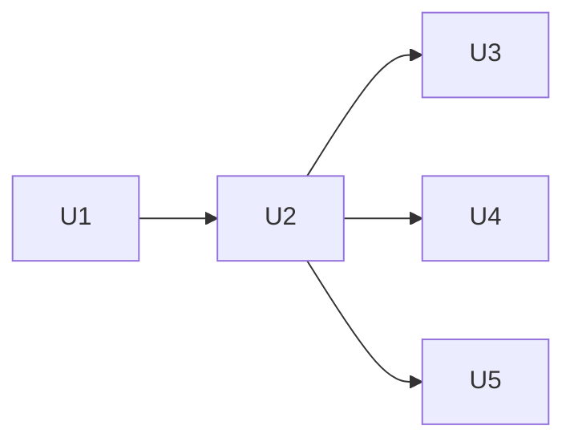

# Python Scripts Under uv Phase 5, Delegate, Drive, and Tune Scripts - Plan

## Goal

`orca-worker.sh`, `pool-usage.sh`, `successor.sh`, `bench.sh`,
`discover-host.sh`, `check-tools.sh`, and `hitl-loop.sh` are registered
commands under `tools/scripts/skills/`, started through `uv run
tools/scripts/run.py`. Their callers use those commands and their embedded
Python becomes importable module code.

Stop condition: preserving a tested lane lifecycle requires a host-side
shell interpreter outside the Orca terminal launch boundary described below.

## Decisions

- The parent plan's Decisions and the
  [repository scripting record](../architecture/2026-10-05-repository-scripting-direction.md)
  apply.
- `pool-usage.sh` is unwrapped first: 534 of its 567 lines are one Python
  here-document, and `tools/scripts/tests/skills/delegate/test_pool_usage.py`
  reads that block with `ast`. The test then imports the module. Why: the
  extraction establishes the pool reader before discovery moves.
- `orca-worker.sh` and `successor.sh` are ported behind
  `tools/scripts/tests/skills/delegate/test_orca_worker.py` and
  `tools/scripts/tests/skills/drive/test_successor.py`. Parameterize the
  command, run the shell baseline, then the port before deleting each old
  path. Why: rollback, grading, joins, and uncertain successor creation are
  already asserted there. Shell-specific failure injection moves to mocked
  file operations and clocks without removing the failure scenario.
- Time limits use `subprocess` timeouts rather than a `timeout` executable.
  The current seven scripts make no call to that executable. Pool reads
  already use subprocess timeouts, Orca passes `--timeout-ms`, and bench
  passes Agy's `--print-timeout`. Preserve those limits, including an
  uncapped bench run for the other CLIs. The portability inventory below
  covers the remaining tools. Why: the port removes runtime dependencies
  without adding a calibration cutoff.
- `hitl-loop.sh` is a template the `diagnose` skill copies to `$TMPDIR` and
  runs with `bash`. It becomes a command, `diagnose hitl-loop`, and the
  skill stops copying a file.
- `check-tools.sh` reports on Node, pnpm, and the web tools. It keeps doing
  that, as the frontend toolchain is out of the parent's scope. Read the
  Node floor from `frontend/web/package.json`. Its pnpm pin appears in
  installation guidance. Version mismatch stays display text, as the
  existing checker only tests pnpm's presence.
- Register the seven commands as `delegate pool-usage`, `delegate
  orca-worker`, `drive successor`, `tune bench`, `tune discover-host`,
  `web-component check-tools`, and `diagnose hitl-loop`. Why:
  `docs/code-style-python.md` assigns each skill a package, and
  `run.py:55-75` discovers its literal `COMMANDS` without a dispatcher edit.
  Reuse `delegate.runlog`, `delegate.model_check`, `lib.repo`, and
  `lib.plans` where needed. `orca-worker.sh:336` already uses the registered
  runlog command, so its former script path is not recreated.
- `orca-worker wait --until` accepts a nonempty JSON argv array of strings
  with a nonempty executable, and runs it in the lane checkout with
  `shell=False` and a timeout capped by the remaining `--max` deadline.
  Empty argument values remain literal. A malformed array
  exits 2 before querying Orca. The old shell expression is removed.
  `drive stage-done <plan> <re-plan|implement|review|compound>` supplies the
  compound predicates currently written with `&&` and `||` in
  `.agents/skills/drive/SKILL.md:124-127`. It reads `lib.plans.followed`:
  re-plan needs status other than implemented and ready, implement needs
  implemented, review needs either accepted verdict, compound needs a
  non-null `state["compound"]`, independently of implementation `outcome`.
  Exit 0 means done, 1 pending, 2 invalid input/state. An until subprocess
  that exhausts the remaining deadline is pending, then wait prints
  `timeout`. Ordinary nonzero predicates retain the existing idle fallback.
  Why: `orca-worker.sh:462` invokes `bash -c`, which violates the parent's
  argument-list decision. The
  [stage-condition lesson](../solutions/conventions/a-stage-done-test-must-fail-where-the-stage-applies.md)
  requires tests through the actual polling wrapper.
  Example after the port:

  ```bash
  uv run tools/scripts/run.py delegate orca-worker wait lane --until '["uv","run","tools/scripts/run.py","drive","stage-done","docs/plans/x-plan.md","re-plan"]'
  ```
- Orca's `--command` field remains a POSIX terminal launch string with
  `env -u`, built from quoted arguments. `line`, `start`, and `drive
  successor` refuse Windows before creating a terminal or worktree.
  Other subcommands use argument lists. Why: the parent excludes Windows
  Orca lanes, and Python's [shlex warning](https://docs.python.org/3.13/library/shlex.html#shlex.quote)
  limits that quoting to Unix shells. Supporting Windows terminal launches
  is unverified and belongs outside this phase. Bench uses an environment
  mapping and direct argv, so it needs no `env` executable.
  Lifecycle tests inject a platform predicate and select POSIX regardless
  of the host. Separate refusal cases select Windows. Why: phase 7 must run
  the suites without starting live Windows Orca lanes.
- The pool reader replaces pipe selectors with one reader thread and a
  queue with deadline-bound reads. Keep newline framing, request ids,
  notifications, cursor handling, and the 30-second request deadline.
  Use binary pipes and a daemon reader that owns stdout and closes it on
  exit. Terminate the server, wait up to five seconds, kill and reap if
  needed, close stdin, and join the reader for at most five seconds.
  If a descendant keeps stdout open, leave that stream with its daemon
  reader until EOF or process shutdown. Never close a stream another
  thread is blocked reading. Test that command exit stays bounded. Why:
  `pool-usage.sh:354-355` registers a pipe, which Python's
  [selectors documentation](https://docs.python.org/3.13/library/selectors.html)
  explicitly excludes on Windows. [Queue.get](https://docs.python.org/3.13/library/queue.html#queue.Queue.get)
  provides a bounded wait and [Thread.join](https://docs.python.org/3.13/library/threading.html#threading.Thread.join)
  takes a timeout, and its daemon contract permits process exit with a
  blocked reader. Implement locally in the pool module. A descendant's
  eventual shutdown remains outside it.
- `diagnose hitl-loop --steps <json-file>` takes an ordered nonempty array
  of `{"step":"instruction"}` or `{"capture":"KEY","question":"text"}`.
  Validate the whole file before prompting. Instructions and questions are
  nonempty strings, and unknown fields fail. Keys match `[A-Z][A-Z0-9_]*`
  and are unique. Steps wait for Enter, captures keep literal answers with
  shell-compatible surrounding space/tab trimming, and the final output
  lists `KEY=VALUE` in capture order. EOF or interruption exits nonzero
  without a complete capture report. Why: the existing template's editable
  steps become data, with no copied program or arbitrary shell execution.
- Every failed command exits nonzero with a stderr diagnostic, as
  `docs/code-style-python.md` requires. Provider read failures remain data
  in the five pool rows. Bench writes the existing result JSON and raw files
  before returning 1 for a failed child. Its current shell wrapper returns
  0 after rendering even when the recorded child exit is nonzero
  (`bench.sh:68`, `:204-206`). Pin this deliberate failure-contract change
  separately from successful-run parity.
- A unit expanded to touch a policy surface runs on a Claude worker, stops
  with an uncommitted diff, and lets the coordinator obtain explicit per-unit
  approval naming the diff's blob hashes before committing. A worker
  prompt is not approval. Why: [the policy-surface approval entry of
  2026-10-07](../agent-observations.md#2026-10-07-drive-policy-surface-units-cannot-be-approved-edit-by-edit-inside-workers)
  records unreliable prompts and Codex's unsupported `permissionDecision:ask`.
  These units change no policy surface. Expand a Files line and revise the
  unit before such an edit, rather than letting a worker add it implicitly.
- Phase 3 and this phase both name `docs/agent-steering.md`. U1, U2, and
  U5 amend its live command references. Compare both diffs before landing
  and retain both changes. The verifier needs no change here: its one
  `.claude/skills/*/scripts/*.sh` glob still matches `verify-change.sh`
  (`verify-change.sh:963-964`). Emptying one skill's directory introduces
  no unmatched pattern. Phase 3 owns its hook-related verifier changes.
  Why: shared documents need reconciliation, and this phase should not
  create a policy overlap without a failing case.
- Follow the phase state and this worktree's branch. The parent's old
  `## Branch` paragraph is stale. Why: `.agents/skills/drive/SKILL.md:205-218`
  lands phases separately, and `lib.plans.branch_to_follow` reads the state
  field. This re-plan leaves the parent's Decisions and state untouched.

### Portability inventory

Replacements run under Python 3.13, pinned by `tools/scripts/run.py:2`.
Sources: [subprocess](https://docs.python.org/3.13/library/subprocess.html),
[pathlib](https://docs.python.org/3.13/library/pathlib.html),
[shutil](https://docs.python.org/3.13/library/shutil.html), and
[urllib.request](https://docs.python.org/3.13/library/urllib.request.html).

| Current tool or shell operation | Sites | Windows counterpart or ruling |
| --- | --- | --- |
| `bash`, Python here-documents, `python3 -c` | all seven script interpreters, pool, worker, successor, bench, discovery embedded code | Registered Python modules. The wait condition takes JSON argv. |
| `env -u` | worker launch lines, bench child environment | Bench removes keys from its environment mapping. Worker terminal launch is POSIX-only, with the refusal above. |
| `grep`, `sed`, `head`, `tail`, `tr` | worker screen matching and usage, successor hints, discovery versions and model pin list | `re`, literal comparisons and LF-delimited list operations. Preserve CR bytes in shell-derived readers. |
| `sort -V` | web tool check's Node floor | Integer version tuple compared with `package.json` engines floor, with malformed output reported as required-tool failure. |
| `date`, `sleep` | worker deadlines, successor polling, bench timing, discovery timestamp | `datetime` UTC timestamps and `time` clocks/sleep. Polling deadlines remain bounded and tests control the clock. |
| `dirname`, `basename`, `pwd`, `cd` | worker, successor, bench, discovery, web checker | `Path.parent`, `Path.name`, `Path.cwd` and subprocess `cwd`. Resolve bench outputs against its target directory as the shell does. |
| `mkdir`, `cp`, `rm`, `cat` | worker delivery/state/cleanup, bench artifacts | `Path.mkdir`, `shutil.copyfile`, `Path.unlink`, and explicit encoded reads/writes. |
| `printf`, `echo`, `read`, redirections, `/dev/null`, shell `test` and globbing | all seven | Streams, `input`/line reads, path predicates/globs, `subprocess.DEVNULL`. No shell test executable remains. |
| `command -v`, executable-bit tests | worker, pool, discovery, web checker | `shutil.which`, including Windows `PATHEXT`, and invoke its resolved path. Search the local web bin directory the same way. Actual Windows shim installation is unverified. |
| `curl` | web check's two-second Storybook probe | A short-lived Python HTTP probe, with an outer `subprocess.run(timeout=2)` bounding the complete operation. `urlopen(timeout=2)` alone only bounds blocking socket operations. |
| `git`, `uv`, `orca`, `claude`, `codex`, `agy`, `omp` | worker, pool, successor, bench, discovery | Keep wrapped CLIs. Windows availability of agent CLIs and live Orca behavior is unverified. Missing readers keep their existing pool error rows. |
| `node`, `pnpm`, local `vitest`/`vue-tsc`, `agent-browser`, impeccable executable | web checker | Keep reporting. Optional impeccable at its current plugin path is POSIX-only and reports optional/unsupported on Windows. Installation hints are platform-specific text and install nothing. |

The seven scripts call no `jq`, `awk`, `mktemp`, `flock`, or `timeout`
executable. Existing test stubs use `#!/bin/sh`, `#!/usr/bin/env python3`,
`chmod`, and colon-separated PATH. Their ported side uses mocks or
`sys.executable` argv with `os.pathsep`, so it needs no Git Bash. Follow the
[empty-variable and carriage-return lesson](../solutions/conventions/a-shell-to-python-port-changes-empty-variables-and-line-breaks.md)
when selecting reads and defaults. The shell baseline still needs POSIX.

## Requirements

1. The existing pool, worker, successor, and bench scenarios pass against
   their shell baseline and port, before deletion. Example: a failed brief
   delivery closes the run and leaves recoverable lane state if removal
   fails. The bench failed-child exit change is tested as decided above.
2. `run.py list` names all seven commands. Their old paths are absent and
   no Python here-document remains in their replacements. Example:
   `uv run tools/scripts/run.py diagnose hitl-loop --help` succeeds.
3. Pool output keeps the same five rows, field omission, errors and slot
   calculation. Example: an unreadable model list omits `models`, and an
   unreadable quota after sign-in keeps `signed_in: true`.
4. Polling retains all current outcomes, deadlines, child checks and
   screen limits. Example: a working child prevents a parent's successful
   until command from returning `done`. Test the documented JSON argv
   through `wait`, both before and after each stage's state transition.
5. Successor retains refusal order and exits 0/1/2. Example: create returns
   no handle, so exit 2 reports that a successor may be running.
6. Discovery and web checks keep their reporting contracts. Example:
   missing pnpm makes the web check exit 1, missing agent-browser remains
   optional, and discovery indents all five pool rows under `pools`.
7. HITL executes only the supplied manual steps. Example: one step and a
   capture of `a=b` print `OUTPUT=a=b`, while a duplicate key fails before
   the first prompt. No command writes to a device on the person's behalf.

## Out of scope

Windows Orca terminal launches, installing or upgrading CLIs or web tools,
hook migration, verifier migration, and the repository-wide shell/layout
ban belong to the parent or other phases. Phase 7 owns the live Windows
run. Local configs, briefs, registry files and HITL step files are authored
by trusted contributors. Provider JSON and terminal screens are data.
Parsers catch malformed replies, rather than defending against a contributor
who can already run commands on this host. Historical evidence and retired
plan examples keep their old script names. Live hyperlinks are updated.

## Units

### U1. Unwrap pool usage and move its callers
Files: .agents/skills/delegate/scripts/pool-usage.sh, tools/scripts/skills/delegate/pool_usage.py, tools/scripts/skills/delegate/__init__.py, tools/scripts/tests/skills/delegate/test_pool_usage.py, .agents/skills/delegate/SKILL.md, .agents/skills/delegate/references/pool-rows.md, .agents/skills/delegate/references/orca.md, .agents/skills/drive/SKILL.md, .agents/skills/tune/SKILL.md, .agents/skills/tune/scripts/discover-host.sh, docs/agent-steering.md
After: none
Change: Extract the existing block first, move top-level calls into `main`, register `pool-usage`, then replace the pipe selector as decided. Import the module in its suite, update every live pool caller including the still-shell discovery command, and delete the wrapper.
Tests: `test_pool_usage.py` first runs the extracted shell definitions, then imported definitions. Keep all current cases and add full-row byte comparison with fixed replies/registry, fragmented and batched RPC lines, ignored notifications, EOF, timeout, terminate/kill/reap, bounded reader cleanup, and a descendant-held stdout pipe that does not hang command exit. Direct `sys.executable` fixtures exercise the pipe transport without executable shebangs. Importing emits nothing and starts no process.
Verify: `.claude/skills/verify-change/scripts/verify-change.sh -- tools/scripts/skills/delegate tools/scripts/tests/skills/delegate .agents/skills/delegate .agents/skills/drive/SKILL.md .agents/skills/tune docs/agent-steering.md`

### U2. Port worker lifecycle and shell-free stage predicates
Files: .agents/skills/delegate/scripts/orca-worker.sh, tools/scripts/skills/delegate/orca_worker.py, tools/scripts/skills/delegate/__init__.py, tools/scripts/tests/skills/delegate/test_orca_worker.py, tools/scripts/skills/drive/stage_done.py, tools/scripts/skills/drive/__init__.py, tools/scripts/tests/skills/drive/test_stage_done.py, .agents/skills/delegate/SKILL.md, .agents/skills/delegate/references/no-orca.md, .agents/skills/delegate/references/orca-sandbox.md, .agents/skills/delegate/references/orca.md, .agents/skills/drive/SKILL.md, .agents/skills/implement/references/workers.md, .agents/skills/land/SKILL.md, .agents/skills/land/references/missing-checkpoint.md, .agents/skills/land/references/orca-cleanup.md, .agents/skills/review/SKILL.md, .agents/skills/review/references/fix-loop.md, .agents/skills/drive/references/parking.md, .agents/skills/drive/scripts/successor.sh, tools/scripts/tests/skills/drive/test_successor.py, docs/agent-steering.md, docs/solutions/conventions/a-stage-done-test-must-fail-where-the-stage-applies.md, docs/solutions/README.md
After: U1
Change: Preserve every lifecycle subcommand, lane state and JSON output. Use the existing runlog/model-check modules or registered argv, no legacy path. Replace the until shell string with JSON argv and register `drive stage-done`. Move all live worker callers, including successor's temporary call to the registered `line` command and its expected-line helper, then delete the shell script. POSIX launch quoting is confined to Orca's command field. Update the stage-condition solution's current example and source references, keeping its historical failure evidence.
Tests: Parameterize `test_orca_worker.py` and run shell then port. Preserve rollback, model check, grading, parked-tip refusal, joins, child handling, bounded clock and pointer-count cases. Port shell clock and python3 failure stubs to controlled clocks/file-operation faults, without sleeps or shell launchers in the Python side. Add paths with spaces, CR screen bytes, JSON validation, shell metacharacters passed literally, until-child timeout and Windows launch refusal. `test_stage_done.py` covers pending/done for all four stages, rework with ready state, both accepted verdicts, `outcome` set with `compound` null, followed branches and invalid state. Execute each skill's documented until example through worker wait against both states. The successor suite remains green with its worker-line helper updated.
Verify: `.claude/skills/verify-change/scripts/verify-change.sh -- tools/scripts/skills/delegate tools/scripts/tests/skills/delegate tools/scripts/skills/drive tools/scripts/tests/skills/drive .agents/skills/delegate .agents/skills/drive .agents/skills/implement/references/workers.md .agents/skills/land .agents/skills/review docs/agent-steering.md docs/solutions/conventions/a-stage-done-test-must-fail-where-the-stage-applies.md docs/solutions/README.md`

### U3. Port host discovery and calibration
Files: .agents/skills/tune/scripts/discover-host.sh, .agents/skills/tune/scripts/bench.sh, tools/scripts/skills/tune/discover_host.py, tools/scripts/skills/tune/bench.py, tools/scripts/skills/tune/__init__.py, tools/scripts/tests/skills/tune/test_discover_host.py, tools/scripts/tests/skills/tune/test_bench.py, .agents/skills/tune/SKILL.md, .agents/skills/tune/references/calibration.md, .agents/skills/delegate/SKILL.md
After: U2
Change: Register both commands, reuse pool usage in discovery, preserve YAML sections/version first lines/model ids, and port calibration argv, raw files and result parsing. Environment cleanup uses a mapping. Delete both shells and move live references, including delegate's host-discovery step. Bench records failed-child evidence before returning nonzero.
Tests: Parameterize `test_bench.py` and run shell then port. Retain existing refusal, denial, downgrade and omp accounting cases. Add multi-message costs, all four launch argv/effort forms, environment removal, stderr/nonzero exit, stale artifacts, relative outputs resolved from `--dir`, and CR bytes. `test_discover_host.py` records the shell baseline on fixture tools, then tests absent CLIs, false/unreadable Orca, model-pin parsing, malformed model lists, UTC time and exactly five indented pool rows. Python fixtures use argv and mocked tool transport, not PATH shell stubs.
Verify: `.claude/skills/verify-change/scripts/verify-change.sh -- tools/scripts/skills/tune tools/scripts/tests/skills/tune .agents/skills/tune .agents/skills/delegate/SKILL.md`

### U4. Port successor handoff
Files: .agents/skills/drive/scripts/successor.sh, tools/scripts/skills/drive/successor.py, tools/scripts/skills/drive/__init__.py, tools/scripts/tests/skills/drive/test_successor.py, .agents/skills/drive/SKILL.md, .agents/skills/land/references/orca-cleanup.md
After: U2
Change: Register `drive successor`, import worker launch construction, preserve registry overlay, plan-fit checks, refusal order, effort id formatting, clean/child preflight, and uncertain-start exit 2. Delete the shell and migrate its two live references. Refuse Windows terminal launch before side effects.
Tests: Parameterize `test_successor.py` and run shell then port. Keep every refusal-order and 0/1/2 case, delayed working/cancel hints, create/close failure and empty handle. Replace sleep/shebang/PATH fixtures on the Python side with controlled time and tool replies. Add quoted paths/model ids, missing argument values and Windows refusal before terminal create.
Verify: `.claude/skills/verify-change/scripts/verify-change.sh -- tools/scripts/skills/drive tools/scripts/tests/skills/drive .agents/skills/drive .agents/skills/land/references/orca-cleanup.md`

### U5. Port web preflight and manual reproduction loop
Files: .agents/skills/web-component/scripts/check-tools.sh, .agents/skills/diagnose/scripts/hitl-loop.sh, tools/scripts/skills/web_component/__init__.py, tools/scripts/skills/web_component/check_tools.py, tools/scripts/skills/diagnose/__init__.py, tools/scripts/skills/diagnose/hitl_loop.py, tools/scripts/tests/skills/web_component/__init__.py, tools/scripts/tests/skills/web_component/test_check_tools.py, tools/scripts/tests/skills/diagnose/__init__.py, tools/scripts/tests/skills/diagnose/test_hitl_loop.py, .agents/skills/web-component/SKILL.md, .agents/skills/web-component/references/review.md, .agents/skills/diagnose/SKILL.md, docs/agent-steering.md
After: U2
Change: Register both commands and delete the shells. Web reporting checks platform-specific bin names and runs its `--storybook-probe` mode in a child via `[sys.executable, <absolute run.py>, "web-component", "check-tools", "--storybook-probe"]`, with an outer two-second timeout. The mode makes the HTTP request and exits 0 for success, 1 otherwise, without rendering tool rows. Diagnose documents a complete steps JSON example and its uv command, replacing the copied template. Migrate the live check-tools reference in the steering record. Neither command installs software or writes to a device.
Tests: New suites run the original web report against stub tools and the HITL template with its three current inputs before replacement. Port tests cover Node at/below floor and malformed output, missing required/optional tools, Windows `.cmd` bins, optional POSIX-only impeccable and HTTP success/error/timeout, including a server that drips a response beyond the total two-second budget. HITL tests cover ordered step/capture prompts, literal backslashes/equal signs/empty answers, space/tab trimming, invalid steps/duplicate keys before prompting, EOF and interruption. Importing either module emits nothing. Execute the diagnose skill's example with scripted input.
Verify: `.claude/skills/verify-change/scripts/verify-change.sh -- tools/scripts/skills/web_component tools/scripts/tests/skills/web_component tools/scripts/skills/diagnose tools/scripts/tests/skills/diagnose .agents/skills/web-component .agents/skills/diagnose docs/agent-steering.md`

Waves: U1 | U2 | U3 U4 U5



## Verification

- Each port runs its named shell baseline before deletion, then its Python
  suite through `uv run tools/scripts/run.py test <test-directory>`.
- `uv run tools/scripts/run.py test` compiles every script module and runs
  all discovered tests. `run.py list` includes the seven commands and
  `drive stage-done`. New test packages have `__init__.py`.
- Run the verifier on every unit's Files and on their merged union.
  Include deleted paths with their replacements. The existing verifier
  still runs the script suites after these shell directories disappear.
- Run `git grep -n "orca-worker.sh\|pool-usage.sh\|successor.sh\|bench.sh\|discover-host.sh\|check-tools.sh\|hitl-loop.sh" -- .agents tools docs`.
  Also scan old directories, `python3`, inline imports and copied-template
  instructions, as `docs/agent-observations.md`'s inline-import entry
  requires. Run documented replacements on fixtures. Existing history,
  parent/other plans and out-of-phase shells are recorded as residual
  matches, rather than rewritten or excluded from a gate.
- Check state and prose with `uv run tools/scripts/run.py verify
  check-plan-state` and `uv run tools/scripts/run.py verify check-prose
  docs/plans/2026-10-05-2216-refactor-uv-python-scripts-phase5-plan.md`.

## Definition of done

- [ ] Seven commands registered, old wrappers absent, all live callers moved.
- [ ] Shell baseline and Python checks recorded for every port, with the
      deliberate bench exit change identified.
- [ ] The phase 3 steering-document changes are reconciled. Any scope
      expansion to a policy surface has per-unit blob approval.
- [ ] Verifier green for every changed path, with the last verdict read.
- [ ] No module import performs work, no plan labels enter code, and no
      shell/Python shim or new dependency is added.
- [ ] The phase outcome is recorded with `plan record implemented`, unit
      count and times, and its implementation commit range in `--landed`.

## Open questions

None blocks implementation. Live Windows CLI availability and Orca terminal
launch support remain unverified and outside this phase. Phase 7 owns the
Windows acceptance run. No policy-surface edit is needed in these units.

## Review gaps

Open follow-ups from the review. None holds the verdict. Each needs a
source change, which the follow-up pass does not make.

- tools/scripts/skills/delegate/orca_worker.py:483: `--role ""` passes the parser; fails: `start --role ""` creates the worktree and terminal before the run log refuses the role; class: hardening
- tools/scripts/skills/delegate/orca_worker.py:143: `Worker.log` lets `SystemExit` from `runlog.main` pass; fails: `start --plan=-x` exits 2 with the lane live and no rollback; class: hardening
- tools/scripts/skills/delegate/orca_worker.py:210: the reachability lookup is unguarded; fails: an `orca status` reply without `runtime` prints `'runtime'` in place of the not-reachable sentence; class: hardening
- tools/scripts/skills/delegate/orca_worker.py:57: strict UTF-8 decode of tool output; fails: one invalid byte in a terminal screen exits 1 with no wait outcome (whether Orca emits one is unverified); class: hardening
- tools/scripts/skills/tune/bench.py:164: `is_dir()` can raise before the refusal; fails: a `--dir` with a 300-character component exits 1 with a traceback where exit 2 is documented; class: hardening
- tools/scripts/skills/tune/bench.py:65: a JSON line that is not an object is read with `.get`; fails: codex stdout line `null` ends in a traceback with no result JSON (the shell did the same); class: hardening
- tools/scripts/skills/delegate/pool_usage.py:546: `for lim in limits` runs outside the `try`; fails: `{"reports":[{"provider":"zai","limits":null}]}` raises out of the reader, so `tune discover-host` exits 1 after four rows (the shell reader did the same); class: hardening
- tools/scripts/skills/web_component/check_tools.py:88: `pnpm.cmd` is the only name tried on Windows; fails: a host with `pnpm.exe` and no `.cmd` shim reads `missing pnpm` (unverified, no Windows run); class: hardening
- tools/scripts/skills/web_component/check_tools.py:22: `version()` strips only `\n`; fails: `v22.12.0\r\n` from node on Windows reads `invalid node` (unverified, no Windows run); class: hardening
- tools/scripts/skills/web_component/check_tools.py:30: `http.client.HTTPException` is not caught; fails: a non-HTTP listener on port 6006 gives `--storybook-probe` a traceback in place of its diagnostic (unverified against the 3.13 source); class: hardening
- tools/scripts/skills/diagnose/hitl_loop.py:48: `input()` returns a final line that has no newline; fails: a last answer cut off by EOF prints the full report and exits 0, where the shell `read` exited 1; class: hardening
