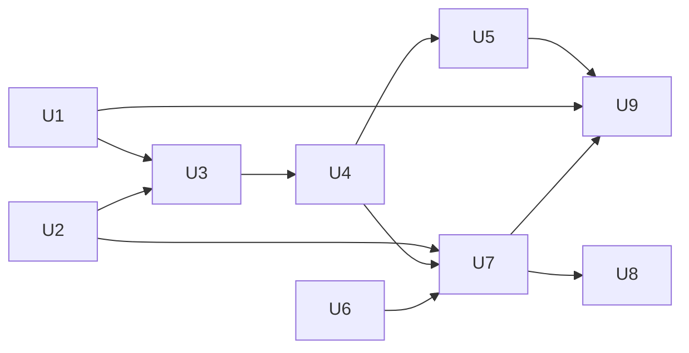

# Simulation reporting granularity - Plan

## Goal

Report each changed state member, each queue/drop decision, each route candidate, and every frame's traversal through producer-owned records with precise
locations. This plan owns G001-G004 and C001/C003/C004/C019/C020/C168 from the [follow-up inventory](2026-10-10-1624-refactor-simulation-followups-plan.md). Stop if complete traversal reporting cannot meet the fixed scale
targets without discarding records or raising a measured gate. Readiness remains `needs-decisions` until the open record and retention contracts below are decided.

Abbreviated code paths start at `src/common/sim`. New test and traversal files are named in their owning units. All other file paths below exist on this tree.

## Decisions

- Detail is required by the accepted [Reporting granularity](../architecture/2026-09-10-virtual-device-direction.md#reporting-granularity). A whole-field snapshot, shared cause, or totals-only aggregate cannot discharge it.
- Keep one nine-unit plan. The state and producer work can start separately, but their fabric adapters, old-shape tests, and traversal-cost work meet in one
  runtime cluster (`go list -deps ./src/common/sim/fabric ./src/common/sim/device ./src/common/sim/layer/traffic ./src/common/sim/layer/routing ./src/common/sim/search`). The phases reference keeps a single connected cluster whole even over six units. No package move is needed. A later
  extraction must be planned as a separate pure-move unit before behavior changes.
- State differences use the existing behavioral classification and named row identities (`src/common/sim/device/state.go:298-312,372-459`). Counters and timestamps remain diagnostic. The record
  carrier is Q4. Every changed leaf or row presence gets a field and current/expected values. Fabric comparison continues to select its first located behavioral
  difference, as its accepted [comparison contract](../architecture/2026-09-10-virtual-device-direction.md#current-against-candidate-comparison) and `src/common/sim/fabric/compare_state.go:11-24` require.
- The library remains pure: no I/O, wall clock or goroutines (`docs/architecture/2026-09-10-virtual-device-direction.md:155-157`, `docs/architecture/2026-09-18-offered-load-streams-direction.md:126-129`). Export yields values to the caller. The caller stores, waits and resumes execution. No callback does storage I/O inside fabric.
- Queue configuration lookup remains by owner, including the current logical endpoint MTU used by the threshold (`device/vswitch/mirror.go:20-28`, `layer/traffic/config.go:17-42`). The decision subject and drop location name the physical member actually attempted. A failed member lookup names
  the logical LAG and an explicit absence, never an invented member. Producer-owned typed facts follow the accepted [trace contract](../architecture/2026-09-10-virtual-device-direction.md#semantic-traces-and-producer-owned-facts).
- Routing records cover the installed equal-cost set defined by the accepted [route-selection record](../architecture/2026-09-10-virtual-device-direction.md#route-selection-and-recursive-next-hops) and `src/common/sim/layer/routing/layer.go:434-456`. Lower-ranked routes and withdrawals retain their
  separate contracts. Split `routeSnapshot`'s set (`src/common/sim/layer/routing/fact.go:39-74`) into one candidate record each. Installed-path identity and multiplicity are Q5. The
  configured-parent key follows routing/diff.go:224,435 and excludes preference/metric. Changing a hash choice must not rename candidates. Selection reasons
  describe the existing bucket result (`src/common/sim/layer/routing/hash.go:38-78`).
- No wire algorithm or packet encoding changes. The simulator's existing selection behavior is the input to reporting, not a new standards claim. Frame bytes
  and hashes remain fixed. Breaking Go and trace APIs are allowed by `AGENTS.md`, Agent behavior, without a compatibility path.
- Retention is separate from flow accounting. Settling still folds once, keeps held-frame provenance, and counts mirrors/reflections apart (`src/common/sim/fabric/flow.go:78-146`,
  `output.go:21-130`). The failed-attempt carrier is Q6. Protocol records remain outside scenario per-frame comparison because they have no scenario provenance
  (`src/common/sim/fabric/compare.go:274-278`). Export availability alone does not change aggregate comparison's accepted inconclusive policy.
- Simload keeps its flow-only simulator/lab projection. Its input has no trace carrier (`src/edge/simload/report.go:29-49`), and the accepted offered-load record's Scoped simulator
  and lab reports section specifies totals. Detailed retrieval belongs to fabric in this scope, with no inference from lab gaps.
- Existing FDB row identity includes MAC/FID/Port (`device/state.go:443-446`). A move is a removal and addition. Keep this identity and the diagnostic exclusions. No new
  State sampling, timer diff, or counter API is requested. `stp.BadBPDU` explicitly ignores untracked ports (`layer/stp/info.go:314-323`). Keep that counter policy, record an
  up-untracked STP refusal at protocol/port scope, and test malformed SSTP accounting separately on a tracked up port.

## Requirements

1. Each changed behavioral member has its own difference record and named row/field location. Example: changing one neighbor MAC and one port state yields two
  records, with neither unrelated neighbors nor other port fields in their current/expected values. Row deletion and addition use explicit absence. Reordering
  equal rows yields no difference.
2. Admission and refusal report the actual attempted endpoint and a distinct producer/cause. Example: a LAG-owned buffer rejects member `1/1/2`, reporting
  that member, the configured owner, PCP, and tail-drop reason separately. Threshold observations use the same endpoint. A loop-protection timer with no
  eligible LAG member produces a no-member outcome. Live and released mirror refusals carry the same traffic fact and terminal drop. An up but STP-untracked
  port has its own cause, and malformed SSTP still increments BadBPDU accounting when that receive path is applicable.
3. Each equal-cost routing candidate has a stable identity and an explicit selected or rejected-bucket reason. Example: two recursive paths with the same
  configured next hop but different resolved next hops yield two distinguishable records and exactly one selected member. A no-route lookup emits an explicit
  no-match record. Receive and Peek agree for the same packet. Originate reports its actual pre-source-selection hash inputs (`layer/routing/originate.go:42`).
4. Every aggregate, protocol, retained, mirrored, and reflected frame has obtainable ordered traversal records, including every branch's terminal location and
  reason. Held frames remain pending until release or failure. Example: one flooded frame delivered on one branch and dropped on another exposes both paths even
  after settling. Flow totals remain equal to the existing fold contract. No sampling or silent eviction satisfies this rule.
5. The chosen retrieval/export API states ownership, copying, fork/replay behavior, incomplete-run coverage, and failure at capacity. These APIs do not exist
  yet. Unit U7 defines them from Q1-Q3 before implementation starts. Example: retaining a returned record while advancing either fork cannot change that record,
  and a failed sink cannot produce a successful complete trace result for a frame whose records were not accepted.
6. With complete reporting enabled, both million-frame entry points drain within 120 seconds and 2 GiB cumulative allocation. Measure total allocation and peak
  live heap separately, including caller-side reporting work and sink buffers. Time the end-to-end caller harness, not an internal library clock. The live-heap ceiling is Q2. Existing absolute allocation ceilings are never raised,
  including `forkAllocationBaseline = 15949` (`src/common/sim/fabric/fork_scale_test.go:15-19`). A lower measurement tightens its gate. A miss leaves this requirement open and readiness blocked.

### Cost evidence

Go is pinned at 1.27 (`go.mod:3`). Size sources: `fabric/journey.go:84,177`, `fabric/config.go:64`, `device/device.go:86`, and `trace/trace.go:151`, and `src/common/net/ethernet/ethernet.go:83`. A Go 1.27.1 darwin/arm64 size probe gives:

| Value | Bytes, excluding referenced storage |
| --- | ---: |
| `fabric.Journey` | 368 |
| `fabric.Entry` | 144 |
| `fabric.Delivery` | 112 |
| `fabric.Cable` | 176 |
| `device.Result` | 264 |
| `device.Egress` | 128 |
| `trace.Step` | 152 |
| `trace.Fact` interface slot | 16 |

Reproduce the shallow sizes from the current types. `go doc reflect.Type.Size` states that this measures storage for a value, not its referenced graph.

```sh
task_probe=$(mktemp -d "$TMPDIR/simgran-size.XXXXXX")
cat > "$task_probe/main.go" <<'GO'
package main
import ("fmt"; "reflect"; "go.aledante.io/FlowSeer/src/common/sim/fabric"; "go.aledante.io/FlowSeer/src/common/sim/device"; "go.aledante.io/FlowSeer/src/common/sim/trace"; "go.aledante.io/FlowSeer/src/common/net/ethernet")
func main() {
 for _, v := range []any{fabric.Journey{}, fabric.Entry{}, fabric.Delivery{}, fabric.Cable{}, device.Result{}, device.Egress{}, trace.Step{}, ethernet.Frame{}} { t := reflect.TypeOf(v); fmt.Println(t, t.Size()) }
 var f trace.Fact
 fmt.Println("trace.Fact", reflect.TypeOf(&f).Elem().Size())
}
GO
go run "$task_probe/main.go"
```

For the two-switch chain built by `src/common/sim/fabric/bench_test.go:53-102`, an eight-entry, one-delivery report starts at `368 + 8*144 + 112 = 1632` bytes. An estimated graph with six cable values,
two six-step hop results, two egress values, one delivery step, and 26 fact slots starts at `1632 + 6*176 + 2*264 + 12*152 + 2*128 + 152 + 26*16 = 5864` bytes. Each extra plain entry costs at least 144
bytes. A hop retaining a result with six steps, one egress, and twelve fact slots adds at least 1640 bytes, including its entry. These estimates exclude fact
bodies, payloads, metadata backing, strings, slice spare capacity, indexes, and allocator rounding. Full retrieval copies these graphs (`src/common/sim/fabric/journey.go:317-346,371-383,461-511`). New
candidate records increase the graph further. These are lower bounds, not a promised resident-memory ceiling or a serialized-format measurement.

| Retention alternative | Present-graph estimate for one million chain frames | Work estimate |
| --- | --- | --- |
| Always retain in memory | At least 1.52 GiB for entry skeletons, or 5.46 GiB for the graph above, before retrieval copies | Build and index one million records, plus cloning on retrieval |
| Always export to a lossless sink | Same total graph volume if this representation is copied, at least 5.46 GiB. A 10,000-frame batch holds at least 55.9 MiB | One million completed-frame handoffs or about eight million entry handoffs, plus encoding and sink I/O |
| Select in-memory retention per run/flow, export every other frame | At 1% selected, at least 55.9 MiB retained, at least 5.40 GiB remaining graph volume exported, plus exporter buffers | One million records are still produced, with selection/index and export work |

The existing benchmark records 97.509 seconds and 553,086,267,888 allocated bytes for direct runs, and 96.438 seconds and 554,063,757,520 bytes through
scenarios (`src/common/sim/fabric/README.md:399-427`). Both already miss 2 GiB. Reproduce with `go test ./src/common/sim/fabric -run '^$' -bench '^BenchmarkAggregateMillion(Scenario)?$' -benchtime=1x -benchmem`. New retention time and sink throughput are unverified until U8 measures them.
Opt-in reporting that omits other frames, bounded sampling, or eviction with only totals would violate requirement 4. Reusing the present copied graph cannot
meet requirement 6. Compact lossless storage or reconstruction must be measured rather than assumed to solve the allocation miss.

### Terminal path inventory

U7 closes reporting at these producers before applying retention. Offered/delivery totals, fold-once, held gauges and
copy attribution stay unchanged. Newly recorded Drop/Loss/Unresolved outcomes follow the existing per-entry fold
rule (`fabric/flow.go:129-142`), so a previously missing terminal outcome adds its true count. Standalone protocol
attempts have no fabricated flow. Tests pin those exact deltas and the new producer-owned reason keys.

| Producer | Present path | Independently pinned U7 result |
| --- | --- | --- |
| fabric/egress.go:31-35 | No link counts transmission and returns without a terminal record | Declared uncabled endpoint: no-cable Drop. Unreported adjacency: Unresolved. Both name the attempted endpoint and frame. |
| fabric/egress.go:38-46,272-278 | Zero-speed/cable fault records Loss with cable and reason | Name cable and actual originating endpoint, preserving fault/flow behavior. |
| fabric/egress.go:73-85, metadata.go:118-147 | Queue refusal/first unstated threshold | Keep U2 member/owner/PCP and policy MTU, complete Drop or QueueThreshold sequence. |
| fabric/run.go:327-334,350-367,439-451,461-470 | Re-entry, corruption, whole-frame and per-egress drops | Exact loop/corruption/producer reasons and branch endpoints, including mixed delivery/drop branches. |
| fabric/output.go:21-71,73-130 | Standalone and held emissions/drops, mirror/reflection descendants | Keep U3/Q6-Q7 protocol classification, U4 preceding steps, hold and ancestor identity, no invented current-arrival link. |
| fabric/acceptance.go:14 and injection.go:30-49 | Endpoint acceptance/rejection/unresolved and immediate injection settlement | Pin each fate and its typed decision/location, plus pending-to-settled transitions. |
| fabric/topology.go:69-97 | Construction applies initial device output before Run | Records exist immediately after construction, with no sink attached yet. Q1 must account for this history without fixing unrelated C005 lifetime work implicitly. |

### Existing fixtures, gates and consumers

Runtime reporting leaves Config shapes and their diff identities intact under the recommended Q5 option. These gates are validation-only. They are not widened,
exempted or replaced by runtime tests.

| Gate or slot inventory | Existing assertion | Change |
| --- | --- | --- |
| Config owners and primary slots | `internal/simtest/diffcoverage.go:29,443,484`: 12 owners, 627 slots. Counts by owner: bridge 20, phy 23, loopprotect 6, mcast 9, lag 18, stp 38, filter 23, routing 19, traffic 17, port 7, vswitch 190, assembly 257 | U1-U9 preserve all under runtime-only reporting. Q5 persistent Config IDs require a new exact-count plan. |
| Exact expectations | `internal/simtest/diffcoverage_test.go:257-263`: 627 registrations, 627 concrete hits, 8 normalized empty cases | Preserve the complete ordered oracle and literal counts. |
| Route slots | `internal/simtest/diffmapping_routing.go:11-29`: 19, including Prefix/NextHop/Interface/Preference/Metric at :16-20 | Runtime candidate identity uses these existing parent coordinates, with no Config diff rewrite. |
| Traffic slots | `internal/simtest/diffmapping_traffic.go:11-27`: 17, including Queue MaxRateBPS/BufferOctets and their key slots at :21-22,26-27 | U2 preserves configured-owner keys and accounting units. |
| Wrapper mappings | `internal/simtest/diffmapping_vswitch.go:282-300,306-322,347-348` and `diffmapping_assembly.go:320-338,344-360,420,426`: 20 routing and 18 traffic slots per wrapper | Keep the route expectation arms in diffmapping_vswitch_expect.go:605 and diffmapping_assembly_expect.go:785. |
| Corpus source-call gate | `internal/simtest/receive_validation_test.go:113-125,526-570` keys every Receive/Compare/Run/RunScenario source call by file/function | U9 owns new literal entries and their validation controls. |
| State and receive gates | `device/state_test.go:93`: 18 projection examples. `internal/simtest/corpus_test.go:1520,1527,1560`: 41 admitted receive cases and 3 absent-next-hop cases | U1 retains classification examples and adds exact member enumeration. U6 migrates the 3 absent-hop checks. U9 owns 41 registry IDs and 21 journey/11 fabric-metadata counts at corpus_test.go:1623-1634, plus each new admitted case. |
| Emission/derive domains | `device/vswitch/emission_matrix_test.go:58`: 16 subsets. `derive_layer_ownership_test.go:94`: 21 producer cases | U3 adds exact refusal outcomes and Q7 lifecycle assertions without shrinking either domain. |

| Existing corpus case | Source | Migration and fixed flow-selection hash |
| --- | --- | --- |
| planning/ecmp-candidates-recorded | `internal/simtest/routing_cases.go:50-89` | U6 emits two member steps, exactly one selected. Hash 2072557066 stays fixed. |
| troubleshooting/neighbor-resolution-pending | same file :174-215 | U6 ties neighbor Inputs to the selected member, hash 336306069. |
| troubleshooting/recursive-route-not-installed | same file :418-458 | U6 records only installed /8 candidate, retains separate /24 withdrawal, hash 2072557066. |
| troubleshooting/stateful-reply-allowed | `internal/simtest/filter_cases.go:265-300` | U6 migrates exact reply trace, hash 2387496097. |
| planning/filter-rule-change | same file :356-410 | U6 migrates both compared traces, hash 1544294637. |
| planning/oversubscribed-trunk-stated-buffer | `internal/simtest/load_cases.go:207-211` | U2 migrates member/owner/PCP facts and keeps its 1018-octet input. |
| planning/oversubscribed-trunk-unstated-buffer | same file :227-240 | U2 preserves first-threshold timing and physical issue/evidence scope. |
| planning/policed-stream | same file :265 | Ingress policer control, no producer change. |

The hashes are existing lookup literals, not cryptographic frame hashes. The scoped corpus stores no per-frame SHA baseline (`rg -n 'FrameHash|frameHash|sha256|digest|Digest' src/common/sim/internal/simtest src/common/sim/fabric src/edge/simload`). The unchanged
446-byte `layer/routing/testdata/neighbor.pcap` has file SHA-256 `a32db5e0e9cbfa243ca7449cc9a5bf3912a9176efde454bca144e1ec6f133ccf`. This identifies the fixture file only. No wire-conformance inference follows from that hash.

| Trace consumer | Required result |
| --- | --- |
| Routing producers and readers | U6 rewrites route.go:40,102,138,158,216,228 and originate.go:35,59,68,141,215,230, plus fact_internal_test.go:33-38, layer_test.go:1601-1642,1681-1878 and vswitch/route_test.go:1382,1690-1843. No retired list snapshot remains for a parser. |
| Corpus flattening/alignment | `internal/simtest/cases.go:25` reads Result.Steps and Entry.Step. `fabric/align.go:76` compares collected facts. U4 preserves preceding release steps, U6 exposes member Subjects, U7 keeps exported steps and record ownership. |
| Search and analysis | U1 rewrites member-local values used by `search/minimize.go:102`. `analysis/difference.go:3` remains one behavioral target. U9 verifies trace diagnostics cannot alter verdicts or cross-fork provenance. |
| Simload | `src/edge/simload/report.go:29-49,147` accepts flow totals and excludes inferred lab causes. No production shape change. U9 runs report/signature controls, with full traversals retrievable through fabric's chosen API. |

## Out of scope

Other follow-up rows remain owned by their existing plan, including queue event-ordering C002, mirror VLAN selection C008, stale-neighbor capacity, and unread
standards. No device traffic, packet codec, new protocol behavior, or policy-surface edit is authorized. The library reads caller-created simulation inputs. A
sink contract must handle write failures and malformed configuration. This is not a hostile-plugin isolation mechanism.

## Units

### U1. Located state-member differences
Files: src/common/sim/device/state.go, src/common/sim/device/state_test.go, src/common/sim/device/state_diff_test.go, src/common/sim/device/README.md, src/common/sim/fabric/compare_state.go, src/common/sim/fabric/compare_state_members_test.go, src/common/sim/fabric/align_test.go, src/common/sim/fabric/README.md, src/common/sim/search/minimize_test.go
After: none
Change: Q4 chooses the full record carrier. Every behavioral leaf or named presence has its own current/expected values. Fabric still selects the first behavioral record. Rule/source: requirement 1, state.go:298-312,372-459 and accepted first-difference comparison. Q4 blocks this unit.
Tests: Construct State directly with two unequal neighbor rows, unrelated expected-only rows, two changed fields, reversed sides and equal reordered slices. Assert all exact member records and absence of unrelated values. state_test.go:83's triple, align_test.go:180-198's count-first coordinates and minimize_test.go:781's unrelated Entries.Length expectation change together. assembly.New/fabric.Compare and Minimize prove an unrelated action can disappear while the target cannot. Restoring whole-field values, first-only reporting or positional pairing must fail.
Verify: `uv run tools/scripts/run.py verify change -- src/common/sim/device src/common/sim/fabric/compare_state.go src/common/sim/fabric/compare_state_members_test.go src/common/sim/fabric/align_test.go src/common/sim/fabric/README.md src/common/sim/search/minimize_test.go`

### U2. Actual queue member with configured owner
Files: src/common/sim/device/device.go, src/common/sim/device/device_test.go, src/common/sim/device/vswitch/mirror.go, src/common/sim/device/vswitch/mirror_test.go, src/common/sim/device/host/host.go, src/common/sim/device/reflector/reflector.go, src/common/sim/layer/traffic/layer.go, src/common/sim/layer/traffic/config.go, src/common/sim/layer/traffic/fact.go, src/common/sim/layer/traffic/config_test.go, src/common/sim/layer/traffic/fact_test.go, src/common/sim/layer/traffic/queue_location_test.go, src/common/sim/layer/traffic/README.md, src/common/sim/fabric/egress.go, src/common/sim/fabric/metadata.go, src/common/sim/fabric/egress_buffer_internal_test.go, src/common/sim/fabric/egress_buffer_test.go, src/common/sim/fabric/queue_buffer_internal_test.go, src/common/sim/fabric/traffic_test.go, src/common/sim/internal/simtest/load_cases.go, src/common/sim/internal/simtest/load_cases_test.go
After: none
Change: Admission takes the actual physical endpoint separately from its existing policy endpoint. Keep the original logical-name MTU input and queueOwner lookup for buffers/rates. Break the device/traffic admission signatures to carry both coordinates. Queue Step.Subject names member/PCP, fabric Entry.Device names its node, and a typed fact names the configured owner. Migrate both enqueue and dequeue-rate call sites plus switch/host/reflector adapters and direct tests. Fabric tail-drop and threshold records preserve the same physical endpoint. Rule/source: requirement 2, traffic/layer.go:103-125, traffic/config.go:23, fabric/egress.go:73-76 and metadata.go:118-147.
Tests: A LAG MTU of 9000 and member MTU of 1500 at depth 1014 plus a 1014-octet frame retains the original 9018-byte threshold policy while naming the member. A fixture crossing 9018 records that threshold at the member. traffic.New with a two-member LAG and assembly.New/Inject/Run prove owner-based 2027-byte refusal versus 2028-byte admission for two 1014-octet frames. egress_buffer_internal_test.go:160,171's lag1 subject changes to the actual member. Load-case exact facts migrate in this unit. Mutations using owner subjects, member-owned limits/MTU, or wire-byte depth must fail. Keep logical and physical counters.
Verify: `uv run tools/scripts/run.py verify change -- src/common/sim/device src/common/sim/layer/traffic src/common/sim/fabric/egress.go src/common/sim/fabric/metadata.go src/common/sim/fabric/egress_buffer_internal_test.go src/common/sim/fabric/egress_buffer_test.go src/common/sim/fabric/queue_buffer_internal_test.go src/common/sim/fabric/traffic_test.go src/common/sim/internal/simtest/load_cases.go src/common/sim/internal/simtest/load_cases_test.go`

### U3. Observable protocol emission refusals
Files: src/common/sim/device/device.go, src/common/sim/device/device_test.go, src/common/sim/device/README.md, src/common/sim/device/vswitch/timers.go, src/common/sim/device/vswitch/route.go, src/common/sim/device/vswitch/issues.go, src/common/sim/device/vswitch/output.go, src/common/sim/device/vswitch/derive.go, src/common/sim/device/vswitch/loopprotect_test.go, src/common/sim/device/vswitch/emission_matrix_test.go, src/common/sim/device/vswitch/derive_emission_test.go, src/common/sim/device/vswitch/derive_layer_ownership_test.go, src/common/sim/device/vswitch/output_test.go, src/common/sim/device/vswitch/mirror_test.go, src/common/sim/device/vswitch/emission_drop_test.go, src/common/sim/device/vswitch/README.md, src/common/sim/fabric/output.go, src/common/sim/fabric/routing_test.go, src/common/sim/fabric/protocol_drop_test.go, src/common/sim/fabric/README.md
After: U1 U2
Change: Q6 defines a terminal-attempt carrier and Q7 its derive lifetime containing frame, protocol classification, producer, logical endpoint, optional actual member, cause and steps. Every refusal in timers/emitRouting produces a record, including no-member and mirror refusal. Producer comes from the frame builder, including nested effects. No member is chosen twice and no standalone attempt inherits the current arrival's identity. Rule/source: requirement 2, timers.go:190-204, route.go:211-231, device.go:143 and output.go:21-71. Q6-Q7 block this unit.
Tests: vswitch.New/Start/Advance/LinkChange with a loop-protection probe makes only member selection fail, then a positive-control member emits the same bytes. Pin exactly one protocol no-member outcome with no physical member. Preserve the 16-subset emission matrix and 21 derive ownership cases while adding exact refusals. Assert all timer/routing refusal branches and chosen Q6 lifecycle, frame content and producer. Removing the record, stamping the executing timer, losing protocol classification or selecting twice must fail.
Verify: `uv run tools/scripts/run.py verify change -- src/common/sim/device src/common/sim/fabric/output.go src/common/sim/fabric/routing_test.go src/common/sim/fabric/protocol_drop_test.go src/common/sim/fabric/README.md`

### U4. Released mirror refusal keeps its traffic trace
Files: src/common/sim/device/vswitch/route.go, src/common/sim/device/vswitch/forward.go, src/common/sim/device/vswitch/mirror_test.go, src/common/sim/device/vswitch/held_test.go, src/common/sim/fabric/output.go, src/common/sim/fabric/routing_test.go, src/common/sim/fabric/mirror_release_drop_test.go
After: U3
Change: A released refusal carries the traffic admission step/fact and its preceding steps into the held frame's terminal fabric drop. It emits no terminal transmit. Rule/source: requirement 2, live forward.go:360 versus released route.go:288-371 and fabric/output.go:61-71, which currently loses drop.Steps.
Tests: mirrorOnceFixture/heldMirrorFixture and public Receive/Advance construct live and released refusals where all earlier gates pass. mirror_test.go:511-539 extends reason-only checks to exact traffic layer, mirror fact, hold and port. fabric.Inject/Run preserves preceding steps and terminal Drop. Restoring routing.EgressFact, omitting Steps or appending Transmit must fail. Mirror VLAN selector C008 remains outside this unit.
Verify: `uv run tools/scripts/run.py verify change -- src/common/sim/device/vswitch/route.go src/common/sim/device/vswitch/forward.go src/common/sim/device/vswitch/mirror_test.go src/common/sim/device/vswitch/held_test.go src/common/sim/fabric/output.go src/common/sim/fabric/routing_test.go src/common/sim/fabric/mirror_release_drop_test.go`

### U5. BPDU refusal cause and malformed accounting
Files: src/common/sim/device/vswitch/intercept.go, src/common/sim/device/vswitch/forward.go, src/common/sim/device/vswitch/stp_test.go, src/common/sim/device/vswitch/bpdu_refusal_test.go, src/common/sim/layer/stp/info.go, src/common/sim/layer/stp/state.go, src/common/sim/layer/stp/fact.go, src/common/sim/layer/stp/rule_test.go, src/common/sim/layer/stp/README.md
After: U4
Change: Distinguish known-down, unknown port, tracked-link-down and up-but-untracked STP causes at their actual port/protocol scopes. Keep untracked BadBPDU ignored, and decode malformed SSTP on an eligible tracked port before recording its refusal. Rule/source: requirement 2, intercept.go:178-190,253-274 and stp/info.go:314-323.
Tests: newAutoSTPSwitch/pvstSwitchConfig with valid BPDU/SSTP frames exercises Peek/Receive on an up port omitted only from STP. Rewrite stp_test.go:27 and :2130's false port-down expectations. A separately tracked up port receiving malformed SSTP increments BadBPDUs once on Receive and zero on Peek. Genuine down-port cases and valid foreign-VLAN SSTP keep their behavior. Shared port-down reason, forwarding-wide scope or skipped BadBPDU update mutations must fail.
Verify: `uv run tools/scripts/run.py verify change -- src/common/sim/device/vswitch/intercept.go src/common/sim/device/vswitch/forward.go src/common/sim/device/vswitch/stp_test.go src/common/sim/device/vswitch/bpdu_refusal_test.go src/common/sim/layer/stp`

### U6. One step per equal-cost routing candidate
Files: src/common/sim/layer/routing/fact.go, src/common/sim/layer/routing/route.go, src/common/sim/layer/routing/originate.go, src/common/sim/layer/routing/layer.go, src/common/sim/layer/routing/hash.go, src/common/sim/layer/routing/candidates_internal_test.go, src/common/sim/layer/routing/fact_internal_test.go, src/common/sim/layer/routing/candidate_fact_test.go, src/common/sim/layer/routing/layer_test.go, src/common/sim/layer/routing/README.md, src/common/sim/device/vswitch/route_test.go, src/common/sim/internal/simtest/routing_cases.go, src/common/sim/internal/simtest/filter_cases.go, src/common/sim/internal/simtest/corpus_test.go, src/common/sim/internal/simtest/README.md, docs/architecture/2026-09-10-virtual-device-direction.md
After: none
Change: Q5 chooses installed-path identity. Replace combined routeSnapshot with lookup summary and one producer-owned typed step per equal-cost member. Subject locates the member, selected/rejected reason records its inclusive hash region, and neighbor-stage inputs refer to that member. No-match is explicit. Rule/source: requirement 3, fact.go:39-74 and accepted route-selection set. Q5 blocks this unit. If Q5 changes Config, re-plan its additional config/diff-mapping file set before readiness.
Tests: selectionConfig/ecmpConfig and routing.New/Route/Originate/Peek pin two recursive paths sharing configured next hop, distinct resolved hops, one selected region, canonical identities, duplicate multiplicity and no-match. Rewrite layer_test.go:1681's candidateCount and vswitch/route_test.go:1690-1708's list parsers and their literal callers. Originate records its actual pre-source-selection hash input. Existing routing/filter corpus lookup Outputs and neighbor Inputs change together. Omitting a loser, using position as identity, conflating configured/resolved hops or expanding the candidate set must fail. Keep neighbor.pcap bytes.
Verify: `uv run tools/scripts/run.py verify change -- src/common/sim/layer/routing src/common/sim/device/vswitch/route_test.go src/common/sim/internal/simtest/routing_cases.go src/common/sim/internal/simtest/filter_cases.go src/common/sim/internal/simtest/corpus_test.go src/common/sim/internal/simtest/README.md docs/architecture/2026-09-10-virtual-device-direction.md`

### U7. Lossless traversal availability across settle
Files: src/common/sim/fabric/fabric.go, src/common/sim/fabric/topology.go, src/common/sim/fabric/egress.go, src/common/sim/fabric/terminal_path_test.go, src/common/sim/fabric/unlinked_internal_test.go, src/common/sim/fabric/flow.go, src/common/sim/fabric/run.go, src/common/sim/fabric/output.go, src/common/sim/fabric/journey.go, src/common/sim/fabric/fork.go, src/common/sim/fabric/executor.go, src/common/sim/fabric/traversal.go, src/common/sim/fabric/traversal_test.go, src/common/sim/fabric/accessor_test.go, src/common/sim/fabric/flow_test.go, src/common/sim/fabric/flow_internal_test.go, src/common/sim/fabric/protocol_issues_test.go, src/common/sim/fabric/compare.go, src/common/sim/fabric/compare_test.go, src/common/sim/fabric/compare_baseline_test.go, src/common/sim/fabric/fork_test.go, src/common/sim/fabric/README.md, docs/architecture/2026-09-10-virtual-device-direction.md, docs/architecture/2026-09-18-offered-load-streams-direction.md
After: U2 U4 U6
Change: Q1 chooses storage/retrieval ownership, Q2 the live ceiling and Q3 bound/failure behavior. Re-plan exported signatures and storage files after those answers. Provide independently specified terminal records for every terminal path before selecting storage. Declared no-cable emission becomes a located no-cable drop, unreported adjacency is an explicit unresolved outcome, and cable loss identifies its cable and attempted endpoint. Capture records before aggregate hop Result disappears at run.go:426-428 and before settle at flow.go:78-94. Preserve pending branches, ancestor identity, immutable records and explicitly incomplete coverage. Rule/source: requirements 4-5. Q1-Q3 block this unit.
Tests: fabric.New/Operate on a declared uncabled physical port pin Injection followed by the no-cable terminal record for retained, aggregate and protocol attempts, with exact endpoint/reason and complete settled state. A separate undeclared adjacency fixture pins Unresolved. Pin each terminal path from the inventory below independently. assembly.New and fabric.Inject/AttachStream/Run/RunScenario exercise aggregate/protocol traversals, held exits, floods, mirrors/reflections and budget-stopped work. Use explicit expected terminal sequences as the completeness oracle, with retained/export parity as a secondary check. Removing the no-cable outcome, one branch location/reason or a loss endpoint must fail. Test caller-side refusal/capacity, pure drain/resume, consumer ownership, fork/replay isolation and records present immediately after construction before a run. Rewrite accessor_test.go:26, flow_test.go:88,123,322 and flow_internal_test.go:152,761,1105's compact/empty-storage expectations to prove runtime release with obtainable records. Keep compare_test.go:118 and compare_baseline_test.go's accepted inconclusive policy and protocol_issues_test.go:74-129's bounded issue set.
Verify: `uv run tools/scripts/run.py verify change -- src/common/sim/fabric docs/architecture/2026-09-10-virtual-device-direction.md docs/architecture/2026-09-18-offered-load-streams-direction.md`

### U8. Fixed allocation targets with complete reporting
Files: src/common/sim/fabric/bench_test.go, src/common/sim/fabric/traversal_scale_test.go, src/common/sim/fabric/fork_scale_test.go, src/common/sim/fabric/flow.go, src/common/sim/fabric/journey.go, src/common/sim/fabric/traversal.go, src/common/sim/fabric/README.md
After: U7
Change: Reduce allocation in the chosen lossless mechanism and measure both million-frame entry points with complete reporting. Record wall time, cumulative allocation, peak live heap and sink bytes separately. Growth checks measure their same-tree zero-input cost. Absolute gates stay at or below recorded values. Rule/source: requirement 6, fabric/README.md:399-427 and the captured same-run-zero-point solution. A remedy needing another package is re-planned before edits, never hidden behind a higher gate.
Tests: benchmarkChainFabric/runAggregateBatches build the existing chain. traversal_scale_test.go asserts every million-frame identity/path, Q2 live ceiling, 120-second/2-GiB ceilings and Q3 queue behavior. A sink dropping the last record fails completeness even with perfect totals. An extra retained per-frame graph and an allocation above a recorded ceiling fail separate gates. Keep forkAllocationBaseline at most 15949, with a same-run zero for growth checks.
Verify: `uv run tools/scripts/run.py verify change -- src/common/sim/fabric`

### U9. Corpus and consumer seam closure
Files: src/common/sim/internal/simtest/corpus.go, src/common/sim/internal/simtest/corpus_test.go, src/common/sim/internal/simtest/receive_validation_test.go, src/common/sim/internal/simtest/registry.go, src/common/sim/internal/simtest/granularity_cases.go, src/common/sim/internal/simtest/README.md, src/common/sim/device/vswitch/conformance_test.go, src/common/sim/search/search_test.go, src/common/sim/search/minimize_test.go, src/common/sim/analysis/README.md, src/common/sim/search/README.md
After: U1 U5 U7
Change: Admit composed state-member, physical queue, protocol refusal, released mirror, BPDU, candidate and aggregate/protocol retrieval cases. Explain trace diagnostics and unchanged first behavioral target/provenance in consumer READMEs. Rule/source: requirements 1-6 and accepted Conformance corpus admission. Existing expectations migrate with their producer in earlier units so each unit stays green.
Tests: DefaultRegistry/CorpusCases/ValidateCorpus assert full exact steps, subjects/facts, all branch fates, replay and ancestry. Search preserves first-target minimization while full detail is obtainable from the selected record carrier. Remove one candidate, terminal branch or preceding release step to demonstrate failures. Simload.NewReport/NewReportFromSimulator and signature tests remain controls with no production simload changes. Update the literal registry count, journey/metadata counts and README entries for named new IDs. Audit each new Receive/Compare/Run/RunScenario source call and add its exact filename/function/count to receive_validation_test.go:526-570, with required validation assertions and omission controls. Preserve every existing inventory entry.
Verify: `uv run tools/scripts/run.py verify change -- src/common/sim/internal/simtest src/common/sim/device/vswitch/conformance_test.go src/common/sim/search src/common/sim/analysis/README.md`

Waves: U1 U2 U6 | U3 | U4 | U5 U7 | U8 U9



## Verification

Every unit runs its named focused race tests before its verifier. Run `go test -race ./src/common/sim/... ./src/edge/simload/...` at closure. Run both million-frame benchmarks above with the selected
reporting mode and record their raw output and Go/platform versions in the fabric README. Run `uv run tools/scripts/run.py verify check-plan-state` and `uv run tools/scripts/run.py verify change -- <every changed path>`. Use `DOCKER_HOST=unix:///Users/aledante/.colima/default/docker.sock` and
`TESTCONTAINERS_DOCKER_SOCKET_OVERRIDE=/var/run/docker.sock` when selected.

U7 amends the virtual-device run bullet's sentences beginning "The caller chooses what survives it" and "Settled protocol journeys also release their traversal
storage" (`:98-105`). It amends the offered-load retention bullet (`:81-104`), the million-frame consequence (`:159-160`), and held-frame settle
sentence (`:187-188`). Preserve Reporting granularity verbatim. U6 changes the route-selection sentence at :860-862 from one combined lookup fact to
individually located candidate steps, preserving set membership and selection. These accepted records are not edited during planning.

## Definition of done

- Q1-Q7 answered and their blocked units re-planned, then state marked implementation-ready.
- Full changed-member/candidate sequences and every frame traversal obtainable.
- Every changed path verified, old-shape expectations updated with its producer.
- Both scale targets met, Q2 peak-live bound met, no measured gate raised.
- Package docs and accepted retention text updated with the behavior they describe.
- Outcome recorded through `plan record implemented` with all nine units, or `partial` naming the remaining requirement. No plan labels in code or commits.

## Open questions

### Q1. Where does every frame's traversal survive settling?

- **Always export to a caller-supplied lossless sink (recommended).** All frames, including protocol frames, reach the sink. A 10,000-frame batch of the present
  graph has a 55.9-MiB lower bound and one million frames represent at least 5.46 GiB of graph volume. The caller-owned store must offer retrieval. Fabric yields pure batches of values for caller-side storage. This adds sink setup,
  encoding and I/O to callers. Recommendation reason: it can release runtime journeys while preserving every path and gives optimization a bounded working set.
- **Always retain all paths in memory.** The chain needs at least 5.46 GiB before referenced bodies and report copies, versus a fixed 2-GiB cumulative
  allocation target. Callers need no sink, but present graph copying cannot meet that target. A compact lossless representation must prove the saving.
- **Choose in-memory paths per run/flow and export every other frame.** A 1% in-memory selection starts at 55.9 MiB, with at least 5.40 GiB of remaining graph
  volume exported. All frames remain obtainable. Selection and sink ownership add caller configuration. Reporting disabled for other frames is incompatible with
  the accepted every-frame requirement.

### Q2. What peak live-memory budget may the reporting mechanism use?

- **256 MiB in addition to measured zero-input fabric state (recommended).** At the 5864-byte lower bound this holds at most 45,776 complete chain graphs,
  before payloads and indexes. A 10,000-frame batch consumes at least 55.9 MiB. Recommendation reason: it leaves room for buffering while preventing a
  million-frame run from silently becoming an all-journey heap.
- **1 GiB above zero-input state.** At most 183,107 lower-bound graphs fit. Larger bursts fit before capacity behavior applies, but the permitted live increment
  is four times larger. The 2-GiB cumulative target still applies.
- **8 GiB above zero-input state.** At most 1,464,859 lower-bound graphs fit. The shallow graph estimate for one million fits, while bodies and retrieval copies
  may exceed it. This admits a much larger host footprint and still requires allocation reductions to meet 2 GiB cumulative.

### Q3. What happens when the chosen live bound or sink capacity is reached?

- **Return a resumable need-to-drain result until the caller stores the complete records (recommended).** A full 10,000-frame lower-bound batch holds at least 55.9 MiB while waiting.
  The caller waits outside the pure library. End-to-end wall time includes that wait, so the 120-second gate fails with a slow sink. Recommendation reason: no successful completed run can lose a frame's path.
  Re-plan caller cancellation, timeout, acknowledgement and re-entry before implementation.
- **Stop with an explicit incomplete-trace error at the bound.** Memory stays within Q2, and the accepted prefix remains retrievable. A million-frame run that
  reaches the bound is incomplete and cannot pass the reporting or scale requirements. Callers must supply a larger working set or faster sink.
- **Spill losslessly to caller-provided storage.** The million-frame graph represents at least 5.46 GiB before encoding, which is not a disk-size prediction.
  Live buffers remain bounded by Q2. The caller performs spilling. This adds storage ownership, cleanup and I/O failure contracts and must measure encoded bytes and time.

### Q4. How does State.Diff expose every changed behavioral member?

- **Return an ordered slice of located records (recommended).** Replace the first-only triple. A three-string record sketch needs 48 header bytes per member, or
  46.9 KiB for 1000 differences, before values and explicit presence storage. Fabric takes its first behavioral target from that sequence. Recommendation
  reason: all records are directly inspectable and state diffs are small compared with traversal retention. Preserve existing row identity.
- **Yield the ordered records through an iterator.** One record header can be reused, with immutable inputs kept alive until iteration ends. This avoids
  materializing the 46.9-KiB header slice in that example, but changes caller consumption and ownership. No first-only compatibility adapter is added.

### Q5. How are identical installed routing paths identified?

- **Configured-parent key plus resolved path and canonical duplicate occurrence (recommended).** Reuse the Diff parent key, add actual interface/resolved hop
  and route kind, then number indistinguishable equal occurrences. IDs survive reordering and hash/preference/metric changes for distinguishable members.
  Identical duplicates have multiset identity rather than independent lifetime. Recommendation reason: it uses existing configuration without adding IDs.
- **Caller-supplied persistent route/path IDs.** Callers identify duplicate routes independently. A string ID adds a 16-byte header per configured route plus
  its bytes, and reporting carries that identity. This changes Config, normalization, validation and the exact-count diff manifests. Re-plan those files and
  counts. Recursive child paths still need deterministic coordinates.

### Q6. What carries a failed protocol attempt across the device seam?

- **A separate terminal-attempt record in device.Output (recommended).** Carry the actual frame, protocol flag, producer, logical/optional physical endpoint,
  cause and preceding steps. Frame alone adds a 72-byte header per attempted record plus payload/tags. Keep held-frame Drop's existing purpose. Recommendation
  reason: standalone failed protocol attempts have their own classification and cannot accidentally attach to the current arrival.
- **Extend device.Drop for standalone and held attempts.** Add frame, protocol and producer fields and explicit standalone classification to its contract. The
  frame adds the same 72-byte header even to held-drop values that already locate a stored frame. All Drop consumers and derive ownership rules change.

### Q7. What is the derive lifetime of an already failed protocol attempt?

The existing derive filter handles outstanding emissions only (`device/vswitch/derive.go:111-119`). The new terminal carrier has no deciding lifetime source. Its frame header alone costs 72 bytes per kept attempt, before bytes, facts and indexes.

- **Preserve failed attempts already observed while aging the old configuration (recommended).** Recommendation reason: the frame was attempted. Retained
  observations remain distinct from emissions withheld from replaced producers.
- **Filter returned attempts from rebuilt producers with outstanding emissions.** This returns a smaller history, but full reporting still preserves those
  attempts in the chosen trace store. Callers must retrieve that history separately.

