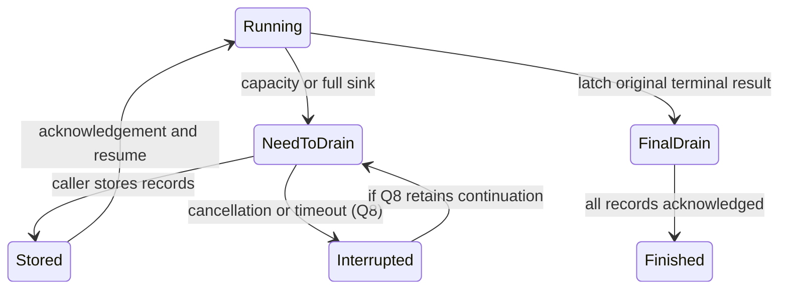

# Simulation reporting granularity - Plan

## Goal

Report each changed state member, each queue/drop decision, each route candidate, and every frame's traversal through producer-owned records with precise
locations. This plan owns G001-G004 and C001/C003/C004/C019/C020/C168 from the [follow-up inventory](2026-10-10-1624-refactor-simulation-followups-plan.md). Stop if complete traversal reporting cannot meet the fixed scale
targets without discarding records or raising a measured gate. Readiness remains `needs-decisions` while the drain-lifecycle decision under Open questions is unresolved.

Abbreviated code paths start at `src/common/sim`. Files lines include proposed traversal and test files. Existing call sites are enumerated separately with their current line numbers.

## Decisions

- Fabric exports every frame's complete traversal, including protocol frames, as pure batches to a caller-supplied lossless sink, then releases runtime storage. The caller stores the values. Why: every path survives settling without a million-frame resident graph (decided by the user, 2026-10-13).
- Path reporting holds at most 256 MiB live above the measured zero-input fabric state. Why: reporting needs a bounded working set while cumulative allocation still meets the independent 2-GiB gate (decided by the user, 2026-10-13).
- At that bound or when the sink is full, execution returns resumable need-to-drain and continues after the caller stores complete records. No completed run loses a path. Why: capacity changes progress rather than reporting coverage (decided by the user, 2026-10-13).
- State.Diff returns an ordered slice of located records, one per changed member, replacing the first-only triple with no compatibility adapter. Why: callers can inspect all changes and fabric still selects its first behavioral target (decided by the user, 2026-10-13).
- Routing candidate identity is the configured-parent key plus resolved interface, resolved hop and route kind, with indistinguishable equal occurrences numbered canonically. No caller-supplied IDs. Why: identity survives reorder and preserves multiplicity without Config changes (decided by the user, 2026-10-13).
- A failed protocol attempt leaves the device as a separate terminal-attempt record in device.Output carrying frame, protocol flag, producer, logical and optional physical endpoint, cause and preceding steps. device.Drop keeps its present purpose. Why: a standalone attempt cannot inherit the arrival or masquerade as a held exit (decided by the user, 2026-10-13).
- Configuration replacement preserves failed attempts already observed while the old configuration ages out. Why: an observed attempt remains history even when its producer's outstanding emissions are withheld (decided by the user, 2026-10-13).
- Detail is required by the accepted [Reporting granularity](../architecture/2026-09-10-virtual-device-direction.md#reporting-granularity). A whole-field snapshot, shared cause, or totals-only aggregate cannot discharge it.
- Keep one connected runtime plan. The state and producer work can start separately, but their fabric adapters, old-shape tests, and traversal-cost work meet in one
  runtime cluster (`go list -deps ./src/common/sim/fabric ./src/common/sim/device ./src/common/sim/layer/traffic ./src/common/sim/layer/routing ./src/common/sim/search`). The phases reference keeps a single connected cluster whole even over six units. The [simulation package-shape record](../architecture/2026-10-01-simulation-package-shape-direction.md#decision) keeps caller storage outside fabric and device. No package move is needed. A later
  extraction must be planned as a separate pure-move unit before behavior changes.
- State differences use the existing behavioral classification and named row identities (`src/common/sim/device/state.go:298-312,372-459`). Counters and timestamps remain diagnostic. State.Diff replaces the first-only triple with an ordered slice of located member records. Every changed leaf or row presence gets a field and current/expected values. Fabric comparison continues to select its first located behavioral
  difference, as its accepted [comparison contract](../architecture/2026-09-10-virtual-device-direction.md#current-against-candidate-comparison) and `src/common/sim/fabric/compare_state.go:11-24` require.
- The library remains pure: no I/O, wall clock or goroutines (`docs/architecture/2026-09-10-virtual-device-direction.md:155-157`, `docs/architecture/2026-09-18-offered-load-streams-direction.md:126-129`). Export yields values to the caller. The caller stores, waits and resumes execution. No callback does storage I/O inside fabric.
- Queue configuration lookup remains by owner, including the current logical endpoint MTU used by the threshold (`device/vswitch/mirror.go:20-28`, `layer/traffic/config.go:17-42`). The decision subject and drop location name the physical member actually attempted. A failed member lookup names
  the logical LAG and an explicit absence, never an invented member. Producer-owned typed facts follow the accepted [trace contract](../architecture/2026-09-10-virtual-device-direction.md#semantic-traces-and-producer-owned-facts).
- Routing records cover the installed equal-cost set defined by the accepted [route-selection record](../architecture/2026-09-10-virtual-device-direction.md#route-selection-and-recursive-next-hops) and `src/common/sim/layer/routing/layer.go:434-456`. Lower-ranked routes and withdrawals retain their
  separate contracts. Split `routeSnapshot`'s set (`src/common/sim/layer/routing/fact.go:39-74`) into one candidate record each. Installed-path identity includes canonical duplicate multiplicity. The
  configured-parent key follows routing/diff.go:224,435 and excludes preference/metric. Changing a hash choice must not rename candidates. Selection reasons
  describe the existing bucket result (`src/common/sim/layer/routing/hash.go:38-78`).
- No wire algorithm or packet encoding changes. The simulator's existing selection behavior is the input to reporting, not a new standards claim. Frame bytes
  and hashes remain fixed. Breaking Go and trace APIs are allowed by `AGENTS.md`, Agent behavior, without a compatibility path.
- Retention is separate from flow accounting. Settling still folds once, keeps held-frame provenance, and counts mirrors/reflections apart (`src/common/sim/fabric/flow.go:78-146`,
  `output.go:21-130`). A separate terminal-attempt carrier crosses device.Output. Protocol records remain outside scenario per-frame comparison because they have no scenario provenance
  (`src/common/sim/fabric/compare.go:274-278`). Export availability alone does not change aggregate comparison's accepted inconclusive policy.
- Simload keeps its flow-only simulator/lab projection and drains full simulator traversals to a separate caller store. Its input has no trace carrier (`src/edge/simload/report.go:29-49`), and the accepted offered-load record's Scoped simulator
  and lab reports section specifies totals. Detailed retrieval belongs to the caller store in this scope, with no inference from lab gaps.
- Existing FDB row identity includes MAC/FID/Port (`device/state.go:443-446`). A move is a removal and addition. Keep this identity and the diagnostic exclusions. No new
  State sampling, timer diff, or counter API is requested. `stp.BadBPDU` explicitly ignores untracked ports (`layer/stp/info.go:314-323`). Keep that counter policy, record an
  up-untracked STP refusal at protocol/port scope, and test malformed SSTP accounting separately on a tracked up port.

## Requirements

1. Each changed behavioral member has its own difference record and named row/field location. Example: changing one neighbor MAC and one port state yields two
  records, with neither unrelated neighbors nor other port fields in their current/expected values. Row deletion and addition use explicit absence. Reordering
  equal rows yields no difference.
2. Admission and refusal report the actual attempted endpoint and a distinct producer/cause. Example: a LAG-owned buffer rejects member `1/1/2`, reporting
  that member, the configured owner, PCP, and tail-drop reason separately. Threshold observations use the same endpoint. A loop-protection timer with no
  eligible LAG member produces a no-member outcome. Live and released mirror refusals carry the same traffic fact and terminal drop. An up but STP-untracked
  port has its own cause, and malformed SSTP still increments BadBPDU accounting when that receive path is applicable.
3. Each equal-cost routing candidate has a stable identity and an explicit selected or rejected-bucket reason. Example: two recursive paths with the same
  configured next hop but different resolved next hops yield two distinguishable records and exactly one selected member. A no-route lookup emits an explicit
  no-match record. Receive and Peek agree for the same packet. Originate reports its actual pre-source-selection hash inputs (`layer/routing/originate.go:42`).
4. Every aggregate, protocol, retained, mirrored, and reflected frame has obtainable ordered traversal records, including every branch's terminal location and
  reason. Held frames remain pending until release or failure. Example: one flooded frame delivered on one branch and dropped on another exposes both paths even
  after settling. Flow totals remain equal to the existing fold contract. No sampling or silent eviction satisfies this rule.
5. The chosen retrieval/export API states ownership, copying, fork/replay behavior, incomplete-run coverage, and failure at capacity. These APIs do not exist
  yet. U7 and U10-U13/U15 define them, subject to the unresolved drain-lifecycle contract. Example: retaining a returned record while advancing either fork cannot change that record,
  and a failed sink cannot produce a successful complete trace result for a frame whose records were not accepted.
6. With complete reporting enabled, both million-frame entry points drain within 120 seconds and 2 GiB cumulative allocation. Measure total allocation and peak
  live heap separately, including caller-side reporting work and sink buffers. Time the end-to-end caller harness, not an internal library clock. The reporting live-memory ceiling is 256 MiB above same-run zero-input fabric state. Existing absolute allocation ceilings are never raised,
  including `forkAllocationBaseline = 15949` (`src/common/sim/fabric/fork_scale_test.go:15-19`). A lower measurement tightens its gate. A miss leaves this requirement open and readiness blocked.

### Cost evidence

Go is pinned at 1.27 (`go.mod:3`). Size sources: `fabric/journey.go:84,177`, `fabric/config.go:64`, `device/device.go:86`, and `trace/trace.go:151`, and `src/common/net/ethernet/ethernet.go:83`. A Go 1.27.1 darwin/arm64 size probe gives:

| Value | Bytes, excluding referenced storage |
| --- | ---: |
| `fabric.Journey` | 368 |
| `fabric.Entry` | 144 |
| `fabric.Delivery` | 112 |
| `fabric.Cable` | 176 |
| `device.Result` | 264 |
| `device.Egress` | 128 |
| `trace.Step` | 152 |
| `trace.Fact` interface slot | 16 |

Reproduce the shallow sizes from the current types. `go doc reflect.Type.Size` states that this measures storage for a value, not its referenced graph.

```sh
task_probe=$(mktemp -d "$TMPDIR/simgran-size.XXXXXX")
cat > "$task_probe/main.go" <<'GO'
package main
import ("fmt"; "reflect"; "go.aledante.io/FlowSeer/src/common/sim/fabric"; "go.aledante.io/FlowSeer/src/common/sim/device"; "go.aledante.io/FlowSeer/src/common/sim/trace"; "go.aledante.io/FlowSeer/src/common/net/ethernet")
func main() {
 for _, v := range []any{fabric.Journey{}, fabric.Entry{}, fabric.Delivery{}, fabric.Cable{}, device.Result{}, device.Egress{}, trace.Step{}, ethernet.Frame{}} { t := reflect.TypeOf(v); fmt.Println(t, t.Size()) }
 var f trace.Fact
 fmt.Println("trace.Fact", reflect.TypeOf(&f).Elem().Size())
}
GO
go run "$task_probe/main.go"
```

For the two-switch chain built by `src/common/sim/fabric/bench_test.go:53-102`, an eight-entry, one-delivery report starts at `368 + 8*144 + 112 = 1632` bytes. An estimated graph with six cable values,
two six-step hop results, two egress values, one delivery step, and 26 fact slots starts at `1632 + 6*176 + 2*264 + 12*152 + 2*128 + 152 + 26*16 = 5864` bytes. Each extra plain entry costs at least 144
bytes. A hop retaining a result with six steps, one egress, and twelve fact slots adds at least 1640 bytes, including its entry. These estimates exclude fact
bodies, payloads, metadata backing, strings, slice spare capacity, indexes, and allocator rounding. Full retrieval copies these graphs (`src/common/sim/fabric/journey.go:317-346,371-383,461-511`). New
candidate records increase the graph further. These are lower bounds, not a promised resident-memory ceiling or a serialized-format measurement.

The decided export mechanism processes the same graph volume if it copies the present representation: at least 5.46 GiB for one million chain frames, before referenced bodies. A 10,000-frame batch starts at 55.9 MiB. These lower bounds require a compact lossless representation and bounded caller buffers, whose allocation and throughput U8 measures with actual storage in the loop.

The existing benchmark records 97.509 seconds and 553,086,267,888 allocated bytes for direct runs, and 96.438 seconds and 554,063,757,520 bytes through
scenarios (`src/common/sim/fabric/README.md:399-427`). Both already miss 2 GiB. Reproduce with `go test ./src/common/sim/fabric -run '^$' -bench '^BenchmarkAggregateMillion(Scenario)?$' -benchtime=1x -benchmem`. New retention time and sink throughput are unverified until U8 measures them.
Opt-in reporting that omits other frames, bounded sampling, or eviction with only totals would violate requirement 4. Reusing the present copied graph cannot
meet requirement 6. Compact lossless storage or reconstruction must be measured rather than assumed to solve the allocation miss.

### Terminal path inventory

U7 closes reporting at these producers before applying retention. Offered/delivery totals, fold-once, held gauges and
copy attribution stay unchanged. Newly recorded Drop/Loss/Unresolved outcomes follow the existing per-entry fold
rule (`fabric/flow.go:129-142`), so a previously missing terminal outcome adds its true count. Standalone protocol
attempts have no fabricated flow. Tests pin those exact deltas and the new producer-owned reason keys.

| Producer | Present path | Independently pinned U7 result |
| --- | --- | --- |
| fabric/egress.go:31-35 | No link counts transmission and returns without a terminal record | Declared uncabled endpoint: no-cable Drop. Unreported adjacency: Unresolved. Both name the attempted endpoint and frame. |
| fabric/egress.go:38-46,272-278 | Zero-speed/cable fault records Loss with cable and reason | Name cable and actual originating endpoint, preserving fault/flow behavior. |
| fabric/egress.go:73-85, metadata.go:118-147 | Queue refusal/first unstated threshold | Keep U2 member/owner/PCP and policy MTU, complete Drop or QueueThreshold sequence. |
| fabric/run.go:327-334,350-367,439-451,461-470 | Re-entry, corruption, whole-frame and per-egress drops | Exact loop/corruption/producer reasons and branch endpoints, including mixed delivery/drop branches. |
| fabric/output.go:21-71,73-130 | Standalone and held emissions/drops, mirror/reflection descendants | Keep U3 protocol classification and preserved observations, U4 preceding steps, hold and ancestor identity, no invented current-arrival link. |
| fabric/acceptance.go:14 and injection.go:30-49 | Endpoint acceptance/rejection/unresolved and immediate injection settlement | Pin each fate and its typed decision/location, plus pending-to-settled transitions. |
| fabric/topology.go:69-97 | Construction applies initial device output before Run | Records exist immediately after construction, with no sink attached yet. U7 must account for this history without fixing unrelated C005 lifetime work implicitly. |

### Existing fixtures, gates and consumers

Runtime reporting leaves Config shapes and their diff identities intact under the decided candidate identity. These gates are validation-only. They are not widened,
exempted or replaced by runtime tests.

| Gate or slot inventory | Existing assertion | Change |
| --- | --- | --- |
| Config owners and primary slots | `internal/simtest/diffcoverage.go:29,443,484`: 12 owners, 627 slots. Counts by owner: bridge 20, phy 23, loopprotect 6, mcast 9, lag 18, stp 38, filter 23, routing 19, traffic 17, port 7, vswitch 190, assembly 257 | All units preserve all under runtime-only reporting. |
| Exact expectations | `internal/simtest/diffcoverage_test.go:257-263`: 627 registrations, 627 concrete hits, 8 normalized empty cases | Preserve the complete ordered oracle and literal counts. |
| Route slots | `internal/simtest/diffmapping_routing.go:11-29`: 19, including Prefix/NextHop/Interface/Preference/Metric at :16-20 | Runtime candidate identity uses these existing parent coordinates, with no Config diff rewrite. |
| Traffic slots | `internal/simtest/diffmapping_traffic.go:11-27`: 17, including Queue MaxRateBPS/BufferOctets and their key slots at :21-22,26-27 | U2 preserves configured-owner keys and accounting units. |
| Wrapper mappings | `internal/simtest/diffmapping_vswitch.go:282-300,306-322,347-348` and `diffmapping_assembly.go:320-338,344-360,420,426`: 20 routing and 18 traffic slots per wrapper | Keep the route expectation arms in diffmapping_vswitch_expect.go:605 and diffmapping_assembly_expect.go:785. |
| Corpus source-call gate | `internal/simtest/receive_validation_test.go:113-125,526-570` keys every Receive/Compare/Run/RunScenario source call by file/function | U9 owns new literal entries and their validation controls. |
| State and receive gates | `device/state_test.go:93`: 18 projection examples. `internal/simtest/corpus_test.go:1520,1527,1560`: 41 admitted receive cases and 3 absent-next-hop cases | U1 retains classification examples and adds exact member enumeration. U6 migrates the 3 absent-hop checks. U9 owns 41 registry IDs and 21 journey/11 fabric-metadata counts at corpus_test.go:1623-1634, plus each new admitted case. |
| Emission/derive domains | `device/vswitch/emission_matrix_test.go:58`: 16 subsets. `derive_layer_ownership_test.go:94`: 21 producer cases | U3 adds exact refusal outcomes and preserved-history lifecycle assertions without shrinking either domain. |

| Existing corpus case | Source | Migration and fixed flow-selection hash |
| --- | --- | --- |
| planning/ecmp-candidates-recorded | `internal/simtest/routing_cases.go:50-89` | U6 emits two member steps, exactly one selected. Hash 2072557066 stays fixed. |
| troubleshooting/neighbor-resolution-pending | same file :174-215 | U6 ties neighbor Inputs to the selected member, hash 336306069. |
| troubleshooting/recursive-route-not-installed | same file :418-458 | U6 records only installed /8 candidate, retains separate /24 withdrawal, hash 2072557066. |
| troubleshooting/stateful-reply-allowed | `internal/simtest/filter_cases.go:265-300` | U6 migrates exact reply trace, hash 2387496097. |
| planning/filter-rule-change | same file :356-410 | U6 migrates both compared traces, hash 1544294637. |
| planning/oversubscribed-trunk-stated-buffer | `internal/simtest/load_cases.go:207-211` | U2 migrates member/owner/PCP facts and keeps its 1018-octet input. |
| planning/oversubscribed-trunk-unstated-buffer | same file :227-240 | U2 preserves first-threshold timing and physical issue/evidence scope. |
| planning/policed-stream | same file :265 | Ingress policer control, no producer change. |

The hashes are existing lookup literals, not cryptographic frame hashes. The scoped corpus stores no per-frame SHA baseline (`rg -n 'FrameHash|frameHash|sha256|digest|Digest' src/common/sim/internal/simtest src/common/sim/fabric src/edge/simload`). The unchanged
446-byte `layer/routing/testdata/neighbor.pcap` has file SHA-256 `a32db5e0e9cbfa243ca7449cc9a5bf3912a9176efde454bca144e1ec6f133ccf`. This identifies the fixture file only. No wire-conformance inference follows from that hash.

| Trace consumer | Required result |
| --- | --- |
| Routing producers and readers | U6 rewrites route.go:40,102,138,158,216,228 and originate.go:35,59,68,141,215,230, plus fact_internal_test.go:33-38, layer_test.go:1601-1642,1681-1878 and vswitch/route_test.go:1382,1690-1843. No retired list snapshot remains for a parser. |
| Corpus flattening/alignment | `internal/simtest/cases.go:25` reads Result.Steps and Entry.Step. `fabric/align.go:76` compares collected facts. U4 preserves preceding release steps, U6 exposes member Subjects, U7 keeps exported steps and record ownership. |
| Search and analysis | U1 rewrites member-local values used by `search/minimize.go:102`. `analysis/difference.go:3` remains one behavioral target. U9 verifies trace diagnostics cannot alter verdicts or cross-fork provenance. |
| Simload | `src/edge/simload/report.go:29-49,147` accepts flow totals and excludes inferred lab causes. The JSON projection stays unchanged. U11 migrates its simulator driver to a separate sink. U9 runs report/signature controls, with full traversals retrievable from the caller store. |

## Out of scope

Other follow-up rows remain owned by their existing plan, including queue event-ordering C002, mirror VLAN selection C008, stale-neighbor capacity, and unread
standards. No device traffic, packet codec, new protocol behavior, or policy-surface edit is authorized. The library reads caller-created simulation inputs. A
sink contract must handle write failures and malformed configuration. This is not a hostile-plugin isolation mechanism.

### Caller migration inventory

All execution and retrieval sites below move in U11. U7 supplies record scaffolding. U10 adds buffer acknowledgement and U15 adds bounded producers. U11 activates them together with every caller. U11 changes execution signatures and their callers together, and U9 closes corpus admission. Line numbers refer to the planning tree. A table row names every call in that file. Flows-only reads remain accounting controls.

#### Production library callers

7 files, 16 call sites.

| File | Calls and line numbers | Unit |
| --- | --- | --- |
| `src/common/sim/assembly/assemble.go` | New: 410. | U11 |
| `src/common/sim/assembly/configure.go` | Replace: 61. | U11 |
| `src/common/sim/assembly/scenario.go` | Operate: 46. | U11 |
| `src/common/sim/fabric/compare.go` | Flows: 87, 87, 98, 98. Report: 92, 93. | U11 |
| `src/common/sim/fabric/executor.go` | RunScenario: 67. Inject: 82, 101. SetFault: 88. | U11 |
| `src/common/sim/search/minimize.go` | Compare: 69, 153. | U11 |
| `src/common/sim/search/search.go` | Compare: 46. | U11 |

#### Corpus executors and helpers

12 files, 103 call sites.

| File | Calls and line numbers | Unit |
| --- | --- | --- |
| `src/common/sim/internal/simtest/baseline_cases.go` | Run: 287, 312, 331. Report: 288, 313, 332. SetFault: 296. Inject: 299, 318. | U11 |
| `src/common/sim/internal/simtest/cases.go` | Report: 110. | U11 |
| `src/common/sim/internal/simtest/comparison_cases.go` | Report: 470, 470, 516, 519, 555, 555, 601, 604, 640, 640, 686, 689, 715, 715, 761, 764. Compare: 489, 491, 574, 576, 659, 661, 734, 736. | U11 |
| `src/common/sim/internal/simtest/load_cases.go` | AttachStream: 117. Run: 122. Report: 123, 147. Flows: 129. | U11 |
| `src/common/sim/internal/simtest/loopprotect_cases.go` | Inject: 120, 231, 261. Run: 128, 210, 239, 269. Report: 129, 133, 211, 240, 245, 270. | U11 |
| `src/common/sim/internal/simtest/reflector_cases.go` | Inject: 205, 351. Run: 213, 358. Report: 214, 220, 359, 369. | U11 |
| `src/common/sim/internal/simtest/routing_cases.go` | Inject: 369, 376. Run: 379. Report: 380. Flows: 390. | U11 |
| `src/common/sim/internal/simtest/scale.go` | Operate: 282. Inject: 305. | U11 |
| `src/common/sim/internal/simtest/scenario_cases.go` | RunScenario: 198, 221. Report: 199, 214, 222, 228, 308, 317. Replay: 206. Inject: 312. Run: 316. | U11 |
| `src/common/sim/internal/simtest/stp_cases.go` | Run: 348, 361. Report: 349, 362. Inject: 353. | U11 |
| `src/common/sim/internal/simtest/topology_cases.go` | Inject: 149, 233, 355, 502, 621. Run: 157, 241, 363, 510, 632. Report: 158, 242, 364, 511, 633. | U11 |
| `src/common/sim/internal/simtest/topology_stp_cases.go` | Run: 180, 193. Report: 181, 194. Inject: 185. | U11 |

#### Tests and benchmarks

54 files, 940 call sites.

| File | Calls and line numbers | Unit |
| --- | --- | --- |
| `src/common/sim/assembly/built_spec_test.go` | SetFault: 116. | U11 |
| `src/common/sim/assembly/compare_test.go` | Inject: 80, 95. Run: 109. | U11 |
| `src/common/sim/assembly/configure_test.go` | Inject: 129, 201, 324, 543. Step: 145, 558. Run: 171, 214, 337, 581, 692, 721, 722. Report: 175, 339, 587. RunScenario: 744. | U11 |
| `src/common/sim/assembly/construction_result_test.go` | Inject: 87, 529, 539, 549. Run: 96, 558. Report: 98, 560. | U11 |
| `src/common/sim/device/host/accept_test.go` | Inject: 54. Run: 58. Report: 60. | U11 |
| `src/common/sim/device/vswitch/routed_egress_matrix_test.go` | Operate: 200, 214. Inject: 231, 237. Run: 240. Report: 245. | U11 |
| `src/common/sim/fabric/accessor_test.go` | Inject: 28. Step: 35. | U11 |
| `src/common/sim/fabric/attach_internal_test.go` | AttachStream: 69, 72, 105, 128. Run: 75, 208, 209. Flows: 79, 112. Step: 109, 155, 161, 178, 204. Report: 138. | U11 |
| `src/common/sim/fabric/attach_test.go` | AttachStream: 79, 149, 191, 205, 215, 222, 250, 269, 307, 376, 410, 483, 614. Run: 84, 155, 233, 253, 281, 282, 329, 330, 418, 419, 451, 473, 529, 552, 617. Report: 87, 158, 225, 234, 254, 257, 341, 422, 429, 452, 474, 544, 554, 620. Inject: 209, 277, 325, 370, 373, 406, 414, 447, 464, 467, 523, 532, 537, 590, 598. Step: 212, 226, 382, 526, 593. SetFault: 230, 470. Flows: 283, 283, 331, 331, 505, 505, 506. RunScenario: 491. | U11 |
| `src/common/sim/fabric/bench_test.go` | Inject: 37, 115. Step: 42. RunScenario: 129. Run: 134. | U11 |
| `src/common/sim/fabric/compare_baseline_test.go` | Inject: 18. Run: 22. Compare: 39, 64, 80. Flows: 55, 55. | U11 |
| `src/common/sim/fabric/compare_filter_test.go` | Compare: 44. | U11 |
| `src/common/sim/fabric/compare_internal_test.go` | Run: 31, 39. | U11 |
| `src/common/sim/fabric/compare_test.go` | Compare: 53, 81, 112, 122, 126, 153, 173, 300, 344, 414, 495, 538, 613, 672, 724, 775, 827, 873, 972, 973, 1085, 1127, 1166, 1204, 1275, 1311, 1370, 1434, 1493, 1604, 1684, 1705, 1728, 1759. AttachStream: 72, 148, 166. Run: 77, 77, 170, 896, 902, 1027, 1069, 1215, 1216. RunScenario: 101, 1518, 1527. Report: 887, 887, 888, 888, 907, 907, 908, 908, 1521, 1530. Inject: 892, 898, 1001, 1014, 1030, 1043, 1056, 1245, 1342. Replay: 1501, 1505. | U11 |
| `src/common/sim/fabric/conformance_test.go` | Inject: 100, 146. Step: 115. Report: 118, 123, 124, 173. Run: 136, 162, 168. Compare: 201, 207, 244, 249. | U11 |
| `src/common/sim/fabric/construction_helpers_test.go` | New: 188. | U11 |
| `src/common/sim/fabric/counters_test.go` | Inject: 42, 135, 236, 372, 411, 490, 507, 541, 614, 643, 709. Run: 46, 139, 240, 254, 381, 420, 493, 510, 544, 618, 647, 713. Report: 383, 422. | U11 |
| `src/common/sim/fabric/egress_buffer_test.go` | Inject: 110, 128, 243, 295. Run: 117, 151, 204, 253, 269, 338. Flows: 168, 209, 255, 272. Step: 310. Report: 344, 368. | U11 |
| `src/common/sim/fabric/fabric_test.go` | Step: 67. Report: 81, 91. | U11 |
| `src/common/sim/fabric/fingerprint_test.go` | Run: 1011, 1019. Inject: 1518, 1545, 1576. Step: 1525, 1553, 1584. | U11 |
| `src/common/sim/fabric/flow_internal_test.go` | Inject: 43, 63, 125, 162, 198, 250, 416, 450, 477, 557, 701, 715, 869, 915, 930, 1091. Step: 54, 72, 261, 881, 968, 1053. Flows: 80, 84, 141, 211, 216, 429, 463, 490, 568, 783, 787, 992, 1099. Report: 94, 182, 751, 1007, 1047, 1108, 1122. Run: 134, 172, 207, 425, 459, 486, 566, 744, 1116. RunScenario: 981. | U11 |
| `src/common/sim/fabric/flow_test.go` | Inject: 45, 58, 106, 148, 174, 203, 284, 307, 334, 350. Run: 48, 68, 120, 158, 184, 212, 316. Report: 49, 88, 117, 123, 322. Flows: 72, 126, 162, 188, 214, 318. SetFault: 99. | U11 |
| `src/common/sim/fabric/fork_bench_test.go` | Run: 24. | U11 |
| `src/common/sim/fabric/fork_test.go` | Inject: 198, 493, 496, 775. Step: 206, 509, 510, 524, 531, 532, 557, 558, 565, 573, 630, 790. Report: 579, 580. | U11 |
| `src/common/sim/fabric/journey_metadata_test.go` | Inject: 85, 152, 217. Run: 93, 160, 221. Report: 95, 142, 162, 224, 289. SetFault: 136. | U11 |
| `src/common/sim/fabric/journey_state_test.go` | Inject: 346. Run: 355. Report: 357. | U11 |
| `src/common/sim/fabric/lag_test.go` | Operate: 73. Inject: 92, 222, 340, 398, 440, 523, 555, 597, 629, 835, 896. Run: 230, 348, 407, 449, 510, 531, 563, 605, 637, 843, 904. Report: 233, 234, 235, 351, 352, 353, 409, 452, 453, 454, 534, 535, 536, 566, 567, 568, 608, 609, 610, 640, 641, 642, 738, 846, 847, 848, 907, 908, 909, 999, 1053. Step: 297, 701, 781, 826, 887, 994, 1046. SetFault: 425, 514, 588. | U11 |
| `src/common/sim/fabric/loopprotect_test.go` | Inject: 115, 177. Report: 126, 187, 343, 356. Step: 310. | U11 |
| `src/common/sim/fabric/mcast_test.go` | Inject: 153. Run: 157. Report: 158. | U11 |
| `src/common/sim/fabric/mcheck_internal_test.go` | Inject: 68. Step: 76. Report: 92. | U11 |
| `src/common/sim/fabric/metadata_cache_internal_test.go` | SetFault: 28. | U11 |
| `src/common/sim/fabric/protocol_issues_test.go` | Run: 80, 102, 107, 124. Report: 82. RunScenario: 112. | U11 |
| `src/common/sim/fabric/queue_buffer_internal_test.go` | Inject: 141, 216. Run: 148, 226. Flows: 233. | U11 |
| `src/common/sim/fabric/queue_internal_test.go` | Step: 18, 70. Inject: 45. | U11 |
| `src/common/sim/fabric/record_test.go` | Operate: 58. RunScenario: 185, 234, 288, 348. Report: 192, 241, 296. | U11 |
| `src/common/sim/fabric/reflector_accept_test.go` | Inject: 121. Run: 129. Report: 131. | U11 |
| `src/common/sim/fabric/replay_test.go` | Inject: 31, 272, 342, 358, 393, 453, 471, 497, 541, 608, 695, 781, 817, 852, 888, 924, 988. Run: 34, 355. Report: 36, 75, 85, 113, 467, 1090, 1120. RunScenario: 82, 109, 165, 1085, 1117. Replay: 129, 150, 171, 1101. Compare: 140. Step: 287, 373, 386, 408, 485, 512, 556, 617, 705, 791, 826, 861, 897, 933, 995. | U11 |
| `src/common/sim/fabric/result_test.go` | Inject: 39, 101, 199, 540, 805, 808. RunScenario: 51, 108, 734, 777, 814. Flows: 55. Run: 181, 184, 202, 212, 229, 259, 377, 544, 720. Operate: 523, 606. Report: 554. AttachStream: 811. | U11 |
| `src/common/sim/fabric/routing_test.go` | Inject: 69, 156, 295, 368, 509, 702, 886, 930, 1039, 1081, 1194, 1323, 1454, 1596, 1603, 1714, 1753, 1839, 1923, 2057, 2073, 2168. Run: 73, 308, 522, 715, 939, 1090, 1224, 1332, 1463, 1610, 1760, 2080, 2198. Report: 311, 525, 718, 943, 954, 1093, 1104, 1227, 1240, 1335, 1349, 1466, 1480, 1614, 1622, 1627, 1635, 1764, 1865, 1961, 2083, 2090, 2200, 2208. Step: 914, 1063, 1208, 1721, 1846, 1936, 2175. | U11 |
| `src/common/sim/fabric/run_internal_test.go` | Report: 59, 69. Step: 128. Run: 159. | U11 |
| `src/common/sim/fabric/run_loop_test.go` | Run: 55, 98, 151. RunScenario: 65, 77, 102, 119, 137. Report: 84. | U11 |
| `src/common/sim/fabric/run_test.go` | Inject: 35, 72, 200, 240, 277, 294, 313, 406, 450, 527, 531, 600, 603, 655, 765, 864, 926, 1008, 1034, 1064, 1075, 1086, 1108, 1173, 1389, 1477, 1487, 1498, 1508, 1518, 1571, 1722, 1735, 1837, 1969, 2090, 2127, 2140, 2220, 2276, 2464, 2490, 2493, 2528, 2537, 2607, 2733, 2808. Run: 39, 76, 203, 321, 411, 455, 485, 607, 659, 769, 868, 930, 1043, 1841, 1981, 2102, 2469, 2506, 2611, 2738, 2812. Report: 42, 77, 204, 326, 416, 570, 609, 661, 779, 870, 932, 1795, 1843, 1983, 2104, 2178, 2237, 2289, 2355, 2508, 2613, 2750, 2814. Step: 281, 282, 283, 554, 566, 1186, 1255, 1406, 1749, 1753, 1783, 2154, 2158, 2166, 2356, 2532, 2834. SetFault: 1280, 1301, 1340, 2503. | U11 |
| `src/common/sim/fabric/scenario_test.go` | Inject: 45. Run: 48, 888, 891. RunScenario: 65, 189, 514, 561, 583, 675, 697, 719, 753, 1013. Compare: 77. Report: 197, 581, 586, 695, 700, 726, 1021. Replay: 500, 566, 680. Operate: 646. Step: 882. | U11 |
| `src/common/sim/fabric/seed_defaults_test.go` | Compare: 54. | U11 |
| `src/common/sim/fabric/stp_test.go` | Run: 212, 215, 256, 377, 391, 414, 435, 767, 824, 1325, 1339, 1371, 1418, 1455, 1481, 1597, 1626. Inject: 243, 379, 423, 930, 1082, 1327, 1359, 1443, 1469. Report: 259, 337, 363, 462, 714, 950, 963, 1093, 1116, 1147, 1159, 1178. Step: 314, 632, 715, 940, 1096, 1154. SetFault: 405, 837, 844, 1613, 1619. | U11 |
| `src/common/sim/fabric/topology_internal_test.go` | RunScenario: 164. | U11 |
| `src/common/sim/fabric/topology_state_test.go` | Inject: 346, 471, 587, 658, 734. Run: 354, 479, 595, 665, 723, 742. | U11 |
| `src/common/sim/fabric/traffic_test.go` | Inject: 113, 116, 182, 223, 267, 275, 316, 363, 457, 542, 617, 649, 698, 744, 835, 874, 881, 934, 976. Step: 120, 123, 132, 190, 658. Run: 140, 235, 282, 323, 373, 461, 556, 629, 674, 733, 757, 841, 877, 885, 940, 982. Report: 143, 238, 286, 326, 362, 374, 465, 560, 630, 676, 715, 844, 887, 942, 986. SetFault: 878. | U11 |
| `src/common/sim/medium/cable/crossing_test.go` | Inject: 69, 150. Run: 73, 154. Report: 77, 111, 155. | U11 |
| `src/common/sim/netmodel/forward_metadata_test.go` | Inject: 71. Run: 82. Report: 85. | U11 |
| `src/common/sim/search/conformance_test.go` | Compare: 172, 186. | U11 |
| `src/common/sim/search/minimize_test.go` | Inject: 659, 855. Run: 662. Step: 859. Report: 860. | U11 |
| `src/common/sim/search/search_test.go` | Compare: 284, 289, 440, 566, 578. | U11 |
| `src/edge/simload/test/integration/lab_test.go` | AttachStream: 277, 373. Run: 280, 378. Flows: 283, 422, 435. | U11 |


## Units

### U1. Located state-member differences
Files: src/common/sim/device/state.go, src/common/sim/device/state_test.go, src/common/sim/device/state_diff_test.go, src/common/sim/device/README.md, src/common/sim/fabric/compare_state.go, src/common/sim/fabric/compare_state_members_test.go, src/common/sim/fabric/align_test.go, src/common/sim/fabric/README.md, src/common/sim/search/minimize_test.go
After: none
Change: Return independent records in stateFields order and canonical row/member order, with explicit current/expected presence and member-local values. Every behavioral leaf or named presence has its own current/expected values. Fabric still selects the first behavioral record. Rule/source: requirement 1, state.go:298-312,372-459 and accepted first-difference comparison.
Tests: Construct State directly with two unequal neighbor rows, unrelated expected-only rows, two changed fields, reversed sides and equal reordered slices. Assert all exact member records and absence of unrelated values. state_test.go:83's triple, align_test.go:180-198's count-first coordinates and minimize_test.go:781's unrelated Entries.Length expectation change together. assembly.New/fabric.Compare and Minimize prove an unrelated action can disappear while the target cannot. Restoring whole-field values, first-only reporting or positional pairing must fail.
Verify: `uv run tools/scripts/run.py verify change -- src/common/sim/device src/common/sim/fabric/compare_state.go src/common/sim/fabric/compare_state_members_test.go src/common/sim/fabric/align_test.go src/common/sim/fabric/README.md src/common/sim/search/minimize_test.go`

### U2. Actual queue member with configured owner
Files: src/common/sim/device/device.go, src/common/sim/device/device_test.go, src/common/sim/device/vswitch/mirror.go, src/common/sim/device/vswitch/mirror_test.go, src/common/sim/device/host/host.go, src/common/sim/device/reflector/reflector.go, src/common/sim/layer/traffic/layer.go, src/common/sim/layer/traffic/config.go, src/common/sim/layer/traffic/fact.go, src/common/sim/layer/traffic/config_test.go, src/common/sim/layer/traffic/fact_test.go, src/common/sim/layer/traffic/queue_location_test.go, src/common/sim/layer/traffic/README.md, src/common/sim/fabric/egress.go, src/common/sim/fabric/metadata.go, src/common/sim/fabric/egress_buffer_internal_test.go, src/common/sim/fabric/egress_buffer_test.go, src/common/sim/fabric/queue_buffer_internal_test.go, src/common/sim/fabric/traffic_test.go, src/common/sim/internal/simtest/load_cases.go, src/common/sim/internal/simtest/load_cases_test.go
After: none
Change: Admission takes the actual physical endpoint separately from its existing policy endpoint. Keep the original logical-name MTU input and queueOwner lookup for buffers/rates. Break the device/traffic admission signatures to carry both coordinates. Queue Step.Subject names member/PCP, fabric Entry.Device names its node, and a typed fact names the configured owner. Migrate both enqueue and dequeue-rate call sites plus switch/host/reflector adapters and direct tests. Fabric tail-drop and threshold records preserve the same physical endpoint. Rule/source: requirement 2, traffic/layer.go:103-125, traffic/config.go:23, fabric/egress.go:73-76 and metadata.go:118-147.
Tests: A LAG MTU of 9000 and member MTU of 1500 at depth 1014 plus a 1014-octet frame retains the original 9018-byte threshold policy while naming the member. A fixture crossing 9018 records that threshold at the member. traffic.New with a two-member LAG and assembly.New/Inject/Run prove owner-based 2027-byte refusal versus 2028-byte admission for two 1014-octet frames. egress_buffer_internal_test.go:160,171's lag1 subject changes to the actual member. Load-case exact facts migrate in this unit. Mutations using owner subjects, member-owned limits/MTU, or wire-byte depth must fail. Keep logical and physical counters.
Verify: `uv run tools/scripts/run.py verify change -- src/common/sim/device src/common/sim/layer/traffic src/common/sim/fabric/egress.go src/common/sim/fabric/metadata.go src/common/sim/fabric/egress_buffer_internal_test.go src/common/sim/fabric/egress_buffer_test.go src/common/sim/fabric/queue_buffer_internal_test.go src/common/sim/fabric/traffic_test.go src/common/sim/internal/simtest/load_cases.go src/common/sim/internal/simtest/load_cases_test.go`

### U3. Observable protocol emission refusals
Files: src/common/sim/device/device.go, src/common/sim/device/device_test.go, src/common/sim/device/README.md, src/common/sim/device/vswitch/timers.go, src/common/sim/device/vswitch/route.go, src/common/sim/device/vswitch/issues.go, src/common/sim/device/vswitch/output.go, src/common/sim/device/vswitch/derive.go, src/common/sim/device/vswitch/loopprotect_test.go, src/common/sim/device/vswitch/emission_matrix_test.go, src/common/sim/device/vswitch/derive_emission_test.go, src/common/sim/device/vswitch/derive_layer_ownership_test.go, src/common/sim/device/vswitch/output_test.go, src/common/sim/device/vswitch/mirror_test.go, src/common/sim/device/vswitch/emission_drop_test.go, src/common/sim/device/vswitch/README.md, src/common/sim/fabric/output.go, src/common/sim/fabric/routing_test.go, src/common/sim/fabric/protocol_drop_test.go, src/common/sim/fabric/README.md, src/common/sim/device/host/host.go, src/common/sim/device/host/host_test.go, src/common/sim/device/host/origination_trace_test.go
After: U1 U2
Change: Add a separate terminal-attempt slice to device.Output containing frame, protocol classification, producer, logical endpoint, optional actual member, cause and steps. Every refusal in timers/emitRouting produces a record, including no-member and mirror refusal. Producer comes from the frame builder, including nested effects. No member is chosen twice and no standalone attempt inherits the current arrival's identity. Rule/source: requirement 2, timers.go:190-204, route.go:211-231, device.go:143 and output.go:21-71. Carry producer steps through successful device.Emission values and host Origination as well as terminal attempts. Host origination preserves its routing Result and selected candidate facts. Preserve aged terminal attempts when derive withholds outstanding emissions from rebuilt layers, independently of those emissions.
Tests: vswitch.New/Start/Advance/LinkChange with a loop-protection probe makes only member selection fail, then a positive-control member emits the same bytes. Pin exactly one protocol no-member outcome with no physical member. Preserve the 16-subset emission matrix and 21 derive ownership cases while adding exact refusals. Assert all timer/routing refusal branches and preserved observed-attempt lifecycle, frame content and producer. host.New/Originate with a routed packet and public fabric.Inject/Run/store retrieval pins exact packet, candidate, neighbor and egress producer steps. Removing a successful emission/origination trace carrier, removing the record, stamping the executing timer, losing protocol classification or selecting twice must fail.
Verify: `uv run tools/scripts/run.py verify change -- src/common/sim/device src/common/sim/fabric/output.go src/common/sim/fabric/routing_test.go src/common/sim/fabric/protocol_drop_test.go src/common/sim/fabric/README.md`

### U4. Released forwarding keeps producer traces
Files: src/common/sim/device/vswitch/route.go, src/common/sim/device/vswitch/forward.go, src/common/sim/device/vswitch/mirror_test.go, src/common/sim/device/vswitch/held_test.go, src/common/sim/fabric/output.go, src/common/sim/fabric/routing_test.go, src/common/sim/fabric/mirror_release_drop_test.go
After: U3
Change: A successful release carries filter, routing, candidate and traffic steps through its device.Emission into its original held-frame traversal. A released refusal carries the traffic admission step/fact and its preceding steps into the held frame's terminal fabric drop. It emits no terminal transmit. Rule/source: requirement 2, live forward.go:360 versus released route.go:288-371 and fabric/output.go:61-71, which currently loses drop.Steps.
Tests: mirrorOnceFixture/heldMirrorFixture and public Receive/Advance construct live and released refusals where all earlier gates pass. mirror_test.go:511-539 extends reason-only checks to exact traffic layer, mirror fact, hold and port. fabric.Inject/Run preserves preceding steps and terminal Drop. A successful held release through an accepting filter and LAG pins its exact producer sequence, member, original frame and ordered store reconstruction. Restoring routing.EgressFact, omitting successful or refused Steps or appending Transmit must fail. Mirror VLAN selector C008 remains outside this unit.
Verify: `uv run tools/scripts/run.py verify change -- src/common/sim/device/vswitch/route.go src/common/sim/device/vswitch/forward.go src/common/sim/device/vswitch/mirror_test.go src/common/sim/device/vswitch/held_test.go src/common/sim/fabric/output.go src/common/sim/fabric/routing_test.go src/common/sim/fabric/mirror_release_drop_test.go`

### U5. BPDU refusal cause and malformed accounting
Files: src/common/sim/device/vswitch/intercept.go, src/common/sim/device/vswitch/forward.go, src/common/sim/device/vswitch/stp_test.go, src/common/sim/device/vswitch/bpdu_refusal_test.go, src/common/sim/layer/stp/info.go, src/common/sim/layer/stp/state.go, src/common/sim/layer/stp/fact.go, src/common/sim/layer/stp/rule_test.go, src/common/sim/layer/stp/README.md
After: U4
Change: Distinguish known-down, unknown port, tracked-link-down and up-but-untracked STP causes at their actual port/protocol scopes. Keep untracked BadBPDU ignored, and decode malformed SSTP on an eligible tracked port before recording its refusal. Rule/source: requirement 2, intercept.go:178-190,253-274 and stp/info.go:314-323.
Tests: newAutoSTPSwitch/pvstSwitchConfig with valid BPDU/SSTP frames exercises Peek/Receive on an up port omitted only from STP. Rewrite stp_test.go:27 and :2130's false port-down expectations. A separately tracked up port receiving malformed SSTP increments BadBPDUs once on Receive and zero on Peek. Genuine down-port cases and valid foreign-VLAN SSTP keep their behavior. Shared port-down reason, forwarding-wide scope or skipped BadBPDU update mutations must fail.
Verify: `uv run tools/scripts/run.py verify change -- src/common/sim/device/vswitch/intercept.go src/common/sim/device/vswitch/forward.go src/common/sim/device/vswitch/stp_test.go src/common/sim/device/vswitch/bpdu_refusal_test.go src/common/sim/layer/stp`

### U6. One step per equal-cost routing candidate
Files: src/common/sim/layer/routing/fact.go, src/common/sim/layer/routing/route.go, src/common/sim/layer/routing/originate.go, src/common/sim/layer/routing/layer.go, src/common/sim/layer/routing/hash.go, src/common/sim/layer/routing/candidates_internal_test.go, src/common/sim/layer/routing/fact_internal_test.go, src/common/sim/layer/routing/candidate_fact_test.go, src/common/sim/layer/routing/layer_test.go, src/common/sim/layer/routing/README.md, src/common/sim/device/vswitch/route_test.go, src/common/sim/internal/simtest/routing_cases.go, src/common/sim/internal/simtest/filter_cases.go, src/common/sim/internal/simtest/corpus_test.go, src/common/sim/internal/simtest/README.md
After: none
Change: Use the VRF/prefix/configured-next-hop/configured-interface parent key (routing/diff.go:224-235,435), resolved interface/hop/kind and canonical occurrence number. Replace combined routeSnapshot with lookup summary and one producer-owned typed step per equal-cost member. Subject locates the member, selected/rejected reason records its inclusive hash region, and neighbor-stage inputs refer to that member. No-match is explicit. Rule/source: requirement 3, fact.go:39-74 and accepted route-selection set. Keep Config and its exact-count diff mappings unchanged. Capture the configured parent before recursive installation replaces its interface or resolved hop, so the ID never guesses those configured coordinates from the installed result.
Tests: selectionConfig/ecmpConfig and routing.New/Route/Originate/Peek pin two recursive paths sharing configured next hop, distinct resolved hops, one selected region, canonical identities, duplicate multiplicity and no-match. Rewrite layer_test.go:1681's candidateCount and vswitch/route_test.go:1690-1708's list parsers and their literal callers. Originate records its actual pre-source-selection hash input. Existing routing/filter corpus lookup Outputs and neighbor Inputs change together. Omitting a loser, using position as identity, conflating configured/resolved hops or expanding the candidate set must fail. Keep neighbor.pcap bytes.
Verify: `uv run tools/scripts/run.py verify change -- src/common/sim/layer/routing src/common/sim/device/vswitch/route_test.go src/common/sim/internal/simtest/routing_cases.go src/common/sim/internal/simtest/filter_cases.go src/common/sim/internal/simtest/corpus_test.go src/common/sim/internal/simtest/README.md`

### U7. Traversal values and terminal-record scaffolding
Files: src/common/sim/fabric/fabric.go, src/common/sim/fabric/topology.go, src/common/sim/fabric/egress.go, src/common/sim/fabric/terminal_path_test.go, src/common/sim/fabric/unlinked_internal_test.go, src/common/sim/fabric/flow.go, src/common/sim/fabric/run.go, src/common/sim/fabric/output.go, src/common/sim/fabric/journey.go, src/common/sim/fabric/fork.go, src/common/sim/fabric/executor.go, src/common/sim/fabric/traversal.go, src/common/sim/fabric/traversal_test.go, src/common/sim/fabric/accessor_test.go, src/common/sim/fabric/flow_test.go, src/common/sim/fabric/flow_internal_test.go, src/common/sim/fabric/protocol_issues_test.go, src/common/sim/fabric/compare.go, src/common/sim/fabric/compare_test.go, src/common/sim/fabric/compare_baseline_test.go, src/common/sim/fabric/fork_test.go, src/common/sim/fabric/README.md
After: U2 U4 U6
Change: Add TraversalBatch/TraversalRecord values and ordered capture primitives without activating storage suspension or removing current execution APIs. Values carry execution-local sequence, frame identity/content, protocol flag, origin/ancestor, entry ordinal, producer facts, endpoint/cable, fate and coverage. Capture detailed hop results before compacting them at run.go:426-428. Close the terminal inventory's no-cable, unreported-adjacency and cable-loss gaps. Fold each flow once independently of later storage delivery. Rule/source: decisions 1-3 and requirements 4-5. U10 adds buffer acknowledgement, U15 bounds device production, and U11 activates the combined protocol and removes the former runtime reporting path. The completed feature never exposes the scaffolding as a totals-only export API. Q8-Q9 block the combined lifecycle, not these record values.
Tests: assembly.New/Inject/Step/Operate and the terminal inventory fixtures pin complete candidate record sequences before release. Assert every no-cable/Unresolved/Loss endpoint and reason, holds and ancestor identity, successful release/origination steps and exact flow deltas. Buffer-level tests retain a copied record while advancing a fork. Keep existing Report/compact-storage assertions until U11's activation moves them to the store. U11 owns public drain/resume, construction suspension and replay tests, and U8 measures their peak. Dropping one branch, producer step or terminal location must fail the explicit sequence oracle.
Verify: `uv run tools/scripts/run.py verify change -- src/common/sim/fabric`

### U8. Fixed allocation targets with complete reporting
Files: src/common/sim/fabric/bench_test.go, src/common/sim/fabric/traversal_scale_test.go, src/common/sim/fabric/fork_scale_test.go, src/common/sim/fabric/flow.go, src/common/sim/fabric/journey.go, src/common/sim/fabric/traversal.go, src/common/sim/fabric/README.md
After: U9
Change: Reduce allocation in the chosen lossless mechanism and measure both million-frame entry points with complete reporting. Use a caller-owned temporary-file sink with a bounded reusable encoder buffer and retrieval decoder. Record end-to-end wall time, cumulative allocation, peak live heap, sink bytes and record count separately. Include construction, run, export, encoding, storage, acknowledgement and resume in the same measurement. Growth checks measure their same-tree zero-input cost. Absolute gates stay at or below recorded values. Rule/source: requirement 6, fabric/README.md:399-427 and the captured same-run-zero-point solution. A remedy needing another package is re-planned before edits, never hidden behind a higher gate.
Tests: benchmarkChainFabric/runAggregateBatches build the existing chain. traversal_scale_test.go reads back the real sink and checks every million-frame identity/path against the chain oracle, 256-MiB reporting live ceiling, 120-second/2-GiB ceilings and need-to-drain behavior. A sink dropping the last record fails completeness even with perfect totals. An extra retained per-frame graph and an allocation above a recorded ceiling fail separate gates. Measure live memory throughout encoding and each capacity boundary against the same harness at zero offered frames, including checkpoint and caller buffers. Keep forkAllocationBaseline at most 15949, with a same-run zero for growth checks. Either entry point exceeding 120 seconds, 2 GiB cumulative allocation or the live increment is an implementation blocker, recorded with raw output. Raising those gates requires a separate owner decision and is not authorized here.
Verify: `uv run tools/scripts/run.py verify change -- src/common/sim/fabric`

### U9. Corpus and consumer seam closure
Files: src/common/sim/internal/simtest/corpus.go, src/common/sim/internal/simtest/corpus_test.go, src/common/sim/internal/simtest/receive_validation_test.go, src/common/sim/internal/simtest/registry.go, src/common/sim/internal/simtest/granularity_cases.go, src/common/sim/internal/simtest/traversal_sink.go, src/common/sim/internal/simtest/traversal_sink_test.go, src/common/sim/search/search.go, src/common/sim/search/minimize.go, src/common/sim/fabric/compare.go, src/common/sim/fabric/align.go, src/common/sim/fabric/align_test.go, src/common/sim/fabric/compare_test.go, src/common/sim/fabric/compare_baseline_test.go, src/common/sim/fabric/caller_sink_test.go, src/edge/simload/test/integration/lab_test.go, src/edge/simload/report_test.go, src/edge/simload/signature_test.go, src/common/sim/internal/simtest/README.md, src/common/sim/device/vswitch/conformance_test.go, src/common/sim/search/search_test.go, src/common/sim/search/minimize_test.go, src/common/sim/analysis/README.md, src/common/sim/search/README.md
After: U5 U6 U13
Change: Validate every migrated caller stores all batches before successful completion, propagates incomplete storage and handles resumable capacity. Extend the shared internal/simtest sink helper with the new admitted-case reconstruction and validation checks. Check Compare/Replay/search stores are separated per candidate and side while analysis keeps its first-target values. Full reporting does not make equal aggregate roots Equivalent, since the existing comparison contract still applies. Admit composed state-member, physical queue, protocol refusal, released mirror, BPDU, candidate and aggregate/protocol retrieval cases. Explain trace diagnostics and unchanged first behavioral target/provenance in consumer READMEs. Rule/source: requirements 1-6 and accepted Conformance corpus admission. Existing expectations migrate with their producer in earlier units so each unit stays green.
Tests: Use the inventory entry points and a sink that refuses its first batch, then accepts it. Assert one complete store per execution side, unchanged total budgets, no complete disposition before storage, and no cross-candidate or cross-fork records. Store and acknowledge a held or looping frame prefix, fork, then diverge both suffixes. Retrieve both complete traversals and run two replays into one caller store with distinct namespaces. Releasing the shared prefix while a checkpoint references it or reusing an execution namespace must fail. DefaultRegistry/CorpusCases/ValidateCorpus assert full exact steps, subjects/facts, all branch fates, replay and ancestry. Search preserves first-target minimization while full detail is obtainable from the selected record carrier. Remove one candidate, terminal branch or preceding release step to demonstrate failures. Simload.NewReport/NewReportFromSimulator and signature tests remain controls. The migrated integration simulator driver stores full paths before projecting totals. Update the literal registry count, journey/metadata counts and README entries for named new IDs. Audit each new Receive/Compare/Run/RunScenario source call and add its exact filename/function/count to receive_validation_test.go:526-570, with required validation assertions and omission controls. Preserve every existing inventory entry.
Verify: `uv run tools/scripts/run.py verify change -- src/common/sim/internal/simtest src/common/sim/device/vswitch/conformance_test.go src/common/sim/search src/common/sim/fabric src/common/sim/analysis/README.md src/edge/simload`

### U10. Storage acknowledgement
Files: src/common/sim/fabric/traversal.go, src/common/sim/fabric/traversal_ack_test.go, src/common/sim/fabric/fork.go, src/common/sim/fabric/fork_test.go
After: U7
Change: Release only records the caller confirms stored. An acknowledgement is a pure value, tied to the execution and outstanding batch, validated before any release. Storage I/O stays outside fabric. Q9 chooses whole-batch versus complete-record-prefix acknowledgement. Either choice retains every unacknowledged record at need-to-drain and rejects a wrong-execution, future or out-of-order acknowledgement without changing state. Rule/source: decision 3's stored-record condition, fork.go:10-12 independent execution rule. A TraversalAck names the execution and stored cursor/range. No existing source decides partial-write retry or duplicate acknowledgement semantics, so Q9 blocks those contracts.
Tests: assembly.New/Inject/Run with two terminal paths builds a batch. Build buffer input by draining the U7 record-capture fixture into TraversalRecord values. A fake caller stores one record then fails, retries and acknowledges under the chosen Q9 contract. These buffer-level checks do not activate public run suspension, which belongs to U11. Assert no loss or duplicate stored identity, no release before storage, and unchanged state on invalid acknowledgements. Fork a paused fabric, acknowledge one side and prove the other retains its own outstanding batch. U11 adds acknowledged-prefix retrieval when namespaces and checkpoint descriptors are activated. Releasing on yield, trusting an unrelated batch or sharing acknowledgement state must fail.
Verify: `uv run tools/scripts/run.py verify change -- src/common/sim/fabric`

### U11. Resume execution and migrate every caller
Files: src/common/sim/fabric/executor.go, src/common/sim/fabric/result.go, src/common/sim/fabric/run.go, src/common/sim/fabric/queue.go, src/common/sim/fabric/fork.go, src/common/sim/fabric/traversal.go, src/common/sim/fabric/run_resume_test.go, src/common/sim/internal/simtest/traversal_sink.go, src/common/sim/internal/simtest/traversal_sink_test.go, src/common/sim/fabric/result_test.go, src/common/sim/fabric/run_loop_test.go, src/common/sim/assembly/assemble.go, src/common/sim/assembly/configure.go, src/common/sim/assembly/scenario.go, src/common/sim/fabric/compare.go, src/common/sim/search/minimize.go, src/common/sim/search/search.go, src/common/sim/internal/simtest/baseline_cases.go, src/common/sim/internal/simtest/cases.go, src/common/sim/internal/simtest/comparison_cases.go, src/common/sim/internal/simtest/load_cases.go, src/common/sim/internal/simtest/loopprotect_cases.go, src/common/sim/internal/simtest/reflector_cases.go, src/common/sim/internal/simtest/routing_cases.go, src/common/sim/internal/simtest/scale.go, src/common/sim/internal/simtest/scenario_cases.go, src/common/sim/internal/simtest/stp_cases.go, src/common/sim/internal/simtest/topology_cases.go, src/common/sim/internal/simtest/topology_stp_cases.go, src/common/sim/assembly/built_spec_test.go, src/common/sim/assembly/compare_test.go, src/common/sim/assembly/configure_test.go, src/common/sim/assembly/construction_result_test.go, src/common/sim/device/host/accept_test.go, src/common/sim/device/vswitch/routed_egress_matrix_test.go, src/common/sim/fabric/accessor_test.go, src/common/sim/fabric/attach_internal_test.go, src/common/sim/fabric/attach_test.go, src/common/sim/fabric/bench_test.go, src/common/sim/fabric/compare_baseline_test.go, src/common/sim/fabric/compare_filter_test.go, src/common/sim/fabric/compare_internal_test.go, src/common/sim/fabric/compare_test.go, src/common/sim/fabric/conformance_test.go, src/common/sim/fabric/construction_helpers_test.go, src/common/sim/fabric/counters_test.go, src/common/sim/fabric/egress_buffer_test.go, src/common/sim/fabric/fabric_test.go, src/common/sim/fabric/fingerprint_test.go, src/common/sim/fabric/flow_internal_test.go, src/common/sim/fabric/flow_test.go, src/common/sim/fabric/fork_bench_test.go, src/common/sim/fabric/fork_test.go, src/common/sim/fabric/journey_metadata_test.go, src/common/sim/fabric/journey_state_test.go, src/common/sim/fabric/lag_test.go, src/common/sim/fabric/loopprotect_test.go, src/common/sim/fabric/mcast_test.go, src/common/sim/fabric/mcheck_internal_test.go, src/common/sim/fabric/metadata_cache_internal_test.go, src/common/sim/fabric/protocol_issues_test.go, src/common/sim/fabric/queue_buffer_internal_test.go, src/common/sim/fabric/queue_internal_test.go, src/common/sim/fabric/record_test.go, src/common/sim/fabric/reflector_accept_test.go, src/common/sim/fabric/replay_test.go, src/common/sim/fabric/routing_test.go, src/common/sim/fabric/run_internal_test.go, src/common/sim/fabric/run_test.go, src/common/sim/fabric/scenario_test.go, src/common/sim/fabric/seed_defaults_test.go, src/common/sim/fabric/stp_test.go, src/common/sim/fabric/topology_internal_test.go, src/common/sim/fabric/topology_state_test.go, src/common/sim/fabric/traffic_test.go, src/common/sim/medium/cable/crossing_test.go, src/common/sim/netmodel/forward_metadata_test.go, src/common/sim/search/conformance_test.go, src/common/sim/search/minimize_test.go, src/common/sim/search/search_test.go, src/edge/simload/test/integration/lab_test.go, src/common/sim/assembly/derive.go, src/common/sim/internal/simtest/corpus.go, src/common/sim/internal/simtest/corpus_test.go, src/common/sim/internal/simtest/receive_validation_test.go, src/common/sim/internal/simtest/routed_fixture.go, src/common/sim/fabric/align.go, src/common/sim/fabric/align_test.go, src/common/sim/search/result.go, src/common/sim/search/domain.go, src/common/sim/fabric/README.md, src/common/sim/search/README.md, src/common/sim/device/vswitch/README.md, src/common/sim/device/device.go, src/common/sim/device/device_test.go, src/common/sim/device/production.go, src/common/sim/device/production_test.go, src/common/sim/device/vswitch/forward.go, src/common/sim/device/vswitch/route.go, src/common/sim/device/vswitch/output.go, src/common/sim/device/vswitch/call.go, src/common/sim/device/vswitch/timers.go, src/common/sim/device/vswitch/switch.go, src/common/sim/device/vswitch/derive.go, src/common/sim/device/vswitch/bounded_output_test.go, src/common/sim/device/host/host.go, src/common/sim/device/reflector/reflector.go, src/common/sim/layer/bridge/egress.go, src/common/sim/layer/bridge/forward.go, src/common/sim/layer/bridge/layer.go, src/common/sim/assembly/bounded_build_test.go, src/common/sim/fabric/output.go, src/common/sim/fabric/topology.go, src/common/sim/fabric/fabric.go, src/common/sim/fabric/producer_resume_test.go, src/common/sim/device/host/host_test.go, src/common/sim/device/vswitch/compare_internal_test.go, src/common/sim/device/vswitch/compare_test.go, src/common/sim/device/vswitch/conformance_test.go, src/common/sim/device/vswitch/construction_result_test.go, src/common/sim/device/vswitch/dependency_invariants_test.go, src/common/sim/device/vswitch/dependency_metadata_test.go, src/common/sim/device/vswitch/derive_emission_test.go, src/common/sim/device/vswitch/derive_internal_test.go, src/common/sim/device/vswitch/derive_layer_ownership_test.go, src/common/sim/device/vswitch/derive_test.go, src/common/sim/device/vswitch/emission_matrix_test.go, src/common/sim/device/vswitch/fdb_peek_test.go, src/common/sim/device/vswitch/filter_test.go, src/common/sim/device/vswitch/fork_matrix_test.go, src/common/sim/device/vswitch/held_test.go, src/common/sim/device/vswitch/helpers_test.go, src/common/sim/device/vswitch/hub_test.go, src/common/sim/device/vswitch/issues_internal_test.go, src/common/sim/device/vswitch/lag_test.go, src/common/sim/device/vswitch/loopprotect_test.go, src/common/sim/device/vswitch/marker_test.go, src/common/sim/device/vswitch/mcast_test.go, src/common/sim/device/vswitch/mirror_hold_test.go, src/common/sim/device/vswitch/mirror_once_test.go, src/common/sim/device/vswitch/mirror_test.go, src/common/sim/device/vswitch/neighbor_test.go, src/common/sim/device/vswitch/output_test.go, src/common/sim/device/vswitch/protocol_link_test.go, src/common/sim/device/vswitch/relay_test.go, src/common/sim/device/vswitch/route_test.go, src/common/sim/device/vswitch/stp_test.go, src/common/sim/device/vswitch/switch_internal_test.go, src/common/sim/device/vswitch/trace_fact_semantics_test.go, src/common/sim/layer/bridge/egress_decision_test.go, src/common/sim/layer/bridge/egress_test.go, src/common/sim/layer/bridge/export_test.go, src/common/sim/layer/bridge/fdb_test.go, src/common/sim/layer/bridge/fdb_time_test.go, src/common/sim/layer/bridge/gate_test.go, src/common/sim/layer/bridge/group_resolver_test.go, src/common/sim/layer/bridge/ingress_learn_test.go, src/common/sim/layer/bridge/ingress_test.go, src/common/sim/layer/bridge/layer_test.go, src/common/sim/layer/layer.go, src/common/sim/layer/bridge/result.go, src/common/sim/layer/bridge/ingress.go, src/common/sim/layer/bridge/fact.go, src/common/sim/device/vswitch/hub.go, src/common/sim/device/vswitch/originate.go, src/common/sim/device/vswitch/intercept.go, src/common/sim/device/vswitch/link.go, src/common/sim/device/vswitch/lag.go, src/common/sim/device/vswitch/mcast.go, src/common/sim/device/vswitch/layers.go, src/common/sim/device/vswitch/fork.go, src/common/sim/device/vswitch/mirror.go, src/common/sim/layer/bridge/fdb.go, src/common/sim/layer/filter/filter_test.go, src/common/sim/layer/lag/layer.go, src/common/sim/layer/lag/layer_test.go, src/common/sim/layer/lag/marker.go, src/common/sim/layer/lag/marker_test.go, src/common/sim/layer/lag/periodic_test.go, src/common/sim/layer/lag/transmit.go, src/common/sim/layer/loopprotect/cadence_test.go, src/common/sim/layer/loopprotect/example_test.go, src/common/sim/layer/loopprotect/layer.go, src/common/sim/layer/loopprotect/layer_test.go, src/common/sim/layer/mcast/layer.go, src/common/sim/layer/routing/candidates_internal_test.go, src/common/sim/layer/routing/host_test.go, src/common/sim/layer/routing/layer.go, src/common/sim/layer/routing/layer_test.go, src/common/sim/layer/routing/neighbor.go, src/common/sim/layer/routing/neighbor_internal_test.go, src/common/sim/layer/routing/neighbor_test.go, src/common/sim/layer/routing/originate.go, src/common/sim/layer/routing/receive.go, src/common/sim/layer/routing/receive_test.go, src/common/sim/layer/routing/route.go, src/common/sim/layer/routing/solicitation.go, src/common/sim/layer/stp/advance.go, src/common/sim/layer/stp/agreement_test.go, src/common/sim/layer/stp/config_test.go, src/common/sim/layer/stp/guard_test.go, src/common/sim/layer/stp/layer_test.go, src/common/sim/layer/stp/link.go, src/common/sim/layer/stp/link_state_internal_test.go, src/common/sim/layer/stp/receive.go, src/common/sim/layer/stp/receive_msti_proposal_test.go, src/common/sim/layer/stp/received_info_test.go, src/common/sim/layer/stp/reroot_internal_test.go, src/common/sim/layer/stp/sync_boundary_test.go, src/common/sim/layer/stp/sync_internal_test.go, src/common/sim/layer/stp/tcn_inactive_msti_test.go, src/common/sim/layer/stp/tcn_test.go, src/common/sim/layer/stp/topology_activity_test.go, src/common/sim/layer/stp/topology_internal_test.go, src/common/sim/layer/stp/transmit.go, src/common/sim/layer/stp/transmit_scheduling_test.go, src/common/sim/layer/stp/transmit_test.go, src/common/sim/layer/stp/tree_boundary_tc_test.go, src/common/sim/layer/stp/tree_internal_test.go, src/common/sim/layer/stp/tree_root_proposal_test.go, src/common/sim/layer/stp/wire_format_test.go, src/common/sim/layer/traffic/mirror_test.go, src/common/sim/device/README.md, src/common/sim/layer/README.md, src/common/sim/layer/traffic/README.md, src/common/sim/layer/mcast/README.md, src/common/sim/layer/bridge/README.md, src/common/sim/layer/stp/README.md, src/common/sim/layer/phy/README.md, src/common/sim/layer/loopprotect/README.md, src/common/sim/layer/lag/README.md, src/common/sim/layer/routing/README.md, src/common/sim/layer/filter/README.md, src/common/sim/device/host/README.md, src/common/sim/device/reflector/README.md
After: U15
Change: Activate the values, acknowledgement and bounded production together, migrating all callers in this unit. A pure execution continuation holds the producer/action cursor, remaining step budget, accumulated roots, fingerprint window/cycle state and pre-action ReplaySpec. Execution termination and storage completion are separate. Latch the original terminal stop, action/scheduling error, steps, pending-work snapshot, roots and DroppedActions once, using executor.go:168-255's existing precedence. Final drain then finalizes that latched result without executing another event. True-stop action cleanup runs once, while a capacity suspension keeps all future actions. Need-to-drain suspends before further production, and does not remove actions or report DroppedActions. Resume consumes the same execution after acknowledgement. True terminal stops retain executor.go:141-147's action cleanup. Plain Run, RunScenario, Step-driven execution, Compare and Replay use the same progress contract. Migrate every caller in the caller inventory in this unit, with the old output-shape assertions, so no intermediate unit needs an I/O callback or an unhandled storage suspension. Corpus executors share internal/simtest/traversal_sink.go. A paused execution permits read accessors, drain, acknowledgement and independent Fork, and refuses a new execution or mutator that would advance it before storage acceptance. Production search exposes caller-controlled execution progress and storage ownership instead of importing that test helper. The caller supplies a fresh storage namespace per construction/execution fork, replay invocation, comparison side and minimization trial. Fabric uses only local sequence values and receives no I/O callback or global-ID generator. A checkpoint carries a pure immutable inherited-prefix descriptor: parent namespace, acknowledged sequence cut and frame-prefix positions. The caller store resolves that prefix plus the child suffix, rather than re-exporting acknowledged records. Unacknowledged records are copied into the child execution and stored under its namespace. Stored prefixes remain alive until every descendant/checkpoint referencing them is released. Lookup is thus complete without retaining the runtime graph. The caller store namespaces every tested candidate and comparison side, including equivalent and inconclusive candidates whose summary carries no retained difference. MaxDifferences still bounds difference metadata rather than stored traversal coverage. Analysis defines result values and has no fabric executor. Rule/source: decision 3, executor.go:34-67,138-147,160-269 and the accepted run budget/replay contracts. A paused execution with outstanding records cannot return a completed result. Construction, direct mutators and Step expose the same capacity boundary. All public API consumers move with activation, including changed Report, compact/empty-storage and startup-output expectations previously listed in U7.
Tests: assembly.New/RunScenario builds two tied injections plus a later fault/configure action. Force two drain boundaries, resume and compare all ordered records, frame bytes, roots, steps, clocks, fingerprints and flow totals with an uninterrupted control. Test Budget and Window exhaustion across boundaries and repeated Replay from its pre-action checkpoint. Resetting budget/window, enqueueing the scenario again or deleting its future actions on suspension must fail. Capacity coinciding with Budget, QueueDrained, Converged, Oscillating, Fault and ActionRefused must preserve each original stop, error and exactly-once cleanup after final acknowledgement. A genuine terminal Budget stop still discards unfired actions. Update existing Run/RunScenario/Compare/Replay callers and Report readers from the inventory in the same unit. Extend receive_validation_test.go to recognize the new progress API and shared sink reader with exact filename/function counts and omission controls. Every exported receive result must still be validated before selecting a journey, including error paths. Merely renaming the recognized call or bypassing the reader validation must fail.
Verify: `uv run tools/scripts/run.py verify change -- src/common/sim/fabric src/common/sim/internal/simtest src/common/sim/search src/common/sim/assembly src/common/sim/device/vswitch/conformance_test.go src/edge/simload`

### U12. Caller cancellation during drain
Files: src/common/sim/internal/simtest/traversal_sink.go, src/common/sim/internal/simtest/traversal_cancel_test.go, src/common/sim/fabric/traversal.go, src/common/sim/fabric/traversal_cancel_test.go
After: U11
Change: The caller owns cancellation and stops requesting progress while storage is blocked. Fabric remains pure and keeps the outstanding values. Q8 decides whether cancellation preserves a resumable execution or explicitly aborts it with incomplete coverage. Rule/source: accepted purity at virtual-device:155-157 and offered-load:126-129. simload/run.go's capture shutdown is a different domain and supplies no fabric cancellation result. Q8 blocks the outcome and cleanup contract.
Tests: assembly.New/AttachStream/Run builds a blocked export. Cancel before a write, after storage but before acknowledgement, and between batches. Assert stored prefix coverage, no successful complete result, and the Q8-selected continuation/abort state. Cancellation during one fork leaves the other runnable. Dropping an unacknowledged record or completing the run on cancellation must fail.
Verify: `uv run tools/scripts/run.py verify change -- src/common/sim/internal/simtest src/common/sim/fabric`

### U13. Caller timeout during drain
Files: src/common/sim/internal/simtest/traversal_sink.go, src/common/sim/internal/simtest/traversal_timeout_test.go, src/common/sim/fabric/traversal_timeout_test.go
After: U12
Change: Deadline checks and waiting live in the caller. Simulated time is unchanged while the sink is full. Q8's stop contract applies to a caller deadline as well as explicit cancellation. No implicit fabric wall-clock timeout is added. Rule/source: the same purity rule and executor.go:17,22-29's step-budget contract. No source supplies a default sink deadline. Callers state their deadline policy, and the scale harness counts all waiting against its existing 120-second gate.
Tests: A caller-controlled clock and assembly.New/RunScenario put the sink at capacity. Advance only caller time past its deadline. Assert Q8's result, unchanged fabric clock and remaining scenario/budget, accessible stored prefix, and successful resume only if Q8 permits it. Using simulation time to expire storage waits or hiding wait time from the scale gate must fail.
Verify: `uv run tools/scripts/run.py verify change -- src/common/sim/internal/simtest src/common/sim/fabric`

### U14. Amend accepted reporting direction
Files: docs/architecture/2026-09-10-virtual-device-direction.md, docs/architecture/2026-09-18-offered-load-streams-direction.md, src/common/sim/fabric/README.md
After: U8
Change: Apply the bounded sentence amendments and insertions in the documentation inventory with source links to the implemented export/resume APIs. Preserve the full existing filter and typed stop-reason paragraphs, and replace every lifecycle-choice instruction with its selected concrete contract before landing. Preserve Reporting granularity, first-difference disposition and min/max/sum/count latency. Rule/source: decisions 1-7 and the accepted sentences named below. The simulation package-shape record stays valid because fabric still imports only device and cable, and the caller supplies storage.
Tests: Reproduce the README example through assembly.New/AttachStream and the U9 sink helper, including a refusal/drain/resume and lookup of both branch terminals and an equivalent search candidate excluded from retained differences. Compare the amended record to the documented sentences and run the prose/link checks. A totals-only example or an unacknowledged successful run contradicts the example assertions.
Verify: `uv run tools/scripts/run.py verify change -- docs/architecture/2026-09-10-virtual-device-direction.md docs/architecture/2026-09-18-offered-load-streams-direction.md src/common/sim/fabric/README.md`

### U15. Bounded device and construction production
Files: src/common/sim/device/device.go, src/common/sim/device/device_test.go, src/common/sim/device/production.go, src/common/sim/device/production_test.go, src/common/sim/device/vswitch/forward.go, src/common/sim/device/vswitch/route.go, src/common/sim/device/vswitch/output.go, src/common/sim/device/vswitch/call.go, src/common/sim/device/vswitch/timers.go, src/common/sim/device/vswitch/switch.go, src/common/sim/device/vswitch/derive.go, src/common/sim/device/vswitch/bounded_output_test.go, src/common/sim/device/host/host.go, src/common/sim/device/reflector/reflector.go, src/common/sim/layer/bridge/egress.go, src/common/sim/layer/bridge/forward.go, src/common/sim/layer/bridge/layer.go, src/common/sim/assembly/assemble.go, src/common/sim/assembly/configure.go, src/common/sim/assembly/derive.go, src/common/sim/assembly/bounded_build_test.go, src/common/sim/fabric/run.go, src/common/sim/fabric/output.go, src/common/sim/fabric/topology.go, src/common/sim/fabric/fabric.go, src/common/sim/fabric/fork.go, src/common/sim/fabric/producer_resume_test.go, src/common/sim/device/host/host_test.go, src/common/sim/device/vswitch/compare_internal_test.go, src/common/sim/device/vswitch/compare_test.go, src/common/sim/device/vswitch/conformance_test.go, src/common/sim/device/vswitch/construction_result_test.go, src/common/sim/device/vswitch/dependency_invariants_test.go, src/common/sim/device/vswitch/dependency_metadata_test.go, src/common/sim/device/vswitch/derive_emission_test.go, src/common/sim/device/vswitch/derive_internal_test.go, src/common/sim/device/vswitch/derive_layer_ownership_test.go, src/common/sim/device/vswitch/derive_test.go, src/common/sim/device/vswitch/emission_matrix_test.go, src/common/sim/device/vswitch/fdb_peek_test.go, src/common/sim/device/vswitch/filter_test.go, src/common/sim/device/vswitch/fork_matrix_test.go, src/common/sim/device/vswitch/held_test.go, src/common/sim/device/vswitch/helpers_test.go, src/common/sim/device/vswitch/hub_test.go, src/common/sim/device/vswitch/issues_internal_test.go, src/common/sim/device/vswitch/lag_test.go, src/common/sim/device/vswitch/loopprotect_test.go, src/common/sim/device/vswitch/marker_test.go, src/common/sim/device/vswitch/mcast_test.go, src/common/sim/device/vswitch/mirror_hold_test.go, src/common/sim/device/vswitch/mirror_once_test.go, src/common/sim/device/vswitch/mirror_test.go, src/common/sim/device/vswitch/neighbor_test.go, src/common/sim/device/vswitch/output_test.go, src/common/sim/device/vswitch/protocol_link_test.go, src/common/sim/device/vswitch/relay_test.go, src/common/sim/device/vswitch/route_test.go, src/common/sim/device/vswitch/routed_egress_matrix_test.go, src/common/sim/device/vswitch/stp_test.go, src/common/sim/device/vswitch/switch_internal_test.go, src/common/sim/device/vswitch/trace_fact_semantics_test.go, src/common/sim/layer/bridge/egress_decision_test.go, src/common/sim/layer/bridge/egress_test.go, src/common/sim/layer/bridge/export_test.go, src/common/sim/layer/bridge/fdb_test.go, src/common/sim/layer/bridge/fdb_time_test.go, src/common/sim/layer/bridge/gate_test.go, src/common/sim/layer/bridge/group_resolver_test.go, src/common/sim/layer/bridge/ingress_learn_test.go, src/common/sim/layer/bridge/ingress_test.go, src/common/sim/layer/bridge/layer_test.go, src/common/sim/layer/layer.go, src/common/sim/layer/bridge/result.go, src/common/sim/layer/bridge/ingress.go, src/common/sim/layer/bridge/fact.go, src/common/sim/device/vswitch/hub.go, src/common/sim/device/vswitch/originate.go, src/common/sim/device/vswitch/intercept.go, src/common/sim/device/vswitch/link.go, src/common/sim/device/vswitch/lag.go, src/common/sim/device/vswitch/mcast.go, src/common/sim/device/vswitch/layers.go, src/common/sim/device/vswitch/fork.go, src/common/sim/device/vswitch/mirror.go, src/common/sim/layer/bridge/fdb.go, src/common/sim/layer/filter/filter_test.go, src/common/sim/layer/lag/layer.go, src/common/sim/layer/lag/layer_test.go, src/common/sim/layer/lag/marker.go, src/common/sim/layer/lag/marker_test.go, src/common/sim/layer/lag/periodic_test.go, src/common/sim/layer/lag/transmit.go, src/common/sim/layer/loopprotect/cadence_test.go, src/common/sim/layer/loopprotect/example_test.go, src/common/sim/layer/loopprotect/layer.go, src/common/sim/layer/loopprotect/layer_test.go, src/common/sim/layer/mcast/layer.go, src/common/sim/layer/routing/candidates_internal_test.go, src/common/sim/layer/routing/host_test.go, src/common/sim/layer/routing/layer.go, src/common/sim/layer/routing/layer_test.go, src/common/sim/layer/routing/neighbor.go, src/common/sim/layer/routing/neighbor_internal_test.go, src/common/sim/layer/routing/neighbor_test.go, src/common/sim/layer/routing/originate.go, src/common/sim/layer/routing/receive.go, src/common/sim/layer/routing/receive_test.go, src/common/sim/layer/routing/route.go, src/common/sim/layer/routing/solicitation.go, src/common/sim/layer/stp/advance.go, src/common/sim/layer/stp/agreement_test.go, src/common/sim/layer/stp/config_test.go, src/common/sim/layer/stp/guard_test.go, src/common/sim/layer/stp/layer_test.go, src/common/sim/layer/stp/link.go, src/common/sim/layer/stp/link_state_internal_test.go, src/common/sim/layer/stp/receive.go, src/common/sim/layer/stp/receive_msti_proposal_test.go, src/common/sim/layer/stp/received_info_test.go, src/common/sim/layer/stp/reroot_internal_test.go, src/common/sim/layer/stp/sync_boundary_test.go, src/common/sim/layer/stp/sync_internal_test.go, src/common/sim/layer/stp/tcn_inactive_msti_test.go, src/common/sim/layer/stp/tcn_test.go, src/common/sim/layer/stp/topology_activity_test.go, src/common/sim/layer/stp/topology_internal_test.go, src/common/sim/layer/stp/transmit.go, src/common/sim/layer/stp/transmit_scheduling_test.go, src/common/sim/layer/stp/transmit_test.go, src/common/sim/layer/stp/tree_boundary_tc_test.go, src/common/sim/layer/stp/tree_internal_test.go, src/common/sim/layer/stp/tree_root_proposal_test.go, src/common/sim/layer/stp/wire_format_test.go, src/common/sim/layer/traffic/mirror_test.go
After: U5 U10
Change: Introduce a pure producer continuation returned as a value and owned by the active fabric execution. It carries stage/branch/port cursors and frozen inputs, rather than accumulating every egress, trace step or copy first. Reserve reporting capacity before each production chunk, including temporary vectors and output application. When a producer exceeds remaining capacity it yields its cursor and complete record prefix, and resumes the next stage exactly once. No completed logical device call leaves a private pending-output queue. Its returned producer cursor is part of the execution value and has explicit frozen-input and clone ownership. Device Receive/Advance/LinkChange/Originate and assembly construction/Derive produce through the same bounded mechanism. Advance/receive effects are also produced incrementally inside capability layers, including STP/loop-protection port emissions and routing held-frame releases. A device-level cursor cannot accept an already oversized layer.Effects vector. Layer continuations retain layer-owned types and device adapters preserve the layer-free seam. Keep timing, protocol algorithms, encoded bytes and selection results unchanged. Assembly builds one node's output incrementally instead of collecting all node outputs before fabric.New. Fault/configure actions preserve endpoint and relink/start progress below the scenario cursor. Fork independently clones mutable producer cursors and reserves capacity for reporting copies before making them. This unit tests producer helpers directly while public Device/Fabric entry points keep their existing signatures. U11 changes those signatures, wires the producer helpers, removes the former eager path and migrates every consumer and old output-shape assertion together. Rule/source: the 256-MiB decision, device.go:24-33, bridge/egress.go:158-209, reflector.go:80-114, assemble.go:388-410, fabric/run.go:177-198 and fabric.go:258-269, stp/advance.go:35-90 and loopprotect/layer.go:295-328. Output value ownership and pure execution remain the accepted device contract, with its bounded-call wording amended in U14.
Tests: port.NewBuilder plus vswitch.New/Receive produces a flood crossing multiple internal production boundaries. reflector.New/Receive produces many ordered copies, and assembly.New/Derive produces several startup outputs. Compare exact frame bytes, trace records, state, counters and output order against the same fixtures drained without intermediate suspension. Force a boundary inside layer timer emissions and routing held releases as well as between fault endpoints and during configure/relink, then assert each effect once. Reserve small test budgets to force internal boundaries, and measure the actual 256-MiB bound in U8. Retaining an eager whole-output slice, restarting an applied endpoint or cloning a reporting graph without reservation must fail. Tests of the dormant producer helpers reuse those package fixture builders and assert the same exact behavioral oracles. U11 owns migration of the existing Output/Emission/Egress/Copies/Steps consumers listed above when it changes the public signatures.
Verify: `uv run tools/scripts/run.py verify change -- src/common/sim/device src/common/sim/layer/bridge src/common/sim/assembly src/common/sim/fabric`

Waves: U1 U2 U6 | U3 | U4 | U5 U7 | U10 | U15 | U11 | U12 | U13 | U9 | U8 | U14



## Verification

Every unit runs its named focused race tests before its verifier. Run `go test -race ./src/common/sim/... ./src/edge/simload/...` at closure. Run both million-frame benchmarks above with the complete caller-drained reporting and record their raw output and Go/platform versions in the fabric README. Run `uv run tools/scripts/run.py verify check-plan-state` and `uv run tools/scripts/run.py verify change -- <every changed path>`. Use `DOCKER_HOST=unix:///Users/aledante/.colima/default/docker.sock` and
`TESTCONTAINERS_DOCKER_SOCKET_OVERRIDE=/var/run/docker.sock` when selected.

### Documentation replacement inventory

U14 edits these records during implementation. Planning leaves them unchanged. Abbreviated paths in this table start at docs/architecture/.

| Source sentence | Replacement text |
| --- | --- |
| `2026-09-10-virtual-device-direction.md:98-108`, from “The caller chooses what survives it” through “remain separately scoped work” | Every frame, including protocol frames and aggregate, mirrored and reflected traffic, exports its complete ordered traversal as pure batches to caller-owned lossless storage. The caller stores the records before acknowledging runtime release. Fabric returns resumable need-to-drain at reporting capacity or when storage is full. Reporting holds at most 256 MiB live above measured zero-input fabric state. Flow folding and held-frame accounting stay independent of storage. |
| Same record `:118-120`, “Its OpQueue step names the logical egress port and PCP” | Its OpQueue step names the attempted physical member and PCP. A producer-owned fact separately identifies the configured logical queue owner. The threshold keeps that owner's logical MTU policy. |
| Same record `:403-411`, add after the existing typed stop-reason paragraph | A storage-capacity suspension returns need-to-drain independently of execution completion and analysis readiness. The same execution resumes after storage acknowledgement, preserving its remaining step budget, scenario cursor and convergence window. After the lifecycle decision is settled, append its concrete cancellation/deadline outcome and implemented source link here. A final storage drain preserves the latched terminal execution result and performs no further event. |
| Same record `:860-862`, “recorded in the lookup fact beside the member” | The lookup reports each installed equal-cost candidate in its own located step, identifying the configured parent, resolved interface, resolved hop, route kind and canonical duplicate occurrence. Each step states whether its bucket selected or rejected the packet. |
| Same record `:528-534`, “Discarded candidates” resource-contract paragraph | Search keeps summary accounting for equivalent and inconclusive candidates, and bounds retained difference metadata by MaxDifferences. Every tested candidate still exports both executions' complete frame traversals to caller storage, indexed by candidate and side. Traversal storage coverage is independent of difference retention. |
| Same record `:945-952`, insert a paragraph after the complete held-filter paragraph that contains “A refusal carries the filter's reason and steps in device.Drop” | A separate device.Output terminal-attempt record carries each failed standalone protocol attempt's frame, protocol flag, producer, logical and optional physical endpoint, cause and preceding steps. Already observed failed attempts survive configuration replacement while the old configuration ages out. |
| Same record `:1193-1200`, completed-call output amendment | Completed logical Peek, Start, Mcheck, Derive, LinkChange, Receive and Advance calls expose all their output as bounded pure values. A suspended producer cursor belongs to the active execution, rather than a private device pending-output queue. Receive and Advance still settle due timers at their instant, and the Receive that evicts a held frame reports the drop in its own output. |
| Same record `:1224-1226`, replace only “It frees aggregate and protocol traversal storage” | It folds flow outcomes once at settle. Runtime reporting storage is released after the caller stores and acknowledges the traversal records. |
| `2026-09-18-offered-load-streams-direction.md:81-84`, replace the opening retention sentences through “frees the journey”, preserving the statistics list that follows | Every frame exports its complete traversal to caller-owned lossless storage. An aggregated frame still names a flow. When its last copy settles, fabric folds its outcome into that flow's statistics once. Reporting storage is released after the caller stores and acknowledges its records. |
| Same record `:100-105`, replace the omitted-path/separately-scoped sentences, preserving the final latency sentence | Complete frame paths, drop locations and reasons survive in caller storage for aggregate and protocol traffic as well. Fabric yields bounded pure batches and a resumable need-to-drain result. Reporting holds at most 256 MiB live above measured zero-input fabric state. The caller stores and acknowledges records. |
| Same record `:159-160`, million-frame consequence | After a million-frame run drains and all reporting batches have been stored and acknowledged, fabric keeps no settled per-frame reporting graph. Complete paths remain retrievable from caller storage. The caller's reporting buffers share the 256-MiB live increment and both million-frame harnesses include storage work in the 120-second and 2-GiB gates. |
| Same record `:187-188`, “Aggregate retention frees that journey at settle” | At settle, aggregate retention folds the frame once. Reporting storage is released after the caller stores and acknowledges its traversal records. |

## Definition of done

- Q8-Q9 answered, blocked lifecycle units re-planned and state marked implementation-ready.
- Full changed-member/candidate sequences and every frame traversal obtainable.
- Every changed path verified, old-shape expectations updated with its producer.
- Both scale targets met, 256-MiB reporting live bound met, no measured gate raised.
- Package docs and accepted retention text updated with the behavior they describe.
- Outcome recorded through `plan record implemented` with all fifteen units, or `partial` naming the remaining requirement. No plan labels in code or commits.

## Open questions

### Q8. When the caller cancels or its sink deadline expires, does the suspended execution remain resumable?

`fabric.RunOptions` has only Budget and Window (`src/common/sim/fabric/run.go:313-319`). `Run` and `RunScenario` have no caller-cancellation input (`executor.go:17,34`). Their terminal cleanup discards unfired scenario actions (`executor.go:141-147`). The purity rule places wall-clock waits outside fabric. The lossless need-to-drain decision requires capacity suspension to resume, but decides no cancellation or deadline outcome. The capture shutdown contract in `src/edge/simload/run.go:314-318,340-368` concerns accepted NIC observations and does not settle this new execution lifecycle.

- **Keep the suspended execution and outstanding records resumable in memory (recommended).** Cancellation or timeout returns explicit incomplete coverage plus the live continuation and the stored prefix. A caller can retry storage and resume the same execution without replaying actions or resetting its budget. It must retain the continuation and its bounded buffers until resumed or explicitly abandoned. Reason: this preserves the decided capacity-resume behavior through caller interruption with no durable-checkpoint promise.
- **Abort the execution on cancellation or timeout.** Return explicit incomplete coverage and the stored prefix. Outstanding records remain accessible for draining, but further simulation requires replay from the pre-action checkpoint with a fresh store. This releases execution ownership sooner after explicit abandonment, but may repeat storage and cannot resume the interrupted scenario in place.

### Q9. What does the caller acknowledge after a sink accepts only part of a batch?

No storage acknowledgement exists in `src/common/sim/fabric/result.go:81-98` or `executor.go:17-67`. Decision 3 requires storage of complete records before progress continues. It does not choose batch atomicity, partial acceptance or retry deduplication. `Fork` supplies independent simulation state (`fabric/fork.go:10-12`), which decides that one fork's acknowledgement cannot release another's records, but supplies no sink-write transaction contract.

- **Acknowledge a contiguous prefix of complete records (recommended).** A batch names its execution and ordered sequence range. The caller acknowledges only through the last completely stored record. Fabric releases that prefix and keeps the suffix for retry. Duplicate acknowledgement at the current cursor is a no-op, while stale earlier, future, out-of-order and wrong-execution acknowledgement is refused. The store keys records by execution and sequence so a write accepted just before an error can be retried without duplicates. Reason: lossless sinks need not implement all-or-nothing batch transactions, and accepted prefixes need not be copied or written again.
- **Acknowledge whole batches only.** Fabric keeps the entire batch until every record is confirmed stored. Retrying after partial acceptance uses the same execution/batch identity and a store that deduplicates the repeated complete records. Duplicate acknowledgement of the current completed batch is a no-op, while other stale or invalid acknowledgements are refused. This gives a smaller acknowledgement API, but every sink must supply whole-batch completion or idempotent retry, and partial acceptance releases no live buffer.
