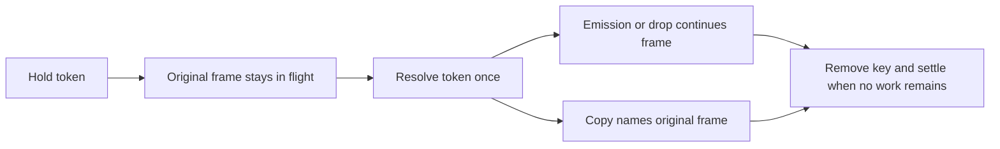

A held frame has not settled. Its device and hold token identify the original
journey, so release, timeout, overflow, filter refusal, and routing rebuild
cannot be attributed to another frame with a matching payload.

## The rule

[`Fabric`](../../../src/common/sim/fabric/fabric.go) keeps a map from device
and token to `FrameID`. A hold contributes to the frame's in-flight count.
[`applyDeviceOutput`](../../../src/common/sim/fabric/output.go) resolves a token
once for the whole output. Emissions and drops continue the held journey.
Mirror copies name that frame and inherit its flow and retention. The key is
removed after every part of the output has used it.

[`settle`](../../../src/common/sim/fabric/flow.go) folds and frees an aggregate
journey after its hold and all transmissions end. Its re-entry set is freed
with it. Protocol journeys also release their storage at settle.
`Flows()` reads `Held` from the live hold map. A completed release counts
under `Delivered`, and a failed hold under `Drops`.

## Evidence

The checks live in
[`flow_internal_test.go`](../../../src/common/sim/fabric/flow_internal_test.go):

- `TestReleaseOutOfOrder` resolves the second neighbor while the first frame
  stays held. The second original journey is delivered.
- `TestHoldExits` checks 20 combinations of five exits, two retentions, and
  two exit orders. It asserts the right frame's fate, an empty hold map,
  `Held == 0`, and `StopConverged`.
- `TestReleaseWithMirrorUnderAggregate` checks one delivery, one copy, and
  one latency sample after the releasing output consumes the key.
- `TestProtocolJourneyFreedAtSettle` checks that settled protocol journeys
  leave no traversal or re-entry storage.

## Boundary

A new fabric from `assembly.Derive` has no hold map for its inherited device
state. An emission or drop with an unknown token starts a journey of its own.
A hold key stays until its device reports an exit. The convergence check
therefore waits for an unresolved hold to finish, regardless of retention.
