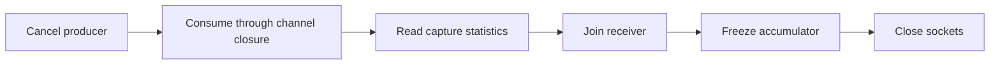

# Drain accepted capture frames before freezing observations

An elapsed drain timer does not prove that the consumer recorded every accepted
frame. Commit `8c143028` records a held-consumer regression: the normal case
reported `LateAfterClose=1`, and cancellation and receiver-failure cases reported
`Missing=1`. The test holds the consumer while the sender queues a signed frame
(`src/edge/simload/run_test.go:550-639`). Its final assertion at `:653-654` is:

```go
if row.Sent != 1 || row.UniqueReceived != 1 || row.Missing != 0 || row.LateAfterClose != 0 || row.Latency.Count != 1 || row.Latency.Sum != time.Microsecond {
    t.Fatalf("observation = %+v, want sent=1 unique=1 missing=0 late=0 latency=1us", row)
}
```

The capture source's contract requires channel closure after cancellation.
A terminal error frame is optional when the channel is full
(`src/modules/capture/rawsocket/rawsocket.go:72-76`):

```go
// Receive returns a channel that delivers frames until ctx is canceled
// or the source is closed, at which point the channel is closed. A
// terminal error frame is best effort and may be omitted if the channel
// is full.
```

Use closure as the drain boundary. Preserve the first receiver error while
continuing to record later accepted data. `consumeCapture` does this at
`src/edge/simload/run.go:340-368`, then reads capture statistics. The owner
waits for its result before freezing the accumulator (`:314-318`):

```go
cancel()
outcome := <-receiverDone
withAccumulator(&observationMu, func() { accumulator.Close() })
closeErr := receiver.Close()
senderErr := sender.Close()
```



`TestExecuteDrainsAcceptedFramesBeforeFreeze` exercises normal completion,
parent cancellation, receiver failure and a cancellation frame after data
(`run_test.go:551`). A shutdown test should hold the consumer until the producer
closes its channel, then release it and check successful sends, unique receives,
missing frames and late frames together.

This requires a source that closes its channel on cancellation. It does not
promise to recover frames the source never accepted, including interface drops.
The [pump stop-signal lesson](stopping-a-pump-does-not-close-its-data.md)
covers producers whose stop signal leaves their data channel open.
