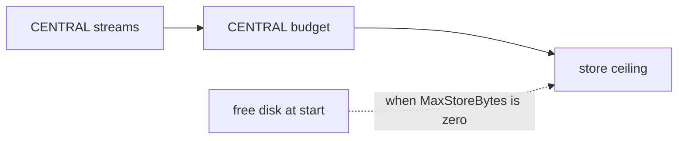

# The CENTRAL JetStream Disk Budget Is a Reservation Against the Server's Store Ceiling

## Context

The hub runs one embedded nats-server in operator mode. CENTRAL is its only
JetStream account: it holds the key-value buckets, the audit and operator
streams, the typed ingest streams, and the evidence stream. The account JWT
carries the JetStream disk limit, minted in `hubKeys.accountJWT`
(`src/modules/edgebus/keys.go:170-177`) from `HubConfig.CentralBudgetBytes`
(`src/modules/edgebus/hub.go:149-152`, `:159`). The server-wide ceiling is
`HubConfig.MaxStoreBytes`, passed as `JetStreamMaxStore`
(`src/modules/edgebus/hub.go:33-35`, `:185`).

## Guidance

The CENTRAL budget must fit under the store ceiling. `DiskStorage` in the
account JWT is a reservation the server checks when it enables JetStream for
the account. `sufficientResources` sums the limits of every enabled account
plus the new one and refuses the account when the sum passes
`js.config.MaxStore` (`nats-server/v2@v2.15.0/server/jetstream.go:2690-2745`).
The caller returns that error from the account setup
(`server/jetstream.go:1241-1244`).

A refused account does not stop the server. `updateAccountClaimsWithRefresh`
logs `Error configuring jetstream for account [...]` and marks the account
`incomplete` (`server/accounts.go:3924-3930`). The hub notices at its first
JetStream call. `createStores` creates the key-value buckets first, and the
failure comes back as the `create key-value bucket` hub error
(`src/modules/edgebus/hub.go:259`). The wrapped cause is the client's
JetStream error. The server's own explanation is in the hub logger, which
receives it through `quietLogger` (`src/modules/edgebus/hub.go:414-460`).

### A ceiling taken from free disk can refuse CENTRAL at restart

With `MaxStoreBytes` at zero, the server sets the ceiling to 75% of the free
space under the store directory and marks it provisional
(`server/jetstream.go:2824-2826`, `server/disk_avail.go:23-37`). Once the
existing streams are recovered, `finalizeDynamicMaxStore` ends the provisional
state and adds back 75% of the bytes those streams already occupy
(`server/jetstream.go:552-574`). The check is skipped while the ceiling is
provisional (`server/jetstream.go:2717-2720`).

The ceiling is read once per start. If other files take disk while the hub is
stopped, the next start computes a lower ceiling. CENTRAL's budget is fixed, so
a budget that fitted before can fail the check now, and the hub refuses to
start with the error above. A deployment that wants a start that does not
depend on the disk's current state sets `MaxStoreBytes` and keeps it above the
CENTRAL budget.

### The budget must also cover the streams

The streams CENTRAL creates reserve bytes inside the budget. That sum is a
separate check from the ceiling. The host refuses a configuration whose
`central_budget_bytes` is below it before it opens anything
(`src/services/device/internal/host/config.go:70-79`), and the hub refuses it
at start (`TestHubRefusesACentralBudgetBelowTheStreamSum`,
`src/modules/edgebus/hub_test.go:132`). The edgebus README gives the
arithmetic (`src/modules/edgebus/README.md`).

## Why This Matters

The refusal looks like a bucket failure. Nothing in the hub error says the disk
or the ceiling is the cause, and the server's explanation is a log line
mentioning "insufficient storage resources", not free space. Without this
entry, a start failure after a disk-filling event reads as a corrupt store or
a key problem.

## When to Apply

- Changing a budget constant or a `HubConfig` budget field: compare the CENTRAL
  budget with the ceiling the deployment sets.
- Adding a second JetStream-enabled account to the hub: its budget joins the
  same sum, so the ceiling must cover both. The central high availability
  phase 2 plan expects this.
- Diagnosing a `create key-value bucket` start failure: read the hub logger
  for `insufficient storage resources available`, then compare the CENTRAL
  budget with the ceiling and with the free disk at the time of the start.

## Related

- `src/modules/edgebus/README.md`: the CENTRAL account layout and its budget
  arithmetic.
- `src/modules/edgebus/hub_test.go`: `TestHubRefusesACentralBudgetBelowTheStreamSum`.
- `docs/solutions/architecture-patterns/local-bus-durability-is-a-runtime-setting-not-storage-identity.md`:
  fsync rules and embedded JetStream server configuration.
