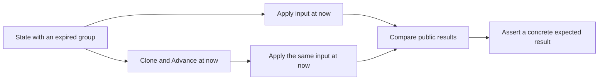

# Test time-aware inputs with and without prior aging

An input handler can age state in its helper and still depend on caller
cleanup when an earlier guard reads stale state. Commit `bd46dfa7` moved
the compatibility guard after `ageGroupPortState`
(`src/common/sim/layer/mcast/layer.go:464-477`). The multicast contract is
already decided in
[`the virtual-device direction`](../../architecture/2026-09-10-virtual-device-direction.md)
at lines 519-523.

## Compare two copies at the same time

`TestLearnExpiredCompatibilityMatchesAdvance` seeds IGMPv1 membership at
`t0`, observes a query at `t0+10s`, and checks expiry at `t0+12s`. At
`t0+20s` it delivers identical inputs to two copies. Only one first runs
`Advance(now)` (`src/common/sim/layer/mcast/compatibility_test.go:47-66,84-114`).



The snapshot assertion at `compatibility_test.go:115-117` is:

```go
if got, want := unaged.Groups(vid, now), aged.Groups(vid, now); !reflect.DeepEqual(got, want) {
    t.Errorf("unaged Groups = %+v, want aged Groups %+v", got, want)
}
```

It also compares resolution and asserts the concrete `TO_IN` result:
INCLUDE membership, source expiry 260 seconds after input, and forwarding
to member and router (`:118-135`). Equality alone can accept two wrong
answers. Expire the record containing the guard's timer. Here the group
expires while the compatibility deadline would still make the guard return.
Commit `bd46dfa7` records that moving the guard before aging fails IGMP
`TO_IN`, empty `TO_IN`, and Leave with fast leave on and off.

## Cover every entry point into the same mechanism

A lookup fix can leave reception able to revive an expired entry.
`TestNeighborEntryPointsMatchPriorAdvance` covers seven state and
transmission-count scenarios against committing/read-only routing, ARP,
and Neighbor Discovery in both address families
(`src/common/sim/layer/routing/neighbor_internal_test.go:156-181`). The
count guard requires 105 cases (`:315-317`).

Seed an exhausted Probe with a held frame and deliver a solicitation
without a link-layer option at `t0+40s`. Retain exits from the first
`Advance`. Compare results, emissions, neighbors, next wake, and exit
causes by token. Read-only calls leave both copies unchanged
(`:212-225,279-309`). The timeout assertion checks `HeldTimedOut` for
the queued token (`:221-224`). Commit `3e6aed96` records a mutation that
removes retirement from reception alone and quotes its failure:

```text
--- FAIL: TestNeighborEntryPointsMatchPriorAdvance/2001:db8:10::11/probe-exhausted/solicitation-no-option (0.00s)
```

## Separate deadline creation from later reads

Fixing a deadline at an event can stabilize later reads while the event
itself still depends on caller aging. Check which of those the promised
independence covers before choosing the fixture. The final two Decisions of
[`the spanning-tree handshake plan`](../../plans/2026-10-01-2200-refactor-sim-package-overhaul-phase13-plan.md)
settle the recent-root rule and its scope.

The layer stores a departure's deadline at the end of its call.
`src/common/sim/layer/stp/portstate.go:123`:

```go
p.rootDeadline = now.Add(delay)
```

Later reads compare that deadline with `now` (`portstate.go:103-107`).
A departure at `T` with a 15-second delay still expires at `T+15s` after a
30-second input. `TestRecentRootCutIsIndependentOfAdvance` checks 36 cases
across CIST, MSTI, and PVST, shorter/equal/longer next delays, fresh/aged
information, and both sides of expiry
(`src/common/sim/layer/stp/recent_root_property_test.go:18-22,86-101`).
Commit `d607594e` quotes the read-time mutation and its failure:

```text
return recentDeadline(p.rootDepartureAt, delay, now)
--- FAIL: TestRecentRootCutIsIndependentOfAdvance (0.00s)
```

The fixture departs before the compared `Advance`. The comment at
`recent_root_property_test.go:14-15` states the uncovered case:

```go
// share one deadline. It does not cover the call a port leaves the role in,
// which depends on Advance when the Root port's information has aged.
```

The accepted limit at `src/common/sim/layer/stp/README.md:633` gives the
counterexample: prior aging makes departure use 15 seconds, while departure
in reception uses 4 seconds. A cut at `T+5s` differs. Test departure during
the compared calls separately when the contract promises independence
there. A property proved after an event does not prove that event's timing.

## Scope

Apply this comparison when caller aging must be optional. It does not
establish the protocol's transition rules or prove every table row
discriminates a particular guard. Preserve side effects from prior aging
when comparing paths, since equal final state can hide a missing timeout
exit. The routing comparison checks exit causes and uniqueness, but does
not compare exit ordering or every held-frame field (`:298-309`).
