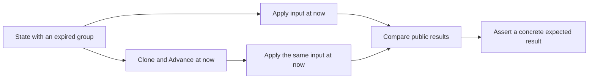

# Test time-aware inputs with and without prior aging

An input handler can age state in its shared helper and still depend on
caller cleanup: a guard before that helper can return on stale state.
Commit `bd46dfa7` removed that shape from `learnGroupRecord` and
`learnLeave`. The guard now follows `ageGroupPortState` in
`src/common/sim/layer/mcast/layer.go:464-477`.

The time-aware multicast contract is already decided in
[`2026-09-10-virtual-device-direction.md`](../../architecture/2026-09-10-virtual-device-direction.md)
at lines 519-523.
The reusable lesson is how to test it at input boundaries, including
guards that can prevent the shared transition code from running.

## Compare two copies at the same time

`TestLearnExpiredCompatibilityMatchesAdvance` builds an IGMPv1 membership
at `t0`, observes a query at `t0+10s`, and checks that the group expires at
`t0+12s`. It delivers the next input at `t0+20s` to two copies, only one
of which first runs `Advance(now)`
(`src/common/sim/layer/mcast/compatibility_test.go:47-66,84-114`).

The test compares membership snapshots and resolution, then checks the
concrete `TO_IN` result: INCLUDE membership with the source expiry 260
seconds after the input and forwarding to the member and router
(`compatibility_test.go:115-135`). Equality alone could let both paths
produce the same wrong result.



Use a deadline that invalidates the record containing the guard's timer,
not only the timer the guard reads. The fixture's group expires before the
next input, while the old compatibility deadline alone would still cause
the pre-aging guard to return. Commit `bd46dfa7` records that moving the
guard back before aging fails the IGMP `TO_IN`, empty `TO_IN`, and Leave
rows, with fast leave both enabled and disabled.

## Evidence

`src/common/sim/layer/mcast/compatibility_test.go:64-66`:

```go
now := t0.Add(20 * time.Second)
aged := unaged.Clone()
aged.Advance(now)
```

The same input reaches both copies at
`compatibility_test.go:84,112`. The snapshot assertion at
`compatibility_test.go:115-117` is:

```go
if got, want := unaged.Groups(vid, now), aged.Groups(vid, now); !reflect.DeepEqual(got, want) {
    t.Errorf("unaged Groups = %+v, want aged Groups %+v", got, want)
}
```

Commit `bd46dfa7` quotes the failing mutation:

```text
--- FAIL: TestLearnExpiredCompatibilityMatchesAdvance/IGMP/TO_IN (0.00s)
```

## Scope

Apply this comparison when caller aging must be optional. It does not
establish the protocol's transition rules or prove every table row
discriminates a particular guard. The concrete expected assertions and
the recorded mutation establish that for the IGMP `TO_IN` case.
