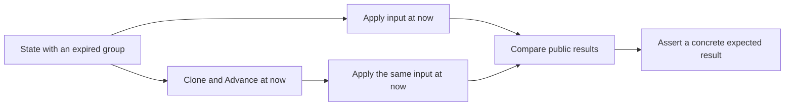

# Test time-aware inputs with and without prior aging

An input handler can age state in its shared helper and still depend on
caller cleanup: a guard before that helper can return on stale state.
Commit `bd46dfa7` removed that shape from `learnGroupRecord` and
`learnLeave`. The guard now follows `ageGroupPortState` in
`src/common/sim/layer/mcast/layer.go:464-477`.

The time-aware multicast contract is already decided in
[`2026-09-10-virtual-device-direction.md`](../../architecture/2026-09-10-virtual-device-direction.md)
at lines 519-523. Test it at input boundaries, including guards before the
shared transition code.

## Compare two copies at the same time

`TestLearnExpiredCompatibilityMatchesAdvance` builds an IGMPv1 membership
at `t0`, observes a query at `t0+10s`, and checks that the group expires at
`t0+12s`. It delivers the next input at `t0+20s` to two copies, only one
of which first runs `Advance(now)`
(`src/common/sim/layer/mcast/compatibility_test.go:47-66,84-114`).

The test compares membership snapshots and resolution, then checks the
concrete `TO_IN` result: INCLUDE membership with the source expiry 260
seconds after the input and forwarding to the member and router
(`compatibility_test.go:115-135`). Equality alone could let both paths
produce the same wrong result.



Use a deadline that invalidates the record containing the guard's timer,
not only the timer the guard reads. The fixture's group expires before the
next input, while the old compatibility deadline alone would still cause
the pre-aging guard to return. Commit `bd46dfa7` records that moving the
guard back before aging fails the IGMP `TO_IN`, empty `TO_IN`, and Leave
rows, with fast leave both enabled and disabled.

## Evidence

`src/common/sim/layer/mcast/compatibility_test.go:64-66`:

```go
now := t0.Add(20 * time.Second)
aged := unaged.Clone()
aged.Advance(now)
```

The same input reaches both copies at
`compatibility_test.go:84,112`. The snapshot assertion at
`compatibility_test.go:115-117` is:

```go
if got, want := unaged.Groups(vid, now), aged.Groups(vid, now); !reflect.DeepEqual(got, want) {
    t.Errorf("unaged Groups = %+v, want aged Groups %+v", got, want)
}
```

## Cover every entry point into the same mechanism

A lookup fix can leave reception able to revive the expired entry. Commit
`3e6aed96` records a failing mutation that retains retirement in lookup
and `Advance` but removes it from reception. Extend the comparison across
entry points and states when another path exposes the same missed property.

`TestNeighborEntryPointsMatchPriorAdvance` enumerates seven state and
transmission-count scenarios against committing and read-only routing calls,
ARP reception, and Neighbor Discovery reception in both address families
(`src/common/sim/layer/routing/neighbor_internal_test.go:156-181`). Its
literal count guard requires 105 cases (`:315-317`).

For example, seed an exhausted Probe entry with a held frame and deliver a
solicitation without a link-layer option at `t0+40s` to both copies. Retain
the exits drained by the first `Advance`. Compare results, emissions,
neighbors, next wake, and exit causes by token, then assert read-only calls
leave both copies unchanged (`:212-225,279-309`). The concrete timeout
assertion at `:221-224` is:

```go
if !slices.ContainsFunc(agedExits, func(exit HeldFrame) bool {
    return exit.Cause == HeldTimedOut && exit.Token == queued.Hold
}) {
    t.Fatalf("Advance exits %v omit timed-out token %d", agedExits, queued.Hold)
}
```

Commit `3e6aed96` quotes the reception-only mutation's failure:
```text
--- FAIL: TestNeighborEntryPointsMatchPriorAdvance/2001:db8:10::11/probe-exhausted/solicitation-no-option (0.00s)
```

## Include capacity reads and compare different histories

A capacity check reads time-dependent state too. With `MaxEntries: 1`,
seed A at `t0` and learn B at `t0+301s`. Expiry must free the slot before
an eviction decision. `src/common/sim/layer/bridge/ingress.go:461-465`
runs `Advance(now)` at the bound and then checks the bound again. Commit
`d453c3da` records the old-bound mutation failing
`TestFDBFrameTimeMatchesPriorAdvance/max=1/world=3/layout=7`.

The test compares traces and egress before closing aging, then entries and
counters (`src/common/sim/layer/bridge/fdb_time_test.go:79-87`). Its concrete
expectation at `:92-93` is:

```go
wantEntries := []bridge.Entry{{MAC: macB, Port: "1/1/2", Origin: bridge.Observed, Lifetime: bridge.Aging, LearnedAt: now}}
wantCounters := bridge.Counters{Learned: 2, Expired: 1}
```

Keep the first copy unaged and advance only its clone (`:56-59`). Before
commit `6e752071`, a `priorAdvance` bit aged the first copy before cloning,
so half the rows compared identical histories. The corrected matrix has
4,128 rows and literal guards for two concrete and two boundary expectations
(`:140-147`). A second learning frame exposes dynamic-count drift that equal
entries can hide (`:128-134`).

## Scope

Apply this comparison when caller aging must be optional. It does not
establish the protocol's transition rules or prove every table row
discriminates a particular guard. Preserve side effects from prior aging
when comparing paths, since equal final state can hide a missing timeout
exit. The routing comparison checks exit causes and uniqueness, but does
not compare exit ordering or every held-frame field (`:298-309`).
