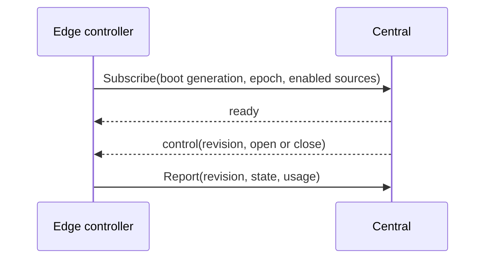

# Raw window edge service

The `flowseer.edge.ingest.v1` package holds `RawWindowEdgeService`. An edge
opens `Subscribe` to receive raw window controls and calls `Report` to give
central its controller's cumulative state. Central never calls an edge, and
neither call belongs to a device lane, so a window can start while a listed
device has no running lane.

A subscription carries the edge's boot generation and process epoch. Central
accepts only an increasing generation, or the current generation with the same
epoch, and closes a stream that a newer subscription supersedes. A control
for a window carries a per-window revision, and a greater revision supersedes
older controls for that window.

## Boundaries

Imports: model/rawwindow

Imported by: nothing

Deliberately absent:

- The window entity and its state. They live in
  [`model/rawwindow/v1`](../../../model/rawwindow/v1/README.md).
- The operator service. `RawWindowService` lives in
  [`api/ingest/v1`](../../../api/ingest/v1/README.md).
- The edge identity. The call's assertion names the edge, so a message carries
  no edge field of its own, and central rejects a report that names another
  edge's window.
