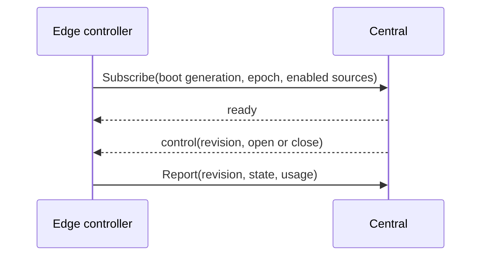

# Edge ingest services

The `flowseer.edge.ingest.v1` package holds `RawWindowEdgeService` and
`IngestService`.

## Ingest delivery

`IngestService.Deliver` carries a batch of `IngestRecord` from an edge to
central. The request names no tenant or edge, since the call's assertion
names the edge and the edge store names its tenant. The response holds
`settled`, the count of leading records central stored or refused for a
reason about the record, and the edge resends from that index. A failure that
is not about a record, such as a full stream, ends the count and the call
still answers.

The request's `items: {ignore: IGNORE_ALWAYS}` keeps the interceptor from
validating each record. Central validates each one and settles an invalid
record as refused. Otherwise one invalid record would refuse the whole batch
and the edge could never get past it.

## Raw window controls

An edge opens `RawWindowEdgeService.Subscribe` to receive raw window
controls and calls `Report` to give central its controller's cumulative
state. Central never calls an edge, and
neither call belongs to a device lane, so a window can start while a listed
device has no running lane.

A subscription carries the edge's boot generation and process epoch. Central
accepts only an increasing generation, or the current generation with the same
epoch, and closes a stream that a newer subscription supersedes. A control
for a window carries a per-window revision, and a greater revision supersedes
older controls for that window.

## Boundaries

Imports: integration/ingest, model/rawwindow

Imported by: nothing

Deliberately absent:

- The window entity and its state. They live in
  [`model/rawwindow/v1`](../../../model/rawwindow/v1/README.md).
- The operator service. `RawWindowService` lives in
  [`api/ingest/v1`](../../../api/ingest/v1/README.md).
- The edge identity. The call's assertion names the edge, so a message carries
  no edge field of its own, and central rejects a report that names another
  edge's window.
