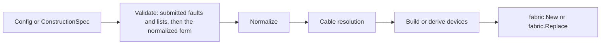

# assembly

Assembly builds devices for the [fabric runtime](../fabric/README.md).
It owns configuration normalization, construction specifications, derivation,
reconfiguration, and configuration diffs. The fabric imports the device seam
and the cable medium so another device kind can run without changing it.

```go
fab, err := assembly.New(cfg)
if err != nil {
    return err
}
next := assembly.Spec(fab)
next.Switches["sw1"] = target
next.Start = time.Time{} // an unset Start takes the fabric's current clock
candidate, err := assembly.Derive(fab, next)
if err != nil {
    return err
}
fmt.Println(candidate.Clock()) // fab.Clock()
```

`Spec` carries the `Start` the fabric was built with, so deriving an unedited
`Spec` builds at that time. Zeroing `Start` makes `Derive` build at the clock
of the fabric it derives from.

`New(cfg)` is `NewConstructionSpec(cfg)` followed by `NewWithSpec(spec)`.
`NewConstructionSpec` validates and normalizes a `Config` into a
`ConstructionSpec` and sets each switch's `NodeID` to its name. `NewWithSpec`
builds from a specification, which keeps the seeds, trust metadata, and node
identities a `Config` cannot carry. `Retention(fab)` reports, for each switch,
which layers the last `Derive`, `Fork`, or `Configure` kept.

`Spec` reads the live devices' specifications and the configured port tables
from `Fabric.Config`. Cable-derived operational states belong to the runtime
ports. A no-op `Configure` preserves the configured table and its conflict
reporting (`TestConfigureWithoutChangeKeepsSpec` in [built_spec_test.go](built_spec_test.go)).

`Diff(a, b)` lists the changes between two `Config` values. `DiffSpecs` compares
construction inputs and configuration behavior. Evidence catalogs and references
produce no change in either, including evidence attached to switch issues and
assumptions. `ConstructionSpec.Equal` includes that evidence.
[construction_result_test.go](construction_result_test.go) checks both contracts.
An address change carries its prefixes as the `trace.Fact` that `PrefixesFact`
builds from the prefix strings, in the order given.
Switch subjects and scenario operation subjects use quoted component keys from
`trace.CompositeKey`, so a slash within an identifier stays part of that identifier.



`ConfigureAction(node, cfg)` copies the configuration into an immutable
`fabric.Operation`. `McheckAction(node, port)` builds migration checking
through `fabric.Operate`. Scenario execution and diffing stay in fabric,
which can also execute caller-supplied operations without importing assembly.
`TestOperationNeedsNoAssembly` in
[the fabric tests](../fabric/topology_internal_test.go) checks that seam.
