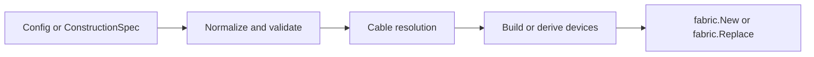

# assembly

Assembly builds devices for the [fabric runtime](../fabric/README.md).
It owns configuration normalization, construction specifications, derivation,
reconfiguration, and configuration diffs. The fabric imports the device seam
and the cable medium so another device kind can run without changing it.

```go
spec, err := assembly.NewConstructionSpec(cfg)
if err != nil {
    return err
}
fab, err := assembly.NewWithSpec(spec)
if err != nil {
    return err
}
next := assembly.Spec(fab)
next.Switches["sw1"] = target
candidate, err := assembly.Derive(fab, next)
```

`Spec` reads the live devices' specifications and the configured port tables
from `Fabric.Config`. Cable-derived operational states belong to the runtime
ports. A no-op `Configure` preserves the configured table and its conflict
reporting (`TestConfigureWithoutChangeKeepsSpec` in [built_spec_test.go](built_spec_test.go)).



`ConfigureAction(node, cfg)` copies the configuration into an immutable
`fabric.Operation`. `McheckAction(node, port)` builds migration checking
through `fabric.Operate`. Scenario execution and diffing stay in fabric,
which can also execute caller-supplied operations without importing assembly.
`TestOperationNeedsNoAssembly` in
[the fabric tests](../fabric/topology_internal_test.go) checks that seam.
