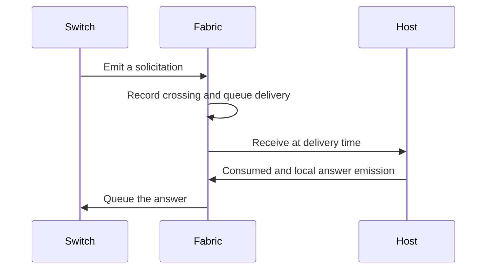

# Host

A host has one cable attachment and no relay. It accepts frames for its own
addresses and answers local ARP and Neighbor Discovery requests. Its stack
uses `NeighborDisabled`, so packet origination requires a configured neighbor.
Neighbor Advertisements clear the Router flag.

```go
fab, err := assembly.New(assembly.Config{
    Start: now,
    Hosts: map[string]host.Config{
        "workstation": {Address: netaddr.MAC{2, 0, 0, 0, 0, 1}},
        "peer": {Address: netaddr.MAC{2, 0, 0, 0, 0, 2}},
    },
    Cables: []fabric.Cable{{
        A: fabric.Endpoint{Node: "workstation"},
        B: fabric.Endpoint{Node: "peer"},
    }},
})
if err != nil {
    return err
}
h := fab.Device("workstation")
out, err := h.Originate(now, "", ethernet.Frame{
    Src: netaddr.MAC{2, 0, 0, 0, 0, 1},
    Dst: netaddr.MAC{2, 0, 0, 0, 0, 2},
    Tags: []vlan.Tag{{PCP: 5}},
}, nil)
if err != nil {
    return err
}
fmt.Println(len(out.Emissions[0].Frame.Tags), out.Emissions[0].PCP) // 0 5
```

`Originate` applies the host's VLAN form to the VID and retains the supplied
PCP and DEI. PCP values above 7, a non-empty port, or a packet combined with
frame fields are refused.
`Receive` reports acceptance as `Consumed` or `Dropped`, with the deciding
step. An undecodable IP header carries incomplete metadata.



The [acceptance suite](accept_test.go) preserves VLAN, MAC, and IP check order.
[host_test.go](host_test.go) checks exactly four local and foreign request cases
and proves that hosts learn and resolve nothing. The advertisement's flags are
pinned to RFC 4861 section 4.4 in
[routing/host_test.go](../../layer/routing/host_test.go).
