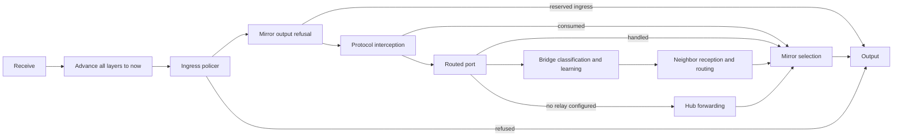
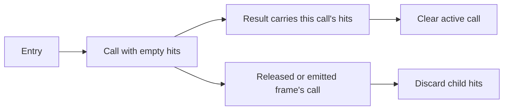

# vswitch

A virtual switch evaluates standard Ethernet forwarding and physical-layer
allocations in pure Go. It executes synchronously in memory without goroutines
or wall clocks.

## Example

The example builds a switch with two access ports and one trunk port, forwards
an untagged frame, derives an updated state, and compares forwarding behavior
across the two states. `Fabric.Device` returns a fork, so the receive, derive,
and compare below leave the fabric untouched. Use `Inject` and `Run` to
execute on the fabric's queue.

```go
package main

import (
	"fmt"
	"time"

	"go.aledante.io/FlowSeer/src/common/net/ethernet"
	"go.aledante.io/FlowSeer/src/common/net/netaddr"
	"go.aledante.io/FlowSeer/src/common/net/vlan"
	"go.aledante.io/FlowSeer/src/common/sim/analysis"
	"go.aledante.io/FlowSeer/src/common/sim/assembly"
	"go.aledante.io/FlowSeer/src/common/sim/device/host"
	"go.aledante.io/FlowSeer/src/common/sim/device/vswitch"
	"go.aledante.io/FlowSeer/src/common/sim/fabric"
	"go.aledante.io/FlowSeer/src/common/sim/layer/bridge"
	"go.aledante.io/FlowSeer/src/common/sim/layer/phy"
	"go.aledante.io/FlowSeer/src/common/sim/medium/cable"
	"go.aledante.io/FlowSeer/src/common/sim/port"
)

func main() {
	ports, err := port.NewBuilder().
		Range("1/1/%d", 1, 3, port.Port{
			AdminStatus: port.Up,
			OperStatus:  port.Up,
		}).
		Build()
	if err != nil {
		panic(err)
	}

	vid10 := vlan.ID(10)
	swCfg := vswitch.Config{
		Ports: ports,
		Bridge: &bridge.Config{
			AgingTime: bridge.DefaultAgingTime,
			VLAN: &bridge.VLAN{
				Table: map[vlan.ID]string{10: "prod"},
				Switchports: map[string]bridge.Switchport{
					"1/1/1": {PVID: &vid10, Untagged: []vlan.ID{10}},
					"1/1/2": {PVID: &vid10, Untagged: []vlan.ID{10}},
					"1/1/3": {Tagged: []vlan.ID{10}},
				},
			},
		},
	}

	now := time.Unix(1700000000, 0)
	fab, err := assembly.New(assembly.Config{
		Start:    now,
		Switches: map[string]vswitch.Config{"sw1": swCfg},
		Hosts:    map[string]host.Config{"h1": {}, "h2": {}, "h3": {}},
		Cables: []fabric.Cable{
			{A: fabric.Endpoint{Node: "sw1", Port: "1/1/1"}, B: fabric.Endpoint{Node: "h1"}},
			{A: fabric.Endpoint{Node: "sw1", Port: "1/1/2"}, B: fabric.Endpoint{Node: "h2"}},
			{A: fabric.Endpoint{Node: "sw1", Port: "1/1/3"}, B: fabric.Endpoint{Node: "h3"}},
		},
		PhyAssumption: &cable.PhyAssumption{
			Medium: cable.TwistedPair,
			Ethernet: phy.Ethernet{
				SupportedSpeedsBPS:        []uint64{1_000_000_000},
				AutoNegotiationSupported: phy.CapabilitySupported,
				Setting:                  &phy.Setting{AutoNegotiation: true},
			},
		},
	})
	if err != nil {
		panic(err)
	}
	sw := fab.Device("sw1").(*vswitch.Switch)

	frame := ethernet.Frame{
		Dst:       netaddr.MAC{0x00, 0x11, 0x22, 0x33, 0x44, 0x55},
		Src:       netaddr.MAC{0x00, 0xaa, 0xbb, 0xcc, 0xdd, 0xee},
		EtherType: ethernet.EtherTypeIPv4,
		Payload:   []byte("hello"),
	}

	res := sw.Receive(now, "1/1/1", frame)
	fmt.Printf("Outcome: %s, Egress count: %d, Status: %s\n", res.Outcome, len(res.Egress), res.Metadata.Status())

	nextCfg := swCfg.Clone()
	b := port.NewBuilder()
	for _, p := range swCfg.Ports.Ports() {
		if p.Name == "1/1/2" {
			p.OperStatus = port.Down
		}
		b.Add(p)
	}
	nextCfg.Ports, err = b.Build()
	if err != nil {
		panic(err)
	}

	nextSpec := sw.Spec()
	nextSpec.Config = nextCfg
	nextSw, out, err := vswitch.Derive(sw, nextSpec, now)
	if err != nil {
		panic(err)
	}

	fmt.Printf("derive drops: %d\n", len(out.Drops))
	cmp := vswitch.Compare(sw, nextSw, now, "1/1/1", frame)
	fmt.Printf("Disposition: %s\n", cmp.Disposition)
	if cmp.Disposition == analysis.Different {
		fmt.Printf("Difference: %s\n", cmp.Difference)
	}
}
```

## State

`State(now)` converts the layer snapshots in [state.go](state.go) into
`device.State`. Sampling does not advance timers. Returned rows and maps
are independent of the switch. Tree keys come from each row's `TreeRef`,
and the CIST is read through `Roles`, so assigning VLAN 1 to an MSTI does
not hide the common tree. [TestStateCarriesEveryLayerField](state_test.go)
walks the nine layer roots, including nested multicast source records,
and checks 29 enumeration values through the converters.

## Per-call output

`Receive` returns forwarding, emissions, mirror copies, and held-frame drops
in one `Output`, so a caller can account for every frame the arrival caused.
`ReceiveMirrored` handles a mirror arrival without policing it or creating
another generation of copies. `Advance` returns timer output without a
forwarding result. These entries leave their output in the returned value.

```go
out := sw.Receive(now, "1/1/1", frame)
fmt.Printf("%s: %d emissions, %d copies, %d held-frame drops\n",
    out.Outcome, len(out.Emissions), len(out.Copies), len(out.Drops))
```



The layer table in `layers.go` advances spanning tree, LAG, loop protection,
bridge, multicast, and routing in that order. It also supplies `NextWake`.
A refused frame still meets due timers. The public aging comparison in
`output_test.go` checks the former root port's reroot state at `T+5s` and
`T+16s` against a switch advanced before the BPDU at `T`.

`Start`, `Mcheck`, and `Derive` return `Output` with a zero forwarding
result. `LinkChange` returns `(Output, error)` and rejects an absent port or
invalid link state before changing runtime state. `Peek` returns the result
and mirror copies without advancing timers, policing, receiving protocol
observations, or learning. The switch holds no output between calls
(`switch.go`, `TestSwitchHoldsNoPendingOutput`).

Every emission passes `emit` in `timers.go`. A mirror output port emits
copies alone, including when spanning tree, loop protection, routing, or
a held-frame release would otherwise send there. A refused release becomes
a `device.Drop` with reason `mirror-output`. Mirror selectors resolve the
physical ingress to its logical port, including a received LACPDU's member
(`mirror.go`, `TestMirrorCopiesLACPFromLogicalIngress`). A released frame
also produces the copies selected by its successful egress. Each copy
carries the held frame's token and owns its frame storage
(`TestReleasedFrameIsMirroredOnEgress`).

Open vSwitch mirrors a packet to a given destination once, even when several
selectors match it. A held frame keeps that rule across the hold. The switch
records, per hold token, the logical ingress port, the ingress VLAN, and the
mirrors that copied the frame on arrival (`heldMirror` in `mirror.go`). At
release the selectors see that ingress and VLAN, and a mirror that already
copied the frame is skipped, so only a mirror selecting by the release port
adds a copy (`TestHeldFrameIsMirroredOncePerMirror`). `Fork` and `Derive` carry
the record with the routing layer's queue. `ReceiveMirrored` makes no copies
of its own frame, held or released, and keeps the copies of the held frames
its arrival releases (`TestReceiveMirroredKeepsCopiesOfReleasedFrames`).

Open vSwitch reserves a mirror output port for mirror copies and runs
no spanning tree on it. Keeping loop-protection probes off the port is the
switch's own rule, drawn from that reservation, because no source read
covers probes.

A port under a loop-protection action keeps sending probes, BPDUs, and
LACPDUs. `applyLoopProtectEffects`, `applySTPEffects`, and `applyLAGEffects`
in `timers.go` never consult the loop-protection gate. The
[loop protection layer](../../layer/loopprotect/README.md#emission-ignores-the-gate)
documents this for probes. No vendor source was read for BPDUs or LACPDUs on
such a port.

Protocol transmission and loop-protection gates follow the
[layer integration rules](../../layer/loopprotect/README.md#switch-integration).

## Capability ladder

The virtual switch uses a ladder of architectural layers:

- **Hub**: Configured with a `port.Table` alone. Frames received on an active
  port repeat to all other active forwarding ports. The hub does not inspect
  VLAN tags or learn MAC addresses.
- **Bridge**: Configured with a `port.Table` and `bridge.Config` without a VLAN
  subsystem. Learns source addresses into a single filtering database (FID 0),
  filters frames destined to known ports, and drops IEEE bridge management
  group addresses unless `ForwardBPDU` is set to forward them like any group address.
  A table bound (`MaxEntries`) evicts the oldest dynamic entry when full, and
  `Counters` tracks learned, expired, evicted, and moved entries. A bridge can
  designate `ProtectedPorts` that never forward traffic to one another. All tags
  are treated as payload.
- **Switch**: Configured with a `port.Table` and `bridge.Config` containing a
  `bridge.VLAN`. Performs 802.1Q ingress classification, admission checks,
  ingress VLAN filtering, per-VLAN learning, and egress tag rewrites.
  Configuring `FloodVLANs` disables learning and floods every frame in those
  VLANs. An untagged egress port can emit priority tags under a `PriorityTags`
  policy (`Never`, `IfNonzero`, `Always`). A port configured with a `Tunnel`
  pushes an outer service tag on ingress and pops it on egress. For example, a
  customer-tagged frame arriving on a tunnel port egresses a trunk port carrying
  an outer S-tag with TPID 0x88A8 plus the customer C-tag.
- **Link aggregation**: Configured with LAG ports and optional `lag.Config`. Member processing and
  egress selection use the [aggregation layer](../../layer/lag/README.md).
- **Spanning tree**: Configured with `bridge.Config` and `stp.Config`. The
  [spanning tree layer](../../layer/stp/README.md) supplies VLAN forwarding
  and learning gates alongside BPDU processing.
- **Loop protection**: Configured with `bridge.Config` and `loopprotect.Config`. The
  [loop protection layer](../../layer/loopprotect/README.md) supplies its own
  gate alongside spanning tree and reacts to returned probes.
- **Multicast snooping**: Configured with VLAN-aware `bridge.Config` and
  `mcast.Config`. IGMP and MLD reports register group members, while queries
  identify router ports. The multicast resolver filters admitted member ports by
  the frame's decoded IP source, so an `(S,G)` join admits that source and no
  other. Router ports always receive registered traffic. Each VLAN chooses
  whether an unregistered group floods or reaches router ports only.
  Link-local control groups remain on the ordinary flood path. A non-fast
  leave keeps forwarding until an observed query lowers its timer to the
  last member query time or, without one, until the full membership interval
  elapses. The runtime issues below cover the completeness signal that gap
  raises.
- **Routing**: Configured with `routing.Config` containing VRFs and routed
  interfaces. An interface has one of three shapes: a VLAN interface (routed
  presence of a classified VLAN), a routed port (physical or LAG port that
  belongs to no VLAN and bridges nothing), or a routed sub-interface (both
  fields set), which classifies frames arriving on its port by their outer
  VLAN tag rather than by bridge VLAN membership. A routed port bypasses the
  relay entirely. The frame's outer tag, or its absence, must name an
  interface configured on that port (a sub-interface at that tag's VID, or
  the untagged interface when the frame carries none) or the frame drops
  with `not-bridged` before ownership is even checked. This applies to every
  routed port, so a tagged frame on a plain untagged routed port drops the
  same way a frame at an unconfigured VID on a trunk of sub-interfaces does.
  A frame that names a configured interface and passes routing's neighbor
  reception predicate is consumed. Any other frame that is not IP addressed
  to its MAC drops with the same reason afterward, once ownership is checked. For
  frames arriving on a VLAN or routed port, routing
  evaluates interface ownership (`Owns`), classification, local destination
  consumption (`not-routed`), hop limit verification, route lookup, and neighbor
  resolution. A lookup takes the longest matching prefix, then the lowest
  preference, then the lowest metric. Whatever ties on all three is a candidate
  set an RFC 2992 hash-threshold over a layer-3 flow hash picks from, and the
  trace fact names every candidate beside the chosen one, so a reader can see the
  path a flow would move to. A static route whose next hop is not on-link is
  resolved against the table when the table is built. One that self-recurses,
  exceeds the recursion bound, or reaches no connected interface is withdrawn
  rather than installed, so its packets fall through to whatever else matches
  and `routing.Layer.WithdrawnRoutes` names the route, the reason, and the chain
  walked. `routing/README.md` gives the rules in full. The hop limit is
  decremented by one and packets reaching
  zero drop without forwarding per RFC 1812 section 5.3.1. Routed packets are
  re-encapsulated with the egress interface source MAC and next-hop neighbor
  destination MAC, handing off to the relay (for VLAN egress) or the port
  layer (for a routed port or a sub-interface). A plain routed port leaves
  the frame untagged. A sub-interface's egress carries one tag naming its
  VLAN, the ingress priority code point, and the ingress drop eligible
  indicator, on the live and the released path alike. A sub-interface resolves
  neighbors under its own interface name, and an arriving ARP or Neighbor
  Discovery advertisement binds the sub-interface its own outer VLAN tag names
  and no other. On a routed port whose lookup misses, it binds nothing, since
  such a port has no bridge membership to fall through to. A filter requires
  routing in the switch. `Config.Validate` refuses a `Filter` without `Routing`
  or with a binding that names no routing interface (`validateFilterComposition`
  in `config.go`), because the switch evaluates a filter on routed paths alone.

  VLAN neighbor reception follows bridge classification and source learning,
  so an answer uses the learned ingress port. A neighbor frame addressed to
  the VLAN interface's own MAC is consumed, including undecodable ARP.
  Broadcast ARP and group Neighbor Discovery are received and relayed.
  A reply to another station is relayed without changing neighbor state
  ([held_test.go](held_test.go)). Other EtherTypes addressed to the interface
  MAC are not consumed and are relayed like any unicast frame, apart from IPv4
  and IPv6, which routing takes. This is a limit of the switch's consumption
  rule, which covers ARP and Neighbor Discovery only.
- **Traffic**: Configured with `traffic.Config`. The switch reserves mirror
  output ports from ordinary ingress and egress, then creates selected mirror
  copies after bridge, hub, or routed forwarding. A copy is exposed only when
  its output port and any selected LAG member are known up. Unknown output state
  suppresses the copy and makes the forwarding result incomplete. Known-down
  state suppresses it with complete readiness. `Output.Copies` carries the
  admitted copies so the fabric can enqueue them as separate transmissions.
  `Receive` applies the switch-owned token bucket at arrival, while
  `Output.Policed` reports an ingress refusal. `AdmitEgress` returns admission,
  the drop or threshold step, and the maximum rate for an egress port and PCP.
  The fabric owns queue occupancy and passes its depth to this decision.

Optional [physical subsystems](../../layer/phy/README.md) (`phy.Config`)
provide Ethernet speed resolution, negotiation, and PoE budget allocation.
Loader defaults are documented in [netmodel](../../netmodel/README.md#loader-defaults).

## Standards and rules

Forwarding and allocation behavior follows standard specifications:

- **Switchport admission default**: Ports default to `admitAll` frame types per
  `spec/mib/ietf/Q-BRIDGE-MIB:1413` (`dot1qPortAcceptableFrameTypes`).
- **Ingress filtering default**: Ingress filtering defaults to false per
  `spec/mib/ietf/Q-BRIDGE-MIB:1437` (`dot1qPortIngressFiltering`).
- **Aging time default**: Bridge aging time defaults to 300 seconds per the
  802.1D recommendation in `spec/mib/ietf/BRIDGE-MIB:778` (`dot1dTpAgingTime`).
- **Priority-tagged classification**: Frames with C-TAG (0x8100) and VID 0
  classify to the port PVID per `spec/mib/ietf/Q-BRIDGE-MIB:1379`.
- **Reserved group addresses**: Destination MAC addresses in the range
  `01-80-C2-00-00-00` through `01-80-C2-00-00-0F` are reserved for bridge
  management protocols. The bridge drops them without learning their sources,
  unless `ForwardBPDU` is set, when the bridge forwards them like any group address
  (see the IEEE Registration Authority at
  https://standards.ieee.org/products-programs/regauth/grpmac/public/).
- **Service tag TPID**: A tunnel port pushes an S-tag with TPID 0x88A8
  (IEEE 802.1ad. The loader's `qinq_ethtype` default follows Open vSwitch's
  `qinq-ethtype` option).
- **Base MAC assignment**: A switch has one base MAC (`Config.MAC`). When omitted,
  `New` assigns the first unused locally administered unicast address
  (`02:00:00:xx:xx:xx` per IEEE Std 802-2014 clause 8.2.2) not used by any
  explicit interface or bridge address in the configuration. The base MAC fills
  zero-valued routed interface addresses and spanning tree bridge addresses.
  Two standalone switches may assign the same address. A fabric assigns across nodes.
- **Routed frame classification**: A forwarded routed frame's `Result.FID`
  records the egress VLAN on a VLAN interface, or zero on a routed port. A
  refused one keeps the ingress VLAN, zero when it arrived on a routed port.

## Drop reasons

Drop reasons recorded in traces and egress records:

| Reason             | Meaning                                                 |
| ------------------ | ------------------------------------------------------- |
| `port-down`        | Ingress or egress port is administratively or operationally down |
| `reserved-address` | Frame destination is in the IEEE reserved bridge range  |
| `admission`        | Tag format rejected by port admission filter            |
| `ingress-filter`   | Ingress port is not a member of the classified VLAN     |
| `undefined-vlan`   | Classified VLAN ID is missing from the VLAN table       |
| `customer-vlan`    | Customer VLAN not in the tunnel port's list             |
| `no-pvid`          | Untagged frame arrived on port without a PVID           |
| `same-port`        | Destination MAC learned on ingress port (no reflection) |
| `protected`        | Frame between two protected ports                       |
| `mtu-exceeded`     | Frame payload length exceeds egress port MTU            |
| `not-member`       | Known unicast's port is not a member of the VLAN        |
| `no-egress`        | No forwarding member port other than the ingress port   |
| `no-member`        | LAG has no enabled member port to transmit egress frame |
| `port-blocked`     | Port is blocked from learning or forwarding by spanning tree or loop protection |
| `unsupported-bpdu` | Frame could not be decoded as a BPDU                    |
| `unsupported-lacpdu` | Frame could not be decoded as an LACPDU               |
| `no-route`         | No route in the VRF table matches the destination IP    |
| `ttl-expired`      | Ingress IP hop limit is 1 or less (RFC 1812 section 5.3.1) |
| `neighbor-miss`    | Next hop's VRF disables resolution, its interface lacks a source address, or its resolution timed out without an answer |
| `neighbor-pending` | Next hop's neighbor entry is newly or still unresolved (not a drop. Outcome `Held`) |
| `neighbor-hold-overflow` | Held frame evicted to make room in the hold queue for a newer one |
| `held-interface-unknown` | Held frame released onto an interface the routing configuration no longer resolves |
| `held-cause-unknown` | Held frame released under a routing hold-queue exit cause this package does not recognize |
| `not-routed`       | Frame addressed to local interface address (consumed)   |
| `bad-header`       | IP packet header failed decoding or checksum validation |
| `not-bridged`      | Frame on a routed port not addressed to interface MAC, or its outer VLAN tag (or the lack of one) names no interface configured on the port, or names one but at a tag protocol the port's interfaces cannot classify |
| `policed`          | Ingress frame exceeded the port's token bucket           |
| `mirror-output`    | Ordinary frame used a port reserved for mirror copies    |
| `unregistered`    | Unregistered group had flooding disabled and no router port |
| `no-router-port`  | Membership report or leave had no router port destination |
| `bad-control`     | IGMP or MLD failed its outer-header or message validation |

## Protocol schedule

The layer table in `layers.go` holds the layers that move with time. Spanning
tree, link aggregation, loop protection, and routing own timers, and bridge
and multicast age their entries on `Advance`. None runs a background timer,
so the host drives them through explicit calls:

- `Start(now)` initializes link state across all ports from the port table.
  A switch started alone assumes point-to-point links unless configured
  shared, because it has no peer with which to resolve duplex. A LAG
  reports its fastest enabled member's speed to spanning tree. This
  simulator rule keeps the cost stable as equally fast members come and go.
  [IEEE 802.1Q-2003, 13.36.1](https://bittwist.sourceforge.io/doc/802.1Q-2003.pdf)
  advises against a cost that follows every member failure and specifies
  no rate calculation.
- `LinkChange(now, port, device.Link)` reports operational state, speed,
  this end's duplex, and whether the peer relays or terminates frames.
  The switch applies the administrative STP override and resolves
  point-to-point from these facts (`link.go`). An unknown operational state
  stays unknown while the protocols hear a non-operational link. For a LAG
  member, it notifies the aggregation layer, updates the LAG port's operational
  state, and informs spanning tree of the LAG's link and speed from the enabled
  members. It returns the call's emissions and drops in `Output`, or an
  error for an absent port or invalid link state without changing either table.
- `Mcheck(now, port)` forces protocol migration checking on the named port.
- `ClearLoopProtect(now, port)` manually lifts the loop-protection action
  applied to the named logical port and returns an empty `Output`.
- `Advance(now)` fires due timers, removes expired dynamic forwarding and
  multicast entries, and settles neighbor resolution. It returns protocol
  frames and released held frames in `Output.Emissions`. At release, the
  frame meets the current ingress binding, its deferred decision resolved
  against the egress interface, and the egress binding. An originated frame
  meets the egress binding alone. Live and released frames use
  `route.go:putRoutedFrame`, preserving the port, selected member, tags, and
  priority. Hold-queue exits that reach no wire appear in `Output.Drops`,
  with the refusing stage's reason and steps.
  A VLAN interface with no single port leaves the drop's port empty, so the
  fabric records the journey without inventing a port counter.
  `Output.Hold` identifies a queued frame. Its later emission or drop
  carries that token in `Hold` and its routed ingress interface in
  `Ingress`. Protocol emissions carry a zero token
  (`TestHeldOutputKeepsReleaseIdentity` in `held_test.go`).
- `NextWake()` reports the earliest deadline across the timed layers.
- `Roles()` exposes current port roles and forwarding states.
- `LagInfo(lag)` returns the runtime aggregation status of the named LAG.
- `MemberInfo(member)` returns the runtime aggregation status of the member port.
Every LAG egress, emission, and mirror copy carries its selected `Member`.
The switch commits that choice when it produces the frame. `Peek` reports
the choice without committing it. The fabric transmits on the returned
member (`TestRoutedLAGEmissionMatrix` and
`TestRoutedLAGSolicitationKeepsCommittedMember` in
`src/common/sim/fabric/lag_test.go`).

## Construction specifications and trust metadata

Exported constructors validate and normalize configurations:

- [New] normalizes and validates the input configuration, returning an error
  if port tables or subsystem invariants fail.
- [NewWithSpec] constructs a switch from a [ConstructionSpec], restoring preloaded
  forwarding database seeds and construction trust metadata alongside normalized
  configuration. [Switch.Spec] extracts an independent deep copy of this
  specification containing configuration, seeds, node identity, and trust
  metadata. Its ports remain as constructed. Runtime state is copied by `Fork`.
- [Derive] takes the target [ConstructionSpec]. Static forwarding entries, node
  identity, and trust metadata come only from that target. They are not copied
  from the current switch. A target dynamic seed yields to the current switch's
  learned entry for the same FID and MAC, while a target static seed remains
  authoritative. Seed timestamps normalize to their UTC wall-clock instant.
  LAG runtime state is retained only while every member's administrative and
  operational state matches the target. To retain existing target trust while
  changing its configuration, start with [Switch.Spec] and replace its `Config`
  field.
- [Switch.Fork] creates an independent executable copy of a running switch that
  diverges freely. Construction inputs (`cfg`, `nodeID`, `metadata`) are
  shared, while mutable runtime state (forwarding tables, dynamic entries,
  seeds, counters, layer states) is deep-copied. `Fork` loops over the layer
  table in `layers.go` to clone every configured layer, including the packet
  filter. Bridge back-pointers (STP/loop-protect gates, LAG
  selectors, multicast resolvers) are rebound to the fork's own layers.
  [bridge.Layer.Clone] provides the underlying bridge copy, cloning FDB entries,
  dynamic counts, and counters while resetting bindings for the caller to
  rebind. Neither `Fork` nor `Clone` blocks or allocates goroutines.
  `TestForkKeepsTheFilter` checks that the same bound rule drops a frame on
  the source and its fork. `TestForkCapabilityMatrix` checks equal outputs
  across 192 valid capability combinations and isolates an hour of fork
  advancement from the source.
- [Switch.Receive] and [Switch.Peek] return `device.Output`, embedding `device.Result`
  and carrying emissions, copies, and held-frame drops. The result carries forwarding
  decisions with [analysis.Metadata] recording scoped issues, operational
  readiness, and evidence. A port with unknown operational status never forwards
  and attaches an Incomplete issue scoped to that port, while known-down ports
  drop traffic authoritatively with Complete readiness.
- [Switch.Power] returns [PowerResult], combining [phy.Allocation] with
  [analysis.Metadata]. The metadata records an Incomplete issue
  (`poe-demand-unknown`) for each port whose power demand is uncertain,
  keeping PoE uncertainty scoped to the port's PoE field and out of forwarding
  metadata.
- Protocol layers maintain `protocol-link-unknown` Incomplete issues. When
  spanning tree computes topology while a port configured under `STP.Ports`
  has unknown operational state or point-to-point duplex status, every port
  configured under `STP.Ports` receives an issue. When a LAG computes
  membership or operational state with an unknown
  member, the LAG and all its member ports receive an issue. Results that consult
  those ports attach these issues to their forwarding metadata
  ([issues.go](issues.go), `TestProtocolLinkIssuesOnlyNameConfiguredSTPPorts`
  in [protocol_link_test.go](protocol_link_test.go)).
- A forward or peek that used a balanced-mode LAG selection old enough that
  unmodeled rebalancing could have moved it raises `lag-rebalance-unmodeled`
  on that LAG's aggregator scope, only for the journeys that went through it.
- A forward or peek that found a next hop pending, whose solicitation has
  no answer yet, raises
  `neighbor-unresolved` on `routing.NeighborLookupScope(nodeID, vrf, iface,
  addr)`.
- A forward or peek that resolved multicast membership while an expected
  group-specific or group-and-source-specific query had gone unobserved past
  its last member query time raises `mcast-query-unobserved` on
  `analysis.ProtocolScope(nodeID, "mcast", "<vid>/<group>")`.
- A forward or peek that crossed a port facing a spanning tree neighbor whose
  per-VLAN trees this switch cannot simulate raises `stp-pvst-boundary` on
  `analysis.ProtocolScope(nodeID, "stp", "<port>/<vid>")`, for every VLAN but
  VLAN 1. VLAN 1 is excluded because it does converge across the boundary: a
  per-VLAN bridge sends VLAN 1's tree to the IEEE bridge group address as
  well, and that frame reaches an RSTP or MSTP neighbor's common tree
  unchanged. The scope names port and VLAN together rather than nesting a VLAN
  inside a port scope, because scope containment is a key-prefix test and the
  bridge consults the port's own spanning tree scope on every gated frame. A
  VLAN the ingress port does not admit does not suppress this issue:
  `ReceiveSSTP` marks the boundary before it reads `SSTPArrival.Admitted`, so
  a non-PVST bridge still reports the neighbor it cannot simulate even for a
  VLAN it would otherwise refuse on ingress.

`ConstructionSpec.NodeID` is the stable node key used to construct node and port
scopes. An empty key identifies an anonymous standalone switch and uses the
anonymous node scope. Non-empty construction metadata must evaluate the named or
anonymous node, or one of its children. Issue and assumption scopes may also be
whole-analysis scopes because they affect every node. Canonical zero metadata
remains valid. Every evidence reference on an issue or assumption must resolve
in the metadata's evidence catalog. A fabric uses its switch map key as the node
identity. `netmodel.Load` uses `SourceContext.DeviceID`.

Forwarding database seeds require a bridge relay. Their MAC addresses must be
usable unicast addresses, their ports must resolve to an admitted logical port,
and their FIDs must belong to that port. Duplicate FID and MAC pairs are rejected.
[Switch.Learn] applies the same validation and leaves the switch unchanged when
it returns an error.

Forwarding combines runtime issues with construction issues on the exact
dependencies the result consulted. These include ports, spanning tree ports,
routing lookups, forwarding database source-learning and destination-lookup
keys, and LAG aggregators used by member processing or egress selection. An
issue on a sibling dependency is left out, while node and whole-analysis issues
are included in every result.
Relevant assumptions and evidence references travel with the retained issues.
The combined issues, assumptions, and evidence catalog use their canonical
ordering, so repeated forwarding and cloned specifications produce the same
metadata. An issue's message is retained for people but does not change
construction identity or generated runtime evidence. Code, status, scope, and
stable facts carry its semantics. An ingress name absent from the port table
remains a consulted, normalized port with explicit Unknown states, so its scoped
construction issues still reach hub, bridge, routing, and protocol-interception
results.

Runtime hit sets belong to one call (`issues.go`, `call`). A held frame that
releases when an ARP reply arrives has its own call, so its multicast query
or LAG rebalance condition does not appear on the reply's result. Routing
emissions and `selectMember` also discard their own hits because they return
no forwarding result. `Receive` starts with empty hit sets, so a policed
drop cannot inherit an earlier held frame's unresolved neighbor.
`issues_internal_test.go` checks these boundaries and cleanup at every entry.



## Derivation and state retention

`Derive(cur, spec, now)` builds the target and advances an independent clone
of `cur` to `now` before carrying state through the layer
table in `layers.go`. Spanning tree, loop protection, LAG, routing, traffic,
and filter report `Kept` when their normalized dependency keys match.
Traffic carries unchanged policer buckets even when its whole key differs.
Filter holds no runtime records and is rebuilt from the target.
Expired records are aged before retention is judged. Emissions and held-frame
drops from that advance are returned with the derivation output
(`TestDeriveAgesBeforeCarry` in `derive_test.go`).

Multicast and the bridge report `Kept` when no source record is absent
afterwards, regardless of key equality. Multicast restores memberships
without consulting spanning tree, because the relay gates their egress
when a frame arrives. The bridge replays eligible dynamic entries and
counts those lost to seed admission or capacity eviction. A lost record
with equal keys names `config`. Other differences use `diffDependency`.
An absent layer on both sides is kept. `Retention` covers every layer
constructed with `New`, including bridge and filter (`retention.go`).

`Forget` removes the same key from both the FDB and construction seeds so
a rebuild cannot resurrect it (`TestForgetRemovesTheSeed`).

Runtime duplex and speed are carried per port independently of STP retention,
retained only where the target's port and PHY resolved speed match. A port whose
resolved speed changed clears its carried duplex and speed and raises
`IssueProtocolLinkUnknown` until a subsequent `LinkChange` confirms the new
negotiation.

## Current-against-candidate comparison

`[vswitch.Compare]` compares the forwarding behavior of evaluating the same
frame arrival across two switch states without mutating either switch:

```go
cmp := vswitch.Compare(curSwitch, candSwitch, now, "1/1/1", frame)
switch cmp.Disposition {
case analysis.Equivalent:
	// Both switches forward or drop identically.
case analysis.Different:
	// Mismatch on the first differing behavioral observable.
	fmt.Printf("Observable %s diverged: current=%s expected=%s\n",
		cmp.Difference.Observable, cmp.Difference.Current, cmp.Difference.Expected)
case analysis.Inconclusive:
	// Evaluation could not reach a definitive comparison.
}
```

The comparison evaluates three dispositions:

- `analysis.Equivalent`: Forwarding outcome, discard reason, classified FID, rewritten
  frame fields, egress ports, selected LAG members, egress PCP, and mirror copies match.
- `analysis.Different`: Both results are Complete and a behavioral observable differs.
  `Comparison.Difference` names the first differing observable and the observed
  values on each side (`Difference.Current` and `Difference.Expected`).
- `analysis.Inconclusive`: Either result has non-Complete readiness, including when an
  observable differs. `Difference` still names the first difference found,
  because incomplete input cannot support a definitive disposition.

### Behavioral versus diagnostic split

Comparison reads `device.Output` and its embedded `device.Result`:

1. **Outcome**: Typed forwarding decision (`Forwarded`, `Flooded`, `Dropped`, `Consumed`, `Held`).
2. **Reason**: Specific discard or forwarding reason (`ReasonNoEgress`, `ReasonPortDown`, etc.).
3. **FID**: Classified Filtering Database identifier.
4. **Egress ports**: Set of transmitted egress ports and per-port drops.
5. **Rewritten frame fields**: Destination MAC, source MAC, EtherType, VLAN tags, and payload.
6. **LAG member**: Selected physical link aggregation member port.
7. **Egress PCP**: Output Priority Code Point.
8. **Mirror copies**: Mirror, logical port, VLAN, selected member, and frame
   content. Copies are ordered by mirror, port, and VLAN before comparison.

Semantic traces (`Steps`), rule IDs, evidence references, and trust metadata are
diagnostic: differences in trace steps or diagnostic text alone never produce
`Different`.

### Non-consuming guarantee

`vswitch.Compare` evaluates both switches using `[Switch.Peek]`, which executes
forwarding without learning source MACs into the filtering database, advancing
aging timers, policing traffic, or mutating internal tables.

## Concurrency contract

A `vswitch.Switch` holds the forwarding database and is not safe for
concurrent use. A caller that needs parallel runs serializes its calls or
builds one switch per goroutine. `Config` holds maps and slices, so a copy
that will be shared comes from `Clone`.

## Configuration diff

`Diff` compares normalized configurations. Adding empty Traffic emits one
record under layer `traffic`, subject `capability:traffic`, field `presence`,
from nil to `vswitch.layer(traffic)`. Removing it reverses the facts.
Architectural presence also includes LAG inferred from LAG-kind ports, so
an omitted LAG pointer can still represent a present capability
([config.go](config.go), [diff_test.go](diff_test.go)).

MAC uses the device subject under `port`. Port-table records precede sorted
capability presence records, followed by each delegated owner's sequence.
Delegation preserves the owner's subject key, member field, and typed facts.
The exact coverage gate checks 190 primary submissions. Its correspondence
matrices cover 14 filter range, seven MST VLAN occurrence, and seven routing
prefix occurrence submissions, each on raw and normalized inputs
([diff.go](diff.go), [diff_coverage_test.go](diff_coverage_test.go)).

## Files

| File | Responsibility |
| --- | --- |
| [switch.go](switch.go) | Construction and shared state |
| [config.go](config.go) | Configuration, validation, and normalization |
| [spec.go](spec.go) | Construction identity and seeds |
| [fork.go](fork.go) | Independent runtime copies |
| [issues.go](issues.go) | Per-call readiness and dependency hits |
| [metadata.go](metadata.go) | Scopes and metadata of a call's result |
| [output.go](output.go) | Conversion to `device.Output` and the receive and advance entry points |
| [layers.go](layers.go) | Layer table: advance, clone, and retention keys |
| [retention.go](retention.go) | Per-layer retention outcome |
| [derive.go](derive.go) | Derivation of a target switch from a current one |
| [compare.go](compare.go) | Current-against-candidate comparison |
| [diff.go](diff.go) | Configuration diff with architectural capability presence and delegated owner fields |
| [forward.go](forward.go) | Forwarding stage dispatch |
| [hub.go](hub.go) | Hub ingress and relay |
| [route.go](route.go) | Routed forwarding and held-frame release |
| [mcast.go](mcast.go) | Multicast reception |
| [mirror.go](mirror.go) | Mirror selection and dependency checks |
| [intercept.go](intercept.go) | BPDU and Slow Protocols interception |
| [link.go](link.go) | Link reports and protocol effects |
| [timers.go](timers.go) | Scheduling and emission |
| [lag.go](lag.go) | Member selection |
| [inspect.go](inspect.go) | State accessors |
