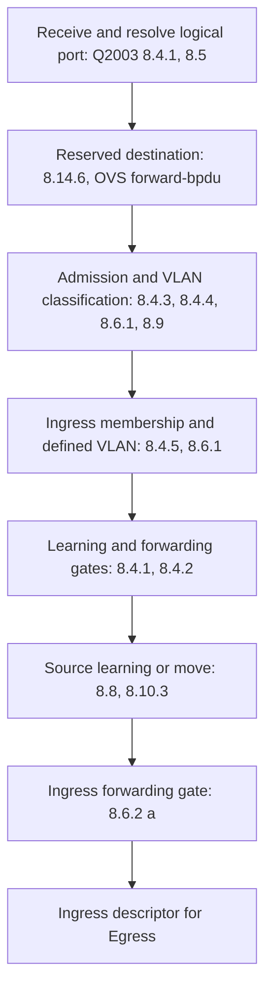
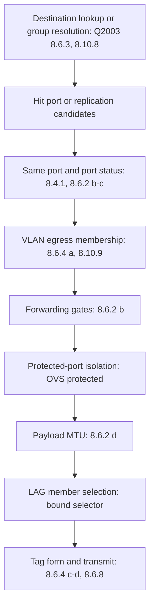

# Ethernet relay

`Layer` relays Ethernet frames by destination address, with optional VLAN
classification. The enclosing device supplies time, owns synchronization,
and binds its forwarding gates, LAG selector, and group resolver. The layer
has no I/O and is not safe for concurrent use ([layer.go](layer.go)).

For example, `TestUntaggedIngressClassifiesToPVIDAndLearns` in
[ingress_test.go](ingress_test.go) receives an untagged frame on `1/1/1`,
classifies it into PVID 10, learns its source in FID 10, and floods to the
other two VLAN members. `TestEgressTagForm` in [egress_test.go](egress_test.go)
checks the tagged and untagged forms on transmission ports.

A caller runs `Ingress(now, port, frame, learn, commit)`, then `Egress(in,
frame)` if ingress succeeds. `learn` permits FDB writes. `commit` determines
whether the later LAG selection mutates its bound selector.
For deferred learning, an admitted descriptor from `Ingress` with `learn`
false passes to `Learn(in, frame)`. It reuses the classification and learning
gate decision, preserving entries, counters, trace steps, and consulted
scopes ([ingress_learn_test.go](ingress_learn_test.go)). A learning-only
port still learns and refuses during `Ingress` with `learn` true.
`EgressTo` applies the replication rules to a supplied logical port list.
An `Ingress` with an empty `Port` represents a locally originated frame,
so every otherwise eligible port can transmit it. `OriginateFrame` applies
one port's tag form without a received frame's priority or remaining tags.

## Pipeline

The diagrams show the order in [ingress.go](ingress.go) and
[egress.go](egress.go). Clause labels refer to [Q2003][q2003]. Tunnel,
protected-port, flood-VLAN, and priority-tag policies come from [OVS][ovs].
Classification precedes gates because a gate answers for a particular VLAN.

Both paths exclude the reception port before the per-port decision in
`decideEgress`. It checks port status, VLAN membership, forwarding gates,
protected-port isolation, payload MTU, and LAG member selection in that
order. Q2003 8.4.1 excludes disabled ports from relaying. Clauses 8.6.2
through 8.6.4 govern topology, destination filtering, and egress membership.

Replication supplies only logical VLAN members and records down ports
before its replication step. Other per-port decisions follow that step.
Both paths record `relay` / `port-down` with a forwarding input fact and
an egress output decision. A per-port unicast refusal also records a dropped
`Egress`. A same-port hit records no `Egress`. A flood omits `Egress` for
down ports so the fabric does not count a discard on each unavailable member.

## Configuration and sources

[config.go](config.go) defines, validates, normalizes, and copies the
configuration. `New` validates against `layer.Env.Ports` and stores copies.
Switchport and protected-port keys name logical ports, so a LAG member
cannot carry its own switchport configuration.

| Field | Meaning and default | Source |
| --- | --- | --- |
| `Config.AgingTime` | Dynamic-entry age, zero becomes 300 seconds, negative is invalid | [BRIDGE-MIB](../../../../../spec/mib/ietf/BRIDGE-MIB), `dot1dTpAgingTime`, Q2003 8.10.3 |
| `Config.MaxEntries` | Dynamic-entry bound, zero is unlimited, negative is invalid | Simulator capacity policy, eviction permitted by Q2003 8.8 |
| `Config.FloodVLANs` | Defined VLANs that disable learning and unicast lookup | OVS Bridge `flood_vlans` |
| `Config.ProtectedPorts` | Traffic between two named protected ports is refused | OVS Port `protected` |
| `Config.ForwardBPDU` | False refuses reserved destinations before classification | OVS Bridge `other_config:forward-bpdu`, Q2003 8.14.6 |
| `Config.VLAN` | Nil uses FID 0 and carries every tag as payload | [Virtual-device direction](../../../../../docs/architecture/2026-09-10-virtual-device-direction.md), capability ladder |
| `VLAN.Table` | Defined VID to display name, IDs 1 through 4094 | Q2003 8.6.1 and Table 9-2 |
| `VLAN.Switchports` | Per-logical-port VLAN policy | Q2003 8.4, 8.10.9 |
| `Switchport.PVID` | Classifies untagged and priority-tagged ingress, unset refuses them | Q2003 8.4.4, Q-BRIDGE-MIB `dot1qPvid` |
| `Switchport.Tagged` | Egress member VLANs transmitted with a tag | Q2003 8.6.4, Q-BRIDGE-MIB `dot1qVlanStaticEgressPorts` |
| `Switchport.Untagged` | Egress member VLANs transmitted without the classified tag | Q2003 8.6.4, Q-BRIDGE-MIB `dot1qVlanStaticUntaggedPorts` |
| `Switchport.IngressFiltering` | False by default, true requires ingress VLAN membership | Q2003 8.4.5, Q-BRIDGE-MIB `dot1qPortIngressFiltering` |
| `Switchport.Admission` | Empty becomes `All`, also accepts `TaggedOnly` or `UntaggedAndPriorityTaggedOnly` | Q-BRIDGE-MIB `dot1qPortAcceptableFrameTypes`, [IEEE8021-TC-MIB](../../../../../spec/mib/ieee/IEEE8021-TC-MIB-201202150000Z.mib) `IEEE8021PortAcceptableFrameTypes` for the third choice |
| `Switchport.Tunnel` | Optional customer-facing tunnel, mutually exclusive with PVID and tagged/untagged sets | OVS Port `vlan_mode=dot1q-tunnel` |
| `Tunnel.VID` | Defined service VLAN, IDs 1 through 4094 | OVS Port `tag` |
| `Tunnel.CustomerVIDs` | Allowed customer VLANs, empty permits all | OVS Port `cvlans` |
| `Tunnel.TPID` | Service tag TPID, zero becomes `0x88a8` | OVS Port `other_config:qinq-ethtype` |
| `Switchport.PriorityTags` | Empty becomes `Never`, `IfNonzero` emits VID 0 for nonzero priority, `Always` emits it even for zero priority | OVS Port `other_config:priority-tags` |

The Q-BRIDGE-MIB objects are in
[Q-BRIDGE-MIB](../../../../../spec/mib/ietf/Q-BRIDGE-MIB).
`PVID` determines reception and does not itself grant egress membership.
A port may untag several VLANs while classifying received untagged frames
into one PVID. `VLAN.AdmitsVIDOnIngress` answers the ordinary ingress rule,
while `Switchport.CarriesVID` answers the egress rule. Tunnel ingress has
its own customer filtering and service classification.

## Filtering database

[fdb.go](fdb.go) keys entries by FID and MAC. With VLAN awareness the FID is
the classified VID. Without it every entry uses FID 0. Entries name logical
ports, including a LAG when reception or a seed names its member.

`Origin` records `Configured` (`"configured"`) or `Observed` (`"observed"`).
`Lifetime` independently records `Aging` (`"aging"`) or `Static` (`"static"`).
`NormalizeSeeds` fills either empty field with its named default and refuses
unknown values at `seeds.<i>.origin` or `seeds.<i>.lifetime`.
`Advance(now)` expires aging entries only when their age exceeds
`AgingTime`. Destination lookup treats such entries as absent at
`Ingress.Now`, as Q2003 8.10.3 requires of aged dynamic information.
Lookup writes nothing. `Entries()` and `Counters()` report the table as of
its last write, and `Entries()` sorts its snapshot by FID and MAC.

Ingress learns individual source addresses when learning is permitted,
refreshes aging records, and preserves static records. An expired source
entry is removed and learned anew, counting one expiry and one learn for
that source key. A non-learning call changes neither entries nor counters.
With VLAN awareness, at least one switchport must carry the VID, per Q2003 8.8 d.
That port can differ from the ingress port. VLAN-unaware learning uses FID
0. Flood VLANs disable learning.

`InstallSeeds` validates the entire seed slice before writes. Aging seeds count as
learned when inserted. An aging seed for an existing static key changes
nothing and counts nothing, preserving the static control required by
Q2003 8.10.1 c 1 and Table 8-5. Seed validation is in [seed.go](seed.go).
`TestAgingSeedPreservesStaticEntry`, `TestSourceLearningAtFrameTime`, and
`TestFDBFrameTimeMatchesPriorAdvance` in
[fdb_time_test.go](fdb_time_test.go) exercise these lifecycle rules.

`MaxEntries` bounds aging entries alone. At the bound, a learning frame
expires every entry past its aging time before applying the capacity limit
([ingress.go](ingress.go)). An expired entry is never evicted. Eviction
removes the oldest aging entry, with FID and then MAC breaking equal-time
ties, so map iteration cannot change the victim. Static entries survive aging, eviction, and
`Flush`. Flush targets union FIDs by port, and an empty FID list means every
FID on that port. `Forget` can remove either lifetime.
`Counters()` reports learned, expired, evicted, and moved counts.

## Trace rules and reasons

Named rule constants are in [layer.go](layer.go), with reasons and result
records in [result.go](result.go). Empty replication uses its drop reason,
`no-egress` or `unregistered`, as the rule ID ([egress.go](egress.go)).
Facts retain the inputs and decisions needed for comparison
([fact.go](fact.go)). Successful classification and lookup
rules carry no drop reason.

| Layer | Rules | Decision or drop reason |
| --- | --- | --- |
| `relay` | `ingress-port-down` | Receive refusal: `port-down` |
| `relay` | `reserved-bridge-address` | `reserved-address` unless `ForwardBPDU` permits it |
| `relay` | `default-vlan` | VLAN-unaware FID 0 |
| `vlan` | `admission-filter`, `admission` | `admission` for a refused ingress tag form |
| `vlan` | `no-pvid`, `vlan-classify` | `no-pvid` or successful ordinary classification |
| `vlan` | `customer-vlan-filter`, `customer-vlan`, `vlan-tunnel-classify` | `customer-vlan` or successful service-VLAN classification |
| `vlan` | `ingress-filter`, `vlan-undefined` | `ingress-filter` or `undefined-vlan` |
| `relay` | `port-blocked` | `port-blocked` for a learning/forwarding gate refusal |
| `relay` | `learn`, `move`, `evict` | FDB lifecycle decisions |
| `relay` | `flood-vlan`, `unicast-hit`, `unicast-miss`, `group-destination` | Destination selection |
| `relay` | `same-port`, `port-down` | `same-port` for a unicast hit, `port-down` on either path |
| `vlan` | `not-member`, `vlan-tag-form` | `not-member` or successful egress tag rewrite |
| `relay` | `protected`, `mtu-exceeded`, `no-member` | `protected`, `mtu-exceeded`, or `no-member` |
| `relay` | `flood`, `transmit` | Replication or successful transmission |
| `relay` | `no-egress`, `unregistered` | Empty ordinary or group-selected replication |

Group resolution can record a replication rule under the bound layer and
rule instead of `relay` / `flood`. When candidates exist but all refuse,
replication reports its first dropped egress's reason. With no eligible
candidate it reports `no-egress`, or the supplied empty-list reason.

## Bindings and copies

`SetGate` replaces a gate for an equal analysis scope and appends a new
scope. Every installed gate participates, so independent layers can each
refuse learning or forwarding. A nil gate still contributes its scope.
Ingress uses the first gate denying both learning and forwarding, else the
first denying forwarding, else the first non-nil gate. Egress uses the
first gate denying forwarding. Each supplies its semantic fact when available
([ingress.go](ingress.go), [egress.go](egress.go), [gate_test.go](gate_test.go)).

`SetSelector` supplies LAG member choice and its consulted scope.
`SetGroupResolver` supplies logical ports for group destinations. A false
decision leaves ordinary flooding in place. A decided empty list produces
`unregistered`. A nil resolver leaves ordinary flooding in place.
`SetFDBScope` supplies exact FID/MAC dependency scopes.
Port snapshots and consulted scopes accompany results for analysis
([dependency_test.go](dependency_test.go)).

`Clone` copies runtime FDB state, counters, and the gate-entry slice.
It keeps every gate scope, shares immutable configuration and port definitions,
and clears gate, selector, and resolver bindings. The enclosing device must
rebind those to its own layers ([gate_test.go](gate_test.go)).
`RetentionKey` includes normalized configuration and port link states.
`SetOperStatus` uses `port.Table.WithOperStatus` to replace the port table.
It refuses an absent port at `ports.<name>` and an invalid state at
`ports.<name>.oper_status`, leaving the table unchanged ([layer.go](layer.go)).

## Files

| File | Subject |
| --- | --- |
| [layer.go](layer.go) | Runtime construction, clone, bindings, shared gate facts, status changes, retention |
| [ingress.go](ingress.go) | Ingress descriptor and processing, reception dependencies |
| [egress.go](egress.go) | Unicast and replication, member selection, transmission dependencies, tag form |
| [fdb.go](fdb.go), [seed.go](seed.go) | Entries, lifecycle, capacity, seed validation |
| [config.go](config.go), [diff.go](diff.go) | Configuration, normalization, validation, comparison facts |
| [fact.go](fact.go), [result.go](result.go) | Forwarding facts, rules' reasons, result metadata |

Tests are grouped by subject in `config_test.go`,
`ingress_test.go`, `egress_test.go`, `egress_decision_test.go`,
`gate_test.go`, `fdb_test.go`, `fdb_time_test.go`,
`layer_test.go`, `diff_test.go`, and `group_resolver_test.go`.
Shared fixtures and doubles live in [helpers_test.go](helpers_test.go).
`fork_internal_test.go`, `diff_coverage_test.go`, `dependency_test.go`,
and `ingress_admission_test.go` check cross-cutting contracts.
`export_test.go` supplies forwarding helpers only to tests.

## Limits

- One FDB per VLAN. Q2003 8.10.7 permits shared learning.
- A static entry forwards to one port. Q2003 8.10.1 c specifies a control
  for each outbound port.
- VLAN membership comes from configuration. Q2003 8.10.9 combines static
  and dynamic registration. Group membership arrives through the resolver.
- A port without a PVID drops untagged ingress as `no-pvid`. Q2003 8.4.4
  supplies a PVID for every port. The [loader defaults](../../device/vswitch/README.md#loader-defaults)
  leave it unset when several untagged VLANs exist.
- Reserved destinations are refused before classification and source
  learning. Q2003 8.6.1 submits ingress-permitted frames to learning.
  The [switch](../../device/vswitch/intercept.go) intercepts BPDUs and LACPDUs
  before relay ingress.
- An outer TPID other than `0x8100` is payload on a port without a tunnel.
  The [virtual-device direction](../../../../../docs/architecture/2026-09-10-virtual-device-direction.md)
  chooses one C-VLAN component. Tunnel ports follow OVS `dot1q-tunnel`.
- A seed's port must relate to its FID through PVID, tagged or untagged
  membership, or a tunnel ([seed.go](seed.go)). Q2003 8.8 permits learning
  on a port that admits ingress even without egress membership.
  [Derive](../../device/vswitch/derive.go) replays learned entries as seeds
  and can therefore drop such an entry. The
  [loader](../../netmodel/netmodel.go) uses seed refusal to report collected
  forwarding entries that contradict the VLAN configuration.

IEEE 802.1Q editions after 2003 and IEEE 802.1ad were not read. Their
requirements are unverified. The cited 2012 textual convention supplies
an admission enum.

[q2003]: https://bittwist.sourceforge.io/doc/802.1Q-2003.pdf
[ovs]: https://raw.githubusercontent.com/openvswitch/ovs/branch-3.3/vswitchd/vswitch.xml
