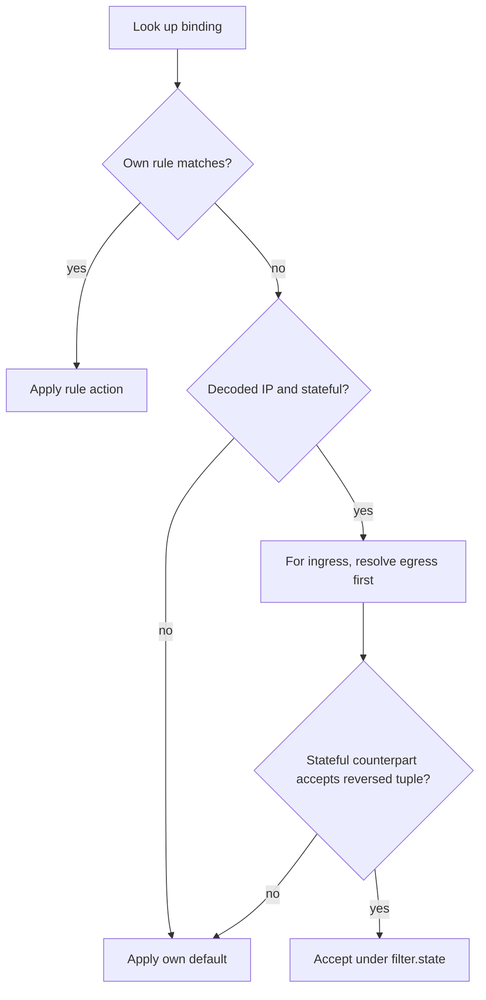

# Packet filtering capability

`filter` evaluates interface-bound access-control rules and stateful reverse
matches for routed traffic in the virtual switch. It does not route or schedule
frames. It models firewall rule sets bound to interfaces in ingress and egress
directions.

## Architecture and evaluation order

A filter configuration attaches rule sets to interfaces through bindings. Each
binding names a routed interface, a direction (`in` or `out`), and the target
rule set. The layer identifies the interface by name and does not require a
routing layer.

Ingress evaluation runs before routing. A deferred decision is resolved when
routing identifies the egress interface. Egress evaluation runs after routing.
The counterpart binding has the same direction on the other interface: the
egress interface for an ingress set, or the ingress interface for an egress
set ([filter.go](filter.go)).

The reverse match swaps source and destination addresses and ports. A stateful
accept names the counterpart rule in its trace inputs.

The order of a stateful set is its own rules, then the reverse match, then its
own default. A decoded packet has EtherType `0x0800` with an IPv4 header or
`0x86dd` with an IPv6 header. Every other frame, including a malformed IP
header, matches only a rule with no criteria. If none matches, it takes the
set's default in either direction, without deferral or a reverse match.
`TestUndecodedStatefulFrameTakesDefault` in [filter_test.go](filter_test.go)
pins both directions.

## Rule matching

Each rule specifies a packet match criteria:

- `Protocol`: match on IP protocol number (e.g. 6 for TCP, 17 for UDP, 1 for ICMPv4).
- `Src` and `Dst`: match on list of IP CIDR prefixes.
- `SrcPorts` and `DstPorts`: match inclusive transport port ranges.
- `ICMP`: match ICMP type and optional code.
- `TCPFlags`: match TCP control bits against a bitwise mask and expected value.

Omitted match fields match any packet.

## State retention and diffs

`Diff` computes differences between two configurations. It reports additions,
removals, and modifications of rules, sets, and bindings as typed `trace.Change`
records. `RetentionKey(cfg Config, env layer.Env) string` encodes the normalized
inputs the layer depends on. `Layer.Clone` returns an independent deep copy of
the layer with cloned rule sets and bindings.

Retained rules report `action`, `match.protocol`, source and destination
prefix members, source and destination range bounds, ICMP Type then Code,
and TCP flag Mask then Value in that order. Prefix replacements remove old
members before adding new ones, even when the addition sorts earlier.
For example, a source range moving from 100-200 to 101-201 emits
`match.src_ports[0].start` and then `match.src_ports[0].end`, with
`filter.port` facts. Ranges pair by normalized position, so inserting a
range can change later positions. Optional match members use nil facts
when absent. Rule additions and removals keep the empty field and
`filter.rule` snapshot. Stable subject sorting preserves the local record
order ([diff.go](diff.go), [diff_test.go](diff_test.go)).

`Normalize` masks prefixes, sorts the source and destination prefix and port
range lists, and removes exact repeats. It preserves contained prefixes and
overlapping ranges, and copies the protocol value so caller changes cannot
change a layer's rules. Rule order stays intact because the first match wins.
For example, `10.0.2.0/24, 10.0.1.5/24, 10.0.2.0/24` becomes
`10.0.1.0/24, 10.0.2.0/24`. Both spellings have the same retention key and an
empty diff, as `TestNormalizeCanonicalizesMatchLists` in
[filter_test.go](filter_test.go) checks.

## Boundaries

- Imports: `src/common/errs`, `src/common/net/*`, `src/common/sim/analysis`,
  `src/common/sim/trace`, `src/common/sim/layer`.
- Imported by: `src/common/sim/device/vswitch`, `src/common/sim/internal/simtest`,
  `src/common/sim/netmodel`.
