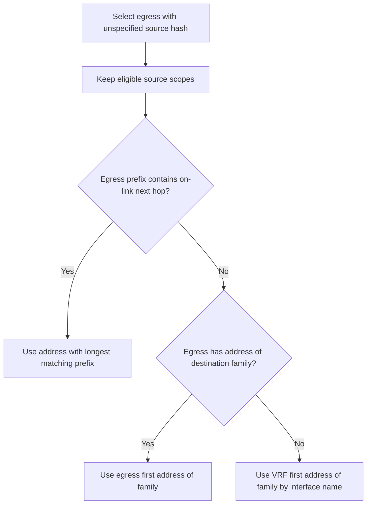
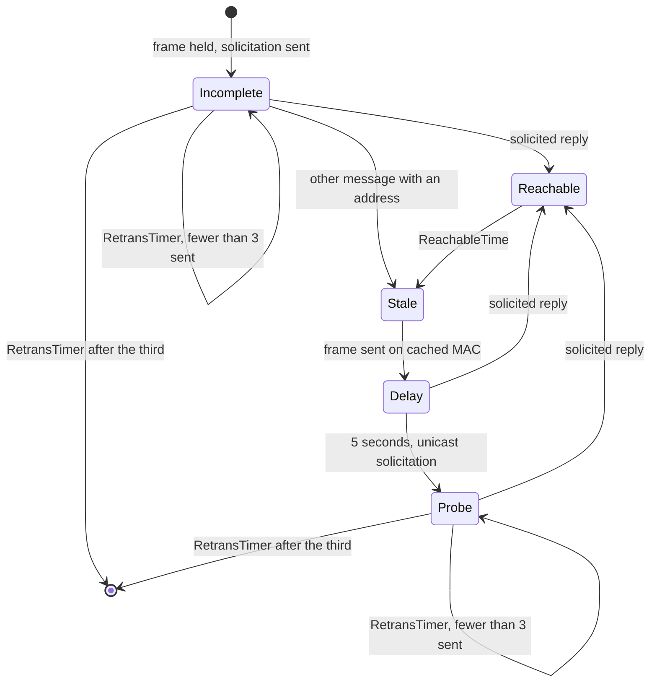

# routing

Package `routing` implements layer 3 forwarding for the virtual switch: per-VRF
routed interfaces, a forwarding table built from the interface prefixes and the
configured static routes, neighbor entries, and the rules that pick one next hop
for a packet.

The layer runs deterministically in memory, with no background goroutines and no
wall clock of its own; `now` is a parameter the caller supplies. `Route` and
`Originate` read the packet and the table and, with `commit` set, may also
update the neighbor table described below. With `commit` clear neither one
mutates anything, so the same packet against the same configuration always
leaves the same way and looking at a decision cannot change it — see "Neighbor
lifecycle" for why that distinction exists.

## Example

Two equal-cost routes to one prefix, a third route whose next hop nothing
reaches, and one packet through them.

```go
package main

import (
	"fmt"
	"net/netip"
	"time"

	"go.aledante.io/FlowSeer/src/common/net/ethernet"
	"go.aledante.io/FlowSeer/src/common/net/ip"
	"go.aledante.io/FlowSeer/src/common/net/netaddr"
	"go.aledante.io/FlowSeer/src/common/sim/layer"
	"go.aledante.io/FlowSeer/src/common/sim/layer/routing"
)

func main() {
	routerMAC := netaddr.MAC{0x00, 0x00, 0x5e, 0x00, 0x01, 0x01}
	hostMAC := netaddr.MAC{0x00, 0x11, 0x22, 0x33, 0x44, 0x11}
	viaVLAN10 := netip.MustParseAddr("10.0.10.254")
	viaVLAN20 := netip.MustParseAddr("10.0.20.254")

	cfg := routing.Config{VRFs: map[string]routing.VRF{
		routing.DefaultVRF: {
			Interfaces: map[string]routing.Interface{
				"vlan10": {VLAN: 10, MAC: routerMAC, Prefixes: []netip.Prefix{netip.MustParsePrefix("10.0.10.1/24")}},
				"vlan20": {VLAN: 20, MAC: routerMAC, Prefixes: []netip.Prefix{netip.MustParsePrefix("10.0.20.1/24")}},
			},
			Routes: []routing.Route{
				{Prefix: netip.MustParsePrefix("192.0.2.0/24"), NextHop: viaVLAN10, Preference: 1, Metric: 10},
				{Prefix: netip.MustParsePrefix("192.0.2.0/24"), NextHop: viaVLAN20, Preference: 1, Metric: 10},
				{Prefix: netip.MustParsePrefix("198.51.100.0/24"), NextHop: netip.MustParseAddr("203.0.113.1")},
			},
			Neighbors: []routing.Neighbor{
				{Interface: "vlan10", Addr: viaVLAN10, MAC: netaddr.MAC{0x00, 0x22, 0x33, 0x44, 0x55, 0x0a}},
				{Interface: "vlan20", Addr: viaVLAN20, MAC: netaddr.MAC{0x00, 0x22, 0x33, 0x44, 0x55, 0x0b}},
			},
		},
	}}

	l, err := routing.New(cfg, layer.Env{NodeID: "sw1"})
	if err != nil {
		panic(err)
	}

	hdr := ip.Header{
		Src:      netip.MustParseAddr("10.0.10.7"),
		Dst:      netip.MustParseAddr("192.0.2.5"),
		HopLimit: 64,
		Protocol: 17,
		V4:       &ip.V4{},
	}
	pkt, err := hdr.Encode([]byte("payload"))
	if err != nil {
		panic(err)
	}

	now := time.Now()
	res := l.Route(now, "vlan10", ethernet.Frame{
		Src:       hostMAC,
		Dst:       routerMAC,
		EtherType: ethernet.EtherTypeIPv4,
		Payload:   pkt,
	}, true)

	fmt.Printf("egress %s towards %s\n", res.Interface, res.Frame.Dst)
	for _, step := range res.Steps {
		for _, fact := range step.Outputs {
			if fact.TypeID() == "routing.lookup_decision" {
				fmt.Println(fact.Canonical())
			}
		}
	}
	for _, w := range l.WithdrawnRoutes(routing.DefaultVRF) {
		fmt.Printf("withdrawn %s via %s: %s\n", w.Prefix, w.NextHop, w.Reason)
	}
}
```

```
egress vlan20 towards 00:22:33:44:55:0b
vrf="default";destination="192.0.2.5";matched=true;prefix="192.0.2.0/24";next_hop="10.0.20.254";interface="vlan20";kind="static";hash_src="10.0.10.7";hash_dst="192.0.2.5";hash_flow_label=0;hash=2807316233;chosen=1;candidates=[10.0.10.254|vlan10|10.0.10.254,10.0.20.254|vlan20|10.0.20.254]
withdrawn 198.51.100.0/24 via 203.0.113.1: unresolved
```

Both routes to `192.0.2.0/24` stay in the table and both are reported in
`candidates=[...]`; which one carries this packet is the flow hash below. The
route to `198.51.100.0/24` is valid configuration, but no chain of routes in the
VRF reaches `203.0.113.1`, so the table does not hold it.

## Sub-interfaces

A routed interface sets `Port` alone (an untagged routed port), `VLAN` alone (a bridge
VLAN interface), or both (a routed sub-interface): a firewall cabled to a trunk with no
bridge at all routes between the VLANs the trunk carries by giving each one its own
sub-interface on the same `Port`.

```go
cfg := routing.Config{VRFs: map[string]routing.VRF{
	routing.DefaultVRF: {
		Interfaces: map[string]routing.Interface{
			"eth1.10": {Port: "eth1", VLAN: 10, MAC: routerMAC, Prefixes: []netip.Prefix{netip.MustParsePrefix("10.0.10.1/24")}},
			"eth1.20": {Port: "eth1", VLAN: 20, MAC: routerMAC, Prefixes: []netip.Prefix{netip.MustParsePrefix("10.0.20.1/24")}},
		},
	},
}}
```

A frame's outer VLAN tag, not bridge VLAN membership, picks the sub-interface: a frame
arriving on `eth1` tagged 10 is handed to `eth1.10`, and one tagged 20 to `eth1.20`. Two
sub-interfaces may share a VID as long as they sit on different ports, and two interfaces
naming the same `(Port, VLAN)` pair fail `Validate`. A sub-interface's VLAN must be a valid
assigned identifier (1 through 4094; `vlan.ID.Valid`), because nothing else bounds it once
it stops needing a bridge VLAN table entry.

A bridge VLAN lookup (`Layer.ByVLAN`) never answers with a sub-interface, whatever the
interface names happen to sort to; only `Layer.ByPortVLAN` resolves one, and it answers two
different questions from one lookup. A port with no routed interface at all reports
`portRouted` false, which the caller falls through to a bridge for; a routed port with no
interface at the given VID reports `portRouted` true and `matched` false, which the caller
drops on, since a routed port has no bridge to fall back to.

## Route order

A lookup takes the longest prefix containing the destination, then the lowest
preference, then the lowest metric.

`Preference` is the administrative distance, lower winning, and `Metric` breaks
the tie within one preference. The metric comparison is deliberately not global:
Cisco compares metrics only "if there are multiple paths to the same destination
from a single routing protocol", and metrics from different sources are not
comparable numbers. In a static-only table one preference is one source, so the
distinction does not bite yet; it will as soon as a dynamic protocol lands.

`Preference` is a `uint8`, which covers the Cisco administrative distance range
of 0 to 255. It cannot express a Junos preference, whose range runs to
4,294,967,295.

Preference 0 is reserved for connected routes, which are built at preference 0
and metric 0. A static route configured at 0 normalizes to 1, following NX-OS,
where a static route's "range is from 1 to 255. The default is 1" over a table
that puts connected at 0 and static at 1. The reservation also means a `uint8`
needs no pointer to tell an unset field from an explicit 0. Without it a static
route at preference 0 would tie the connected route covering its prefix, join its
candidate set, and the flow hash would spread one destination between on-link
delivery and a next hop — an outcome no vendor documents.

## The candidate set

Every route that contains the destination and ties the winner on prefix length,
preference, and metric is a candidate, and all of them are reported in
`candidates=[...]` of the `routing.lookup_decision` fact, so a reader can tell
an alternative path from a path that was never there. An equal-length prefix
that does not contain the destination is a different prefix and never joins the set.

Candidates are ordered by next hop, then egress interface. The order is part of
the contract: the reduction below turns a hash into an index into this slice, and
the route fact's canonical string is compared verbatim across constructions.

One prefix carries at most 64 equal-cost routes. That is FRR's number — it "is
generally compiled with a limit of 64 way ECMP" — and an uncapped set would be
netsim inventing the one behavior no router has. Above the cap the first 64 in
canonical order are installed and the rest are withdrawn as `max-paths`. The cap
applies twice, because there are two ways to exceed it: to the paths one
recursive route inherits from the route that resolved it, and to the equal routes
several configured routes put on one prefix.

## The flow hash

The candidate is chosen by hashing the packet's layer 3 flow with FNV-1a
(`hash/fnv`'s `fnv.New32a`), over these bytes in this order:

1. Source address (4 octets for IPv4, 16 for IPv6).
2. Destination address (4 or 16 octets).
3. IPv6 flow label (4 octets, big-endian uint32). IPv4 contributes nothing here.

`Originate` hashes the family's unspecified address and the destination, with
flow label zero. Selecting the egress first lets it choose a source on that
interface, as [RFC 1122 section 3.3.4.3](https://www.rfc-editor.org/rfc/rfc1122#section-3.3.4.3)
suggests and [RFC 6724 Rule 5](https://www.rfc-editor.org/rfc/rfc6724#section-5)
prefers. A destination wider than link-local scope prefers a non-link-local
source of the same family whenever the VRF has one. A destination of link-local
scope or narrower prefers a link-local source on the egress interface when it
has one ([RFC 6724 sections 3.1 and 5 Rule 2](https://www.rfc-editor.org/rfc/rfc6724#section-3.1)).
This includes IPv6 multicast scopes 0, 1, and 2. The layer departs from
[RFC 6724 section 3.2](https://www.rfc-editor.org/rfc/rfc6724#section-3.2)
by treating IPv4 multicast `224.0.0.0/24` as link-local and `127/8` as global
([linkLocalScope](layer.go)).
The caller's payload contributes nothing to selection.



For `192.0.2.5` via `10.0.2.254` on `b0` at `10.0.2.1/24`, the source is
`10.0.2.1`, even when `a0` has `10.0.1.1/24`.


Nothing else enters. No protocol octet, no ports. This is what a router nobody
configured hashes: Cisco CEF's default per-destination load sharing takes the
source and destination addresses with no transport fields, and Linux's default
`fib_multipath_hash_policy=0` is layer 3, with ports entering only at policy 1.
RFC 2991 section 3 warns that "including transport-layer information in the
next-hop selection process can actually be problematic". A five-tuple would model
a box someone had configured, and netsim has no field that says they did — the
hash input is the vendor default, not a knob, and `ip cef load-sharing full` and
`fib_multipath_hash_policy` have no equivalent here.

Two consequences are worth stating, because they are why the input is short:

- Every fragment of a datagram takes one next hop, with no fragment rule in the
  code. The transport ports live in the first fragment alone, so a hash that read
  them would have had to buy this property back with a fragment test. RFC 2991
  section 2 wants a flow on one path for reordering and path-MTU reasons, and
  reassembly is not even on its list.
- A TCP segment behind an IPv6 extension header hashes like one without. `ip.Decode`
  does not walk the extension header chain, so `Header.Protocol` is the fixed
  header's first Next Header; hashing it would split one flow on the headers its
  packets happen to carry. The flow label is in the fixed header instead, and
  RFC 6437 put it there precisely "to enable and encourage the use of the flow
  label for various forms of stateless load distribution, especially across Equal
  Cost Multi-Path (ECMP) and/or Link Aggregation Group (LAG) paths".

FNV-1a folds the last bytes written in with the fewest multiplications, so flows
that differ only in the final octet of the destination move the hash by about
1/256 of the space each. A run of consecutive destinations from one source can
therefore sit in one region and take one next hop. Spreading a synthetic load
across paths takes a spread of addresses, not a spread of last octets.

## The reduction: hash-threshold, not modulo

The 32-bit hash space is cut into as many contiguous equal-width regions as there
are candidates, in canonical order, and the packet takes the candidate whose
region holds its hash (RFC 2992). The last region absorbs the remainder.

The reduction is not `hash % len(candidates)`, which would be shorter and wrong
for what netsim is for. RFC 2992 measures modulo-N as "the most disruptive of the
algorithms; if a next-hop is added or removed the disruption is (N-1)/N", against
"between 1/4 and 1/2" for hash-threshold. "Which flows move when this path fails"
is the question this table exists to answer, and under modulo-N nearly every flow
in the VRF moves when any path does. Linux reduces by cumulative upper bounds and
Cisco by a 16-bucket load-share table; hash-threshold is the published form of the
same idea.

What the reduction buys is a bound, not immobility. When a candidate goes, every
region grows, so a flow can only slide down into the region below it: the first
candidate keeps everything it had, and no flow lands on a candidate it was not on
or below. Flows near a region's lower edge do move, which is the 1/4 to 1/2 above.

There is no bucket table and no remembered state, unlike the bond hash in
`lag`, which persists a flow across a member's return. The routing table is
rebuilt whole on every `Derive`, and hash-threshold gives the disruption bound
with nothing to keep.

## Recursive next hops

A static route whose next hop is not on-link resolves against its own VRF's table
when the table is built, and installs carrying the on-link next hop and interface
it reached. `Route.NextHop` keeps the configured value for `Canonical`, `Diff`,
and the facts; the resolved pair is what the frame is built for, because the
neighbor lookup keys on the next hop rather than on the egress interface.

Resolution walks at most 8 routes. Cisco names a "maximum IPv6 forwarding
recursion depth" without publishing a value, BIRD allows exactly one level, and
FRR bounds recursion by its self-match test instead. Eight is netsim's own
number, above BIRD's so an ordinary two-step chain resolves, and low enough to
catch a configuration mistake; a real static chain is one or two hops, so the
bound guards against a loop rather than limiting anyone.

A next hop does not resolve through the default route, following FRR: "Nexthop
tracking doesn't resolve nexthops via the default route by default". Without that
rule every unresolvable next hop in a VRF carrying a default route would quietly
resolve through it.

Resolution walks the whole table, which is netsim's simplification. FRR resolves a
next hop only against the selected, installed route for the matching prefix, and
only for route types with recursion enabled. In a static-only table with one
selection rule those gates coincide with walking the table; a dynamic protocol
would end that and the resolver would have to grow them.

Resolution consults routes and connected prefixes only, never neighbors. A next
hop the table reaches but no neighbor entry resolves is a per-packet drop, not a
withdrawal — see below.

## Withdrawn routes

`Layer.WithdrawnRoutes(vrf)` returns the configured static routes the forwarding
table does not hold, sorted by prefix then next hop, each with the reason and the
chain of prefixes resolution walked. `Chain` starts at the route's own prefix and
ends where resolution stopped, so a self-recursive route reads
`[10.0.0.0/8, 10.0.0.0/8]` and an `A via B`, `B via A` cycle reads `[A, B, A]`.
The reasons are `self-recursive`, `depth-exceeded`, `unresolved`, and
`max-paths`.

A withdrawn route is valid configuration, not a construction error: real gear
keeps it in the configuration and out of the routing table, and so does netsim.
Forwarding then answers from the routes that remain — a less specific route, or
`no-route` — and that answer is complete, not an admission that netsim lacked an
input.

A withdrawal, a `neighbor-miss`, and a `neighbor-pending` are three different
answers. A withdrawn route means no chain of routes reaches the next hop, and
it is decided once, when the table is built. A `neighbor-miss` means the VRF
cannot solicit the next hop: it does not observe neighbors at all, or the
interface has no address of the required family. A `neighbor-pending` means
the table reached the next hop and resolution is still in progress.

## Neighbor lifecycle

Observed entries follow [RFC 4861](https://www.rfc-editor.org/rfc/rfc4861.txt)
sections 7.2.2, 7.3.3, and Appendix C. ARP uses this same machine, with
[RFC 826](https://www.rfc-editor.org/rfc/rfc826.txt)'s request layout and
[RFC 1122](https://www.rfc-editor.org/rfc/rfc1122.txt) section 2.3.2.1's
request rate and unicast polling rule. Configured entries stay `Reachable`
with no expiry and ignore observations.



`Unobserved` is the zero value for an absent entry. A committing lookup
under `NeighborObserved` holds the frame and returns the first solicitation
in `Result.Emissions`. Without an egress address of the target's family,
it returns `neighbor-miss` and emits nothing. The source address is the
egress address whose prefix contains the target, else the interface's first address
of that family. ARP broadcasts a request. IPv6 sends a Neighbor Solicitation
to the solicited-node group, with the source link-layer option. Its group
uses the target's low 24 bits ([RFC 4291](https://www.rfc-editor.org/rfc/rfc4291.txt)
section 2.7.1), mapped to Ethernet by
[RFC 2464](https://www.rfc-editor.org/rfc/rfc2464.txt) section 7.

`Advance` returns at most one due solicitation per neighbor at its input
time and schedules the next one `RetransTimer` later. After the third
unanswered solicitation, it deletes the entry and reports held frames as
`HeldTimedOut`. Later traffic can start resolution again. A lookup judges
reachability at its own time, even without prior aging. A committing Stale
lookup forwards and starts Delay. Delay and Probe forward on the cached
MAC. Probes send to that MAC, and for IPv6 to the target IP address.
`NextWake` reports the earliest Incomplete, Delay, or Probe deadline.

`Receive(now, iface, frame)` processes only frames addressed to the
interface's MAC, ARP broadcast, or IPv6 all-nodes and local solicited-node
MACs. [ndp.Decode](../../../net/ndp/ndp.go) checks hop limit 255, checksum,
code zero, minimum message length, a unicast target, and option lengths up
to the first matching link-layer option. An unspecified solicitation source
must have no source link-layer option. For that source, [Receive](receive.go)
checks that the destination is solicited-node multicast. It rejects solicited advertisements
to multicast IPv6 destinations. These checks implement part of
[RFC 4861](https://www.rfc-editor.org/rfc/rfc4861.txt) section 7.1.

ARP reception follows [RFC 826](https://www.rfc-editor.org/rfc/rfc826.txt):
merge an existing sender before checking the target, create a Stale sender
entry when the interface holds the target, and answer a local request.
A reply confirms an existing entry, while a request supplies an unsolicited
override update. An ARP probe's zero sender address changes no entry
([RFC 5227](https://www.rfc-editor.org/rfc/rfc5227.txt) section 2.1.1).

A Neighbor Solicitation for a local target learns its IP source from the
Source Link-Layer Address option as RFC 4861 section 7.2.3 specifies.
A non-local target is discarded before learning. The answer follows
section 7.2.4, with Router and Override set, and Solicited set only for a
specified source. A specified source receives a unicast answer at its
option's MAC, else its cached MAC. An unspecified source receives an
all-nodes advertisement and leaves no entry.

Advertisements apply section 7.2.5 only to existing observed entries.
An Incomplete entry needs a Target Link-Layer Address option, then becomes
Reachable for a solicited advertisement or Stale otherwise. Override clear
with a changed MAC makes a Reachable entry Stale without changing its MAC,
and leaves other states alone. A solicited update under Override, an equal
MAC, or no supplied MAC confirms reachability. An unsolicited changed MAC
makes the entry Stale. Configured entries never change. `NeighborDisabled`
answers solicitations while keeping the configured table unchanged.

`DrainExits` reports each queued frame once, as `HeldReleased`,
`HeldTimedOut`, or `HeldEvicted`. Within one `Advance`, exits are ordered by
VRF, interface, and address. A committing lookup or `Receive` appends an
exhausted entry's exits at call time.
`Advance` releases queues whose entries resolved. `FailHeld` returns waiting
exits and remaining held frames, then deletes Incomplete entries.

### The hold queue

Each queued frame receives a `HoldToken`, starting at 1 for each layer.
`Result.Hold` returns it at enqueue and `HeldFrame.Token` returns it on
release, eviction, or timeout, so a caller can match an exit to its call.
Tokens are never reused within a layer. `Clone` copies the counter and
the queued tokens, so both forks mint the same next token. A rebuilt layer
starts at 1 after `FailHeld` returns its predecessor's frames.
`HeldFrame.Ingress` names the interface passed to `Route`, and is empty
for `Originate`, on every cause. A non-committing call returns a zero
`Hold` because it queues no frame.

Under `NeighborObserved`, a `Route` or `Originate` call that misses the
table and is told to `commit` creates an `Incomplete` entry (if one does not
already exist) and appends the frame to that neighbor's hold queue, bounded
by `NeighborPolicy.HoldDepth`. RFC 4861 section 7.2.2: "the number of queued
packets per neighbor SHOULD be limited to some small value. When a queue
overflows, the new arrival SHOULD replace the oldest entry." `HoldDepth`
defaults to 3 rather than the permitted minimum of 1, because an analysis
library is asked which of several frames arrived, and a depth of 1 answers
that for the last one only.

The replaced frame surfaces in `DrainExits` after the next `Advance` or a
committing lookup or `Receive` retires its exhausted neighbor entry, as a
`HeldEvicted` exit under its own reason `neighbor-hold-overflow`. That reason
is deliberately not `neighbor-miss`, because the neighbor may well resolve,
and on a queue that overflowed because frames kept arriving it usually does —
often on the same `Advance` that reports the eviction.

`commit` is what makes a preview safe. With it clear, a miss reports
`neighbor-pending` without creating an entry or queuing anything, so
`Switch.Peek` can be called any number of times without perturbing what a
later commit sees, and two consecutive comparisons of the same pair of
switches agree. Under `NeighborDisabled`, both values of `commit` report `neighbor-miss`
and change nothing.

### Policy

`VRF.NeighborPolicy` holds `Mode`, `ReachableTime`, `RetransTimer`, and
`HoldDepth`. Defaults are 30 seconds, 1 second, and 3 frames respectively.
The delay is 5 seconds and each resolution or probe cycle sends at most
3 solicitations, from RFC 4861 section 10. `NeighborDisabled` never
solicits or holds a frame for an absent binding.

### Limits

- Neither `Receive` nor `ndp.Decode` checks IPv6 Next Header 58. The
  [switch reception predicate](../../device/vswitch/route.go) checks it.
- `ndp.Decode` stops option validation at the first matching link-layer
  option. Options after it are unchecked, unlike RFC 4861 section 7.1.
- The layer returns no ICMP error for any drop, including no-route, hop
  limit, neighbor-miss, and hold overflow. RFC 4861 section 7.2.2 requires
  an ICMP Address Unreachable error for each packet queued by failed
  resolution.
- No Router Solicitation, Router Advertisement, Redirect, Duplicate Address
  Detection, proxy or anycast advertisement, or IsRouter entry flag.
- No MLD group join. RFC 4861 section 7.2.1 requires joining all-nodes
  and each assigned address's solicited-node group. The switch hands the
  layer frames its interface receives. A snooping VLAN that does not flood unregistered groups sends
  the layer's solicitation only to listeners and router ports.
- `ReachableTime` is the configured value, without the randomization RFC
  4861 section 6.3.2 describes, so simulations repeat.
- No upper-layer reachability hint from RFC 4861 section 7.3.1. Only a
  solicited reply confirms reachability.
- Every ARP reply counts as solicited. RFC 826's intent for an unrequested
  reply is unverified.
- No removal of an unused entry.
- A unicast Neighbor Advertisement is not sent when neither the
  solicitation's source link-layer option nor a resolved cache entry
  supplies the destination MAC. RFC 4861 section 7.2.4 calls for resolving
  that source first, which the layer does not initiate on receipt.

## State retention

`RetentionKey(cfg Config, env layer.Env) string` encodes every normalized
input the routing runtime state depends on: its own configuration as `Diff`
sees it and the administrative and operational state of interfaces that reference
a port. When `vswitch.Derive` finds the routing retention key unchanged, it
retains the neighbor table and hold queues. When the key differs, the layer is
rebuilt and all held frames are reported as failed under `neighbor-fail-derive`.
