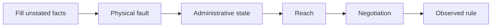

# Cable

`Cable` owns physical resolution and the decision at one crossing. The fabric
keeps endpoint identities, counts crossings, and schedules delivery.

```go
import "go.aledante.io/FlowSeer/src/common/sim/medium/cable"

wire := cable.Cable{
    Medium: cable.TwistedPair,
    LengthMeters: 10,
    Fault: cable.Fault{Kind: cable.FaultLoseSequence, Sequence: []uint{2, 3}},
}
lost, corrupt := wire.Crossing(2, true) // true, false
delay := wire.Propagation()
```

Fault positions are one-based and count every transmitted frame on the cable
in both directions together. A BPDU takes a position. Positions 2 and 3 can
therefore lose one frame each way. `Crossing` receives the count and whether
the frame travels from A to B. The fabric increments the count before calling
it (`fabric/run.go`, `transmitCable`). `TestFaultPositionCountsBothDirections`
pins that count through the fabric's journeys.

`Resolve` takes each end's Ethernet facts and administrative state. It returns
the facts used, each end's operational state, reason, speed and duplex, with
issues and any assumption that filled an unreported fact. Labels and scopes
keep those reports attached to the endpoint that supplied the facts.



An unknown administrative state at either end leaves both ends `Unknown`
with `ReasonAdminUnknown` (`unknown-operational-status`). A cut, a dead
direction that prevents negotiation, or a disabled end is resolved before
that rule (`resolve.go`, `Cable.Resolve`).

The reach rows and velocity factors in `medium.go` are the simulator's existing
model. This package carries those values without adding Ethernet claims.
`ValidateEthernet` and `NormalizeEthernet` use the physical layer's port rules
so a host, reflector, and switch validate the same facts (`ethernet.go`).
