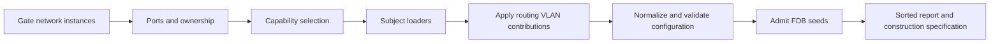

# netmodel

Package `netmodel` translates device model records into executable virtual switch
construction specifications with explicit trust and readiness metadata.

The package accepts structured interface, VLAN, forwarding database, spanning tree,
LACP, IP, and packet filter records in one [Input](input.go). Its `Want` field
selects capabilities explicitly. An empty `Want` infers them from the records.
It produces a reproducible [vswitch.ConstructionSpec]
alongside a [Report] and [analysis.Metadata] detailing readiness, assumptions,
defaults, skipped facets, and data conflicts.

## Working example

The loader accepts caller source context and an `Input` value, returning a
constructible result envelope:

```go
src := netmodel.SourceContext{
    DeviceID: "sw1",
    Origin:   "telemetry-snapshot",
    Context:  "collector-run-42",
}

res, err := netmodel.Load(now, src, netmodel.Input{
    Interfaces:      ifaces,
    VLANs:           vlans,
    FDB:             fdb,
    Budgets:         budgets,
    BridgeState:     bridgeState,
    STPPorts:        stpPorts,
    LACPAggregators: lacpAggregators,
    LACPPorts:       lacpPorts,
    Addresses:       addrs,
    Neighbors:       neighbors,
    FilterSets:      filterSets,
})
if err != nil {
    // Unconstructible input: empty interfaces, duplicate port names, or invalid LAG parents.
    return err
}

// Check readiness across the loaded model.
switch res.Readiness() {
case analysis.Complete:
    // Full model fidelity without missing operational state or conflicts.
case analysis.Incomplete:
    // Model contains missing operational state or skipped facets; inspect res.Metadata.Issues().
case analysis.Unstable:
    // Model contains contradictory or conflicting state rows.
}

// Build the fabric, then apply the loaded specification with its FDB seeds.
// No cable names a port here, so each one is declared uncabled and reads Down.
var uncabled []fabric.Uncabled
for _, p := range res.Spec.Config.Ports.Ports() {
    if p.Kind != port.LAG {
        uncabled = append(uncabled, fabric.Uncabled{Endpoint: fabric.Endpoint{Node: "sw1", Port: p.Name}})
    }
}
fab, err := assembly.New(assembly.Config{
    Start:    now,
    Switches: map[string]vswitch.Config{"sw1": res.Spec.Config},
    Uncabled: uncabled,
})
if err != nil {
    return err
}
spec := assembly.Spec(fab)
spec.Switches["sw1"] = res.Spec
fab, err = assembly.Derive(fab, spec)
if err != nil {
    return err
}
fmt.Println(fab.Snapshot().Devices["sw1"])
```

`TestICX7150Load/forwarding` in [testdata_icx7150_test.go](testdata_icx7150_test.go)
builds `vswitch.NewWithSpec` from the fixture's loaded specification. An untagged
frame on `1/1/1` floods in VLAN 4000 and exits `1/1/2` untagged. Reversing the
addresses on `1/1/2` sends the reply only to the learned source on `1/1/1`.
These assertions describe execution of the fixture's memberships.

## Loader boundary

[Load](netmodel.go) coordinates subject loaders in `load_*.go`.
[loadContext](load_context.go) owns diagnostics during translation. Shared
[ownership facts](load_context.go) let bridge and STP exclude routed ports without
reading routing's raw rows. Routing returns VLAN contributions for the coordinator
to apply to the bridge, so each loader owns its configuration result.



## Error versus result separation

Errors returned by [Load] are strictly reserved for impossible construction inputs:

- Empty interface slices.
- Duplicate interface names.
- Empty interface names.
- LAG parent references to non-existent interfaces.

Partial, uncertain, or conflicting inputs do not return an error. Instead, [Load]
preserves the unaffected configuration and records scoped findings in `res.Report`
and `res.Metadata`. A malformed address or prefix omits its row rather than making
the whole switch unconstructible.

A filter set with a malformed or unsupported predicate, or an absent, unspecified,
or unknown action, is omitted with all same-name sets and bindings. For example,
a destination port range `100..99` leaves no executable binding, while a differently
named valid set survives. Each offending rule field has an evidenced diagnostic.
`TestFilterMatchFieldMatrix` and `TestFilterAllOffendersReported` in
[filter_matrix_test.go](filter_matrix_test.go) cover the omission and diagnostics.

ICMP predicates require exactly one type and at most one code. Their family supplies
Protocol 1 or 58 when absent. A conflicting explicit Protocol omits the set because
the predicate cannot be represented faithfully. TCP flag predicates require unique,
disjoint one-hot flags. Reserved masks 256 through 2048 are unsupported because
[tcp.Decode](../../net/tcp/tcp.go) reads only the eight low bits.

An FDB row becomes a seed only when it reports `ACTIVE` status and either
`STATIC` or `DYNAMIC` kind. Missing, unspecified, unsupported, and unrecognized
values leave no executable seed and make readiness non-Complete. The row must
also name a logical switchport that admits its VLAN in the completed bridge
configuration. A row that has no relay, no VLAN-aware relay, no matching VLAN,
or no admitting switchport is omitted with a port-scoped issue.
Conflicting executable rows are scoped to their exact FID and MAC lookup key, so
they affect forwarding only when that unicast destination is consulted.

An explicit capability request is also input to the trust decision. The loader
deduplicates supported layers and reports duplicate requests as Incomplete.
Unknown layers are omitted and reported as Unsupported. A supported request
that loses its executable configuration has an evidenced omission and no
capability source. An existing bridge-level STP omission supplies that diagnostic
without a duplicate. The final report uses `vswitch.Config.Capabilities`, including
LAG ports. If every requested layer is rejected, the loader does not fall back
to capability inference.

The spanning tree layer constructs from a bridge state that explicitly
reports RSTP or MSTP. MSTP requires a complete default-domain region with a
matching reconstructed VLAN allocation digest and at most 64 instances.
Missing or refused instance-port rows and absent administrative path costs
omit the instance and its dependents. The region is omitted if that changes
its digest. Ports whose MSTID is shared with a refused domain have ambiguous
ownership and are refused. An absent MST port priority inherits the common
port priority with an evidenced assumption ([loadMST](load_mst.go)).
PVST has no protocol-version value or per-VLAN configuration input (see [Limits](#limits)).
A missing or `UNSPECIFIED` protocol version is Incomplete. STP and unknown
versions are Unsupported. Incomplete MST regions omit the STP layer. An
absent bridge or port priority uses the IEEE default, while an explicitly
reported priority of zero remains zero through switch construction.
Port priorities outside 0 through 240 in steps of 16 produce an evidenced issue.
A refused common RSTP port omits that port, while valid sibling ports survive.
A refused MST port omits its instance and dependents. A changed allocation
digest then omits the region ([loadMST](load_mst.go)). Absent or invalid transmit hold
counts use [stp.DefaultTxHoldCount](../layer/stp/config.go), with an assumption.
Bridge aging uses [bridge.DefaultAgingTime](../layer/bridge/config.go) because the
input has no aging setting.

## Operational uncertainty and localized scoping

Interfaces with unspecified or unobserved operational status are assigned
[port.Unknown]. The loader records an `analysis.Incomplete` issue scoped directly to
the affected port:

- A port with unknown operational status cannot forward frames (`port.Forwards() == false`).
- A known-down port remains a definite domain drop with `analysis.Complete` status.
- Sibling uncertainty is localized. An unknown port on a switch does not taint
  independent known-up ports on the same switch.

## Physical fact mapping and Power over Ethernet

Physical layer attributes translate directly into tri-state physical facts in [phy.Config]:

- Ethernet capabilities: absent `auto_negotiation_supported` maps to [phy.CapabilityUnknown].
- PSE budgets require a present positive `pse_group` and positive nominal power
  when reported. Invalid budgets are omitted with field diagnostics. Absent power
  remains unknown, represented by zero with an evidenced assumption.
- Power over Ethernet delivery status:
  - `DELIVERING_POWER` maps to [phy.PDAttached] alongside its power class when reported. A power class reported without `DELIVERING_POWER` is omitted with an Incomplete finding, as classification is valid only while power is delivered (RFC 3621).
  - `SEARCHING` maps to [phy.PDAbsent] with an assumption recorded that absence is inferred from the searching status (RFC 3621 treats non-delivering PSE states as searching).
  - `DISABLED`, `TEST`, `FAULT`, `OTHER_FAULT`, `UNSPECIFIED`, unrecognized values, and absent status map to [phy.PDUnknown].

## Report collections and metadata

The returned [Report](report.go) keeps translation details for inspection.
`Result.Metadata` summarizes loading trust. `Spec.Metadata` carries that trust
into switch construction and later forwarding, as [finishLoad](load_finish.go)
records both from the same catalog, issues, and assumptions.

- **Skipped facets**: Features or records deliberately omitted during translation,
  such as bridge switchport configuration on routed interfaces, or IP addresses on
  interfaces without an IP facet. Each record carries the exact scope, explanation,
  and source evidence references.
- **Defaults and assumptions**: Standards-based fallback values applied when
  optional fields are absent, including STP bridge and port priorities, hello
  time, max age, forward delay, transmit hold count, and the executable
  zero/unlimited MTU fallback.
  These are recorded both in the report and as executable assumptions in metadata.
  A missing MTU also creates an evidenced Incomplete port issue. An explicitly
  reported MTU of zero is observed data and does not create a default or issue.
- **Conflicts**: Distinct values for the same source key, such as one MAC and VLAN
  reported on two ports. The conflicted fact is omitted, while identical repeated
  rows collapse to one fact. Conflicts lower readiness to [analysis.Unstable] and
  do not depend on input order.
- **Deterministic ordering**: All report collections (capabilities, skips, defaults,
  conflicts) are sorted deterministically, ensuring reproducible diffs and tests.

## Construction trust boundary

Only absent `network_instance` and explicit `DefaultNetworkInstance` enter the
default domain. Absence records an evidenced assumption. A present empty key is
malformed. Named IP facets, VLANs, FDB entries, bridge states, MST instances and
MST VLAN maps are refused before capability inference or shared ownership claims
so they cannot merge with default-domain data. Address and neighbor rows inherit
their interface's refusal, as do its In and Out filter bindings. Each refusal
has an instance and row scope with evidence. `TestLoadNamedDomainsBeforeClaims`
in [load_instances_test.go](load_instances_test.go) preserves an explicit-default
VID 10 sibling beside blue/red VID 10 rows in both input orders.

The construction specification contains normalized configuration, executable
seeds, the source device identity, and an immutable copy of the loading metadata.
Building a switch with `vswitch.NewWithSpec(res.Spec)`, or a fabric from the
specification with `assembly.Derive` as above, therefore carries scoped loading
conflicts, skips, assumptions, and their evidence into later forwarding
results. The detailed loading report remains on `Result` because it describes the
translation rather than runtime forwarding.

A forwarding result selects metadata against the dependencies it actually
consulted. Port state uses port scopes. Routing uses exact port, port-and-VID,
VLAN, ownership, route, local-address, and neighbor lookup scopes; neighbor
scopes include the VRF, interface, and address, including for VLAN interfaces.
Bridge forwarding uses the exact FID and destination MAC scope for an FDB
lookup. A sibling dependency is excluded, while a node-scoped conflict affects
every query on that node. The result's scope retains `SourceContext.DeviceID`,
which keeps similarly named ports on different devices disjoint.

A `Subinterface` loads as a routed interface carrying its parent's port name
and the VID of its one customer tag, provided the parent names a physical or
LAG interface loaded alongside it and the encapsulation is exactly one
`ETHER_TYPE_DOT1Q` tag whose VID is a usable IEEE 802.1Q identifier (1 through
4094). It contributes no port-table entry of its own, since it is not a port,
and an accepted IP facet on it counts toward the same routed-interface capability
flag a VLAN interface or a routed port would set. A parent's own switchport facet
and its spanning-tree port are skipped from the bridge switchport table and
the spanning-tree port table on the same footing as a directly routed port,
even when the parent carries no IP facet of its own, but only once one of
its sub-interfaces resolves to a claim the routing walk accepts without a
conflicting claimant. A parent whose only sub-interface is rejected, or
whose sub-interfaces claim the same parent and VID, keeps both.

Any other encapsulation, an absent one included, raises
`netmodel.routing.unsupported_encapsulation` on the parent port's lookup
scope and leaves the interface out of the VRF; a parent that is absent from
the load, is not itself a physical or LAG interface, or is itself a LAG
member, keeps raising `netmodel.routing.unsupported_interface_kind` on that
same scope. A directly routed interface that is itself a LAG member raises
the same issue. Two sub-interfaces naming the same parent and VID is a
device reporting the same claim twice: `netmodel.routing.claim_conflict` is
recorded on the parent port's lookup scope and neither claimant reaches the
VRF, the same way any other contested fact drops out rather than keeping
whichever claimant happened to load first. Two VLAN-kind interfaces
reporting the same VLAN id contest a separate namespace, since neither one
resolves to a port: the same conflict code is recorded on the VLAN's own
lookup scope instead, and again neither claimant reaches the VRF.

## Loader defaults

When importing from network model protobuf messages, `netmodel.Load` populates
omitted values with standard defaults and records each in the `Report`:

| Field               | Default value    | Standard or source                  |
| ------------------- | ---------------- | ----------------------------------- |
| `aging_time`        | 300s             | [bridge.DefaultAgingTime](../layer/bridge/config.go) |
| `frame_admission`   | `admitAll`       | Q-BRIDGE-MIB:1413 AcceptableFrame   |
| `ingress_filtering` | `false`          | Q-BRIDGE-MIB:1437 IngressFiltering  |
| `pvid`              | untagged VLAN ID | Port has exactly one untagged VID   |
| `qinq_ethtype`      | 0x88A8           | Open vSwitch qinq-ethtype, 802.1ad  |
| `mtu`               | unlimited (0)    | Loader fallback when MTU is absent  |
| `tx_hold_count`     | 6                | [stp.DefaultTxHoldCount](../layer/stp/config.go) |
| `max_class`         | 8                | No net/phy message carries one      |
| `priority`          | none (last)      | PoeSettings without a priority      |
| `power_nanowatts`   | unknown (0 nW)   | PseBudget without reported nominal power |
| `bond_mode`         | `active-backup`  | Open vSwitch bond_mode default      |
| `lacp`              | `off`            | Open vSwitch lacp default           |

## Limits

- Bridge aging uses [bridge.DefaultAgingTime](../layer/bridge/config.go).
  The [VLAN](../../../../spec/proto/flowseer/net/switching/v1/vlan.proto),
  [switchport](../../../../spec/proto/flowseer/net/switching/v1/switchport_facet.proto),
  and [FDB](../../../../spec/proto/flowseer/net/switching/v1/fdb_entry.proto)
  inputs provide no aging setting. FDB VLAN IDs are restricted to 1 through
  4094, so those rows cannot represent a VLAN-unaware FID 0 seed.
- Observed [multicast memberships](../../../../spec/proto/flowseer/net/multicast/v1/group_membership.proto)
  do not supply the snooping enablement, router ports, and timer policy needed by
  [mcast.Config](../layer/mcast/config.go).
- Interface and switchport inputs provide no loop-protection probe, timer, or
  action settings for [loopprotect.Config](../layer/loopprotect/config.go).
- [QoS rows](../../../../spec/proto/flowseer/net/qos/v1/qos_interface.proto)
  contain partial settings. They supply no complete queue-to-PCP mapping for
  [traffic.Config](../layer/traffic/config.go).
  [Capture wrappers](../../../../spec/proto/flowseer/net/capture/v1/mirror.proto)
  describe received packets, without the mirror selectors and destinations
  needed to configure traffic mirroring.
- [ProtocolVersion](../../../../spec/proto/flowseer/net/protocol/stp/v1/protocol_version.proto)
  has no PVST value or per-VLAN configuration input.

Requests for multicast, loop protection, and traffic are reported as Unsupported
by [requestedCapabilities](load_capabilities.go). The loader does not infer their
settings from observations. [Input](input.go) supplies no observed counter seeds,
and [loadSTP](load_stp.go) does not restore observed roots.
[InterfaceCounters](counters.go) remains the adapter from device counters to
protobuf reports.
