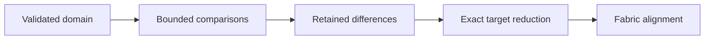

# search

`search` evaluates finite traffic and cable-fault domains against two fabrics
without consuming either input. Comparison locations and trace alignment belong
to `fabric`, which owns injection and descendant pairing.

## Search and reduce a counterexample

```go
func compareDomain(currentConfig, candidateConfig assembly.Config) error {
    current, err := assembly.New(currentConfig)
    if err != nil {
        return err
    }
    candidate, err := assembly.New(candidateConfig)
    if err != nil {
        return err
    }
    domain, err := search.NewL2TrafficDomain(search.L2TrafficDomainConfig{
        Sources: []fabric.Endpoint{{Node: "h1"}},
        Destinations: []netaddr.MAC{{2, 0, 0, 0, 0, 2}},
        VLANs: []vlan.ID{10, 20},
        Shapes: []search.FrameShape{
            {EtherType: ethernet.EtherTypeIPv4, Payload: []byte("probe")},
        },
    })
    if err != nil {
        return err
    }
    limits := search.Limits{MaxCandidates: 50, MaxDifferences: 5, Budget: 100}
    result, err := search.Search(current, candidate, domain, limits)
    if err != nil {
        return err
    }
    if result.Err != nil {
        return result.Err
    }
    fmt.Printf("Coverage: %s, errors: %d\n", result.Coverage, result.Errors)
    for _, difference := range result.Differences {
        reduced, err := search.Minimize(current, candidate, difference.Candidate, limits.Budget)
        if err != nil {
            return err
        }
        fmt.Printf("%s: %d actions, target %+v, difference %s\n",
            reduced.Minimality, len(reduced.Candidate.Actions), reduced.Target, reduced.Difference)
        comparison := fabric.Compare(current, candidate,
            reduced.Candidate.ToScenario(), fabric.RunOptions{Budget: limits.Budget})
        if comparison.Err != nil {
            return comparison.Err
        }
        if alignment, ok := fabric.Align(comparison); ok {
            fmt.Printf("Behavioral location: %+v\n", alignment.Location)
            if alignment.Trace != nil {
                fmt.Printf("Diagnostic entry: %d\n", alignment.Trace.EntryIndex)
            }
        }
    }
    return nil
}
```

The snippet uses `fmt`, `net/ethernet`, `net/netaddr`, `net/vlan`, `sim/assembly`,
`sim/fabric`, and `sim/search`. The caller supplies configurations containing
host `h1` and its cable attachment.



## Domains and action identity

`Domain.Size` declares the exact candidate count. `Domain.Enumerate` visits
tuples in deterministic order and stops when the callback returns false.
`L2TrafficDomain` enumerates sources, destination MACs, VLANs, and frame shapes.
`TimedFaultDomain` enumerates `fabric.FaultAction` values at declared times,
with base traffic supplied as injection `fabric.Action` values.

Both constructors return a domain and an error. Config validation rejects
empty source node names, VLANs above 4094, invalid faults or actions, zero
action times, and cross products beyond `int`. An empty dimension yields an
empty domain. A zero L2 `At` uses the default epoch.

`Candidate.Actions` owns injection and fault declarations. `Candidate.Clone`
deep-copies frame tags, frame and packet payloads, and fault loss sequences.
`ToScenario` names unnamed declarations before sorting, then numbers unnumbered
declarations with injections before faults at tied times. Existing IDs and
indices survive reduction. Duplicate IDs and duplicate timestamp
and index pairs are invalid. Times use full UTC identity, and endpoint tuples
use `Endpoint.Canonical` so delimiter-bearing names remain distinct.

## Accounting and retention

`Limits.Budget` must be positive. `MaxCandidates` must be nonnegative, with
zero evaluating the whole domain. `MaxDifferences` is zero for counts only,
positive for bounded replay retention, and `-1` for unlimited retention.
Invalid limits return an error before enumeration.

Every evaluated candidate increments exactly one of `EquivalentCount`,
`InconclusiveCount`, `TotalDifferences`, or `Errors`. Candidate errors do not
halt enumeration. `Result.Err` keeps the first error wrapped with its tuple.
`InconclusiveCount` includes incomplete runs even when a difference was found.
Equal settled aggregate roots also count as inconclusive because flow totals
cannot prove journey equivalence ([fabric/compare.go](../fabric/compare.go)).
`Coverage.Tested + len(Result.Remainder)` equals the domain size, including
errors. Retained differences carry independent candidates and both replay
checkpoints. Each replay is an in-memory value preserving its fabric's
pre-action live state, including learned records and cable crossing counts.
It cannot be serialized. Discarded differences contribute to counts only.

## Exact minimization targets

`Minimize` removes injections, then faults, accepting a removal only when
comparison remains `Different` at the same `fabric.DifferenceLocation` with
the same observable, current value, and expected value. `Minimization` returns
the candidate, `Minimality`, original `Target`, and exact `Difference`, even
at `LimitReached`. Zero trials uses 64 trials. Invalid budgets, negative trial
limits, comparison errors, and an initial non-difference return errors.

Exact values can prevent an otherwise useful reduction. In
`TestMinimizeExactValuesCanRetainOtherwiseRemovableAction`
(`minimize_test.go`), removing a shared learning injection keeps the snapshot
field but changes displayed FDB counts from 2/2 to 1/1. Both injections remain.
`Minimal` means no further single-action removal preserves this exact target.

`fabric.Align` returns the behavioral location separately from an optional
diagnostic trace. It uses scenario injection identity and mirror and reflection
ancestry, includes one-sided descendants, and indexes original report entries.
Diagnostic facts never change the behavioral disposition.
