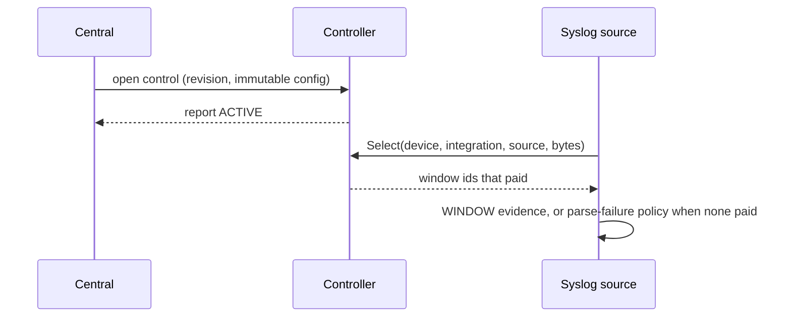

# Device access agent

The agent that runs where the devices are. It enrolls with central once, holds
central's dispatch and capture-assignment streams open, drives the
local-network access lane and packet captures from what arrives on them, and
reports back what happened.

Assembled from `src/modules/localnet/access` (the lane) and
`src/modules/capture` (the capture engine). The agent owns two segmented logs,
a loopback OTLP receiver, and a separate delivery drain for each log. It adds
identity, transport, and the orderings between them.

## What it is made of

| Package | What it does |
| --- | --- |
| `internal/identity` | The Ed25519 key pair central registered, the enrollment answer, and the assertion signer every call except `Enroll` carries |
| `internal/otlpreceiver` | The loopback OTLP receiver that appends exports to the telemetry log |
| `internal/drain` | Separate ingest and telemetry delivery loops, with retry and resume after a short settlement |
| `internal/subscribeloop` | The reconnecting stream loop with backoff and its `Contact` counters, generic over the streamed message type |
| `internal/dispatch` | What the stream loop needs to carry dispatches — the opener, the event names, the dropped-message attributes — and the routing of each dispatch to its lane call |
| `internal/report` | The re-send queue for dispatch reports, and the blocking deliverer for audit records |
| `internal/lanehost` | Contact with central and the freeze it drives, the device listing and what it onboards, and the per-operation device session factories |
| `internal/capture` | The capture assignment stream loop, active session registry, engine runner, and chunk upload client |
| `internal/syslogsource` | Sockets, mapping, and raw payload suppression for syslog ingestion from hosted network devices |
| `internal/seglog` | Checksummed segment files bounded by bytes and age, with append-order delivery and deletion on acknowledgement. The host opens both logs and the drains acknowledge settled segments. See [the package contract](internal/seglog/doc.go). |

## Which devices this edge serves

The edge is not configured with its devices; it asks. `ListDevices` names
them and, for each, where it answers, the binding that reaches it, the
access policy it pins and its measured delayed-apply horizon — all of it
read from a registry the edge cannot see. Configuring it locally instead
would make the address a second source of truth, and an address that is
wrong in one of two places fails open: the session opens, against a
different real device that answers normally.

The listing runs before every attempt to open the dispatch stream, first
attempt included, because a dispatch for a device this edge has not
onboarded has nowhere to go. Between listings the edge holds what it was
last told, which is stale by construction and the point: one operation runs
against one consistent set of facts rather than a set that can change under
it.

A device already onboarded is left alone rather than re-added to the lane. A
second `AddDevice` for an already-registered device is refused by the lane.
The lane session therefore stays on the onboarded address until the attempt
restarts, while the device index follows the listing immediately, so datagrams
from an address a device left are not attributed to it. A held device whose listing changed
is served by a lane session that no longer matches it, which is a real gap for
lane operations, and it is recorded rather than passed over: a re-listing that
differs from what a device was onboarded with names each field and both
values, because an operator who measures a horizon centrally and watches
mutations go on being refused has otherwise nothing anywhere connecting the
two facts.

A device listed without a measured horizon is onboarded all the same and
read as usual, and the lane refuses a mutation on it.

Onboarding one device is bounded. It runs before every attempt to open the
dispatch stream, and adding a device probes it — a device that is powered off
does not refuse the probe, it says nothing, for as long as the transport will
wait. Unbounded and serial, a handful of dead devices adds minutes to every
reconnection while the heartbeat goes on succeeding and the listing has not
failed, so from central the edge looks enrolled, healthy, and permanently
unsubscribed. A device that runs out of time is left unheld and tried again
on the next listing, which is what happens to one that fails outright. The horizon bounds how
long a mutation's effect may stay unknown, and a read has no effect to
become visible.

## Starting up, and the order that is forced

`cmd/agent` reads one prototext file and hands it to `host`. The identity
comes before every signed call. The logs and receiver open before the runtime
because telemetry exports need the receiver's bound address.

Enrollment, an empty anchor set, or failure to open storage or bind the receiver
ends startup. After the runtime returns, shutdown closes the receiver, then
the telemetry log, then the ingest log. This lets the runtime's final export
reach the telemetry log before the receiver closes.

The logs live in `<state_dir>/buffer/ingest` and `<state_dir>/buffer/telemetry`.
Ingest defaults to 192 MiB, telemetry to 64 MiB, and both retain seven days.
Each log's `max_bytes` and `max_age` can be configured independently. The
512 KiB segment and 256 KiB record bounds are fixed. A drain sends one segment
per call and acknowledges it after central settles every record. A short
settlement resumes at the first unsettled record. A restart can resend a
settled prefix. Only the log's byte and age bounds discard queued records.
A collector outage holds telemetry in its log while ingest continues.
Each drain runs under its own supervisor branch. A persistent storage error
restarts only that drain with jittered backoff capped at 30 seconds, leaving
the other log and agent modules running. Drain attempt metrics use the paths
`agent/delivery_ingest/drain` and `agent/delivery_telemetry/drain`.
Old `jetstream` directories and `hub.creds` files remain untouched on upgrade.

Everything else is survivable, and the first device listing is the one worth
knowing about. A listing that fails at startup is not fatal: the dispatch
stream still opens, and the next reconnection lists again. But the agent then
comes up serving no devices and refusing every dispatch it receives, which from
central looks exactly like an edge that has no devices assigned to it. The
`flowseer.edge.devices.listing_failed` event is the only thing that separates
the two, so it is emitted for the startup listing as well as for every later
one — an operator seeing an edge that manages nothing looks there first.

## Nothing standing

Every credential is acquired for the operation that uses it and the session
is closed when that operation ends. There is no cached device session, no
standing SNMP user, and no lease — so a credential central revokes stops
working at the next operation rather than whenever a connection happens to
drop. The cost is one acquisition per read and per mutation, which is what
`AcquireReadCredential` is shaped for.

The same reasoning runs through the identity: the private key is the whole of
what this edge is, central holds only the public half, and an edge that loses
it cannot be recovered by anything the edge itself can do. It is written
before the first `Enroll` and never sent — and the directory entry naming it
is flushed before the call goes out, since a key whose name never reached disk
is lost just as completely as one never written, against a setup key central
has by then consumed.

An edge that enrolls also adopts central's clock for the run that enrolled it.
`EnrollResponse` carries central's time, and an edge whose real-time clock is
dead would otherwise sign every assertion from a factory date, be refused for
skew, and retry delivery without making progress. The difference is
measured, not stored: an edge that loads an enrollment written on an earlier
run signs on its own clock again. Carrying it across restarts means adopting
the time the heartbeat already returns, and a decision about where that offset
lives.

## The two things that are held open

A dispatch stream and a heartbeat, and both are mechanisms that act when
nothing is happening — which is the shape that hides a total failure as
silence.

`subscribeloop.Contact` counts streams central served, failures, and messages,
so a client dead since its first attempt is a number rather than a quiet fleet.
All three are exported as counters —
`flowseer.edge.dispatch.connections`, `.failures` and `.messages` — because
the state that matters here is what no single event carries: the loop emits a
record when it connects and when it drops, and nothing at all while a first
stream stays open.
Read together: connections climbing with failures at zero is healthy;
connections at zero with failures climbing is a client that has never reached
anything; both at zero is a first stream still open. Connections climbing with
messages at zero is a central that accepts and immediately closes, which reads
healthy and is a loop backing off to its ceiling.

The heartbeat counts consecutive failed attempts, not elapsed time, and each
attempt is bounded by the interval. A laptop asleep for an hour wakes with an
hour since its last success and nothing wrong, so elapsed time would freeze
every device on resume. A call that never answers is contact lost by any
useful definition but is not a failure — it never returns to be counted — so
without the per-attempt deadline the counter stops exactly when it matters.
Two misses freeze the lane; the next success unfreezes it, and only a freeze
this loop performed is one it will lift.

## What central is owed, and what it is owed by

Reports are queued and re-sent until central confirms them. The queue
supersedes rather than accumulates — one entry per operation holding its
latest report — so its size tracks outstanding operations, and since reports
are caused by dispatches, an unreachable central cannot make it grow.

Audit records are the opposite and must not be confused with them: the
deliverer blocks, because the lane holds its own state transition until
central has the record. A record that was merely enqueued would let the lane
release the state the record describes before anything durable held it.

A duplicate dispatch is answered from what this edge already reported rather
than run again — central re-dispatches exactly what it holds no report for,
so what it wants is the report. The memory of an operation is released when
central confirms a report that *ends* it, not when the operation finishes: a
completed operation is the most likely thing to be re-dispatched, and a
progress report or an acknowledgement is one central takes while the operation
is still running. Releasing on either would leave the sequence admittable
again with the lane still holding it, and the next re-dispatch would apply the
mutation to the device a second time.

The re-send order matters for the same reason. A device whose report central
refuses sends no later report until that one lands; other devices carry on.
Without the hold an `Onboarded` — which is not phase-ordered, and which clears
central's per-dispatch confirmations when it arrives — can overtake the
reports it precedes and re-open operations they had settled.

## Remote packet capture

Alongside the lane, `host.Run` assembles the `"capture"` module unconditionally
into the supervision tree. It subscribes to `SubscribeCaptureAssignments` using
the shared reconnecting `subscribeloop` transport and demultiplexes incoming
assignments into active sessions managed by an in-memory registry.

When a `Start` assignment arrives, the handler launches a runner goroutine that
opens `UploadCapture`, delivers the initial `SignedEdgeAssertion`, executes
`capture.Engine`, and uploads batches of packet records as `CapturePacketChunk`
messages. To keep the stream active and satisfy central's assertion deadline,
the runner transmits periodic mid-stream re-assertions every 30 seconds.

When a `Stop` assignment arrives, the handler cancels the running engine and
flushes any buffered packets with `final: true`, which is how the upload ends
cleanly. A final chunk is the only thing that tells central a capture
finished, so a capture that did not finish must not send one: if the interface
stays idle past the inactivity timeout, or the engine's source fails, the
runner closes the upload stream with no final chunk and central records the
session failed rather than complete.

Stream contact metrics are exported under `flowseer.edge.capture.connections`,
`.failures`, and `.messages`. No packet payload byte is ever written to a log
record: what the runner logs about a chunk is its first sequence, its packet
count, and whether it is final.

## Syslog ingestion

When configured with listeners, `host.Run` includes the `"syslog"` module
gated on listener presence. It binds UDP and TCP listeners, admits syslog
datagrams and frames up to 65,535 bytes, maps them to `SyslogRecord` payloads,
and appends them to the ingest log. Its drain delivers them through
`IngestService.Deliver`, with the record id retained for central deduplication.

Incoming datagrams are accepted only from management addresses resolved by
`lanehost.DeviceIndex`, which follows the device listing and nothing else. An
address resolves to a device when exactly one listed device claims it, whether
or not the lane onboarded that device: a UDP source address is spoofable
either way, and a gate on onboarding would drop syslog from a listed device
whose management session is down. A device id listed at two addresses resolves
from both, each with its own row's binding and integration. The sync validates
the whole listing first: a malformed row, one device claimed at one address
with two bindings or integrations, or one binding paired with two integrations
refuses the listing, onboards nothing, and leaves the index as it was. Each
accepted sync replaces the index's claims with the listing before onboarding
starts, so a device the listing omits or moves stops resolving at the old
address, and a failed listing leaves the index as it was. When two or more listed devices claim an
address, datagrams from it resolve to no device and are dropped with reason
`ambiguous_source`. Senders from addresses no listed device claims are dropped
and counted on `flowseer.edge.syslog.dropped` with reason `unknown_source`. A
lane restart keeps the last listing, while a process restart starts with an
empty index until the first listing.

When a record fails parsing or exceeds field length bounds, `RawPolicy`
evaluates whether to attach the raw payload. The first 20 failures per device
per minute retain raw bytes under reason `RAW_REASON_PARSE_FAILURE`, and 1 in
100 thereafter, recording the suppressed count. Oversized messages beyond 65,527
bytes are truncated and marked with `message_truncated`.

## Raw windows

An operator can open a raw window for a device, an integration, or the `syslog`
source. The agent keeps the original bytes only while a window it holds permits
them, and central learns what happened through reports, not through the
connection.

The agent advances a durable boot generation (`raw-window-epoch.textproto` in
its state directory) before it connects, then draws a UUID process epoch. One
`rawwindow.Controller` lives for the process, outside the module attempts the
supervisor restarts. It opens the `RawWindowEdgeService.Subscribe` stream with
the generation, epoch and enabled sources, applies the controls central sends,
and reports cumulative usage through `Report` on a five second tick and when a
window ends. A generation that cannot advance disables raw windows for the
process and logs `flowseer.edge.raw_window.disabled`. The rest of the agent runs.

The source asks the controller for every resolved record, before the
parse-failure policy. A window that paid keeps the payload as `RAW_REASON_WINDOW`
naming the sorted distinct window ids and carrying no suppression count. Every
matching window with room is charged the record's original length, once, so
overlapping windows keep one copy and account independently. A record names at
most 16 windows, the schema's limit, so a window past the first 16 in id order
is neither charged nor ended for that record. A window whose
remainder cannot hold the whole record ends without truncating it. The envelope
is built once per record, so a publish retry reuses its debit.

Expiry is checked per record against two clocks: the wall-clock expiry in the
control, read through a nondecreasing high-water mark, and an elapsed deadline
fixed when the window is first admitted and never longer than an hour. A
repeated start reports the current state and renews neither. A close leaves a
tombstone through the original expiry, so a delayed start cannot reopen it. A
restart starts with no windows: central ends the old epoch's windows, and
collection resumes only through a new open. Intake moves `WINDOW` evidence to
the evidence stream with its refs and republishes the typed record without it.
