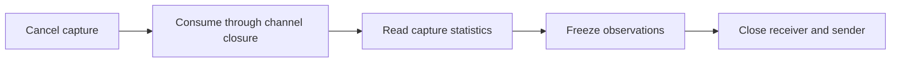

# simload

`simload` executes finite `stream.Source` values on an edge host. It sends
complete Ethernet frames through a named transmit interface and observes the
signed frames on a different named receive interface. The command does not
choose an interface for the operator.

## A bounded run

The `transmit` command reads one version-one JSON document from stdin. Durations
use Go duration strings, and `frame_hex` is an encoded Ethernet II frame whose
payload has at least 32 octets reserved for the signature.

```json
{
  "version": 1,
  "tx_interface": "veth-load-tx",
  "rx_interface": "veth-load-rx",
  "drain": "250ms",
  "flows": [
    {
      "id": 7,
      "frame_hex": "00000000000100000000000288b50000000000000000000000000000000000000000000000000000000000000000000000000000000000000000000000",
      "frames_per_second": 1000,
      "count": 10000,
      "burst": 1,
      "gap": "0s",
      "start": "0s",
      "seed": 42
    }
  ]
}
```

The example schedules sequences 0 through 9,999 over 9.999 seconds. A real
run needs an isolated interface pair, an interface that is up, and the
capability to open raw packet sockets, normally `CAP_NET_RAW`. The transmit and
receive interfaces must be distinct. `packetio` writes with a send-only
`AF_PACKET` socket. Capture uses the existing non-promiscuous raw-socket source.

The first 32 payload octets are reserved as follows:

| Octets | Meaning |
| --- | --- |
| 0-3 | ASCII `FSLD` |
| 4-7 | Big-endian version `1` |
| 8-11 | Big-endian nonzero flow ID |
| 12-15 | Big-endian zero reserved word |
| 16-23 | Big-endian zero-based sequence |
| 24-31 | Signed Unix nanoseconds at userspace submission |

The report keeps simulator counters and lab observations separate. A transmit
timestamp proves submission to the kernel, not physical departure from the
NIC. A capture timestamp is when the receive path observed the frame. A missing
sequence is an observation. It is not assigned a switch drop reason or cable
loss without evidence.

Shutdown retains every frame the capture channel accepted, including data
queued before a receiver failure. [`run.go`](run.go) completes this boundary:



Internal capture cancellation is normal shutdown. A statistics failure still
returns an error when capture emits a cancellation frame. An existing run
error takes precedence over receiver and statistics errors, followed by receiver
close and sender close errors. Socket write failures carry
`packetio.ErrCodeSenderOpen` while retaining their cause for `errors.Is`.

`compare` reads a version-one document containing a simulator report, a lab
observation, and the named simulator destination host. It writes deterministic
JSON with the raw counters, simulator status and issues, lab counters, and
normalized offered/delivered/unreceived rows. A lab flow ID absent from the
simulator input is refused before any JSON is written. Simulator-only rows
remain visible with zero lab counters.

[`NewReport`](report.go) and `NewReportFromSimulator` return `(Report, error)`.
Both return an error and a zero report for a lab-only flow ID. `NewReport`
keeps each flow's folded journey status and issues, including copy-derived
issues, while the simulator summary retains whole-fabric metadata. An unrelated
fabric issue leaves a complete flow complete, so the report preserves where
trust was lost. [`report_test.go`](report_test.go) pins issue scopes and evidence
references separately for flows and the whole summary.

## Live switch runs

A live comparison changes no switch configuration, but it does send bounded
unicast traffic through the named VLAN and updates ordinary MAC-table and port
counters. Before powering on or running against a physical switch, record the
two host NICs, switch ports and VLAN, source and destination MACs, EtherType,
signature reservation, frame size, maximum frame count, aggregate rate,
duration, stop conditions, and the fact that no configuration changes will be
made. Obtain the owner's explicit approval and advance power-on notice first.
