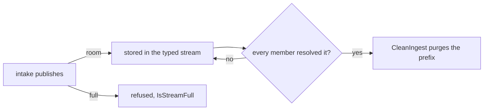

# edgebus

Central's embedded NATS hub, JetStream stores, and OTLP collector client.
The hub has one data account, CENTRAL, and no edge-facing listener. It serves
central through an in-process connection. The agent delivers ingest records
and its own telemetry over authenticated Connect calls, buffered in separate
segmented logs.

The [edge delivery record](../../../docs/architecture/2026-10-04-edge-delivery-over-connect-direction.md)
states the delivery path. `TestASyslogDatagramReachesItsStreamWithNoLeafLink`
in `src/services/device/test/integration/delivery_test.go` checks a real
agent's delivery and the absence of per-edge key files on central.

## CENTRAL account

The hub runs in operator mode with a system account and CENTRAL.
`TestHubLoadsOnlySystemAndCentralAccounts` checks that the server lists only
`$G`, the system account, and CENTRAL. `TestHubHasNoEdgeFacingListener` checks
the server options. CENTRAL has no imports or exports, as
`TestCentralAccountCarriesNoImportsOrExports` checks through its signed JWT.

CENTRAL holds the `device-lanes`, `edges`, `captures`, `raw-windows`,
`tenants`, and `access` key-value buckets, `FLOWSEER_DEVICE_AUDIT`,
`FLOWSEER_OPERATOR_ACTIONS`, `FLOWSEER_OPERATOR_READS`, one typed ingest
stream per record type, and `FLOWSEER_INGEST_EVIDENCE`. The `tenants` stream
allows atomic batches so the tenant store writes a record and its
organization index together.

The account's disk budget defaults to 1 GiB and must fit under the server
store ceiling. A zero ceiling uses 75% of free disk at start. The stream
bounds must fit within the CENTRAL budget, which `HubConfig.CentralStreamBytes`
sums and the device service checks when loading its configuration.

## Subjects and streams

```text
flowseer.<tenant>.audit.device.<device-id>          central's audit records
flowseer.<tenant>.operator.action.<action>          operator changes
flowseer.<tenant>.operator.read.<action>            operator views
flowseer.<tenant>.ingest.<record-type>.<device-id>   typed ingest records
flowseer.<tenant>.evidence.<record-type>.<device-id> raw ingest evidence
```

The CENTRAL account keeps one file-backed limits stream for each known ingest
record type. `FLOWSEER_INGEST_SYSLOG` stores
`flowseer.*.ingest.syslog.*`. `FLOWSEER_INGEST_EVIDENCE` stores
`flowseer.*.evidence.>`. The evidence stream is a window of raw bytes kept for
inspection. It discards its oldest record at its byte or age limit (64 MiB and
24 hours by default) and deduplicates a message id for up to ten minutes,
capped by its maximum age.

### Typed ingest streams refuse instead of discarding

A typed stream is accepted work. Its limits are the byte bound
(`HubConfig.IngestMaxBytes`, 256 MiB by default), the discard-new policy, no
maximum age, and a ten minute duplicate window. At the bound the server
refuses the publication and stores nothing. `edgebus.IsStreamFull` tells that
refusal (API error code 10077, `maximum bytes exceeded`) from another store
failure. The hub applies these limits with an in-place stream update on every
start, so a state directory that held a rolling stream keeps its records.

The members of a typed stream are the durable consumers
`edgebus.IngestConsumers(recordType)` names. For syslog that is `history_sink`
alone: no filter, deliver all, explicit acknowledgement, unlimited deliveries,
a two-minute acknowledgement wait, and 10,000 pending acknowledgements. The hub
creates each member with `EnsureIngestConsumer` right after the stream and
before intake can publish. `EnsureIngestConsumer` only creates. It returns a
matching consumer, refuses a differing one with `ErrCodeCleanup`, and never
updates one.

`edgebus.CleanIngest` is the only code that removes a typed record. It purges
below the lowest member acknowledgement floor plus one, so a record leaves the
stream once every member acknowledged or terminated it. A record held by one
sink keeps every later record on disk until it resolves, and the member's
acknowledgement wait bounds how long a sink that died holds it. The pass runs
only when the consumers on the stream are exactly the members, each with the
member's name, filter, deliver policy, acknowledgement policy, and delivery
limit. A missing, stray, or differing consumer returns `ErrCodeCleanup` and
purges nothing. A floor of zero sends no request, since the client turns purge
sequence 0 into a purge of every record. Two passes may run at once because
each purges below a floor it read and floors only rise.

`CleanReport` carries what the pass read: the floor, the first and last
sequence, the stored bytes and their bound, the time of the first record, the
pending count summed over the members, and whether a purge request succeeded.
`Purged` is not a count of removed records.



A central host without a `history` section still provisions the member.
Nothing resolves its syslog records, so the stream fills to its bound and
intake is refused. Membership is closed in code, not per deployment.

These operator requests remove a record nobody resolved, and nothing counts
them: a purge or a message deletion sent by hand, a consumer reset to a higher
sequence, a stream deletion, a member's configuration changed by hand, and a
stream update that restores a maximum age or the discard-old policy. A member
deleted and created again starts one below the stream's first sequence, so it
is offered every stored record, and records its earlier incarnation resolved
stay resolved.

### Sizing the ingest streams

The defaults suit a test host, since the hub reserves each stream's byte bound
against 75 percent of free disk. A deployment sets `ingest_streams` in the
device service configuration (`max_bytes_per_type`, `central_budget_bytes`)
from this formula:

```text
max_bytes_per_type = stored_bytes_per_message x fleet_records_per_second
                     x (horizon + cleanup_interval)
                     + stored_bytes_per_message x MaxAckPending
```

`fleet_records_per_second` is the sum over every edge. The horizon is a
capacity target: how long the history store may be down before the stream is
full and intake is refused. It is not a retention, since nothing ages out.
`MaxAckPending` is the member's 10,000. The last term covers the records a
sink holds delivered but not yet acknowledged.

`TestStoredBytesPerSyslogMessage` measures `stored_bytes_per_message` for a
typical syslog record: a 341-byte envelope occupies 571 bytes in the stream.
At the planning rate of one message per device per minute, a 72-hour horizon,
and 1,000 devices, the first term is 571 x (1,000 / 60) x 72 x 3,600, about
2.3 GiB. The central budget must cover that stream plus the others, which
`HubConfig.CentralStreamBytes` sums (the audit stream, both operator streams,
one ingest stream per record type, and the evidence stream). The device
service refuses a configuration whose budget is below it.

## The operator trail's two streams

Central records what each operator did in two CENTRAL streams. Both discard the
oldest record first and keep a cap per subject, and both limits are `HubConfig`
fields with no deployment setting.

| Stream | Subject | Holds | Bytes | Per subject |
| --- | --- | --- | --- | --- |
| `FLOWSEER_OPERATOR_ACTIONS` | `flowseer.<tenant>.operator.action.<action>` | every change, and every capture stream or full-payload capture | 64 MiB | 10,000 |
| `FLOWSEER_OPERATOR_READS` | `flowseer.<tenant>.operator.read.<action>` | `GetEdge` and `ListEdges` | 16 MiB | 1,000 |

A call admitted to no tenant, which only `CreateTenant` is, takes the token
`platform` in the tenant position. `tenant.Validate` refuses it as a tenant id,
so no tenant can write there.

The cap per subject bounds one subject, not the stream. Once the stream holds
more than its byte limit, the server removes the oldest record in the stream
whatever its subject (`enforceBytesLimit` in nats-server
`server/filestore.go`). A flood on many subjects therefore evicts the records
of other actions. Views are the flood the trail expects, since every viewer may
call them, so they have a stream of their own and a change competes only with
changes.

A stored record costs 34 bytes plus its subject, header, and payload
(`fileStoreMsgSizeRaw`, same file). An `IssueSetupKey` attempt and completion
for a 60-character issuer and a 36-character subject occupy about 410 bytes
each (`TestOperatorActionRecordFitsTheSizingArithmetic`), so a change subject at
its cap holds about 4 MiB and the action stream holds about 160,000 records.

The two streams reserve 80 MiB of the central account's 1 GiB beside the
audit stream's 256 MiB, the syslog ingest stream's 256 MiB, and the evidence
stream's 64 MiB. A key-value bucket sets no byte limit, so the six buckets
share the 368 MiB the streams leave once they are full.

## Keys and upgrades

The operator, system, and CENTRAL seeds persist as `operator.nk`, `system.nk`,
and `central.nk` under `<StateDir>/keys`. CENTRAL's user is minted when the
hub connects. No key file is created for an edge.

An upgraded central can still hold `keys/edge-*.nk`, `keys/edge-*.tenant`,
and former edge accounts' directories under `<StateDir>/jetstream/jetstream`.
The hub ignores the key files. At startup nats-server v2.15.0 scans its store
and tries to resolve each former account. It logs one `Account fetch failed`
warning per directory and continues serving CENTRAL
(`server/jetstream.go:933-947`, `server/server.go:2183-2185`).
`TestHubServesCentralWithFormerEdgeState` pins that startup behavior and
checks that the stray files remain intact.

The operator deletes the stray key files and former account directories.
The hub leaves them in place because deleting a directory it cannot identify
could destroy CENTRAL's store. Keep the directory named by CENTRAL's public
account key, derived from `central.nk`.

## Observability and durability

`HubConfig.Logger` receives the embedded server's warnings and errors, with
event name `flowseer.edgebus.server` and the detail in
`flowseer.edgebus.detail`.

The hub declares its fsync policy with `service.BusFsyncPolicy` and normalizes
it through `service.NormalizeFsync`, the rule the process-local bus follows.
Central declares `BusFsyncPerMessage` because the hub is the journal's
authority. An undeclared policy refuses startup before any key is written,
with `edgebus/config`.

## OTLP delivery

The agent's loopback receiver lives in
[`otlpreceiver`](../../edge/agent/internal/otlpreceiver/receiver.go). It appends
OTLP bodies to the telemetry log. The agent drains that log through
`TelemetryService.Deliver`, served by
[`otlpapi`](../../services/device/internal/otlpapi/README.md).
`Collector` posts each body unchanged to central's collector and classifies
the answer. `NewCollector` refuses an endpoint that is not an absolute `http`
or `https` URL. The delivery call leaves an unsettled body in the agent's
telemetry log until the collector settles it or the log's bounds discard it.
