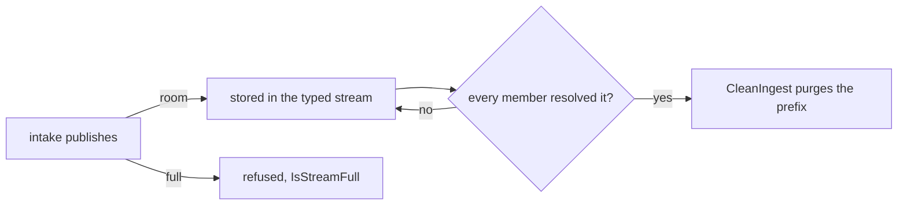

# edgebus

Central's embedded NATS hub, JetStream stores, and OTLP collector client.
The agent delivers ingest records and its own telemetry over authenticated
Connect calls, with separate segmented logs as its buffers. It joins no bus.
The leaf, per-edge streams, and forwarder remain pending removal, and central
still binds the leaf listener. The
[edge delivery record](../../../docs/architecture/2026-10-04-edge-delivery-over-connect-direction.md)
states the delivery path. `TestASyslogDatagramReachesItsStreamWithNoLeafLink`
in `src/services/device/test/integration/delivery_test.go` checks that a real
agent delivers a record with no leaf link or JetStream directory.

## Accounts are the security boundary, one per edge

An edge credential can make the server publish for it, with the server's own
internal client, into any stream and any JetStream API in the edge's account:
a JetStream flow-control control message (an empty body whose header begins
with the inlined status `NATS/1.0 100 `) names its own reply subject, and
`processInboundSourceMsg` obeys it through a client subject to no
permissions, before the check that would bind the message to the sourcing
consumer. No permission list closes that, because the publish is the
server's, not the edge's. The only boundary the reflection cannot cross is an
account: an account imports and exports nothing here, so a reflected publish
reaches only subjects in the account it was provoked in.

The hub therefore runs the system account, a CENTRAL account, and one account
per edge:

- **CENTRAL** holds the `device-lanes`, `edges`, `captures`, `raw-windows`,
  `tenants`, and `access` key-value buckets, `FLOWSEER_DEVICE_AUDIT`,
  `FLOWSEER_OPERATOR_ACTIONS`, `FLOWSEER_OPERATOR_READS`, one typed ingest
  stream per record type, and `FLOWSEER_INGEST_EVIDENCE`. The streams are
  written through central's own CENTRAL-account connection. Typed ingest is
  bounded to 256 MiB by default and has no age. A full typed stream refuses new
  records and removes none. Raw evidence is bounded to 64 MiB and 24 hours and
  discards its oldest records first. Both ingest streams remember message ids
  for ten minutes. The `tenants` stream allows atomic
  batches so the tenant store writes a record and its organization index
  together. No edge credential is in this account, so neither a direct publish
  nor a reflected one from an edge can reach the journal.
- **EDGE_<edge-id>**, created when the edge first attaches, holds that one
  edge's source stream and its minted user; its leaf node joins it. A
  reflection an edge provokes lands in its own account, where the only
  addressable JetStream API is its own. Before per-edge accounts, one shared
  edge account let a reflection name another edge's
  `$JS.edge-<other>.API.STREAM.DELETE` and destroy its buffer
  (`TestOneEdgeCannotAddressAnotherEdgesJetStreamAPI`).

`TestAccountsCarryNoImportsOrExports` reads the signed account JWTs the server
enforces and fails on a merge-back or on any import or export slipping in:
the containment is structural, not a permission list. CENTRAL gets its own
JetStream disk budget and each edge account its own. Account budgets reserve
against the server store ceiling when each account is enabled. Setting the
ceiling to zero finalizes it once at server start as 75% of free disk, and the
resulting edge count is capped by `(ceiling - central budget) / edge budget`.
Within that capacity, telemetry volume in an edge account cannot exhaust the
store the journal writes into.

If the server refuses an edge account because its budget does not fit under
the store ceiling, `AttachEdge` returns an `edgebus/storage` error naming the
edge budget and the ceiling. Other wait and stream-setup failures retain
`edgebus/hub`. The attach holds the hub's read lock from account connection
through the JetStream flag read, so `Close` cannot clear that flag during the
decision.

## Subjects and streams

```
flowseer.<tenant>.edge.<edge-id>.otel.{logs,metrics,traces}   the agent's OTLP bodies
flowseer.<tenant>.edge.<edge-id>.ingest.syslog                syslog records
flowseer.<tenant>.edge.<edge-id>.source.>                     the hub's sourcing deliveries
flowseer.<tenant>.audit.device.<device-id>                    central's audit records (CENTRAL)
flowseer.<tenant>.operator.action.<action>                    central's records of an operator change (CENTRAL)
flowseer.<tenant>.operator.read.<action>                      central's records of an operator view (CENTRAL)
flowseer.<tenant>.ingest.<record-type>.<device-id>             typed ingest records (CENTRAL)
flowseer.<tenant>.evidence.<record-type>.<device-id>           raw ingest evidence (CENTRAL)
```

The edge's `EDGE_BUFFER` stream, in JetStream domain `edge-<edge-id>`, holds
the `otel` and `ingest` branches, file-backed, bounded by bytes and age with
the oldest record discarded first. For each attached edge the hub creates
`FLOWSEER_EDGE_<edge-id>` in that edge's account, a stream that sources that
edge's buffer and nothing else, across its leaf link through
`$JS.edge-<edge-id>.API`, delivering on the `source` branch: that branch is
inside the edge's publish permission and outside its buffer's subjects, which
matters because JetStream refuses a consumer that would deliver into the
stream it reads. There is deliberately no `SubjectTransform` on the source: a
transform that re-roots a subject (`{Source: ">", Destination: branch+".>"}`)
prepends the branch to every subject, which corrupts a legitimate record
rather than only re-rooting a forged one, and no single transform re-roots a
foreign subject while leaving an in-branch one alone. One stream per edge in
its own account is what keeps a record's edge honest: the stream it sits in,
not the subject it carries. A stream emptied by its age bound re-sources its
edge's whole buffer on a hub restart, so the age is set comfortably longer
than any forwarder outage.

The CENTRAL account keeps one file-backed limits stream for each known ingest
record type. `FLOWSEER_INGEST_SYSLOG` stores
`flowseer.*.ingest.syslog.*`. `FLOWSEER_INGEST_EVIDENCE` stores
`flowseer.*.evidence.>`. The evidence stream is a window of raw bytes kept for
inspection. It discards its oldest record at its byte or age limit (64 MiB and
24 hours by default) and deduplicates a message id for up to ten minutes,
capped by its maximum age.

### Typed ingest streams refuse instead of discarding

A typed stream is accepted work. Its limits are the byte bound
(`HubConfig.IngestMaxBytes`, 256 MiB by default), the discard-new policy, no
maximum age, and a ten minute duplicate window. At the bound the server
refuses the publication and stores nothing. `edgebus.IsStreamFull` tells that
refusal (API error code 10077, `maximum bytes exceeded`) from another store
failure. The hub applies these limits with an in-place stream update on every
start, so a state directory that held a rolling stream keeps its records.

The members of a typed stream are the durable consumers
`edgebus.IngestConsumers(recordType)` names. For syslog that is `history_sink`
alone: no filter, deliver all, explicit acknowledgement, unlimited deliveries,
a two-minute acknowledgement wait, and 10,000 pending acknowledgements. The hub
creates each member with `EnsureIngestConsumer` right after the stream and
before intake can publish. `EnsureIngestConsumer` only creates. It returns a
matching consumer, refuses a differing one with `ErrCodeCleanup`, and never
updates one.

`edgebus.CleanIngest` is the only code that removes a typed record. It purges
below the lowest member acknowledgement floor plus one, so a record leaves the
stream once every member acknowledged or terminated it. A record held by one
sink keeps every later record on disk until it resolves, and the member's
acknowledgement wait bounds how long a sink that died holds it. The pass runs
only when the consumers on the stream are exactly the members, each with the
member's name, filter, deliver policy, acknowledgement policy, and delivery
limit. A missing, stray, or differing consumer returns `ErrCodeCleanup` and
purges nothing. A floor of zero sends no request, since the client turns purge
sequence 0 into a purge of every record. Two passes may run at once because
each purges below a floor it read and floors only rise.

`CleanReport` carries what the pass read: the floor, the first and last
sequence, the stored bytes and their bound, the time of the first record, the
pending count summed over the members, and whether a purge request succeeded.
`Purged` is not a count of removed records.



A central host without a `history` section still provisions the member.
Nothing resolves its syslog records, so the stream fills to its bound and
intake is refused. Membership is closed in code, not per deployment.

These operator requests remove a record nobody resolved, and nothing counts
them: a purge or a message deletion sent by hand, a consumer reset to a higher
sequence, a stream deletion, a member's configuration changed by hand, and a
stream update that restores a maximum age or the discard-old policy. A member
deleted and created again starts one below the stream's first sequence, so it
is offered every stored record, and records its earlier incarnation resolved
stay resolved.

### Sizing the ingest streams

The defaults suit a test host, since the hub reserves each stream's byte bound
against 75 percent of free disk. A deployment sets `ingest_streams` in the
device service configuration (`max_bytes_per_type`, `central_budget_bytes`)
from this formula:

```text
max_bytes_per_type = stored_bytes_per_message x fleet_records_per_second
                     x (horizon + cleanup_interval)
                     + stored_bytes_per_message x MaxAckPending
```

`fleet_records_per_second` is the sum over every edge. The horizon is a
capacity target: how long the history store may be down before the stream is
full and intake is refused. It is not a retention, since nothing ages out.
`MaxAckPending` is the member's 10,000. The last term covers the records a
sink holds delivered but not yet acknowledged.

`TestStoredBytesPerSyslogMessage` measures `stored_bytes_per_message` for a
typical syslog record: a 341-byte envelope occupies 571 bytes in the stream.
At the planning rate of one message per device per minute, a 72-hour horizon,
and 1,000 devices, the first term is 571 x (1,000 / 60) x 72 x 3,600, about
2.3 GiB. The central budget must cover that stream plus the others, which
`HubConfig.CentralStreamBytes` sums (the audit stream, both operator streams,
one ingest stream per record type, and the evidence stream). The device
service refuses a configuration whose budget is below it.

A leaf without a distinct domain silently extends the hub's; `EdgeDomain` is
the guard.

## The operator trail's two streams

Central records what each operator did in two CENTRAL streams. Both discard the
oldest record first and keep a cap per subject, and both limits are `HubConfig`
fields with no deployment setting.

| Stream | Subject | Holds | Bytes | Per subject |
| --- | --- | --- | --- | --- |
| `FLOWSEER_OPERATOR_ACTIONS` | `flowseer.<tenant>.operator.action.<action>` | every change, and every capture stream or full-payload capture | 64 MiB | 10,000 |
| `FLOWSEER_OPERATOR_READS` | `flowseer.<tenant>.operator.read.<action>` | `GetEdge` and `ListEdges` | 16 MiB | 1,000 |

A call admitted to no tenant, which only `CreateTenant` is, takes the token
`platform` in the tenant position. `tenant.Validate` refuses it as a tenant id,
so no tenant can write there.

The cap per subject bounds one subject, not the stream. Once the stream holds
more than its byte limit, the server removes the oldest record in the stream
whatever its subject (`enforceBytesLimit` in nats-server
`server/filestore.go`). A flood on many subjects therefore evicts the records
of other actions. Views are the flood the trail expects, since every viewer may
call them, so they have a stream of their own and a change competes only with
changes.

A stored record costs 34 bytes plus its subject, header, and payload
(`fileStoreMsgSizeRaw`, same file). An `IssueSetupKey` attempt and completion
for a 60-character issuer and a 36-character subject occupy about 410 bytes
each (`TestOperatorActionRecordFitsTheSizingArithmetic`), so a change subject at
its cap holds about 4 MiB and the action stream holds about 160,000 records.

The two streams reserve 80 MiB of the central account's 1 GiB beside the
audit stream's 256 MiB, the syslog ingest stream's 256 MiB, and the evidence
stream's 64 MiB. A key-value bucket sets no byte limit, so the six buckets
share the 368 MiB the streams leave once they are full.

## The credential an edge is minted

`Hub.MintEdgeUser` signs a user in that edge's own account with the minimal
set that lets the hub source its buffer and nothing more:

| Direction | Allowed | Why |
| --- | --- | --- |
| publish | `flowseer.<tenant>.edge.<edge-id>.>` | the edge's own records and the sourcing consumer's deliveries |
| publish | `$JSC.R.>` | the reply the hub's source client attaches to its consumer-create request |
| subscribe | `$JS.edge-<edge-id>.API.>` | so that consumer-create request reaches the edge domain |
| subscribe | `$JS.FC.>` | the flow-control replies the sourcing consumer sends |

Each subject was found by bisecting a sourcing failure with a test, not read
from a document; a narrower set silently stalls sourcing with no warning on
either server, so the reason each survives is recorded here. The edge is
deliberately **not** granted publish on its own JetStream API: nothing that
crosses the link needs it, and it is the path that would let a caller read
the source consumer's delivery subject through `CONSUMER.INFO`. Nor any
`_INBOX` subject: the stock random inbox prefix matches none of these, and an
account-wide `_INBOX` grant would reach central's own request replies.
`TestEdgePermissionsConfineTheLeafWhileSourcingFlows` proves the conjunction:
the permitted set is enough to source the edge's own record, and a
subscription on `flowseer.>` imports nothing central publishes, in one test,
so a future narrowing that breaks sourcing or a widening that restores it
fails a single test.

The operator, system, and CENTRAL keys are generated into `<StateDir>/keys`
on first start. An edge's account key and
`edge-<edgeID>.tenant` file are generated there when it first attaches and
read back afterwards, so a restart re-attaches every edge whose two files
persisted and keeps every minted credential valid. If an edge's tenant file
cannot be read, the hub skips that edge and continues starting. A leaf writes
its credential to
`<StateDir>/hub.creds`, mode 0600, because a remote leaf authenticates from a
file.

The tenant token is enforced at both ends of the link. An edge user publishes
flowseer records only under `flowseer.<tenant>.edge.<edge-id>.>` through
`edgePermissions`. That permission also grants `$JSC.R.>` for JetStream reply
flow. The forwarder refuses a record whose subject names another tenant or
edge with `belongsToEdge`.

## What a compromised edge can and cannot do

Constructed and proven:

- It cannot write into the journal buckets or the audit stream, directly or
  through the flow-control reflection: those are in CENTRAL and no edge
  credential is in that account. The containment is the account boundary,
  read from the JWTs by `TestAccountsCarryNoImportsOrExports`.
- It cannot reach another edge's JetStream API to delete or purge its buffer:
  each edge is its own account
  (`TestOneEdgeCannotAddressAnotherEdgesJetStreamAPI`).
- A forged record that reached the aggregate would not be shipped as another
  edge's: the forwarder reads the edge from the stream's name and drops a
  record whose subject is outside that edge's subtree, before posting
  (`TestForwarderRefusesARecordOutsideItsStreamsEdge`).
- A publish inside the subtree but on neither buffered branch is refused with
  `edgebus/leaf`, never acknowledged by nothing
  (`TestPublishOutsideTheBufferedBranchesFailsLoudly`).

The source consumer's delivery subject is disclosed, not hidden: the hub's own
consumer-create request carries it and is published on
`$JS.edge-<edge-id>.API.CONSUMER.CREATE.EDGE_BUFFER`, inside the subscribe
grant the edge must have for sourcing to work. Containment does not depend on
the edge not knowing it. An edge that publishes a record with a forged
`$JS.ACK` reply on its delivery subject can store that record under a foreign
subject in its own source stream, but the record stays in the edge's own
account and the forwarder refuses to ship it as another edge's; nothing
central-visible is relabelled. That the store itself happens is the accepted
residual: an edge can put arbitrary bytes, under an arbitrary subject, into
its own account's stream, which is no more than it can already publish as its
own data.

## Observability

A refusal is the one sign that an agent is trying to relabel another edge's
data, so it is not a silent discard: the forwarder emits a WARN record, event
name `flowseer.edgebus.record.refused`, carrying the stream's edge, the edge
the subject claimed, the reason, and the subject, rate-limited to one per edge
stream every ten seconds so a misbehaving agent cannot flood the log; and it
counts `flowseer.edgebus.records.refused` labeled by reason
(`foreign_subject`, `not_otel`, `collector_rejected`, `max_deliver_exceeded`)
and signal, closed sets, since an edge id is an identity the cardinality rule
keeps off metric attributes. `Forwarder.Dropped` keeps the exact count for a
test.

Both embedded servers run with `NoLog`, so their own diagnostics would vanish;
`HubConfig.Logger` and `LeafConfig.Logger` route the server's warnings and
errors to the host logger, so a line like "JetStream out of space" reaches an
operator. `Leaf.BufferState` reports the local buffer's depth and
oldest-record age, which is what an agent surfaces as "buffering since ..."
when the hub is not draining it.

## Durability

Both servers declare their fsync policy with `service.BusFsyncPolicy` and go
through `service.NormalizeFsync`, the rule the process-local bus follows, so
the three embedded JetStream servers in the repository tell one durability
story. Central declares `BusFsyncPerMessage` for the hub, which is the
journal's authority; an edge declares `BusFsyncPeriodic` for its buffer, since
a record lost to a power cut there is a gap in history. An undeclared policy
refuses to start, before any key is written, with `edgebus/config`.

## OTLP delivery

The agent's loopback receiver lives in
[`otlpreceiver`](../../edge/agent/internal/otlpreceiver/receiver.go). It appends
OTLP bodies to the telemetry log. The agent drains that log through
`TelemetryService.Deliver`, served by `otlpapi` in the device service.
`Collector` posts each body unchanged to central's collector and classifies
the answer as accepted, refused, retry for a configuration answer, or retry
for an unavailable collector. `NewCollector` refuses an endpoint that is not
an absolute `http` or `https` URL.

The retained `Forwarder` uses the same `Collector` for bodies in per-edge hub
streams. It discovers attached edges on an interval and acknowledges a body
on a 2xx. A 400-class answer that describes the body drops it on sight, since
retrying cannot change the answer. A 401, 403, 404, 408 or 429 instead causes
redelivery. The forwarder's delivery backstop bounds that at eight attempts
five seconds apart. Those configuration refusals count as
`collector_rejected`. The Connect delivery call has no delivery backstop and
leaves an unsettled body in the agent's telemetry log until the collector
settles it or the log's bounds discard it.

`TestRecordsPublishedWhileTheHubIsDownArriveAfterReconnect` checks the retained
leaf sourcing path across a hub restart.

## TLS

The hub's WebSocket listener serves Connect's certificate. An edge verifies it
with [`tlspin.PinVerifier`](../../common/tlspin/tlspin.go), which accepts a
leaf certificate whose SPKI SHA-256 digest is among the anchors
`EdgeProvisioning` and `EnrollResponse` carry, and both
of the edge's dialers, the Connect client and the leaf remote, install the
same verifier so they cannot drift apart. A non-loopback listener must serve
TLS; the hub refuses a plaintext listener on any other host. The WebSocket
leaf path needs the leaf-node subsystem enabled, which the server keys on a
leaf port, so the hub also binds a plain leaf listener on loopback; an edge
never dials it.

## What is deliberately absent

- Any dispatch, report, or audit subject. Those are Connect calls.
- Announce subjects and capability advertisement.
- A per-tenant NATS account. The tenant token is enforced in edge publish
  permissions and forwarder subject checks, but the account boundary described
  in the device-service direction remains to be added.
