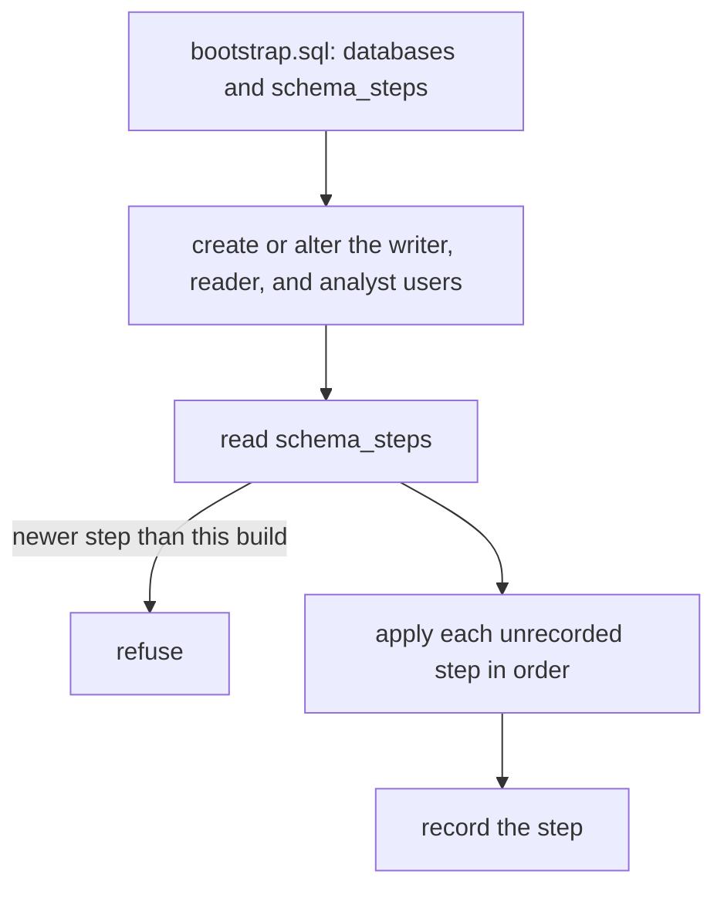

# History store

`history` is the ClickHouse side of central history: the connection pools the
sink and the history read share, the migrator that owns the schema, and the
mirror of registry devices. The design is the
[history store direction](../../../../../docs/architecture/2026-10-08-history-store-direction.md).

```go
store, err := history.Open(history.Config{
	Endpoints: []string{"127.0.0.1:9000"},
	Database:  "flowseer",
	Admin:     history.User{Name: "flowseer_admin", PasswordFile: "/etc/flowseer/clickhouse/admin.password"},
	Writer:    history.User{Name: "flowseer_writer", PasswordFile: "/etc/flowseer/clickhouse/writer.password"},
	Reader:    history.User{Name: "flowseer_reader", PasswordFile: "/etc/flowseer/clickhouse/reader.password"},
	Analyst:   history.User{Name: "flowseer_analyst", PasswordFile: "/etc/flowseer/clickhouse/analyst.password"},
})
```

`Open` connects to nothing. A pool dials when a call first needs a connection,
tries the endpoints in order, and reads the user's password file at that moment,
so a rotated secret reaches the next connection without a restart. A call to an
unreachable server fails within the 5 second dial timeout. No pool sets a
default database, so every statement names `<database>.<table>`.

## Migrator

`history.Migrate` runs as the admin user and only from the device binary's
one-shot mode. The service never creates schema. Two processes must not run it
at once, since `schema_steps` holds no lock.



The steps are the files under [`sql/steps`](sql/steps), numbered from 1 without
a gap. A step runs its statements one by one and is recorded after the last
one, so a failed step stays unrecorded and the next run starts there. Every
statement is therefore idempotent (`IF NOT EXISTS`). A statement file separates
statements with a line holding `-- statement`, because a semicolon can occur
inside a string. Users come from Go, not SQL, since each statement carries the
SHA-256 of the password file's contents and never the password. Each run
alters the users again, so a rotated file takes effect on the next migration.

Names reach SQL through a template: `{{.DB}}`, `{{.Control}}`, `{{.Writer}}`,
`{{.Reader}}`, `{{.Analyst}}`, `{{.OnCluster}}`, and `{{.Engine "<MergeTree
family>" "<args>"}}`. Every name matches `^[A-Za-z_][A-Za-z0-9_]{0,63}$`
before it is interpolated.

### Single node and cluster

| | `Cluster` empty | `Cluster` set |
| --- | --- | --- |
| Databases | server default engine | `ENGINE = Replicated` |
| Tables | plain `MergeTree` family | `Replicated` family with no Keeper path |
| Users, profiles, grants, row policies, resources, workloads | plain statements | `ON CLUSTER` |
| Tables and views | plain DDL | plain DDL, which the Replicated database replicates |

The cluster form follows the ClickHouse guidance in
[research 01](../../../../../docs/research/clickhouse-history-store/01-clients-durability-dedup.md),
section 7. The integration test runs it on one node with an embedded Keeper and
a one-node cluster, which checks the DDL form and the `ON CLUSTER` syntax. It
does not measure replication. Two conditions come from the server:

- The database must not exist yet, or must already be `Replicated`. The
  `clickhouse-server` image creates the database named by `CLICKHOUSE_DB` as an
  Atomic database, and a `Replicated` table engine then fails with "Macro 'uuid'
  in engine arguments is only supported when ... using the Replicated database
  engine".
- `ON CLUSTER` statements need the `CLUSTER` privilege for the admin user.

## Schema

| Table | Pattern | Key | Notes |
| --- | --- | --- | --- |
| `syslog` | events | `(tenant_id, device_id, ts, record_id)` | `ReplacingMergeTree`, weekly partitions per retention class, text index on `message`, `vendor_tag` derived from Cisco-style messages |
| `syslog_by_location` | events, second ordering | `(tenant_id, location_id, ts, device_id, record_id)` | keys only, fed by a view |
| `syslog_daily` | counts | `(tenant_id, device_id, severity, vendor_tag, day)` | `SummingMergeTree`, severity 255 means no priority |
| `device_dim` | dimension | `(tenant_id, device_id)` | plain table, `ReplacingMergeTree(ver)`, joined at read time |
| `<database>_control.user_tenants` | access mapping | `(user, tenant_id)` | which tenants an analyst user reads |
| `<database>_control.schema_steps` | migrator record | `step` | |

`ts` is the received time as `DateTime64(3)`. `severity` and `facility` hold the
protobuf enum number, and bits of `present` say what the message carried (bit 0
severity, 1 facility, 2 `sent_at`, 3 `source_ip`), since no column is Nullable.
`retention_class` is the tenant's enum number, 1 short, 2 standard, 3 long, and
leads every partition key so a part expires whole. Raw syslog rows live 90 days,
1 year, and 3 years, and daily counts 2, 3, and 5 years.

A redelivered record is stored again past the insert deduplication window. The
`ReplacingMergeTree` key collapses it at merge, so a read that lists or counts
rows uses `LIMIT 1 BY record_id` or `FINAL`. `syslog_daily` counts a
redelivery twice.

Both views run as the user that migrated (`DEFINER = CURRENT_USER`), so the
writer needs `INSERT` on `syslog` and nothing else. A view without the clause
runs as the inserting user, who then needs `SELECT` on the source columns
([view docs](https://clickhouse.com/docs/sql-reference/statements/create/view)).
A different admin on a later migration does not change an existing view.

## Users, limits, and tenants

| User | Profile | Workload | Access |
| --- | --- | --- | --- |
| writer | `svc_writer` | `ingestion` | `INSERT` on `syslog` and `device_dim` |
| reader | `svc_reader` | `monitoring` | `SELECT` on the history database |
| analyst | `analyst` | `analytics` | `SELECT` per table, through a row policy |

`svc_reader` pins `max_execution_time` 30 s, `max_rows_to_read` 10,000,000,
`max_memory_usage` 2 GiB, and `max_threads` 8 as `CONST`, so a client cannot
raise them and an overrun throws. The analyst profile is sized for a host with
16 GiB or more. Workload priorities run ingestion, then monitoring, then
analytics, with no thread cap, since the right number depends on the cores.

The analyst reads a tenant only when `user_tenants` maps it. Each table that
holds `tenant_id` has one policy of the form `tenant_id IN (SELECT tenant_id FROM
<database>_control.user_tenants WHERE user = currentUser())`, which prunes the
primary key where a per-row `dictHas` would not. An operator maps tenants by
hand:

```sql
INSERT INTO flowseer_control.user_tenants (user, tenant_id)
VALUES ('flowseer_analyst', '018f0000-0000-7000-8000-0000000000a1');
```

Grants to the analyst are per table. A table added later stays closed to it
until a step grants it together with its policy.

## Tests

```bash
go test -race ./src/services/device/internal/history/...
TESTCONTAINERS_RYUK_DISABLED=true go test -race -tags=history_integration ./src/services/device/internal/history/test/integration/
```

The first command needs no Docker. The second starts the pinned ClickHouse
image per test and fails, not skips, when the image cannot start.
