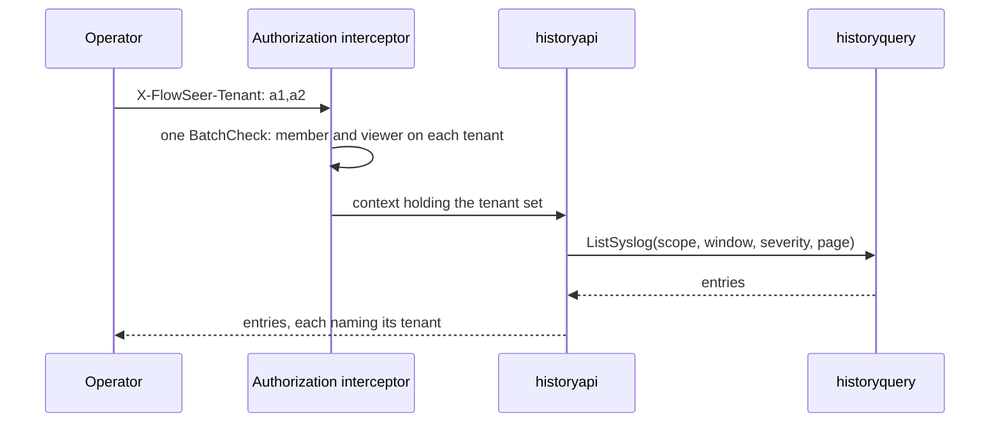

# History API

`historyapi` serves `HistoryService`, the operator's read of stored history. The
one call, `ListSyslogRecords`, lists the syslog records of a device or a location
for the tenants the call names. The host mounts it behind the operator
interceptors when the configuration has a `history` section.



## Tenants

The rule is `RULE_MODE_TENANT`, relation `viewer`, `multi_tenant: true`. The
interceptor admits up to 25 tenants in one `BatchCheck`, fails the whole call when
any is denied, and puts the set on the context. The handler reads
`tenant.SetFrom` through `historyquery` and takes nothing from the request body.
A partner's active admins hold `viewer` on a customer through the partner link,
so one call can read a customer's history with the partner's own.

## Records

An entry carries the record id, the owning tenant as data, and a `SyslogRecord`
rebuilt from the stored row. A header field stored as an empty string is left
unset. The `present` bits decide whether severity, facility, `sent_at`, and the
source address are set, so a stored severity of 0 comes back as `EMERGENCY` and a
message without a priority comes back with none. An IPv4-mapped IPv6 source
address becomes an IPv4 address again. Structured data elements are regrouped
from their parallel arrays in stored order. The message bytes come back as
stored, including bytes that are not UTF-8.

## Errors

| Failure | Connect code |
| --- | --- |
| A page token this service did not issue | `InvalidArgument` |
| A read that reached a limit of the reader profile | `ResourceExhausted` |
| A store that cannot be reached or answered another error | `Unavailable` |
| A call that reached the handler with no admitted tenant | `Internal` |

The caller sees the user message of each and never the ClickHouse text. A client
that gets `ResourceExhausted` narrows the window or the scope.

## Tests

```bash
go test -race ./src/services/device/internal/historyapi/...
TESTCONTAINERS_RYUK_DISABLED=true go test -race -tags=history_integration ./src/services/device/internal/historyapi/test/integration/
```

The integration tests run a pinned ClickHouse through `history/historytest`.
They cover a redelivered record listed once before and after a merge, a header
of two tenants, a denied tenant, paging, the severity filter, the location scope,
and a 30-day read of 12,000,000 rows that fails while a concurrent insert
completes.
