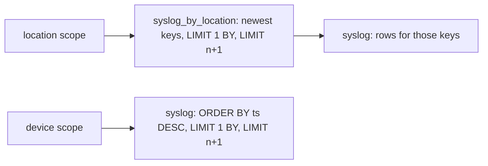

# History query

`historyquery` builds and runs the history read statements. A caller hands it a
scope, a time window, an optional minimum severity, and a page, and it returns
one page of stored syslog records, newest first:

```go
reader := historyquery.NewReader(store.Reader(), "flowseer")
page, err := reader.ListSyslog(ctx, historyquery.Query{
	Scope:    historyquery.DeviceScope(deviceID),
	From:     from,
	To:       to,
	PageSize: 100,
})
```

## Tenants come from the context

`ListSyslog` takes no tenant argument. It reads the set the authorization
interceptor admitted for the call (`tenant.SetFrom`), and refuses a context that
carries none with `ErrCodeNoTenants` before any statement exists. The set is
bound as the `tenants` parameter. It is never part of the statement text, and
every `WHERE` of every statement starts with `tenant_id IN {tenants:Array(String)}`,
so the condition prunes by the leading sort-key column and cannot be left out.
`TestEveryWhereOfEveryStatementStartsWithTheTenantCondition` checks the text of
both scopes with every filter.

## Statements

A device scope reads `syslog` directly. A location scope selects the newest keys
from `syslog_by_location`, which holds no message text, and fetches their rows
from `syslog` by the full key:



Both end with `LIMIT 1 BY tenant_id, record_id`. A redelivery past the insert
deduplication window is stored twice until a merge collapses it, and this
returns it once before and after. The pair `(tenant_id, record_id)` keeps one
tenant's repeat from hiding another tenant's record.

A page fetches one row more than it returns. That row decides whether a next
page exists. The page token is the base64 of the last returned row's receive
time in milliseconds and record id, and the next page adds
`(ts, record_id) < (token)`. A token is only valid against the same scope,
window, and filter.

A severity filter keeps `bitAnd(present, 1) = 1 AND severity <= n`, so a message
with no priority is left out, and severity 0 (emergency) is a real value.

## Limits

The reader pool connects as the user with the `svc_reader` profile, which pins
`max_rows_to_read` at 10,000,000, 30 seconds, and 2 GiB. A device that stores
more than 10,000,000 rows in a window fails the read for that window. The
integration test `TestAThirtyDayReadPastTheReaderRowLimitFailsWhileInsertsKeepCompleting`
seeds 12,000,000 rows of one device and shows a 30-day read fail while a one-day
read of the same device answers. A server exception with code 158, 159, 160, 202,
241, 307, or 396 maps to `ErrCodeLimit`, which the API answers as
`ResourceExhausted`. Every other failure is `ErrCodeStore` and retryable, and a
cancelled context returns its own error.

## Tests

```bash
go test -race ./src/services/device/internal/historyquery/...
```

The statement and paging tests need no Docker. The read against a real server is
exercised by the integration tests of
[`historyapi`](../historyapi/README.md).
