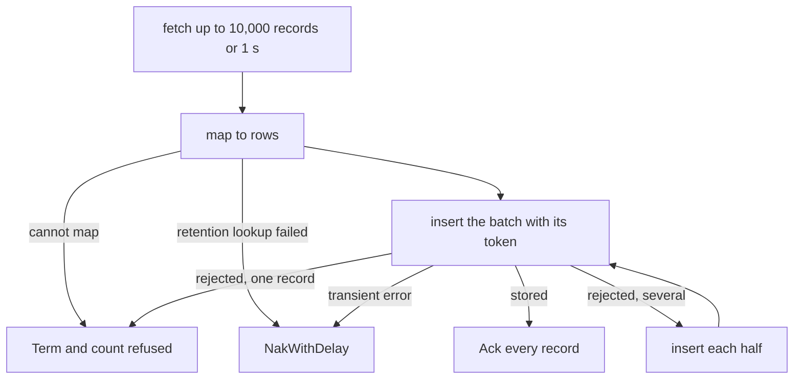

# History sink

The sink follows the central syslog ingest stream (`FLOWSEER_INGEST_SYSLOG`)
with the durable consumer `history_sink`, maps each record to a row of the
[`syslog` table](../history/README.md), and inserts batches synchronously. A
record is acknowledged only after the insert returns, so a record the store has
not confirmed stays in the stream. The host starts the sink as the last module,
only when the configuration has a `history` section:

```go
sink, err := historysink.Start(ctx, historysink.Config{
	JetStream: hub.JetStream(),
	Inserter:  historysink.NewInserter(store.Writer(), "flowseer"),
	Retention: retentionOfTenant,
	Location:  locationOfDevice,
	Mirror:    mirrorRegistryDevices,
})
if err != nil {
	return err
}
return sink.Run(ctx)
```

`Start` never touches ClickHouse, and `Run` returns only when its context ends.
A store that is down or refusing leaves the records in the stream and the
sink retrying.



## What an error means

An insert error is either a rejection or transient.

- A rejection is an error the server gives for what the rows hold: a
  `clickhouse.Exception` with one of the codes in `rejectedCodes`
  (`inserter.go`), or a column the driver cannot append. The same rows fail the
  same way again. The sink splits the batch in halves until the failing record
  is alone, terminates it, and counts it as refused. The other records of the
  batch are stored.
- Everything else is transient: a refused connection, a timeout, a server that
  is read-only or short of replicas, or an access error. The whole batch gets
  `NakWithDelay`, and the sink pauses before the next fetch. No record is
  terminated for a transient error, because that would turn a ClickHouse outage
  into data loss.

A record that cannot become a row is terminated before any insert: a subject
whose tenant token is not a tenant id, a payload that does not decode, a device
or record id that is not a UUID.

## Deduplication

Each insert carries `insert_deduplication_token`, the SHA-256 of the batch's
stream sequences in ascending order. A token built from the first and last
sequence alone would drop a later batch with the same ends and other members,
which two replicas sharing the consumer produce. The token only deduplicates
where the server keeps block hashes, which is a replicated table inside the
deduplication window. Past that, the `ReplacingMergeTree` key collapses a
repeat at merge, as the [history store direction](../../../../../docs/architecture/2026-10-08-history-store-direction.md)
describes.

## Stamps and the mirror

Each row takes `location_id` from the registry device's configured location and
leaves `site_id` and `software_version` empty. `retention_class` comes from the
tenant record (`RETENTION_CLASS_STANDARD` when the tenant has none) and is
cached for the life of the sink, since a class never changes after creation.

`Mirror` copies the registry's devices into `device_dim` under the tenant of
the registry's edge. `Run` calls it before each fetch until it succeeds once,
so a ClickHouse that was down at start is mirrored when it returns.

## Instruments

Scope `go.aledante.io/FlowSeer/src/services/device/internal/historysink`.

| Name | Type | Unit | Counted when |
| --- | --- | --- | --- |
| `flowseer.history.records.inserted` | counter | `{record}` | the store confirmed the batch and the records were acknowledged |
| `flowseer.history.records.refused` | counter | `{record}` | a record was terminated. `flowseer.history.reason` is `record` or `rejected` |
| `flowseer.history.records.retried` | counter | `{record}` | a record was negatively acknowledged |
| `flowseer.history.batch.duration` | histogram | `s` | an insert call returned. `error.type` is `store` or `rejected` on failure |
| `flowseer.history.record.age` | histogram | `s` | a record reached the sink, measured from its stream timestamp |
| `flowseer.history.records.discarded` | gauge | `{record}` | sampled every 10 s: the stream's first sequence minus one, minus the consumer's acknowledged floor |

A discarded value above zero means the stream removed records by age or size
before the sink acknowledged them, which a store outage longer than the
stream's retention causes. The ingest stream keeps records for 72 hours by
default, and `ingest_streams` in the service configuration sets its size.
Warnings are logged at most once per 10 seconds for each reason.
