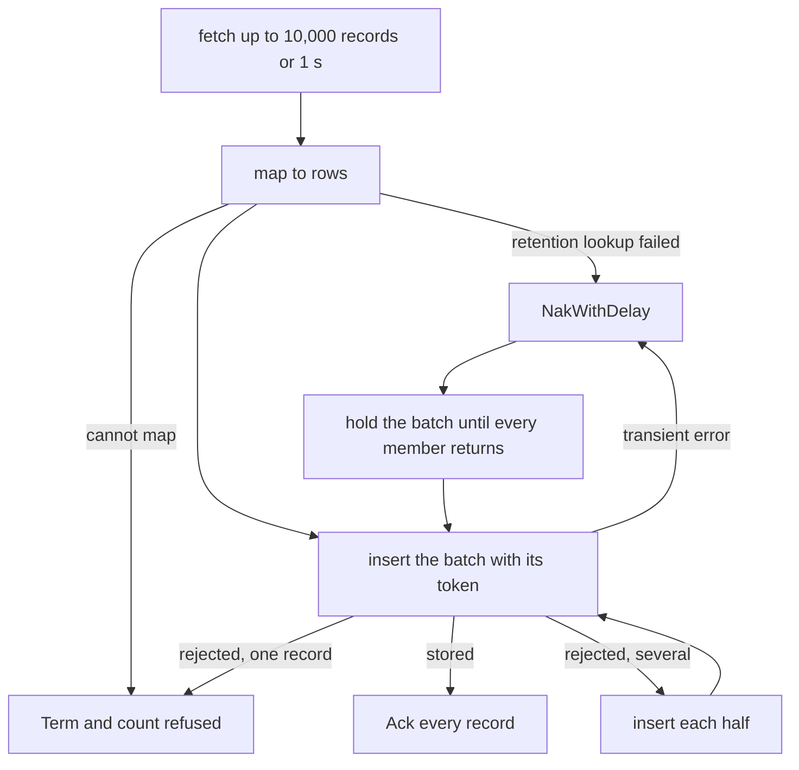
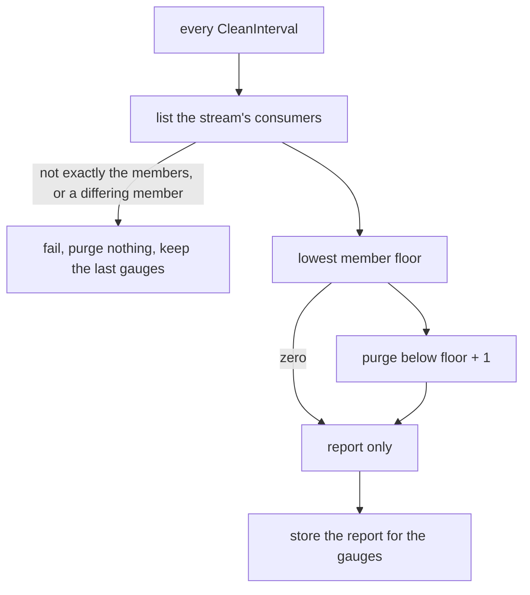

# History sink

The sink follows the central syslog ingest stream (`FLOWSEER_INGEST_SYSLOG`)
with the durable consumer `history_sink`, which the hub creates with the stream
and which is the stream's only member. The sink maps each record to a row of the
[`syslog` table](../history/README.md), and inserts batches synchronously. A
record is acknowledged only after the insert returns, so a record the store has
not confirmed stays in the stream. The host starts the sink as the last module,
only when the configuration has a `history` section:

```go
sink, err := historysink.Start(ctx, historysink.Config{
	JetStream: hub.JetStream(),
	Inserter:  historysink.NewInserter(store.Writer(), "flowseer"),
	Retention: retentionOfTenant,
	Location:  locationOfDevice,
	Mirror:    mirrorRegistryDevices,
})
if err != nil {
	return err
}
return sink.Run(ctx)
```

`Start` binds the hub's member and never touches ClickHouse. When the server
reports the member missing, `Start` creates it again with
`edgebus.IngestConsumerConfig` and logs a warning. The new member starts at the
first stored record, so the stream offers every stored record once more. A
member whose config differs is bound as it is and cleanup fails on it (see
[Cleanup](#cleanup)). `Run` returns only when its context ends. A store that is
down or refusing leaves the records in the stream and the sink retrying.



## What an error means

An insert error is either a rejection or transient.

- A rejection is an error the server gives for what the rows hold: a
  `clickhouse.Exception` with one of the codes in `rejectedCodes`
  (`inserter.go`), or a column the driver cannot append. The same rows fail the
  same way again. The sink splits the batch in halves until the failing record
  is alone, terminates it, and counts it as refused. The other records of the
  batch are stored.
- Everything else is transient: a refused connection, a timeout, a server that
  is read-only or short of replicas, or an access error. The whole batch gets
  `NakWithDelay`, and the sink pauses before the next fetch. No record is
  terminated for a transient error, because that would turn a ClickHouse outage
  into data loss. When a rejected batch's first half fails transiently, that
  half is held and the half the sink never sent is negatively acknowledged
  without being held.

A record that cannot become a row is terminated before any insert: a subject
whose tenant token is not a tenant id, a payload that does not decode, a device
or record id that is not a UUID.

## Deduplication and held batches

Each insert carries `insert_deduplication_token`, the SHA-256 of the batch's
stream sequences in ascending order. A token built from the first and last
sequence alone would drop a later batch with the same ends and other members,
which two replicas sharing the consumer produce. On a single node the token
deduplicates through the `non_replicated_deduplication_window` that migration
step 8 sets on the `syslog` table, and a replicated table keeps its own window.
Past the window, the `ReplacingMergeTree` key collapses a repeat at merge, as
the [history store direction](../../../../../docs/architecture/2026-10-08-history-store-direction.md)
describes.

A transient insert error is ambiguous, because the server may hold the block
when the connection broke. A token only helps when the retry carries the same
members, so the sink holds the failed batch and inserts it again, with the same
token, once every member has been redelivered. Records that arrive meanwhile
form batches of their own. A member that a peer sink took never returns, so a
batch whose members are not all back within `2 * RetryDelay + 10 s` is let go:
the members that did return are negatively acknowledged and every member is a
new record. The deadline is a liveness bound. It stays under the member's
two-minute `AckWait` for any `RetryDelay` below 55 seconds, and past that the
server redelivers a held member and the batch takes the newer delivery. A
duplicate row from a let-go batch is absorbed by the table key and the
read-time deduplication. Stopping the sink hands every held batch back without
counting a retry.

## Cleanup

The ingest stream refuses a new record at its byte bound and removes nothing by
age, so the stream's room comes from cleanup alone. Every `CleanInterval`
(five seconds by default) `Run` calls `edgebus.CleanIngest`, which purges the
records below the lowest acknowledgement floor of the stream's members. The
floor moves past a record only when the member acknowledged or terminated it.



A record the store has not confirmed holds the floor, and with it every record
above it, because a purge removes a prefix. One record that the sink retries
for an hour keeps its successors in the stream for that hour, so a long outage
fills the stream to its bound and intake refuses new records instead of
removing pending ones. A record the store permanently rejects is terminated,
counted in `flowseer.history.records.refused`, and no longer holds the floor.
A failed pass logs at the limited rate and leaves the last report in the
gauges. The sink keeps consuming.

## Stamps and the mirror

Each row takes `location_id` from the registry device's configured location and
leaves `site_id` and `software_version` empty. `retention_class` comes from the
tenant record (`RETENTION_CLASS_STANDARD` when the tenant has none) and is
cached for the life of the sink, since a class never changes after creation.

`Mirror` copies the registry's devices into `device_dim` under the tenant of
the registry's edge. `Run` calls it before each fetch until it succeeds once,
so a ClickHouse that was down at start is mirrored when it returns.

## Instruments

Scope `go.aledante.io/FlowSeer/src/services/device/internal/historysink`.

| Name | Type | Unit | Counted when |
| --- | --- | --- | --- |
| `flowseer.history.records.inserted` | counter | `{record}` | the store confirmed the batch and the records were acknowledged |
| `flowseer.history.records.refused` | counter | `{record}` | a record was terminated. `flowseer.history.reason` is `record` or `rejected` |
| `flowseer.history.records.retried` | counter | `{record}` | a record was negatively acknowledged |
| `flowseer.history.records.redelivered` | counter | `{record}` | the stream delivered a record it had delivered before |
| `flowseer.history.batch.duration` | histogram | `s` | an insert call returned. `error.type` is `store` or `rejected` on failure |
| `flowseer.history.cleanup.duration` | histogram | `s` | a cleanup pass returned. `error.type` is `cleanup` on failure |
| `flowseer.history.record.age` | histogram | `s` | a record reached the sink, measured from its stream timestamp |
| `flowseer.history.records.pending` | gauge | `{record}` | read at the last cleanup pass: records the member has not resolved |
| `flowseer.history.stream.usage` | gauge | `By` | read at the last cleanup pass: bytes the stream stores |
| `flowseer.history.stream.limit` | gauge | `By` | read at the last cleanup pass: the stream's byte bound |
| `flowseer.history.stream.oldest.age` | gauge | `s` | read at the last cleanup pass: age of the first stored record |

The four gauges report nothing until a pass has succeeded. No instrument counts
discarded records, because the stream removes none by itself. Alert in this
order: `stream.usage` against `stream.limit`, then
`flowseer.intake.records.retried` with reason `stream_full`, then
`flowseer.history.record.age` nearing the per-edge age. A stream near its limit
with `records.pending` high means the store is slow or down. A stream near its
limit with `records.pending` low means cleanup is failing, which
`cleanup.duration` with `error.type` set shows.
Warnings are logged at most once per 10 seconds for each reason.
