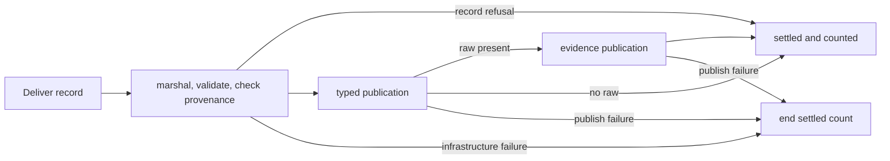

# Central intake

[`Handler`](handler.go) implements central's `IngestService.Deliver`. It
validates each delivered `IngestRecord` and publishes it into the central
streams owned by `edgebus`.

```go
handler, err := intake.NewHandler(intake.HandlerConfig{
	Central:    hub.JetStream(),
	EdgeID:     verifiedEdgeID,
	EdgeTenant: edgeStoreTenant,
})
if err != nil {
	return err
}
```

The edge comes from the call's verified assertion and the tenant from the
edge store. A missing edge answers `unauthenticated`. A tenant lookup failure
answers `unavailable`. Neither publishes a record.



`settled` counts the leading records stored, already stored, or refused for
a reason about the record. A provenance mismatch or validation rule violation
settles that record and allows the batch to continue. A marshal failure,
validator infrastructure failure, or publish failure ends the count. The
edge resumes from the first unsettled record.

[`prepareRecord`](prepare.go) derives the typed subject from the payload's
device id. Without raw evidence, it publishes the encoded record unchanged.
With raw evidence, it publishes the typed record with `raw` cleared, followed
by the original bytes as evidence. Both publications use
`<tenant>.<record_id>` as their JetStream message id. The subjects are
`flowseer.<tenant>.ingest.syslog.<device-id>` and
`flowseer.<tenant>.evidence.syslog.<device-id>`.

The typed publication goes first so a full typed stream refuses before
storing evidence. A full typed stream ends the count with a `stream_full`
retry. The edge's backoff spaces the next attempt. If evidence fails after
the typed record stores, the next attempt republishes the typed record with
the same message id. Central delivery is at least once, with duplicate
suppression bounded by the stream windows configured in
[`hub.go`](../../../../modules/edgebus/hub.go).

The handler emits these instruments in the scope
`go.aledante.io/FlowSeer/src/services/device/internal/intake`:

| Instrument | Counting point |
| --- | --- |
| `flowseer.intake.records.republished` | One record after every required publication succeeds |
| `flowseer.intake.records.duplicate` | One delivery with at least one duplicate publish acknowledgement |
| `flowseer.intake.evidence.stored` | One successful evidence publish acknowledgement |
| `flowseer.intake.records.refused` | One settled refusal, by `flowseer.intake.reason` |
| `flowseer.intake.records.retried` | One unsettled attempt, by `flowseer.intake.reason` |
| `flowseer.intake.record.duration` | Seconds from record delivery to its final outcome |

The publication counters carry `flowseer.intake.record_type`. Refusal reasons
are `invalid` and `foreign_provenance`. Retry reasons are `stream_full`,
`publish_failed`, `validation`, and `marshal`.

Refusals emit the WARN event `flowseer.intake.record.refused`, carrying the
edge id and refusal reason. Retry warnings carry the edge id and `error.type`.
Each is limited separately to one warning per edge every ten seconds. Retry
warnings stop when the call's context ends. Counters count every outcome.

`BenchmarkDeliver` measures batches of 64 and 1024 records with 256-byte syslog
messages against a hub that syncs every message. It reports `records/s`
without a threshold:

```bash
go test -run '^$' -bench BenchmarkDeliver -benchtime 20x ./src/services/device/internal/intake/
```
