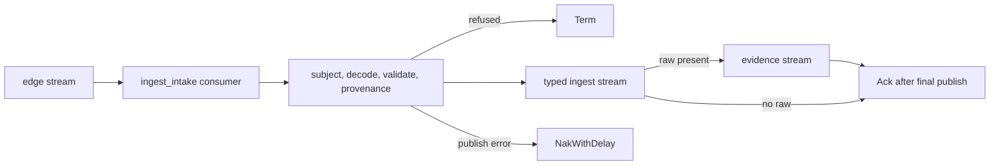
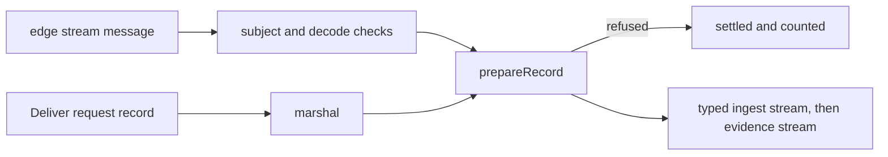

# Central intake

Central intake follows each attached edge buffer and moves validated
`IngestRecord` messages into the central streams owned by `edgebus`. The host
starts it with the hub's central JetStream context:

```go
in, err := intake.Start(ctx, intake.Config{
	Hub:     hub,
	Central: hub.JetStream(),
})
if err != nil {
	return err
}
defer in.Close()
```

The edge is identified by the stream it came from. The message subject must
begin with that edge's `flowseer.<tenant>.edge.<edge-id>.ingest.` subtree. Intake
then unmarshals the envelope, runs `protovalidate`, and checks that
`provenance.edge` names the same edge. A refusal is terminated and counted, so
the source consumer does not redeliver it.



## The delivery call

`NewHandler` returns central's `IngestService` handler. An edge calls
`Deliver` with a batch of records instead of publishing to its stream. The
handler and the stream consumer share `prepareRecord`, which validates a
record, checks its provenance, picks its type, splits its evidence, and names
its message id, so both paths refuse and publish alike.



The handler takes the edge from the call's assertion and the tenant from the
edge store, where the consumer reads both from the stream a record arrived in.
A lookup failure answers `unauthenticated` (no edge) or `unavailable` (no
tenant) and publishes nothing. It then walks the records in order and answers
with `settled`, the count of leading records stored, already stored, or
refused for a reason about the record. A marshal failure, a validator failure
that is not a rule violation, and a publish failure end the count and count a
retry, and the call still answers so the edge resumes from `settled`. The
handler does not use the consumer's full-stream gate. A full typed stream
ends the count with a `stream_full` retry and the edge's backoff spaces the
next attempt. It records `flowseer.intake.record.duration` per record and no
age, since a request has no stream timestamp.

`BenchmarkDeliver` delivers batches of 64 and 1024 records of 256-byte syslog
messages to a hub that syncs every message, and reports `records/s` without a
threshold:

```bash
go test -run '^$' -bench BenchmarkDeliver -benchtime 20x ./src/services/device/internal/intake/
```

A typed syslog record uses the device id in its payload, even when the edge
published it on a different `ingest.<source>` branch. A record without raw
evidence is republished as received. A record with raw evidence is published
first to `flowseer.<tenant>.ingest.syslog.<device-id>` after `raw` is cleared,
then to `flowseer.<tenant>.evidence.syslog.<device-id>` with the original
bytes. Both messages use `<tenant>.<record_id>` as their JetStream message id.

Central delivery is at least once. A validation infrastructure error or a
publish failure uses `NakWithDelay`, so the edge message remains pending. A
message from an edge the hub has no tenant for is retried the same way, because
that says nothing about the record. A repeat inside the central stream's
duplicate window, ten minutes for typed records and capped by the stream's
maximum age for evidence, is acknowledged as a duplicate. A message can still
be lost when the edge stream reaches its age or byte bound, because JetStream
discards its oldest message. The stream and subject definitions live in
[`src/modules/edgebus/subjects.go`](../../../../modules/edgebus/subjects.go)
and the central stream limits live in
[`src/modules/edgebus/hub.go`](../../../../modules/edgebus/hub.go).

Intake publishes these instruments in the scope
`go.aledante.io/FlowSeer/src/services/device/internal/intake`:

- counters for republished records, deliveries a central stream reported as a
  duplicate (one count per delivery), stored raw evidence, refusals by
  reason, and retry requests by reason
- `flowseer.intake.record.duration` in seconds from delivery to `Ack`, `Term`,
  or `NakWithDelay`, and on the delivery call to the record's final outcome
- `flowseer.intake.record.age` in seconds from the edge stream timestamp to
  delivery

Refusals emit the named event `flowseer.intake.record.refused` at WARN level.
The event carries the stream edge, refusal reason, and subject. It is limited to
one event per edge every ten seconds, and remains owed after the delivery
lifetime ends. Retry warnings carry `error.type` `validation` or `marshal` and
are limited separately to one warning per edge every ten seconds. The refusal
event and retry warning therefore do not hide each other. The full refusal
count remains in the counter.

Intake logs terminal consumer errors as `intake consumer stopped` with
`error.type` `consumer_deleted`, `bad_request`, or `connection_closed`.
Terminal messages are not limited. Non-terminal errors use
`intake consumer error` with `error.type` `no_heartbeat` or `consume_error` and
are limited to one message per edge every ten seconds. Consumer messages are
skipped after the delivery lifetime ends.

## When central is full

A typed stream at its byte bound refuses the publication with an error for
which `edgebus.IsStreamFull` is true. Intake then publishes nothing of that
record type for one retry delay and naks each delivery of that type in the
window. A duplicate acknowledgement does not open the gate early. The server
answers a repeated message id before it stores, and so before it checks
capacity (`server/stream.go:6953-6969` and the store call at `:7320-7345` in
nats-server v2.15.0).

The typed record goes first so a full typed stream never stores evidence
again on a retry. When the evidence publication fails after the typed record
was stored, the retry sends the typed record again and the stream answers it
as a duplicate within its window.

`flowseer.intake.records.retried` counts attempts, not records. Its
`flowseer.intake.reason` is `stream_full`, `publish_failed`, `unknown_edge`,
`validation`, or `marshal`. Inside a closed gate the first delivery of each
message id counts one `stream_full` retry and later deliveries count none, so
one record refused across three retry delays adds three.

Alert in this order: the sink's stream bytes against its limit, then retries
with reason `stream_full`, then `flowseer.intake.record.age` nearing the
per-edge stream's age bound.

A refused record waits in the per-edge hub stream, whose default bounds are
64 MiB and 24 hours and whose telemetry traffic shares the space. That stream,
the edge buffer, and the evidence stream stay rolling. Accepted central work
starts when the typed stream stores the record, and nothing here promises
end-to-end lossless delivery.
