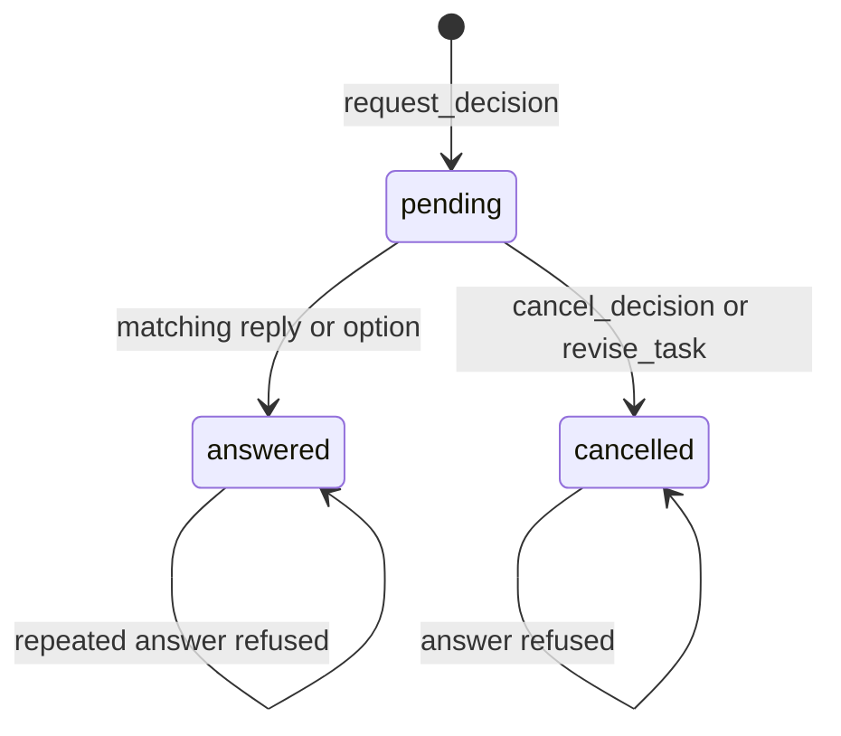

# Harness bridge and state

The [bridge](bridge.py) lets a local coordinator submit a decision and wait
for one durable answer. Its [store](state.py) keeps task identities and
delivery records across restarts. It writes only to the configured state
directory, outside the checkout.

For a task ID already created in the store:

```bash
uv run tools/scripts/run.py harness bridge ask \
  --config /srv/flowseer/config.toml \
  --task TASK_ID --request /srv/flowseer/question.json --timeout 300
```

`question.json`:

```json
{
  "version": 1,
  "request_id": "choose-storage",
  "question": "Which storage should hold task state?",
  "options": [
    {"id": "sqlite", "label": "SQLite", "tradeoff": "Restricted to one host"},
    {"id": "files", "label": "Files", "tradeoff": "Requires explicit locking"}
  ],
  "recommendation": "sqlite"
}
```

An option answer prints one line:

```json
{"decision": "DECISION_ID", "revision": 1, "option": "sqlite", "text": null}
```

A Custom Answer sets `option` to null and `text` to the reply. The decision
ID is issued by the store. `request_id` is chosen by the coordinator and
identifies the same request across retries within a task. Reusing it with
different content is refused.

## Configuration

[config.py](config.py) reads TOML from `--config` or
`FLOWSEER_HARNESS_CONFIG`. The explicit path takes precedence. Relative
paths inside the file resolve against its directory. The file, state
directory, and credential file must resolve outside the checkout.

```toml
state_dir = "/srv/flowseer/state"
bot_token_file = "/srv/flowseer/secrets/bot-token"
allowed_user_id = 7
private_chat_id = 11

[default]
agent = "claude"
model = "default-model"

[[alternatives]]
agent = "codex"
model = "gpt-5.5"
```

All fields are required. An empty `alternatives = []` belongs before
`[default]`. IDs must be positive integers. Agent and model strings must be
nonempty, and each pair must be distinct. The credential file must be a
regular file with no group or other permission bits, such as mode `0600`.
The loader checks its metadata without reading the credential.

## Payloads and exit codes

Each command takes `--task` and `--request`. Every payload is a JSON object
with integer `version: 1` and a nonempty string `request_id`. Unknown fields
and versions are refused. Files larger than 64 KiB are refused before any
store is opened.

| Command | Additional fields | Behavior |
| --- | --- | --- |
| `ask` | `question`, `options`, `recommendation` | Stores a decision and polls once a second |
| `progress` | `summary` | Stores an event and queues changed content |
| `result` | `status`, `artifacts`, `evidence` | Stores evidence and queues a notification |
| `ack` | `action` | Stores an acknowledgement event |

`question` and `summary` are nonempty strings. `options` contains 1 to 20
objects with distinct, nonempty `id` strings and nonempty `label` and
`tradeoff` strings. `recommendation` names an option ID.

`result.status` is `completed`, `failed`, or `blocked`. `artifacts` is a
nonempty array of absolute path strings. `evidence` is a nonempty array of
strings. For example:

```json
{
  "version": 1,
  "request_id": "storage-result",
  "status": "completed",
  "artifacts": ["/srv/flowseer/artifacts/storage-tests.txt"],
  "evidence": ["Focused unittest discovery passed"]
}
```

`ack.action` is `cancel`, `pause`, `resume`, or `steer`. These are events for
the coordinator to reconcile. Result and acknowledgement events set no
workflow checkpoints. The bridge does not launch processes or perform
commit or land operations.

| Exit | Meaning |
| --- | --- |
| `0` | An answer was printed, or an event was stored |
| `2` | Invalid arguments, configuration, payload, or store operation |
| `3` | The decision was cancelled |
| `4` | The optional timeout expired |

Timeout is a finite, nonnegative number of seconds and leaves the decision
pending. Commands other than `ask` return immediately with no standard
output. Errors go to standard error.

## Store boundaries

`Store(Config)` creates `state.sqlite3` with schema version 1. A different
nonzero version is refused. Each mutation uses a separate connection and a
`BEGIN IMMEDIATE` transaction with a ten-second busy timeout. Unique keys
protect inbound update IDs, decision answers, notification keys, and open
operations. The crash and concurrent-writer tests are in
[test_state.py](../tests/harness/test_state.py).



A decision stores the task revision, commit ID, and diff digest at issue
time. `revise_task` advances the revision, binds a new proposal, and cancels
pending decisions in the same transaction so waiting asks exit 3. Retrying
the same request ID returns the cancelled decision. A reply against an
older fingerprint still reports `obsolete_revision`. `issue_callback` stores
a random 32-byte hexadecimal ID mapped to its task, decision, revision,
and option.
A null option requests a Custom Answer without resolving the decision.
`map_message` binds the reply message to that task and decision.

`ingest` accepts normalized dictionaries. Common fields are `update_id`,
`kind`, `chat_id`, `thread_id`, and `sender_id`. Supported kinds are:

| Kind | Additional fields | Store effect |
| --- | --- | --- |
| `new_task` | `brief` | Creates a task with the configured default pair |
| `callback` | `callback_id` | Resolves the issued callback |
| `message` | `reply_to_message_id`, `text` | Answers the mapped decision |
| `stop` | `draft_id` | Records `cancel_requested` for the mapped task |

The normalized `callback_id` is the opaque button data, rather than the
Telegram callback query ID. The [Bot API CallbackQuery fields](https://core.telegram.org/bots/api#callbackquery)
carry button data and message context. Bind a received natural-language
brief before issuing agent/model buttons:

```python
callbacks = store.issue_agent_options("Build storage")
callback = callbacks[1]
result = store.ingest({
    "update_id": 18, "kind": "callback", "sender_id": 7,
    "chat_id": 11, "thread_id": None, "callback_id": callback,
})
store.attach_topic(result["task_id"], 4)
```

The stored brief and pair survive restart. `issue_agent_options` issues
one card's callbacks in configured order, default first. Accepting any
button consumes the whole card in the task creation transaction so sibling
buttons cannot create another task. `issue_agent_option` issues a standalone
button. Callers that already carry a brief may omit it for that button at
issue time and supply it on the normalized update. Topic creation is
external to this store. `create_task` and `attach_topic` also support trusted
local setup. Use `map_draft` to bind native Stop controls before delivery.

Every inbound dictionary with an integer `update_id` is committed with an
accepted or rejected result before `ingest` returns. A replay returns that
original result. A caller advances its polling offset only after that
return. Sender and chat must
match configuration. Stops have no sender and require the full stored
chat, topic, and draft mapping. Refused callbacks and replies report a
specific reason such as `unknown_callback`, `topic_mismatch`,
`obsolete_revision`, or `already_answered` and produce no task event.
A decision callback for a task without a topic reports `no_topic`.
Malformed routing IDs are rejected before lookup. Inbound IDs are stored
as decimal text to preserve integers outside SQLite's integer range.
A constraint failure rolls back the update's effects to a savepoint and
records `state_conflict`, preserving the inbound result without a partial task.

Progress deduplication compares canonical content with the last queued
progress for the task. Bridge request IDs do not enter that digest. A
notification retry with the same idempotency key keeps the original row.
`start_operation` refuses a second intended or running operation for a task.
`finish_operation` requires an open operation and a terminal state.
